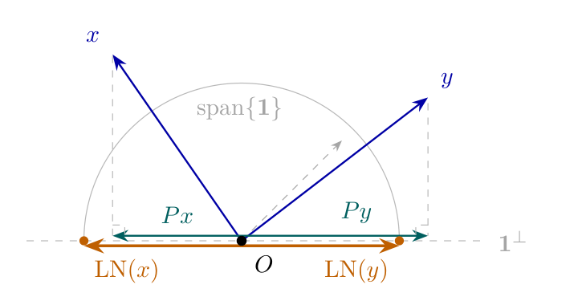

# Chapter 1: MDS geometry, layer normalisation, and residual connections

[Library index](../README.md) · [Source and transcription policy](../SOURCE.md) · [Previous pages: PDF 44–50](0044-0050-ch01-trainable-and-statistical-position.md) · [Next chapter: PDF 64–75](0064-0075-ch02-single-head-and-scores.md)

> **Editorial note.** This is the full English transcription of PDF pages 51–63 / printed pages 15–27. The opening continues the paragraph ending “embeds isometrically” on PDF 50; Remark 1.18 itself was already complete there. The source's mathematical statements, numerical table, algorithm, claims, and defects are retained. Editorial interpretation and counterexamples appear separately in the notes on [MDS](../notes/05-information-optimal-position-and-mds.md), [normalisation](../notes/06-layer-normalisation-and-rank.md), and [residual connections](../notes/07-residual-connections.md). Running headers and standalone page-number footers are omitted.

## PDF 51 · Book 15

> **Editorial boundary.** Continuation of §1.3.5 from [PDF 50](0044-0050-ch01-trainable-and-statistical-position.md#pdf-0050).

*into Euclidean space already*, namely as the points $\Phi(\mu_1),\ldots,\Phi(\mu_n)\in\mathbb R^{|\mathcal V|}$. The question is therefore not whether a Euclidean embedding exists, but in what minimum dimension and at what compression cost.

An *information-optimal* positional encoding would be one whose rows reproduce this metric: $\lVert p_i-p_j\rVert=d_H(\mu_i,\mu_j)$ for all $i,j$.

**When an exact isometry exists.** By Lemma 1.17, the Hellinger distances on $\{\mu_1,\ldots,\mu_n\}$ coincide with Euclidean distances between the points $\Phi(\mu_1),\ldots,\Phi(\mu_n)$. Classical Euclidean-distance-matrix theory (Torgerson, 1952; Schoenberg, 1935) characterises when such a finite set admits an exact isometric embedding into $\mathbb R^d$: an isometric embedding of $(\{1,\ldots,n\},d_H)$ into $(\mathbb R^d,\lVert\cdot\rVert)$ exists if and only if the doubly-centred Gram matrix $B$ with entries

$$
\begin{aligned}
B_{ij}=-\frac12\Bigl(&d_H(\mu_i,\mu_j)^2-\frac1n\sum_k d_H(\mu_k,\mu_j)^2\\
&-\frac1n\sum_k d_H(\mu_i,\mu_k)^2+\frac1{n^2}\sum_{k,\ell}d_H(\mu_k,\mu_\ell)^2\Bigr)
\end{aligned}
$$

satisfies $B\succeq0$ and $\operatorname{rank}(B)\le d$. Since $d_H$ is the Euclidean chord distance on the points $\Phi(\mu_i)\in\mathbb R^{|\mathcal V|}$, the matrix $B$ is automatically positive semidefinite, and $\operatorname{rank}(B)\le n-1$ (the centring projection removes one degree of freedom). An exact isometric embedding therefore exists in any dimension $d\ge\operatorname{rank}(B)$, and in particular always in $\mathbb R^{n-1}$.

**The compression problem and MDS.** The practical constraint is not curvature but *dimension*: positional encodings live in $\mathbb R^d$ with $d\ll n-1$ for typical Transformer dimensions ($d=768$ for BERT-base, sequence lengths $n$ that may reach several thousands). When $d<\operatorname{rank}(B)$, no isometric embedding exists in $\mathbb R^d$ and one must accept some distortion. The best Euclidean approximation in $\mathbb R^d$, in the Frobenius sense made precise below, is given by *classical multidimensional scaling* (MDS): convert the distance matrix into the doubly-centred Gram matrix $B$, extract the leading $d$ eigenvectors, and use them as coordinates. When $d\ge\operatorname{rank}(B)$, MDS recovers the distances exactly; when $d<\operatorname{rank}(B)$, MDS finds the closest low-rank Euclidean approximation, and the residual distortion is measured by the *stress* (defined below).

**Proposition 1.19 (Information-optimal PE via MDS; see (Cirrincione, 2026d)).** Let $D\in\mathbb R^{n\times n}$ be the matrix of *squared* Hellinger distances, $D_{ij}=d_H(\mu_i,\mu_j)^2$, let $H=I_n-\frac1n\mathbf1\mathbf1^\top$ be the $n\times n$ *centering matrix*, and let

$$
B=-\tfrac12HDH
$$

be the *doubly-centred Gram matrix*. Let $B=U\Lambda U^\top$ be the eigendecomposition of $B$ with eigenvalues $\lambda_1\ge\cdots\ge\lambda_n$, and write $\lambda_k^+:=\max(\lambda_k,0)$ for the positive part. Denote by $U_d\in\mathbb R^{n\times d}$ the matrix of the first $d$ eigenvectors and $\Lambda_d^+=\operatorname{diag}(\lambda_1^+,\ldots,\lambda_d^+)$. Then:

**(i)** The matrix $B$ is positive semidefinite (hence $\lambda_k\ge0$ for all $k$) if and only if there exists an exact isometric embedding of $(\{1,\ldots,n\},d_H)$ into some Euclidean space. In that case, $\operatorname{rank}(B)$ is the minimum dimension of any such embedding.

**(ii)** For every $d\ge1$, the matrix

$$
P_{\mathrm{MDS}}=U_d(\Lambda_d^+)^{1/2}\in\mathbb R^{n\times d}
$$

minimises $\lVert PP^\top-B\rVert_F^2$ over all $P\in\mathbb R^{n\times d}$.

## PDF 52 · Book 16

**(iii)** If $d\ge\operatorname{rank}(B)$ and $B\succeq0$, then $P_{\mathrm{MDS}}$ achieves zero stress: $\lVert p_i-p_j\rVert=d_H(\mu_i,\mu_j)$ for all $i\ne j$.

The *stress* of an encoding $P$ with respect to a corpus is defined as

$$
\operatorname{stress}(P)=
\frac{\displaystyle\sum_{i\ne j}\bigl(\lVert p_i-p_j\rVert-d_H(\mu_i,\mu_j)\bigr)^2}
{\displaystyle\sum_{i\ne j}d_H(\mu_i,\mu_j)^2}\ge0.
\tag{1.3}
$$

*Proof.* *(i)* Classical result (Torgerson, 1952): a symmetric $n\times n$ matrix $D$ of squared distances is realised by $n$ points in some Euclidean space if and only if the double-centred matrix $B=-\frac12HDH$ is positive semidefinite. In that case, the minimum embedding dimension equals $\operatorname{rank}(B)$, with the points given by rows of $U\Lambda^{1/2}$ (using all non-zero eigenvalues).

*(ii)* Any $P\in\mathbb R^{n\times d}$ satisfies $\operatorname{rank}(PP^\top)\le d$ and $PP^\top\succeq0$. The claim therefore reduces to the following: among symmetric PSD matrices $C\in\mathbb R^{n\times n}$ of rank at most $d$, the Frobenius-best approximation to $B$ is $C^*=U_d\Lambda_d^+U_d^\top$.

By the spectral theorem for real symmetric matrices, both $B$ and any candidate $C$ admit orthonormal eigendecompositions; let $\lambda_1\ge\cdots\ge\lambda_n$ denote the eigenvalues of $B$ in decreasing order, and $\mu_1\ge\cdots\ge\mu_n$ those of $C$ (also in decreasing order, with $\mu_k\ge0$ for all $k$ since $C$ is PSD, and $\mu_k=0$ for $k>d$ since $\operatorname{rank}(C)\le d$). The *Hoffman–Wielandt inequality* (Hoffman and Wielandt, 1953) for symmetric matrices states that

$$
\lVert B-C\rVert_F^2\ge\sum_{k=1}^n(\lambda_k-\mu_k)^2,
$$

with equality when $B$ and $C$ share the same orthonormal eigenbasis (with eigenvalues paired in the same decreasing order). The right-hand side is a sum over $n$ independent coordinates, minimised separately in each. The constraints on $\mu_k$ are: $\mu_k\ge0$ for all $k$, $\mu_k=0$ for $k>d$, and $\mu_1\ge\cdots\ge\mu_n$. Coordinate-wise minimisation under these constraints gives

$$
\mu_k^*=\begin{cases}
\max(\lambda_k,0)=\lambda_k^+&k\le d,\\
0&k>d,
\end{cases}
$$

since $\lambda_k^+$ is the closest non-negative value to $\lambda_k$, and the resulting sequence $\lambda_1^+\ge\cdots\ge\lambda_d^+\ge0\ge\cdots\ge0$ is decreasing as required. The minimum is attained when $C$ and $B$ share their eigenbasis, i.e. $C^*=U\operatorname{diag}(\mu_1^*,\ldots,\mu_n^*)U^\top=U_d\Lambda_d^+U_d^\top$. Setting $P_{\mathrm{MDS}}=U_d(\Lambda_d^+)^{1/2}$ gives $P_{\mathrm{MDS}}P_{\mathrm{MDS}}^\top=C^*$, which establishes the claim.

*(iii)* If $B\succeq0$ and $d\ge\operatorname{rank}(B)$, then $\lambda_k^+=\lambda_k$ for $k\le d$ and $\lambda_k=0$ for $k>\operatorname{rank}(B)$, so $P_{\mathrm{MDS}}P_{\mathrm{MDS}}^\top=B$ exactly. The squared distance $\lVert p_i-p_j\rVert^2=B_{ii}+B_{jj}-2B_{ij}$ then equals $D_{ij}$ by the definition of $B$ via double centring of a squared-distance matrix, giving $\lVert p_i-p_j\rVert=\sqrt{D_{ij}}=d_H(\mu_i,\mu_j)$.

Zero stress, as measured by (1.3), means perfect isometric reproduction of the positional metric; stress that is large compared to one (the value attained by an encoding whose pairwise distances are typically far from the target $d_H$) means the encoding is geometrically unrelated to the statistical structure of the corpus. The stress provides a corpus-dependent criterion for evaluating any positional encoding — sinusoidal, trainable, RoPE, or MDS — and comparing their geometric faithfulness to the data.

**Takeaway.** *Stress gives a data-driven yardstick for positional encodings. An encoding with low stress on a corpus is aligned with the statistical geometry of that corpus; an encoding*

## PDF 53 · Book 17

*with high stress is not, and its performance on downstream tasks depends on the model’s ability to reshape it during training. The MDS construction achieves minimum stress by construction — and in some regimes, with fewer parameters than a freely trainable encoding.*

**Remark 1.20 (Stress vs. the Frobenius optimum).** Proposition 1.19 (ii) states that $P_{\mathrm{MDS}}$ minimises $\lVert PP^\top-B\rVert_F^2$, not $\operatorname{stress}(P)$ directly. The two criteria differ in scaling: the Frobenius objective minimises squared errors on the Gram entries $B_{ij}$, whereas stress minimises squared errors on the distances $\sqrt{D_{ij}}$. For small perturbations of an exact isometry, the two coincide to leading order; for large perturbations they can diverge. In practice, the MDS solution is an excellent — typically near-optimal — minimiser of stress as well, and is used as such throughout the experimental literature. The distinction matters only for theoretical precision.

**Connection to the trainable encoding.** Conjecture 1.13 predicts that $P_{\mathrm{trainable}}^*$ has distinct rows; the MDS construction provides a sharper picture, conditional on the same training-dynamics regime. In a setting where the training loss approximates the statistical divergence between positions — for instance, the cross-entropy on a masked language modelling objective — the gradient flow on $P$ is heuristically equivalent to a weighted MDS on the Hellinger distances, with weights determined by the task. The learned $P^*$ is then expected to converge toward $P_{\mathrm{MDS}}$, distorted by the specific weighting imposed by the loss. The stress of $P_{\mathrm{trainable}}^*$ on a given corpus is therefore a measure of how well the task loss aligns with the statistical geometry of the data. This connection is *heuristic, not a theorem of this chapter*; it is consistent with the empirical evidence and is supported in the NTK regime by (Cirrincione, 2026d).

This connection will be verified experimentally in Chapter 18, where we measure the stress of the sinusoidal, trainable, and RoPE encodings on the SARS-CoV-2 and SST-2 corpora.

**Algorithm.** The construction of $P_{\mathrm{MDS}}$ from a corpus is summarised in Algorithm 1.

**Remark 1.21 (Computational cost).** The dominant cost is the eigendecomposition of $B\in\mathbb R^{n\times n}$, which requires $O(n^3)$ operations. For typical sequence lengths ($n\le512$ in BERT), this is negligible — a one-time preprocessing step on the corpus. The estimation of $\mu_i$ requires a single pass over the corpus. The algorithm is therefore practical for any corpus of moderate size. For very long sequences ($n\gg512$), one can replace the full eigendecomposition with a truncated SVD, computing only the top $d$ eigenvectors at cost $O(n^2d)$.

**A concrete example.** To make Proposition 1.19 tangible, consider a synthetic corpus with $n=32$ positions, vocabulary size $|\mathcal V|=200$, and embedding dimension $d=128$, constructed so that positional distributions vary non-trivially with position. Running Algorithm 1 on such a corpus produces a Gram matrix $B$ whose eigenvalues decay rapidly: the first two eigenvectors alone capture 79.9% of the total positional variance, and the top three capture 82.3%. The effective rank of $B$ is $31=n-1$, so exact isometric embedding is possible in $\mathbb R^{31}$ but not in lower dimension.

Table 1.1 compares the stress of $P_{\mathrm{MDS}}$ at several truncation ranks against the sinusoidal encoding on the same corpus. Two observations stand out. First, the MDS encoding at rank 3 — using 480 parameters under the low-rank factorisation $P=AB^\top$ with $A\in\mathbb R^{n\times3}$, $B\in\mathbb R^{d\times3}$ — achieves stress 0.047, while the sinusoidal encoding uses $d=128$ components but achieves stress 18.98. On this corpus the sinusoidal encoding is geometrically unfaithful to the statistical structure by more than two orders of magnitude. Second, the full-rank MDS encoding (rank 31) achieves zero stress — it is an exact isometry of the positional metric

## PDF 54 · Book 18

### Algorithm 1. Information-optimal positional encoding via MDS

**Require:** Corpus $\mathcal D$ of sequences of length $n$, embedding dimension $d$.

**Ensure:** Matrix $P_{\mathrm{MDS}}\in\mathbb R^{n\times d}$.

| Line | Algorithm text |
|---:|---|
| 1 | **Estimate positional distributions** |
| 2 | **for** $i=1$ **to** $n$ **do** |
| 3 | **for** $v\in\mathcal V$ **do** |
| 4 | $\mu_i(v)\leftarrow\#\{(t_1,\ldots,t_n)\in\mathcal D:t_i=v\}/\lvert\mathcal D\rvert$ |
| 5 | **end for** |
| 6 | **end for** |
| 7 | **Compute Hellinger distance matrix** |
| 8 | **for** $i=1$ **to** $n$ **do** |
| 9 | **for** $j=i$ **to** $n$ **do** |
| 10 | $D_{ij}\leftarrow\sum_{v\in\mathcal V}\bigl(\sqrt{\mu_i(v)}-\sqrt{\mu_j(v)}\bigr)^2$ |
| 11 | $D_{ji}\leftarrow D_{ij}$ |
| 12 | **end for** |
| 13 | **end for** |
| 14 | **Double-centre** |
| 15 | $H\leftarrow I_n-\frac1n\mathbf1\mathbf1^\top$; ▷ centering matrix |
| 16 | $B\leftarrow-\frac12HDH$ |
| 17 | **Eigendecomposition** |
| 18 | $(\lambda_1\ge\cdots\ge\lambda_n),\ U\leftarrow\operatorname{eig}(B)$ |
| 19 | **if** $\lambda_d<0$ **then** |
| 20 | **warn:** exact isometry impossible; set $\lambda_k\leftarrow\max(\lambda_k,0)$ |
| 21 | **end if** |
| 22 | **Extract coordinates** |
| 23 | $P_{\mathrm{MDS}}\leftarrow U_{:,1:d}\cdot\operatorname{diag}(\sqrt{\lambda_1},\ldots,\sqrt{\lambda_d})$ |
| 24 | **Compute stress** (optional diagnostic) |
| 25 | $\operatorname{stress}\leftarrow\bigl(\sum_{i\ne j}(\lVert p_i-p_j\rVert-\sqrt{D_{ij}})^2\bigr)/\bigl(\sum_{i\ne j}D_{ij}\bigr)$ |
| 26 | **return** $P_{\mathrm{MDS}},\operatorname{stress}$ |

> **Editorial formatting note.** Original line numbers and operations are retained; the nested loops on lines 3–5 are inside lines 2–6, and lines 9–12 are inside lines 8–13. The missing $d>n$ handling, stress-denominator condition, and warning criterion are discussed in the [MDS note](../notes/05-information-optimal-position-and-mds.md#implementation-boundaries), not silently repaired in this transcription.

## PDF 55 · Book 19

— and does so with fewer effective parameters than a freely trainable $P$, which requires $nd=4{,}096$ entries.

**Table 1.1: Rank–stress–parameter trade-off on a synthetic corpus ($n=32$, $|\mathcal V|=200$, $d=128$).**

| Encoding | Rank $r$ | Stress | Parameters | Saving vs free |
|---|---:|---:|---:|---:|
| Sinusoidal | $d=128$ | 18.98 | 0 (fixed) | — |
| $P_{\mathrm{MDS}},\ r=1$ | 1 | 0.281 | 160 | 96.1% |
| $P_{\mathrm{MDS}},\ r=2$ | 2 | 0.060 | 320 | 92.2% |
| $P_{\mathrm{MDS}},\ r=3$ | 3 | 0.047 | 480 | 88.3% |
| $P_{\mathrm{MDS}},\ r=7$ | 7 | 0.020 | 1,120 | 72.7% |
| $P_{\mathrm{MDS}}$ (full) | 31 | 0.000 | 4,960 | −21.1% |
| Free $P$ | $\le d$ | — | 4,096 | 0% |

> **Editorial source-fidelity note.** The original “Rank $r$” entry $d=128$, full-rank parameter count 4,960, and prose “fewer effective parameters” are retained. Their incompatibilities are explained in the [MDS note](../notes/05-information-optimal-position-and-mds.md#table-1-1-reading).

The lesson is not that the MDS encoding should replace the sinusoidal in all applications — the sinusoidal has other virtues, including the ability to extrapolate to unseen sequence lengths. The lesson is that the stress criterion, together with the MDS construction, gives us a *yardstick* against which any positional encoding can be measured. Encodings with low stress are geometrically aligned with the statistical structure of the data; encodings with high stress are not, and their performance on downstream tasks depends on the model’s ability to reshape them during training.

**Remark 1.22 (Relationship to the sinusoidal encoding).** The sinusoidal encoding PE of Definition 1.9 is a special case of a structured basis on $\{1,\ldots,n\}$ — specifically, the Fourier basis. The MDS encoding $P_{\mathrm{MDS}}$ is the data-driven basis that best approximates the statistical geometry of the corpus. The two coincide when the Hellinger distances between positional distributions are well approximated by the distances induced by the Fourier basis — a condition that holds approximately when the corpus is long, stationary in the sense that $\mu_i\approx\mu_{i+1}$, and the positional statistics vary smoothly. In that regime, the matrix $B$ is approximately circulant (entries depend only on $|i-j|$), its eigenvectors are approximately sinusoidal by the classical theory of circulant matrices, and $P_{\mathrm{MDS}}$ is approximately sinusoidal. This provides a theoretical justification for the sinusoidal encoding that Vaswani et al. did not offer: it is the information-optimal encoding for corpora whose positional statistics vary smoothly with position. Corpora with strongly non-uniform positional distributions — such as structured biological sequences or the synthetic corpus of Table 1.1 — are better served by the corpus-specific $P_{\mathrm{MDS}}$.

### 1.4 Layer Normalisation: Centering & Scaling

Training deep neural networks is made difficult by a phenomenon that is easy to describe and hard to cure: as gradients propagate backward through many layers, they tend either to vanish — becoming so small that early layers receive almost no learning signal — or to explode — growing so large that training becomes numerically unstable. This is not a flaw in the training algorithm; it is a consequence of the compositional structure of deep networks. Many layers of matrix multiplication, each with eigenvalues that differ from one, amplify or attenuate the gradient exponentially in the depth.

Residual connections (Section 1.6) address one aspect of this problem by creating additive shortcuts that allow gradients to bypass layers entirely. Layer normalisation (?) addresses a complementary aspect: it controls the scale of the activations at each layer, preventing them from drifting into regimes where gradients become poorly conditioned.

## PDF 56 · Book 20

The idea is straightforward. Before passing the hidden state matrix $X$ to an attention block or an MLP, normalise each row vector so that it has zero mean and unit variance across its $d$ coordinates. This operates on individual tokens — each row of $X$ is normalised independently of the others. The operation is nonlinear: dividing by the standard deviation is a nonlinear function of the input. But, as we will show in the next section, it is a nonlinearity of a very particular kind — one that preserves the rank of the matrix it acts on.

**Definition 1.23 (Layer normalisation).** Let $x\in\mathbb R^d$ be a row vector. Define its *coordinate mean* and *coordinate standard deviation* as

$$
\mu(x)=\frac1d\sum_{j=1}^d x_j,\qquad
\sigma(x)=\sqrt{\frac1d\sum_{j=1}^d(x_j-\mu(x))^2}.
$$

The *layer normalisation* of $x$ is

$$
\operatorname{LN}(x)=\frac{x-\mu(x)\mathbf1}{\sigma(x)},
$$

where $\mathbf1=(1,1,\ldots,1)\in\mathbb R^d$ is the all-ones vector, provided $\sigma(x)>0$.

Applied to a matrix $X\in\mathbb R^{n\times d}$ with rows $x_1,\ldots,x_n$, layer normalisation produces $\operatorname{LN}(X)\in\mathbb R^{n\times d}$ with rows $\operatorname{LN}(x_1),\ldots,\operatorname{LN}(x_n)$.

In practice, two additional parameters are introduced: a learnable scale $\gamma\in\mathbb R^d$ and shift $\beta\in\mathbb R^d$, giving $\operatorname{LN}_{\gamma,\beta}(x)=\gamma\odot\operatorname{LN}(x)+\beta$, where $\odot$ denotes elementwise multiplication. The structural analysis of this chapter concerns only the normalisation step; the parameters $\gamma$ and $\beta$ introduce a learnable affine correction on top of it and do not affect the rank-theoretic argument that follows.

**Remark 1.24 (Pre-norm versus post-norm).** The position of layer normalisation relative to the attention block and the MLP differs between implementations. The original BERT (Devlin et al., 2019a) uses *post-norm*: normalisation is applied *after* the residual addition, so $X^{(l)}=\operatorname{LN}(X^{(l-1)}+F^{(l)}(X^{(l-1)}))$. Modern implementations increasingly prefer *pre-norm*: normalisation is applied to the input before the attention or MLP computation, so $F^{(l)}$ receives $\operatorname{LN}(X^{(l-1)})$ rather than $X^{(l-1)}$ itself. Pre-norm produces cleaner gradient flow and is better behaved theoretically. We adopt pre-norm throughout this book. The Rank-Neutrality Theorem of the next section holds in both conventions.

It is worth pausing on the geometry of layer normalisation before proceeding to the theorem. Write $\mathbf1^\perp=\{v\in\mathbb R^d:\sum_{j=1}^d v_j=0\}$ for the hyperplane of zero-mean vectors, and let

$$
P=I-\frac1d\mathbf1\mathbf1^\top
$$

be the orthogonal projector onto $\mathbf1^\perp$. Then the centring step of LN is exactly

$$
x-\mu(x)\mathbf1=Px,
$$

and layer normalisation is

$$
\operatorname{LN}(x)=\frac{Px}{\lVert Px\rVert_2/\sqrt d}
=\frac{\sqrt d}{\lVert Px\rVert_2}Px.
$$

This is a radial projection onto the $(d-1)$-sphere of radius $\sqrt d$ within the hyperplane $\mathbf1^\perp$. The scalar factor $\sqrt d/\lVert Px\rVert_2$ is positive (whenever $\sigma(x)>0$, which is equivalent to $Px\ne0$)

## PDF 57 · Book 21

**Figure 1.3: Geometry of layer normalisation.** Blue: original vectors $x,y$. Teal: projections $Px,Py$ onto $\mathbf1^\perp$. Amber: normalised vectors $\operatorname{LN}(x),\operatorname{LN}(y)$ on the sphere of radius $\sqrt d$.

and depends on $x$ — it is what makes LN nonlinear. This representation is the key to the proof that follows.

Figure 1.3 illustrates the geometry. Two vectors $x$ and $y$ (blue) are projected onto $\mathbf1^\perp$ to give $Px$ and $Py$ (teal), then rescaled to the sphere (amber). The vector $x$ has a short projection ($\lVert Px\rVert<\sqrt d$), so $\operatorname{LN}(x)$ is scaled outward beyond $Px$; the vector $y$ has a long projection ($\lVert Py\rVert>\sqrt d$), so $\operatorname{LN}(y)$ is pulled inward. In both cases the two normalised vectors land on the same sphere. The crucial point is that the relative positions of $Px$ and $Py$ within $\mathbf1^\perp$ — and in particular their linear independence — are preserved by both steps: the projection $P$ is linear, and the rescaling changes only norms, not directions.

### 1.5 The Rank-Neutrality Theorem

The *rank* of a matrix $X\in\mathbb R^{n\times d}$ is the dimension of its row space: the number of linearly independent directions spanned by the embedded token vectors. It is a measure of *representational diversity* — of how much of $\mathbb R^d$ the sequence actually uses. A matrix of rank $r$ has its rows confined to an $r$-dimensional subspace, regardless of how many rows it has or how large $d$ is.

Why does this matter? In Chapter 2, we will construct the *score matrix* — a square $n\times n$ matrix whose $(i,j)$ entry measures how strongly token $i$ attends to token $j$. This matrix is a bilinear function of $X$: its rank is bounded above by the rank of $X$. If the token representations span only a low-dimensional subspace, the scores that determine what each token attends to are correspondingly constrained. The redundancy that Chapter 13 will quantify has one of its roots here, in the effective dimensionality of the representation. The rank of $X$ is therefore a quantity worth tracking across layers — and a quantity whose behaviour under each operation of the network should be understood.

Layer normalisation is applied before every attention block and every MLP. It is a nonlinear operation, and nonlinear operations do not generally preserve rank. The Rank-Neutrality Theorem says that layer normalisation is an exception. This is the first original result of the book.

**Theorem 1.25 (Rank-Neutrality Theorem).** Let $X\in\mathbb R^{n\times d}$ be a matrix with rows $x_1,\ldots,x_n\in\mathbb R^d$. Let $P=I-\frac1d\mathbf1\mathbf1^\top$ be the orthogonal projector onto $\mathbf1^\perp=\{v\in\mathbb R^d:\sum_jv_j=0\}$. Suppose the following non-degeneracy conditions hold:

**(H1)** $\sigma(x_i)>0$ for all $i=1,\ldots,n$ (no row is constant across all coordinates);

**(H2)** $\mathbf1\notin\operatorname{rowspace}(X)$ (the all-ones vector is not a linear combination of the rows of $X$).

## PDF 58 · Book 22

Then

$$
\operatorname{rank}(\operatorname{LN}(X))=\operatorname{rank}(X).
$$

*Proof.* By the geometric observation at the end of Section 1.4, we have

$$
\operatorname{LN}(x_i)=\lambda_iPx_i,\qquad
\lambda_i=\frac{\sqrt d}{\lVert Px_i\rVert_2}>0,
\tag{1.4}
$$

where positivity of $\lambda_i$ follows from hypothesis (H1). Let $\widetilde X$ denote the matrix with rows $\lambda_iPx_i$, so that $\operatorname{LN}(X)=\widetilde X$.

We prove the theorem in two steps:

$$
\operatorname{rowspace}(\operatorname{LN}(X))=P\operatorname{rowspace}(X)
\quad\text{and}\quad
\dim P\operatorname{rowspace}(X)=\operatorname{rank}(X).
$$

**Step 1.** By (1.4), the rows of $\operatorname{LN}(X)$ are $\lambda_iPx_i$. Since $\lambda_i>0$, scaling a vector by $\lambda_i$ does not change the subspace it spans:

$$
\operatorname{rowspace}(\operatorname{LN}(X))
=\operatorname{span}\{Px_1,\ldots,Px_n\}.
$$

Linearity of $P$ then gives $\operatorname{span}\{Px_1,\ldots,Px_n\}=P\operatorname{rowspace}(X)$.

**Step 2.** First, $\ker P=\operatorname{span}\{\mathbf1\}$: if $Pv=0$ then $(I-\frac1d\mathbf1\mathbf1^\top)v=0$, so $v=\frac1d(\mathbf1^\top v)\mathbf1$, a multiple of $\mathbf1$.

Let $r=\operatorname{rank}(X)$ and let $\{v_1,\ldots,v_r\}$ be a basis of $\operatorname{rowspace}(X)$. We claim that $\{Pv_1,\ldots,Pv_r\}$ is linearly independent; this gives $\dim P\operatorname{rowspace}(X)=r$.

Suppose, for contradiction, that $\sum_{k=1}^r\alpha_kPv_k=0$ for some $(\alpha_1,\ldots,\alpha_r)\ne0$. Then

$$
P\Bigl(\sum_{k=1}^r\alpha_kv_k\Bigr)=0,
$$

so $\sum_k\alpha_kv_k\in\ker P=\operatorname{span}\{\mathbf1\}$, i.e. $\sum_k\alpha_kv_k=c\,\mathbf1$ for some $c\in\mathbb R$.

If $c=0$, then $\sum_k\alpha_kv_k=0$, contradicting the linear independence of $\{v_k\}$ since $(\alpha_k)\ne0$. If $c\ne0$, then $\mathbf1=c^{-1}\sum_k\alpha_kv_k\in\operatorname{rowspace}(X)$, contradicting (H2). Either way, the assumed dependence fails.

Combining:

$$
\operatorname{rank}(\operatorname{LN}(X))
=\dim\operatorname{rowspace}(\operatorname{LN}(X))
=\dim P\operatorname{rowspace}(X)
=\operatorname{rank}(X).
\qquad\square
$$

The proof reveals something more than the theorem states. Layer normalisation does not merely preserve the *rank* of $X$ — it preserves a canonically related *subspace*. Every basis of $\operatorname{rowspace}(X)$ maps, under the linear part $P$ of LN, to a basis of $\operatorname{rowspace}(\operatorname{LN}(X))$. The nonlinear scaling factors $\lambda_i$ do not enter the argument: they cancel out because the row space is invariant under positive rescaling of individual rows.

**Corollary 1.26 (Rank stability across layers).** Let the Transformer use pre-norm layer normalisation. If hypotheses (H1) and (H2) hold for the hidden-state matrix $X^{(l)}$ at every layer $l$, then layer normalisation does not decrease rank at any layer:

$$
\operatorname{rank}(\operatorname{LN}(X^{(l)}))
=\operatorname{rank}(X^{(l)})\quad\text{for all }l=0,1,\ldots,L.
$$

## PDF 59 · Book 23

The rank of $X^{(l)}$ can change only through the learned linear transformations — the projection matrices of the attention mechanism and the weight matrices of the MLP (all defined in Chapter 2) — not through normalisation. In particular, when measuring the representational capacity of the network at a given layer (as in Chapter 13), the rank of $X^{(l)}$ and the rank of its normalised version $\operatorname{LN}(X^{(l)})$ can be used interchangeably.

**Remark 1.27 (On the non-degeneracy hypotheses).** Hypothesis (H1) requires that no row of $X$ is constant across all $d$ coordinates. A constant row $x_i=c\,\mathbf1$ satisfies $Px_i=0$ and $\sigma(x_i)=0$, making $\operatorname{LN}(x_i)$ undefined. In practice, the $\varepsilon$ in the denominator of Definition 1.23 prevents a division by zero, but the resulting normalised vector is numerically unreliable. Such a row contributes only the constant direction $\mathbf1$ to the row space of $X$, and that direction is precisely the one annihilated by the centering projection $P$, so its contribution to the rank is lost after normalisation. This is the only case in which LN decreases rank, and it is geometrically degenerate.

Hypothesis (H2) requires that $\mathbf1\notin\operatorname{rowspace}(X)$. This is equivalent to saying that the constant vector cannot be expressed as a linear combination of the rows of $X$. Since the rows of $X$ are embedded in $\mathbb R^d$ with $d\gg1$, and since the embedding initialisation is random, this condition holds with probability one at the start of training. Whether it is preserved throughout training depends on the specific trajectory, but empirical evidence (see the ablation studies in Chapter 18) suggests it is robustly maintained.

Both conditions are checkable at inference time: one computes $\sigma(x_i)$ for (H1), and for (H2) one tests whether $\mathbf1$ lies in the row space of $X$ by comparing the ranks

$$
\operatorname{rank}(X)\quad\text{and}\quad
\operatorname{rank}\begin{pmatrix}X\\\mathbf1^\top\end{pmatrix}.
$$

Hypothesis (H2) holds if and only if the second rank exceeds the first — equivalently, the linear system $X^\top\alpha=\mathbf1$ has no solution. In the experimental pipeline of Appendix C, this check is performed before every measurement of representational rank.

**Takeaway.** *Layer normalisation is not a bookkeeping device. Under mild non-degeneracy conditions, it preserves the rank of the hidden-state matrix exactly — and in fact preserves a canonically related row subspace. Any loss of representational dimension in a Transformer happens through the learned linear maps, not through normalisation.*

### 1.6 Residual Connections and the Cumulative Representation

A deep Transformer has many layers — twelve in $\mathrm{BERT}_{\mathrm{base}}$, twenty-four in $\mathrm{BERT}_{\mathrm{large}}$. Each layer applies a sequence of operations to the hidden state matrix: an attention block, a layer normalisation, an MLP, another layer normalisation. Without any additional mechanism, the composition of many such operations is numerically fragile: gradients vanish or explode as they propagate backward through the layers, and the network becomes effectively untrainable beyond a modest depth.

The solution, proposed by He et al. (2016) in the context of deep convolutional networks for image recognition, is to add to the output of each transformation the input it received — creating a *residual connection*, or *skip connection*. Instead of replacing the representation at each layer, the network learns only the *correction* to apply to it. The input passes through unchanged alongside the transformed version, and the two are added at the output.

This simple change has a profound algebraic consequence. The hidden state at layer $l$ is no longer the result of $l$ transformations applied sequentially to the initial representation

## PDF 60 · Book 24

— it is the initial representation plus the sum of all the corrections contributed by each layer. The depth of the network, rather than compressing information through a cascade of nonlinearities, *accumulates* it. Each layer is free to contribute whatever correction the data requires, and the initial representation is never destroyed.

This additive structure will play a central role in Part III, where we interpret the Transformer as a discrete dynamical system in the space of matrices. The trajectory of the hidden state matrix through the layers — the sequence $X^{(0)},X^{(1)},\ldots,X^{(L)}$ — will be studied as a flow driven by the gradient of the loss projected onto the antisymmetric sector of the score matrix. The linearity of the cumulative representation simplifies this analysis considerably: the space of trajectories is a linear space, and the tools of Lie algebra and motor formalism apply directly. For now, we record the definitions and a basic rank-theoretic observation.

**Definition 1.28 (Residual connection and cumulative representation).** Let $F^{(1)},\ldots,F^{(L)}$ denote the transformations learned at layers $l=1,\ldots,L$, each consisting of an attention block and an MLP (defined formally in Chapter 2). The *residual dynamics* are:

$$
X^{(l)}=X^{(l-1)}+\Delta^{(l)},\qquad
\Delta^{(l)}:=F^{(l)}\bigl(X^{(l-1)}\bigr),
$$

with initial condition $X^{(0)}=X_{\mathrm{pos}}=X_{\mathrm{emb}}^{(0)}+\mathrm{PE}$, the positionally augmented embedding matrix of Definition 1.9. The matrix $\Delta^{(l)}\in\mathbb R^{n\times d}$ is called the *residual update* at layer $l$.

By telescoping the recurrence, the hidden state at layer $l$ is:

$$
X^{(l)}=X^{(0)}+\sum_{l'=1}^l\Delta^{(l')}.
$$

This is the *cumulative representation*: the hidden state at any layer is the initial embedding plus the sum of all residual updates contributed by the preceding layers.

**Remark 1.29 (Dynamical interpretation — preview).** The cumulative representation $X^{(l)}=X^{(0)}+\sum_{l'=1}^l\Delta^{(l')}$ will be interpreted in Chapter 9 as the discrete trajectory of a dynamical system on the space $\mathbb R^{n\times d}$. The residual update $\Delta^{(l)}$ plays the role of a *velocity*: it is the displacement of the hidden state matrix at step $l$, driven by the gradient of the loss through the attention and MLP computations. The motor formalism of Part III characterises these displacements geometrically, showing that the antisymmetric component of the score matrix generates rotations in the embedding space — infinitesimal elements of the Lie algebra $\mathfrak{so}(d)$. The linearity of the cumulative representation — the fact that $X^{(l)}$ is a sum, not a composition — is what makes this geometric analysis tractable.

**Proposition 1.30 (Rank under residual updates).** For any two matrices $A,B\in\mathbb R^{n\times d}$:

$$
\bigl|\operatorname{rank}(A+B)-\operatorname{rank}(A)\bigr|
\le\operatorname{rank}(B).
$$

In particular, applying this to a residual update $X^{(l)}=X^{(l-1)}+\Delta^{(l)}$:

$$
\operatorname{rank}(X^{(l-1)})-\operatorname{rank}(\Delta^{(l)})
\le\operatorname{rank}(X^{(l)})
\le\operatorname{rank}(X^{(l-1)})+\operatorname{rank}(\Delta^{(l)}).
$$

The rank may increase, decrease, or remain constant under a residual update, depending on how the rows of $\Delta^{(l)}$ interact with those of $X^{(l-1)}$; the bound above controls the magnitude of the change but does not predict its sign. The maximum rank at any layer is $\min(n,d)$.

*Proof.* The inequality $\operatorname{rank}(A+B)\le\operatorname{rank}(A)+\operatorname{rank}(B)$ is the subadditivity of rank: every row of $A+B$ is the sum of a row of $A$ and a row of $B$, so the row space of $A+B$ is

## PDF 61 · Book 25

contained in $\operatorname{rowspace}(A)+\operatorname{rowspace}(B)$, whose dimension is at most $\operatorname{rank}(A)+\operatorname{rank}(B)$. Applying the same inequality to the decomposition $A=(A+B)+(-B)$ gives $\operatorname{rank}(A)\le\operatorname{rank}(A+B)+\operatorname{rank}(B)$, hence $\operatorname{rank}(A)-\operatorname{rank}(B)\le\operatorname{rank}(A+B)$. Combining both bounds gives $|\operatorname{rank}(A+B)-\operatorname{rank}(A)|\le\operatorname{rank}(B)$. $\square$

**Remark 1.31 (Rank is not monotone under residual updates).** The proposition controls the magnitude of the rank variation but does not establish monotonicity in either direction. A residual update can leave the rank unchanged or even decrease it, even when $\operatorname{rowspace}(\Delta^{(l)})\not\subseteq\operatorname{rowspace}(X^{(l-1)})$. For instance, with $A=\left(\begin{smallmatrix}1&0\\0&0\end{smallmatrix}\right)$ and $B=\left(\begin{smallmatrix}-1&0\\0&1\end{smallmatrix}\right)$, one has $\operatorname{rank}(A)=1$, $\operatorname{rank}(B)=2$, $\operatorname{rowspace}(B)=\mathbb R^2\not\subseteq\operatorname{rowspace}(A)$, yet

$$
A+B=\begin{pmatrix}0&0\\0&1\end{pmatrix},\qquad
\operatorname{rank}(A+B)=1=\operatorname{rank}(A).
$$

The cancellation between row 1 of $A$ and row 1 of $B$ destroys the contribution of row 1 to the row space of the sum, while the new direction introduced by row 2 of $B$ replaces it. The net rank is unchanged. The general identity $\operatorname{rowspace}(A+B)=\operatorname{rowspace}(A)+\operatorname{rowspace}(B)$ does not hold either: in this example, the right-hand side is $\mathbb R^2$ but the left is $\operatorname{span}\{(0,1)\}$.

The proposition says that residual connections control how much the rank can change in a single update — the variation is bounded by the rank of the correction — but they do not make the rank monotone. Combined with the Rank-Neutrality Theorem (Theorem 1.25), which guarantees that layer normalisation preserves rank exactly, this gives the following picture: the only operations in the network that can change the rank of the hidden state matrix are the residual updates and the learned linear transformations inside them (the attention projections and the MLP weights). Layer normalisation is rank-neutral; residual addition is rank-bounded but not rank-monotone. The rank of the hidden state matrix is therefore a meaningful, controlled measure of representational capacity. Chapter ?? will make this measurement precise.

### 1.7 Concluding Remarks

This chapter has built, from first principles, the mathematical object that the rest of the book will study. The reader who has followed the argument holds in hand a single matrix, $X\in\mathbb R^{n\times d}$, together with the structure that surrounds it. Chapter 2 will take this object and put it to work — constructing the score matrix, decomposing it, and beginning the analysis of what a single attention head can compute. Before that construction begins, we collect here the complete inventory of what this chapter delivers.

**Objects.** The vocabulary $\mathcal V$ with token index $\iota$ (Definition 1.1). The embedding map $E:\mathcal V\to\mathbb R^d$ and its matrix representation $W_E\in\mathbb R^{|\mathcal V|\times d}$ (Definition 1.2). The initial hidden state matrix $X^{(0)}\in\mathbb R^{n\times d}$ with the row convention fixed (Definition 1.5). The positional encoding matrix $\mathrm{PE}\in\mathbb R^{n\times d}$ and the augmented matrix $X_{\mathrm{pos}}=X^{(0)}+\mathrm{PE}$ (Definition 1.9). The layer normalisation map $\operatorname{LN}:\mathbb R^{n\times d}\to\mathbb R^{n\times d}$ and its geometric representation as a radial projection onto the sphere within $\mathbf1^\perp$ (Definition 1.23). The residual dynamics $X^{(l)}=X^{(0)}+\sum_{l'=1}^l\Delta^{(l')}$ (Definition 1.28).

**Results.** Four theorems and three propositions, of which four are original to this book.

*Theorem 1.8 (Necessity of positional encoding).* A Transformer without positional encoding is equivariant to permutations of the input sequence and cannot solve any task sensitive to order.

## PDF 62 · Book 26

*Proposition 1.10 (Block-rotation structure and separability).* The sinusoidal encoding has a block-rotation structure; its inner products depend only on relative position; its rows are all distinct under a mild condition on sequence length.

*Theorem 1.12 (Conditional positional separation)* and *Conjecture 1.13 (Positional separation under H1–H3).* If the gradient-matching identity fails at every collision $p_i=p_j$, then no minimiser of a coercive loss can contain a collision; this is rigorous (Lemma 1.11 and Theorem 1.12). The strong claim that hypotheses H1–H3 alone suffice to rule out collisions in a full Transformer is stated as Conjecture 1.13 and supported by the heuristic of Remark 1.14; a rigorous proof is announced in (Cirrincione, 2026d) for the NTK regime and remains open outside it.

*Proposition 1.19 (Information-optimal PE via MDS).* The positional encoding that minimises stress with respect to the Hellinger metric on positional distributions is given by classical multidimensional scaling. Algorithm 1 computes it from a corpus. The sinusoidal encoding is its special case when positional statistics vary smoothly.

*Theorem 1.25 (Rank-Neutrality Theorem).* Layer normalisation preserves the rank of the hidden state matrix under two generic non-degeneracy conditions.

*Corollary 1.26 (Rank stability across layers).* In a pre-norm Transformer, the rank of $X^{(l)}$ is invariant under layer normalisation at every layer.

*Proposition 1.30 (Rank under residual updates).* Residual connections control the magnitude of the rank variation per layer, bounded by the rank of the update; the rank itself is not monotone (Remark 1.31).

**Open problem.** The *monotonicity conjecture* (Remark 1.16): under a regularity condition on the positional statistics of the corpus, every minimiser $P^*$ of the loss satisfies $\lVert p_i^*-p_j^*\rVert\le\lVert p_i^*-p_k^*\rVert$ whenever $|i-j|\le|i-k|$. A proof would connect Conjecture 1.13 to the motor formalism of Part III.

**What Chapter 2 assumes.** The model dimension $d$ and sequence length $n$. The embedding map $E$ and the augmented matrix $X_{\mathrm{pos}}$, henceforth written $X$ when no confusion arises. The row convention. The rank of $X$ as a stable, well-defined quantity. The Rank-Neutrality Theorem — cited by name whenever layer normalisation appears in an argument.

**Bibliographic note.** The embedding of discrete symbols into continuous vector spaces was formalised in the distributional semantics tradition; Mikolov et al. (2013) gave the first practical large-scale implementation. The sinusoidal positional encoding is due to Vaswani et al. (2017), who state it without theoretical justification. The connection to the Fourier basis and the block-rotation structure (Proposition 1.10) are made explicit here for the first time in this form. The observation that the sinusoidal encoding is the information-optimal encoding for corpora with smooth positional statistics (Remark 1.22) is original to this book. The square-root map sending the simplex of distributions to the unit sphere, with Hellinger distance equal to the Euclidean chord distance between images, is due to Rao (1945); the classical multidimensional scaling construction is due to Torgerson (1952), with the underlying Euclidean-distance-matrix characterisation due to Schoenberg (1935). RoPE was introduced by Su et al. (2021). Layer normalisation is due to ?; its rank-preserving property (Theorem 1.25) is original to this book. Residual connections were introduced by He et al. (2016).

The Necessity Theorem (Theorem 1.8) and the conditional Positional Separation Theorem

> **Editorial page-boundary notice.** The source splits “Theorem” as “Theo-” / “rem” across printed pages 26–27. The word is joined above; the sentence continues below.

## PDF 63 · Book 27

(Theorem 1.12) are original results. The unconditional separation under (H1)–(H3) (Conjecture 1.13) and the monotonicity conjecture (Remark 1.16) are open.

> **Editorial boundary.** Chapter 1 ends here. [Chapter 2 begins on PDF 64 / printed page 28](0064-0075-ch02-single-head-and-scores.md#pdf-0064).
