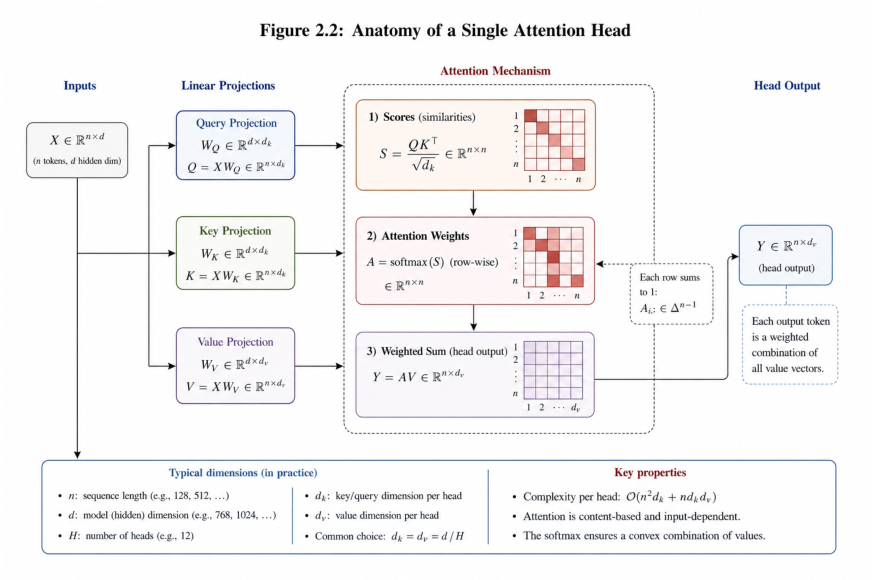
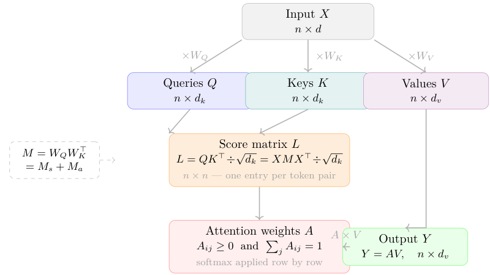
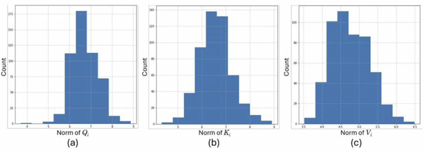

# Chapter 2: single-head attention, score functions and scaling

[Library index](../README.md) · [Source policy](../SOURCE.md) · [Previous pages](0051-0063-ch01-geometry-normalisation-and-residuals.md) · [Continuation](0076-0081-ch02-position-and-multihead.md)

> Editorial notice: Full English transcription of PDF 64–75 / printed pages 28–39. Mathematical statements, examples, tables, captions and unresolved references are retained as printed. Running headers are omitted. Original diagrams are cropped from the supplied PDF. Source assertions and inconsistencies are not silently corrected; see [the single-head note](../notes/08-single-head-bilinear-scores.md) and [the score/scaling note](../notes/09-score-families-and-scaling.md).

## PDF 64 · Book 28

### Chapter 2. The Self-Attention Mechanism

Chapter 1 ended with a single object: the matrix $X_{\mathrm{pos}}\in\mathbb R^{n\times d}$, whose $i$-th row carries the initial representation of the $i$-th token, augmented by positional information. Every row is a vector in $\mathbb R^d$; the geometry of that space is now available. But the rows do not yet know about each other. The representation of the word *bank* at position $i$ is the same whether the surrounding context speaks of rivers or of ledgers. The geometry is there; what is missing is the *interaction* that would let each token revise its representation in light of the others.

This is the problem that self-attention solves. Given a sequence of $n$ vectors arranged in the rows of $X_{\mathrm{pos}}$, a self-attention head produces a new matrix of the same shape in which each row is a weighted combination of all the others. The weights are not fixed in advance; they are computed from the content of the sequence itself. The question is how.

The mechanism rests on a single algebraic operation: the comparison, for every ordered pair of tokens $(i,j)$, of a *query* derived from token $i$ with a *key* derived from token $j$. High compatibility between the query of $i$ and the key of $j$ causes token $i$ to attend strongly to token $j$ — to let $j$'s information influence $i$'s updated representation. The comparison is a bilinear form; its matrix is $M=W_QW_K^\top\in\mathbb R^{d\times d}$, where $W_Q,W_K\in\mathbb R^{d\times d_k}$ are the learned query and key projection matrices and $d_k$ is the key dimension (all defined precisely in Section 2.1.1). Everything that follows in this book turns on the properties of $M$.

The matrix $M$ is the product of two independently learned matrices, $W_Q$ and $W_K$, and is therefore generically *asymmetric*: the score assigned to the pair $(i,j)$ is not the same as the score assigned to $(j,i)$. This asymmetry is not an artefact or a design flaw. It is the mechanism by which the attention head encodes directional relationships — grammatical dependency, causal order, referential structure — relationships that are, in language and in biology alike, inherently oriented.

Every square matrix decomposes uniquely into its symmetric and antisymmetric parts. Applied to $M$, this elementary fact separates two geometrically distinct functions: the symmetric part governs mutual affinity between tokens, while the antisymmetric part governs directional preference. The precise content of this separation — including the theorems that make it exact and computable — is the subject of Chapter 4. Here we introduce the mechanism, derive its algebraic structure, and identify the object that Chapter 4 will analyse.

The chapter proceeds in six sections. Section 2.1 introduces the single attention head and defines the score matrix $L$ and the attention output $Y$. Section 2.2 expands $L$ into four geometrically distinct contributions and identifies the role of positional encoding. Section 2.3 extends the construction to multiple parallel heads, introduces the output projection $W_O$, and defines the *canonical pair* $(M^{(h)},N^{(h)})$ that will drive the theory in Part II. Section 2.4

## PDF 65 · Book 29

describes the feed-forward block and the residual structure of the encoder, and states the Channel Destruction Proposition. Section 2.5 derives exact FLOP counts. Section 2.6 analyses the structure of $M$ directly.

The chapter has two missions running in parallel: an expository one, which introduces the mechanism in a form that the rest of the book will assume without reminder, and a structural one, which identifies the algebraic objects whose properties the remainder of the book analyses. Because the two missions share the same sections, we preface the technical development with a brief architectural declaration that separates them.

### Structure and levels of this chapter

A monograph is not a textbook. Every section of this chapter belongs to one of four levels, which correspond to distinct roles in the theoretical programme of this book.

**Level I — Fundamental objects.** The definitions and notation that every subsequent chapter assumes without reminder: the QKV projections, the score matrix $L$, the attention weight matrix $A$, the head output $Y$, the output projection $W_O$, the feed-forward block, and the encoder block with its residual stream. These objects have no original content; they are the language.

**Level II — Structural objects of the theory.** The objects whose algebraic properties constitute the new content of this book: the matrix $M=W_QW_K^\top$ and its rank-$d_k$ factorisation; the canonical pair $(M^{(h)},N^{(h)})$ where $N^{(h)}=W_V^{(h)}W_O^{(h)}$ is the dual of $M^{(h)}$; the four-term expansion of the score with positional encoding; the gauge group $\mathrm{GL}(d_k)$; and the first look at $M=M_s+M_a$. These objects define the vocabulary of Part II.

**Level III — Theoretical consequences.** Results that follow from the Level II objects and that the rest of the book will prove in full: the Toeplitz structure of the position–position term; the Channel Destruction Proposition; the rank bounds on the multi-head output; the directional capacity theorem (Chapter 4). These are stated here with proofs that are either complete or sketched; the full proofs appear in the indicated chapters.

**Level IV — Extensions and design principles.** Results that extend the core theory to specific architectures or design choices: the score function alternatives (Section 2.1.3); the dual temperature analysis; the Position-Gated Output Projection (Remark 2.19); the variants of the projection structure (Section 2.3.5). These results are applications of the framework, not foundations of it. The Hierarchical Kernel Transformer, as an architectural extension, is treated in the *For the Specialist* section at the end of this chapter.

This stratification is not a reading guide. It is an architectural declaration: the programme of this book is to prove that the Level II objects determine, with mathematical precision, the capabilities and the failures of the standard Transformer. Every chapter of Part II delivers one piece of that programme.

### 2.1 The Single Attention Head

Suppose we want token $i$ to gather information from the rest of the sequence in a data-dependent way. The most direct approach would be to compute, for each pair $(i,j)$, some

## PDF 66 · Book 30

measure of compatibility between the representation of $i$ and the representation of $j$, and to use those measures as weights in a weighted average of the other tokens' representations. This is the architecture of the attention head: the measure of compatibility becomes the score $L_{ij}$, and the weighted average of representations becomes the output.

The question is what form the compatibility measure should take. It must be computable from the representations alone, and it must be flexible enough to model the diverse types of relationships — syntactic, semantic, positional — that a trained model will need to encode. The choice made in the Transformer (Vaswani et al., 2017) is to use a bilinear form: each token $i$ is mapped to a query vector $q_i\in\mathbb R^{d_k}$ and each token $j$ to a key vector $k_j\in\mathbb R^{d_k}$, and their compatibility is their inner product $q_i\cdot k_j$. The parameters are the two linear maps that produce queries and keys from the hidden states.

### 2.1.1 The QKV projections

**Figure 2.1: Anatomy of a single attention head.**

*Input $X\in\mathbb R^{n\times d}$ is projected to $(Q,K,V)$ via the parameter matrices $(W_Q,W_K,W_V)$; the score matrix $S=QK^\top/\sqrt{d_k}$ is computed from $(Q,K)$; the row-wise softmax produces the attention matrix $A$; the head output $Y=AV$ is the convex combination of value vectors weighted by $A$. Per-head complexity is $O(n^2d_k+nd_kd_v)$ for the core attention; the QKV projections add $O(nd(2d_k+d_v))$ on top. (The internal heading “Figure 2.2” inside the artwork is a draft annotation; the figure is referenced as Figure 2.1 in this book.)*

**Definition 2.1 (Query, Key, Value projections).** Let $d_k$ and $d_v$ be positive integers. A single attention head is specified by three parameter matrices:

$$
W_Q\in\mathbb R^{d\times d_k},\qquad
W_K\in\mathbb R^{d\times d_k},\qquad
W_V\in\mathbb R^{d\times d_v}.
$$

Given the augmented hidden state matrix $X_{\mathrm{pos}}\in\mathbb R^{n\times d}$ (Definition 1.9 of Chapter 1), the

## PDF 67 · Book 31

*query*, *key*, and *value* matrices are:

$$
Q:=X_{\mathrm{pos}}W_Q\in\mathbb R^{n\times d_k},\qquad
K:=X_{\mathrm{pos}}W_K\in\mathbb R^{n\times d_k},\qquad
V:=X_{\mathrm{pos}}W_V\in\mathbb R^{n\times d_v}.
$$

Row $i$ of $Q$ is the query vector $q_i\in\mathbb R^{d_k}$ of token $i$; row $j$ of $K$ is the key vector $k_j\in\mathbb R^{d_k}$ of token $j$; row $j$ of $V$ is the value vector $v_j\in\mathbb R^{d_v}$ of token $j$.

The notation for row vectors deserves a word, since it is used consistently throughout this chapter and the rest of the book. The $i$-th row of $X^{(0)}$, denoted $x_i^{(0)}\in\mathbb R^d$, is the embedding $E(t_i)$ of the $i$-th input token (Definition 1.2 of Chapter 1); the $i$-th row of PE, denoted $p_i\in\mathbb R^d$, is the positional vector of position $i$; and the $i$-th row of $X_{\mathrm{pos}}$, written $x_i=x_i^{(0)}+p_i$ when the distinction is material, is the augmented token representation on which the head operates. Queries, keys, and values are the images of these rows under the respective linear maps: $q_i=x_iW_Q$, $k_j=x_jW_K$, $v_j=x_jW_V$ (all with $X_{\mathrm{pos}}$ understood).

**Remark 2.2 (Special cases: $W_Q=W_K$ and tied weights).** The general case $W_Q\ne W_K$ is not the only one encountered in practice. Several architectures impose structural constraints on the projection matrices; each has a precise algebraic consequence for $M$.

**Tied query and key ($W_Q=W_K=W$).** When the same matrix projects both queries and keys, $M=WW^\top$ is symmetric and positive semidefinite. Its antisymmetric part $M_a:=(M-M^\top)/2$ (Section 2.6) vanishes identically: $M_a=0$. The score matrix $L$ (Definition 2.4) satisfies $L_{ij}=x_i(WW^\top)x_j^\top/\sqrt{d_k}=L_{ji}$ for all token pairs: $L$ is a Gram matrix in the feature space $\mathbb R^{d_k}$, and is symmetric. Since the softmax is applied row-wise, the resulting attention weight matrix $A=\operatorname{softmax}(L)$ is in general *not* symmetric: each row $A_{i,:}$ is normalised by its own partition function $\sum_k\exp(L_{ik})$, and distinct rows of a symmetric $L$ have, in general, distinct partition functions. Concretely, the symmetric matrix

$$
L=\begin{pmatrix}0&1\\1&2\end{pmatrix}
$$

has $A_{12}=e/(1+e)\approx0.731$ and $A_{21}=1/(1+e)\approx0.269$, so $A_{12}\ne A_{21}$ even though $L_{12}=L_{21}$. What $M_a=0$ does enforce is the *pre-softmax* pairwise equality $L_{ij}=L_{ji}$; the *post-softmax* attention weights need not be equal, and the head can therefore still produce direction-dependent attention maps from a symmetric score. The point is that this directionality is generated entirely by the row-wise normalisation, not by the bilinear form, and it is structurally weaker than the directionality available when $M_a\ne0$ (which contributes both $L_{ij}\ne L_{ji}$ at the pre-softmax level and the corresponding post-softmax difference). Architecturally, $W_Q=W_K$ is the linear Mahalanobis metric of metric learning (Remark 2.31), and it saves $d\times d_k$ parameters per head at the cost of all pre-softmax directional capacity.

**Tied keys and values ($W_K=W_V$).** In this case $M=W_QW_K^\top$ is unchanged, but the value vectors coincide with the key vectors: $V=K$. The output of the head is a weighted average of the key representations themselves — the model uses the same vectors to determine attention weights and to carry information. This reduction, used in several efficient architectures including variants of DeepSeek's MLA (Liu et al., 2024), saves $d\times d_v$ parameters per head without altering the score structure.

**$Q=K$ at the representation level.** The condition $Q=K$ (equality of the projected matrices, not the weight matrices) requires $X(W_Q-W_K)=0$, which holds either when $W_Q=W_K$ or when $(W_Q-W_K)$ lies in the null space of $X^\top$. The second case is possible when $X$ is rank-deficient, and produces a symmetric score matrix $L=QQ^\top/\sqrt{d_k}$ even with $W_Q\ne W_K$. This is a pathological regime from the perspective of the theory: $M_a$ may be nonzero as a matrix, yet contribute nothing to the score on the given input.

The algebraic content of this last observation is developed in Chapter 4 under the name of the Directional Energy Theorem (Theorem C): the antisymmetric sector $M_a$ can be globally

## PDF 68 · Book 32

nonzero yet locally inert on a specific sequence, depending on the subspace spanned by the token representations. This is one of the reasons the sequence-dependence of the attention geometry is non-trivial.

**Summary.** The condition $W_Q\ne W_K$ is *necessary* for $M_a\ne0$, which is in turn necessary for any directional capacity. All symmetric special cases ($W_Q=W_K$, $W_Q=W_K^\top$ with square matrices) force $M_a=0$ and reduce to metric learning on the token space. The design implication — that architecturally tied weights should be used precisely for reciprocal heads and separate weights for directional heads — belongs to Chapter **??**.

> Editorial notice: The null-space statement, the transposed-weight “symmetric special case”, and the scope of “directional capacity” above are retained from the source; see [the mathematical qualifications](../notes/08-single-head-bilinear-scores.md#source-caveats). The unresolved “Chapter ??” is also present in the PDF.

The motivation for this choice — and the consequences of varying it — will be clear once the multi-head structure is assembled in Section 2.3.

The value projection $W_V$ plays a different role from $W_Q$ and $W_K$. Whereas $W_Q$ and $W_K$ determine *how much* token $i$ attends to token $j$, $W_V$ determines *what information* passes from $j$ to $i$ once the degree of attention has been fixed. This separation is fundamental: the attention weights are a routing mechanism, and the value projection is the payload. One consequence is that $W_V$ does not appear in the score matrix $M=W_QW_K^\top$ at all; its analysis belongs to a different part of the theory.

**Figure 2.2:** Single-head self-attention. Input $X\in\mathbb R^{n\times d}$ is projected to queries, keys, and values; the output through query, key, and value projections to the output $Y=AV$. The score matrix $L=XMX^\top/\sqrt{d_k}$ (amber) is the central object; $M=W_QW_K^\top$ decomposes as $M_s+M_a$ (dashed box).

### 2.1.2 The score matrix

The compatibility between token $i$ and token $j$ is the inner product of their query and key vectors:

$$
q_i\cdot k_j=q_i k_j^\top.
$$

Assembled over all pairs, this gives the $n\times n$ matrix $QK^\top$. Substituting the definitions $Q=X_{\mathrm{pos}}W_Q$ and $K=X_{\mathrm{pos}}W_K$:

$$
QK^\top=(X_{\mathrm{pos}}W_Q)(X_{\mathrm{pos}}W_K)^\top
=X_{\mathrm{pos}}W_QW_K^\top X_{\mathrm{pos}}^\top
=X_{\mathrm{pos}}M X_{\mathrm{pos}}^\top, \tag{2.1}
$$

where we define the *attention weight matrix*:

$$
M:=W_QW_K^\top\in\mathbb R^{d\times d}. \tag{2.2}
$$

## PDF 69 · Book 33

The matrix $M$ is not a parameter of the model in the direct sense: it is not stored or optimised. What are stored and optimised are $W_Q$ and $W_K$ separately. The matrix $M=W_QW_K^\top$ is a *derived* quantity — the product of the two rectangular factors — and its properties depend on how $W_Q$ and $W_K$ relate to each other. This dependence is the source of $M$'s geometric richness, as we will see in Section 2.6.

Raw inner products grow with dimension. The following derivation makes this precise and motivates the scaling factor $1/\sqrt{d_k}$.

**Proposition 2.3 (Variance of the raw inner product).** *Suppose the components of $q_i$ and $k_j$ are jointly independent, with each component having zero mean and unit variance (in particular, components of $q_i$ are independent of components of $k_j$). Then*

$$
\mathbb E[q_i\cdot k_j]=0,\qquad \operatorname{Var}(q_i\cdot k_j)=d_k.
$$

*Consequently, $q_i\cdot k_j$ has standard deviation $\sqrt{d_k}$, and the scaled product $(q_i\cdot k_j)/\sqrt{d_k}$ has unit variance.*

*Proof.* Write $q_i\cdot k_j=\sum_{\ell=1}^{d_k}(q_i)_\ell(k_j)_\ell$. By independence of $(q_i)_\ell$ and $(k_j)_\ell$, $\mathbb E[(q_i)_\ell(k_j)_\ell]=\mathbb E[(q_i)_\ell]\mathbb E[(k_j)_\ell]=0$, so each term has expectation zero. By independence again, $\operatorname{Var}((q_i)_\ell(k_j)_\ell)=\mathbb E[(q_i)_\ell^2]\mathbb E[(k_j)_\ell^2]=1$. Joint independence of all $2d_k$ component random variables gives $\operatorname{Var}(q_i\cdot k_j)=\sum_\ell\operatorname{Var}((q_i)_\ell(k_j)_\ell)=d_k$. $\square$

Without scaling, the variance of $q_i\cdot k_j$ grows linearly with $d_k$: for $d_k=64$ ($\mathrm{BERT}_{\mathrm{base}}$), the standard deviation is $8$. A softmax applied to logits of this magnitude saturates — it places nearly all probability mass on the largest entry and produces near-zero gradients everywhere else, making training unstable. Dividing by $\sqrt{d_k}$ restores unit variance and keeps the softmax in its informative regime (Vaswani et al., 2017).

**Definition 2.4 (Score matrix).** The *score matrix* (also called the *logit matrix*) is:

$$
L:=\frac1{\sqrt{d_k}}X_{\mathrm{pos}}M X_{\mathrm{pos}}^\top
\in\mathbb R^{n\times n}. \tag{2.3}
$$

Its $(i,j)$ entry $L_{ij}$ is the pre-softmax attention score from token $i$ to token $j$.

The score matrix $L$ is the central object of this book. Its algebraic structure — and, in particular, the way in which the structure of $M$ imprints itself on $L$ — determines every aspect of what the attention head can compute. Section 2.6 begins that analysis; it will continue through Chapters 4–10.

Before proceeding to the four-term expansion of $L$ and the multi-head architecture, we record a single elementary fact about $M$. It is the fact on which the entire structural analysis of the attention mechanism rests, and since it will be invoked at several points in the remainder of this chapter, we state it now in its purely algebraic form. Its geometric interpretation — what the two components of the decomposition *mean* for the attention mechanism — is developed in Section 2.6.3 at the end of this chapter, once the mechanism has been fully assembled.

**Fact 2.5 (Symmetric-antisymmetric decomposition of a square matrix).** Every matrix $M\in\mathbb R^{d\times d}$ decomposes uniquely as

$$
M=M_s+M_a,\qquad
M_s:=\frac{M+M^\top}{2},\qquad
M_a:=\frac{M-M^\top}{2},
$$

where $M_s=M_s^\top$ is symmetric and $M_a=-M_a^\top$ is antisymmetric (skew-symmetric). The decomposition is unique: $\{M_s,M_a\}$ are the only symmetric and antisymmetric matrices that sum to $M$.

## PDF 70 · Book 34

This is not a modelling choice. It is a universal fact of linear algebra, as natural as writing a function as the sum of its even and odd parts. What is a choice — and the central claim of this book — is that applied to the attention weight matrix $M=W_QW_K^\top$, the two parts have geometrically distinguishable roles. The precise content of that claim — the Reciprocity-Directionality Identity, the Cycle Circulation Theorem, and the Directional Energy Theorem — is the subject of Chapter 4. In the present chapter, we use only the algebraic decomposition itself: the notation $M=M_s+M_a$ will appear where the structure of $M$ is analysed (Section 2.6), where the four-term expansion of the score meets the positional encoding (Proposition 2.8), and where the multi-head output-projection algebra is developed (Section 2.3.3).

Figure 2.3 shows the empirical distributions of the norms $\lVert q_i\rVert,\lVert k_i\rVert,\lVert v_i\rVert$ for a representative head of $\mathrm{BERT}_{\mathrm{base}}$. The norms of $q_i$ and $k_i$ are substantially larger than those of the input $x_i^{(0)}$, reflecting the amplifying effect of $W_Q$ and $W_K$: their dominant singular values exceed one, so the projections stretch the representations before the inner product is taken. The scaling factor $1/\sqrt{d_k}$ compensates for this growth.

**Figure 2.3:** Row-vector norms $\lVert q_i\rVert_2,\lVert k_i\rVert_2,\lVert v_i\rVert_2$ ($q_i,k_i\in\mathbb R^{d_k}$, $v_i\in\mathbb R^{d_v}$) for head 4, layer 1 of $\mathrm{BERT}_{\mathrm{base}}$. Query and key norms exceed input norms (dominant singular values of $W_Q,W_K>1$); $1/\sqrt{d_k}$ compensates this amplification.

### 2.1.3 Score functions: alternatives and their algebraic structure

The scaled dot-product $s(q,k)=qk^\top/\sqrt{d_k}$ is the score function used throughout this book and in all standard Transformer architectures. It is not, however, the only possible choice. The literature contains a variety of score functions, each with different geometric properties, different computational costs, and different implications for the decomposition $M=M_s+M_a$ (where $M_s:=(M+M^\top)/2$ and $M_a:=(M-M^\top)/2$, defined in Section 2.6) that organises our analysis. This subsection surveys the principal alternatives and positions each within the algebraic framework we have established.

The central organising question is: does the score function admit a representation of the form $s(q_i,k_j)=x_iMx_j^\top$ for some fixed matrix $M\in\mathbb R^{d\times d}$? If it does, the entire theory of Chapters 4–10 applies directly. If it does not — because the score is nonlinear, or

## PDF 71 · Book 35

input-dependent — a different analysis is required.

Table 2.1 organises the principal score functions by family; the subsections below discuss the most theoretically significant cases.

$\phi:\mathbb R^{d_k}\to\mathbb R^m$ denotes a feature map; $R_\theta\in\mathbb R^{d_k\times d_k}$ a position-dependent rotation matrix; $G\in\mathbb R^{d_k\times d_k}$ a symmetric positive definite metric matrix; $W_a\in\mathbb R^{d_k\times d_k}$ a learned bilinear weight; $v\in\mathbb R^h$, $W_1,W_2\in\mathbb R^{h\times d_k}$ the parameters of the additive score; $b_r\in\mathbb R$ a learnable scalar bias at relative distance $r=j-i$. The column “$M_a=0$?” indicates whether the antisymmetric component of the effective score matrix vanishes, i.e. whether the head is incapable of directional computation by construction. †: applies to the bilinear part only; distance-based scores contain additional diagonal terms.

**Table 2.1: Principal score functions in the attention literature.**

| Family | Score $s(q_i,k_j)$ | $M$ factorisation | $M_a=0$? | Yr. |
|---|---|---|---|---|
| **Bilinear (dot-product family)** | | | | |
| Scaled dot-product | $q_i k_j^\top/\sqrt{d_k}$ | $W_QW_K^\top$ | No | 2017 |
| Tied QK ($W_Q=W_K$) | $q_i k_j^\top/\sqrt{d_k}$ | $WW^\top$ | **Yes** | — |
| Bilinear (general) | $q_iW_a k_j^\top$ | $W_QW_aW_K^\top$ | No | 2015 |
| Mahalanobis | $q_iGk_j^\top,\ G\succ0$ | $W_QGW_K^\top$ | No | — |
| **Distance-based** | | | | |
| Euclidean | $-\lVert q_i-k_j\rVert^2$ | bilinear part only | **Yes†** | 2014 |
| Cosine | $q_i k_j^\top/(\lVert q_i\rVert\lVert k_j\rVert)$ | input-dep. | No | — |
| **Additive** | | | | |
| Bahdanau | $v^\top\tanh(W_1q_i^\top+W_2k_j^\top)$ | none | n/a | 2015 |
| Location-based | $w^\top q_i$ | $M=0$ | **Yes** | 2015 |
| **Kernel / linear approx.** | | | | |
| Symmetric kernel | $\phi(q_i)\cdot\phi(k_j)$ | approx. (feat. sp.) | **Yes** | 2019 |
| Performer (ELU) | $\phi_{\mathrm{elu}}(q_i)\cdot\phi_{\mathrm{elu}}(k_j)$ | approx. | **Yes** | 2021 |
| **Position-relative / adaptive** | | | | |
| Rel. pos. bias | $q_i k_j^\top/\sqrt{d_k}+b_r,\ r=\lvert i-j\rvert$ | $W_QW_K^\top+\text{bias}$ | No | 2018 |
| ALiBi | $q_i k_j^\top/\sqrt{d_k}-m\lvert i-j\rvert$ | $W_QW_K^\top+\text{bias}$ | No | 2022 |
| RoPE | $(R_{\theta_i}q_i)\cdot(R_{\theta_j}k_j)^\top$ | pos.-dep. $M$ | No | 2021 |

† Bilinear part only; diagonal terms also present.

> Editorial notice: Table 2.1 is transcribed without correcting its symmetry classifications or its difference between the prose definition $r=j-i$ and the table's $r=\lvert i-j\rvert$. The later prose on PDF 72–73 qualifies several of these classifications. See [the score-family note](../notes/09-score-families-and-scaling.md#source-caveats).

**Bilinear scores and the $M_s+M_a$ framework.** All scores of the form $s(q_i,k_j)=q_iW_a k_j^\top$ with a fixed matrix $W_a$ are bilinear forms and admit the representation $s=x_iMx_j^\top$ with $M=W_QW_aW_K^\top$. The entire theory of Part II applies. When $W_a=I$, this reduces to the standard case; when $W_a$ is learned, it introduces $d_k^2$ additional parameters that effectively modify the metric in the latent space $\mathbb R^{d_k}$ — the connection to metric learning discussed in Remark 2.31. Note that $W_a$ can be decomposed as $W_a=W_a^s+W_a^a$ (symmetric + antisymmetric); the symmetric part enriches $M_s$ and the antisymmetric part enriches $M_a$, independently.

**Distance-based scores.** The score $s(q,k)=-\lVert q-k\rVert^2=2qk^\top-\lVert q\rVert^2-\lVert k\rVert^2$ can be written as a scaled dot-product plus diagonal corrections to $L$. Its bilinear part is $2qk^\top$, so $M_{\mathrm{bilinear}}=2W_QW_K^\top$ and the $M_s+M_a$ decomposition applies to that part. The diagonal

## PDF 72 · Book 36

**Table 2.2:** Score function families: admissibility of the $XMX^\top$ form and whether $M_a=0$ holds structurally. $q_i=x_iW_Q$, $k_j=x_jW_K\in\mathbb R^{d_k}$; $\phi:\mathbb R^{d_k}\to\mathbb R^m$ is a feature map; $W_a\in\mathbb R^{d_k\times d_k}$ is a learned weight. Orange cells: $M_a=0$ forced by construction, implying zero directional capacity.

| Family / score | Admits $XMX^\top$? | $M_a=0$ always? |
|---|---|---|
| **Bilinear**: $q_iW_a k_j^\top$ | Yes — $M=W_QW_aW_K^\top$ | No (generic $M_a\ne0$) |
| **Distance-based**: $-\lVert q_i-k_j\rVert^2$ | Partial (bilinear term only) | Yes — symmetric by construction |
| **Additive (Bahdanau)**: $v^\top\tanh(W_1q_i^\top+W_2k_j^\top)$ | No — nonlinear in $q,k$ | Not applicable |
| **Symmetric kernel**: $\phi(q_i)^\top\phi(k_j)$ | Approximate (feature space) | **Yes — always** |
| **Position-adaptive**: RoPE, ALiBi, T5 bias | $M$ depends on position | No — even with tied weights |

> Editorial notice: The highlighted claims are retained from the source. The immediately following text and the tied-RoPE proof on PDF 73 place conditions on them; they are not unconditional rules for independent query/key projections.

terms $\lVert q_i\rVert^2$ and $\lVert k_j\rVert^2$ modify the raw logit matrix by adding row-constant and column-constant terms respectively; the row-constant part vanishes under softmax (shift invariance), while the column-constant part acts as a key-specific temperature. Whether this score is symmetric in $(i,j)$ depends on the projection regime. *In the tied regime $W_Q=W_K=W$*, the bilinear part becomes $2WW^\top$, which is symmetric, so the bilinear contribution to $L$ satisfies $L_{ij}^{\mathrm{bil}}=L_{ji}^{\mathrm{bil}}$. *In the independent-projections regime $W_Q\ne W_K$*, the bilinear matrix $2W_QW_K^\top$ has, in general, a non-zero antisymmetric component, and the distance-based score is not symmetric in $(i,j)$ at the bilinear level.

The cosine score $s(q,k)=qk^\top/(\lVert q\rVert\lVert k\rVert)$ is input-dependent: it cannot be written as $x_iMx_j^\top$ for a fixed $M$, because the normalisation depends on $x_i$ and $x_j$. This breaks the bilinear structure and the $M_s+M_a$ analysis does not apply directly. Numerically, the cosine score is invariant to the scale of $Q$ and $K$ — a desirable property when norms vary widely across layers (as Figure 2.3 shows for BERT) — but it discards norm information that may carry semantic content.

**Additive scores and the non-bilinear case.** The Bahdanau score $s(q,k)=v^\top\tanh(W_1q^\top+W_2k^\top)$ is not a bilinear form: no fixed matrix $M$ satisfies $s(q_i,k_j)=q_iMk_j^\top$ for all inputs. The $M_s+M_a$ decomposition does not apply. In the linearised regime (when the argument of $\tanh$ is small), the score becomes approximately $v^\top W_1q^\top+v^\top W_2k^\top$, a sum of terms linear in $q$ and $k$ separately but with no cross-product — a different object altogether from $qk^\top$. The additive score was the dominant mechanism before Vaswani et al. (2017); its computational cost is $O(h\cdot d_k)$ per pair rather than $O(d_k)$, which explains the shift to dot-product attention at scale.

**Kernel scores in the tied-projections regime.** Scores of the form $s(q,k)=\phi(q)\cdot\phi(k)$, with a fixed feature map $\phi$, are symmetric in their two arguments: $s(q,k)=s(k,q)$. *In the tied-projections regime* $q_i=x_iW$ and $k_j=x_jW$, the score on the original tokens becomes $s(q_i,k_j)=\phi(x_iW)\cdot\phi(x_jW)$, which is symmetric in $(i,j)$, and the antisymmetric component $M_a$ of the corresponding effective bilinear form vanishes.

*This symmetry does not survive independent projections*: with $q_i=x_iW_Q$ and $k_j=x_jW_K$ and $W_Q\ne W_K$, the score $s(q_i,k_j)=\phi(x_iW_Q)\cdot\phi(x_jW_K)$ is generally not symmetric in $(i,j)$, because the two arguments of the kernel are produced by distinct linear maps. Symmetry of the kernel as a function of its two slots — $K(u,v)=K(v,u)$ — is therefore not enough to

## PDF 73 · Book 37

confer symmetry on the token-level score.

In the literature on efficient attention — including the Performer (Choromanski et al., 2021), random Fourier features, and polynomial-kernel approximations — this distinction is sometimes blurred. Architectures that use *tied* query-key projections together with a symmetric kernel commit to symmetric token-level scores and forego directional capacity at the bilinear level; this is a meaningful design choice. Architectures that use *independent* projections retain bilinear directional capacity even when the kernel is symmetric, but the convenient closed-form linearisations that motivate kernel attention often presuppose the tied regime. The criterion for whether a given variant sacrifices directional capacity is therefore the projection regime, not the kernel symmetry alone; Chapter 4 provides the theoretical formalisation.

**RoPE and position-dependent score matrices.** RoPE (Su et al., 2021) replaces the static projection by a position-dependent rotation: $q_i^{\mathrm{RoPE}}=q_iR_{\omega i}$, $k_j^{\mathrm{RoPE}}=k_jR_{\omega j}$, giving $s(q_i,k_j)=q_iR_{\omega(i-j)}k_j^\top$. The effective score matrix is $M_{ij}^{\mathrm{eff}}=W_QR_{\omega(i-j)}W_K^\top$, which depends on the relative position $i-j$. Two consequences follow.

First, $M_{ij}^{\mathrm{eff}}$ is a different matrix for each pair $(i,j)$: the theory of a single fixed $M$ does not apply directly, but a layer-by-layer generalisation does (and is developed in Chapter 4).

Second, with *independently learned* $W_Q$ and $W_K$, the effective matrix $M_{ij}^{\mathrm{eff}}=W_QR_{\omega(i-j)}W_K^\top$ is generally not symmetric: $M_{ji}^{\mathrm{eff}}=W_QR_{-\omega(i-j)}W_K^\top=W_QR_{\omega(i-j)}^\top W_K^\top$, which equals $(M_{ij}^{\mathrm{eff}})^\top$ only when an additional algebraic relation holds. The antisymmetric component

$$
M_a^{\mathrm{eff}}(i,j)=\frac12\left(
W_QR_{\omega(i-j)}W_K^\top
-W_KR_{\omega(i-j)}^\top W_Q^\top
\right)
$$

is generically non-zero for $i\ne j$, providing the algebraic mechanism by which RoPE confers directional capacity in standard MHA.

**Caveat.** *RoPE does not confer directional capacity in the tied-weight regime $W_Q=W_K=W$.* The score $L_{ij}=x_iWR_{\omega(i-j)}W^\top x_j^\top$ is a scalar; transposing,

$$
\begin{aligned}
L_{ji}
&=x_jWR_{\omega(j-i)}W^\top x_i^\top
=x_jWR_{\omega(i-j)}^\top W^\top x_i^\top\\
&=\left(x_iWR_{\omega(i-j)}W^\top x_j^\top\right)^\top
=L_{ij},
\end{aligned}
$$

*where the second step uses $R_\theta^{-1}=R_\theta^\top$ and $R_{-\theta}=R_\theta^\top$. So with tied $W$, RoPE produces a symmetric score matrix despite the position-dependent rotations. The directional capacity announced in this paragraph requires both the position-dependent rotation and independently parameterised $W_Q\ne W_K$. Architectures combining RoPE with tied projections (less common but not absent in the literature) have access to position-modulated affinities but no directional logit asymmetry.*

**Numerical comparison.** The key numerical distinction between score families is their behaviour under scaling of $Q$ and $K$. When the projection matrices develop large singular values during training (as seen in Figure 2.3 for deeper BERT layers), the dot-product score amplifies accordingly. For randomly generated $Q,K$ scaled by a factor of 5, the maximum logit magnitude grows from 2.7 to 67.5, pushing the softmax into saturation (entropy drops from 2.60 to 0.12, maximum weight rises from 0.45 to $\approx1$). The cosine score is invariant to this scaling by construction: its logit range and softmax entropy are unchanged. The asymmetry $\lVert L-L^\top\rVert_{\mathrm{avg}}$ is 0.99 for the dot-product (reflecting $M\ne M^\top$), 0.13 for cosine (input-dependent normalisation suppresses asymmetry), and identically zero for distance-based scores (symmetric by construction).

## PDF 74 · Book 38

### 2.1.4 Attention weights and head output

The score $L_{ij}$ is a real number, not a probability. To use it as a weight, we apply the softmax function row-wise.

**Definition 2.6 (Attention weight matrix and head output).** The *attention weight matrix* is:

$$
A:=\operatorname{softmax}(L)\in\mathbb R^{n\times n},
$$

where the softmax is applied independently to each row: $(A)_{i,:}=\operatorname{softmax}((L)_{i,:})$, so that $A_{ij}\ge0$ for all $i,j$ and $\sum_j A_{ij}=1$ for all $i$.

The *output of the single head* is:

$$
Y:=AV=\operatorname{softmax}(L)X_{\mathrm{pos}}W_V
\in\mathbb R^{n\times d_v}. \tag{2.4}
$$

Row $i$ of $Y$ is the updated representation of token $i$: a convex combination of all value vectors $\{v_j\}_{j=1}^n$, weighted by $A_{i,:}$.

The softmax has a well-known shift invariance: adding a constant $c$ to all entries of a row of $L$ leaves $A$ unchanged, since $\operatorname{softmax}(x+c\mathbf1)=\operatorname{softmax}(x)$. This will become relevant in Section 2.2 when we expand $L$ into four terms: any term that is constant along rows drops out of the attention weights.

**Remark 2.7 (Softmax as maximum-entropy solution and implicit temperature).** The softmax has a variational characterisation that clarifies its role in attention. Given a row of logits $\ell=(\ell_1,\ldots,\ell_n)\in\mathbb R^n$, define the Shannon entropy of a probability vector $p\in\Delta^{n-1}$ (where $\Delta^{n-1}:=\{p\in\mathbb R^n:p_j\ge0,\ \sum_jp_j=1\}$ is the probability simplex) as $H(p):=-\sum_jp_j\log p_j$. The softmax output $\operatorname{softmax}(\ell)$ is the unique solution to:

$$
\max_{p\in\Delta^{n-1}}\left[H(p)+p\cdot\ell\right].
$$

In words: among all distributions over $n$ positions, $A_{i,:}=\operatorname{softmax}(L_{i,:})$ is the one that maximises the sum of entropy and expected logit score. This gives attention weights a precise information-theoretic meaning: each row of $A$ is the least-committed distribution consistent with the preference ordering encoded in $L_{i,:}$.

The *temperature* $\tau>0$ of the generalised softmax $\operatorname{softmax}(L/\tau)$ scales all logits uniformly: as $\tau\to0$, the distribution concentrates on the argmax (hard attention); as $\tau\to\infty$, it converges to the uniform distribution $1/n$ (flat attention). The factor $1/\sqrt{d_k}$ in Definition 2.4 is therefore an implicit temperature: $L/\sqrt{d_k}=L/\tau$ with $\tau=\sqrt{d_k}$. Proposition 2.3 shows that this choice keeps the pre-softmax variance at 1, which places the softmax in its informative intermediate regime rather than at either extreme.

### 2.1.5 Scaling and normalisation of scores

The factor $1/\sqrt{d_k}$ is the only scaling used in the original Transformer, and it has become universal. Its justification, given in Proposition 2.3, is a second-moment argument: dividing by $\sqrt{d_k}$ restores unit variance when $q_i$ and $k_j$ have independent unit-variance components. This argument is necessary but not sufficient. Three structural gaps remain.

**Gap 1: variance stabilisation does not stabilise entropy.** The softmax is sensitive to the *maximum* of the row, not to its variance. By extreme value theory, for $n$ logits distributed as $\mathcal N(0,1)$, $\mathbb E[\max_j L_{ij}]\approx\sqrt{2\log n}$, which grows with $n$ regardless of $d_k$. Table 2.3 confirms this numerically: the entropy $H(A)$ of the attention distribution grows roughly as $\log n$, not as a constant, even after the $1/\sqrt{d_k}$ correction. The standard scaling stabilises the variance of individual logits, not the peakedness of the softmax output.

## PDF 75 · Book 39

**Table 2.3:** Expected maximum logit and softmax entropy as a function of sequence length $n$, for $Q,K\sim\mathcal N(0,I_{d_k})$, $d_k=64$, with the standard $1/\sqrt{d_k}$ scaling. The theoretical prediction $\sqrt{2\log n}$ tracks the empirical maximum; entropy grows with $n$, showing that standard scaling does not produce a sequence-length-invariant attention regime.

| $n$ | $\mathbb E[\max_j L_{ij}]$ | $\sqrt{2\log n}$ | $H(A)$ |
|---:|---:|---:|---:|
| 4 | 1.03 | 1.67 | 1.11 |
| 8 | 1.41 | 2.04 | 1.73 |
| 16 | 1.76 | 2.36 | 2.36 |
| 32 | 2.07 | 2.63 | 3.01 |
| 64 | 2.33 | 2.88 | 3.69 |
| 128 | 2.58 | 3.12 | 4.37 |

**Gap 2: the distribution of $q\cdot k$ is not Gaussian after training.** In a trained model, $q_i=x_iW_Q$ and $k_j=x_jW_K$ are not independent unit-variance Gaussians. Their inner products have a distribution shaped by the learned projections, the input statistics, and the task. The empirical norms $\lVert q_i\rVert$ and $\lVert k_j\rVert$ vary substantially across heads and layers (Figure 2.3): the $1/\sqrt{d_k}$ factor, fixed at initialisation, becomes increasingly miscalibrated as training progresses.

**Gap 3: the scaling treats $M_s$ and $M_a$ identically.** Since $L=L_s+L_a$ with $L_s=XM_sX^\top/\sqrt{d_k}$ and $L_a=XM_aX^\top/\sqrt{d_k}$, the standard scaling applies to both components uniformly. There is no reason, a priori, why the reciprocal affinity component and the directional component should operate at the same scale.

**Alternatives.** Table 2.4 summarises the principal alternatives proposed in the literature and one new proposal derived from the $M_s+M_a$ framework.

“Breaks bilinear?” indicates whether the strategy makes $s(q_i,k_j)$ depend on inputs other than $q_i$ and $k_j$ alone, breaking the $XMX^\top$ factorisation. Here $\tau_s,\tau_a>0$ are per-head learnable scalars controlling the reciprocal and directional components respectively (Equation (2.5)).

† Proposed here; not yet in the published literature.

**Table 2.4: Scaling and normalisation strategies for the score matrix $L=QK^\top/\sqrt{d_k}$.**

| Strategy | Score formula | Fixed? | Bilinear? | Ref. |
|---|---|---|---|---|
| Standard | $qk^\top/\sqrt{d_k}$ | Yes | Yes | Vaswani et al. (2017) |
| Learned $\tau$ | $qk^\top/\tau,\ \tau>0$ learned | No | Yes | Radford et al. (2021) |
| $\sigma$-reparam | $\sigma_Q\sigma_K\,qk^\top/\sqrt{d_k}$ | No | Yes | Zhai et al. (2023) |
| QK-Norm | $(q/\lVert q\rVert)(k/\lVert k\rVert)^\top/\tau$ | Yes | No (input-dep.) | ?Dehghani et al. (2023) |
| Sub-LN | $\operatorname{LN}(q)\operatorname{LN}(k)^\top/\sqrt{d_k}$ | Yes | No | ? |
| Scaled init | std. score; $W\sim\mathcal N(0,1/d_k)$ | Yes | Yes | ? |
| Dual temperature† | $xM_sx^\top/\tau_s+xM_ax^\top/\tau_a$ | No | Yes | This book |

> Editorial notice: The unresolved references, table wording and repeated $x$ in the dual-temperature row are preserved. The indexed pair formula appears as Equation (2.5) on PDF 76. “Fixed?” and the nearby wording “Breaks bilinear?” are also retained as printed.

**Learned temperature** replaces $\sqrt{d_k}$ with a learnable scalar $\tau>0$ per head, allowing the model to discover the appropriate scale. CLIP (Radford et al., 2021) uses a global learned temperature; the $\sigma$-reparametrisation of Zhai et al. (2023) achieves the same effect by factoring $W_Q=\sigma_Q\widetilde W_Q$ with $\lVert\widetilde W_Q\rVert_F=1$, giving effective temperature $\tau=\sqrt{d_k}/(\sigma_Q\sigma_K)$

> Editorial boundary: This sentence continues on [PDF 76 / printed page 40](0076-0081-ch02-position-and-multihead.md#pdf-0076). Section 2.1.5 is complete only when that continuation is included.
