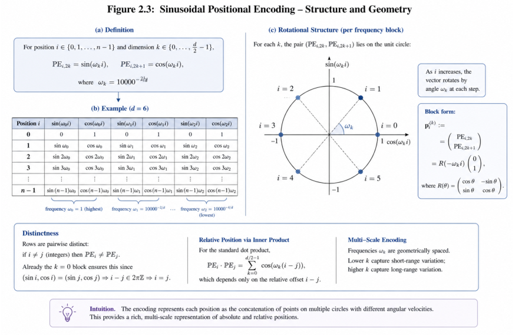
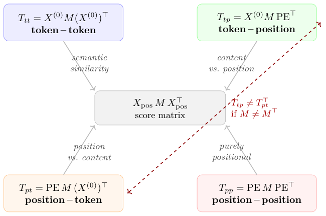
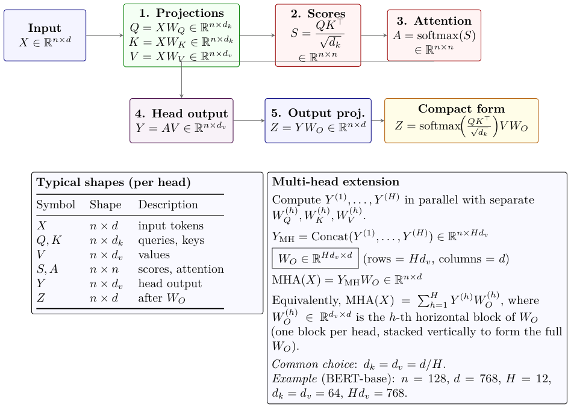

# Chapter 2: four-term positional expansion and multi-head introduction

[Library index](../README.md) · [Source policy](../SOURCE.md) · [Previous pages](0064-0075-ch02-single-head-and-scores.md) · [Continuation](0082-0092-ch02-output-projection-and-variants.md)

> Editorial notice: Full English transcription of PDF 76–81 / printed pages 40–45. This file begins with the continuation of the temperature paragraph on PDF 75. Formulas, captions, source assertions and source defects are preserved. For mathematical qualifications concerning projected annihilation, Toeplitz structure and biases, see [the four-term note](../notes/10-four-term-positional-expansion.md).

## PDF 76 · Book 40

per head. Both approaches cost two additional scalars per head — negligible — and improve training stability at scale.

**QK-Norm and Sub-LN** normalise $q$ and $k$ before the inner product, making the score invariant to their norms and addressing Gap 2. The cost is breaking the bilinear structure: the score depends on $\lVert q_i\rVert$ and $\lVert k_j\rVert$ and cannot be written as $x_iMx_j^\top$ for a fixed $M$. QK-Norm is used in ViT-22B (Dehghani et al., 2023) to stabilise training at $2.7\times10^9$ parameters.

**Dual temperature** is a new proposal following directly from Gap 3. Since $L=L_s+L_a$, one can write:

$$
L_{ij}^{\mathrm{dual}}
=\frac{x_iM_sx_j^\top}{\tau_s}
+\frac{x_iM_ax_j^\top}{\tau_a}, \tag{2.5}
$$

with $\tau_s,\tau_a>0$ learnable per-head scalars. The standard scaling is the special case $\tau_s=\tau_a=\sqrt{d_k}$.

The dual temperature has a precise semantic: $\tau_s$ controls the softness of reciprocal affinity, $\tau_a$ the softness of the directional component. As $\tau_a/\tau_s\to\infty$, the head approaches pure reciprocal behaviour; as $\tau_s/\tau_a\to\infty$, it approaches pure directional behaviour. The optimiser therefore has access to a soft interpolation between the two functional modes via two additional scalars per head. In the empirical data of Section 2.7, heads with asymmetry index $\alpha_h:=\lVert M_a\rVert_F/\lVert M\rVert_F\approx0.70$ (defined formally in Experiment 3, Section 2.7.3) have $\lVert M_a\rVert_F\approx0.70\lVert M\rVert_F$ and $\lVert M_s\rVert_F\approx0.71\lVert M\rVert_F$: scaling them uniformly is approximately correct on average, but the optimal $\tau_a/\tau_s$ for each individual head is unlikely to be exactly 1. evaluation of dual temperatures is an open problem; its theoretical motivation is clear and its cost is minimal.

> Editorial notice: The lowercase beginning “evaluation” is present in the source. The author explicitly identifies evaluation of dual temperatures as an open problem; the proposal is not a measured learning-speed result.

### 2.2 Positional Encoding in the Score: The Four-Term Expansion

The score matrix was defined as $L=X_{\mathrm{pos}}M X_{\mathrm{pos}}^\top/\sqrt{d_k}$, where $X_{\mathrm{pos}}=X^{(0)}+\mathrm{PE}$ (Definition 1.9 of Chapter 1). This sum carries a preview into the score that was already visible in Chapter 1: substituting $X_{\mathrm{pos}}$ into the bilinear form gives four terms, each with a different geometric meaning, and the first of them — the token–token contribution — is the permutation-equivariant component identified in Theorem 1.8. The three remaining terms are the mechanism by which positional encoding breaks that equivariance and injects positional structure into the attention score. In the present section we complete the analysis at the algebraic level: we identify which terms are structurally dominant, and we determine how the positional part of the score inherits its geometry from the sinusoidal encoding of Definition 1.9.

Expanding $X_{\mathrm{pos}}=X^{(0)}+\mathrm{PE}$:

$$
\begin{aligned}
X_{\mathrm{pos}}M X_{\mathrm{pos}}^\top
&=(X^{(0)}+\mathrm{PE})M(X^{(0)}+\mathrm{PE})^\top\\
&=\underbrace{X^{(0)}M(X^{(0)})^\top}_{T_{tt}}
+\underbrace{X^{(0)}M\mathrm{PE}^\top}_{T_{tp}}
+\underbrace{\mathrm{PE}M(X^{(0)})^\top}_{T_{pt}}
+\underbrace{\mathrm{PE}M\mathrm{PE}^\top}_{T_{pp}}.
\end{aligned} \tag{2.6}
$$

so that $L=(T_{tt}+T_{tp}+T_{pt}+T_{pp})/\sqrt{d_k}$.

Figure 2.5 illustrates the structure of this decomposition.

Each of the four terms has a distinct geometric identity.

## PDF 77 · Book 41

**Figure 2.4: Sinusoidal positional encoding: structure and geometry.**

*Panel (a) recalls the definition $\mathrm{PE}_{i,2k}=\sin(\omega_ki)$, $\mathrm{PE}_{i,2k+1}=\cos(\omega_ki)$ with $\omega_k=10000^{-2k/d}$. Panel (b) illustrates the values for small $d$. Panel (c) shows the rotational structure of each frequency block $(p_i)^{(k)}$: as the position $i$ varies, the 2D vector traces out points on the unit circle at angular spacing $\omega_k$. Lower frequencies (small $\omega_k$) capture long-range structure; the highest frequency $\omega_0=1$ ensures distinctness of integer positions (since $i\ne j\Rightarrow(\sin i,\cos i)\ne(\sin j,\cos j)$, as $i-j\in2\pi\mathbb Z$ is impossible for distinct integers). The standard inner product $p_i\cdot p_j=\sum_k\cos(\omega_k(i-j))$ depends only on the relative position $j-i$. The internal label “Figure 2.3” inside the artwork is a draft annotation.*

**Figure 2.5:** Four-term decomposition of the score matrix $L=X_{\mathrm{pos}}M X_{\mathrm{pos}}^\top=T_{tt}+T_{tp}+T_{pt}+T_{pp}$. The dashed arrow marks $T_{tp}\ne T_{pt}^\top$ when $M\ne M^\top$.

> Editorial notice: Figure 2.5 omits the $1/\sqrt{d_k}$ factor used in Definition 2.4 and treats nonzero antisymmetry of $M$ as sufficient for a nonzero cross-term difference. Both features are retained; [the note](../notes/10-four-term-positional-expansion.md#source-caveats) states the projected condition.

## PDF 78 · Book 42

**Token–token: $T_{tt}=X^{(0)}M(X^{(0)})^\top$.** The entry $(T_{tt})_{ij}=x_i^{(0)}M(x_j^{(0)})^\top$ measures the compatibility between the semantic content of token $i$ and the semantic content of token $j$, as mediated by the structure of $M$. This is the dominant term in practice: experiments on BERT (Section **??** of Chapter 3) show that $T_{tt}$ accounts for the bulk of the variance in $L$, a finding consistent with the intuition that attention is primarily a mechanism for relating meanings, not positions.

**Token–position: $T_{tp}=X^{(0)}M\mathrm{PE}^\top$.** The entry $(T_{tp})_{ij}=x_i^{(0)}Mp_j^\top$ measures how compatible the *content* of token $i$ is with the *position* $j$, filtered through $M$. This term allows the network to learn patterns of the form “token $i$ tends to attend to position $j$ if $i$'s semantic content is compatible with what position $j$ typically contains.” It is asymmetric: $(T_{tp})_{ij}\ne(T_{pt})_{ij}$ in general, because the two terms transpose the roles of content and position under a bilinear form that is itself not symmetric.

**Position–token: $T_{pt}=\mathrm{PE}M(X^{(0)})^\top$.** The entry $(T_{pt})_{ij}=p_iM(x_j^{(0)})^\top$ measures the compatibility of position $i$ with the content of token $j$. Together with $T_{tp}$, this term encodes the interaction between positional structure and semantic content. Note that $T_{pt}=T_{tp}^\top$ if and only if $M=M^\top$; in general, the two cross terms are independent. Their difference, $T_{tp}-T_{pt}^\top$, is a function solely of the antisymmetric part of $M$ — an observation we will formalise in Chapter 4.

**Position–position: $T_{pp}=\mathrm{PE}M\mathrm{PE}^\top$.** The entry $(T_{pp})_{ij}=p_iMp_j^\top$ depends only on the positions $i$ and $j$, not on the token identities. Whether it depends only on the relative position $j-i$ — the structural property that would make $T_{pp}$ Toeplitz — is a more delicate question, and the answer turns out to depend on the structure of $M$, not only on the structure of the encoding.

**Proposition 2.8 (Symmetry decomposition and Toeplitz structure of $T_{pp}$).** *Let PE be the sinusoidal encoding of Definition 1.9 (Chapter 1). Let $R_t\in\mathbb R^{d\times d}$ denote the block-diagonal rotation*

$$
R_t=\bigoplus_{k=0}^{d/2-1}
\begin{pmatrix}
\cos(\omega_k t)&-\sin(\omega_k t)\\
\sin(\omega_k t)&\cos(\omega_k t)
\end{pmatrix},
$$

*which acts on the sinusoidal encoding by translation: $p_{i+t}=p_iR_t$ (in the row-vector convention; this follows from the addition formulae for sin, cos together with the Vaswani convention of Definition 1.9). Let $M\in\mathbb R^{d\times d}$ with decomposition $M=M_s+M_a$. Then:*

*(i)* $(T_{pp}^s)_{ij}:=p_iM_sp_j^\top$ *is symmetric in $(i,j)$: $(T_{pp}^s)_{ij}=(T_{pp}^s)_{ji}$.*

*(ii)* $(T_{pp}^a)_{ij}:=p_iM_ap_j^\top$ *is antisymmetric in $(i,j)$: $(T_{pp}^a)_{ij}=-(T_{pp}^a)_{ji}$, and in particular $(T_{pp}^a)_{ii}=0$.*

*(iii)* $T_{pp}$ *is Toeplitz — i.e. $(T_{pp})_{ij}$ depends only on the relative position $j-i$ — if and only if $M$ commutes with the translation representation:*

$$
R_tMR_t^\top=M\qquad\text{for all }t\in\mathbb R.
$$

*The same condition applied to $M_s$ alone (resp. $M_a$ alone) is necessary and sufficient for $T_{pp}^s$ (resp. $T_{pp}^a$) to be Toeplitz.*

*Proof.* (i) Since $M_s=M_s^\top$, $p_iM_sp_j^\top=(p_iM_sp_j^\top)^\top=p_jM_s^\top p_i^\top=p_jM_sp_i^\top$ (the first step uses that the expression is a scalar, equal to its own transpose).

## PDF 79 · Book 43

(ii) Since $M_a^\top=-M_a$, the same calculation gives $p_iM_ap_j^\top=p_jM_a^\top p_i^\top=-p_jM_ap_i^\top$. The diagonal vanishes because $(T_{pp}^a)_{ii}=-(T_{pp}^a)_{ii}$.

(iii) Using $p_{i+t}=p_iR_t$ from the assumption,

$$
(T_{pp})_{i+t,j+t}=p_{i+t}Mp_{j+t}^\top
=p_iR_tMR_t^\top p_j^\top.
$$

$T_{pp}$ is Toeplitz if and only if $(T_{pp})_{i+t,j+t}=(T_{pp})_{ij}$ for all $i,j,t$, i.e. $p_i(R_tMR_t^\top-M)p_j^\top=0$ for all $i,j,t$. The set of vectors $\{p_i\}_{i\in\mathbb R}$ spans $\mathbb R^d$ (the rows of PE extended to all real positions parametrise a $d$-dimensional subgroup of $O(d)$ acting transitively on a generic orbit), so $R_tMR_t^\top=M$ for all $t$ is necessary and sufficient. The same argument applied to $M_s$ or $M_a$ alone gives the analogous condition for the symmetric/antisymmetric component. $\square$

> Editorial notice: The proof above explicitly extends positions to all real values. Its “if and only if” must not be applied without that global identity and spanning scope to one finite observed Toeplitz matrix. The subgroup-dimension description is also retained verbatim. See [the note](../notes/10-four-term-positional-expansion.md#source-caveats).

**Caveat.** *For a generic learned $M$, the commutation condition $R_tMR_t^\top=M$ does not hold, and $T_{pp}$ is not Toeplitz. The Toeplitz property of the standard positional kernel $p_i\cdot p_j=f(j-i)$ (Proposition 1.10) is precisely the case $M=I$: the identity commutes with every $R_t$. Architectures that enforce translation-equivariance of the positional component (RoPE being the canonical example) impose this commutation condition by construction; standard MHA does not.*

This provides a learnable positional bias that is modulated by the structure of $M$: the symmetric sector of $M$ contributes a position-only term that depends on distance $|i-j|$, while the antisymmetric sector contributes a directional term that distinguishes the direction $i\to j$ from $j\to i$. The antisymmetric contribution vanishes identically on the diagonal — $(T_{pp}^a)_{ii}=p_iM_ap_i^\top=0$ by antisymmetry of $M_a$ — while the symmetric contribution does not.

**Remark 2.9 (Practical consequences of Proposition 2.8).** Proposition 2.8 has three robust consequences that hold for any $M$, plus a fourth that is conditional on the commutation hypothesis. We separate them.

**1. Diagonal vanishing of the antisymmetric positional contribution.** By part (ii) of the proposition, $(T_{pp}^a)_{ii}=0$ for every $i$: the antisymmetric positional contribution is zero on the diagonal regardless of $M$. The symmetric contribution $(T_{pp}^s)_{ii}$ is generally non-zero. Heads with directional structure ($M_a\ne0$) therefore acquire pre-softmax positional asymmetries on off-diagonal pairs, while every diagonal entry $(T_{pp})_{ii}=(T_{pp}^s)_{ii}$ is purely symmetric.

**2. Token-special behaviour: [CLS] and [SEP].** The vectors $p_0$ and $p_{n-1}$ (positions of [CLS] and [SEP]) are PE vectors at the extremes of the positional range. By antisymmetry of $T_{pp}^a$,

$$
(T_{pp}^a)_{0,j}=p_0M_ap_j^\top
=-p_jM_ap_0^\top=-(T_{pp}^a)_{j,0},
$$

so [CLS] and every other position receive opposite directional biases from each other — a feature of the antisymmetric structure that holds for any $M_a$, with no commutation hypothesis. This is a partial algebraic explanation for the empirical finding of Clark et al. (2019a) that many BERT heads concentrate disproportionate attention on [CLS] and [SEP]: their PE vectors interact with $M_a$ to create asymmetric positional scores. The magnitude of the asymmetry depends on $M_a$ and on the inner products $p_0M_ap_j^\top$, and need not be a function of $j$ alone.

**3. What changes with RoPE or with no additive PE.** When $\mathrm{PE}=0$ (models using only RoPE or ALiBi), the terms $T_{pp}$, $T_{tp}$, and $T_{pt}$ all vanish. The only remaining term is $T_{tt}=X^{(0)}M(X^{(0)})^\top$. Positional information enters entirely through the score mechanism (RoPE: rotating $Q$ and $K$ before the inner product). In this case, $M_s$ and $M_a$ carry only semantic effects; the positional bias is handled separately. With RoPE, the effective score

## PDF 80 · Book 44

matrix $M_{ij}^{\mathrm{eff}}=W_QR_{\omega(i-j)}W_K^\top$ depends on the relative position $i-j$ by construction, so the analogue of part (iii) of Proposition 2.8 is built into the architecture rather than being a property of a learned $M$.

**4. Toeplitz structure is conditional, not automatic.** For a generic learned $M$, the position–position term $T_{pp}$ is not Toeplitz: it depends on $i$ and $j$ separately, not only on $j-i$. Toeplitz structure emerges only under the commutation hypothesis $R_tMR_t^\top=M$ of part (iii) — that is, when $M$ is invariant under the translation representation of the sinusoidal encoding. The standard positional kernel $p_i\cdot p_j=f(j-i)$ corresponds to $M=I$, the simplest case of this commutation. Architectures that wish to enforce relative-position-only biases at the score level must either constrain $M$ to commute with $R_t$ (a non-trivial parameter constraint), inject the relative-position dependence outside $M$ (RoPE, ALiBi, T5 relative-position bias), or both. Standard MHA does neither: any Toeplitz-like structure in $T_{pp}$ for a trained head is an empirical observation about the learned $M$, not a consequence of the encoding alone.

**Remark 2.10 (Bias terms and softmax invariance).** When the attention head includes additive bias vectors $b_Q\in\mathbb R^{d_k}$ and $b_K\in\mathbb R^{d_k}$, the product $QK^\top$ acquires three additional terms: $XW_Qb_K^\top\mathbf1^\top$, $\mathbf1b_Q^\top W_K^\top X^\top$, and $\mathbf1b_Q^\top b_K\mathbf1^\top$. The last term, $b_Q^\top b_K\cdot\mathbf1\mathbf1^\top$, is a constant matrix and vanishes under the softmax by shift invariance. The first two terms act row-wise and column-wise respectively; they can be absorbed into effective modifications of $X$ and $M$. In this book we work with the bias-free form (2.6) for clarity; all results extend to the biased case without conceptual change.

> Editorial notice: The mixed vector orientation and the blanket extension statement in Remark 2.10 are preserved. Under a consistent row-vector convention, both the row-constant term and the global constant disappear from row-wise softmax; the column bias generally remains. [Detailed qualification](../notes/10-four-term-positional-expansion.md#bias-terms).

### 2.3 Multi-Head Attention and the Canonical Pair $(M,N)$

A single attention head computes a single score matrix $L$ and a single output $Y\in\mathbb R^{n\times d_v}$. Its expressive power is limited: it can only attend to one “type” of relationship at a time — one particular bilinear form mediated by one particular $M$. The Transformer uses $H$ attention heads in parallel, each with its own parameters $W_Q^{(h)},W_K^{(h)},W_V^{(h)}$, and hence its own matrix $M^{(h)}$. The heads process the same input simultaneously and their outputs are combined. This is the *multi-head* architecture.

### 2.3.1 Parallel heads and their outputs

**Definition 2.11 (Multi-head attention).** Fix $H$ heads and dimensions $d_k,d_v$. For each $h\in\{1,\ldots,H\}$, let $W_Q^{(h)},W_K^{(h)}\in\mathbb R^{d\times d_k}$ and $W_V^{(h)}\in\mathbb R^{d\times d_v}$ be the projection matrices of head $h$. Define:

$$
\begin{aligned}
M^{(h)}&:=W_Q^{(h)}(W_K^{(h)})^\top\in\mathbb R^{d\times d},\\
L^{(h)}&:=\frac1{\sqrt{d_k}}X_{\mathrm{pos}}M^{(h)}X_{\mathrm{pos}}^\top\in\mathbb R^{n\times n},\\
A^{(h)}&:=\operatorname{softmax}(L^{(h)})\in\mathbb R^{n\times n},\\
Y^{(h)}&:=A^{(h)}X_{\mathrm{pos}}W_V^{(h)}\in\mathbb R^{n\times d_v}.
\end{aligned}
$$

The concatenated multi-head output is $Y_{\mathrm{MH}}:=\operatorname{Concat}(Y^{(1)},\ldots,Y^{(H)})\in\mathbb R^{n\times Hd_v}$.

In $\mathrm{BERT}_{\mathrm{base}}$, $H=12$, $d=768$, $d_k=d_v=64$, so $Hd_v=768=d$. The concatenation is a matrix of the same width as the model dimension, which makes the next step natural.

## PDF 81 · Book 45

**Figure 2.6:** Self-attention equations and matrix shapes. Top row: the single-head pipeline maps $X$ through projections to $(Q,K,V)$, computes scores $S=QK^\top/\sqrt{d_k}$, applies row-wise softmax to obtain attention weights $A$, takes the weighted sum $Y=AV$, and projects to $Z=YW_O$. Bottom right: the multi-head extension parallelises across $H$ heads and combines via concatenation followed by the output projection $W_O\in\mathbb R^{Hd_v\times d}$. Note the orientation of $W_O$: rows index the concatenated head dimension, columns index the model dimension; this is the convention used throughout the chapter.

> Editorial transcription of the artwork below: the formulas and shape table repeat the text inside Figure 2.6 for searchability.

**Input:** $X\in\mathbb R^{n\times d}$.

**1. Projections:** $Q=XW_Q\in\mathbb R^{n\times d_k}$; $K=XW_K\in\mathbb R^{n\times d_k}$; $V=XW_V\in\mathbb R^{n\times d_v}$.

**2. Scores:** $S=QK^\top/\sqrt{d_k}\in\mathbb R^{n\times n}$.

**3. Attention:** $A=\operatorname{softmax}(S)\in\mathbb R^{n\times n}$.

**4. Head output:** $Y=AV\in\mathbb R^{n\times d_v}$.

**5. Output proj.:** $Z=YW_O\in\mathbb R^{n\times d}$.

**Compact form:** $Z=\operatorname{softmax}(QK^\top/\sqrt{d_k})VW_O$.

**Typical shapes (per head)**

| Symbol | Shape | Description |
|---|---|---|
| $X$ | $n\times d$ | input tokens |
| $Q,K$ | $n\times d_k$ | queries, keys |
| $V$ | $n\times d_v$ | values |
| $S,A$ | $n\times n$ | scores, attention |
| $Y$ | $n\times d_v$ | head output |
| $Z$ | $n\times d$ | after $W_O$ |

**Multi-head extension**

Compute $Y^{(1)},\ldots,Y^{(H)}$ in parallel with separate $W_Q^{(h)},W_K^{(h)},W_V^{(h)}$.

$$
Y_{\mathrm{MH}}=\operatorname{Concat}(Y^{(1)},\ldots,Y^{(H)})\in\mathbb R^{n\times Hd_v}
$$

$$
W_O\in\mathbb R^{Hd_v\times d}\qquad
(\text{rows}=Hd_v,\ \text{columns}=d)
$$

$$
\operatorname{MHA}(X)=Y_{\mathrm{MH}}W_O\in\mathbb R^{n\times d}
$$

Equivalently, $\operatorname{MHA}(X)=\sum_{h=1}^{H}Y^{(h)}W_O^{(h)}$, where $W_O^{(h)}\in\mathbb R^{d_v\times d}$ is the $h$-th horizontal block of $W_O$ (one block per head, stacked vertically to form the full $W_O$).

*Common choice:* $d_k=d_v=d/H$.

*Example (BERT-base):* $n=128$, $d=768$, $H=12$, $d_k=d_v=64$, $Hd_v=768$.

> Editorial boundary: PDF 81 contains Figure 2.6 and its caption, with no unfinished sentence. The discussion of multi-head attention continues on [PDF 82](0082-0092-ch02-output-projection-and-variants.md#pdf-0082).
