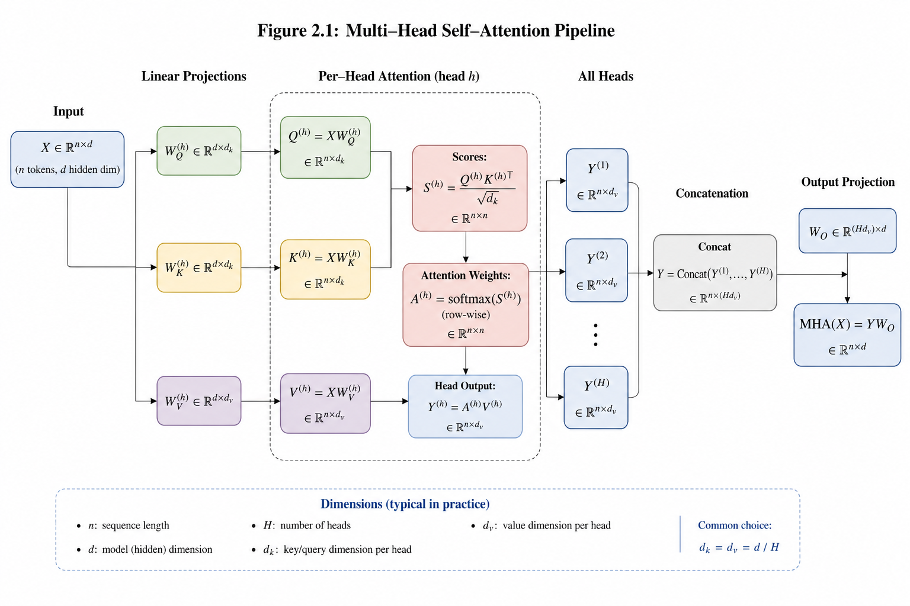
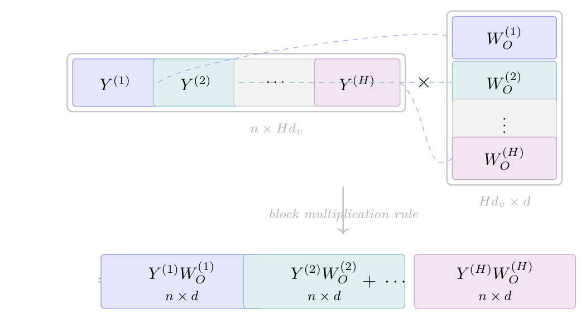
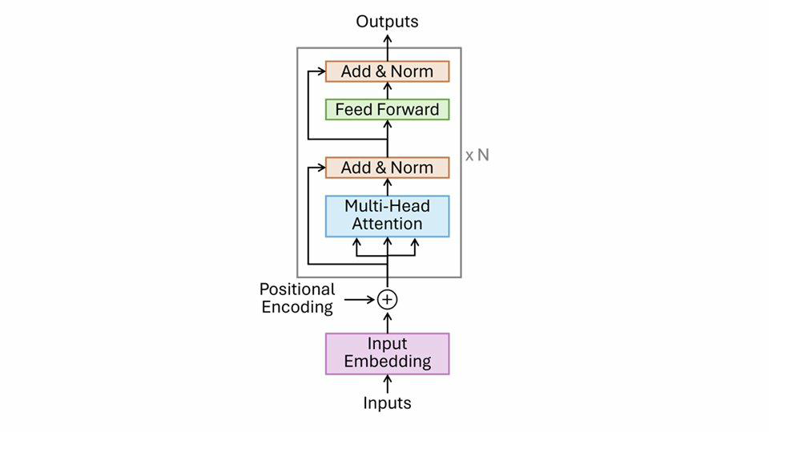
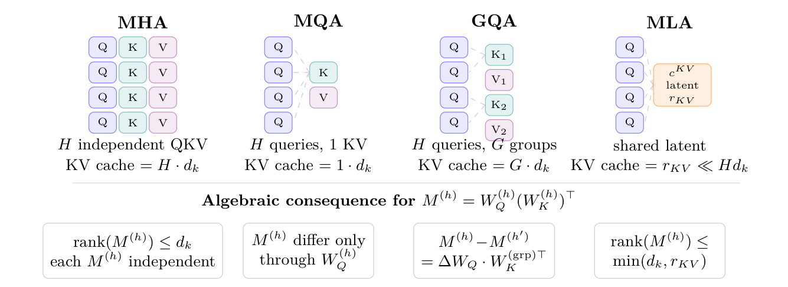

# Chapter 2: output projection, the canonical pair, and projection variants

[Library index](../README.md) · [Source and transcription policy](../SOURCE.md) · [Previous pages: PDF 76–81](0076-0081-ch02-position-and-multihead.md) · [Next pages: PDF 93–100](0093-0100-ch02-encoder-cost-and-matrix-structure.md)

> Editorial note: This file transcribes all source content on PDF pages 82–92 (printed pages 46–56), including the original figures and tables. Source claims, repeated equation definitions and unresolved references are retained. Mathematical and interpretive limitations are discussed separately in [the canonical-pair note](../notes/11-canonical-pair-and-output-projection.md) and [the projection-variants note](../notes/12-projection-variants.md). Remark 2.20 continues on PDF 93.

## PDF 82 · Book 46

**Figure 2.7:** Multi-head self-attention pipeline. The same input $X$ is processed in parallel by $H$ heads, each with its own parameters $(W_Q^{(h)},W_K^{(h)},W_V^{(h)})$ and producing its own output $Y^{(h)}\in\mathbb R^{n\times d_v}$.

*The $H$ outputs are concatenated along the feature axis to form $Y_{\mathrm{MH}}\in\mathbb R^{n\times Hd_v}$, then projected through the output matrix $W_O\in\mathbb R^{Hd_v\times d}$ to give the final $\mathrm{MHA}(X)\in\mathbb R^{n\times d}$. Equivalently (Equation (2.8)), the final output is the sum of per-head contributions $\sum_{h=1}^H Y^{(h)}W_O^{(h)}$ where $W_O^{(h)}$ is the $h$-th horizontal block of $W_O$. The internal label “Figure 2.1” inside the artwork is a draft annotation.*

## PDF 83 · Book 47

### 2.3.2 The output projection

The concatenated output $Y_{\mathrm{MH}}\in\mathbb R^{n\times Hd_v}$ must be mapped back to $\mathbb R^{n\times d}$ before it can enter the residual stream (Section 2.4). This is accomplished by the *output projection matrix* $W_O\in\mathbb R^{Hd_v\times d}$.

**Definition 2.12 (Multi-head attention output).** The output of the multi-head attention sub-layer is:

$$
\mathrm{MHA}(X_{\mathrm{pos}}):=Y_{\mathrm{MH}}W_O
=\operatorname{Concat}(Y^{(1)},\ldots,Y^{(H)})W_O\in\mathbb R^{n\times d}.
\tag{2.7}
$$

Writing $W_O$ in *horizontal blocks* $W_O^{(h)}\in\mathbb R^{d_v\times d}$ (one block per head, stacked vertically to form the full $W_O\in\mathbb R^{Hd_v\times d}$), the concatenation-times-projection becomes a sum:

$$
\mathrm{MHA}(X_{\mathrm{pos}})=\sum_{h=1}^H Y^{(h)}W_O^{(h)}.
\tag{2.8}
$$

Figure 2.8 shows why this factorisation holds. Partitioning $W_O$ into $H$ horizontal blocks $W_O^{(h)}\in\mathbb R^{d_v\times d}$ (one per head), the block-matrix product $\operatorname{Concat}(Y^{(1)},\ldots,Y^{(H)})\times W_O$ expands, by the standard block-multiplication rule, into the sum of $H$ terms, each of shape $n\times d$.

**Figure 2.8:** Concat-to-Sum factorisation. $W_O\in\mathbb R^{Hd_v\times d}$ is partitioned into $H$ row blocks $W_O^{(h)}\in\mathbb R^{d_v\times d}$ (colour-coded by head index $h$). The block-multiplication rule then yields $\operatorname{Concat}(Y^{(1)},\ldots,Y^{(H)})\times W_O=\sum_{h=1}^H Y^{(h)}W_O^{(h)}$. Dashed lines show that $Y^{(h)}$ multiplies only $W_O^{(h)}$.

This representation as a sum has an important consequence. The sum $\sum_h Y^{(h)}W_O^{(h)}$ is *invariant under any simultaneous permutation of the head indices*: relabelling heads and the corresponding output blocks produces the same matrix, because addition is commutative. The downstream MLP block (Section 2.4) and the next attention layer therefore see only the summed mixture, not the labelled tuple of head contributions; whether the head-specific information is recoverable in principle (it is, via $W_O^{-1}$ when $W_O$ is invertible) or used in practice by the downstream computation (it is not, because the next layer’s parameters are functions of the sum) are different questions that we return to in Section 2.4.3.

**Observation 2.13 (Rank bound on the multi-head output).** Each head output $Y^{(h)}W_O^{(h)}$ has rank at most $\min(n,d_k)$, since $Y^{(h)}\in\mathbb R^{n\times d_v}$ and $W_O^{(h)}\in\mathbb R^{d_v\times d}$ with $d_v=d_k$. By

## PDF 84 · Book 48

subadditivity of rank:

$$
\operatorname{rank}(\mathrm{MHA}(X_{\mathrm{pos}}))
\le\sum_{h=1}^H\operatorname{rank}(Y^{(h)}W_O^{(h)})
\le H\cdot\min(n,d_k).
$$

For $\mathrm{BERT}_{\mathrm{base}}$ with $H=12$, $d_k=64$: $\operatorname{rank}(\mathrm{MHA})\le\min(n,768)=\min(n,d)$. The bound is tight only if the $H$ head outputs span independent subspaces — which in practice they do not, due to the redundancy analysed in Chapter 13. Layer normalisation preserves rank under standard non-degeneracy hypotheses (Theorem 1.25, Chapter 1), but the residual update $X+\mathrm{MHA}(X)$ does not preserve rank monotonically: by the bilateral inequality $|\operatorname{rank}(A+B)-\operatorname{rank}(A)|\le\operatorname{rank}(B)$ (Proposition 1.30 of Chapter 1), the rank of $X+\mathrm{MHA}(X)$ may exceed, equal, or fall below that of $X$ depending on how the row spaces of $X$ and $\mathrm{MHA}(X)$ interact, with cancellations in the residual sum being the mechanism that can reduce rank. The bound on $\operatorname{rank}(\mathrm{MHA}(X))$ therefore controls the magnitude of the rank variation per layer but does not guarantee any specific bound on the rank of the post-residual hidden state.

**Remark 2.14 (Effective rank of $W_O$ as a layer-wise diagnostic).** In $\mathrm{BERT}_{\mathrm{base}}$, $W_O\in\mathbb R^{Hd_v\times d}=\mathbb R^{768\times768}$ is a square matrix. Its *effective rank* is

$$
r_{\mathrm{eff}}(W_O):=\exp(H(\sigma)),\qquad
H(\sigma):=-\sum_k\bar\sigma_k\log\bar\sigma_k,
$$

where $\bar\sigma_k:=\sigma_k/\sum_j\sigma_j$ are the normalised singular values. This quantity measures how many singular directions carry non-negligible weight: $r_{\mathrm{eff}}=1$ when $W_O$ is rank-one (a single dominant mode), and $r_{\mathrm{eff}}=d$ when all singular values are equal.

**Information bottleneck.** If $r_{\mathrm{eff}}(W_O)\ll d$, then even if the individual head outputs $Y^{(h)}$ span rich orthogonal subspaces, their sum $\mathrm{MHA}(X)=\sum_hY^{(h)}W_O^{(h)}$ lives in a subspace of dimension at most $r_{\mathrm{eff}}(W_O)$. The Channel Destruction Theorem (Chapter ??) makes this irreversible: no downstream layer can recover the individual contributions; $r_{\mathrm{eff}}$ quantifies how much of the combined content survives the mixing.

**Lower bound on prunable heads.** If $W_O$ uses only $r_{\mathrm{eff}}$ effective directions and each head contributes on at most $d_v$ of them, then at least $H-\lceil r_{\mathrm{eff}}(W_O^{(l)})/d_v\rceil$ heads are structurally redundant at layer $l$: their contributions lie in directions that $W_O$ discards regardless. For $\mathrm{BERT}_{\mathrm{base}}$ ($H=12$, $d_v=64$), a value $r_{\mathrm{eff}}\approx320$ would imply at least $12-\lceil320/64\rceil=7$ structurally prunable heads per layer, consistent with the empirical finding that 50–80% of heads are removable (Voita et al., 2019b; Michel et al., 2019b).

**Layer-wise profile and connection to $\alpha_h$.** Measuring $r_{\mathrm{eff}}(W_O^{(l)})$ across layers $l=1,\ldots,12$ yields a diagnostic profile of the model’s redundancy structure. The theoretical prediction is that $r_{\mathrm{eff}}(W_O^{(l)})$ is *negatively correlated* with the mean asymmetry index $\bar\alpha^{(l)}=H^{-1}\sum_h\alpha_h^{(l)}$: layers where heads are more directional (high $\bar\alpha$, dominant $M_a$) tend to have a more compressive $W_O$ (low $r_{\mathrm{eff}}$), because specialised heads contribute to fewer orthogonal directions.

**Numerical calibration.** For orientation: a random Gaussian $W_O\in\mathbb R^{768\times768}$ has $r_{\mathrm{eff}}\approx618$ ($\approx0.80d$, not $d$, because the Marchenko–Pastur distribution of singular values is not flat); a rank-64 matrix has $r_{\mathrm{eff}}\approx63$; and the identity gives $r_{\mathrm{eff}}=768$.

The formal unification of $r_{\mathrm{eff}}$, the asymmetry index $\alpha_h$, and the pruning bound $n_{\mathrm{prunable}}$ into a redundancy triptych belongs to Chapter 13.

> Editorial note: Effective rank is an entropy diagnostic, not a strict upper bound on algebraic rank or output-subspace dimension. The pruning guarantee and irrecoverability claims above do not follow from the displayed definition alone. See [the mathematical caveats](../notes/11-canonical-pair-and-output-projection.md#effective-rank).

## PDF 85 · Book 49

### 2.3.3 The algebra of $W_O$: gauge freedom, dual structure, and cross-layer composition

The output projection $W_O$ plays three distinct algebraic roles in the attention mechanism, each of which has a precise mathematical content. The preceding subsection treated it primarily as a source of the $r_{\mathrm{eff}}$ diagnostic; here we develop the complete picture.

#### Gauge freedom on the value–output pair

The gauge freedom of Remark 2.31 applies to the query–key pair $(W_Q,W_K)$ and is mediated by $\mathrm{GL}(d_k)$. An exactly analogous freedom exists on the value–output pair.

**Remark 2.15 (Gauge freedom of $(W_V^{(h)},W_O^{(h)})$).** For any invertible $G\in\mathrm{GL}(d_v)$, the transformation

$$
W_V^{(h)}\longmapsto W_V^{(h)}G^{-1},\qquad
W_O^{(h)}\longmapsto GW_O^{(h)}
$$

leaves the head output $Y^{(h)}W_O^{(h)}=XW_V^{(h)}W_O^{(h)}$ invariant. The $d_v^2$ degrees of freedom in $G$ are therefore pure gauge: they affect the factorisation but not the observable.

*Canonical parametrisation.* Writing $W_V^{(h)}=U_V\Sigma_VV_V^\top$ (SVD), the canonical choice $G=V_V^\top$ sets $W_{V,\mathrm{can}}^{(h)}=U_V\Sigma_V$ (orthonormal columns, up to scaling) and $W_{O,\mathrm{can}}^{(h)}=V_V^\top W_O^{(h)}$. In this parametrisation, $W_O^{(h)}$ carries the complete information about what is written to the residual stream by head $h$, irrespective of how $W_V^{(h)}$ is decomposed.

The two gauge groups $\mathrm{GL}(d_k)$ and $\mathrm{GL}(d_v)$ act independently: the first on the score computation (who attends to whom), the second on the value–output path (what gets written). Together they generate the full gauge group of a single attention head, $\mathrm{GL}(d_k)\times\mathrm{GL}(d_v)$, which has dimension $d_k^2+d_v^2=2\cdot64^2=8{,}192$ for $\mathrm{BERT}_{\mathrm{base}}$.

> Editorial note: The displayed head-output equality in Remark 2.15 omits the attention factor $A^{(h)}$. With the earlier definition of $Y^{(h)}$, the full contribution is $A^{(h)}XW_V^{(h)}W_O^{(h)}$. The stated gauge transformation still preserves it.

#### The canonical pair: dual matrix $N^{(h)}=W_V^{(h)}W_O^{(h)}$

**Definition 2.16 (The canonical reading/writing pair).** For each head $h$ at each layer $l$, define:

$$
M^{(h)}:=W_Q^{(h)}(W_K^{(h)})^\top\in\mathbb R^{d\times d},\tag{2.9}
$$

$$
N^{(h)}:=W_V^{(h)}W_O^{(h)}\in\mathbb R^{d\times d}.\tag{2.10}
$$

The matrix $M^{(h)}$ governs *reading*: it determines which token pairs receive high attention scores. The matrix $N^{(h)}$ governs *writing*: it determines what information each attended token contributes to the residual stream. Together, $(M^{(h)},N^{(h)})$ is the *canonical pair* of head $h$ — the minimal algebraic description of what the head reads and what it writes. Both $M^{(h)}$ and $N^{(h)}$ are $d\times d$ matrices of rank at most $d_k$ and $d_v$ respectively, both carry gauge freedom, and both admit a symmetric-antisymmetric decomposition $M^{(h)}=M_s^{(h)}+M_a^{(h)}$ and $N^{(h)}=N_s^{(h)}+N_a^{(h)}$ with complementary geometric roles. The theory of Part II is organised around this pair.

Eliminating the gauge freedom reveals the two invariant objects of an attention head:

$$
M^{(h)}:=W_Q^{(h)}(W_K^{(h)})^\top\in\mathbb R^{d\times d},\tag{2.11}
$$

$$
N^{(h)}:=W_V^{(h)}W_O^{(h)}\in\mathbb R^{d\times d}.\tag{2.12}
$$

The matrix $M^{(h)}$ encodes which tokens are attended to; the matrix $N^{(h)}$ encodes what is written to the residual stream once the attention weights are fixed. Precisely: for input

## PDF 86 · Book 50

$X\in\mathbb R^{n\times d}$, the contribution of head $h$ to token $i$ is

$$
\bigl[Y^{(h)}W_O^{(h)}\bigr]_i
=\sum_{j=1}^n A_{ij}^{(h)}x_jN^{(h)},\tag{2.13}
$$

where $A_{ij}^{(h)}=\operatorname{softmax}(x_iM^{(h)}x_j^\top/\sqrt{d_k})_j$ are the attention weights. The pair $(M^{(h)},N^{(h)})$ provides a complete, gauge-invariant description of the head.

Both $M^{(h)}$ and $N^{(h)}$ are $d\times d$ matrices that are generically non-symmetric. The algebraic decomposition of Fact 2.5 therefore applies to each:

**Observation 2.17 (Decomposition and rank bounds of the canonical pair).** Every head carries two canonical decompositions:

$$
M^{(h)}=M_s^{(h)}+M_a^{(h)},\qquad
N^{(h)}=N_s^{(h)}+N_a^{(h)},
$$

with $M_s,N_s$ symmetric and $M_a,N_a$ antisymmetric. The decomposition of $M^{(h)}$ is the one whose geometric interpretation is developed throughout Part II, beginning with Chapter 4. The decomposition of $N^{(h)}$ is algebraically parallel but semantically distinct: it splits the *write map* into a symmetric and an antisymmetric sector, whose roles in the information flow of the encoder are addressed in Part II in their proper context. Here we record only the accompanying structural fact: the rank bound $\operatorname{rank}(N^{(h)})\le d_v$ implies that $N^{(h)}$ can write into at most $d_v=64$ directions of $\mathbb R^d$; the remaining $d-d_v=704$ directions of the residual stream are invisible to head $h$ from the write side.

#### Cross-layer composition and attention paths

The residual stream after layer $l$ is $X^{(l+1)}=X^{(l)}+\sum_hY^{(h,l)}W_O^{(h,l)}+\mathrm{FFN}^{(l)}(X^{(l)})$. When head $h'$ at layer $l+1$ forms its query, it reads from $X^{(l+1)}$, and therefore the writing of head $h$ at layer $l$ propagates forward:

$$
\bigl[Y^{(h,l)}W_O^{(h,l)}\bigr]W_Q^{(h',l+1)}
=A^{(h,l)}X^{(l)}N^{(h,l)}W_Q^{(h',l+1)}.
$$

The matrix

$$
C^{h\to h'}:=W_O^{(h,l)}W_Q^{(h',l+1)}\in\mathbb R^{d_v\times d_k}\tag{2.14}
$$

is the *attention composition matrix* from head $h$ at layer $l$ to head $h'$ at layer $l+1$. Its Frobenius norm $\lVert C^{h\to h'}\rVert_F$ measures how strongly head $h$’s writing influences head $h'$’s routing. If $\lVert C^{h\to h'}\rVert_F\approx0$, the two heads are effectively decoupled across layers; if $\lVert C^{h\to h'}\rVert_F$ is large, head $h$ is directly steering head $h'$’s attention pattern — the mechanism underlying induction heads (?).

The *virtual attention matrix* of the composed circuit is:

$$
M^{h'\leftarrow h}:=N^{(h,l)}M^{(h',l+1)}
=W_V^{(h,l)}C^{h\to h'}(W_K^{(h',l+1)})^\top\in\mathbb R^{d\times d}.\tag{2.15}
$$

Expanding the symmetric–antisymmetric decompositions of both factors gives an algebraic four-term split:

$$
M^{h'\leftarrow h}
=N_s^{(h)}M_s^{(h')}+N_s^{(h)}M_a^{(h')}
+N_a^{(h)}M_s^{(h')}+N_a^{(h)}M_a^{(h')}.\tag{2.16}
$$

The four terms are useful as a bookkeeping device but they do *not* in general inherit symmetry types from their factors. Specifically, for any matrices $A$ and $B$, $(AB)^\top=B^\top A^\top$. Applied to the four products in (2.16):

## PDF 87 · Book 51

- $(N_sM_s)^\top=M_sN_s$, which equals $N_sM_s$ only when $N_s$ and $M_s$ commute;
- $(N_aM_a)^\top=(-M_a)(-N_a)=M_aN_a$, which equals $N_aM_a$ only when $N_a$ and $M_a$ commute;
- $(N_sM_a)^\top=-M_aN_s$ and $(N_aM_s)^\top=-M_sN_a$, which give symmetry/antisymmetry of the corresponding products only under specific commutation/anticommutation relations between the factors.

For generic $N^{(h)}$ and $M^{(h')}$, none of the four terms is symmetric or antisymmetric. The expansion (2.16) is therefore algebraically useful as a way of organising the contributions, but its geometric interpretation requires additional structure (commutation relations, low-rank constraints, or specific architectural choices) to be analysed term by term. The propagation of directional information across layers — which is the genuine content of the cross-layer composition picture — is developed under the appropriate assumptions in Chapter ??.

**Remark 2.18 (What $W_O$ is simultaneously).** The output projection $W_O$ plays four algebraic roles at once:

(i) *Dimensionality reducer*: maps $\mathbb R^{Hd_v}$ to $\mathbb R^d$, with gauge freedom $\mathrm{GL}(d_v)^H$ (one group per head).

(ii) *Writing operator*: $W_O^{(h)}$ is the right factor of $N^{(h)}=W_V^{(h)}W_O^{(h)}$, which determines what each head writes to the residual stream.

(iii) *Composition mediator*: $C^{h\to h'}=W_O^{(h)}W_Q^{(h')}$ is the cross-layer attention path from head $h$ to head $h'$.

(iv) *Bottleneck*: $\operatorname{rank}(N^{(h)})\le d_v$, so $r_{\mathrm{eff}}(W_O)$ bounds the information that survives the mixing step.

The theory of $M=M_s+M_a$ (Chapter 4) covers the reading side of attention. A parallel theory of $N=N_s+N_a$ covers the writing side. The composition matrix $C^{h\to h'}$ links the two sides across layers. Together, $(M^{(h)},N^{(h)},C^{h\to h'})$ form the complete algebraic description of an attention layer — the object that Chapter ?? calls the *attention circuit*.

**Remark 2.19 (The position-invariance of $W_O$ and head-fusion).** A structural limitation of the standard $W_O$ deserves attention, because it motivates a design principle developed in Chapter ??.

The contribution of head $h$ to the residual stream at token $i$ is $Y_i^{(h)}W_O^{(h)}$. The matrix $W_O^{(h)}\in\mathbb R^{d_v\times d}$ is *position-invariant*: it applies the same linear map to $Y_i^{(h)}$ for every $i\in\{1,\ldots,n\}$. This does not destroy the positional information carried by the rows of $Y^{(h)}$ — token $i=5$ and token $i=50$ produce different rows, and $W_O^{(h)}$ preserves this difference. What $W_O$ cannot do is *modulate the relative contribution of different heads as a function of position*.

To see why this matters, consider two heads: $h=1$ with dominant $M_a$ (directional, syntactic, local) and $h=2$ with dominant $M_s$ (semantic, scale-free). At a token in a dense syntactic region (e.g. the verb of a long clause), the syntactic head $h=1$ should arguably contribute more; at a token in an open semantic context, head $h=2$ should. The standard $W_O$ cannot implement this modulation: the fixed blocks $W_O^{(1)}$ and $W_O^{(2)}$ weight both heads equally at every position.

**Position-Gated Output Projection (PG-OP).** The acronym reads: PG = *position-gated* (a scalar gate that depends on the token position $i$); OP = *output projection* (the object being modulated, namely $W_O$). The name distinguishes what is new (the gate) from what

## PDF 88 · Book 52

it acts on (the standard output projection). A natural remedy introduces a scalar gate $g_h(x_i,i)\in(0,1)$ for each head and each token:

$$
\mathrm{MHA}_{\mathrm{PG}}(X)_i
:=\sum_{h=1}^H g_h(x_i,i)\cdot Y_i^{(h)}W_O^{(h)},\tag{2.17}
$$

where $g_h(x_i,i)=\sigma(x_iW_g^{(h)}+\mathrm{pe}_i w_p^{(h)}+b_g^{(h)})$ with $W_g^{(h)}\in\mathbb R^{d\times1}$, $w_p^{(h)}\in\mathbb R^{d_{\mathrm{pe}}}$, $b_g^{(h)}\in\mathbb R$. This adds $H(d+d_{\mathrm{pe}}+1)\approx9{,}200$ parameters per layer for $\mathrm{BERT}_{\mathrm{base}}$ — less than 1.6% of $W_O$ — and is retrocompatible: $g_h\equiv1$ recovers standard MHA.

**Connection with $M_s+M_a$.** The gate $g_h(x_i,i)$ provides a testable bridge between the geometry of $M^{(h)}$ and the behaviour of $W_O$. Since $M_s$-dominant heads are scale-free, their utility does not depend on position: one expects $\partial g_h/\partial i\approx0$ for heads with small $\alpha_h=\lVert M_a^{(h)}\rVert_F/\lVert M^{(h)}\rVert_F$. Since $M_a$-dominant heads capture local directional structure, their utility should vary with position: one expects $|\partial g_h/\partial i|$ to correlate positively with $\alpha_h$. This prediction is empirically verifiable on a trained PG-OP model and connects the decomposition $M=M_s+M_a$ directly to the design of $W_O$.

**Connection with HKT.** The Hierarchical Kernel Transformer (Cirrincione, 2026a) uses a level gate $\lambda_l(X)=\operatorname{softmax}(\gamma)$, constant across tokens. PG-OP uses a head gate $g_h(x_i,i)$ that varies per token. PG-OP is therefore the token-level counterpart of HKT: where HKT asks “which scale is most useful for this sequence?”, PG-OP asks “which head is most useful at this position?”. The two mechanisms compose naturally in the HKT framework, yielding a gate $g_{h,l}(x_i,i)$ that varies by head, scale level, and token simultaneously.

The formal development of PG-OP — including the Rank-Scale Proportionality theorem for the gated case and the empirical test of the $\alpha_h$ prediction — belongs to Chapter ??.

### 2.3.4 Architecture and parameter count

Figure 2.9 shows the structure of the BERT encoder block: multi-head attention followed by layer normalisation and a residual connection, then a feed-forward network followed by a second layer normalisation and residual connection. Table 19.1 lists the parameter matrices of a single head and of the full multi-head sub-layer.

**Figure 2.9:** BERT encoder block ($L=12$ for $\mathrm{BERT}_{\mathrm{base}}$, $L=24$ for $\mathrm{BERT}_{\mathrm{large}}$). Multi-head attention (blue) and feed-forward network (green), each with residual connection and layer normalisation (orange). Repeated $L$ times ($L=12$ for $\mathrm{BERT}_{\mathrm{base}}$, $L=24$ for $\mathrm{BERT}_{\mathrm{large}}$).

A striking fact visible in the table: more than half of the attention parameters reside in $W_V$ (the value projections) and $W_O$ (the output projection). The corresponding FLOP cost of each matrix is derived in Section 2.5 and summarised alongside these parameter

## PDF 89 · Book 53

**Table 2.5:** Attention sub-layer parameters, $\mathrm{BERT}_{\mathrm{base}}$ ($d=768$, $H=12$, $d_k=d_v=64$).

| Matrix | Shape | Per head | Total |
|---|---|---|---:|
| $W_Q^{(h)}$ | $d\times d_k$ | $768\times64$ | $12\times49{,}152$ |
| $W_K^{(h)}$ | $d\times d_k$ | $768\times64$ | $12\times49{,}152$ |
| $W_V^{(h)}$ | $d\times d_v$ | $768\times64$ | $12\times49{,}152$ |
| $W_O$ | $Hd_v\times d$ | — | $768\times768=589{,}824$ |
| **Total (attention sub-layer)** | | | **2,362,368** |

counts in Table 2.8. Experiments in Chapter 3 and the analysis of Chapter 13 will show that between 50% and 80% of the heads of a trained BERT can be removed with negligible loss on downstream tasks (Voita et al., 2019b; Michel et al., 2019b). The parameter count alone does not explain the redundancy; its explanation requires the algebraic structure of $M^{(h)}$ developed in Part II.

> Editorial note: “Table 19.1” on PDF 88 is retained as printed. The local attention-parameter table is Table 2.5. For its listed matrix weights, $W_V$ and $W_O$ together account for exactly half, rather than more than half, of the total.

### 2.3.5 Variants of the projection structure: state of the art

The standard MHA of Definition 2.11 uses $H$ independent sets of full projection matrices $(W_Q^{(h)},W_K^{(h)},W_V^{(h)})$, each of shape $d\times d_k$, plus a single output projection $W_O$. Since the original Transformer, a rich literature has explored alternatives that modify the projection structure to trade expressiveness for efficiency, or to improve the alignment between what the architecture can represent and what it needs to represent. We survey the principal families here, with the algebraic perspective of this chapter as organising lens.

Table 2.6 summarises the main variants; the discussion below analyses each in terms of the $M^{(h)}=W_Q^{(h)}(W_K^{(h)})^\top$ structure and its symmetric-antisymmetric decomposition.

$H$: number of query heads; $G$: number of KV groups ($1\le G\le H$); $r_{\mathrm{KV}}$: rank of the KV latent space in MLA; $r$: fixed head dimension used when $d_k$ is decoupled from $d/H$; $R_K$: tensor-product rank for keys in TPA. “KV cache” column gives cache size per token per layer relative to standard MHA. “$M_a\ne0$?”: whether the variant preserves the capacity for directional computation.

**Multi-Query Attention (MQA) and Grouped-Query Attention (GQA).** Multi-Query Attention, introduced by Shazeer (2019), caches only a single KV head, significantly reducing memory usage during autoregressive decoding. All query heads share the same $W_K$ and $W_V$, so $M^{(h)}=W_Q^{(h)}W_K^\top$ differs across heads only in the query projection. The matrix $M_a^{(h)}=(M^{(h)}-(M^{(h)})^\top)/2$ is generally nonzero for each head, so directional capacity is preserved. The cost is that all heads share the same key subspace: diversity in $M^{(h)}$ comes entirely from $W_Q^{(h)}$, not from $W_K$.

GQA, introduced by Ainslie et al. (2023), generalises MQA by partitioning the $H$ query heads into $G$ groups, each sharing a KV head. GQA with $G=H$ is standard MHA; GQA with $G=1$ is MQA. The algebraic structure is identical to MQA within each group. In practice, models such as Llama 2 and Llama 3 use $G=8$ KV groups for $H=32$ query heads, a configuration adopted by many subsequent large models.

The algebraic consequence for our framework is sharp. In MQA/GQA, within each group

## PDF 90 · Book 54

**Table 2.6:** Variants of the MHA projection structure.

| Variant | KV projection | KV cache | $M_a\ne0$? | Ref. |
|---|---|---|---|---|
| **MHA (standard)** | $H$ independent $W_K^{(h)},W_V^{(h)}$ | $1\times$ | Yes | Vaswani et al. (2017) |
| **MQA** | Single shared $W_K,W_V$ for all heads | $1/H\times$ | Yes (Q independent) | Shazeer (2019) |
| **GQA** | $G$ shared KV heads, $H/G$ queries per group | $G/H\times$ | Yes | Ainslie et al. (2023) |
| **MLA** | Low-rank latent $c\in\mathbb R^{r_{\mathrm{KV}}}$, up-projected per head | $r_{\mathrm{KV}}/(Hd_k)\times$ | Yes | Liu et al. (2024) |
| **TPA** | Tensor-product: $Q_i=A_Q(x)^\top B_Q(x)$, contextual factorisation | $R_Kr/(Hd)\times$ | Yes | Zhang et al. (2025) |
| **Fixed head size** | $W_Q^{(h)},W_K^{(h)}\in\mathbb R^{d\times r}$, $r$ fixed (not $d/H$) | $1\times$ | Yes | Bhojanapalli et al. (2020) |
| **Mixhead** | Learnable mixing weights across heads | $1\times$ | Yes | Ma et al. (2021) |

**Figure 2.10:** MHA projection variants. Each row represents one head.

*$\mathrm{MHA}$: $H$ independent $(W_Q^{(h)},W_K^{(h)},W_V^{(h)})$. MQA: all heads share one $(W_K,W_V)$ (Shazeer, 2019). GQA: $G$ KV groups, $H/G$ queries per group (Ainslie et al., 2023). MLA: a shared low-rank latent $c^{\mathrm{KV}}$ is up-projected per head (Liu et al., 2024). The algebraic consequence for $M^{(h)}=W_Q^{(h)}(W_K^{(h)})^\top$ is shown in the bottom row.*

## PDF 91 · Book 55

the score matrices $M^{(h)}$ and $M^{(h')}$ satisfy:

$$
M^{(h)}-M^{(h')}=(W_Q^{(h)}-W_Q^{(h')})(W_K^{(\mathrm{group})})^\top.
$$

The difference is a rank-$d_k$ matrix whose left factor comes from the query projections and whose right factor is the shared key projection. The symmetric-antisymmetric decomposition of the difference is therefore fully determined by the *query diversity*: if two heads in the same group have similar query projections, their score matrices are geometrically close, and their $M_s^{(h)}$ and $M_a^{(h)}$ components will be nearly identical.

**Multi-head Latent Attention (MLA).** MLA, introduced in DeepSeek-V2 (Liu et al., 2024), compresses the input into a low-rank latent vector $c^{\mathrm{KV}}\in\mathbb R^{r_{\mathrm{KV}}}$ via a down-projection $W^{\mathrm{DKV}}\in\mathbb R^{r_{\mathrm{KV}}\times d}$, then up-projects per head to recover full-rank $K$ and $V$ representations. The effective key projection for head $h$ is $W_K^{(h)\mathrm{eff}}=W^{\mathrm{UK}(h)}W^{\mathrm{DKV}}$, a product of two matrices, so $\operatorname{rank}(W_K^{(h)\mathrm{eff}})\le r_{\mathrm{KV}}$. This imposes an additional rank constraint beyond $d_k$ on the score matrix: $\operatorname{rank}(M^{(h)})\le\min(d_k,r_{\mathrm{KV}})$.

The theoretical analysis of ? is directly relevant here: they prove that a function representable by a single full-rank attention head may require an exponential number of low-rank heads to approximate. MLA accepts this expressiveness tradeoff in exchange for a dramatically reduced KV cache, relying on the empirical observation that key representations tend to lie in a low-rank subspace, especially before applying RoPE.

**Rank-head tradeoff: a theoretical result.** The question of how rank and head count trade off has a precise theoretical answer in recent work. ? prove that there exist functions representable by a single full-rank head ($d_k=d$) that require an exponential number of heads if $d_k<d$. The converse is also quantified: empirically, reducing the number of heads while maintaining a larger per-head rank (fixed $r=d_k$) significantly improves accuracy on certain tasks without changing parameter count. This is the theoretical grounding for the heuristic $d_k=d/H$ used universally since Vaswani et al. (2017): it keeps the total parameter budget fixed, but it is not the only way to do so, and it may not be the best.

In the language of this book, the rank-head tradeoff is a statement about $M^{(h)}$: a head with $d_k=d/H$ has $\operatorname{rank}(M^{(h)})\le d/H$, while a head with $d_k=d$ has a full-rank score matrix. The Gauge Freedom Remark (Remark 2.31) shows that the effective degrees of freedom of $M^{(h)}$ are $2dd_k-d_k^2$; the rank-head tradeoff says that beyond a certain rank threshold, the *functional capacity* changes discontinuously. The two perspectives are complementary: gauge freedom measures parametric redundancy within a fixed rank; the rank-head theorem measures functional capacity across ranks.

**Tensor Product Attention (TPA).** TPA (Zhang et al., 2025) factorises each head’s query, key, and value into a sum of contextual tensor products: $Q_t^{(i)}=\sum_{r=1}^{R_Q}a_{Q,r}(x_t)b_{Q,r}(x_t)^\top$, where $R_Q$ is the query tensor-product rank, and $a_{Q,r},b_{Q,r}:\mathbb R^d\to\mathbb R^{d_k}$ are learned linear maps applied to the current token $x_t$. This is a *dynamic, input-dependent* factorisation, unlike the static $Q=XW_Q$ of standard MHA.

The algebraic consequence is that the score matrix is no longer of the form $XMX^\top$ for a fixed $M$: the effective $M$ depends on the input $x_t$ through the tensor product factors. The $M_s+M_a$ decomposition can be applied to the *instantaneous* effective matrix, but it varies token by token. This is a richer setting than the fixed-$M$ theory of Part II, and its analysis belongs to Chapter ?? and the Volume II treatment of adaptive attention.

## PDF 92 · Book 56

**The low-rank bottleneck and its remedies.** The constraint $\operatorname{rank}(M^{(h)})\le d_k=d/H$ is the *low-rank bottleneck* of MHA, identified formally by Bhojanapalli et al. (2020). They show that increasing the number of heads while keeping $d_k=d/H$ fixed reduces the head size and therefore hurts the model’s expressive power, while increasing the head size with a fixed number of heads improves performance monotonically. Several architectures address this directly: Mixhead (Ma et al., 2021) mixes attention outputs across heads with learnable weights to increase the effective rank of the aggregated output; *fixed-head-size* architectures (Bhojanapalli et al., 2020) decouple $d_k$ from the ratio $d/H$.

In the framework of this book, the low-rank bottleneck is a direct consequence of the architecture’s constraint $\operatorname{rank}(M)\le d_k$, identified in Remark 2.30. The remedies in the literature are, from our perspective, either increasing $d_k$ (more rank for each head), or sharing rank across heads (GQA, MQA, MLA), or making the rank input-dependent (TPA). The Incremental Transformer (Chapter 15) takes the fourth path: growing $d_k$ dynamically during training, guided by the residual directional energy $\Gamma_{\mathrm{res}}$.

**Remark 2.20 (Heads as viewpoints: the uniform-resolution problem and multi-scale attention).** The MHA architecture can be read as assigning to each head a distinct viewpoint on the input: a different bilinear form $M^{(h)}$, and therefore a different notion of token compatibility. This framing is appealing, but it obscures a structural constraint: all viewpoints have the same resolution. In $\mathrm{BERT}_{\mathrm{base}}$, every head operates in $\mathbb R^{d_k}$ with $d_k=64$, regardless of whether it is attending to adjacent tokens or to tokens at opposite ends of the sequence.

This uniformity is not obviously correct. In natural language, different types of structure manifest at different scales: syntactic dependencies are predominantly local (subject-verb distance $\approx5$ tokens), co-reference is intermediate (antecedent-pronoun distance $\approx20$ tokens), and thematic coherence is global. There is no a priori reason why a head attending to adjacent tokens should use the same $d_k$-dimensional subspace as a head attending across the full sequence.

The $M_s+M_a$ decomposition sharpens this point. The symmetric component $M_s$, which captures undirected semantic affinity, is arguably scale-free: conceptual similarity does not depend strongly on positional distance. The antisymmetric component $M_a$, by contrast, captures directed, order-sensitive relationships — and these are intrinsically scale-dependent. The directional flow from subject to verb (local) has a different algebraic character from the directional flow from discourse topic to pronoun resolution (global). Encoding both in the same $d_k$-dimensional subspace is a compression that the architecture cannot compensate for by varying only $M^{(h)}$.

The Hierarchical Kernel Transformer (HKT, Cirrincione 2026a) addresses both limitations simultaneously. HKT computes attention at $L$ resolution levels: level $l$ operates on a causally downsampled representation of the sequence at stride $s^l$, with per-level key dimension $d_k^{(l)}=\max(d_k/2^l,16)$. The hierarchical score matrix is:

$$
S_{ij}^{\mathrm{hier}}=\sum_{l=0}^{L-1}\lambda_l\cdot S^{(l)}_{\lfloor i/s^l\rfloor,\,\lfloor j/s^l\rfloor},
$$

where $\lambda_l=\operatorname{softmax}(\gamma)_l$ are learned convex weights and each level-$l$ score

$$
S_{mn}^{(l)}=\langle W_Q^{(l)}X_m^{(l)},\,W_K^{(l)}X_n^{(l)}\rangle/\sqrt{d_k^{(l)}}
$$

is a scaled dot-product on the downsampled sequence $X^{(l)}\in\mathbb R^{T_l\times d_l}$.

In the language of this book, each level $l$ produces a score matrix $X^{(l)}M^{(l)}(X^{(l)})^\top$ with $M^{(l)}=W_Q^{(l)}(W_K^{(l)})^\top\in\mathbb R^{d_l\times d_l}$. The decomposition $M^{(l)}=M_s^{(l)}+M_a^{(l)}$ applies at every level.

> Editorial boundary: Remark 2.20 continues on [PDF 93](0093-0100-ch02-encoder-cost-and-matrix-structure.md#pdf-0093). The body of that continuation belongs to this same 50-page batch.
