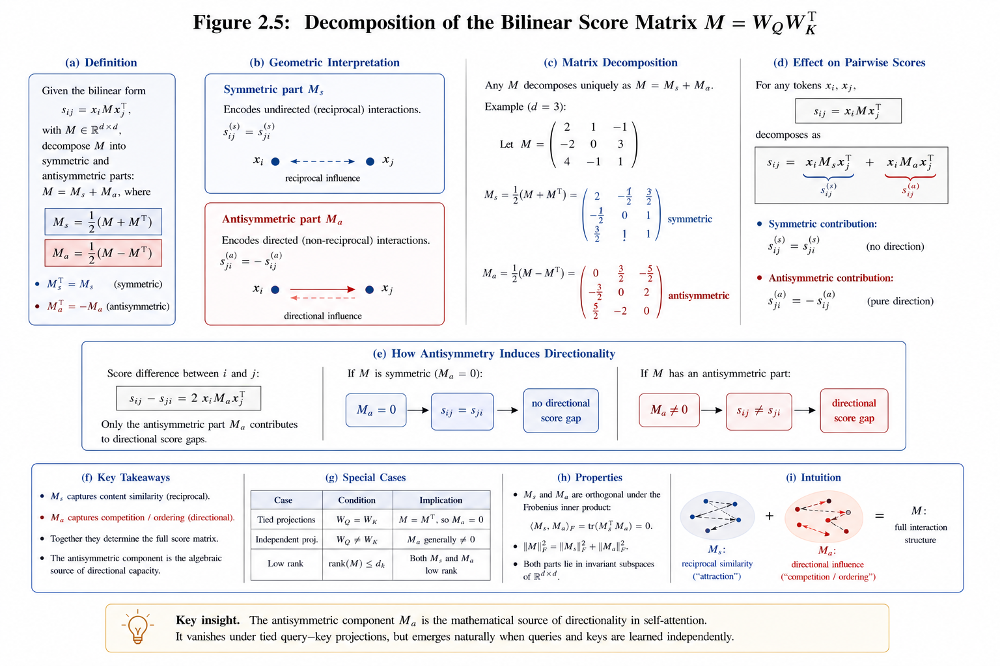
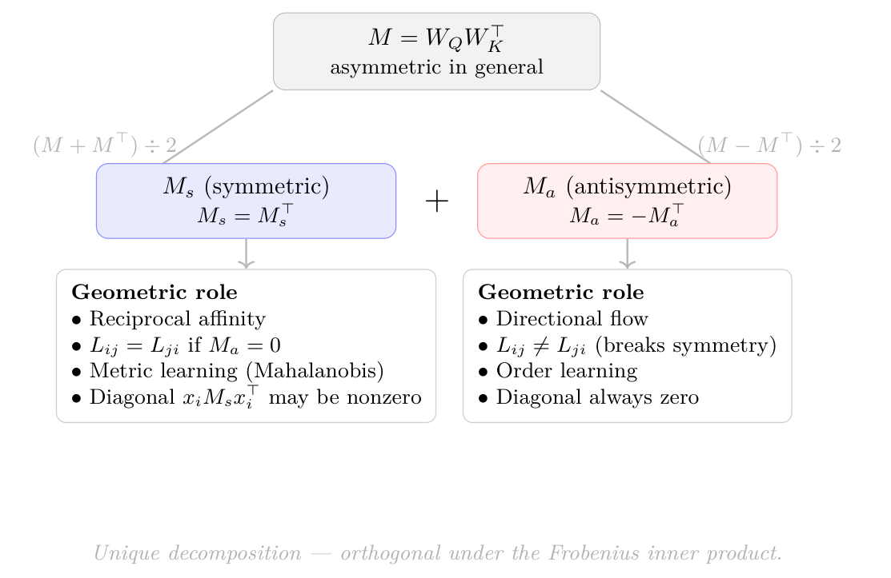
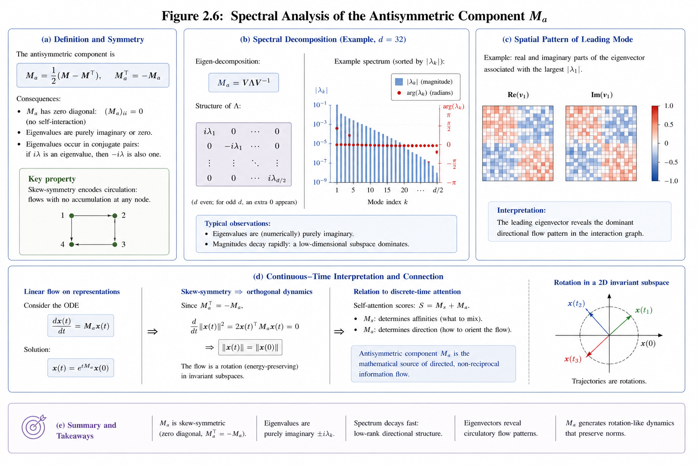
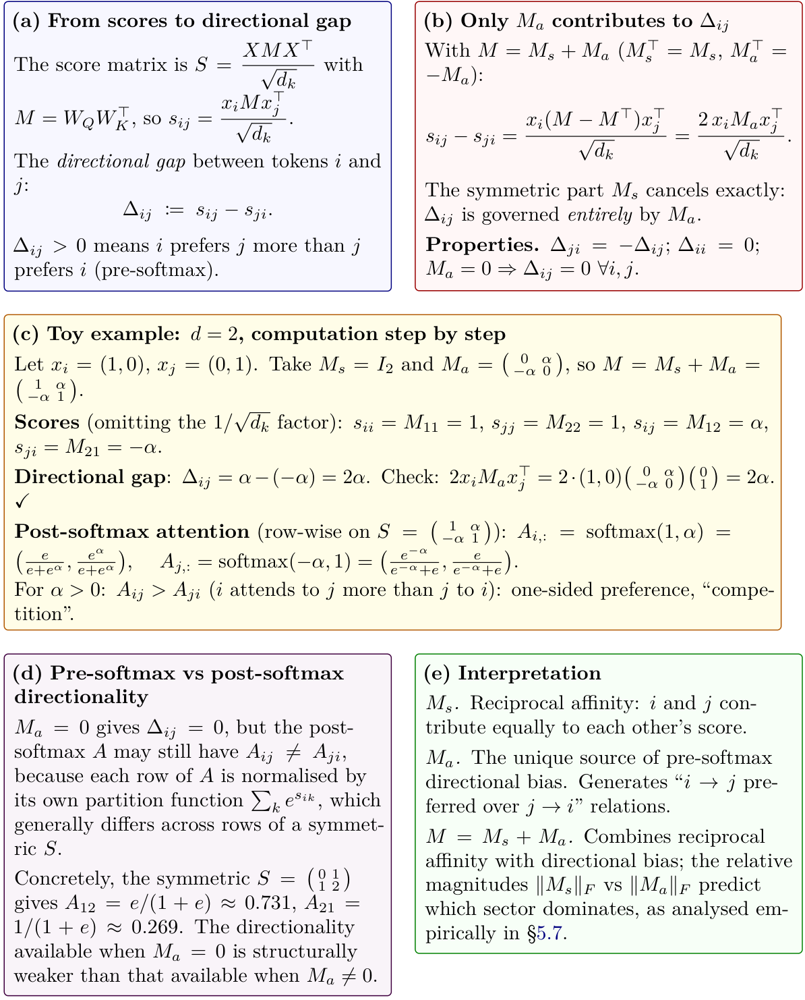

# Chapter 2: kernel attention, low rank, gauge freedom, and directional scores

[Library index](../README.md) · [Source and transcription policy](../SOURCE.md) · [Previous pages: PDF 93–100](0093-0100-ch02-encoder-cost-and-matrix-structure.md) · [Next pages: PDF 109–119](0109-0119-ch02-empirical-illustrations-and-conclusions.md)

> Editorial note: This file preserves the English source on PDF 101–108 (printed pages 65–72), including original figures and mathematical claims. Remark 2.29 starts on PDF 100; PDF 101 contains an intervening figure, and its opening sentence resumes on PDF 102. The last body paragraph, on PDF 107, continues on PDF 109 after the intervening Figure 2.14 on PDF 108. Source inaccuracies are retained; editorial qualifications are in [note 15](../notes/15-kernel-attention-rank-and-gauge.md) and [note 16](../notes/16-asymmetry-and-directional-scores.md).

## PDF 101 · Book 65

**Figure 2.11:** Decomposition of the bilinear matrix $M=W_QW_K^\top$ into symmetric and antisymmetric parts: $M_s=(M+M^\top)/2$ models reciprocal affinity (panel b, undirected influence), $M_a=(M-M^\top)/2$ models directed influence (panel b, one-sided arrows).

Panels (c) and (h) show that the two components are mutually orthogonal in the Frobenius inner product, $\langle M_s,M_a\rangle_F=\operatorname{tr}(M_s^\top M_a)=0$, hence $\|M\|_F^2=\|M_s\|_F^2+\|M_a\|_F^2$. Panel (g) summarises special cases: tied projections $W_Q=W_K$ force $M_a=0$, while independent projections (the standard regime) generally produce $M_a\ne0$. The internal label “Figure 2.5” inside the artwork is a draft annotation.

## PDF 102 · Book 66

> Editorial boundary: continuation of [Remark 2.29 on PDF 100](0093-0100-ch02-encoder-cost-and-matrix-structure.md#remark-2-29). The preceding words are “When $W_Q=W_K=:W$, the”.

matrix $M=WW^\top$ is positive semidefinite and the score reduces to

$$
L_{ij}=\frac1{\sqrt{d_k}}(x_iW)(x_jW)^\top
=\frac{\phi(x_i)\cdot\phi(x_j)}{\sqrt{d_k}},
\qquad \phi(x):=xW\in\mathbb R^{d_k},
$$

where $\phi:\mathbb R^d\to\mathbb R^{d_k}$ is a fixed linear feature map. The score matrix $L$ is then a kernel matrix: $L_{ij}=k(x_i,x_j)/\sqrt{d_k}$ with kernel $k(u,v)=(uW)(vW)^\top$, a dot-product kernel on the projected space $\mathbb R^{d_k}$. In this regime, $L_{ij}=L_{ji}$ at the pre-softmax level for every pair: the head has no bilinear directional capacity. The post-softmax attention weights $A$ are still in general non-symmetric (because the row-wise softmax produces $A_{ij}\ne A_{ji}$ whenever the partition functions of rows $i$ and $j$ differ), but the directionality available is only that produced by row normalisation, not by the bilinear form. The constraint $W_Q=W_K$ corresponds precisely to forcing the head to use a Mahalanobis-style symmetric kernel as its score function, at the cost of all pre-softmax directional capacity. This connection to kernel methods motivates several linear-attention approximations in the literature (Katharopoulos et al., 2020; Choromanski et al., 2021), which replace the softmax with a kernel function that admits efficient computation. The present book takes the opposite direction: rather than constraining $M$ to be symmetric, it analyses the full asymmetric structure.

The matrix $M$ produced by a trained BERT head is generically a full $d\times d$ matrix with no guaranteed symmetry, no guaranteed semidefiniteness, and no guaranteed commutativity. Each of these failures has a geometric consequence.

**Remark 2.30 (Low-rank structure of $M$ and parametric redundancy).** The parametrisation $M=W_QW_K^\top$ with $W_Q,W_K\in\mathbb R^{d\times d_k}$ imposes a structural constraint that is easy to overlook: $M$ is a $d\times d$ matrix, but it has rank at most $d_k$. This follows immediately from $\operatorname{rank}(AB^\top)\le\min(\operatorname{rank}(A),\operatorname{rank}(B))\le d_k$.

The numbers make this concrete. For a single head of $\mathrm{BERT}_{\mathrm{base}}$: $W_Q$ and $W_K$ each have $d\times d_k=768\times64=49{,}152$ parameters, for a total of $98{,}304$. The matrix $M=W_QW_K^\top$ has $d^2=768^2=589{,}824$ entries, but only $98{,}304$ degrees of freedom — a compression ratio of roughly $6:1$. Put differently, of the $589{,}824$ real numbers that would be needed to specify a generic $768\times768$ matrix, only $98{,}304$ are free; the remaining $\sim491{,}000$ are determined by the rank-$d_k$ factorisation.

This low-rank structure is not learned — it is imposed by the architecture. The model cannot produce a full-rank $M$ regardless of training. This is the first, and most fundamental, manifestation of the parametric redundancy that this book diagnoses throughout: the architecture constrains the space of representable attention geometries to a low-dimensional manifold inside the full space of $d\times d$ bilinear forms. The dimension of that manifold — and which geometries it contains — is precisely what the decomposition $M=M_s+M_a$ of Chapter 4 will characterise.

**How to choose $d_k$.** The standard choice $d_k=d/H$ is a budget constraint, not a principled criterion. Four considerations inform a better-grounded choice.

**(i) Geometric capacity.** The decomposition $M=M_s+M_a$ provides a precise lower bound. The symmetric part $M_s$ has rank at most $d_k$, so it can represent at most $d_k$ independent semantic directions. The antisymmetric part $M_a$ has even-rank at most $d_k$, so it can encode at most $\lfloor d_k/2\rfloor$ independent directional tendencies (each corresponding to a pair of imaginary eigenvalues). A head intended to capture $r_s$ semantic directions and $r_a$ directional tendencies requires $d_k\ge\max(r_s,2r_a)$. In practice, $r_s$ and $r_a$ are task-dependent and unknown, but the analysis of Chapter 4 provides empirical tools to estimate them from a trained model.

**(ii) Effective degrees of freedom.** After accounting for the gauge freedom of Remark 2.31 —

## PDF 103 · Book 67

the $\mathrm{GL}(d_k)$ redundancy of the $(W_Q,W_K)$ parametrisation — the effective number of free parameters of $M$ is $2d\,d_k-d_k^2$. This is maximised at $d_k=d$ (a single full-rank head), where it equals $d^2$, the dimension of the full space of $d\times d$ matrices. For $\mathrm{BERT}_{\mathrm{base}}$: $2\times768\times64-64^2=94{,}208$ effective parameters per head, versus a naive count of $98{,}304$. The difference $d_k^2=4{,}096$ is the gauge orbit: parameters that can be freely changed without altering $M$.

**(iii) Sequence-length bottleneck.** The rank of the head output $Y^{(h)}=AV^{(h)}$ is bounded by $\min(n,d_k)$, where $n$ is the sequence length. If $d_k\ge n$, the rank bottleneck on the output is lifted and the head can, in principle, produce any linear combination of the value vectors. If $d_k<n$, the output is confined to a $d_k$-dimensional subspace of the row space of $V^{(h)}$. For $\mathrm{BERT}_{\mathrm{base}}$ ($d_k=64$, $n=128$) this bound is $\min(128,64)=64$: exactly half the sequence length. Longer sequences (the $n=512$ variant of $\mathrm{BERT}_{\mathrm{large}}$) make this bottleneck more severe, which partly motivates attention approximations that avoid materialising the $n\times n$ score matrix.

**(iv) Softmax stability.** With standard initialisation, $\operatorname{Var}(L_{ij})\approx d_k\operatorname{Var}(q_i)\operatorname{Var}(k_j)$, so $\operatorname{std}(L_{ij})\approx\sqrt{d_k}$. The scaling factor $1/\sqrt{d_k}$ in Definition 2.4 restores unit variance. Without it, large $d_k$ pushes the softmax into saturation, where gradients vanish. This argument imposes no hard constraint on $d_k$, but it motivates keeping $d_k$ in the range $[16,256]$ for numerical stability with standard initialisations.

**A principled summary.** The four criteria are: $d_k\ge\max(r_s,2r_a)$ (geometric capacity); $d_k\le d$ with $2dd_k-d_k^2$ effective parameters (gauge-corrected budget); $d_k\approx n/2$ to avoid the sequence-length bottleneck at typical lengths; $d_k\in[16,256]$ for softmax stability. The INCRT of Chapter 15 takes a different approach: it starts with small $d_k$ and grows it dynamically, guided by the residual directional energy $\Gamma_{\mathrm{res}}$, until the geometric capacity criterion is satisfied for the task at hand.

**Figure 2.12:** Decomposition $M=M_s+M_a$ ($M\in\mathbb R^{d\times d}$, $d=d_{\mathrm{model}}$). matrix into its symmetric part $M_s=(M+M^\top)/2$ (reciprocal affinity, metric learning) and antisymmetric part $M_a=(M-M^\top)/2$ (directional flow, order learning). The decomposition is unique and the two components are Frobenius-orthogonal.

## PDF 104 · Book 68

**Remark 2.31 (Gauge freedom in the QKV parametrisation).** The parametrisation $M=W_QW_K^\top$ carries a structural redundancy that is easy to overlook. For any invertible matrix $A\in\mathrm{GL}(d_k)$, the simultaneous substitution

$$
W_Q\mapsto W_QA,\qquad W_K\mapsto W_K(A^{-1})^\top
$$

leaves $M$ unchanged:

$$
(W_QA)\bigl[W_K(A^{-1})^\top\bigr]^\top
=W_QA\,A^{-1}W_K^\top=W_QW_K^\top=M.
$$

The group $\mathrm{GL}(d_k)$ therefore acts freely on the pair $(W_Q,W_K)$ while fixing $M$. The effective degrees of freedom of $M$ are $2d\,d_k-d_k^2$, not $2d\,d_k$: the current architecture stores and optimises $d_k^2=4{,}096$ redundant parameters per head — parameters that the training dynamics must eliminate statistically rather than structurally. These redundant directions consume optimiser state, learning rate budget, and generalisation capacity, contributing nothing to the attention map.

A sharper way to see the same point: the score $L_{ij}=q_ik_j^\top/\sqrt{d_k}$ uses the Euclidean metric $G=I$ on the latent space $\mathbb R^{d_k}$. This is an implicit architectural choice. The canonical object is the bilinear form $L_{ij}=x_iMx_j^\top/\sqrt{d_k}$ on $\mathbb R^d$, and $M=M_s+M_a$ is its metric-free decomposition. The factorisation $W_QW_K^\top$ is one particular implementation of that bilinear form, with $G=I$ imposed at the bottleneck dimension $d_k$ and $d_k^2$ degrees of gauge freedom introduced as a consequence.

There is a deeper reading of this observation. The matrix $WW^\top$ is positive semidefinite — it is a metric (Euclidean for $W=I$). The projection $x\mapsto xW$ therefore sets a metric on the token space $\mathbb R^d$: a Mahalanobis metric with Gram matrix $WW^\top$. The transformations into the query, key, and value spaces are, in this light, equivalent to a choice of metric for each head. When $W_Q=W_K$, the score is a Mahalanobis inner product — the object studied in metric learning under the names LMNN, NCA, or ITML. When $W_Q\ne W_K$, the score $x_iMx_j^\top$ is an asymmetric bilinear form: the generalisation of metric learning to directed similarity. The decomposition $M=M_s+M_a$ then separates the symmetric (metric-learning) component from the antisymmetric (order-learning) component. Chapter ?? develops this connection into a formal equivalence theorem and derives from it both the canonical parametrisation of $M$ and a new class of metric-learning losses for attention pre-training.

**Proposition 2.32 (The attention bilinear form is not generally positive semidefinite).** Recall that a real matrix $A\in\mathbb R^{d\times d}$ is positive semidefinite (PSD) if $A=A^\top$ and all eigenvalues of $A$ are non-negative; equivalently, $uAu^\top\ge0$ for all $u\in\mathbb R^d$ and $A$ is symmetric.[1](#footnote-2-1) The matrix $M=W_QW_K^\top$ is generally not PSD.

Specifically:

1. **(i)** $M$ is symmetric if and only if $W_QW_K^\top=W_KW_Q^\top$, which holds in particular when $W_Q=W_K$. For independently parameterised $W_Q,W_K$, this fails generically.
2. **(ii)** Even when $M$ is symmetric, it need not have non-negative eigenvalues. Hence $M=M^\top$ is necessary but not sufficient for PSD.
3. **(iii)** In the tied case $W_Q=W_K=:W$, $M=WW^\top\succeq0$ holds: $uMu^\top=\|uW\|^2\ge0$.

*Proof.* (i) $M^\top=(W_QW_K^\top)^\top=W_KW_Q^\top$, so $M=M^\top$ if and only if $W_QW_K^\top=W_KW_Q^\top$. The case $W_Q=W_K$ is immediate.

**Footnote 1.** Without symmetry, the condition $uAu^\top\ge0$ for all $u$ depends only on the symmetric part $A_s=(A+A^\top)/2$, since $uAu^\top=uA_su^\top$. For consistency with the standard convention we therefore include symmetry in the definition of PSD.

## PDF 105 · Book 69

(ii) Take $W_Q=I_2$ and $W_K=\begin{pmatrix}0&1\\1&0\end{pmatrix}$. Then

$$
M=W_QW_K^\top=\begin{pmatrix}0&1\\1&0\end{pmatrix},
$$

which is symmetric. Its eigenvalues are $\pm1$; in particular, $M$ has a negative eigenvalue and is therefore not PSD. Concretely, $u=(1,-1)$ gives $uMu^\top=-2<0$.

(iii) For $W_Q=W_K=W$, $uMu^\top=uWW^\top u^\top=\|uW\|_2^2\ge0$, with equality if and only if $uW=0$. $\square$

The failure of positive semidefiniteness means that $L_{ij}$ can be negative even when $i=j$: a token can have negative self-compatibility. The attention mechanism is not measuring similarity in any standard geometric sense. It is computing something richer: a signed, asymmetric, bilinear form on pairs of token representations, whose geometry is determined by the full spectral structure of $M$.

**Figure 2.13:** Spectral analysis of the antisymmetric component $M_a=(M-M^\top)/2$.

Panel (a): $M_a$ has zero diagonal, eigenvalues are purely imaginary or zero, and they occur in conjugate pairs $\pm i\lambda_k$ (consequences of $M_a^\top=-M_a$ and the realness of $M_a$). Panel (b): empirical spectrum from a trained head, sorted by magnitude, showing rapid decay — a low-dimensional subspace dominates. Panel (c): real and imaginary parts of the leading eigenvector reveal the dominant directional flow pattern. Panel (d): the continuous-time interpretation $\dot x=M_ax$ has solution $x(t)=e^{tM_a}x(0)$; skew-symmetry $M_a^\top=-M_a$ implies that $\frac{d}{dt}\|x\|^2=2x^\top M_ax=0$ (using $x^\top M_ax=0$ for any $x$), so the trajectory is a rotation in $\mathbb R^d$ that preserves norms. This continuous-time analogy is a useful intuition for the role of $M_a$, but the actual operation of self-attention is discrete and goes through a row-wise softmax. The internal label “Figure 2.6” inside the artwork is a draft annotation.

## PDF 106 · Book 70

### 2.6.2 Asymmetry: directed relationships

The most immediate geometric consequence of $M\ne M^\top$ is:

$$
L_{ij}=\frac{x_iMx_j^\top}{\sqrt{d_k}}\ne
\frac{x_jMx_i^\top}{\sqrt{d_k}}=L_{ji}\qquad\text{in general}.\tag{2.25}
$$

Concretely: the score that token $i$ assigns to token $j$ — how much $i$ attends to $j$ — differs from the score that $j$ assigns to $i$. This is not a defect; it is the mechanism by which attention encodes directed relationships.

**Linguistic examples.** In natural language, syntactic and semantic relationships are generically asymmetric. A verb governs its subject and object: the verb determines the grammatical role of the surrounding nouns, not the other way around. An article governs its head noun: “the” retrieves “cat”, but “cat” does not retrieve “the” with the same force. A pronoun refers back to its antecedent, so attention from the pronoun to the antecedent should be stronger than attention in the reverse direction. Prepositions govern their complements directionally: the dependency “in $\leftarrow$ London” is oriented, not symmetric. In each case, the linguistic relationship has a source and a target, and a model that uses only symmetric scores cannot distinguish source from target.

More subtly: even when two tokens are mutually relevant, the degree of relevance may differ by direction. The subject of a sentence is relevant to the verb (for agreement), and the verb is relevant to the subject (for interpretation), but these two relevances are not equally strong or equally urgent at every layer of the network.

**Genomic and structured-sequence examples.** The asymmetry is equally natural in other sequence domains. In a genome, a regulatory element upstream of a coding region influences the expression of that region, while the coding region does not symmetrically influence the regulatory element. In protein sequences, the N-terminal signal peptide governs translocation, acting as a source of information for downstream processing, not as a symmetric interactor. An attention head with $L_{ij}=L_{ji}$ could not implement this one-way signalling.

**Quantifying the asymmetry.** The directed gap $L_{ij}-L_{ji}$ is a natural measure of how strongly the head distinguishes direction $i\to j$ from direction $j\to i$. From (2.25) and the definition of $M_a$:

$$
L_{ij}-L_{ji}=\frac{x_i(M-M^\top)x_j^\top}{\sqrt{d_k}}
=\frac{2x_iM_ax_j^\top}{\sqrt{d_k}}.\tag{2.26}
$$

The directed gap is controlled entirely by the antisymmetric part of $M$. Three immediate consequences follow from (2.26):

1. **(i)** If $M_a=0$, then $L_{ij}=L_{ji}$ for every pair and every input. The head is purely reciprocal.
2. **(ii)** If $M_s=0$ (a purely antisymmetric $M$), then $L_{ii}=x_iM_ax_i^\top/\sqrt{d_k}=0$ for all $i$: self-attention scores are zero, and the diagonal of $L$ is identically zero. The head attends to other tokens only.
3. **(iii)** The magnitude of the directed gap at a given token pair $(i,j)$ depends on both the geometry of $M_a$ and the representations $x_i,x_j$: even a head with a large $\|M_a\|_F$ will produce zero directed gap on token pairs that lie in the null space of $M_a$. This is the “sequence-silent asymmetry” regime of Chapter 4.

The asymmetry index $\alpha_h=\|M_a^{(h)}\|_F/\|M^{(h)}\|_F\in[0,1]$ is the simplest scalar summary of this capacity: $\alpha_h=0$ means the head is fully reciprocal; $\alpha_h=1$ means it is fully directional. Empirical distributions of $\alpha_h$ across the 144 heads of $\mathrm{BERT}_{\mathrm{base}}$ are shown in Experiment 3

## PDF 107 · Book 71

(Section 2.7), where it is observed that most heads are intermediate, with $\alpha_h\in(0.2,0.6)$, and a minority of highly directional heads ($\alpha_h>0.7$) appear consistently in the syntactically richer middle layers.

**Observation 2.33 (Asymmetry as a computational resource).** For any attention head, $L_{ij}-L_{ji}=x_i(M-M^\top)x_j^\top/\sqrt{d_k}$. The pairwise directional gap $L_{ij}-L_{ji}$ at the pre-softmax level is controlled entirely by the antisymmetric part of $M$: when that part vanishes ($M=M^\top$), the score matrix is symmetric and $L_{ij}=L_{ji}$ for all $i,j$. The post-softmax attention weights $A$ need not be symmetric even then, because the row-wise softmax normalises each row by its own partition function (and distinct rows of a symmetric $L$ have, in general, distinct partition functions); but the directionality available at the post-softmax level when $M_a=0$ is only that produced by row-wise normalisation, not the bilinear directionality available when $M_a\ne0$. The richness of directed computation at the pre-softmax level is proportional to the “size” of the antisymmetric part of $M$, in a sense made precise by the Directional Energy Theorem of Chapter 4.

### 2.6.3 The symmetric-antisymmetric structure: a first look

We now return to the decomposition $M=M_s+M_a$ introduced as Fact 2.5 at the end of Section 2.1.2. There the decomposition was stated in its purely algebraic form; here, with the full mechanism assembled, we can read it geometrically.

What the fact gives us for free is the uniqueness of the split: the symmetric part $M_s=(M+M^\top)/2$ and the antisymmetric part $M_a=(M-M^\top)/2$ are the unique matrices with those symmetry properties that sum to $M$. What the fact does not give us is an interpretation of the two parts. That interpretation is the central claim of this book, and we state it here in its preliminary form; the precise content — the Reciprocity-Directionality Identity, the Cycle Circulation Theorem, and the Directional Energy Theorem — is the subject of Chapter 4.

Substituting $M=M_s+M_a$ into the score reveals the claim in its simplest setting:

$$
L_{ij}=\frac1{\sqrt{d_k}}\left(
\underbrace{x_iM_sx_j^\top}_{\text{symmetric in }i,j}
+\underbrace{x_iM_ax_j^\top}_{\text{antisymmetric in }i,j}
\right).\tag{2.27}
$$

The first term satisfies $x_iM_sx_j^\top=x_jM_sx_i^\top$: it contributes equally to $L_{ij}$ and $L_{ji}$. It measures something like mutual affinity — how strongly the representations of $i$ and $j$ are aligned under the symmetric metric defined by $M_s$. The second term satisfies $x_iM_ax_j^\top=-x_jM_ax_i^\top$: it contributes with opposite signs to $L_{ij}$ and $L_{ji}$. It is the unique source of directional imbalance at the logit level: if and only if $M_a=0$, we have $L_{ij}=L_{ji}$ for all token pairs.

The analysis of Chapter 4 will sharpen this qualitative reading into three exact statements. The symmetric part governs the reciprocal affinity structure — the extent to which two tokens attract each other symmetrically. The antisymmetric part governs directional energy — the capacity of the head to impose oriented preferences on the token sequence. And the two sectors interact, along closed cycles of token indices, in a way that connects the algebraic split to the circulation of attention around those cycles. The formal results belong to that chapter.

For now, it is enough to note three consequences visible directly from Equation (2.27). First, a head with $M_a=0$ is forced to compute scores that are symmetric in $(i,j)$ at the pre-softmax level: $L_{ij}=L_{ji}$, so any post-softmax directionality of $A$ is generated only by row-wise normalisation, not by the bilinear form (the strict subclass of attention patterns it can implement is the one accessible from a symmetric score plus row-wise softmax). Second,

## PDF 108 · Book 72

**Figure 2.14:** Directional collaboration and competition in self-attention. The pre-softmax directional gap $\Delta_{ij}:=s_{ij}-s_{ji}$ is governed entirely by the antisymmetric component $M_a$ of the bilinear form $M=W_QW_K^\top$. Panel (c) works through a 2D toy example. Panel (d) cautions against the conclusion “$M_a=0\Rightarrow A_{ij}=A_{ji}$”: the row-wise softmax can still produce post-softmax directionality, but it is structurally weaker than that available when $M_a\ne0$. The decomposition $M=M_s+M_a$ separates reciprocal affinity from directional bias; both contribute to the full attention pattern, with distinct geometric roles developed in Chapter 4.

Searchable transcription of the text inside Figure 2.14

**(a) From scores to directional gap**

The score matrix is $S=XMX^\top/\sqrt{d_k}$ with $M=W_QW_K^\top$, so $s_{ij}=x_iMx_j^\top/\sqrt{d_k}$.

The *directional gap* between tokens $i$ and $j$:

$$\Delta_{ij}:=s_{ij}-s_{ji}.$$

$\Delta_{ij}>0$ means $i$ prefers $j$ more than $j$ prefers $i$ (pre-softmax).

**(b) Only $M_a$ contributes to $\Delta_{ij}$**

With $M=M_s+M_a$ ($M_s^\top=M_s$, $M_a^\top=-M_a$):

$$s_{ij}-s_{ji}=\frac{x_i(M-M^\top)x_j^\top}{\sqrt{d_k}}=\frac{2x_iM_ax_j^\top}{\sqrt{d_k}}.$$

The symmetric part $M_s$ cancels exactly: $\Delta_{ij}$ is governed *entirely* by $M_a$.

**Properties.** $\Delta_{ji}=-\Delta_{ij}$; $\Delta_{ii}=0$; $M_a=0\Rightarrow\Delta_{ij}=0\ \forall i,j$.

**(c) Toy example: $d=2$, computation step by step**

Let $x_i=(1,0)$, $x_j=(0,1)$. Take $M_s=I_2$ and $M_a=\begin{pmatrix}0&\alpha\\-\alpha&0\end{pmatrix}$, so $M=M_s+M_a=\begin{pmatrix}1&\alpha\\-\alpha&1\end{pmatrix}$.

**Scores** (omitting the $1/\sqrt{d_k}$ factor): $s_{ii}=M_{11}=1$, $s_{jj}=M_{22}=1$, $s_{ij}=M_{12}=\alpha$, $s_{ji}=M_{21}=-\alpha$.

**Directional gap:** $\Delta_{ij}=\alpha-(-\alpha)=2\alpha$. Check: $2x_iM_ax_j^\top=2\cdot(1,0)\begin{pmatrix}0&\alpha\\-\alpha&0\end{pmatrix}\binom01=2\alpha$. ✓

**Post-softmax attention** (row-wise on $S=\begin{pmatrix}1&\alpha\\-\alpha&1\end{pmatrix}$):

$$
A_{i,:}=\operatorname{softmax}(1,\alpha)=\left(\frac e{e+e^\alpha},\frac{e^\alpha}{e+e^\alpha}\right),
\qquad A_{j,:}=\operatorname{softmax}(-\alpha,1)=\left(\frac{e^{-\alpha}}{e^{-\alpha}+e},\frac e{e^{-\alpha}+e}\right).
$$

For $\alpha>0$: $A_{ij}>A_{ji}$ ($i$ attends to $j$ more than $j$ to $i$): one-sided preference, “competition”.

**(d) Pre-softmax vs post-softmax directionality**

$M_a=0$ gives $\Delta_{ij}=0$, but the post-softmax $A$ may still have $A_{ij}\ne A_{ji}$, because each row of $A$ is normalised by its own partition function $\sum_k e^{s_{ik}}$, which generally differs across rows of a symmetric $S$.

Concretely, the symmetric $S=\begin{pmatrix}0&1\\1&2\end{pmatrix}$ gives $A_{12}=e/(1+e)\approx0.731$, $A_{21}=1/(1+e)\approx0.269$. The directionality available when $M_a=0$ is structurally weaker than that available when $M_a\ne0$.

**(e) Interpretation**

$M_s$. Reciprocal affinity: $i$ and $j$ contribute equally to each other’s score.

$M_a$. The unique source of pre-softmax directional bias. Generates “$i\to j$ preferred over $j\to i$” relations.

$M=M_s+M_a$. Combines reciprocal affinity with directional bias; the relative magnitudes $\|M_s\|_F$ vs $\|M_a\|_F$ predict which sector dominates, as analysed empirically in §5.7.

> Editorial boundary: the sentence ending “Second,” on PDF 107 continues at [PDF 109](0109-0119-ch02-empirical-illustrations-and-conclusions.md#pdf-0109). PDF 108 contains the intervening Figure 2.14 only.
