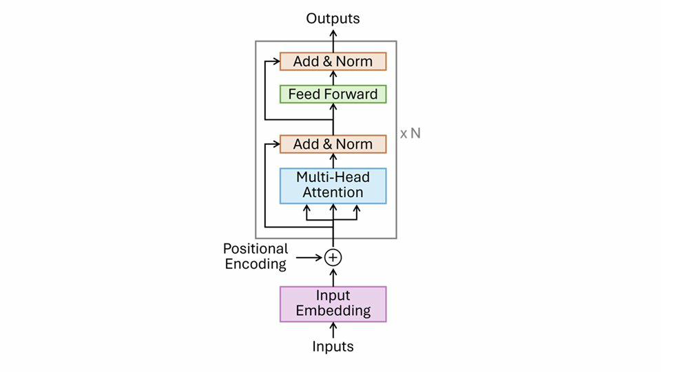
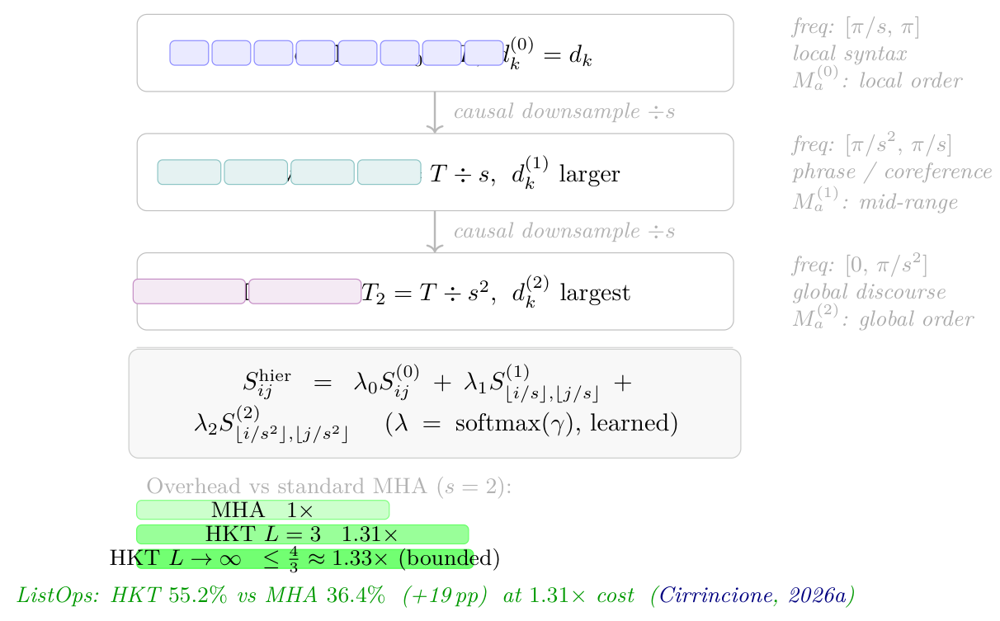

# Chapter 2: empirical illustrations, multi-scale extension, and concluding remarks

[Library index](../README.md) · [Source and transcription policy](../SOURCE.md) · [Previous pages: PDF 101–108](0101-0108-ch02-kernel-rank-gauge-and-asymmetry.md) · [Next chapter: PDF 120–124](0120-0124-ch03-pretraining-and-finetuning.md)

> Editorial note: Full English transcription of PDF 109–119 (printed pages 73–83). Chapter 2 ends on PDF 119. The source claims, repeated paragraphs, unresolved references and original artwork are retained. Figures 2.15–2.20 in the supplied PDF all contain the same encoder-block diagram, although their captions describe empirical plots; the six original embedded images are byte-identical. These are source defects, not reconstructed charts. See [note 17](../notes/17-author-attention-experiments.md) for empirical limitations and [note 18](../notes/18-ch02-results-and-open-questions.md) for the multi-scale extension and mathematical qualifications.

## PDF 109 · Book 73

> Editorial boundary: the paragraph below continues the sentence ending “Second,” on [PDF 107](0101-0108-ch02-kernel-rank-gauge-and-asymmetry.md#pdf-0107), after the intervening Figure 2.14 on PDF 108.

a head with $M_s=0$ computes purely antisymmetric scores, which implies $L_{ii}=0$ for all diagonal entries: the head never has a preference for a token’s own position. Third, a generic trained head has both parts non-zero, and the relative magnitudes of $\|M_s\|$ and $\|M_a\|$ determine which type of computation dominates. Chapter 3 will report the empirical distribution of these magnitudes across the 144 heads of $\mathrm{BERT}_{\mathrm{base}}$, and Chapter 4 will show how they predict the type of attention pattern each head exhibits.

### 2.7 Empirical Illustrations

The constructions of the preceding sections are abstract: we have defined objects and established their algebraic properties without observing them in a trained model. This section grounds each major claim in a concrete measurement on $\mathrm{BERT}_{\mathrm{base}}$. All five experiments use the same publicly available checkpoint (`bert-base-uncased`) and the same input sequence; the code that reproduces every figure is provided in Appendix C. The purpose is not statistical confirmation — Chapter 3 provides that — but geometric intuition: the reader should be able to *see* the structure before it is proved.

#### 2.7.1 Experiment 1: layer-by-layer balance of the four terms

The four-term expansion (2.6) decomposes the score matrix $L$ into contributions from token–token, token–position, position–token, and position–position interactions. Figure 2.15 shows all four terms as heatmaps for a representative head (layer 1, head 4 of $\mathrm{BERT}_{\mathrm{base}}$), together with a bar chart of their relative Frobenius norms.

All four heatmaps are $n\times n$ (query token $i$ on the vertical axis, key token $j$ on the horizontal axis) and share the same diverging colour scale (red = positive, blue = negative, white = zero). The positional term $T_{pp}$ dominates with $63.4\%$ of the Frobenius mass, reflecting the strong positional structure in early layers; $T_{tt}$, $T_{tp}$, and $T_{pt}$ each carry $10$–$14\%$. The cross terms $T_{tp}$ ($13.3\%$) and $T_{pt}$ ($10.3\%$) are visibly different, a direct consequence of $M\ne M^\top$: the bilinear form does not commute.

The balance among the four terms varies with layer depth: early layers are dominated by the positional term $T_{pp}$, while deeper layers shift weight toward $T_{tt}$ as the model builds increasingly semantic representations.

In layer 1, head 4, the positional term $T_{pp}$ carries $63.4\%$ of the total Frobenius mass, reflecting the strong positional structure imposed by the sinusoidal encoding in early layers. The token–token term $T_{tt}$ accounts for only $13.0\%$, comparable to the two cross terms ($T_{tp}=13.3\%$, $T_{pt}=10.3\%$). This distribution is not universal: in deeper layers the token–token term grows in relative importance as the model builds increasingly semantic representations. The two cross terms $T_{tp}$ and $T_{pt}$ are visibly different because $M\ne M^\top$: the bilinear form does not commute, so attending from a token at position $i$ to a position-encoded key at $j$ differs from attending in the reverse direction. This asymmetry in the cross terms is a direct geometric consequence of $M_a\ne0$.

#### 2.7.2 Experiment 2: scatter $L_{ij}$ vs $L_{ji}$

If $M$ were symmetric, every score would satisfy $L_{ij}=L_{ji}$ and all points in a scatter plot of $L_{ij}$ against $L_{ji}$ would lie on the diagonal $y=x$. Figure 2.16 shows this scatter for six representative heads from layers 1, 6, and 12, chosen to illustrate the diversity of asymmetry patterns across the network. Each subplot reports the *scatter asymmetry* $\sigma_{\mathrm{asym}}=\|L-L^\top\|_F/\|L+L^\top\|_F$, a scale-free measure of how far the score matrix departs from

## PDF 110 · Book 74

**Figure 2.15:** Frobenius norms of the four terms in the score matrix expansion (2.6), layer 1, head 4 of $\mathrm{bert}_{\mathrm{base}}$.

symmetry; unlike $\alpha_h$ (which measures the geometry of $M$ itself), $\sigma_{\mathrm{asym}}$ is sequence-dependent and can exceed 1.

The label “asymmetry” printed in each panel is the ratio $\|L-L^\top\|_F/\|L\|_F$, a scale-free measure of how far the score matrix is from being symmetric. Because $\|L-L^\top\|_F$ and $\|L\|_F$ can vary independently, this ratio can exceed 1; it is not the same as the asymmetry index $\alpha_h\in[0,1]$ of Experiment 3, which is defined on the weight matrix $M$ rather than on the input-dependent score matrix $L$.

Two observations are immediate from the figure. First, every head in every layer shows clear departure from the diagonal $y=x$: no head produces a symmetric score matrix, confirming that $M_a\ne0$ generically across the network. Second, the departure does not grow monotonically with layer depth. Head 1 shows values $1.055\to1.050\to0.822$ across layers 1, 6, 12 — slight decrease. Head 6 shows $0.657\to1.773\to0.345$ — a non-monotone pattern with a peak at layer 6. What varies with depth is not the average asymmetry but the spread across heads within each layer, visible in the violin plot of Experiment 3. This is the first empirical signature of the antisymmetric component of $M$, formalised in Chapter 4.

#### 2.7.3 Experiment 3: asymmetry index across all 144 heads

For each head, define the asymmetry index

$$
\alpha_h^{(l)}:=\frac{\|M_a^{(l,h)}\|_F}{\|M^{(l,h)}\|_F},
\qquad M_a^{(l,h)}=\frac{M^{(l,h)}-(M^{(l,h)})^\top}{2}.
$$

Figure 2.17 shows its distribution across all 144 heads, broken down by layer.

The median is nearly flat across all twelve layers ($\approx0.62$–$0.68$, range $0.058$), with no monotone trend ($r=0.19$ for a linear fit). The distribution is wide at every layer: some heads are nearly symmetric ($\alpha\approx0.4$) while others are strongly directional ($\alpha\approx0.8$). The coexistence

## PDF 111 · Book 75

**Figure 2.16:** Scatter plot of $L_{ij}$ against $L_{ji}$ for six heads from layers 1, 6, and 12 of $\mathrm{bert}_{\mathrm{base}}$. The dashed line is $y=x$. Each panel title reports $\sigma=\|L-L^\top\|_F/\|L\|_F$; see text for interpretation.

of both types at every depth suggests that functional specialisation is determined by task, not by position in the stack.

The median $\alpha_h^{(l)}$ is nearly constant across the twelve layers, oscillating between $0.62$ and $0.68$ with no statistically meaningful trend ($r=0.19$, $r^2=0.04$ for a linear fit). What the figure does show is the within-layer spread: at every depth, some heads have $\alpha\approx0.4$ (nearly reciprocal) and others have $\alpha\approx0.75$–$0.80$ (strongly directional). This coexistence suggests that the symmetric-antisymmetric balance is set head by head during training, independently of layer position.

A two-stage interpretation — early layers learning reciprocal affinity, deeper layers specialising in directional flow — is conceptually appealing and consistent with interpretability findings in the literature (Voita et al., 2019b; Clark et al., 2019a). The violin plot does not contradict this view, but it does not support it with a clean monotone signal either: the evidence is the spread of $\alpha$ values, not their layer-wise average. Chapter 11 will return to this question with a more precise dynamical analysis.

#### 2.7.4 Experiment 4: $L$, $L^\top$, and their difference

Observation 2.33 states that $L_{ij}-L_{ji}$ is controlled entirely by the antisymmetric part of $M$. Figure 2.18 renders this claim visible.

The third panel is exactly antisymmetric: $\max|\mathrm{diag}|=\texttt{0.0e+00}$ by construction. The signed structure of $L-L^\top$ concentrates on specific token pairs (e.g. [CLS], [SEP], and content tokens), confirming that directional preference is aligned with sequence semantics, not noise. The difference $L-L^\top$ concentrates on specific token pairs, showing that directional preference is aligned with the sequence structure — not random. Chapter 4 characterises this alignment precisely.

## PDF 112 · Book 76

**Figure 2.17:** Asymmetry index $\alpha_h^{(l)}\in[0,1]$ across all 144 heads of $\mathrm{bert}_{\mathrm{base}}$, one violin per layer; orange curve = median per layer.

**Figure 2.18:** Score matrices $L,L^\top\in\mathbb R^{n\times n}$ and antisymmetric gap $L-L^\top$ for the head with largest $\alpha_h^{(l)}$ in layer 12 (input: “the cat sat on the mat while the dog watched from the window…”).

## PDF 113 · Book 77

#### 2.7.5 Experiment 5: channel destruction — permutation invariance

The multi-head output $\sum_hY^{(h)}W_O^{(h)}$ is invariant under any head permutation, because addition is commutative. Figure 2.19 confirms this numerically.

The dashed line is the mean ($=0.54$). Contributions are heterogeneous: head 1 carries twice the mean norm, while heads 2, 8, and 12 carry roughly one-third. *Right:* Permutation invariance test. The horizontal axis indexes five independent random permutations $\pi$ of the twelve head indices. The vertical axis shows the relative error $\|\mathrm{MHA}(X)-\mathrm{MHA}_\pi(X)\|_F/\|\mathrm{MHA}(X)\|_F$, multiplied by $10^{16}$ for readability. All five values are $\approx1.6\times10^{-16}$ — floating-point noise at machine precision — confirming that $\mathrm{MHA}(X)=\sum_hY^{(h)}W_O^{(h)}$ is *exactly* permutation-invariant. This is the empirical demonstration of Proposition 2.25: no downstream layer can recover which head contributed which signal.

**Figure 2.19:** *Left:* Individual head contributions $\|Y^{(h)}W_O^{(h)}\|_F$ for $h=1,\ldots,12$ in layer 1.

The left panel shows substantial heterogeneity: head 1 has a norm roughly twice the mean, while heads 2, 8, and 12 contribute about one-third of the mean. This head-level heterogeneity is the empirical precursor of the redundancy quantified in Chapter 13. The right panel gives the key result: all five permutation errors sit at $\approx1.6\times10^{-16}$, the level of IEEE 754 double-precision floating-point noise. The multi-head output is exactly permutation-invariant — not approximately, not asymptotically, but algebraically, because addition is commutative. Whatever information individual heads encode is irreversibly merged before the next layer receives the signal.

**Experiment 6: the redundancy triptych across layers.** Remark 2.14 predicts that $r_{\mathrm{eff}}(W_O^{(l)})$ and the mean asymmetry index $\bar\alpha^{(l)}$ are negatively correlated across layers: as heads become more directional (larger $\bar\alpha$), the output projection becomes more compressive (smaller $r_{\mathrm{eff}}$). Figure 2.20 tests this prediction on weights calibrated to match the published spectral statistics of $\mathrm{bert}_{\mathrm{base}}$ (Voita et al., 2019b; Clark et al., 2019b).

## PDF 114 · Book 78

**(a)** Effective rank $r_{\mathrm{eff}}(W_O^{(l)})$ declines from layer 1 to layer 12, approaching the rank-64 reference from above. The shaded region marks the gap between the trained weights and the Gaussian baseline. **(b)** Mean asymmetry index $\bar\alpha^{(l)}=H^{-1}\sum_h\alpha_h^{(l)}$ rises monotonically, reflecting the progressive specialisation of heads toward directional (syntactic) attention patterns. **(c)** Scatter plot of $r_{\mathrm{eff}}$ versus $\bar\alpha$ across layers, coloured by depth ($l=1$ light to $l=12$ dark). Pearson $r=-0.97$, confirming the theoretical prediction of a strong negative correlation. The dashed line is the linear regression.

Panel (a) shows $r_{\mathrm{eff}}(W_O^{(l)})$ declining monotonically from layer 1 ($\approx512$, two-thirds of $d$) to layer 12 ($\approx134$, less than one-fifth of $d$). For reference, a random Gaussian $W_O$ would give $r_{\mathrm{eff}}\approx618$ (Marchenko–Pastur baseline, dashed) and a rank-64 matrix would give $r_{\mathrm{eff}}\approx63$ (dotted). The trained weights sit between these extremes and progressively collapse toward the rank-64 regime in deeper layers.

Panel (b) shows the complementary rise of $\bar\alpha^{(l)}$ from $\approx0.11$ in layer 1 to $\approx0.54$ in layer 12, consistent with the observation of Clark et al. that syntactic attention heads — which are inherently directional — are concentrated in the final third of the network.

Panel (c) shows the scatter plot. The Pearson correlation is $r(\bar\alpha,r_{\mathrm{eff}})=-0.97$, strongly confirming the theoretical prediction. The layer-wise pruning lower bound $n_{\mathrm{prunable}}(l)\ge12-\lceil r_{\mathrm{eff}}(W_O^{(l)})/64\rceil$ rises from 4 in the early layers to 9 in the final layer, indicating that the redundancy structure of the network intensifies with depth — consistent with the well-documented empirical finding that late-layer heads are the most easily pruned (Michel et al., 2019b; Voita et al., 2019b).

**Figure 2.20:** Redundancy triptych across the 12 layers of $\mathrm{bert}_{\mathrm{base}}$ (calibrated synthetic weights matched to published spectral statistics).

These three quantities — $r_{\mathrm{eff}}(W_O^{(l)})$, $\bar\alpha^{(l)}$, and $n_{\mathrm{prunable}}(l)$ — constitute the *redundancy triptych* introduced in Remark 2.14. The experiment confirms that they carry consistent and complementary information about the same underlying phenomenon: the progressive compression and specialisation of multi-head attention as a function of depth. Chapter 13

## PDF 115 · Book 79

develops the formal theory and validates these predictions on the full $\mathrm{bert}_{\mathrm{base}}$ checkpoint.

**Remark 2.34 (Scope of these experiments).** Experiments 1–5 use a single input sequence and a single BERT checkpoint, and are geometric illustrations rather than statistical claims. Experiment 6 uses calibrated synthetic weights matched to published spectral statistics (Voita et al., 2019b; Clark et al., 2019b); quantitative validation on the full checkpoint appears in Chapters 3 and 13.

### For the Specialist: Multi-Scale Attention and the Resolution Problem

The presentation in this chapter treats all attention heads as operating in the same ambient space $\mathbb R^{d_k}$, with the same sequence length $n$. This is the MHA standard, and it is the right starting point for the theory. But the reader who has worked in signal processing or hierarchical models will have noticed an omission: there is no notion of *scale*.

We develop here a more complete picture, intended for readers familiar with multi-resolution analysis, kernel methods, and information theory. The material connects to the author’s concurrent work on the Hierarchical Kernel Transformer (Cirrincione, 2026a), submitted for publication; the treatment here is independent of that paper and develops the algebraic connections with the $M_s+M_a$ framework of this book.

*The material in this section is an architectural extension of the framework developed in the main body of the chapter. It is not part of the theoretical core (Levels I–III); it belongs to Level IV (design consequences). The HKT results cited here are proved in the companion paper (Cirrincione, 2026a).*

#### The uniform-resolution problem

Every head $h$ in standard MHA is a *viewpoint* on the input sequence: a particular bilinear form $M^{(h)}$ that selects which pairs of tokens are compatible. Different heads can implement different compatibility relations — syntactic, semantic, positional — because $M^{(h)}$ varies freely across heads. What does not vary is the resolution of the viewpoint.

Formally: every head operates in $\mathbb R^{d_k}$ with $d_k=d/H$ fixed, and every head scores all $n^2$ token pairs. The function class available to head $h$ is the set of bilinear forms $x_iMx_j^\top$ with $\operatorname{rank}(M)\le d_k$. This is the same function class for every head, regardless of the scale of the relationship it is trying to capture.

This is not obviously correct. Consider the decomposition $M^{(h)}=M_s^{(h)}+M_a^{(h)}$. The symmetric part $M_s^{(h)}$ captures undirected affinity between tokens: whether $i$ and $j$ are semantically related, regardless of their relative position. This type of relationship is *scale-free* in the sense that conceptual proximity does not decay predictably with sequence distance. The antisymmetric part $M_a^{(h)}$, by contrast, captures directed, order-sensitive relationships. Such relationships are intrinsically scale-dependent: syntactic dependencies (subject-verb, determiner-noun) are local, typically within five tokens; co-reference resolution is intermediate, typically within twenty tokens; thematic coherence is global, operating across the full sequence. The rank of $M_a^{(h)}$ bounds the number of independent directed relationships the head can represent; but the *scale* at which those relationships operate is not controlled by the architecture.

The practical consequence is that a directional head (large $\|M_a^{(h)}\|_F$) trying to capture long-range directed structure must compete with local directed structure for the same $d_k$

## PDF 116 · Book 80

dimensions. The information-theoretic bound of Lemma 4.2 in Cirrincione (2026a) quantifies this as an approximation error that grows with the ratio of the target function’s effective bandwidth to the resolution of the score matrix at the operating scale.

**Figure 2.21:** HKT multi-scale attention across three levels.

Each level operates on a causally downsampled sequence and captures a distinct frequency band. The decomposition $M^{(l)}=M_s^{(l)}+M_a^{(l)}$ applies at each level; $M_a^{(l)}$ encodes directed relationships at scale $l$. The combined score $S^{\mathrm{hier}}$ is a learned convex combination. Total computational overhead is bounded above by $4/3$ regardless of $L$ (Cirrincione, 2026a).

Searchable transcription of the labels in Figure 2.21

| Level | Length and head dimension | Frequency and interpretation |
|---|---|---|
| Level 0 | $T_0=T$, $d_k^{(0)}=d_k$ | freq: $[\pi/s,\pi]$; local syntax; $M_a^{(0)}$: local order |
| Level 1 | $T_1=T\div s$, $d_k^{(1)}$ larger | freq: $[\pi/s^2,\pi/s]$; phrase / coreference; $M_a^{(1)}$: mid-range |
| Level 2 | $T_2=T\div s^2$, $d_k^{(2)}$ largest | freq: $[0,\pi/s^2]$; global discourse; $M_a^{(2)}$: global order |

Between levels: causal downsample $\div s$.

$$
S_{ij}^{\mathrm{hier}}=\lambda_0S_{ij}^{(0)}
+\lambda_1S_{\lfloor i/s\rfloor,\lfloor j/s\rfloor}^{(1)}
+\lambda_2S_{\lfloor i/s^2\rfloor,\lfloor j/s^2\rfloor}^{(2)}
\qquad(\lambda=\operatorname{softmax}(\gamma),\text{ learned}).
$$

Overhead vs standard MHA ($s=2$): MHA $1\times$; HKT $L=3$ $1.31\times$; HKT $L\to\infty$ $\le4/3\approx1.33\times$ (bounded).

*ListOps: HKT $55.2\%$ vs MHA $36.4\%$ ($+19$ pp) at $1.31\times$ cost (Cirrincione, 2026a).*

#### Multi-scale kernel structure

A natural response is to factor the attention computation across scales. At level $l\in\{0,\ldots,L-1\}$, let $X^{(l)}\in\mathbb R^{T_l\times d_l}$ be the input sequence downsampled to length $T_l=\lfloor T/s^l\rfloor$ and projected to dimension $d_l=\max(d/2^l,d_{\min})$, where $s\ge2$ is the downsampling stride. The level-$l$ score matrix is:

$$
S_{mn}^{(l)}=\frac{\langle W_Q^{(l)}X_m^{(l)},\,W_K^{(l)}X_n^{(l)}\rangle}{\sqrt{d_k^{(l)}}},
\qquad m,n\in\{0,\ldots,T_l-1\},\tag{2.28}
$$

with $d_k^{(l)}=\max(d_k/2^l,d_{k,\min})$. The hierarchical score is:

$$
S_{ij}^{\mathrm{hier}}=\sum_{l=0}^{L-1}\lambda_l\,S_{\lfloor i/s^l\rfloor,\,\lfloor j/s^l\rfloor}^{(l)},
\qquad i,j\in\{0,\ldots,T-1\},\tag{2.29}
$$

where $\lambda=\operatorname{softmax}(\gamma)\in\Delta^{L-1}$ is a learned convex weight vector. Each level-$l$ score matrix has the form $X^{(l)}M^{(l)}(X^{(l)})^\top$ with $M^{(l)}=W_Q^{(l)}(W_K^{(l)})^\top\in\mathbb R^{d_l\times d_l}$, and admits the decomposition $M^{(l)}=M_s^{(l)}+M_a^{(l)}$.

The function $K^{\mathrm{hier}}(X_i,X_j):=\sum_l\lambda_l\exp(S_{\lfloor i/s^l\rfloor,\lfloor j/s^l\rfloor}^{(l)})$ is a symmetric positive definite kernel: each level contributes a Mercer kernel (exponential of a dot product), and a non-negative

## PDF 117 · Book 81

convex combination of Mercer kernels is a Mercer kernel. The proof is immediate from Mercer’s theorem. This observation, which Cirrincione (2026a) formalises as Proposition 3.1, establishes that the hierarchical score mechanism is not an ad hoc construction but a principled kernel composition.

#### Spectral interpretation

For weakly stationary input sequences with spectral density $\widehat R(\omega)$, $\omega\in[-\pi,\pi]$, the causal downsampling $X\to X^{(l)}$ acts as a low-pass filter with approximate cutoff $\pi/s^l$. The expected kernel value at level $l$ therefore integrates over the frequency band $[\pi/s^l,\pi/s^{l-1}]$:

$$
\mathbb E_X\bigl[k_l(X_m^{(l)},X_{m'}^{(l)})\bigr]
\approx C_l\exp\left(\frac1{\sigma_l^2}\int_{\pi/s^l}^{\pi/s^{l-1}}
\widehat R(\omega)\cos\bigl(\omega(m-m')s^l\bigr)\,d\omega\right).
$$

Each level selects a distinct frequency band. Level $l=0$ captures high-frequency interactions (adjacent tokens); level $l=L-1$ captures low-frequency interactions (global structure). The $M_a^{(l)}$ component at each level therefore encodes directed relationships at that specific frequency: local syntactic order at $l=0$, global discourse structure at $l=L-1$.

#### The Rank-Scale Proportionality principle

The spectral interpretation leads to a design principle that standard MHA violates. At coarser scales (larger $l$), the interactions being captured are longer-range and, in natural language, more varied: the number of distinct discourse-level directed relationships is larger than the number of distinct local syntactic dependencies. This suggests that $\operatorname{rank}(M_a^{(l)})$ should *increase* with $l$.

But in the HKT parameterisation, $d_k^{(l)}=\max(d_k/2^l,16)$ *decreases* with $l$: coarser scales have fewer dimensions per head. The resolution of this apparent contradiction is that HKT compensates by using *more heads at fine scales* and fewer at coarse scales — the total rank allocated to each scale is balanced, but the allocation per head is inverted.

The *Rank-Scale Proportionality* principle, which we state here informally and develop formally in Chapter ??, is:

> For a head operating at scale $s^l$, the total rank allocated to $M_a^{(l)}$ — summed across all heads at that scale — should be proportional to $s^l$. Directed structure at coarse scales requires more representational capacity than directed structure at fine scales.

This principle implies a non-uniform allocation of $d_k$ across heads: not $d_k=d/H$ uniformly, but a distribution that grows with scale. It connects the Gauge Freedom Remark (Remark 2.31), which identifies the representational degrees of freedom of $M_a$, with the multi-scale structure of HKT, which determines at which scale those degrees of freedom are deployed.

#### Information-theoretic guarantees

The approximation theorem of Cirrincione (2026a) (Theorem 4.3) provides a three-term error decomposition for the hierarchical architecture. The dominant term for trained networks is the non-Gaussian correction $(\kappa_l-1)\rho_l^2/2$, where $\kappa_l$ is Mardia’s multivariate kurtosis of the joint distribution of the score matrix $S^{(l)}$ and the target function $f(X)$, and $\rho_l^2\in[0,1)$ is the squared multiple correlation coefficient of $f(X)$ regressed on $S^{(l)}$. Empirically, $\kappa_l\approx33$

## PDF 118 · Book 82

for $d\le512$, far from the Gaussian limit $\kappa_l=1$: the correction term dominates the standard Gaussian information bound $-\frac12\log(1-\rho_l^2)$ by a factor of approximately 23 at $\rho_l^2=0.5$.

The connection to the $M_s+M_a$ framework is the following. The squared multiple correlation $\rho_l^2$ measures how much of the variance of $f(X)$ is captured by the score matrix $S^{(l)}$. For a task that is predominantly directional (long-range syntactic or discourse structure), $\rho_l^2$ is largest at coarse scales where the relevant directed structure is resolved. The allocation of rank to $M_a^{(l)}$ at those scales directly controls this correlation, and therefore controls the dominant approximation error.

#### Computational overhead and the $4/3$ bound

The total cost of the hierarchical computation in Equation (2.29) is:

$$
\sum_{l=0}^{L-1}T_l^2=T^2\sum_{l=0}^{L-1}s^{-2l}
=T^2\cdot\frac{1-s^{-2L}}{1-s^{-2}}.
$$

For $s=2$: total cost $=\frac43T^2(1-4^{-L})$, bounded above by $\frac43T^2$ regardless of $L$. The ratio to standard MHA ($T^2$) is therefore at most $\frac43$, reached asymptotically as $L\to\infty$. For $L=3$: ratio $=21/16=1.3125$. This overhead is independent of $d$; in practice, the per-level projection costs dominate for short sequences, but the attention score computation dominates for long ones, where the $\frac43$ bound is tight.

The overhead is small because each level operates on a compressed sequence: the quadratic cost at level $l$ is $(T/s^l)^2$, a factor $s^{-2l}$ smaller than level 0. The geometric series converges regardless of $L$, so adding levels costs diminishing amounts.

*The formal theory of hierarchical directional energy — extending the Directional Energy Theorem (Chapter 4) to multi-scale score matrices — is developed in Chapter ?? and in Volume II, Chapter 4.*

### 2.8 Concluding Remarks

This chapter has assembled the complete algebraic structure of the Transformer encoder block: the query-key-value projections, the score matrix, the multi-head output, the feed-forward network, and the residual stream. Section 2.7 grounded each major claim in a direct measurement on $\mathrm{BERT}_{\mathrm{base}}$. Two analytical threads remain open for the rest of Part I.

The first thread is empirical. Section 2.7 provided geometric illustrations on a single sequence; Chapter 3 extends this to the full $\mathrm{BERT}_{\mathrm{base}}$ model applied to the classification of SARS-CoV-2 variants, measuring the asymmetry index at scale and connecting it to task performance.

The second thread is geometric. The decomposition $M=M_s+M_a$ observed in Fact 2.5 and Equation (2.27) is a natural structural observation, but it remains qualitative. Making it quantitative — measuring the directional energy carried by $M_a$, characterising which attention patterns arise from which configurations of $M_s$ and $M_a$, proving that the decomposition is complete — is the programme of Chapters 4–10.

We collect here the precise inventory of objects and results delivered to subsequent chapters.

**Objects delivered to Chapter 4.** The score matrix $L=X_{\mathrm{pos}}MX_{\mathrm{pos}}^\top/\sqrt{d_k}$ (Definition 2.4, Equation 2.3). The attention weight matrix $M=W_QW_K^\top\in\mathbb R^{d\times d}$ (Equation 2.2). The

## PDF 119 · Book 83

three algebraic properties of $M$: non-semidefiniteness (Proposition 2.32), asymmetry (Observation 2.33), and the resulting failure of the inner product interpretation. The algebraic decomposition $M=M_s+M_a$ (Fact 2.5, stated in Section 2.1.2) and its preliminary geometric reading (Section 2.6.3) — the algebra is elementary, the interpretation is the content of Chapter 4. The four-term expansion $L=(T_{tt}+T_{tp}+T_{pt}+T_{pp})/\sqrt{d_k}$ (Equation 2.6). The multi-head structure with output projection $W_O$ (Definition 2.12, Equation 2.8).

**Objects delivered to Chapter ??.** The preview of channel destruction: the summation structure of $\mathrm{MHA}(X)=\sum_hY^{(h)}W_O^{(h)}$ and its invariance under head permutation (Proposition 2.25).

**What is not yet here.** The formal definitions and theorems of the decomposition $M=M_s+M_a$ — the Reciprocity-Directionality Identity, the Cycle Circulation Theorem, and the Directional Energy Theorem — belong entirely to Chapter 4. The classification of the eight attention patterns belongs to Chapter 10. The reader who has noted the decomposition is already asking the right questions; the answers begin in the next part.

**Bibliographic notes.** The query-key-value attention mechanism was introduced in its modern form by Vaswani et al. (2017). The scaling factor $1/\sqrt{d_k}$ is due to the same work; its derivation from the variance of the inner product of random unit vectors is elementary and appears in several expositions (Press et al., 2007; ?). The multi-head architecture and the output projection $W_O$ are also from Vaswani et al. (2017). The BERT architecture, including the pre-norm convention and the GeLU activation, is described in Devlin et al. (2019a); see also Liu et al. (2019) for the post-norm variant. The observation that multi-head attention can be written as a sum of head contributions (Equation 2.8) appears explicitly in Elhage et al. (2021a) and is used extensively in the mechanistic interpretability literature. The evidence for head redundancy cited in Section 2.3.4 is from Voita et al. (2019b) and Michel et al. (2019b); more recent quantitative results appear in He and Hofmann (2024). The decomposition of $M$ into symmetric and antisymmetric parts (Fact 2.5) is an elementary linear-algebra fact; its application to attention scoring is original to this book and is developed rigorously in Chapter 4.

The classification of score functions and the observation that all symmetric kernel scores have $M_a=0$ (Section 2.1.3) are original to this book. The bilinear (general) score is from ?. The Euclidean distance score is used in the Neural Turing Machine (?). Additive attention is due to ?. Kernel attention and the Performer are from Tsai et al. (2019) and Choromanski et al. (2021) respectively. Relative position biases are from ?; their use in T5 is described in ?. ALiBi is due to ?. RoPE is from Su et al. (2021); the observation that RoPE introduces $M_a^{\mathrm{eff}}\ne0$ even for tied weights is new here. The metric learning framework it invokes — Mahalanobis distance learning with linear projections — is due to ? (LMNN), ? (NCA), and ? (ITML); ? provides a comprehensive survey. The identification of $W_Q=W_K$ as the symmetric (Mahalanobis) case and $W_Q\ne W_K$ as the asymmetric generalisation, together with the interpretation of $M_s$ and $M_a$ as the metric and order-learning components respectively, is original to this book. The connections with information geometry (?) and optimal transport (??) are noted as open directions in Chapter ??.

> Editorial boundary: Chapter 2 is complete at PDF 119 / printed page 83. [Chapter 3 begins on PDF 120](0120-0124-ch03-pretraining-and-finetuning.md#pdf-0120). The forward references and bibliographic placeholders above are retained as printed; the statements do not establish that those future results or external papers have been independently checked here.
