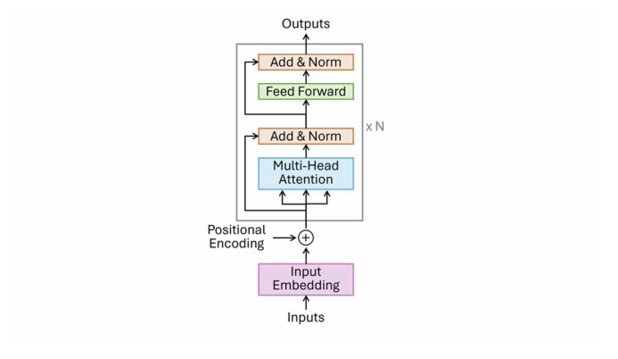
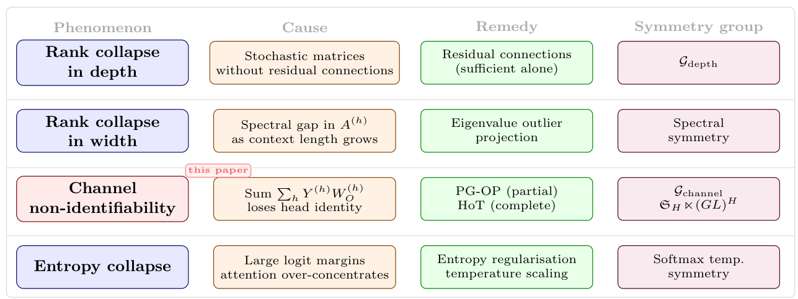

# Chapter 3: BERT pre-training, fine-tuning, and the rank debate

[Library index](../README.md) · [Source policy](../SOURCE.md) · [Previous: PDF 109–119](0109-0119-ch02-empirical-illustrations-and-conclusions.md#pdf-0119) · [Next: PDF 125–130](0125-0130-ch03-normalisation-residual-and-mlp-rank.md)

> **Editorial note.** Full English transcription of PDF 120–124 / printed pages 84–88. Original claims, unresolved references, and internal inconsistencies are retained. The chapter later qualifies several claims made here; see the separate notes on [pre-training and fine-tuning](../notes/19-bert-pretraining-and-finetuning.md), [normalisation](../notes/20-layernorm-and-affine-rank.md), and [rank and the MLP](../notes/21-residual-head-rank-and-mlp.md). Running headers and standalone page numbers are omitted. Text transcribed from artwork is explicitly identified.

## PDF 120 · Book 84

## Chapter 3. BERT: Pre-training, Fine-tuning, and Case Study

BERT (Devlin et al., 2019a) occupies a peculiar position in the history of language modelling. It was not the first large pre-trained Transformer — ELMo and GPT had preceded it — but it was the first to demonstrate, with unmistakable clarity, that a bidirectional model pre-trained on unlabelled text could be fine-tuned to state-of-the-art performance across a wide range of tasks with minimal architectural modification. That demonstration changed the field.

The mathematical structure of BERT is the subject of this chapter. Not its engineering — the implementation details, the tokenisation choices, the training hyperparameters — but the algebraic and geometric properties that make it work, and the properties that limit it. The book has been building toward this chapter from the first page: the embedding map of Chapter 1, the score matrix of Chapter 2, the residual dynamics of Chapter 1, and the rank theory of Chapters 1 and 13 all come together here in a single architecture.

This chapter proceeds in four stages. Section 3.1 describes the two pre-training objectives — masked language modelling and next-sentence prediction — and identifies their mathematical structure. Section 3.2 analyses the fine-tuning protocol and the sense in which the pre-trained representation constrains the fine-tuned model. Section 3.3 surveys the state of the art, with emphasis on the theoretical contributions that this book extends: rank collapse and its relationship to residual connections and the MLP. Section 3.4 presents the case study on SARS-CoV-2 classification that motivates Part IV.

### 3.1 Pre-training: MLM and NSP

BERT is pre-trained on two tasks simultaneously. The *masked language modelling* (MLM) task asks the model to predict masked tokens from their context; the *next-sentence prediction* (NSP) task asks it to predict whether two sentences are consecutive in the original text. We analyse each in turn.

#### 3.1.1 Masked Language Modelling

Let $s=(t_1,\ldots,t_n)\in\mathcal V^n$ be a sequence of tokens. A masking function $\mathcal M$ selects a subset $I\subset\{1,\ldots,n\}$ of positions (typically $\lvert I\rvert\approx0.15n$) and replaces each $t_i$ with $i\in I$ with one of: (a) the special [MASK] token (with probability 0.8), (b) a random token from $\mathcal V$ (with probability 0.1), or (c) the original token $t_i$ (with probability 0.1).

## PDF 121 · Book 85

Let $\widetilde s$ denote the masked sequence and $X^{(0)}(\widetilde s)\in\mathbb R^{n\times d}$ its initial embedding. The BERT forward pass produces $X^{(L)}(\widetilde s)$, and an output projection $W_{\mathrm{MLM}}\in\mathbb R^{d\times|\mathcal V|}$ maps each hidden state $x_i^{(L)}$ to a probability distribution over the vocabulary. The MLM loss is:

$$
\mathcal L_{\mathrm{MLM}}
=-\frac1{|I|}\sum_{i\in I}\log p_\theta(t_i\mid\widetilde s),
\qquad
p_\theta(t\mid\widetilde s)
=\frac{\exp(x_i^{(L)}W_{\mathrm{MLM}})_t}
{\sum_{t'}\exp(x_i^{(L)}W_{\mathrm{MLM}})_{t'}}.
\tag{3.1}
$$

**Remark 3.1 (The MLM blind spot).** The MLM objective is symmetric in the [MASK] positions: the model receives the same input for any permutation of the masked tokens (since all are replaced by the same special token). It therefore cannot, from the MLM signal alone, distinguish the directional relationship between masked positions. This blind spot — the inability to develop asymmetric (directional) attention structure from MLM — is formalised in Lemma ?? of Chapter ?? and proved as Proposition 11.A. It motivates the antisymmetric attention analysis of Chapter ??.

**Proposition 3.2 (Masked-token identity equivariance, no-positional case).** Consider an MLM input in which a subset $S\subseteq\{1,\ldots,n\}$ of positions is replaced by the same [MASK] embedding. Suppose there is no positional encoding and no other position-dependent feature. Then the encoder input is invariant under permutations of the masked positions that fix all unmasked positions: for any such permutation $\sigma$, the input matrix $X^{(0)}$ satisfies $\Pi_\sigma X^{(0)}=X^{(0)}$. Consequently, the encoder output is permutation-equivariant under such permutations, and the MLM logits at the masked positions transform equivariantly. The model cannot distinguish masked positions by lexical identity alone: any distinction must come from positional encoding or surrounding context.

*Proof.* By assumption, every $i\in S$ has $X_i^{(0)}=e_{[\mathrm{MASK}]}$, the embedding of the [MASK] token. A permutation $\sigma$ that permutes $S$ and fixes its complement leaves the multiset of rows of $X^{(0)}$ at positions in $S$ unchanged (all are $e_{[\mathrm{MASK}]}$), and fixes all other rows. Hence $\Pi_\sigma X^{(0)}=X^{(0)}$. Without positional encoding and with weights shared across positions, the encoder is permutation-equivariant (cf. Proposition 3.29 for the same equivariance in the MHA setting). Therefore $X^{(L)}(\Pi_\sigma X^{(0)})=\Pi_\sigma X^{(L)}(X^{(0)})$, and the MLM logits at positions in $S$ are permuted by $\sigma$. Distinct masked positions are indistinguishable on the basis of token identity alone. $\square$

**Remark 3.3 (Why this proposition is weaker than “MLM cannot create directional attention”).** The classical strong claim “MLM cannot develop directional attention” is too strong as a structural theorem about the encoder: positional encodings and surrounding context can provide the asymmetry. The proposition above isolates the precise sense in which the MLM signal is symmetric: it is symmetric under permutations of masked positions *when no positional information is present*. The structural asymmetry of attention can still develop under MLM training, but it must be driven by positional encodings or by the contextual asymmetry of unmasked tokens, not by the lexical identity of masked tokens.

#### 3.1.2 Next-Sentence Prediction

The NSP task presents the model with a pair of sentences $(s^{(1)},s^{(2)})$ separated by a [SEP] token and asks it to classify whether $s^{(2)}$ follows $s^{(1)}$ in the original corpus. The classification is performed from the [CLS] token representation $x_{\mathrm{CLS}}^{(L)}\in\mathbb R^d$ via a linear head.

**Remark 3.4 (NSP attention and the rank-1 signal).** The NSP classification depends on a single vector $x_{\mathrm{CLS}}^{(L)}$. For this vector to carry information about the relationship between the

## PDF 122 · Book 86

two sentences, the top-layer attention heads that aggregate information into [CLS] must develop asymmetric (directional) attention patterns — attending differently to tokens in $s^{(1)}$ versus $s^{(2)}$. The attention matrix for such a head is approximately rank-1 in empirical observation: it assigns high weight to one sentence and low weight to the other. This is a property observed in trained models, not a logical consequence of the NSP objective alone. The Lie algebra $\mathfrak{so}(64)$ of skew-symmetric $64\times64$ matrices, which governs the directional component of the score matrix (Chapter 2), has dimension $\binom{64}{2}=2016$: there are 2016 independent directions in which the attention can be directional.

**Proposition 3.5 (CLS bottleneck for NSP supervision).** Let the NSP classifier have the form $\widehat y=\operatorname{softmax}(W_{\mathrm{NSP}}h_{\mathrm{CLS}}+b)$, where $h_{\mathrm{CLS}}=X_{\mathrm{CLS}}^{(L)}$ is the CLS row of the final-layer hidden state matrix $H=X^{(L)}\in\mathbb R^{n\times d}$. Let $\mathcal L_{\mathrm{NSP}}=-\log\widehat y_y$ be the cross-entropy loss. Then the direct gradient of $\mathcal L_{\mathrm{NSP}}$ with respect to the final-layer matrix $H$ is supported only on the CLS row:

$$
\frac{\partial\mathcal L_{\mathrm{NSP}}}{\partial H_i}=0
\qquad\text{for every }i\ne\mathrm{CLS}.
$$

Non-CLS rows of $H$ receive gradient only through backpropagation across the attention, MLP, and residual couplings of earlier layers.

*Proof.* By assumption, the classifier depends on $H$ only through the row $h_{\mathrm{CLS}}$. The chain rule gives $\partial\mathcal L_{\mathrm{NSP}}/\partial H_i=(\partial\mathcal L_{\mathrm{NSP}}/\partial h_{\mathrm{CLS}})\cdot(\partial h_{\mathrm{CLS}}/\partial H_i)$. For $i\ne\mathrm{CLS}$, $h_{\mathrm{CLS}}$ does not depend on $H_i$ at the same layer (the CLS row of $H$ is just $H_{\mathrm{CLS}}$), so the local partial derivative vanishes. Gradient reaches $H_i$ for $i\ne\mathrm{CLS}$ only through the dependence of $h_{\mathrm{CLS}}$ on earlier-layer representations, via the attention and MLP couplings. $\square$

### 3.2 Fine-tuning

Fine-tuning adapts the pre-trained parameters $\theta_{\mathrm{pre}}$ to a downstream task $\mathcal T$ by minimising a task-specific loss $\mathcal L_{\mathcal T}$ over a labelled dataset. The adaptation is typically shallow: only a linear classification head is added on top of the frozen or lightly modified encoder.

**Remark 3.6 (Fine-tuning inheritance: scope).** The classical statement that “fine-tuning cannot create new directional structure” is correct for frozen-encoder fine-tuning and quantitatively controlled (but not exact) for full fine-tuning of the encoder. We give both versions precisely.

**Proposition 3.7 (Frozen-encoder fine-tuning inheritance).** Suppose the encoder parameters of a pre-trained Transformer are frozen during fine-tuning, and only a downstream readout head is updated. Then the per-layer score operators $M^{(l,h)}=W_Q^{(l,h)}(W_K^{(l,h)})^\top$ and their antisymmetric components

$$
M_a^{(l,h)}=\tfrac12\bigl(M^{(l,h)}-(M^{(l,h)})^\top\bigr)
$$

remain unchanged during fine-tuning. No new directional attention structure can be created inside the encoder by the readout update alone.

*Proof.* If the encoder is frozen, $W_Q^{(l,h)}$ and $W_K^{(l,h)}$ are fixed across all fine-tuning steps. Their product $M^{(l,h)}$ and its antisymmetric part $M_a^{(l,h)}$ are therefore fixed. Updating the readout cannot modify any quantity defined entirely in terms of encoder parameters. $\square$

**Proposition 3.8 (Lipschitz control of antisymmetric structure under fine-tuning).** For a single attention head, write $M=W_QW_K^\top$ and $M_a=\tfrac12(M-M^\top)$. Suppose fine-tuning

## PDF 123 · Book 87

updates the projections to

$$
W_Q'=W_Q+\Delta_Q,\qquad W_K'=W_K+\Delta_K,
$$

producing $M'=W_Q'(W_K')^\top$ and $M_a'=\tfrac12(M'-(M')^\top)$. Then

$$
\lVert M_a'-M_a\rVert_F
\le\lVert\Delta_QW_K^\top\rVert_F
+\lVert W_Q\Delta_K^\top\rVert_F
+\lVert\Delta_Q\Delta_K^\top\rVert_F.
$$

In particular, by submultiplicativity of the Frobenius and operator norms,

$$
\lVert M_a'-M_a\rVert_F
\le\lVert\Delta_Q\rVert_F\lVert W_K\rVert_{\mathrm{op}}
+\lVert W_Q\rVert_{\mathrm{op}}\lVert\Delta_K\rVert_F
+\lVert\Delta_Q\rVert_F\lVert\Delta_K\rVert_{\mathrm{op}}.
$$

*Proof.* Expand the product:

$$
M'=W_Q'(W_K')^\top
=W_QW_K^\top+\Delta_QW_K^\top+W_Q\Delta_K^\top
+\Delta_Q\Delta_K^\top.
$$

Subtracting $M$ and taking the antisymmetric part is a linear operation that does not increase the Frobenius norm ($\lVert B_a\rVert_F\le\lVert B\rVert_F$ for every matrix $B$, since $B_a=(B-B^\top)/2$ and $\lVert B-B^\top\rVert_F\le2\lVert B\rVert_F$). The inequality then follows from the triangle inequality applied to the three perturbation terms. The second form is obtained by applying the inequality $\lVert AB\rVert_F\le\lVert A\rVert_F\lVert B\rVert_{\mathrm{op}}$ to each term. $\square$

**Remark 3.9 (Narrative consequence).** Frozen-encoder fine-tuning is exactly inheritance-preserving for directional attention structure (Proposition 3.7). Full fine-tuning can in principle create or destroy antisymmetric structure, but the change $\lVert M_a'-M_a\rVert_F$ is Lipschitz-controlled by the size of the parameter update (Proposition 3.8). For small fine-tuning updates — the typical regime in BERT-style fine-tuning, which uses small learning rates and short training horizons — the directional structure cannot drift far from its pre-trained value. The strong informal claim “fine-tuning cannot create new directional structure” is thus correct in spirit for the small-update regime, and exact only when the encoder is literally frozen.

### 3.3 State of the Art: Rank, MLP, and Beyond

**Figure 3.1: BERT architecture (Devlin et al., 2019a).**

> **Editorial artwork transcription.** Labels, from bottom upward: Inputs; Input Embedding; Positional Encoding; Multi-Head Attention; Add & Norm; Feed Forward; Add & Norm; Outputs. The repeated block is labelled “× N”.

#### 3.3.1 Rank collapse and the role of depth

Dong et al. (2021b) proved that in a pure attention Transformer (without MLP layers or residual connections), the rank of the token representation matrix collapses to 1 doubly-exponentially with depth. Residual connections and the MLP sub-layer break the collapse,

## PDF 124 · Book 88

but the tension between attention (which promotes rank reduction via the doubly-stochastic structure of the attention matrix) and the MLP (which promotes rank expansion via its non-linearity) creates what Dong et al. call a “tug of war”.

This result is important for two reasons. First, it explains why residual connections are not merely an engineering convenience but a structural necessity. Second, it motivates the Rank-Neutrality Theorem of Chapter 1, which shows that layer normalisation is precisely neutral with respect to rank — it neither increases nor decreases it, leaving the tug of war between attention and MLP undisturbed.

Cordonnier et al. (2020) showed that multi-head attention with sufficient heads can express any linear combination of the input tokens, making it a universal approximator in the linear case. This result sets an upper bound on what multi-head attention can express and motivates the question of Chapter 13: how many of the expressible patterns are actually used?

**The three issues at a glance.** The following table summarises the corrections to Dong’s analysis developed in the companion paper (Cirrincione, 2026b) and in the remaining sections of this chapter:

| Component | Dong (2021) | This book / paper [5] |
|---|---|---|
| Layer normalisation | Plays no role | Preserves affine rank exactly; matrix rank in zero-bias case |
| Residual connections | One of two remedies | Generically obstruct rank collapse |
| MLP | Necessary (anti-collapse) | Necessary only for non-linearity; not for anti-collapse |
| Output projection $W_O$ | Not discussed | Induces head-channel non-identifiability |

The remainder of this section develops the formal analysis announced in the table above, organised in six parts: affine-rank neutrality of layer normalisation (§3.3.2), generic obstruction of rank collapse by residual connections (§3.3.3), the MLP’s actual role (§3.3.4), rank contraction and MLP width (§3.3.5), head-channel non-identifiability (§3.3.6), and the position-gated output projection (PG-OP) (§3.3.7). The four phenomena are summarised in Figure 3.2.

**Figure 3.2: The four representational collapse phenomena in Transformer architectures.** Head-channel non-identifiability (highlighted) is characterised in Cirrincione (2026b).

> **Editorial artwork transcription.** The diagram contains the following text; its assertions are reproduced, not independently endorsed. The third row bears the additional label “this paper”.

| Phenomenon | Cause | Remedy | Symmetry group |
|---|---|---|---|
| Rank collapse in depth | Stochastic matrices without residual connections | Residual connections (sufficient alone) | $\mathcal G_{\mathrm{depth}}$ |
| Rank collapse in width | Spectral gap in $A^{(h)}$ as context length grows | Eigenvalue outlier projection | Spectral symmetry |
| Channel non-identifiability | Sum $\sum_hY^{(h)}W_O^{(h)}$ loses head identity | PG-OP (partial); HoT (complete) | $\mathcal G_{\mathrm{channel}}$; $\mathfrak S_H\ltimes(GL)^H$ |
| Entropy collapse | Large logit margins; attention over-concentrates | Entropy regularisation; temperature scaling | Softmax temp. symmetry |

> **Editorial boundary.** This page completes §3.3.1. [PDF 125](0125-0130-ch03-normalisation-residual-and-mlp-rank.md#pdf-0125) begins §3.3.2. The unconditional affine-rank and “doubly-stochastic” language above is retained; subsequent qualifications appear in Remarks 3.13 and 3.20.
