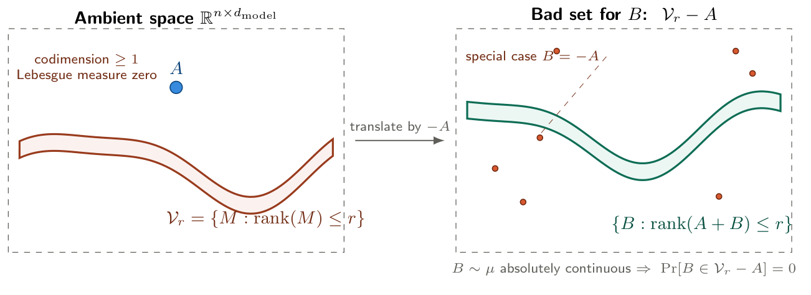

# Chapter 3: Normalisation, residual genericity, and MLP interpolation

[Library index](../README.md) · [Source policy](../SOURCE.md) · [Previous: PDF 120–124](0120-0124-ch03-pretraining-and-finetuning.md) · [Next: PDF 131–139](0131-0139-ch03-head-symmetry-pgop-and-case-study.md)

> **Editorial note.** Full English transcription of PDF 125–130 / printed pages 89–94, from §3.3.2 through the complete proof of Theorem 3.22. Formula orientations, inequality directions, claims of sufficiency, unresolved citations, and other source defects are preserved. Corrections and counterexamples are separate in [note 20](../notes/20-layernorm-and-affine-rank.md) and [note 21](../notes/21-residual-head-rank-and-mlp.md).

## PDF 125 · Book 89

### 3.3.2 Affine-rank neutrality of layer normalisation

The first correction to Dong’s analysis concerns layer normalisation. Dong et al. (2021b) treats LN as inert; the rigorous result of Chapter 1 (Theorem 1.25) shows that LN with zero bias preserves the rank of the hidden-state matrix exactly under appropriate non-degeneracy hypotheses. We restate that result in the form most directly useful for the residual analysis of the present chapter, then comment on two subtleties about the affine variant.

**Definition 3.10 (Affine rank).** For a matrix $X\in\mathbb R^{n\times d_{\mathrm{model}}}$ with rows $x_1,\ldots,x_n$, the *affine rank* of $X$ is

$$
\operatorname{arank}(X)
=\dim\operatorname{aff}(x_1,\ldots,x_n)
=\dim\operatorname{span}\{x_i-x_j:1\le i,j\le n\}.
$$

Equivalently, $\operatorname{arank}(X)=\operatorname{rank}(X-\bar x\mathbf1_n^\top)$ for $\bar x=\frac1n\sum_i x_i$. One has $\operatorname{arank}(X)\le\min(\operatorname{rank}(X),n-1)$, with equality $\operatorname{arank}(X)=\operatorname{rank}(X)$ when $\mathbf1_n$ is not in the column space of $X^\top$ (equivalently, when no non-trivial linear combination of the rows with coefficients summing to one vanishes).

**Theorem 3.11 (Rank-Neutrality of Layer Normalisation, $\beta=0$).** Let $\operatorname{LN}_0$ denote layer normalisation with affine parameters $\gamma\in\mathbb R^{d_{\mathrm{model}}}$ and $\beta=0$, applied row-wise: $\operatorname{LN}_0(X)_i=\gamma\odot(x_i-\mu_i\mathbf1_d)/\sigma_i$, where $\mu_i$ and $\sigma_i$ are the empirical mean and standard deviation of row $i$. Under the non-degeneracy hypotheses

**(H1)** $\sigma_i>0$ for all rows $i$ (no constant rows);

**(H2)** $\mathbf1_d\notin\operatorname{rowsp}(X)$ (the all-ones vector is not a linear combination of the rows of $X$);

**(H3)** $\gamma_j\ne0$ for all $j\in\{1,\ldots,d_{\mathrm{model}}\}$;

$\operatorname{LN}_0$ preserves the *matrix rank* exactly:

$$
\operatorname{rank}(\operatorname{LN}_0(X))=\operatorname{rank}(X).
$$

This is Theorem 1.25 of Chapter 1. The proof there proceeds by showing $\operatorname{rowsp}(\operatorname{LN}_0(X))=P\operatorname{rowsp}(X)D_\gamma$ with $P=I_d-\frac1d\mathbf1_d\mathbf1_d^\top$ the orthogonal projection onto $\mathbf1_d^\perp$ and $D_\gamma=\operatorname{diag}(\gamma)$ invertible by H3, then using $\ker P=\operatorname{span}\{\mathbf1_d\}$ together with H2 to conclude that the restriction of $P$ to $\operatorname{rowsp}(X)$ is injective.

**Remark 3.12 (Why H2 cannot be weakened, and what happens with general $\beta$).** H2 is exact: if $\mathbf1_d\in\operatorname{rowsp}(X)$, then $P$ kills exactly one direction of $\operatorname{rowsp}(X)$, and $\operatorname{rank}(\operatorname{LN}_0(X))=\operatorname{rank}(X)-1$. In particular, every $X\in\mathbb R^{n\times d}$ with $\operatorname{rank}(X)=d$ has $\operatorname{rowsp}(X)=\mathbb R^d\ni\mathbf1_d$, so H2 fails and $\operatorname{rank}(\operatorname{LN}_0(X))\le d-1$ regardless of any other condition. The weaker hypothesis “$X$ has at least two distinct rows” is not equivalent to H2 and does not suffice: a randomly drawn $X\in\mathbb R^{5\times4}$ with continuous distribution has $\operatorname{rank}(X)=4=d$ almost surely, hence H2 fails almost surely on full-rank matrices.

For $\beta\ne0$, $\operatorname{LN}(X)=\operatorname{LN}_0(X)+\mathbf1_n\beta^\top$. The added term has rank 1, and by the rank triangle inequality

$$
\operatorname{rank}(\operatorname{LN}_0(X))
\le\operatorname{rank}(\operatorname{LN}(X))
\le\operatorname{rank}(\operatorname{LN}_0(X))+1.
$$

Both inclusions can be tight, depending on whether $\beta$ contributes a direction outside $\operatorname{rowsp}(\operatorname{LN}_0(X))$.

**Remark 3.13 (Affine-rank version: subtleties).** The natural “$\beta$-free” counterpart is the affine-rank version, since $\operatorname{arank}$ is invariant under uniform shifts of all rows. One might hope that $\operatorname{arank}(\operatorname{LN}(X))=\operatorname{arank}(X)$ holds under H1, H3 alone, or under H1, H2, H3, regardless of $\beta$. Two subtleties prevent a clean exact statement.

## PDF 126 · Book 90

**(i)** The condition $\mathbf1_d\notin\operatorname{rowsp}(X)$ of Theorem 3.11 is not the right condition for the affine-rank version. By the same projection argument applied to row differences, the correct condition is the strictly stronger

$$
\mathbf1_d\notin\operatorname{span}\{x_i-x_j:1\le i,j\le n\}.
$$

A clean two-row counterexample to equality without this condition is $x_1=(0,1)$, $x_2=(1,2)$ in $\mathbb R^2$: $\operatorname{arank}(X)=1$, but $x_1-\mu_1\mathbf1_2=x_2-\mu_2\mathbf1_2=(-\tfrac12,\tfrac12)$, so the two centred rows coincide and $\operatorname{arank}(\operatorname{LN}_0(X))=0$. The difference $x_2-x_1=(1,1)=\mathbf1_2$ is exactly the direction collapsed by centring.

**(ii)** The row-wise rescaling factors $\Lambda(X)=\operatorname{diag}(\sqrt d/\lVert Px_i\rVert_2)$ are row-dependent and do not commute with the row-centring projection $C=I_n-\frac1n\mathbf1_n\mathbf1_n^\top$ used to compute the affine rank. As a consequence, $\Lambda$ can in fact *break* affine degeneracies of $X$ and *increase* the affine rank: the explicit input $X\in\mathbb R^{4\times5}$ with rows $(1,0,-1,0,0)$, $(1,1,-2,0,0)$, $(1,-\tfrac12,-\tfrac12,0,0)$, $(1,-\tfrac32,\tfrac12,0,0)$ has $\operatorname{arank}(X)=1$ (all rows lie on a single line) but $\operatorname{arank}(\operatorname{LN}_0(X))=2$.

A clean “preservation” statement for the affine rank is therefore not available without additional hypotheses. The correct generic statement takes the form: on the affine-rank-$r$ stratum of $(\mathbb R^d)^n$, the set of inputs at which $\operatorname{arank}(\operatorname{LN}(X))<r$ is contained in a proper real-analytic subset, and hence has measure zero on that stratum, provided one input $X_\star$ in the stratum exists with $\operatorname{arank}(\operatorname{LN}(X_\star))\ge r$. We do not develop this generic version here, because the matrix-rank statement of Theorem 3.11 is what the residual analysis of §3.3.3 actually requires.

### 3.3.3 Residual connections generically obstruct rank collapse

The second correction is sharper than the first. Dong’s result shows that pure-attention residual-free Transformers collapse to rank one. The introduction of residual connections is widely believed to “solve” rank collapse, but the precise mathematical content of this statement is delicate: it is not deterministic.

**Proposition 3.14 (Generic rank non-collapse under additive perturbation).** For any $A,B\in\mathbb R^{n\times d_{\mathrm{model}}}$ the rank triangle inequality holds:

$$
\bigl|\operatorname{rank}(A)-\operatorname{rank}(B)\bigr|
\le\operatorname{rank}(A+B)
\le\operatorname{rank}(A)+\operatorname{rank}(B),
\tag{3.2}
$$

and no deterministic lower bound stronger than (3.2) exists: setting $B=-A$ gives $\operatorname{rank}(A+B)=0$.

The following generic statement, however, holds. Fix $A\in\mathbb R^{n\times d_{\mathrm{model}}}$ with $\operatorname{rank}(A)=r<\min(n,d_{\mathrm{model}})$, and let $\mu$ be any probability measure on $\mathbb R^{n\times d_{\mathrm{model}}}$ that is absolutely continuous with respect to Lebesgue measure. Then

$$
\Pr_{B\sim\mu}\bigl[\operatorname{rank}(A+B)>r\bigr]=1.
\tag{3.3}
$$

*Proof.* The triangle inequality (3.2) is standard. For (3.3), the determinantal variety

$$
\mathcal V_r=\{M\in\mathbb R^{n\times d_{\mathrm{model}}}:\operatorname{rank}(M)\le r\}
$$

is the common zero set of the $(r+1)\times(r+1)$ minors of $M$, hence a closed real-algebraic set. Since $r<\min(n,d_{\mathrm{model}})$, $\mathcal V_r$ has codimension $(n-r)(d_{\mathrm{model}}-r)\ge1$, and is therefore of Lebesgue measure zero in $\mathbb R^{n\times d_{\mathrm{model}}}$. The set $\{B:\operatorname{rank}(A+B)\le r\}=\mathcal V_r-A$ is its translate, which has Lebesgue measure zero by translation invariance of Lebesgue measure. Any $\mu$ absolutely continuous with respect to Lebesgue therefore assigns it zero mass. $\square$

## PDF 127 · Book 91

**Remark 3.15.** Four points are worth noting. **(i)** The statement is asymmetric in $A$ and $B$: $A$ is held fixed and $B$ is the absolutely continuous perturbation. This is precisely the regime relevant to residual updates, where $A=X^{(l)}$ is the current state and $B=\Delta^{(l)}$ is the update. **(ii)** If $A$ is already full-rank, the proposition is vacuous; it is non-trivial precisely in the rank-deficient regime, which is the regime of rank collapse. **(iii)** The condition $\operatorname{rowsp}(\Delta^{(l)})\not\subseteq\operatorname{rowsp}(X^{(l)})$ is sufficient but not necessary for rank to strictly increase, and is itself generic. **(iv)** The proposition assumes $B$ is absolutely continuous on $\mathbb R^{n\times d_{\mathrm{model}}}$. When $B$ is constrained to a lower-dimensional sub-manifold — as for $B=\operatorname{MHA}(X)$, which depends analytically on $X$ and on the attention weights — the conclusion does not follow automatically: one must verify separately that the bad set is not the entire sub-manifold. This is what Theorem 3.16 below establishes for multi-head attention.

**Figure 3.3: Geometric content of Proposition 3.14.**

*Left: the ambient space $\mathbb R^{n\times d_{\mathrm{model}}}$ contains the determinantal variety $\mathcal V_r$ of rank-deficient matrices, drawn schematically as a thin region of codimension at least one — hence of Lebesgue measure zero. The fixed matrix $A$ is held outside (or, in the rank-deficient case, inside) this set. Right: the bad set for the perturbation $B$, namely $\{B:\operatorname{rank}(A+B)\le r\}=\mathcal V_r-A$, is the translate of $\mathcal V_r$ by $-A$ and inherits the measure-zero property by translation invariance of Lebesgue measure. Generic samples $B\sim\mu$ from any absolutely continuous distribution miss the bad set with probability one; the cancellation case $B=-A$ exists but lies on this measure-zero set.*

> **Editorial artwork transcription.** Labels: “Ambient space $\mathbb R^{n\times d_{\mathrm{model}}}$”; “codimension $\ge1$”; “Lebesgue measure zero”; $A$; $\mathcal V_r=\{M:\operatorname{rank}(M)\le r\}$; “translate by $-A$”; “Bad set for $B$: $\mathcal V_r-A$”; “special case $B=-A$”; $\{B:\operatorname{rank}(A+B)\le r\}$; “$B\sim\mu$ absolutely continuous $\Rightarrow\Pr[B\in\mathcal V_r-A]=0$”.

**Theorem 3.16 (Generic residual obstruction of rank collapse).** Consider the residual attention map $F(X)=X+\operatorname{MHA}(X)$ (attention with residual, no MLP), with fixed weight matrices $\{W_Q^{(h)},W_K^{(h)},W_V^{(h)},W_O^{(h)}\}$. Fix the rank-$r$ stratum

$$
\mathcal M_r=\{X\in\mathbb R^{n\times d_{\mathrm{model}}}:\operatorname{rank}(X)=r\},
\qquad r<\min(n,d_{\mathrm{model}}).
$$

Suppose there exists a witness $X_\star\in\mathcal M_r$ such that

$$
\operatorname{rank}\bigl(X_\star+\operatorname{MHA}(X_\star)\bigr)>r.
\tag{W}
$$

Then the set $\mathcal B_l^{(r)}=\{X\in\mathcal M_r:\operatorname{rank}(F(X))\le r\}$ is contained in a proper real-analytic subset of $\mathcal M_r$, hence has measure zero on the rank-$r$ stratum (with respect to the natural smooth measure inherited from the determinantal stratification).

In particular, for generic $X^{(l)}$ of rank $r$, the residual update strictly increases the rank:

$$
\operatorname{rank}\bigl(X^{(l)}+\operatorname{MHA}(X^{(l)})\bigr)
>\operatorname{rank}\bigl(X^{(l)}\bigr).
$$

The doubly-exponential rank-collapse mechanism of residual-free attention (Dong et al., 2021b) is therefore generically obstructed by the residual connection.

## PDF 128 · Book 92

*Proof.* **Step (a): Algebraic characterisation of the bad set.** The map

$$
F(X)=X+\sum_h A^{(h)}(X)\,XW_V^{(h)}W_O^{(h)},
$$

with $A^{(h)}(X)=\operatorname{softmax}(S^{(h)})$, $S_{ij}^{(h)}=x_iM^{(h)}x_j^\top/\sqrt{d_k}$, $M^{(h)}=W_Q^{(h)}W_K^{(h)\top}$, is real-analytic on $\mathbb R^{n\times d_{\mathrm{model}}}$. The condition $\operatorname{rank}(F(X))\le r$ is the simultaneous vanishing of all $(r+1)\times(r+1)$ minors of $F(X)$, each of which is a real-analytic function of $X$. Hence $\{X\in\mathcal M_r:\operatorname{rank}(F(X))\le r\}$ is a real-analytic subset of $\mathcal M_r$.

**Step (b): The witness shows the bad set is proper.** By assumption (W), $X_\star\in\mathcal M_r$ satisfies $\operatorname{rank}(F(X_\star))>r$, so at least one $(r+1)\times(r+1)$ minor of $F(X_\star)$ is non-zero. The corresponding minor, viewed as a real-analytic function on $\mathcal M_r$, is not identically zero. By the standard real-analytic vanishing principle (?, Chapter 1), its zero set is a proper real-analytic subset of $\mathcal M_r$, hence of measure zero. The bad set $\mathcal B_l^{(r)}$ is contained in this zero set and inherits the measure-zero property.

**Existence of witnesses (sufficient conditions).** The witness condition (W) is mild and verifiable in the relevant regime. For $r=1$, take $X_\star=e_1f_1^\top$ where $e_1\in\mathbb R^n$, $f_1\in\mathbb R^d$ are the first standard basis vectors. For this rank-1 input: $x_1=f_1$, $x_i=0$ for $i\ge2$; the score matrix has only $S_{11}^{(h)}$ possibly non-zero among row-1 entries; $V^{(h)}=XW_V^{(h)}$ has only its first row non-zero (equal to $f_1^\top W_V^{(h)}$). Hence each $Y^{(h)}=A^{(h)}V^{(h)}$ is a rank-$\le1$ matrix with all rows proportional to $f_1^\top W_V^{(h)}$. The contribution $\operatorname{MHA}(X_\star)=\sum_hY^{(h)}W_O^{(h)}$ has rank at most $H$. For $\operatorname{rank}(X_\star+\operatorname{MHA}(X_\star))>1$ to hold, it suffices that there exists $h$ with $f_1^\top W_V^{(h)}W_O^{(h)}\notin\operatorname{span}\{f_1\}$, i.e. that the action of at least one head on the direction $f_1$ produces a non-collinear contribution. This holds for Lebesgue-almost-every choice of $\{W_V^{(h)},W_O^{(h)}\}$. For higher ranks $r$, the analogous witness $X_\star^r=\sum_{i=1}^r e_if_i^\top$ provides the same conclusion under the same generic weight condition. $\square$

**Remark 3.17 (Transversality minus cancellation).** The result has the structure

$$
\text{rank expansion}=\text{transverse update}-\text{exact cancellation}.
$$

The witness condition (W) is what makes the update “transverse” to the rank-$r$ stratum. The exceptional set $\mathcal B_l^{(r)}$ is precisely the locus of exact cancellation $\operatorname{rank}(X+\operatorname{MHA}(X))\le r$; on it, $\operatorname{MHA}(X)$ happens to lie in the row span of $X$. Without (W) (e.g. if $W_V^{(h)}=0$ for all $h$, in which case $\operatorname{MHA}\equiv0$ and the “bad” set is the entire stratum), no rank expansion occurs and the theorem is vacuous.

### 3.3.4 The MLP’s actual role: non-linearity, not anti-collapse

Theorem 3.16 settles the question of MLP necessity for rank collapse: the residual stream alone suffices. The MLP is therefore not necessary as an anti-collapse mechanism. What is its actual structural role? The following proposition makes the answer precise: attention with residual is locally affine, and the MLP is the only source of genuine non-linearity in the representation.

**Remark 3.18 (First-order linearisation of residual attention).** The composition $X^{(0)}\mapsto X^{(L)}$ defined by a residual-attention stack $X^{(l+1)}=X^{(l)}+\operatorname{MHA}(X^{(l)})$ (no MLP) is a smooth function of $X^{(0)}$. Its first-order Taylor expansion at any base point $X^{(0)}$ is, by definition,

$$
X^{(L)}(X^{(0)}+\varepsilon)
=X^{(L)}(X^{(0)})
+DX^{(L)}\big|_{X^{(0)}}\varepsilon
+o(\lVert\varepsilon\rVert),
\tag{3.4}
$$

## PDF 129 · Book 93

where $DX^{(L)}|_{X^{(0)}}$ is the Jacobian of the layer composition. To first order in $\varepsilon$, this is an affine map of $X^{(0)}$. The fact that residual attention is locally affine in this sense is therefore not specific to attention: it is the first-order Taylor approximation of any smooth map. What is specific is the explicit form of the Jacobian when the attention weights $A^{(h)}$ are evaluated at the base point and treated as frozen: each layer Jacobian is then $I+D[\operatorname{MHA}]_{\mathrm{frozen}}$, where $D[\operatorname{MHA}]_{\mathrm{frozen}}$ is linear in its argument. The composition of $L$ such layer Jacobians is itself linear, giving an explicit affine form

$$
X^{(L)}\approx X^{(0)}\Phi(X^{(0)})+B(X^{(0)})
$$

to first order. The matrices $\Phi(X^{(0)})$ and $B(X^{(0)})$ depend on $X^{(0)}$ only through the values of $A^{(h)}$ at $X^{(0)}$, and their explicit form is computed in Cirrincione (2026b), Section 5. We do not state this as a theorem because the only mathematical content is the standard first-order Taylor expansion; what is structurally relevant for the MLP discussion below is just the slogan: *at first order, residual attention applies an affine map to the input, and an affine map cannot generate new feature directions beyond those obtainable from $X^{(0)}$ by linear combinations*. The MLP breaks this first-order linearisation through its non-polynomial activation.

### 3.3.5 Rank contraction and the lower bound on MLP width

Although residual connections obstruct rank collapse (depth phenomenon), a different and orthogonal phenomenon affects the width of attention: *rank contraction*, the empirical observation that $\operatorname{rank}(\operatorname{MHA}(X^{(l)}))\ll d_{\mathrm{model}}$ at typical layers. The mechanism is not what one might initially expect: it is not that specialised heads write into low-dimensional subspaces. The following proposition rules that interpretation out.

**Proposition 3.19 (Head-output rank bound).** Let $Y^{(h)}=A^{(h)}(X)\cdot XW_V^{(h)}\in\mathbb R^{n\times d_v}$ with $W_V^{(h)}\in\mathbb R^{d_{\mathrm{model}}\times d_v}$, and let $Z^{(h)}=Y^{(h)}W_O^{(h)}\in\mathbb R^{n\times d_{\mathrm{model}}}$ with $W_O^{(h)}\in\mathbb R^{d_v\times d_{\mathrm{model}}}$. Set $\mathcal R_h=\operatorname{rowsp}(Z^{(h)})$. Then the universal upper bound holds:

$$
\dim(\mathcal R_h)
\le\min\bigl\{\operatorname{rank}(A^{(h)}(X)),\operatorname{rank}(X),d_v\bigr\}.
\tag{3.5}
$$

For generic full-rank $W_V^{(h)},W_O^{(h)}$, and a softmax matrix $A^{(h)}(X)$ of rank $n$ (the typical case for non-degenerate inputs):

$$
\dim(\mathcal R_h)=\min\{n,\operatorname{rank}(X),d_v\}.
\tag{3.6}
$$

In the canonical regime $n\ge d_v$ ($\mathrm{BERT}_{\mathrm{base}}$: $n=128\ge d_v=64$), this reduces to $\dim(\mathcal R_h)=\min(\operatorname{rank}(X),d_v)$. The asymmetry index $\alpha_h=\lVert M_a^{(h)}\rVert_F/\lVert M^{(h)}\rVert_F$ does not appear in the bound: it controls the directional content of $A^{(h)}$, not its rank.

*Proof.* The universal bound (3.5) is the elementary inequality $\operatorname{rank}(ABC)\le\min\{\operatorname{rank}(A),\operatorname{rank}(B),\operatorname{rank}(C)\}$ applied to the factorisation $Z^{(h)}=A^{(h)}(X)\cdot X\cdot(W_V^{(h)}W_O^{(h)})$, together with $\operatorname{rank}(W_V^{(h)}W_O^{(h)})\le\min(\operatorname{rank}(W_V^{(h)}),\operatorname{rank}(W_O^{(h)}))\le d_v$.

For the generic-equality statement (3.6): the condition that the upper bound is not attained is the simultaneous vanishing of the relevant minors of $Z^{(h)}$, which is a real-analytic condition on the weight tuple $(W_V^{(h)},W_O^{(h)})$. Provided one configuration of weights exists for which the bound is attained (a witness, easy to exhibit by taking $W_V^{(h)}$ with the first $d_v$ columns of $I_d$ and $W_O^{(h)}=I$), the bad set has measure zero on the weight space, and equality holds for almost every $(W_V^{(h)},W_O^{(h)})$. The same argument controls $\operatorname{rank}(A^{(h)}(X))=n$ for generic $X$ (away from the measure-zero set of inputs that produce a rank-deficient softmax matrix). $\square$

## PDF 130 · Book 94

**Remark 3.20.** $A^{(h)}(X)=\operatorname{softmax}(S^{(h)})$ is row-stochastic (each row sums to 1) but not column-stochastic in general; the term “doubly-stochastic” is inappropriate here. Row-stochasticity is enough to fix the rank of $A^{(h)}$ generically: $A^{(h)}$ has $\mathbf1_n$ as a right eigenvector with eigenvalue 1, but generic softmax matrices are still of full rank $n$.

The mechanism of rank contraction is therefore not subspace *shrinkage* (the per-head dimensions are fixed by architecture, up to measure-zero degeneracies) but subspace *alignment* after summation:

**Conjecture 3.21 (Directional specialisation induces subspace alignment).** When heads are directional (high $\alpha_h^{(l)}$), their output subspaces $\mathcal R_h$ tend to become aligned (pointing in similar directions in $\mathbb R^{d_{\mathrm{model}}}$). Since $\dim(\mathcal R_h)=d_v$ for each head individually (Proposition 3.19, generic case), the rank contraction of $\operatorname{MHA}(X^{(l)})=\sum_hY^{(h)}W_O^{(h)}$ occurs through $\dim(\mathcal R_1+\cdots+\mathcal R_H)<Hd_v$, i.e. through overlapping subspaces rather than shrinking ones. The principal angles between pairs $(\mathcal R_h,\mathcal R_{h'})$ provide a measurable diagnostic.

The MLP must compensate for this aggregate rank loss by generating new feature directions through its non-polynomial activation. The correct quantitative tool is finite-sample interpolation.

**Theorem 3.22 (Finite-sample rank restoration by a position-wise MLP).** Let $z_1,\ldots,z_n\in\mathbb R^{d_{\mathrm{model}}}$ be pairwise distinct token representations and let $\phi$ be any non-polynomial real-analytic activation function (in particular $\phi=\mathrm{GeLU}$). For any prescribed targets $y_1,\ldots,y_n\in\mathbb R^{d_{\mathrm{model}}}$ and any hidden width $d_{\mathrm{ff}}\ge n$, there exists a two-layer position-wise MLP

$$
\operatorname{MLP}(z)=\phi(zW_1+b_1)W_2+b_2,
\qquad W_1\in\mathbb R^{d_{\mathrm{model}}\times d_{\mathrm{ff}}},
\quad W_2\in\mathbb R^{d_{\mathrm{ff}}\times d_{\mathrm{model}}},
$$

such that $\operatorname{MLP}(z_i)=y_i$ for all $i=1,\ldots,n$. In particular, if $n\ge d_{\mathrm{model}}+1$, the MLP can map the $n$ token states to vectors of full affine rank $d_{\mathrm{model}}$, restoring any rank lost in the residual sum $X^{(l)}+\operatorname{MHA}(X^{(l)})$.

*Proof.* For pairwise distinct inputs $z_1,\ldots,z_n$, choose first-layer weight rows $w_1,\ldots,w_{d_{\mathrm{ff}}}\in\mathbb R^{d_{\mathrm{model}}}$ and biases $b_1,\ldots,b_{d_{\mathrm{ff}}}\in\mathbb R$. Define the feature matrix

$$
\Phi\in\mathbb R^{n\times d_{\mathrm{ff}}},
\qquad \Phi_{ia}=\phi(z_i\cdot w_a+b_a).
$$

We claim that for generic $(w_a,b_a)$, $\Phi$ has rank $n$ provided $d_{\mathrm{ff}}\ge n$.

The condition $\operatorname{rank}(\Phi)<n$ is equivalent to the simultaneous vanishing of all $n\times n$ minors of $\Phi$, each of which is a real-analytic function of the parameters $\{(w_a,b_a)\}$ (since $\phi$ is real-analytic and $\Phi_{ia}=\phi(z_i\cdot w_a+b_a)$).

Existence of one parameter configuration that achieves $\operatorname{rank}(\Phi)=n$ is a classical consequence of $\phi$ being non-polynomial (the Pinkus density theorem and its precursors, see ?): for $n$ distinct inputs, there exist parameters $\{(w_a,b_a)\}_{a\le n}$ with $\Phi$ invertible. Hence the bad set $\{\operatorname{rank}(\Phi)<n\}$ is contained in a proper real-analytic subset of the parameter space, of measure zero.

For any such generic first layer, the equation $\Phi W_2=Y$ for the target matrix $Y\in\mathbb R^{n\times d_{\mathrm{model}}}$ admits a solution $W_2\in\mathbb R^{d_{\mathrm{ff}}\times d_{\mathrm{model}}}$ (taking $W_2=\Phi^+Y$ where $\Phi^+$ is the Moore–Penrose pseudoinverse, or solving the underdetermined system explicitly when $d_{\mathrm{ff}}>n$). Choosing $b_2=0$, the resulting MLP interpolates: $\operatorname{MLP}(z_i)=y_i$ for all $i$.

For the rank-restoration consequence: if $n\ge d_{\mathrm{model}}+1$, choose $Y$ with affine rank $d_{\mathrm{model}}$. The interpolating MLP then maps the input set to a full-affine-rank target set. $\square$

> **Editorial boundary.** Theorem 3.22 and its proof are complete here. [PDF 131](0131-0139-ch03-head-symmetry-pgop-and-case-study.md#pdf-0131) begins Remark 3.23, continuing the interpretation of this theorem.
