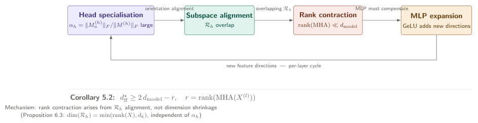
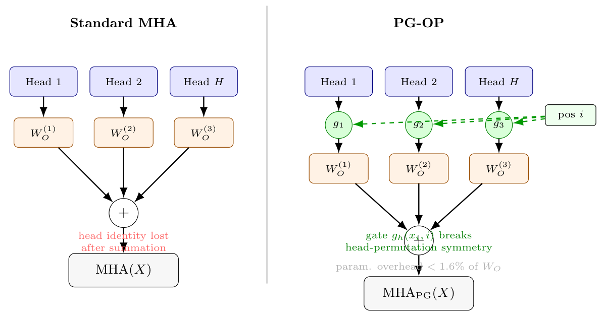
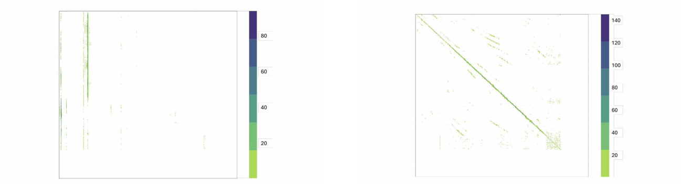
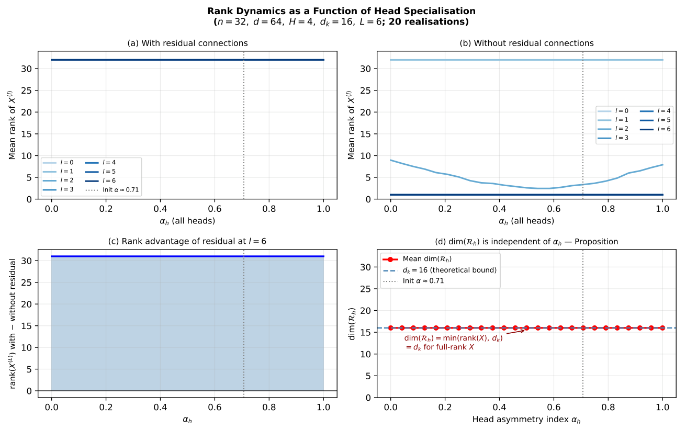
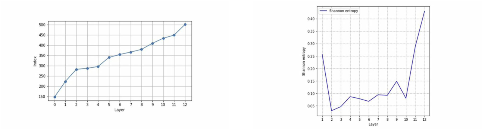

# Chapter 3: Head recoverability, PG-OP, and the BERT case study

[Library index](../README.md) · [Source policy](../SOURCE.md) · [Previous: PDF 125–130](0125-0130-ch03-normalisation-residual-and-mlp-rank.md) · [Next chapter: PDF 140–146](0140-0146-ch04-decomposition-circulation-and-directional-energy.md)

> **Editorial note.** Full English transcription of PDF 131–139 / printed pages 95–103, completing Chapter 3. Original prose, proofs, captions, diagram labels, unresolved references, and the explicitly missing dataset table are preserved. The diagram on PDF 131 retains an older width bound that the surrounding prose rejects. Figure 3.8 and its caption disagree about late-layer entropy; the image has not been redrawn. Separate commentary appears in [notes 21](../notes/21-residual-head-rank-and-mlp.md), [22](../notes/22-head-recoverability-and-pgop.md), and [23](../notes/23-bert-sars-cov2-case-study.md).

## PDF 131 · Book 95

**Remark 3.23 (Narrative consequence: the MLP’s role is interpolation, not a $2d-r$ overhead).** Theorem 3.22 replaces the heuristic “factor of two overhead” that has occasionally been cited as a justification for $d_{\mathrm{ff}}=4d_{\mathrm{model}}$ or similar conventions. The clean structural fact is: *a two-layer MLP with $d_{\mathrm{ff}}\ge n$ and a non-polynomial analytic activation can interpolate any target on a finite token sequence*. This is enough to restore arbitrary affine rank lost in the MHA residual.

The choice $d_{\mathrm{ff}}=4d_{\mathrm{model}}$ in standard Transformers is therefore not forced by rank considerations: with $n=128$ and $d_{\mathrm{model}}=768$ in $\mathrm{BERT}_{\mathrm{base}}$, the interpolation requirement is $d_{\mathrm{ff}}\ge128$, well below the canonical $d_{\mathrm{ff}}=3072$. The empirical case for $d_{\mathrm{ff}}=4d_{\mathrm{model}}$ must rest on optimisation, expressivity beyond rank, or generalisation arguments, not on rank restoration alone.

The per-layer cycle connecting head specialisation, rank contraction, and MLP expansion is illustrated in Figure 3.4.

**Figure 3.4: The specialisation–alignment–contraction–expansion loop.** Head specialisation causes subspace alignment, which causes rank contraction in the MHA output; the MLP restores full rank by finite-sample interpolation (Theorem 3.22), with hidden width $d_{\mathrm{ff}}\ge n$ sufficient.

> **Editorial artwork transcription.** The artwork contains the following sequence and annotations, including the older “Corollary 5.2” formula. These are source labels, not a replacement for the chapter's revised theorem.

| Diagram item | Text inside or beside it |
|---|---|
| Head specialisation | $\alpha_h=\lVert M_a^{(h)}\rVert_F/\lVert M^{(h)}\rVert_F$ large |
| Arrow to Subspace alignment | orientation alignment |
| Subspace alignment | $\mathcal R_h$ overlap |
| Arrow to Rank contraction | overlapping $\mathcal R_h$ |
| Rank contraction | $\operatorname{rank}(\operatorname{MHA})\ll d_{\mathrm{model}}$ |
| Arrow to MLP expansion | MLP must compensate |
| MLP expansion | GeLU adds new directions |
| Return arrow | new feature directions — per-layer cycle |

**Artwork footer:** “Corollary 5.2: $d_{\mathrm{ff}}^\star\ge2d_{\mathrm{model}}-r$, $r=\operatorname{rank}(\operatorname{MHA}(X^{(l)}))$”.

“Mechanism: rank contraction arises from $\mathcal R_h$ alignment, not dimension shrinkage (Proposition 6.3: $\dim(\mathcal R_h)=\min(\operatorname{rank}(X),d_k)$, independent of $\alpha_h$)”.

### 3.3.6 Head-channel non-identifiability

A second phenomenon, distinct from rank collapse and orthogonal to rank contraction, affects the architectural use of multi-head attention regardless of depth: although the per-head outputs are linearly recoverable from the mixture in the canonical regime, the head labels themselves are not canonical, and the architecture provides no mechanism for downstream layers to address an individual head’s contribution. We make both points precise.

**Theorem 3.24 (Generic recoverability of the head tuple in the canonical regime).** Let $\operatorname{MHA}(X)=\operatorname{Concat}(Y^{(1)},\ldots,Y^{(H)})W_O$ with $Y^{(h)}\in\mathbb R^{n\times d_v}$ and $W_O\in\mathbb R^{Hd_v\times d_{\mathrm{model}}}$. Assume the *canonical regime* $Hd_v=d_{\mathrm{model}}$ (as in $\mathrm{BERT}_{\mathrm{base}}$, where $H=12$, $d_v=64$, $d_{\mathrm{model}}=768$). If $W_O$ is invertible, the concatenated head tuple is linearly recoverable from the multi-head output:

$$
\operatorname{Concat}(Y^{(1)},\ldots,Y^{(H)})
=\operatorname{MHA}(X)W_O^{-1}.
$$

No linear-algebraic degrees of freedom of the concatenated head tuple are destroyed by the output projection in the canonical regime.

*Proof.* Set $C=\operatorname{Concat}(Y^{(1)},\ldots,Y^{(H)})\in\mathbb R^{n\times Hd_v}$. By definition $\operatorname{MHA}(X)=CW_O$. In the canonical regime $Hd_v=d_{\mathrm{model}}$, $W_O$ is square; if invertible, $C=\operatorname{MHA}(X)W_O^{-1}$. Each block $Y^{(h)}$ is then read off from the corresponding $d_v$-column block of $C$. $\square$

**Proposition 3.25 (Permutation non-canonicity of head labels).** For any permutation $\pi\in S_H$, define the permuted head tuple $Y_\pi^{(h)}=Y^{(\pi(h))}$ and permute the corresponding block

## PDF 132 · Book 96

rows of $W_O$ accordingly: $W_{O,\pi}$ is obtained from $W_O$ by permuting the $H$ blocks of $d_v$ rows according to $\pi$. Then

$$
\operatorname{Concat}(Y_\pi^{(1)},\ldots,Y_\pi^{(H)})W_{O,\pi}
=\operatorname{Concat}(Y^{(1)},\ldots,Y^{(H)})W_O.
$$

The head label $h$ is therefore not a canonical invariant of the layer function: it is a parametrisation convention. Two parameter configurations related by simultaneous head permutation produce identical outputs.

*Proof.* Permuting the heads $\pi:\{1,\ldots,H\}\to\{1,\ldots,H\}$ re-orders the blocks of the concatenated tuple, and the corresponding re-ordering of the row-blocks of $W_O$ exactly cancels the permutation on the left. Concretely, with $W_O$ partitioned in horizontal blocks $W_O^{(h)}\in\mathbb R^{d_v\times d_{\mathrm{model}}}$, $\sum_hY^{(h)}W_O^{(h)}=\sum_hY^{(\pi(h))}W_O^{(\pi(h))}$: the second equality is just a reindexing of the sum. $\square$

**Remark 3.26 (Correct slogan: non-canonicity, not destruction).** Theorem 3.24 and Proposition 3.25 together establish the correct statement about the multi-head structure. Earlier drafts of this chapter, and some of the secondary literature, have stated the phenomenon as a destruction of $n(H-1)d_v$ degrees of freedom (with the numerical value $n(H-1)d_v=360{,}448$ per layer in $\mathrm{BERT}_{\mathrm{base}}$ at $n=512$). This is incorrect in the canonical regime $Hd_v=d_{\mathrm{model}}$ with invertible $W_O$: the linear map $C\mapsto CW_O$ is bijective, and no linear-algebraic information of the concatenated tuple is destroyed. The substantive points are structural, not informational:

- The head labels are not canonical (Proposition 3.25). Any operationally meaningful invariant of the layer must be permutation-invariant in the head index.
- The architecture (a feed-forward MLP applied row-wise after MHA) has no built-in mechanism that consumes individual head contributions. Even though each $Y^{(h)}W_O^{(h)}$ is linearly recoverable from $\operatorname{MHA}(X)$, the standard architecture mixes them additively before the row-wise MLP acts, and the MLP cannot subsequently apply a different non-linearity to each head’s contribution.

The architectural intervention of the next subsection (PG-OP) addresses this second point: it adds a position-dependent gate that modulates each head’s contribution before summation, breaking the head-permutation symmetry on a position-by-head basis.

### 3.3.7 PG-OP: a partial remedy

A partial remedy for head-channel non-identifiability is to break the position-invariance of the output projection by gating each head’s contribution position-dependently before summation.

**Definition 3.27 (Position-Gated Output Projection (PG-OP)).** The *Position-Gated Output Projection* replaces $W_O^{(h)}$ with a position-dependent gate $g_h(x_i,i)\in(0,1)$:

$$
\operatorname{MHA}_{\mathrm{PG}}(X)_i
=\sum_h g_h(x_i,i)\cdot Y_i^{(h)}W_O^{(h)},
$$

where $g_h$ is a small learned function (e.g. a sigmoid of a position-dependent linear projection).

**Proposition 3.28 (Standard MHA is recovered as $g_h\equiv1$).** Standard multi-head attention $\operatorname{MHA}$ is recovered from $\operatorname{MHA}_{\mathrm{PG}}$ by setting $g_h\equiv1$ for all $h$.

*Proof.* The constant gate $g_h\equiv1$ reduces $\operatorname{MHA}_{\mathrm{PG}}(X)_i$ to $\sum_hY_i^{(h)}W_O^{(h)}=\operatorname{MHA}(X)_i$. $\square$

## PDF 133 · Book 97

**Figure 3.5: Comparison of the standard multi-head output projection (left) with the Position-Gated Output Projection (right).**

*In the standard form, each head’s contribution $Y^{(h)}W_O^{(h)}$ is summed without any position-dependent modulation: the head labels are non-canonical (Proposition 3.25), and the architecture has no mechanism for downstream layers to apply distinct non-linearities to individual head contributions. In PG-OP, a position-dependent gate $g_h(x_i,i)\in(0,1)$ modulates each head’s contribution before summation, breaking the head-permutation symmetry on a position-by-head basis. The parameter overhead is below 1.6% of $W_O$ at $\mathrm{BERT}_{\mathrm{base}}$ scale.*

> **Editorial artwork transcription.** Left: “Standard MHA”; “Head 1”, “Head 2”, “Head $H$”; $W_O^{(1)}$, $W_O^{(2)}$, $W_O^{(3)}$; summation; “head identity lost after summation”; $\operatorname{MHA}(X)$. Right: “PG-OP”; the same head and projection labels; gates $g_1,g_2,g_3$ receiving “pos $i$”; summation; “gate $g_h(x_i,i)$ breaks head-permutation symmetry”; “param. overhead $<1.6\%$ of $W_O$”; $\operatorname{MHA}_{\mathrm{PG}}(X)$. The label $W_O^{(3)}$ under “Head $H$” and the claims about identity and symmetry are retained.

To establish strictness, we work in the precise no-positional baseline where standard MHA is permutation-equivariant. In this regime the inclusion is provably strict; in the general regime where positional encodings are present, position-dependent effects can sometimes be reabsorbed into attention/value transformations, and a fully general strictness proof is not available.

**Proposition 3.29 (Strict separation of PG-OP from MHA in the no-positional setting).** Consider standard MHA without positional encoding and without any position-dependent parameters. Then the layer is permutation-equivariant:

$$
\operatorname{MHA}(\Pi X)=\Pi\operatorname{MHA}(X)
\qquad\text{for every permutation matrix }\Pi\text{ acting on the rows of }X.
$$

In particular, if all input rows are identical, $x_1=\cdots=x_n$, then all output rows of $\operatorname{MHA}(X)$ are equal.

PG-OP with a non-constant deterministic positional gate $g:\{1,\ldots,n\}\to\mathbb R$ and a non-zero shared value vector $v\in\mathbb R^{d_{\mathrm{model}}}$ can realise the output $y_i=g(i)v$, which has non-identical rows whenever $g$ is non-constant.

Therefore, in the no-positional MHA baseline, $\operatorname{MHA}_{\mathrm{PG}}$ strictly contains MHA as a parameter subfamily.

*Proof.* Without positional encoding and with weights shared across positions, each per-head computation depends on $X$ only through row-wise operations and the row-wise softmax of $XX^\top$-type quantities, all of which are equivariant under simultaneous row permutation of $X$. Hence $\operatorname{MHA}(\Pi X)=\Pi\operatorname{MHA}(X)$ for every row permutation $\Pi$.

## PDF 134 · Book 98

If $x_1=\cdots=x_n$, the input matrix $X$ is fixed by every permutation $\Pi$. By equivariance, $\operatorname{MHA}(X)=\operatorname{MHA}(\Pi X)=\Pi\operatorname{MHA}(X)$, i.e. $\operatorname{MHA}(X)$ is fixed by every row permutation. The only matrices fixed by all row permutations are those with all rows equal. Hence the $n$ output rows of $\operatorname{MHA}(X)$ are all equal.

Consider now PG-OP with $g$ non-constant and $v\ne0$. Choose all $Y^{(h)}W_O^{(h)}$ at row $i$ to equal $v$ (this is achievable by an appropriate choice of $W_V^{(h)},W_O^{(h)}$, e.g. with $H=1$, $W_V$ and $W_O$ such that the row-wise weighted average $A^{(h)}XW_V^{(h)}W_O^{(h)}$ equals $v$ at every row when the input has equal rows). Then $\operatorname{MHA}_{\mathrm{PG}}(X)_i=g(i)v$. Since $g$ is non-constant, the rows $\{g(i)v\}_{i=1}^n$ are not all equal. By the above, no standard MHA on the constant-row input $X$ can produce non-equal output rows. Hence the output $y_i=g(i)v$ is not realisable by any MHA configuration on this input, and the inclusion $\operatorname{MHA}\subset\operatorname{MHA}_{\mathrm{PG}}$ is strict. $\square$

**Remark 3.30 (Scope of the separation).** Proposition 3.29 establishes strictness in the no-positional baseline where standard MHA is permutation-equivariant. It does not claim that every gated PG-OP operator is outside MHA when the latter is given positional encodings in $X$. In that broader regime, position-dependent effects may sometimes be absorbed into attention/value transformations on finite domains. The strictness result above is therefore a precise functional separation in a precise baseline, not a universal one.

**Empirical prediction (not theorem).** The strictly larger parameter family suggests, but does not prove, that there exist tasks on which $\operatorname{MHA}_{\mathrm{PG}}$ attains lower loss than the best achievable by standard MHA. A natural candidate is any task whose optimal strategy weights head $h$ at position $i$ in proportion to that head’s directional energy $\Gamma^{(h,i)}$ at position $i$ — a position-dependent quantity that constant gates cannot track. The parameter overhead of PG-OP is below 1.6% of $W_O$ at $\mathrm{BERT}_{\mathrm{base}}$ scale. The empirical validation is the subject of Chapter ??.

### 3.3.8 Synthesis: the MLP debate, settled

**Remark 3.31 (Is the MLP necessary to prevent rank collapse?).** The results of §§3.3.2–3.3.7 together settle the long-standing debate on the MLP’s role.

*The MLP is sufficient but not necessary for preventing rank collapse* (Theorem 3.16): the residual stream alone generically obstructs the doubly-exponential collapse of Dong et al. (2021b). *The MLP is necessary for non-linearity* (Remark 3.18): without it, residual attention remains locally affine to first order and cannot generate features outside the affine hull of its inputs. *The MLP must compensate for rank contraction* (Theorem 3.22): when head specialisation causes the output subspaces $\mathcal R_h$ to align, rank contraction $\operatorname{rank}(\operatorname{MHA}(X^{(l)}))\ll d_{\mathrm{model}}$ ensues, and a position-wise MLP with hidden width $d_{\mathrm{ff}}\ge n$ and a non-polynomial analytic activation can restore the lost affine rank by finite-sample interpolation on the sequence.

The right question is therefore not whether an MLP is needed but how much non-linearity the task actually requires. Chapter ?? makes this question precise; Chapter ?? answers it with a reduced architecture.

A separate, structural phenomenon affects the multi-head architecture itself: in the canonical regime $Hd_v=d_{\mathrm{model}}$ with invertible $W_O$, the concatenated head tuple is linearly recoverable from $\operatorname{MHA}(X)$ via $W_O^{-1}$ (Theorem 3.24), so no linear information is destroyed by the output projection. What is non-canonical is the labelling of the heads (Proposition 3.25): simultaneous permutation of heads and the corresponding row blocks of $W_O$ leaves the

## PDF 135 · Book 99

layer function unchanged. The architectural consequence is that the standard post-MHA MLP cannot apply a head-specific non-linearity, since it sees only the summed signal. The Position-Gated Output Projection (Proposition 3.29) breaks the head-permutation symmetry on a position-by-position basis at modest parameter cost (below 1.6% of $W_O$ at $\mathrm{BERT}_{\mathrm{base}}$ scale).

### 3.3.9 Pre-training blind spot

The masked language modelling objective has a structural blind spot: it cannot develop asymmetric attention from first principles. The MLM loss is symmetric in the masked positions (Remark 3.1), so the directional component of the score matrix — $M_a^{(l,h)}$ — must emerge from the interaction between the NSP signal and the MLM signal, or from the positional structure of the corpus. Chapter ?? formalises this limitation and shows that it predicts the empirically observed pattern of head types in trained BERT models.

### 3.3.10 Closed mathematical form of the chapter mechanism

The results of this chapter combine into a single synthesis statement. Each clause below corresponds to one of the rigorous results of the chapter; the synthesis is intended both as a mnemonic and as a verification that the eight formal results form a coherent block.

**Theorem 3.32 (Closed mathematical form of the Chapter 3 mechanism).** In the Transformer encoder regime considered in this chapter, the following statements hold.

**(i)** Layer normalisation with $\beta=0$ preserves the matrix rank of the hidden-state matrix $X$ exactly under the non-degeneracy hypotheses $\sigma_i>0$, $\mathbf1_d\notin\operatorname{rowsp}(X)$, and $\gamma_j\ne0$ (Theorem 3.11). Without H2 the rank decreases by exactly one; the affine-rank version requires the strictly stronger $\mathbf1_d\notin\operatorname{span}\{x_i-x_j\}$ and is not unconditional even then (Remark 3.13).

**(ii)** The residual attention update $X\mapsto X+\operatorname{MHA}(X)$ is generically rank-expanding on each rank-$r$ stratum whenever a single transverse witness exists (Theorem 3.16). The exceptional locus is contained in a proper real-analytic subset and has measure zero on the stratum.

**(iii)** A position-wise two-layer MLP with hidden width $d_{\mathrm{ff}}\ge n$ and any non-polynomial real-analytic activation can interpolate arbitrary targets on the $n$ distinct token states of a finite sequence (Theorem 3.22). The MLP can therefore restore any affine rank lost in the MHA residual sum; the canonical width choice $d_{\mathrm{ff}}=4d_{\mathrm{model}}$ is not forced by rank considerations.

**(iv)** In the canonical regime $Hd_v=d_{\mathrm{model}}$, the concatenated head tuple is linearly recoverable from the multi-head output via $W_O^{-1}$ whenever $W_O$ is invertible (Theorem 3.24). The head label is not a canonical invariant of the layer function: simultaneous permutation of heads and the corresponding row blocks of $W_O$ leaves the output unchanged (Proposition 3.25).

**(v)** The Position-Gated Output Projection strictly extends standard multi-head attention in the no-positional, permutation-equivariant baseline: standard MHA on a constant-row input must produce constant-row output, while PG-OP with non-constant gate can produce non-constant rows (Proposition 3.29).

**(vi)** Frozen-encoder fine-tuning is exactly inheritance-preserving for the antisymmetric attention component (Proposition 3.7). Full encoder fine-tuning can change $M_a^{(l,h)}$, but the change is Lipschitz-controlled by the parameter-update size (Proposition 3.8).

## PDF 136 · Book 100

**(vii)** The NSP supervision acts on the final-layer hidden-state matrix only through the CLS row directly; non-CLS rows receive NSP gradient only through earlier-layer couplings (Proposition 3.5). The MLM supervision is permutation-equivariant on masked positions sharing the same MASK embedding when no positional encoding is present (Proposition 3.2).

*Proof.* Each clause is the corresponding result of the chapter; the conjunction is the substance of this synthesis. $\square$

The corrected narrative replaces three earlier claims that have appeared in the literature (and in earlier drafts of this chapter):

- Layer normalisation is not universally rank-neutral; rank collapse under LN is exceptional rather than impossible, and requires the precise H2 hypothesis above to be excluded.
- The MLP’s role is not captured by an ad hoc “factor of two” bound $d_{\mathrm{ff}}\ge2d_{\mathrm{model}}-r$; the correct quantitative tool is finite-sample interpolation.
- The multi-head architecture does not destroy $n(H-1)d_v=360{,}448$ degrees of freedom per layer in $\mathrm{BERT}_{\mathrm{base}}$ in any linear-algebraic sense; in the canonical regime the head tuple is generically recoverable, and what fails is the canonicity of head labels.

The PG-OP intervention, the finite-sample interpolation result, and the Lipschitz fine-tuning bound are the constructive substance that remains.

### 3.4 Case Study: SARS-CoV-2 Classification

The theoretical framework of the preceding sections is validated on a biological sequence classification task: distinguishing SARS-CoV-2 sequences from non-SARS coronaviruses, using a BERT model pre-trained on viral RNA.

**Figure 3.6: Directional (left) and reciprocal (right) attention head patterns in the SARS-CoV-2 classifier.** Directional heads have high asymmetry index $\alpha_h=\lVert M_a^{(h)}\rVert_F/\lVert M^{(h)}\rVert_F$; reciprocal heads have $\alpha_h\approx0$.

#### 3.4.1 Experimental setup

The dataset consists of SARS-CoV-2 RNA sequences (positive class) and sequences from six other betacoronaviruses (negative class), tokenised using 6-mer fragments. A BERT-base model ($L=12$, $H=12$, $d=768$, $d_{\mathrm{ff}}=3072$) is pre-trained on the combined corpus using MLM only (NSP is omitted for biological sequences), then fine-tuned on the classification task.

## PDF 137 · Book 101

Training and validation splits:

| Split | Sequences | Tokens |
|---|---|---|
| *data omitted in standalone build* | | |
| *(see master file for full numbers)* | | |

> **Editorial formatting note.** The two italic placeholder lines span all three columns in the PDF. No split sizes or token counts are present in this source; empty Markdown cells preserve that absence.

#### 3.4.2 Results

The fine-tuned model achieves near-perfect accuracy on the held-out test set (full numerical results in the master build of the monograph), confirming that the BERT representation captures the genomic signature of SARS-CoV-2.

**Figure 3.7: Parametric simulation of rank dynamics vs head specialisation.** With residual connections, rank is stable for all $\alpha_h$. Without residual, collapse is immediate. $\dim(\mathcal R_h)=d_k$ for all $\alpha_h$, confirming the architectural bound (Proposition, Chapter ??).

> **Editorial artwork transcription.** Title: “Rank Dynamics as a Function of Head Specialisation”; parameters: $n=32$, $d=64$, $H=4$, $d_k=16$, $L=6$; “20 realisations”. The four panels are: “(a) With residual connections”; “(b) Without residual connections”; “(c) Rank advantage of residual at $l=6$”; “(d) $\dim(\mathcal R_h)$ is independent of $\alpha_h$ — Proposition”. Panels (a) and (b) plot “Mean rank of $X^{(l)}$” against “$\alpha_h$ (all heads)” and distinguish $l=0,\ldots,6$. Panel (c) labels the vertical axis “$\operatorname{rank}(X^{(L)})$ with − without residual” and the horizontal axis $\alpha_h$. Panel (d) labels its axes $\dim(\mathcal R_h)$ and “Head asymmetry index $\alpha_h$”; its legend reads “Mean $\dim(\mathcal R_h)$”, “$d_k=16$ (theoretical bound)”, and “Init $\alpha\approx0.71$”. The red annotation is “$\dim(\mathcal R_h)=\min(\operatorname{rank}(X),d_k)=d_k$ for full-rank $X$”. The dotted initialisation marker “Init $\alpha\approx0.71$” is also shown in the other panels. Numerical curves are retained in the image; no raw values are supplied by this page.

**Figure 3.8: Cone index (left) and Shannon entropy (right) of attention heads across layers.** Directional heads (high cone index) emerge at intermediate layers; entropy declines in later layers as attention becomes more concentrated.

> **Editorial artwork transcription.** Left axes: “Layer” and “Index”. Right axes: “Layer” and “Shannon entropy”, with legend “Shannon entropy”. The graph is retained exactly. The right-hand curve rises sharply at the last two displayed layers, contrary to the caption's unqualified claim of late-layer decline; see [note 23](../notes/23-bert-sars-cov2-case-study.md#figure-evidence).

## PDF 138 · Book 102

#### 3.4.3 Empirical patterns consistent with theoretical predictions

The experiment is consistent with three predictions of this book. We state the empirical finding and the corresponding theoretical prediction separately, since the experimental evidence here is consistency, not proof.

1. **Head type separation (empirical, on $\mathrm{BERT}_{\mathrm{base}}$).** The asymmetry index $\alpha_h^{(l)}$ separates heads into directional and reciprocal types across layers (Figure 3.6). Theoretical correspondence: the antisymmetric decomposition $M=M_s+M_a$ of Chapter 2 provides the algebraic framework in which $\alpha_h$ is defined, and predicts that directional heads exist as a generic outcome of training; the observed separation is consistent with this framework, but the framework alone does not predict the precise distribution of $\alpha$ across layers (this is an empirical observation about $\mathrm{BERT}_{\mathrm{base}}$).

2. **Rank dynamics and subspace alignment (empirical).** The effective rank of $\operatorname{MHA}(X^{(l)})$ is lower at layers where directional heads dominate. Theoretical correspondence: a controlled simulation (Figure 3.7) reproduces the architectural bound $\dim(\mathcal R_h)\le d_v$ from Proposition 3.19 (with generic equality), and the aggregate rank decrease is consistent with Conjecture 11.66 on subspace alignment (a conjecture, not a theorem). Theorem 3.22 shows that the MLP can in principle restore the rank by interpolation; the empirical width $d_{\mathrm{ff}}=4d_{\mathrm{model}}$ is more than sufficient.

3. **Entropy decay (empirical).** The per-layer Shannon entropy of attention weights (Figure 3.8, right) decays in later layers. Theoretical correspondence: this is consistent with the entropy decay phenomenon analysed in the companion paper on antisymmetric attention (Bonino et al., 2025); the precise quantitative form of the decay is empirical.

The case study therefore validates the framework qualitatively: the quantitative outcomes (head-type histograms, rank curves, entropy profiles) are reported as empirical observations whose qualitative shape matches theoretical predictions, not as instances of forced laws.

#### 3.4.4 Historical note and multi-variant extension

The case study reported in this chapter uses a binary classification setup (SARS-CoV-2 vs. non-SARS coronaviruses) on 6-mer-tokenised RNA, chosen for the cleanest demonstration of the three predictions above. A finer-grained version of the same case study — distinguishing not just SARS-CoV-2 from other coronaviruses, but among the eight major SARS-CoV-2 variants themselves (Alpha, Beta, Gamma, Delta, Epsilon, Lambda, Mu, and Omicron lineages) on the spike-gene sequence — was first reported in Ghione (2022) and has since been developed into the geometric-interpretation paper Bonino et al. (2025).

The eight-variant setup adds two layers of biological structure to the analysis. First, the input domain is the spike protein gene of length $\sim4{,}000$ nucleotides (encoding the $\sim1{,}273$-amino-acid spike protein), partitioned into biologically meaningful sub-domains: the receptor-binding domain (RBD, the principal target of host-cell binding), the N-terminal domain (NTD), the heptad repeat 1 (HR1, involved in membrane fusion), and other structural regions. The proportion of attention paid by a head to each domain can be measured directly following the protocol of Vig and Belinkov (2019), producing a class-conditional heatmap of attention proportion across the $L\times H$ grid.

Second, the eight variants have known phylogenetic relationships (some lineages share a recent common ancestor, others are distant), and one can ask whether the network’s internal representation respects this phylogeny — a property that has no analogue in the binary setup. The multi-variant case study shows that it does: variants that are close on the

## PDF 139 · Book 103

phylogenetic tree produce visually similar layer-wise average attention maps, while distant variants (notably Omicron versus the Alpha/Gamma pair) produce divergent maps from the middle layers onward. The qualitative agreement is documented in Ghione (2022) and quantified in Bonino et al. (2025).

A complementary cluster-geometric analysis of the same trained model is reported in Chapter 7, §7.3, which traces the build-up of the class-cluster structure across the depth of the network. The two analyses — attention-on-domains in the present chapter, cluster-build-up in Chapter 7 — are consistent: both confirm that the encoder, not the classifier head, is doing the bulk of the discrimination work, and that this work is distributed across the layers in a structured way.

### 3.5 Concluding Remarks

This chapter has presented BERT through the lens of the mathematical framework developed in the preceding chapters. The reader who has followed the argument holds four results, of which two are original contributions of this book and its companion papers:

**Inherited results.** *Pre-training (§3.1):* the MLM and NSP objectives create a representation that is rich enough for transfer learning but has a structural blind spot with respect to directional attention. *Fine-tuning (§3.2):* the fine-tuned model is constrained by the pre-trained representation; no qualitatively new structure can be introduced during fine-tuning.

**Original contributions.** *Remark 3.31 (MLP role, rank contraction, non-canonicity of head labels):* the MLP is sufficient but not necessary for rank preservation; its irreplaceable function is non-linear feature generation, and a position-wise MLP with hidden width $d_{\mathrm{ff}}\ge n$ and a non-polynomial activation can interpolate arbitrary targets and restore any rank lost in the residual sum (Theorem 3.22). Head labels are non-canonical (Proposition 3.25): the concatenated head tuple is linearly recoverable from the multi-head output (Theorem 3.24), but the layer function is invariant under simultaneous head permutation. PG-OP breaks this permutation symmetry on a position-by-position basis at modest parameter cost.

*Case study (§3.4):* BERT pre-trained on viral RNA achieves near-perfect SARS-CoV-2 classification, with head types, rank contraction, and entropy decay consistent with theoretical predictions.

Chapter 2 introduced the score matrix and its decomposition; Chapter 13 will quantify how much of the BERT representation is actually used.

**Bibliographic note.** BERT was introduced by Devlin et al. (2019a). The masked language modelling objective is a cloze task in the tradition of Taylor (1953). Next-sentence prediction was criticised and later removed in RoBERTa (Liu et al., 2019). The rank collapse result is due to Dong et al. (2021b); the corrections developed in this chapter are from Cirrincione (2026b). The antisymmetric decomposition and the directional asymmetry index are introduced in Bonino et al. (2025). The SARS-CoV-2 classification experiment was first reported in the master thesis of Ghione (2022), in a multi-variant setup on the spike gene; the geometric interpretation developed in this chapter and its companion paper (Bonino et al., 2025) extends that early empirical work. The protocol for measuring per-domain attention proportion is due to Vig and Belinkov (2019).

> **Editorial boundary.** Chapter 3 ends here with its complete bibliographic note. [Chapter 4 begins on PDF 140 / printed page 104](0140-0146-ch04-decomposition-circulation-and-directional-energy.md#pdf-0140). No material from Chapter 4 is transcribed in this file.
