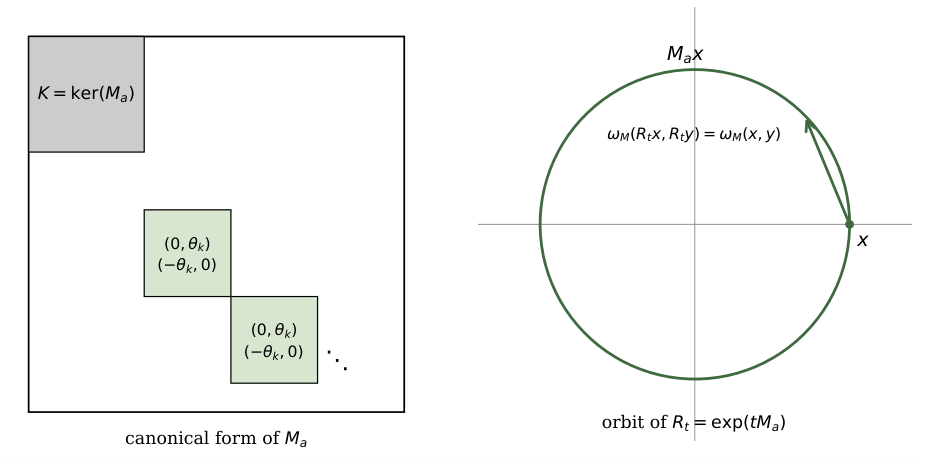

# Chapter 4: decomposition, circulation, directional energy, and symmetry scores

[Library index](../README.md) · [Source and transcription policy](../SOURCE.md) · [Previous pages: PDF 131–139](0131-0139-ch03-head-symmetry-pgop-and-case-study.md) · [Next pages: PDF 147–150](0147-0150-ch04-invariance-initialisation-and-classification.md)

> Editorial note: This file transcribes all source content on PDF pages 140–146 (printed pages 104–110), including the original Figure 4.1. The mathematical statements and their proofs are retained as printed. Interpretive limitations and source inconsistencies are discussed separately in the notes on [score decomposition](../notes/24-symmetric-and-antisymmetric-score-decomposition.md), [circulation and directional energy](../notes/25-circulation-geometry-and-directional-energy.md), and [symmetry indices and coordinate statistics](../notes/26-symmetry-index-and-coordinate-statistics.md). Section 4.5.3 continues on PDF 147.

## PDF 140 · Book 104

## Chapter 4 — The Symmetric/Antisymmetric Decomposition

Let $X\in\mathbb R^{n\times d}$ denote the matrix whose rows are the token representations entering a single attention head, and let $W_Q,W_K\in\mathbb R^{d\times d_k}$ be the query and key projections of that head. Ignoring the bias terms already separated in Chapter 2, the pre-softmax score matrix is

$$
L=XMX^\top,\qquad M:=W_QW_K^\top\in\mathbb R^{d\times d}.
\tag{4.1}
$$

The factor $M$ is the object of this chapter. It is not, in general, symmetric; it is not, in general, positive semidefinite; and therefore the expression $x_i^\top Mx_j$ cannot be read as an ordinary inner product or as a cosine similarity. It is a bilinear score. The failure of symmetry is not a defect to be hidden. It is the first structural split of the attention head.

Every square matrix decomposes uniquely into a symmetric and an antisymmetric component. For the attention operator $M$, this elementary algebraic fact has a non-elementary interpretation. The symmetric sector measures reciprocal affinity: the part of the score for which the relation from token $i$ to token $j$ is identical to the relation from token $j$ to token $i$. The antisymmetric sector measures orientation: the part of the score for which the ordered pair $(i,j)$ and the reversed pair $(j,i)$ carry opposite contributions. The former is metric-like; the latter is circulatory. The rest of the chapter makes that distinction precise.

The exposition gives special prominence to the concurrent work of Saponati, Sager, Aceituno, Stadelmann, and Grewe. Their paper and the foundational paper underlying the present chapter were posted to arXiv within forty-eight hours of each other and were developed independently. The overlap is real: both works isolate the same symmetric/antisymmetric decomposition of $W_QW_K^\top$, both interpret the score as a bilinear form, and both identify the balanced value $\alpha_h\simeq1/\sqrt2$ at random initialisation. The distinction is equally real. Saponati et al. study how training objectives shape symmetry and directionality in $W_QW_K^\top$; this chapter studies the static algebra, geometry, and gauge structure forced by the decomposition at fixed weights. The comparison is therefore not a priority dispute but a map between two complementary theories.

### 4.1 The decomposition

**Definition 4.1 (Symmetric/antisymmetric decomposition).** For $M\in\mathbb R^{d\times d}$ define

$$
M_s:=\frac12(M+M^\top),\qquad M_a:=\frac12(M-M^\top).
\tag{4.2}
$$

## PDF 141 · Book 105

Then $M=M_s+M_a$, $M_s^\top=M_s$, and $M_a^\top=-M_a$.

**Proposition 4.2 (Orthogonal splitting).** The spaces $\operatorname{Sym}(d)$ and $\mathfrak{so}(d)$ are orthogonal for the Frobenius inner product, and

$$
\|M\|_F^2=\|M_s\|_F^2+\|M_a\|_F^2.
\tag{4.3}
$$

Moreover $M_s$ and $M_a$ are the unique matrices with these symmetry properties whose sum is $M$.

*Proof.* The Frobenius inner product is $\langle A,B\rangle_F=\operatorname{tr}(A^\top B)$. If $S^\top=S$ and $A^\top=-A$, then

$$
\langle S,A\rangle_F
=\operatorname{tr}(SA)
=\operatorname{tr}((SA)^\top)
=\operatorname{tr}(A^\top S^\top)
=-\operatorname{tr}(AS)
=-\operatorname{tr}(SA),
\tag{4.4}
$$

so $\langle S,A\rangle_F=0$. Hence $\|M\|_F^2=\|M_s\|_F^2+\|M_a\|_F^2$ by Pythagoras applied to $M=M_s+M_a$. For uniqueness, suppose $M=S+A$ with $S^\top=S$ and $A^\top=-A$. Then $M^\top=S-A$, whence $S=(M+M^\top)/2$ and $A=(M-M^\top)/2$. $\square$

The bilinear score decomposes accordingly:

$$
x_i^\top Mx_j=x_i^\top M_sx_j+x_i^\top M_ax_j.
\tag{4.5}
$$

The first term is reciprocal because $x_i^\top M_sx_j=x_j^\top M_sx_i$. The second is directional because $x_i^\top M_ax_j=-x_j^\top M_ax_i$. In particular $x_i^\top M_ax_i=0$ for every vector $x_i$.

### 4.2 Proposition A: the Reciprocity–Directionality Identity

The decomposition of $M$ lifts canonically to the pre-softmax score matrix. This is the algebraic reason the words reciprocal and directional are legitimate at the level of tokens, not only at the level of parameters.

**Proposition 4.3 (Proposition A: Reciprocity–Directionality Identity).** Let $X\in\mathbb R^{n\times d}$ and $M\in\mathbb R^{d\times d}$. Define

$$
L:=XMX^\top,\qquad L_s:=XM_sX^\top,\qquad L_a:=XM_aX^\top.
\tag{4.6}
$$

Then

$$
L=L_s+L_a,\qquad L_s^\top=L_s,\qquad L_a^\top=-L_a.
\tag{4.7}
$$

Equivalently, for every pair of token positions $i,j$,

$$
L_{ij}+L_{ji}=2x_i^\top M_sx_j,
\tag{4.8}
$$

$$
L_{ij}-L_{ji}=2x_i^\top M_ax_j.
\tag{4.9}
$$

*Proof.* The identity $L=L_s+L_a$ follows from $M=M_s+M_a$. Since $M_s^\top=M_s$,

$$
L_s^\top=(XM_sX^\top)^\top=XM_s^\top X^\top=XM_sX^\top=L_s.
\tag{4.10}
$$

Similarly, since $M_a^\top=-M_a$,

$$
L_a^\top=(XM_aX^\top)^\top=XM_a^\top X^\top=-XM_aX^\top=-L_a.
\tag{4.11}
$$

The coordinate identities are the entries of the two equalities $L_s=(L+L^\top)/2$ and $L_a=(L-L^\top)/2$. $\square$

Proposition 4.3 is coordinate-free in the following sense. If the embedding coordinates are changed by an orthogonal matrix $R\in O(d)$ and one replaces $X$ by $XR$ and $M$ by $R^\top MR$, then $XMX^\top$ is unchanged. Thus the reciprocal and directional parts are not artifacts of a chosen orthonormal coordinate system.

## PDF 142 · Book 106

### 4.3 Theorem B: the Cycle Circulation Theorem

The antisymmetric part is not merely the residue left after subtracting a symmetric matrix. It is an element of the Lie algebra $\mathfrak{so}(d)$, and therefore carries the canonical structure of a skew form. This section records the consequences needed later in the book.

**Definition 4.4 (Directional pairing).** The antisymmetric component $M_a$ defines a bilinear form

$$
\omega_M(x,y):=x^\top M_ay,\qquad x,y\in\mathbb R^d.
\tag{4.12}
$$

The form $\omega_M$ is alternating: $\omega_M(x,x)=0$ for every $x$. It is not necessarily non-degenerate on all of $\mathbb R^d$, because $M_a$ may have a kernel. The correct statement is therefore pre-symplectic on $\mathbb R^d$ and symplectic on the quotient by the kernel.

**Theorem 4.5 (Theorem B: Cycle Circulation Theorem).** Let $M\in\mathbb R^{d\times d}$ and let $M_a=(M-M^\top)/2$. Then:

1. $M_a\in\mathfrak{so}(d)$ and $\operatorname{tr}(M_a)=0$.
2. $K:=\ker(M_a)$ is a canonical subspace of directionally inert vectors. The form $\omega_M$ descends to the quotient $\mathbb R^d/K$.
3. The descended form is non-degenerate on $\mathbb R^d/K$.
4. $\operatorname{rank}(M_a)$ is even.
5. The one-parameter family

$$
R_t:=\exp(tM_a),\qquad t\in\mathbb R,
\tag{4.13}
$$

belongs to $SO(d)$ and preserves $\omega_M$:

$$
\omega_M(R_tx,R_ty)=\omega_M(x,y)\qquad\text{for all }x,y\in\mathbb R^d.
\tag{4.14}
$$

*Proof.* The first claim follows directly from $M_a^\top=-M_a$. The trace of an antisymmetric real matrix is zero because each diagonal entry satisfies $(M_a)_{ii}=-(M_a)_{ii}$.

Let $K=\ker(M_a)$. If $k\in K$, then $\omega_M(k,y)=k^\top M_ay$. Since $M_a^\top=-M_a$, we have $k^\top M_a=-(M_ak)^\top=0$, so $\omega_M(k,y)=0$ for every $y$. By antisymmetry of $\omega_M$, also $\omega_M(x,k)=0$ for every $x$. Hence adding an element of $K$ to either argument does not change $\omega_M$, and the rule

$$
\bar\omega_M([x],[y]):=\omega_M(x,y)
\tag{4.15}
$$

is well-defined on the quotient.

To prove non-degeneracy on the quotient, suppose $[x]\in\mathbb R^d/K$ satisfies $\bar\omega_M([x],[y])=0$ for every $[y]$. Then $x^\top M_ay=0$ for every $y$, so $M_a^\top x=0$. Since $M_a^\top=-M_a$, this gives $M_ax=0$, hence $x\in K$ and $[x]=0$. Thus the quotient form is non-degenerate.

Every finite-dimensional real vector space carrying a non-degenerate alternating form has even dimension. Since $\dim(\mathbb R^d/K)=\operatorname{rank}(M_a)$ by rank–nullity, $\operatorname{rank}(M_a)$ is even.

Finally, $M_a^\top=-M_a$ implies

$$
R_t^\top R_t=\exp(tM_a)^\top\exp(tM_a)=\exp(-tM_a)\exp(tM_a)=I,
\tag{4.16}
$$

so $R_t\in O(d)$. Moreover $\det R_t=\exp(t\operatorname{tr}M_a)=1$, hence $R_t\in SO(d)$. Since $M_a$ commutes with $\exp(tM_a)$,

$$
R_t^\top M_aR_t=\exp(-tM_a)M_a\exp(tM_a)=M_a,
\tag{4.17}
$$

and therefore $\omega_M(R_tx,R_ty)=x^\top R_t^\top M_aR_ty=x^\top M_ay$. $\square$

## PDF 143 · Book 107

**Figure 4.1:** Canonical block structure of $M_a\in\mathfrak{so}(d)$.

Theorem 4.5 is the precise sense in which the antisymmetric sector is circulatory. On each nonzero two-dimensional symplectic block, the flow $R_t$ is a rotation; on the kernel it is inert. The antisymmetric score does not measure self-affinity, because $\omega_M(x,x)=0$; it measures oriented exchange between different directions. Figure 4.1 shows the canonical block structure of $M_a$ and the corresponding rotational orbits of $R_t$ on a representative two-dimensional symplectic block.

The kernel $K=\ker(M_a)$ is directionally inert (left, grey). The complement decomposes as a direct sum of two-dimensional symplectic blocks, on each of which $R_t=\exp(tM_a)$ acts as a planar rotation (right, with sample orbit). The rank of $M_a$ is the dimension of the rotational complement and is therefore even.

### 4.4 Theorem C: directional energy

The norm $\|M_a\|_F$ measures how much antisymmetric mass exists in the head parameters. It does not say whether that mass is active on the sequence currently being processed. A head can contain a large antisymmetric component whose induced alternating form restricts to zero on the row span of $X$. Directional energy is the sequence-dependent quantity that detects actual antisymmetric activity.

**Definition 4.6 (Directional energy).** For $X\in\mathbb R^{n\times d}$ and $M\in\mathbb R^{d\times d}$ define

$$
\Gamma(X;M):=\|XM_aX^\top\|_F.
\tag{4.18}
$$

**Theorem 4.7 (Theorem C: Directional Energy Theorem).** For every $X\in\mathbb R^{n\times d}$ and $M\in\mathbb R^{d\times d}$:

1. $\Gamma(X;M)$ depends only on $M_a$ and not on $M_s$.
2. $\Gamma$ is orthogonally gauge-invariant: for every $R\in O(d)$,

$$
\Gamma(XR;R^\top MR)=\Gamma(X;M).
\tag{4.19}
$$

3. Let $V:=\operatorname{row}(X)\subseteq\mathbb R^d$. Then $\Gamma(X;M)=0$ if and only if the restriction of $\omega_M$ to $V\times V$ is identically zero. This is strictly weaker than $M_av=0$ for every $v\in V$.

## PDF 144 · Book 108

*Proof.* The first claim is the definition of $\Gamma$ together with $XM_sX^\top$ entering only into $L_s$. For the second, observe that

$$
(R^\top MR)_a=\frac12(R^\top MR-R^\top M^\top R)=R^\top M_aR.
\tag{4.20}
$$

Thus

$$
(XR)(R^\top M_aR)(XR)^\top=XM_aX^\top,
\tag{4.21}
$$

so the Frobenius norm is unchanged.

For the third claim, the matrix $XM_aX^\top$ has $(i,j)$ entry $x_i^\top M_ax_j=\omega_M(x_i,x_j)$. Hence $XM_aX^\top=0$ if and only if $\omega_M(x_i,x_j)=0$ for all rows $x_i,x_j$ of $X$. By bilinearity, this is equivalent to $\omega_M$ vanishing on $V\times V$. The condition $M_av=0$ for every $v\in V$ is strictly stronger: it says $V\subseteq\ker M_a$, while vanishing of $\omega_M$ on $V\times V$ only says $M_aV\subseteq V^\perp$. $\square$

**Remark 4.8 (Trace identity).** The matrix $XM_aX^\top$ is antisymmetric, since its transpose equals $XM_a^\top X^\top=-XM_aX^\top$. Every antisymmetric matrix has trace zero, hence $\operatorname{tr}(XM_aX^\top)=0$ and $\operatorname{tr}(XMX^\top)=\operatorname{tr}(XM_sX^\top)$. This is unrelated to $\Gamma$ but is recorded here because it eliminates the antisymmetric component from any score that depends on $M$ only through traces.

The words *energy*, *gauge*, and *symplectic* are structural terms in this chapter. They do not assert a physical conservation law in the model. They assert an invariant quadratic norm, an invariance under orthogonal coordinate change, and the standard quotient structure of an alternating form.

**Remark 4.9 (Degenerate cases of vanishing $\Gamma$).** Two non-trivial cases are worth flagging. If $X$ has a single row ($n=1$), then $\omega_M(x_1,x_1)=0$ by alternating, so $\Gamma(X;M)=0$ for every $M$, regardless of whether $x_1\in\ker M_a$. If $V=\operatorname{row}(X)$ is one-dimensional, the same conclusion holds. For $n\ge2$ and $\dim V\ge2$, $\Gamma(X;M)=0$ requires that the symplectic form $\omega_M$ degenerate identically on $V$, a strictly stronger condition than $V\not\subseteq\ker M_a$.

> Editorial note: The final comparison in Remark 4.9 and the broad phrase “only through traces” in Remark 4.8 are retained as printed. See [the directional-energy note](../notes/25-circulation-geometry-and-directional-energy.md#source-caveats) for the precise zero criterion, counterexamples, and the distinction between a linear trace and traces of powers.

### 4.5 Relation with the concurrent work of Saponati et al.

Saponati et al. use the decomposition

$$
W_{qk}=M_s+M_n,
\tag{4.22}
$$

where $W_{qk}$ is their notation for the matrix $M=W_QW_K^\top$ of the present chapter, $M_s$ is symmetric, and $M_n$ is skew-symmetric. In our notation $M_n=M_a$. They introduce a symmetry score $s$ and a directionality score $d$. The first is a reparametrisation of the asymmetry index used here; the second is not. This section records the exact relations.

### 4.5.1 Symmetry score and asymmetry index

Saponati et al. define a symmetry score

$$
s(M):=2\frac{\|M_s\|_F^2-\|M_a\|_F^2}{\|M\|_F^2},\qquad M\ne0.
\tag{4.23}
$$

The asymmetry index used in this chapter is

$$
\alpha_h(M):=\frac{\|M_a\|_F}{\|M\|_F}.
\tag{4.24}
$$

## PDF 145 · Book 109

**Proposition 4.10 (Asymmetry index–symmetry score equivalence).** For every nonzero $M\in\mathbb R^{d\times d}$,

$$
s(M)=2-4\alpha_h(M)^2.
\tag{4.25}
$$

Consequently the map $\alpha_h\mapsto s$ is a bijection from $[0,1]$ to $[-2,2]$, with inverse

$$
\alpha_h=\frac12\sqrt{2-s}.
\tag{4.26}
$$

*Proof.* By the orthogonal splitting (Proposition 4.2), $\|M\|_F^2=\|M_s\|_F^2+\|M_a\|_F^2$. Dividing by $\|M\|_F^2$ gives $\|M_s\|_F^2/\|M\|_F^2=1-\alpha_h^2$ and $\|M_a\|_F^2/\|M\|_F^2=\alpha_h^2$. Substitution yields

$$
s(M)=2\bigl[(1-\alpha_h^2)-\alpha_h^2\bigr]=2-4\alpha_h^2.
\tag{4.27}
$$

The inverse formula follows by solving for $\alpha_h$, and the endpoints $\alpha_h=0,1$ are sent to $s=2,-2$ respectively. $\square$

**Corollary 4.11 (Identical information content).** The scalar $s(M)$ and the scalar $\alpha_h(M)$ contain exactly the same information. In particular, the two-class distinction of Saponati et al., obtained by the sign of $s$, is equivalent to thresholding $\alpha_h$ at $1/\sqrt2$.

*Proof.* By Proposition 4.10, $s=0$ if and only if $\alpha_h^2=1/2$. Moreover $s>0$ if and only if $\alpha_h<1/\sqrt2$, and $s<0$ if and only if $\alpha_h>1/\sqrt2$. $\square$

Thus, whenever Saponati et al. report a statement in terms of $s$, it can be translated without loss into the present notation. The two notations differ only in convention: $s$ is centred at zero and signed by dominance of the symmetric or antisymmetric sector; $\alpha_h$ is a norm fraction in $[0,1]$.

### 4.5.2 The directionality score is not the directional energy

The directionality score $d$ of Saponati et al. compares row-norm and column-norm dominance in a chosen coordinate basis. It is a coordinate-level statistic. By contrast, the directional energy of this chapter is

$$
\Gamma(X;M):=\|XM_aX^\top\|_F,
\tag{4.28}
$$

which depends only on the antisymmetric component and on the row span of the actual sequence representation $X$. These are different objects.

> Editorial note: The zero/nonzero criterion for $\Gamma$ depends on the row span, but its numerical value also depends on the lengths and multiplicities of the rows of $X$. The sentence above is retained as printed; [the directional-energy note](../notes/25-circulation-geometry-and-directional-energy.md#scale-and-span) gives the scaling identity.

**Lemma 4.12 (Equality of row and column norms for symmetric and antisymmetric matrices).** Let $M\in\mathbb R^{d\times d}$. If $M^\top=M$ or $M^\top=-M$, then for every $i\in\{1,\ldots,d\}$,

$$
\|m_{i,\cdot}\|_2=\|m_{\cdot,i}\|_2,
\tag{4.29}
$$

where $m_{i,\cdot}$ is the $i$-th row and $m_{\cdot,i}$ is the $i$-th column.

*Proof.* If $M^\top=M$, the $i$-th column equals the $i$-th row, so the equality is trivial. If $M^\top=-M$, the $i$-th column equals the negative of the $i$-th row, hence has the same Euclidean norm. $\square$

**Proposition 4.13 (Saponati directionality vanishes on pure components).** Let $d_{\mathrm{Sap}}(M)$ be the directionality score of Saponati et al., defined from the row and column norm profiles of $M$. If $M$ is symmetric or antisymmetric, then

$$
d_{\mathrm{Sap}}(M)=0
\tag{4.30}
$$

whenever the score is defined.

## PDF 146 · Book 110

*Proof.* By Lemma 4.12, the row and column norm profiles agree index by index:

$$
\|m_{i,\cdot}\|_2=\|m_{\cdot,i}\|_2\qquad\forall i.
\tag{4.31}
$$

Therefore the two empirical profiles have the same mean and standard deviation, the same threshold is applied to rows and columns, and the selected row and column contributions coincide. Hence $r_M=c_M$. Whenever the denominator $r_M+c_M$ is nonzero, this gives

$$
d_{\mathrm{Sap}}(M)=\frac{r_M-c_M}{r_M+c_M}=0.
\tag{4.32}
$$

If $r_M+c_M=0$, the score is undefined or conventionally set to zero, depending on the convention adopted. $\square$

**Proposition 4.14 (Independence of $d_{\mathrm{Sap}}$ and $\Gamma$).** Fix the threshold parameter used in $d_{\mathrm{Sap}}$. In sufficiently large dimension, the Saponati directionality score and the directional energy $\Gamma(X;M)$ do not determine one another.

*Proof.* First, take $M_1$ symmetric and $M_2$ antisymmetric. By Proposition 4.13, both have $d_{\mathrm{Sap}}=0$ whenever the score is defined. Choose $X$ whose row span contains a two-dimensional plane on which the alternating form induced by $M_2$ is nonzero (which exists by Theorem 4.5, item 4, since any nonzero antisymmetric matrix has even rank at least $2$). Then

$$
\Gamma(X;M_1)=0,\qquad\Gamma(X;M_2)>0,
\tag{4.33}
$$

by Theorem 4.7, items 1 and 3. Thus the same value of $d_{\mathrm{Sap}}$ can correspond to different values of $\Gamma$.

Conversely, fix an antisymmetric matrix $A$ and vary only the symmetric part $S$. Since

$$
(S+A)_a=A,
\tag{4.34}
$$

the quantity $\Gamma(X;S+A)$ is independent of $S$ for every $X$. By choosing $S$ so that the row and column norm profiles have different outlier structure under the Saponati threshold, one obtains different values of $d_{\mathrm{Sap}}$ while keeping $\Gamma$ fixed. This uses only the fact that the Saponati score is sensitive to row–column norm outlier imbalance; it is not asserted that every pointwise row–column norm discrepancy changes the score. $\square$

The conceptual distinction is simple. The score $d$ detects whether a matrix has dominant rows or dominant columns in a prescribed basis. The functional $\Gamma$ detects whether the antisymmetric part of the bilinear form is active on the sequence subspace actually occupied by $X$. The first is a coordinate statistic of $M$; the second is a gauge-invariant sequence functional of $M_a$.

### 4.5.3 Static algebra and training dynamics

The remaining results of this chapter are statements about the matrix $M$ at fixed weights. They do not say how training moves $M$. Conversely, the training-dynamical theorems of Saponati et al. describe the asymptotic structure of updates under autoregressive and bidirectional objectives; they do not imply the pre-symplectic, rank-parity, or layer-normalisation results below.

---

[Continue Section 4.5.3: Proposition 4.15 on PDF 147](0147-0150-ch04-invariance-initialisation-and-classification.md#pdf-0147)
