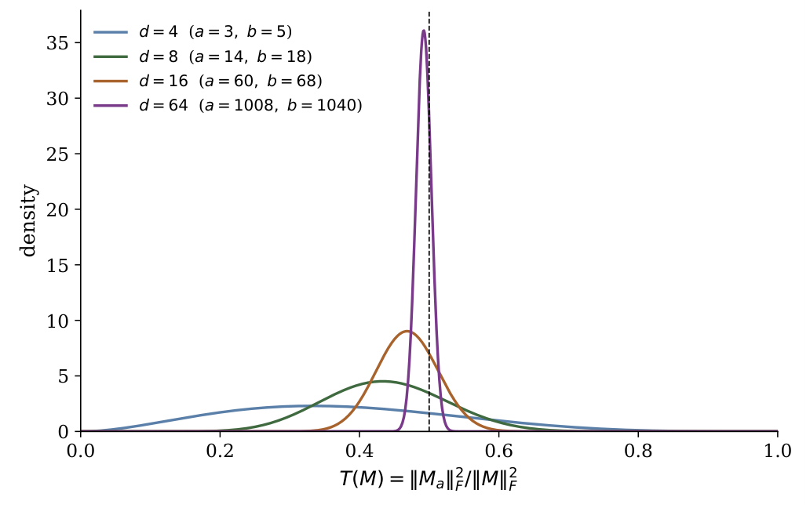

# Chapter 4: invariance, random initialisation, and sequence activity

[Library index](../README.md) · [Source and transcription policy](../SOURCE.md) · [Previous pages: PDF 140–146](0140-0146-ch04-decomposition-circulation-and-directional-energy.md)

> Editorial note: This file transcribes all source content on PDF pages 147–150 (printed pages 111–114), including the original Figure 4.2. It begins with the continuation of Section 4.5.3 and ends inside the second paragraph of Section 4.8. Proposition 4.17 and Definition 4.18 are complete in this range. The numerical and probabilistic conditions are discussed in the notes on [invariance and coordinate statistics](../notes/26-symmetry-index-and-coordinate-statistics.md) and [initialisation and sequence activity](../notes/27-random-initialisation-and-sequence-activity.md). PDF 151 and later body pages have not been read for this batch.

## PDF 147 · Book 111

*Continuation of [Section 4.5.3](0140-0146-ch04-decomposition-circulation-and-directional-energy.md#section-4-5-3).*

**Proposition 4.15 (Different invariance domains).** The structural results of this chapter and the row–column dominance results of Saponati et al. live in different invariance classes. The former are invariant under orthogonal change of coordinates in the embedding space. The latter are formulated in a fixed coordinate basis and are not invariant under a generic orthogonal conjugation. Consequently no coordinate-free statement about $M_a$ alone can imply a row–column dominance statement without additional gauge-fixing assumptions, and no row–column dominance statistic can recover the pre-symplectic structure of $M_a$ without additional structural data.

*Proof.* Let $R\in O(d)$ and replace $M$ by $R^\top MR$. Then $(R^\top MR)_a=R^\top M_aR$, and the Frobenius norm, kernel, rank, quotient symplectic form, and flow $\exp(tM_a)$ are transported isomorphically. The theorems of this chapter therefore depend only on the bilinear form up to orthogonal gauge. Row and column dominance in a fixed basis is not invariant under such conjugation: a generic rotation mixes the coordinate rows and columns and changes their norm-outlier structure. Therefore the two analyses are not related by a lossless translation. Passing from one to the other requires additional assumptions that select a coordinate gauge or connect the training dynamics to the invariant antisymmetric sector. $\square$

The relation with Saponati et al. can now be stated in one sentence. The two frameworks share the same decomposition and the same one-dimensional asymmetry information; they diverge on the second statistic, because $d$ and $\Gamma$ measure different phenomena; and beyond that point the present chapter studies static algebra whereas Saponati et al. study objective-dependent dynamics.

### 4.6 The asymmetry index at initialisation

The asymmetry index is

$$
\alpha_h(M):=\frac{\|M_a\|_F}{\|M\|_F},\qquad M\ne0.
\tag{4.35}
$$

It is invariant under orthogonal gauge and lies in $[0,1]$. The value $\alpha_h=0$ means purely reciprocal; $\alpha_h=1$ means purely antisymmetric; $\alpha_h=1/\sqrt2$ means equal Frobenius mass in the symmetric and antisymmetric sectors.

**Proposition 4.16 (Gauge invariance of the asymmetry index).** For every $R\in O(d)$ and every nonzero $M$,

$$
\alpha_h(R^\top MR)=\alpha_h(M).
\tag{4.36}
$$

*Proof.* As above, $(R^\top MR)_a=R^\top M_aR$. The Frobenius norm is invariant under multiplication by orthogonal matrices, so both numerator and denominator in the definition of $\alpha_h$ are unchanged. $\square$

At isotropic random initialisation, the symmetric and antisymmetric sectors receive asymptotically equal mass, after accounting for their dimensions. The proposition below concerns an isotropic surrogate: it assumes the entries of $M$ are i.i.d., which holds for an unconstrained random matrix but not for the actual Transformer factorisation

$$
M=W_QW_K^\top,
\tag{4.37}
$$

where the entries of $M$ are sums of products of Gaussian variables and are not independent across indices. The same balanced value $\alpha_h\simeq1/\sqrt2$ is observed empirically for the factorised case, but its proof requires a separate analysis of the product distribution. The iid matrix

## PDF 148 · Book 112

result below should therefore be read as an isotropic surrogate baseline, not as a proof for the exact product-factorised Transformer initialisation.

**Proposition 4.17 (Asymmetry at isotropic Gaussian initialisation).** Let the entries of $M\in\mathbb R^{d\times d}$ be i.i.d. $N(0,\sigma^2)$. Set

$$
n_a:=\binom d2=\frac{d(d-1)}2,\qquad
n_s:=\binom{d+1}2=\frac{d(d+1)}2,
\tag{4.38}
$$

so that $n_a+n_s=d^2$. Then:

1. $\|M_a\|_F^2$ and $\|M_s\|_F^2$ are independent random variables with

$$
\|M_a\|_F^2\sim\sigma^2\chi^2_{n_a},\qquad
\|M_s\|_F^2\sim\sigma^2\chi^2_{n_s}.
\tag{4.39}
$$

2. The ratio

$$
T(M):=\frac{\|M_a\|_F^2}{\|M\|_F^2}
\tag{4.40}
$$

follows the Beta distribution

$$
T(M)\sim\operatorname{Beta}\left(\frac{n_a}2,\frac{d^2-n_a}2\right)
=\operatorname{Beta}\left(\frac{d(d-1)}4,\frac{d(d+1)}4\right).
\tag{4.41}
$$

Its expectation is

$$
\mathbb E\,T(M)=\mathbb E\,\alpha_h(M)^2
=\frac{n_a}{d^2}
=\frac{d-1}{2d}
=\frac12-\frac1{2d}.
\tag{4.42}
$$

3. As $d\to\infty$, $\alpha_h(M)\xrightarrow{p}1/\sqrt2$.
4. Under the relaxed hypothesis that the entries are independent, centred, with common variance $\sigma^2$ and finite fourth moment, the convergence in probability $\alpha_h(M)\to1/\sqrt2$ still holds as $d\to\infty$.

*Proof. Independence and chi-square structure.* Writing $M_{ij}=Z_{ij}$ with $Z_{ij}\sim N(0,\sigma^2)$ i.i.d., one has, for $i<j$,

$$
(M_a)_{ij}=\frac12(Z_{ij}-Z_{ji}),\qquad
(M_s)_{ij}=\frac12(Z_{ij}+Z_{ji}),
\tag{4.43}
$$

and $(M_s)_{ii}=Z_{ii}$, $(M_a)_{ii}=0$. The pair $((M_s)_{ij},(M_a)_{ij})$ for $i<j$ is the orthogonal transformation $(u,v)\mapsto((u+v)/2,(u-v)/2)$ applied to $(Z_{ij},Z_{ji})$ and produces two independent $N(0,\sigma^2/2)$ variables. Distinct off-diagonal pairs use disjoint $Z$-variables, and the diagonal $\{Z_{ii}\}_{i=1}^d$ is independent of all off-diagonal pairs. The off-diagonal entries of $M_a$ and $M_s$ are therefore independent of each other, and the diagonal of $M_s$ is independent of both. By antisymmetry, $\|M_a\|_F^2$ counts each off-diagonal pair twice:

$$
\|M_a\|_F^2=2\sum_{i<j}(M_a)_{ij}^2.
\tag{4.44}
$$

Since $(M_a)_{ij}\sim N(0,\sigma^2/2)$, we have $2(M_a)_{ij}^2\sim\sigma^2\chi^2_1$, and summing the $n_a=d(d-1)/2$ independent pairs gives $\|M_a\|_F^2\sim\sigma^2\chi^2_{n_a}$. Likewise $\|M_s\|_F^2$ counts off-diagonal pairs twice and adds the diagonal squares:

$$
\|M_s\|_F^2=2\sum_{i<j}(M_s)_{ij}^2+\sum_{i=1}^dZ_{ii}^2.
\tag{4.45}
$$

## PDF 149 · Book 113

The first sum is $\sigma^2\chi^2_{n_a}$ as above; the second is $\sigma^2\chi^2_d$ and is independent of it. The total is $\sigma^2\chi^2_{n_a+d}=\sigma^2\chi^2_{n_s}$, since $n_a+d=n_s$. Independence of $\|M_a\|_F^2$ and $\|M_s\|_F^2$ follows from independence of the underlying disjoint sets of Gaussian coordinates.

*Beta distribution of $T$.* Independent chi-squares $U\sim\chi^2_p$, $V\sim\chi^2_q$ satisfy $U/(U+V)\sim\operatorname{Beta}(p/2,q/2)$. Applied to $\sigma^2U=\|M_a\|_F^2$ and $\sigma^2V=\|M_s\|_F^2$ with $p=n_a$, $q=n_s$,

$$
T(M)=\frac{\|M_a\|_F^2}{\|M_a\|_F^2+\|M_s\|_F^2}
=\frac U{U+V}
\sim\operatorname{Beta}(n_a/2,n_s/2).
\tag{4.46}
$$

Substituting $n_a=d(d-1)/2$ and $n_s=d(d+1)/2$ gives the stated parameters. The mean of $\operatorname{Beta}(a,b)$ is $a/(a+b)$, so

$$
\mathbb E\,T(M)=\frac{n_a/2}{(n_a+n_s)/2}
=\frac{n_a}{d^2}
=\frac{d-1}{2d}.
\tag{4.47}
$$

*Convergence in probability for the Gaussian case.* The variance of $\operatorname{Beta}(a,b)$ is $ab/((a+b)^2(a+b+1))$. With $a=n_a/2$ and $b=n_s/2$, both of order $d^2$, this is $O(1/d^2)$. Chebyshev’s inequality gives $T(M)\xrightarrow{p}1/2$, and the continuous mapping theorem applied to $\sqrt{\cdot}$ gives $\alpha_h(M)\xrightarrow{p}1/\sqrt2$.

*Generalisation to non-Gaussian entries.* Under independence, centring, common variance $\sigma^2$, and finite fourth moment, $\mathbb E\|M_a\|_F^2=n_a\sigma^2$ and $\mathbb E\|M\|_F^2=d^2\sigma^2$. Each squared entry has finite variance bounded by the fourth moment. Summing $n_a$ independent variances and dividing by $(d^2\sigma^2)^2$ gives $\operatorname{Var}(\|M_a\|_F^2/d^2\sigma^2)=O(1/d^2)$, and similarly $\operatorname{Var}(\|M\|_F^2/d^2\sigma^2)=O(1/d^2)$. The weak law of large numbers then gives

$$
\frac{\|M_a\|_F^2}{d^2\sigma^2}\xrightarrow{p}\frac12,\qquad
\frac{\|M\|_F^2}{d^2\sigma^2}\xrightarrow{p}1.
\tag{4.48}
$$

Slutsky’s theorem applied to the ratio gives $T(M)\xrightarrow{p}1/2$, and the continuous mapping theorem yields $\alpha_h(M)\xrightarrow{p}1/\sqrt2$. $\square$

> Editorial note: The non-degenerate Beta law requires $d\ge2$ and $\sigma>0$; $d=1$ gives $T=0$, and $\sigma=0$ makes the ratio undefined. The half-sum/half-difference map in the proof is a scaled orthogonal map. For the stated non-Gaussian extension, the variance argument also needs control of fourth moments uniformly as the dimension grows, or a common fixed entry distribution. These qualifications and a counterexample to an unrestricted finite-fourth-moment interpretation are given in [the initialisation note](../notes/27-random-initialisation-and-sequence-activity.md#non-gaussian-extension). The source wording above is preserved.

The same value appears in Saponati et al. as $s\simeq0$ at initialisation. Proposition 4.10 shows that this is the same statement in a different coordinate on the one-dimensional asymmetry axis. Figure 4.2 shows the Beta density of $T(M)=\alpha_h(M)^2$ for several values of $d$, illustrating concentration at $1/2$ as $d$ grows.

### 4.7 Parameter type and sequence activity

The scalar $\alpha_h$ says how much antisymmetric mass the head contains. The scalar $\Gamma(X;M)$ says whether the alternating form induced by that mass is active on the current sequence. Combining them gives a useful classification, but the two axes should not be collapsed into a single disjoint partition: $\alpha_h$ is a *parameter-side type*, whereas $\Gamma$ is a *sequence-side activity state*. They can vary independently, and a single head occupies one position on each axis simultaneously.

Fix thresholds

$$
0<\alpha_{\mathrm{low}}<\alpha_{\mathrm{high}}<1,\qquad\gamma>0,
\tag{4.49}
$$

where $\gamma$ is applied to a normalised version of $\Gamma$ appropriate to the scale of the layer.

## PDF 150 · Book 114

**Figure 4.2:** Density of $T(M)=\|M_a\|_F^2/\|M\|_F^2$ for i.i.d. Gaussian entries, equal to $\operatorname{Beta}(d(d-1)/4,d(d+1)/4)$ as established in Proposition 4.17. As $d$ grows, the density concentrates at $1/2$, with mean $(d-1)/(2d)$. The dashed vertical line marks $1/2$.

> Editorial transcription of the plot labels: the horizontal axis is $T(M)=\|M_a\|_F^2/\|M\|_F^2$; the vertical axis is density. The legend lists $d=4$ $(a=3,b=5)$, $d=8$ $(a=14,b=18)$, $d=16$ $(a=60,b=68)$, and $d=64$ $(a=1008,b=1040)$.

**Definition 4.18 (Parameter type and sequence activity).** For a head with operator $M$ and sequence representation $X$, define its parameter type by

$$
\operatorname{type}(M)=
\begin{cases}
\text{reciprocal},&\alpha_h(M)\le\alpha_{\mathrm{low}},\\
\text{mixed},&\alpha_{\mathrm{low}}<\alpha_h(M)<\alpha_{\mathrm{high}},\\
\text{directional},&\alpha_h(M)\ge\alpha_{\mathrm{high}},
\end{cases}
\tag{4.50}
$$

and, independently, its sequence activity state by

$$
\operatorname{activity}(X;M)=
\begin{cases}
\text{active},&\Gamma(X;M)>\gamma,\\
\text{sequence-silent},&\Gamma(X;M)\le\gamma.
\end{cases}
\tag{4.51}
$$

A head is therefore not assigned to one of four mutually exclusive classes. It has one of three parameter types and one of two sequence activity states; the two are determined separately. The familiar visual partition of the $(\alpha_h,\Gamma)$ plane in Figure 4.3 arises from plotting the three parameter regimes along the $\alpha_h$ axis and overlaying the sequence-silent strip along the $\Gamma$ axis. A head can be strongly antisymmetric in its weights and nevertheless sequence-silent on a particular input if the row span of $X$ lies close to an isotropic subspace for the alternating form $\omega_M$. This is precisely why the taxonomy cannot be reduced to the two-class $s$ or $\alpha_h$ taxonomy.

### 4.8 Numerical verification principles

The numerical experiments attached to this chapter have a limited role. They do not prove the theorems; the proofs above do that. Their role is to make the algebra visible and to check that the implementation respects the identities.

The decomposition experiment verifies that $M=M_s+M_a$ and that the Frobenius identity $\|M\|_F^2=\|M_s\|_F^2+\|M_a\|_F^2$ holds to numerical precision. The eigenplane experiment verifies

> **Editorial boundary — end of batch 003:** PDF 150 ends mid-sentence after “The eigenplane experiment verifies”. The continuation and Figure 4.3 are now available on [PDF 151 / printed page 115](0151-0154-ch04-training-and-normalisation.md#pdf-0151) in batch 004. Section 4.8 is complete across these files; this file retains the physical PDF 150 boundary.
