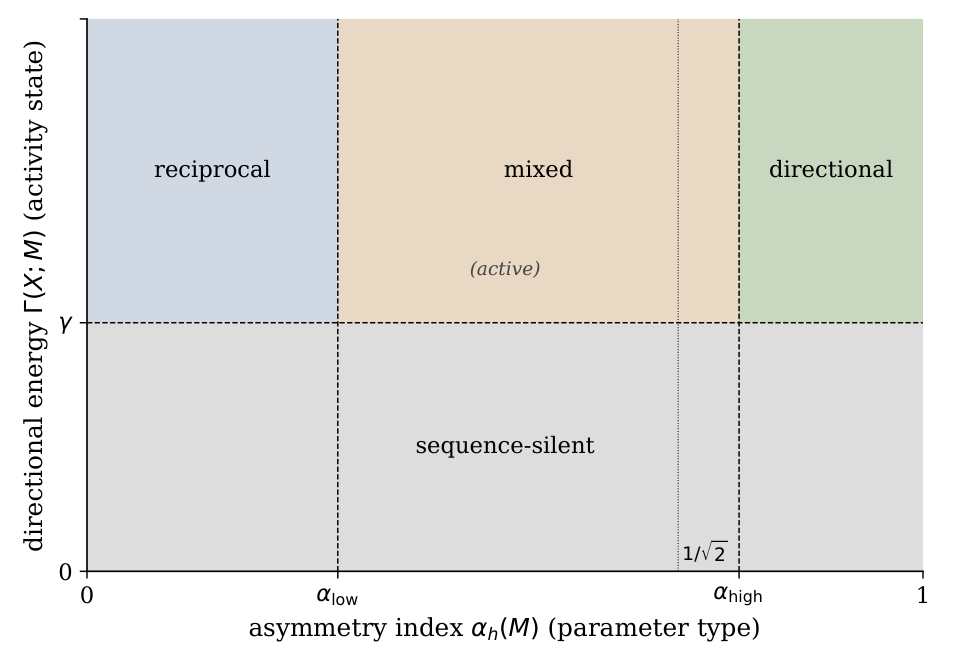

# Chapter 4: gradient splitting, layer normalisation, and concluding remarks

[Library index](../README.md) · [Source and transcription policy](../SOURCE.md) · [Previous pages: PDF 147–150](0147-0150-ch04-invariance-initialisation-and-classification.md) · [Next pages: PDF 155–161](0155-0161-ch05-context-and-related-work.md)

> Editorial note: This file preserves the English source on PDF 151–154 (printed pages 115–118), including its original mathematical claims and figure. The body on PDF 151 continues §4.8 from the preceding batch after an intervening figure. Chapter 4 ends on PDF 154. Qualifications concerning factorised updates and layer normalisation are kept separately in [note 28](../notes/28-gradients-factorisation-and-layer-normalisation.md).

## PDF 151 · Book 115

**Figure 4.3:** Parameter type along the $\alpha_h$ axis (reciprocal, mixed, directional) and sequence activity state along the $\Gamma$ axis (active, sequence-silent), shown together in the $(\alpha_h,\Gamma)$ plane. The two axes are independent: a head with high $\alpha_h$ in its weights can still be sequence-silent on a particular input.

> Editorial boundary: continuation of [§4.8 on PDF 150](0147-0150-ch04-invariance-initialisation-and-classification.md#pdf-0150). The preceding words are “The eigenplane experiment verifies”.

the canonical block structure of $M_a$ and the conservation of $\omega_M$ along $R_t=\exp(tM_a)$. The taxonomy figure displays the parameter type and sequence activity state in the $(\alpha_h,\Gamma)$ plane. The rank-parity experiment verifies that the numerical rank of random antisymmetric matrices is even up to tolerance. The initialisation experiment checks the convergence of $\alpha_h$ toward $1/\sqrt2$ at BERT-base scale and matches the Beta-law prediction of Proposition 4.17. The layer-normalisation experiment checks the exact commutation case in Proposition 4.21 below.

These experiments are reproducibility checks, not additional assumptions. If a numerical implementation contradicts any of the exact identities above, the implementation is wrong, not the theorem.

### 4.9 Dynamics and layer normalisation

The decomposition is algebraic, but it must coexist with two dynamical operations used throughout Transformer training: gradient descent and layer normalisation. A complete theory of training dynamics is deferred to the motor formalism of later chapters. The present section records only the facts that follow at the level of the decomposition itself.

#### 4.9.1 Gradient splitting

For losses depending smoothly on $M$ treated as a free Euclidean parameter, the gradient $G=\nabla_M\mathcal L$ splits as

$$
G_s:=\frac12(G+G^\top),\qquad
G_a:=\frac12(G-G^\top).
\tag{4.52}
$$

A free-$M$ gradient step $M\mapsto M-\eta G$ therefore induces

$$
M_s\mapsto M_s-\eta G_s,\qquad
M_a\mapsto M_a-\eta G_a.
\tag{4.53}
$$

## PDF 152 · Book 116

This statement is exact as an identity of vector spaces. It should not be read as a complete description of Transformer parameter training. In the actual parametrisation

$$
M=W_QW_K^\top,
\tag{4.54}
$$

the optimiser updates $W_Q$ and $W_K$, not $M$ directly, and the induced update of $M$ is factorised through these two matrices. To first order,

$$
\Delta M=(\Delta W_Q)W_K^\top+W_Q(\Delta W_K)^\top+O(\|\Delta W\|^2).
\tag{4.55}
$$

The two correction terms are not, in general, orthogonally split between $\operatorname{Sym}(d)$ and $\mathfrak{so}(d)$: a perturbation that is purely directional in one factor produces a $\Delta M$ whose symmetric and antisymmetric parts both depend on the current $W_Q,W_K$. Consequently the factorisation couples the symmetric and antisymmetric sectors at every step, and the free-$M$ splitting above is an algebraic baseline rather than a faithful picture of the optimiser’s trajectory. Decoupling of the loss into independent symmetric and antisymmetric objectives is a stronger dynamical statement; it holds for special quadratic losses with orthogonal projections but not for a general softmax cross-entropy. The quantitative coupling of $M_s$ and $M_a$ under the full attention loss is therefore a genuine dynamical problem, not a consequence of the static decomposition.

#### 4.9.2 Layer normalisation and the orthogonal flow

Let $\mathbf1\in\mathbb R^d$ be the all-ones vector and let

$$
P:=I-\frac1d\mathbf1\mathbf1^\top
\tag{4.56}
$$

be the centering projection. Ignoring learned affine scale and shift, layer normalisation maps a vector $x$ to

$$
\operatorname{LN}(x)=\frac{Px}{\|Px\|/\sqrt d},
\tag{4.57}
$$

whenever $Px\ne0$. Thus LN is radial normalisation on the hyperplane $\mathbf1^\perp$.

**Lemma 4.19 (Antisymmetric matrices vanish on the diagonal of $\mathbf1$).** For every $M_a\in\mathfrak{so}(d)$, the vector $M_a\mathbf1$ lies in $\mathbf1^\perp$, that is, $\mathbf1^\top M_a\mathbf1=0$.

*Proof.* The scalar $\mathbf1^\top M_a\mathbf1$ equals its own transpose, hence equals $-\mathbf1^\top M_a\mathbf1$ by antisymmetry, so it is zero. $\square$

**Proposition 4.20 (Post-LN directional energy bound).** Let $\widehat X$ be the matrix obtained by applying layer normalisation row-wise to $X$, without learned affine parameters, so that every row of $\widehat X$ has Euclidean norm $\sqrt d$. Then

$$
\Gamma(\widehat X;M)\le\|\widehat X\|_2^2\,\|M_a\|_F\le nd\,\|M_a\|_F,
\tag{4.58}
$$

and the sharper element-wise bound

$$
\Gamma(\widehat X;M)\le nd\,\|M_a\|_2
\tag{4.59}
$$

also holds.

## PDF 153 · Book 117

*Proof.* The submultiplicativity of the Frobenius norm under composition with operator norms gives

$$
\|\widehat X M_a\widehat X^\top\|_F
\le\|\widehat X\|_2\,\|M_a\widehat X^\top\|_F
\le\|\widehat X\|_2\,\|M_a\|_F\,\|\widehat X^\top\|_2
=\|\widehat X\|_2^2\,\|M_a\|_F.
\tag{4.60}
$$

For the row-norm bound, $\|\widehat X\|_F^2=nd$ and $\|\widehat X\|_2\le\|\widehat X\|_F=\sqrt{nd}$, hence $\|\widehat X\|_2^2\le nd$. For the element-wise bound, the $(i,j)$ entry of $\widehat X M_a\widehat X^\top$ satisfies

$$
|\widehat x_i^\top M_a\widehat x_j|
\le\|\widehat x_i\|_2\,\|M_a\|_2\,\|\widehat x_j\|_2
=d\|M_a\|_2.
\tag{4.61}
$$

There are $n^2$ entries, so the squared Frobenius norm is at most $n^2d^2\|M_a\|_2^2$, giving the stated bound. $\square$

**Proposition 4.21 (LN–flow compatibility).** Let $M_a\in\mathfrak{so}(d)$ and $R_t=\exp(tM_a)$. Define

$$
\mathfrak{so}(d)_{\mathbf1}:=\{A\in\mathfrak{so}(d):A\mathbf1=0\}.
\tag{4.62}
$$

Then:

1. if $M_a\mathbf1=0$, then $R_t\mathbf1=\mathbf1$ for every $t\in\mathbb R$, and layer normalisation commutes exactly with the flow:

$$
\operatorname{LN}(R_tx)=R_t\operatorname{LN}(x)
\tag{4.63}
$$

for every $x$ with $Px\ne0$;

2. $\mathfrak{so}(d)_{\mathbf1}$ is a Lie subalgebra of dimension

$$
\dim\mathfrak{so}(d)_{\mathbf1}
=\binom{d-1}{2}
=\frac{(d-1)(d-2)}2.
\tag{4.64}
$$

*Proof.* If $M_a\mathbf1=0$, then $M_a^k\mathbf1=0$ for every $k\ge1$, hence $R_t\mathbf1=\mathbf1$. Therefore $R_t$ preserves $\mathbf1^\perp$ and commutes with the centering projection $P$. Since $R_t$ is orthogonal, it also preserves the norm of $Px$. Hence

$$
\operatorname{LN}(R_tx)
=\frac{PR_tx}{\|PR_tx\|/\sqrt d}
=\frac{R_tPx}{\|Px\|/\sqrt d}
=R_t\operatorname{LN}(x).
\tag{4.65}
$$

For the dimension count, $\mathfrak{so}(d)_{\mathbf1}$ is the stabiliser Lie algebra of $\mathbf1$ under the natural action of $SO(d)$ on $\mathbb R^d$. Closure under the Lie bracket is a direct check: if $A\mathbf1=B\mathbf1=0$, then $[A,B]\mathbf1=AB\mathbf1-BA\mathbf1=0$. Choosing an orthonormal basis whose first vector is $\mathbf1/\sqrt d$ identifies this stabiliser with $\mathfrak{so}(d-1)$ acting on $\mathbf1^\perp$. Its dimension is therefore $(d-1)(d-2)/2$. $\square$

**Remark 4.22 (First-order failure of LN–flow commutation).** For general $M_a$, write $R_t=I+tM_a+O(t^2)$. By Lemma 4.19, $M_a\mathbf1\in\mathbf1^\perp$ always, hence $PM_a\mathbf1=M_a\mathbf1$. Therefore

$$
PR_t\mathbf1=t\,M_a\mathbf1+O(t^2),
\tag{4.66}
$$

which vanishes to first order if and only if $M_a\mathbf1=0$. Equivalently, the centred trajectory $t\mapsto PR_tx$ has initial velocity $PM_ax=M_ax-\frac{\mathbf1^\top M_ax}{d}\mathbf1$, and the obstruction to LN-equivariance at $t=0$ is precisely the projection of $M_ax$ onto $\mathbf1$, controlled by $\langle M_ax,\mathbf1\rangle=-\langle x,M_a\mathbf1\rangle$. Thus the obstruction is linear in the single vector $M_a\mathbf1\in\mathbf1^\perp$, which is the only component of $M_a$ relevant to first-order LN-failure.

The proposition isolates the exact compatibility condition between the antisymmetric flow and LN. If $M_a\mathbf1=0$, the flow remains inside the normalised hyperplane and LN is invisible to it. If $M_a\mathbf1\ne0$, LN interrupts the flow by re-centering after a motion that has leaked out of $\mathbf1^\perp$.

## PDF 154 · Book 118

### 4.10 Concluding Remarks

The chapter establishes four objects that are not redefined later: the decomposition $M=M_s+M_a$, the directional pairing $\omega_M$, the directional energy $\Gamma(X;M)$, and the asymmetry index $\alpha_h$. It also establishes three structural results that later chapters use without reproving: Proposition 4.3, Theorem 4.5, and Theorem 4.7.

The post-softmax theory of the next chapter starts from Proposition 4.3: before the softmax, reciprocal and directional contributions are exactly the symmetric and antisymmetric lifts of $M_s$ and $M_a$. The pattern taxonomy of later chapters uses the parameter type / sequence activity classification of Definition 4.18. The motor formalism uses $M_a\in\mathfrak{so}(d)$ and the flow $R_t=\exp(tM_a)$. The training-dynamics chapters use Proposition 4.17 as the random-initialisation baseline and Proposition 4.21 as the compatibility condition between antisymmetric motion and layer normalisation.

The static theory ends here. It says what the antisymmetric sector is, what invariants it carries, and when it is active on a sequence. It does not, by itself, say why training should increase or decrease $\alpha_h$, nor how the softmax cross-entropy couples $M_s$ and $M_a$ over time. Those are dynamical questions. The point of the present chapter is that they now have a well-defined object on which to act.

> Editorial boundary: Chapter 4 is complete. [Chapter 5 begins on PDF 155](0155-0161-ch05-context-and-related-work.md#chapter-5).
