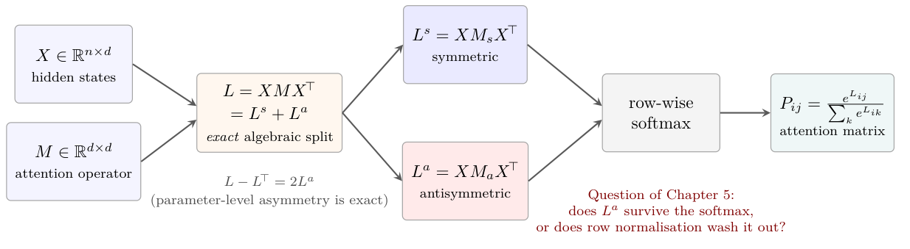

# Chapter 5: post-softmax persistence, context, and related work

[Library index](../README.md) · [Source and transcription policy](../SOURCE.md) · [Previous pages: PDF 151–154](0151-0154-ch04-training-and-normalisation.md) · [Next pages: PDF 162–164](0162-0164-ch05-sink-and-edge-persistence.md)

> Editorial note: This file preserves the full English source on PDF 155–161 (printed pages 119–125), including the author's literature descriptions, priority claims, incomplete author labels (“et al”), and mathematical inconsistencies. These references have not been independently verified as part of the transcription. Qualifications are separated in [note 29](../notes/29-post-softmax-attention-and-related-work.md). The final sentence continues on PDF 162 in the next file.

## PDF 155 · Book 119

### Chapter 5 · Post-Softmax Persistence

### 5.1 Why post-softmax persistence is non-trivial

Chapter 4 established the algebraic decomposition $M=M_s+M_a$ of the attention operator into its symmetric and antisymmetric components, and proved a sequence of structural results (reciprocity-directionality identity, cycle circulation, directional energy) at the pre-softmax level. All of these results live in the algebra of the score matrix $L=XMX^\top$, which decomposes exactly as $L=L^s+L^a$ with $L^s=XM_sX^\top$ symmetric and $L^a=XM_aX^\top$ antisymmetric.

This algebraic decomposition is exact, but it is only one half of the story. The behavioural object that the rest of the network sees is not $L$ but

$$
P_{ij}=\frac{\exp(L_{ij})}{\sum_{k=1}^n\exp(L_{ik})},
\tag{5.1}
$$

the row-wise softmax. The softmax is non-linear and breaks the decomposition. There is no analogue of $L=L^s+L^a$ at the level of $P$: in general $P$ is neither symmetric nor antisymmetric, and the question of how much of $L^a$ survives the row normalisation is not addressed by the chain of identities of Chapter 4.

This question is sharp. One can construct examples where $L^a$ is arbitrarily large in Frobenius norm and yet $P$ is essentially symmetric, because the row-wise normalisation absorbs the antisymmetric margin into the row-dependent denominator. Conversely, one can construct examples in which a small but well-structured $L^a$ produces a $P$ with a marked directional pattern. The chapter is devoted to giving sufficient algebraic conditions under which the second behaviour holds: the antisymmetric margin survives the softmax and produces a visible directional structure in $P$.

**Remark 5.1 (On the order-preservation result of Saponati et al., 2025).** A weak post-softmax fact is well known: if $L_{ij}\ge L_{ik}$ entrywise for some pair $(j,k)$ across all rows $i$, then $P_{ij}\ge P_{ik}$ across all rows. Saponati et al. (2025) state this as their Proposition 2.1. This guarantees that pre-softmax order is preserved, but not that quantitative pre-softmax margins translate into quantitative post-softmax margins. The two results of this chapter — Theorem 5.2 and Proposition 5.5 — are quantitative in this stronger sense.

**Takeaway.** *The decomposition $L=L^s+L^a$ is exact at the pre-softmax level, but the softmax is non-linear. The central question of this chapter is whether the antisymmetric margin in $L^a$ is preserved under row normalisation, or washed out. We give two sufficient conditions — one global, one local — under which the answer is the former.*

## PDF 156 · Book 120

**Figure 5.1: Pre-softmax decomposition vs post-softmax structure.** At the pre-softmax level, the decomposition $L=L^s+L^a$ with $L^s=XM_sX^\top$ and $L^a=XM_aX^\top$ is exact: $L-L^\top=2L^a$ identifies the antisymmetric component without ambiguity.

After the row-wise softmax, however, $P$ is in general neither symmetric nor antisymmetric. The question of this chapter is: when does the antisymmetric margin in $L^a$ survive the softmax and become a visible directional pattern in $P$? Theorems 5.2 and 5.5 provide sufficient conditions.

### 5.2 Related work and positioning

The two results of this chapter are tied closely to a body of recent empirical work on what is now called the attention sink phenomenon. This literature has grown rapidly between 2023 and 2026 — and has grown almost entirely on the empirical side. Because the chapter’s contribution is a quantitative algebraic complement to that empirical record, an explicit account of the related work, and an equally explicit account of where we sit relative to it, is essential. We organise the discussion in seven subsections, moving from the phenomenological core (Sections 5.2.1–5.2.3) to the algebraic frontier (Sections 5.2.4–5.2.5), to alternative remediation strategies (Section 5.2.6), and finally to the gap that the chapter fills (Sections 5.2.7–5.2.8).

#### 5.2.1 The attention sink phenomenon: empirical and functional accounts

The term attention sink was coined by Xiao et al. (2024), who observed that in autoregressive transformer language models a small subset of tokens — typically the first few in a sequence — consistently absorb a disproportionate fraction of the attention probability mass, regardless of their semantic content. The phenomenon is universal across decoder-only architectures (GPT-2, LLaMA, Mistral, Pythia), persists across pretraining corpora, and is robust to fine-tuning. Removing or masking sink tokens at inference time leads to catastrophic performance degradation, indicating that the sink plays a non-trivial functional role rather than being a mere artefact of training. The original use of the observation was algorithmic: Xiao et al. (2024) introduced StreamingLLM, a serving strategy that retains the first few sink tokens in the key-value cache and discards the rest of the past, achieving stable perplexity well beyond the training context length and reducing memory cost by an order of magnitude. The phenomenon was thus identified, named, and exploited within the same paper, but no mechanistic explanation was provided.

The most systematic empirical study of the phenomenon is Gu et al. (2025), who investigate which factors of pretraining (optimisation algorithm, data distribution, loss function, architecture) correlate with sink emergence. They report that the phenomenon arises in essentially every softmax-based transformer trained at scale, and trace its origin to the conjunction of softmax normalisation, residual connections, and LayerNorm. They also show that sinks emerge early during pretraining — often within the first few thousand optimisation steps —

## PDF 157 · Book 121

and stabilise thereafter. Their account is empirical: it tells us that sinks emerge robustly, but not when (in terms of the parameters of $M$) they must emerge. The paper provides extensive empirical correlations between sink prominence and hyperparameters (learning rate, weight decay, context length) but no algebraic prediction of the form “parameters satisfying $X$ produce a sink”.

Alongside the empirical characterisation, several functional accounts have been proposed. Barbero et al. (2025) argue that attention sinks act as a buffer against over-mixing and representational collapse in deep transformers: heads that attend predominantly to a sink with a low-norm value vector approximate a no-op, slowing the homogenisation of token representations across layers. Their argument is functional and analytic: they show that a sufficiently strong sink bounds the Jacobian of the token-to-token influence map, and that such a bound is necessary to avoid representational collapse over long sequences or many layers. This complements an earlier line of work on rank collapse in pure attention (Dong et al., 2021a) and on graph over-smoothing analogues (Keriven, 2022). The functional account explains why the network would benefit from having a sink, but not when (in the algebraic sense) one will appear.

In a different direction, Cancedda (2024) interprets sinks through a spectral lens: they correspond to “dark” subspaces in the embedding and unembedding matrices, characterised by small singular values, that absorb residual attention without contaminating the predictive subspace. The mechanism is described at the level of linear algebra of the parameter matrices: signals trafficking in low spectral bands are critical for sink behaviour, and pruning high-spectral-value components of the model preserves performance provided the dark bands are kept intact. This account is the closest existing work to an algebraic theory of sinks, but it is descriptive of the trained model rather than prescriptive: it identifies which subspaces become dark, rather than predicting from operator structure when darkness will arise.

#### 5.2.2 Geometric and reference-frame perspectives

A geometric reading of the sink phenomenon emerged more recently. et al (2025d) propose that attention sinks correspond to reference frames in the high-dimensional token-space: anchors that pin down a stable coordinate system on the probability simplex, against which other tokens orient themselves through angular relationships. Their framework distinguishes three sink types — centralised (single anchor at the start of the sequence), distributed (multiple co-existing anchors), and bidirectional (anchors at both ends, typical of encoder-only models such as BERT) — and explains them as optimal solutions to the constraint that the softmax projects logits onto the probability simplex. The argument is that, on the simplex with the Fisher–Rao metric, the curvature induces a preferred set of corner-anchored directions; sinks are the natural attractors of this curvature.

The geometric perspective is appealing because it does not depend on the specifics of the transformer dynamics. Its limitation, from the viewpoint pursued in this chapter, is that it does not connect the geometry of the simplex to the algebra of the score matrix $L=XMX^\top$. The reference-frame argument suggests that sinks should exist; it does not say which heads will produce them or under which conditions on $M$.

A complementary geometric reading, of more architectural nature, is the over-mixing argument of Barbero et al. (2025): the sink mechanism shortens the effective Jacobian of token-to-token influence and thus prevents unbounded gradient flow through deep stacks. This is a stability result: it explains why, all else being equal, the network would prefer configurations of $M$ that produce sinks. Again, the argument does not predict for which $M$ such configurations are realised; that question remains open at the operator level.

## PDF 158 · Book 122

#### 5.2.3 Active–dormant heads and value-state dynamics

The training-dynamical perspective (Guo et al., 2024; et al, 2025b) establishes that a substantial fraction of attention heads in pretrained models become dormant: their attention map is concentrated almost entirely on the sink token, and their value-state norm at the sink position is vanishingly small. Guo et al. (2024) identify a self-reinforcing feedback loop — low value norm at a sink token attracts more attention through the softmax denominator, which further suppresses the value norm via the gradient — and they prove that this loop is stable under mild assumptions on the loss landscape. They estimate that as many as 14% of heads in standard pretrained models can be removed at inference time without measurable performance loss, because they are dormant in the technical sense.

This dynamical account is the most mechanistic in the literature. It explains how sinks become locked in during training: the attention-on-sink and value-norm-at-sink degrees of freedom couple through the gradient and reinforce each other. What it does not explain is how the dynamics interacts with the symmetric/antisymmetric algebra of $M$. The active-dormant analysis works at the level of attention maps and value norms, not at the level of $M_s$ vs $M_a$. Whether dormant heads are antisymmetric in $M$, or simply have very peaked rows of $L$ regardless of the $M_s/M_a$ split, is not addressed.

This work connects to a longer tradition of redundancy analysis (Voita et al., 2019a; Michel et al., 2019a) which had already observed, through pruning experiments, that BERT and similar models contain large numbers of effectively unused heads. The sink-related work of Guo et al. (2024) provides a mechanistic explanation for redundancy: many heads are not merely “not used” but actively absorbed by the sink mechanism. The redundancy literature predates the sink literature and is broadly compatible with it; both leave the question of operator-level structure unanswered.

#### 5.2.4 Algebraic accounts of asymmetry: the parameter-side picture

A separate line of work studies the asymmetry of $M$ at the parameter level, without specifically addressing sinks. The two main strands are kernel-decomposition methods and architectural constraints.

The kernel-eigen framework of Chen et al. (2023) and Chen et al. (2024) (KSVD attention) studies the asymmetry of attention through a low-rank kernel singular value decomposition rather than through the additive split $M_s+M_a$. Their starting observation is that $M=W_QW_K^\top$ is rectangular and generically asymmetric, so its singular value decomposition is the natural diagonalising structure. They derive a primal-dual formulation in which the left and right singular vectors of $M$ play the role of separate query and key bases. The decomposition is multiplicative rather than additive, and the asymmetry of $M$ is encoded in the difference between the two singular bases. This is a genuinely different parametrisation of the same algebraic content addressed by the $M_s+M_a$ split: it gives a global SVD-style description of the asymmetry but does not single out the antisymmetric component as a distinct object. As a consequence, the KSVD framework does not produce post-softmax results of the sink-or-edge type; it produces approximation and computational guarantees for the kernel itself.

Architectural primitives of an opposite kind are introduced by Brantner and Kraus (2023) and Zhang and Martens (2026), who prescribe rather than describe the antisymmetric structure. The symplectic transformer of Brantner and Kraus (2023) parametrises $M$ via the Cayley transform of an antisymmetric matrix, ensuring $M\in SO(d)$ throughout training. The orthogonal-attention proposal of Zhang and Martens (2026) parametrises $M$ as a matrix

## PDF 159 · Book 123

exponential of an antisymmetric generator. In both cases the goal is to engineer $M_s=0$ structurally, sidestepping the question of when antisymmetry emerges naturally. The present chapter takes the opposite stance: $M$ is unconstrained, and we ask what must follow when the antisymmetric component happens to dominate, by training or by accident.

The descriptive vs prescriptive distinction matters. A prescriptive framework guarantees behaviour by construction and does not need post-softmax analysis: if $M=e^\Omega$ with $\Omega$ antisymmetric, the network is orthogonal by construction and many properties follow trivially. A descriptive framework takes $M$ as it is found in trained models and asks what its structure implies. The chapter is descriptive in this sense.

#### 5.2.5 Saponati et al. (2025): concurrent algebraic analysis

A specific concurrent line of work merits its own subsection, since it is the closest existing analysis to the one developed in this monograph. Saponati et al. (2025) introduced the decomposition $M=M_s+M_a$ in arXiv:2502.10927 (15 February 2025), 48 hours before Bonino et al. (2025) (arXiv:2502.12033, 17 February 2025). The two streams are formally independent. A complete comparison appears in Chapter 4; here we focus on the part directly relevant to post-softmax persistence.

Saponati et al. (2025) introduce two scalar indices on the parameter side. The first is a symmetry score $s=2-4\alpha_h^2$, where $\alpha_h\in[0,1/\sqrt2]$ is a single number measuring the relative norm of the antisymmetric component; $\alpha_h=0$ corresponds to a symmetric $M$ and $\alpha_h=1/\sqrt2$ to a fully antisymmetric one. The second is a directionality score $d$ measuring the column-versus-row dominance of the resulting score matrix $L$. The two scores are qualitative summaries of the algebraic structure of the head, not inputs to a quantitative bound.

The post-softmax content of Saponati et al. (2025) consists of their Proposition 2.1, which we will refer to as the order-preservation proposition. It states (in our notation) that if $L_{ij}\ge L_{ik}$ entrywise across all rows $i$ for some pair $(j,k)$, then $P_{ij}\ge P_{ik}$ across all rows. The proof is elementary (the softmax is monotonic in each coordinate). The proposition guarantees that pre-softmax rankings are preserved post-softmax. It does not, however, give any quantitative content: “$P_{ij}\ge P_{ik}$” is preserved, but “$P_{ij}$ is much larger than $P_{ik}$” is not, in general, derivable from “$L_{ij}$ is much larger than $L_{ik}$”. The amount by which $L_{ij}$ exceeds $L_{ik}$ is in fact not the relevant quantity: what matters post-softmax is the entire row partition function $\sum_k e^{L_{ik}}$, which can absorb large pre-softmax margins.

This is the precise gap that the present chapter closes. Theorem 5.2 translates a quantitative pre-softmax margin $\gamma$ (uniformly across competitors) into a quantitative post-softmax lower bound on the sink mass, and Proposition 5.5 does the analogous translation for a single ordered pair. The order-preservation result of Saponati et al. (2025) is recovered as a corollary of either: when $\gamma>0$ the order of $A_{i,j^*}$ vs $A_{i,k}$ is preserved, but in addition we obtain the quantitative lower bound (5.3), which is the content the order-preservation proposition cannot produce.

Saponati et al. (2025) also report empirical training dynamics: the trajectory of $\alpha_h(t)$ during training shows that some heads migrate from the symmetric regime ($\alpha_h\approx0$) to the antisymmetric regime ($\alpha_h$ close to its maximum) over the course of pretraining. This is a complement to the static analysis of the present chapter and is taken up in Chapter 11. We do not duplicate the empirical comparison here.

## PDF 160 · Book 124

#### 5.2.6 Modifications of the softmax itself

A parallel literature studies modifications of the softmax that are specifically designed to eliminate or redirect the sink, on the premise that sinks are pathological and should be removed. Zuhri et al. (2025) propose a rectified softmax (“Softpick”) that breaks the sum-to-one constraint and provably eliminates sinks. Miller (2023) adds a constant slot to the denominator (“softmax with one extra column”, also called “off-by-one attention”), which absorbs surplus attention without forcing it onto a real token. et al (2024) replace the softmax with a normalised sigmoid, which is order-preserving but not sum-to-one. Lv et al. (2024) propose a signed softmax that allows negative attention weights, breaking the non-negativity constraint that drives sink formation. et al (2025c) use a difference of two softmaxes (“differential transformer”), which permits cancellation of irrelevant attention.

All of these works share an architectural premise: the standard softmax is the cause of the sink, and modifying it is the solution. The present chapter takes the opposite stance: the standard softmax is retained, and the algebraic structure of $M$ that produces sinks is characterised. The two viewpoints are not in conflict: the modifications above can be read as breaking the hypothesis (5.2) of Theorem 5.2 (e.g., Softpick removes the sum-to-one constraint that drives the bound; off-by-one attention adds a phantom competitor that lowers the effective $\gamma$). Such a unified reading is straightforward but not available in the cited works, which formulate their proposals without reference to an underlying algebraic criterion.

A separate strand modifies attention through gating rather than through the softmax kernel. et al (2025a) introduce input-dependent multiplicative gates on the attention output, which effectively turn off heads without exploiting sink mass; their architecture eliminates sinks empirically. The gating mechanism is orthogonal to the algebraic question pursued here, in the sense that it operates at a different layer of the architecture, and we do not discuss it further.

#### 5.2.7 What the literature does not provide

We summarise the state of the art in Table 5.1, which classifies the cited works according to two axes: the level of algebraic specificity (does the work derive sinks from operator-level structure?) and the type of result (empirical observation, functional argument, dynamical analysis, algebraic prediction).

The diagonal of the table is empty before this chapter. Sinks are a behavioural (post-softmax) phenomenon, but no quantitative algebraic prediction of their emergence has been available in the literature. The empirical and functional cells of the behavioural row are well populated, and the algebraic row contains the qualitative results of Saponati et al. (2025) and the spectral analysis of Cancedda (2024), but the precise combination — a sufficient condition on the operator $M$ that guarantees a quantitative post-softmax behaviour — has been absent. This chapter fills that cell.

#### 5.2.8 Positioning of this chapter

We summarise the contribution of the chapter point-by-point against each of the four scientific traditions surveyed above.

**(1) Relative to the empirical sink literature** (Xiao et al., 2024; Gu et al., 2025; et al, 2025d). These works detect, name, and characterise sinks through inspection of attention maps in trained models. They demonstrate that sinks are universal and functionally important. They do not predict, from parameters alone, when a sink will appear in a given

## PDF 161 · Book 125

**Table 5.1:** Schematic positioning of the related literature on attention sinks and asymmetry. Rows are theoretical layers; columns are types of result. The cell marked “Theorem 5.2, Prop. 5.5” is the contribution of this chapter.

| | Empirical | Functional or dynamical | Quantitative algebraic |
| --- | --- | --- | --- |
| Behavioural (post-softmax) | Xiao et al. (2024), Gu et al. (2025), et al (2025d) | Barbero et al. (2025), Guo et al. (2024) | **Theorem 5.2, Prop. 5.5** (this chapter) |
| Algebraic (pre-softmax) | Voita et al. (2019a), Michel et al. (2019a) | Cancedda (2024) | Saponati et al. (2025) (qualitative), Bonino et al. (2025) (Ch. 4) |
| Architectural (modifications) | — | Zuhri et al. (2025), et al (2024), et al (2025a) | Brantner and Kraus (2023), Zhang and Martens (2026) |

> Editorial boundary: after the intervening table, the sentence from PDF 160 continues below; its preceding words are “in a given”.

head. Theorem 5.2 provides a one-sided prediction of this kind: given the operator $M$ of a head and a candidate input $X$, one can compute $A$ and $S$ and the worst-case margins $\gamma,\eta$, and certify a sink whenever the hypotheses hold, with an explicit quantitative lower bound on the sink mass. The condition is sufficient, not necessary: if the hypotheses fail, the criterion is silent — a sink may still emerge by other partition-function configurations not captured by the uniform inequalities of (5.2).

**(2) Relative to the functional and dynamical accounts** (Barbero et al., 2025; Guo et al., 2024; Cancedda, 2024). These works explain why sinks are useful (over-mixing prevention, no-op gating, dark-channel absorption) and how they emerge during training (active-dormant feedback loop). They do not give an operator-level criterion. Our results are complementary: they say which $M$ produces sinks, leaving the question of why training drives $M$ to such structure to the dynamical literature. The two perspectives compose: the dynamical account explains the trajectory of $\rho_h$ during training, and the present static account predicts the post-softmax consequences once $\rho_h$ reaches the directional regime.

**(3) Relative to concurrent algebraic accounts** (Saponati et al., 2025; Chen et al., 2023, 2024). The asymmetry of $M$ is studied at the parameter level by these works, either through the additive split $M_s+M_a$ (Saponati) or through the SVD of $M$ (Chen). The post-softmax content available so far is the qualitative order-preservation proposition of Saponati et al. (2025). The present chapter promotes this qualitative order-preservation to two quantitative bounds: a global one for sinks (Theorem 5.2) and a local one for edges (Proposition 5.5). Both bounds reduce to the order-preservation statement when $\gamma\to0^+$ and $\tau\to0^+$ respectively, but go strictly further: they translate a quantitative margin into a quantitative behavioural guarantee.

**(4) Relative to softmax modifications and architectural constraints** (Zuhri et al., 2025; Miller, 2023; et al, 2024; Lv et al., 2024; et al, 2025c; Brantner and Kraus, 2023; Zhang and Martens, 2026). These works either remove the softmax structure that creates sinks, or constrain $M$ to a manifold ($\mathfrak{so}(d)$ or $SO(d)$) that bypasses the question. The present chapter keeps the standard softmax and the unconstrained $M$ of vanilla transformers, and analyses what emerges. The chapter’s results predict when the unmodified architecture must

> Editorial boundary: the final sentence continues with “produce a sink” on [PDF 162](0162-0164-ch05-sink-and-edge-persistence.md#pdf-0162). No conclusion has been supplied beyond the source-page boundary.
