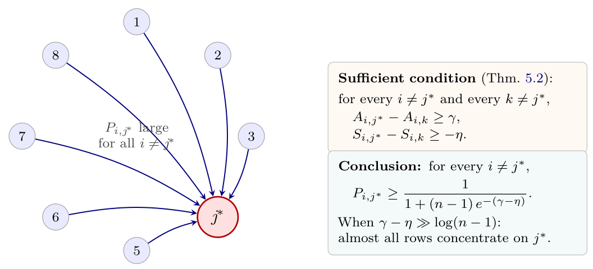

# Chapter 5: the Antisymmetric Sink Theorem and Directional Edge Persistence Criterion

[Library index](../README.md) · [Source and transcription policy](../SOURCE.md) · [Previous pages: PDF 155–161](0155-0161-ch05-context-and-related-work.md) · [Next pages: PDF 165–171](0165-0171-ch05-indices-geometry-and-experiments.md)

> Editorial note: This file preserves the full English source on PDF 162–164 (printed pages 126–128), including the completion of §5.2.8, Theorem 5.2 with its proof, Remarks 5.3–5.4, Proposition 5.5 with its proof, and Remark 5.6. Mathematical and logical qualifications are kept separately in [note 29](../notes/29-post-softmax-attention-and-related-work.md), [note 30](../notes/30-attention-sink-theorem.md), and [note 31](../notes/31-directional-edge-persistence.md). The source's overly strong interpretations are retained without silent amendment.

## PDF 162 · Book 126

> Editorial boundary: continuation of [§5.2.8 on PDF 161](0155-0161-ch05-context-and-related-work.md#pdf-0161). The preceding words are “the unmodified architecture must”.

produce a sink, which complements the modification literature: a modification suppresses sinks by breaking some inequality of Theorem 5.2; identifying which inequality is broken is a fine-grained way to compare modification strategies, available only with an explicit algebraic criterion.

**What we deliberately do not address.** Three questions deferred elsewhere or to future work:

- The *training dynamics* that lead to the inequalities of Theorem 5.2 being satisfied at convergence (Chapter 11).
- The *functional role* of the sink (over-mixing prevention, no-op gating); these are downstream questions, addressed by Barbero et al. (2025) and Guo et al. (2024), for which the present results provide an algebraic substrate.
- The *quantitative coupling* between the index $\delta_h$ and the cross-entropy loss; we leave this as an open problem of the monograph.

**Takeaway.** *The literature on attention sinks contains a rich empirical record, several functional accounts, a dynamical mechanism, and a qualitative algebraic order-preservation result. What it does not contain is a quantitative sufficient condition on the operator $M$ that guarantees a sink in the post-softmax matrix $P$. The two results of this chapter — Theorem 5.2 and Proposition 5.5 — provide such a condition, in the form of a one-sided certificate: when the algebraic hypotheses hold, sinks and persistent edges are certified with explicit quantitative bounds; failure of the hypotheses is silent rather than a refutation, since the criteria are sufficient and not necessary.*

### 5.3 The Antisymmetric Sink Theorem

We adopt the notation of Chapter 4 without modification: $X\in\mathbb R^{n\times d}$ is the input hidden-state matrix (rows $x_i$ are tokens), $M=W_QW_K^\top\in\mathbb R^{d\times d}$ is the attention operator, $M_s=(M+M^\top)/2$ and $M_a=(M-M^\top)/2$ its symmetric and antisymmetric parts. The score matrix $L=XMX^\top$ decomposes as $L=L^s+L^a$ with $L^s$ symmetric and $L^a$ antisymmetric.

For the rest of the chapter, write $S\equiv L^s$ and $A\equiv L^a$ to match the notation of the foundational paper (Bonino et al., 2025) and reduce subscript clutter.

**Theorem 5.2 (Antisymmetric Sink Theorem).** Let $L=S+A$ be the score matrix of a single attention head, with $S$ symmetric and $A$ antisymmetric. Let $P_{ij}=e^{L_{ij}}/\sum_k e^{L_{ik}}$ be the row-wise softmax. Suppose there exist a column index $j^*\in\{1,\ldots,n\}$ and constants $\gamma>0$, $\eta\ge0$ such that

$$
A_{i,j^*}-A_{i,k}\ge\gamma,\qquad
S_{i,j^*}-S_{i,k}\ge-\eta,
\tag{5.2}
$$

for every row $i\ne j^*$ and every competitor column $k\ne j^*$. Then for every row $i\ne j^*$,

$$
P_{i,j^*}\ge\frac1{1+(n-1)e^{-(\gamma-\eta)}}.
\tag{5.3}
$$

*Proof.* Fix $i\ne j^*$. For any competitor $k\ne j^*$, the hypotheses (5.2) give

$$
L_{i,j^*}-L_{i,k}
=(S_{i,j^*}-S_{i,k})+(A_{i,j^*}-A_{i,k})
\ge-\eta+\gamma=\gamma-\eta.
$$

## PDF 163 · Book 127

Equivalently, $L_{i,k}\le L_{i,j^*}-(\gamma-\eta)$ for every $k\ne j^*$. The contribution of $k=j^*$ to the denominator of the softmax is $e^{L_{i,j^*}}$ exactly. Thus

$$
\sum_{k=1}^n e^{L_{i,k}}
=e^{L_{i,j^*}}+\sum_{k\ne j^*}e^{L_{i,k}}
\le e^{L_{i,j^*}}\bigl(1+(n-1)e^{-(\gamma-\eta)}\bigr),
$$

and so

$$
P_{i,j^*}
=\frac{e^{L_{i,j^*}}}{\sum_k e^{L_{i,k}}}
\ge\frac1{1+(n-1)e^{-(\gamma-\eta)}}.
$$

This is (5.3). $\square$

**Figure 5.2: The Antisymmetric Sink Theorem creates a global directional gate.** A target token $j^*$ acts as a sink: every other row concentrates its attention probability mass on column $j^*$. The condition is uniform over all competitor columns $k\ne j^*$, hence the conclusion is also uniform over all rows.

The condition (5.2) has a clean interpretation. The first inequality says that the antisymmetric part of $L$ pulls every non-target row $i$ towards the target column $j^*$ by a uniform amount $\gamma$. The second inequality says that the symmetric part does *not* oppose this pull beyond a tolerance $\eta$. The conclusion is that, once $\gamma$ exceeds $\eta$ by a margin comparable to $\log(n-1)$, the post-softmax attention concentrates mass on column $j^*$.

**Remark 5.3 (The role of $\eta$).** The constant $\eta$ measures how much the symmetric component is allowed to disagree with the sink direction set by the antisymmetric part. When $\eta=0$, the symmetric part is at worst neutral towards the sink. When $\eta<\gamma$, the antisymmetric pull dominates and a sink emerges. When $\eta>\gamma$, the bound becomes vacuous: the symmetric part can override the antisymmetric pull and destroy the sink. The empirical destruction of the sink in this regime is demonstrated in Experiment 5.7.3.

**Remark 5.4 (Sharpness of the bound).** The bound (5.3) is the worst-case bound implied by the hypotheses. Equality is approached when, for some row $i$, the inequalities of (5.2) are tight on every competitor $k$ simultaneously — that is, when all $n-1$ competitors achieve the boundary value $L_{i,j^*}-(\gamma-\eta)$ exactly. In typical cases the inequalities are slack on most competitors, and the measured $P_{i,j^*}$ is strictly larger than the bound; this is documented in Experiment 5.7.1.

**Caveat.** *The hypothesis (5.2) is a uniform statement: it must hold for every row $i\ne j^*$ and every competitor $k\ne j^*$. A single violating row, or a single competitor at one row, suffices to break the conclusion of the theorem for that row. In practice, when verifying*

## PDF 164 · Book 128

*the theorem on real models (see the notebook accompanying this chapter), one computes the minimum of $A_{i,j^*}-A_{i,k}$ over all pairs $(i,k)$ with $i,k\ne j^*$, and uses that as the empirical $\gamma$.*

**Takeaway.** *Theorem 5.2 is the first result of the chapter. It promotes the algebraic identity $L-L^\top=2A$ to a quantitative behavioural statement: when the antisymmetric margin exceeds the symmetric tolerance by more than $\log(n-1)$, the attention matrix exhibits a global directional sink at column $j^*$. This is the algebraic substrate of the empirical attention sink phenomenon documented by Xiao et al. (2024) and subsequent work.*

### 5.4 The Directional Edge Persistence Criterion

The sink theorem is a global statement: it controls a whole column of $P$ uniformly. A complementary local statement controls a single ordered pair $(i,j)$ of tokens.

**Proposition 5.5 (Directional Edge Persistence Criterion).** Let $L=S+A$ be as in Theorem 5.2, and write $L_i$ for the $i$th row of $L$. Fix an ordered pair $(i,j)$ with $i\ne j$. If there exists $\tau>0$ such that

$$
2A_{ij}\ge\|L_i-L_j\|_\infty+\tau,
\tag{5.4}
$$

then

$$
\frac{P_{ij}}{P_{ji}}\ge e^\tau.
\tag{5.5}
$$

*Proof.* By definition,

$$
\log\frac{P_{ij}}{P_{ji}}
=(L_{ij}-L_{ji})-\bigl(\operatorname{LSE}(L_i)-\operatorname{LSE}(L_j)\bigr),
$$

where $\operatorname{LSE}(u)=\log\sum_k e^{u_k}$. The first term is exactly $L_{ij}-L_{ji}=2A_{ij}$, since $S$ is symmetric and $A$ antisymmetric. The log-sum-exp function is 1-Lipschitz with respect to the $\ell^\infty$ norm:

$$
\bigl|\operatorname{LSE}(u)-\operatorname{LSE}(v)\bigr|
\le\|u-v\|_\infty\qquad\text{for }u,v\in\mathbb R^n.
$$

(This follows from $\partial_k\operatorname{LSE}=\operatorname{softmax}_k\in[0,1]$ together with $\sum_k\operatorname{softmax}_k=1$.) Hence $\bigl|\operatorname{LSE}(L_i)-\operatorname{LSE}(L_j)\bigr|\le\|L_i-L_j\|_\infty$, and

$$
\log\frac{P_{ij}}{P_{ji}}\ge2A_{ij}-\|L_i-L_j\|_\infty\ge\tau,
$$

the last step by hypothesis (5.4). Exponentiating gives (5.5). $\square$

The interpretation is straightforward. The quantity $2A_{ij}$ is the exact pre-softmax log-asymmetry of the directed pair $(i,j)$: $L_{ij}-L_{ji}=2A_{ij}$. The quantity $\|L_i-L_j\|_\infty$ controls the worst-case discrepancy between the partition functions of rows $i$ and $j$. When the former exceeds the latter by $\tau$, the post-softmax ratio $P_{ij}/P_{ji}$ is at least $e^\tau$, and the edge $(i,j)$ remains directional after normalisation.

**Remark 5.6 (Comparison with the sink theorem).** Theorem 5.2 and Proposition 5.5 are complementary, not redundant. The sink theorem requires a uniform condition over all rows and competitors and concludes a uniform lower bound on a whole column of $P$. The edge criterion requires a condition only on a single pair $(i,j)$ and concludes only a ratio bound on that pair. Several distinct edges may persist on a sequence without the existence of a single sink column; conversely, a single sink column may exist without any individual ordered pair $(i,j)$ satisfying the edge criterion strongly. The two phenomena coexist in real models without one implying the other.

> Editorial boundary: Remark 5.6 is complete. Its illustration, [Figure 5.3 on PDF 165](0165-0171-ch05-indices-geometry-and-experiments.md#figure-5-3), appears in the next source file, followed by Remark 5.7.
