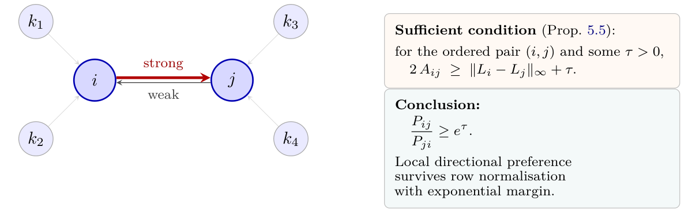
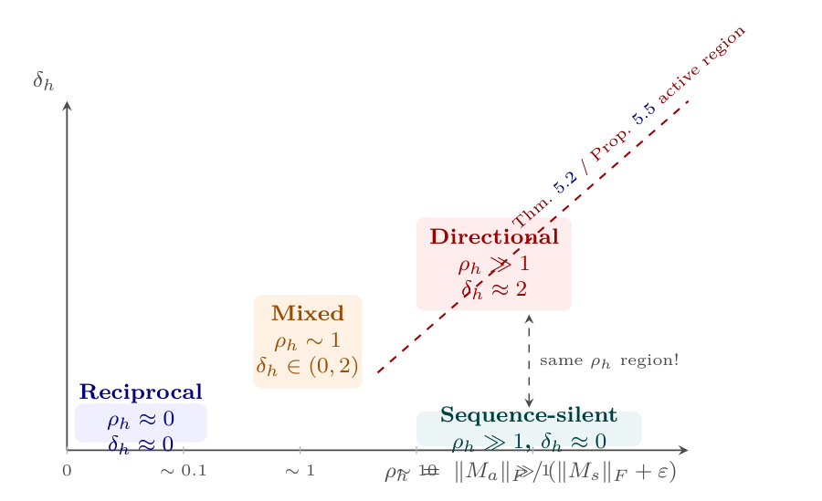
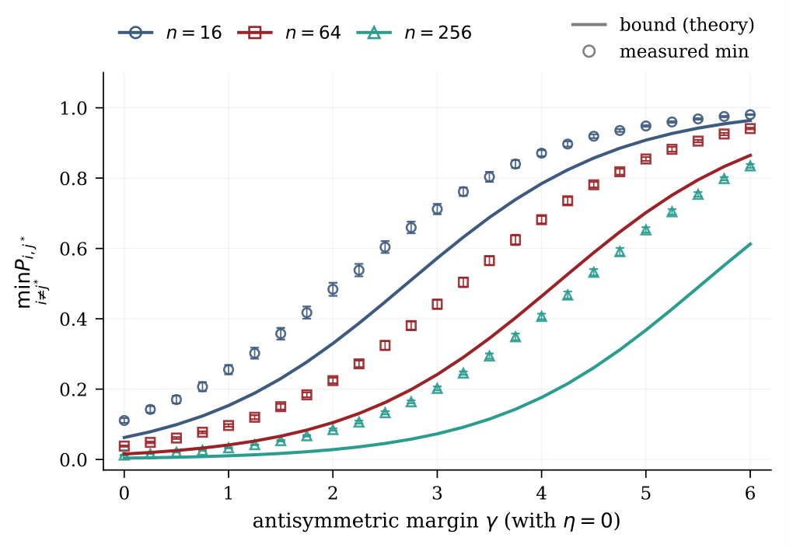
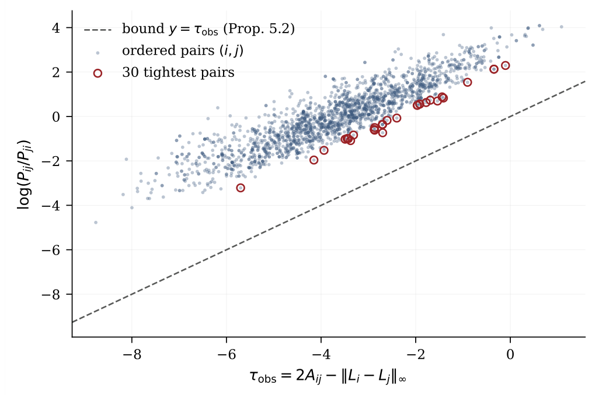
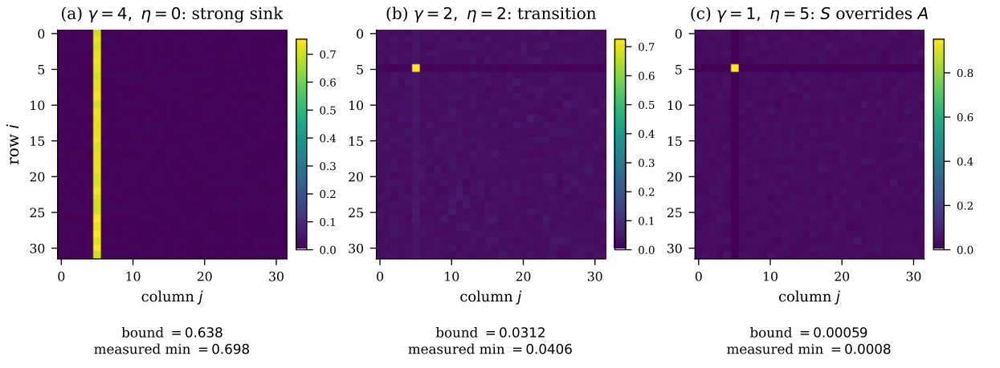
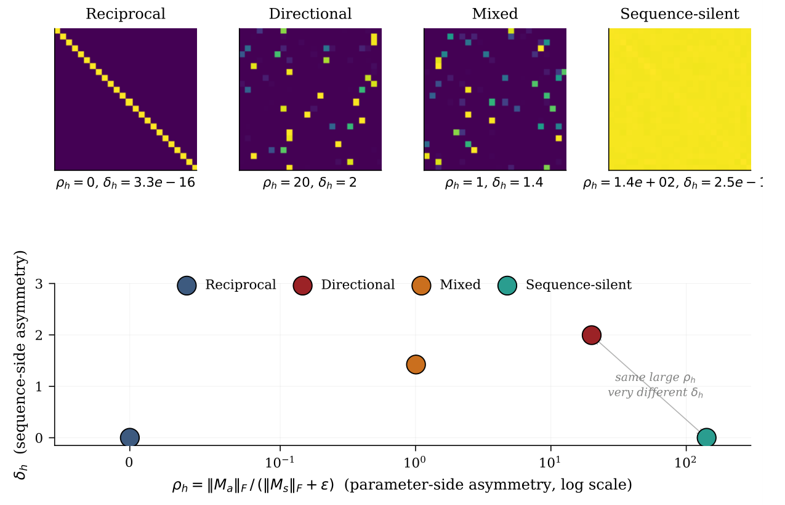

# Chapter 5: quantitative indices, geometry, and synthetic experiments

[Library index](../README.md) · [Source policy](../SOURCE.md) · [Previous pages: PDF 162–164](0162-0164-ch05-sink-and-edge-persistence.md) · [Next pages: PDF 172–178](0172-0178-ch05-refinements-equivariance-and-stability.md)

> **Editorial scope.** Full English transcription of PDF 165–171 / printed pages 129–135. The first page begins with Figure 5.3, followed by Remark 5.7; Proposition 5.5 is on the preceding page. Original mathematical and empirical claims are retained. Here $S$ and $A$ are the symmetric and antisymmetric parts of the score matrix $L$; $P$ is the row-softmax attention matrix. Qualifications are separate in [note 32](../notes/32-directionality-indices-taxonomy-and-geometry.md) and [note 33](../notes/33-synthetic-directionality-experiments.md). The final paragraph continues on PDF 172.

## PDF 165 · Book 129

**Figure 5.3:** **The Directional Edge Persistence Criterion controls a single ordered pair.** Where the antisymmetric margin $2A_{ij}$ exceeds $\|L_i-L_j\|_\infty$ by some $\tau>0$, the post-softmax ratio $P_{ij}/P_{ji}$ is bounded below by $e^\tau$.

*Unlike the sink theorem, this condition is purely local: it says nothing about other rows or columns of $P$.*

Searchable labels in Figure 5.3

Nodes: $i,j,k_1,k_2,k_3,k_4$; “strong”, “weak”.

**Sufficient condition (Prop. 5.5):** for the ordered pair $(i,j)$ and some $\tau>0$,
$$2A_{ij}\ge\|L_i-L_j\|_\infty+\tau.$$

**Conclusion:**
$$\frac{P_{ij}}{P_{ji}}\ge e^\tau.$$

Local directional preference survives row normalisation with exponential margin.

**Remark 5.7 (On the use of $\|\cdot\|_\infty$).** The Lipschitz constant of LSE in $\ell^\infty$ is the tightest bound available with no additional information about the rows $L_i,L_j$. Tighter bounds are available under additional structural assumptions; we develop the natural refinement, based on the integral identity for LSE, in Proposition 5.11 below.

**Takeaway.** *Proposition 5.5 is the second result of the chapter and is the local counterpart of the sink theorem. It says: if the antisymmetric margin $2A_{ij}$ on a single ordered pair exceeds the $\ell^\infty$ row difference by $\tau>0$, then the directional preference $P_{ij}>P_{ji}$ survives the softmax with margin $e^\tau$.*

### 5.5 Quantitative indices and the four-class taxonomy

The conditions of Theorem 5.2 and Proposition 5.5 are formulated in terms of pointwise inequalities on $A$ and $S$. For diagnostic and empirical purposes it is useful to also have scalar summaries of the algebraic structure of a head. We adopt the two indices introduced in the foundational paper (Bonino et al., 2025) and made explicit in Chapter 4.

**Definition 5.8 (Parameter-side antisymmetry index).** For a head with attention operator $M$, the *parameter-side antisymmetry index* is

$$
\rho_h=\frac{\|M_a\|_F}{\|M_s\|_F+\varepsilon}, \tag{5.6}
$$

with $\varepsilon>0$ a small numerical regulariser ($\varepsilon=10^{-9}$ throughout this chapter).

**Definition 5.9 (Sequence-side antisymmetry index).** For a head with score matrix $L=XMX^\top$ on a given input $X$, the *sequence-side antisymmetry index* is

$$
\delta_h=\frac{\|L-L^\top\|_F}{\|L\|_F+\varepsilon}. \tag{5.7}
$$

The two indices capture different aspects of the head. $\rho_h$ depends only on the trained parameters $W_Q,W_K$ and is sequence-independent. $\delta_h$ depends on both the parameters and the input. The relationship between them is constrained but not bijective: $\rho_h=0$ implies $\delta_h=0$ (by symmetry of $M$); $\delta_h=0$ implies $XM_aX^\top=0$, which can hold either because

## PDF 166 · Book 130

$M_a=0$ (so $\rho_h=0$) or because the input lies in the kernel of $M_a$ in a specific way (so $\rho_h>0$ but the antisymmetric component is silent on this input).

The latter case — $\rho_h>0,\delta_h=0$ — is geometrically possible because $XM_aX^\top$ measures $M_a$ only on the row span of $X$. If the row span of $X$ has dimension less than $d$, the antisymmetric component of $M$ may have non-zero parts orthogonal to this row span which contribute nothing to $L$. We exhibit this configuration explicitly in Experiment 5.7.4 below.

This observation grounds the four-class taxonomy of attention heads introduced in Chapter 4, which we recall here in a form adapted to the post-softmax discussion of this chapter:

**Definition 5.10 (Four-class taxonomy of attention heads).** A head $h$ with indices $(\rho_h,\delta_h)$ on a given sequence is classified as

1. **Reciprocal** if $\rho_h\approx0$ (and hence $\delta_h\approx0$). The score matrix $L$ is symmetric and the attention is reciprocal: $P_{ij}$ and $P_{ji}$ are tightly coupled.
2. **Directional** if $\rho_h\gg1$ and $\delta_h\gtrsim1$. The score matrix is dominated by its antisymmetric part; the hypotheses of Theorem 5.2 or Proposition 5.5 may be satisfied.
3. **Mixed** if $\rho_h$ and $\delta_h$ are both of order unity. Both components contribute non-trivially.
4. **Sequence-silent** if $\rho_h\gg1$ but $\delta_h\approx0$. The antisymmetric structure is present in $M$ but silent on the current input.

**Figure 5.4:** **Four-class taxonomy in the $(\rho_h,\delta_h)$ plane.** The parameter-side asymmetry ratio $\rho_h$ (horizontal, log scale) captures the relative weight of the antisymmetric component in the attention operator $M$.

*The sequence-side score $\delta_h$ (vertical) captures the asymmetry of the resulting score matrix $L$ on the actual input. The two are not equivalent. A head can be antisymmetric in parameter space ($\rho_h$ large) but produce a perfectly symmetric $L$ on a given sequence ($\delta_h\approx0$): this is the sequence-silent regime. Theorem 5.2 and Proposition 5.5 can be satisfied only in the upper right region, never in the sequence-silent region.*

Searchable labels in Figure 5.4

Horizontal: $\rho_h=\|M_a\|_F/(\|M_s\|_F+\varepsilon)$, $0$, $\sim0.1$, $\sim1$, $\sim10$, $\gg1$. Vertical: $\delta_h$.

Reciprocal: $\rho_h\approx0,\delta_h\approx0$. Mixed: $\rho_h\sim1,\delta_h\in(0,2)$. Directional: $\rho_h\gg1,\delta_h\approx2$. Sequence-silent: $\rho_h\gg1,\delta_h\approx0$. “same $\rho_h$ region!”; “Thm. 5.2 / Prop. 5.5 active region”.

The diagnostic value of the taxonomy is that it predicts which heads can satisfy the hypotheses of the theorems of this chapter. A reciprocal head ($\rho_h\approx0$) cannot satisfy (5.2) because its $A$ is essentially zero. A sequence-silent head ($\delta_h\approx0$) cannot satisfy them *on this input*, even though the parameters carry non-trivial antisymmetry. A directional head is the only class that can support a sink or a persistent edge, and the only one for which the bounds of Theorem 5.2 and Proposition 5.5 are non-trivial.

## PDF 167 · Book 131

**Preview.** *The dynamics of the indices $\rho_h$ and $\delta_h$ during training — when does a head migrate from reciprocal to directional? when does silence give way to activation? — is the subject of Chapter 11. The static analysis of this chapter places no constraint on this trajectory; it asks only what happens when a head reaches the directional regime.*

### 5.6 Geometric reading of the sink condition

The hypothesis (5.2) of Theorem 5.2 can be read as a geometric statement about the antisymmetric bilinear form $\langle u,v\rangle_a:=u^\top M_av$ on the token cloud $\{x_1,\ldots,x_n\}\subset\mathbb R^d$. Substituting $A_{ij}=x_i^\top M_ax_j$, the hypothesis becomes

$$
x_i^\top M_ax_{j^*}-x_i^\top M_ax_k\ge\gamma
\qquad\forall\,i\ne j^*,\ k\ne j^*, \tag{5.8}
$$

together with an analogous inequality for $M_s$ with $-\eta$. Equivalently,

$$
x_i^\top M_a(x_{j^*}-x_k)\ge\gamma
\qquad\forall\,i\ne j^*,\ k\ne j^*. \tag{5.9}
$$

The map $x\mapsto M_ax$ rotates by a quarter turn in each invariant 2-plane of $M_a$ (the spectral structure of an antisymmetric matrix on $\mathbb R^d$ is a direct sum of 2-dimensional rotations and a kernel, on which $M_a$ acts as zero). Condition (5.9) thus says: every difference $x_{j^*}-x_k$ has a $M_a$-image that aligns positively with every $x_i$ for $i\ne j^*$. Two natural sufficient conditions are:

1. **Spectral dominance.** $M_a$ has a single dominant 2-plane $V\subset\mathbb R^d$ on which $\|M_a\|_V\gg\|M_a\|_{V^\perp}$, and the projection of every $x_i$ ($i\ne j^*$) onto $V$ has a consistent sign relative to the projection of $x_{j^*}$.
2. **Angular separation.** The token $x_{j^*}$ is angularly separated from the rest of the cloud in the dominant 2-plane of $M_a$, with the rest of the cloud clustered on one side of the $M_a$-direction.

These geometric pictures connect the algebraic condition of the theorem to the geometry of the token embeddings, and provide intuition for when the hypothesis is plausibly satisfied: it requires that the trained $M_a$ has identified a low-rank invariant subspace on which the input cloud is geometrically clustered around a distinguished direction.

**Caveat.** *The geometric reading above is a sufficient condition, not a characterisation. Theorem 5.2 can hold without spectral dominance or angular separation, provided the inequalities are satisfied. The geometric picture is an organising heuristic, not a substitute for the algebraic verification.*

**Takeaway.** *The sink condition is, geometrically, a statement that the antisymmetric operator $M_a$ has identified a direction along which the token cloud is clustered, with the sink token $x_{j^*}$ distinguished from the rest. When such a direction exists in the trained model, the bound of Theorem 5.2 kicks in and forces a sink in the post-softmax attention.*

### 5.7 Numerical illustration of the theorems

We illustrate Theorems 5.2 and 5.5 and the four-class taxonomy through four small synthetic experiments. The experiments are designed to verify the bounds and exhibit the mechanisms at play; they are not validations on a trained model (which is the subject of Section ?? below). All experiments use random number generator seed 2026 for reproducibility.

## PDF 168 · Book 132

#### 5.7.1 Experiment 5.1: tightness of the sink bound

**Setup.** For each $n\in\{16,64,256\}$ and each $\gamma\in\{0.0,0.25,0.5,\ldots,6.0\}$, we generate 50 random score matrices $L=S+A$ satisfying (5.2) with the prescribed $\gamma$ and $\eta=0$. The construction is straightforward: sample $A$ as a random skew-symmetric matrix, then enforce $A_{i,j^*}=\max_{k\ne j^*}A_{i,k}+\gamma$ for every $i\ne j^*$ (adjusting the antisymmetric pair to preserve $A^\top=-A$); sample $S$ as a random symmetric matrix and enforce $S_{i,j^*}\ge\max_{k\ne j^*}S_{i,k}$ similarly. The hypotheses of Theorem 5.2 then hold by construction (with $\eta=0$). For each instance we measure $\min_{i\ne j^*}P_{i,j^*}$ and compare to the theoretical bound $1/(1+(n-1)e^{-\gamma})$.

**Result.** Figure 5.5 shows the measured minimum (markers, with one-standard-deviation error bars over the 50 trials) and the theoretical bound (solid lines), as a function of $\gamma$, for the three values of $n$.

Each measurement lies above the bound, as predicted. The gap reflects the conservativeness of the worst-case denominator estimate. Every measured point lies above the corresponding bound, confirming Theorem 5.2. The gap between bound and measurement reflects the slack of typical random constructions in the inequalities of (5.2): most competitors $k$ achieve $L_{i,k}$ strictly less than the required maximum, so the denominator of the softmax is smaller than the worst-case estimate used in the proof, and the bound is conservative. The conservativeness grows with $n$ (more competitors means more possible slack), as visible in the figure.

**Figure 5.5:** **Theorem 5.2, numerical verification.** Theoretical lower bound $1/(1+(n-1)e^{-\gamma})$ (solid lines) and worst-case measured $P_{i,j^*}$ (markers, mean $\pm$ standard deviation over 50 trials) as a function of $\gamma$, for sequence lengths $n\in\{16,64,256\}$.

#### 5.7.2 Experiment 5.2: edge persistence on random pairs

**Setup.** We generate one random score matrix $L=S+A$ of size $n=64$, with $S$ and $A$ of comparable Frobenius norm. We sample 2000 random ordered pairs $(i,j)$ and for each compute the empirical slack $\tau_{\mathrm{obs}}=2A_{ij}-\|L_i-L_j\|_\infty$ and the actual log-ratio $\log(P_{ij}/P_{ji})$. Proposition 5.5 predicts $\log(P_{ij}/P_{ji})\ge\tau_{\mathrm{obs}}$ whenever $\tau_{\mathrm{obs}}>0$; in fact the same inequality

## PDF 169 · Book 133

holds for any value of $\tau_{\mathrm{obs}}$, because the proof uses the inequality directly without restricting to positive $\tau$.

**Result.** Figure 5.6 shows the scatter of $(\tau_{\mathrm{obs}},\log(P_{ij}/P_{ji}))$. The dashed line is the bound $y=\tau_{\mathrm{obs}}$. Every point lies above this line: zero violations on 2000 pairs. The slack between bound and measurement varies; the 30 tightest pairs (highlighted as red circles) are those where the $\ell^\infty$ Lipschitz constant of LSE is nearly attained. These tight pairs concentrate near the upper-left region of the plot, where $\tau_{\mathrm{obs}}$ is moderate and the row vectors $L_i,L_j$ differ predominantly in a single coordinate.

**Figure 5.6:** **Proposition 5.5, numerical verification.** For 2000 random ordered pairs $(i,j)$ in a $64\times64$ score matrix, we plot the empirical slack $\tau_{\mathrm{obs}}=2A_{ij}-\|L_i-L_j\|_\infty$ against the actual $\log(P_{ij}/P_{ji})$. The dashed line is the bound. All 2000 points lie above the bound; the 30 tightest are circled.

> **Editorial image note.** The original legend labels the dashed line “bound $y=\tau_{\mathrm{obs}}$ (Prop. 5.2)”. This differs from the caption's Proposition 5.5 and is preserved in the image.

#### 5.7.3 Experiment 5.3: sink destruction when $S$ overrides $A$

**Setup.** We construct $L=S+A$ for $n=32$ and $j^*=5$ in three regimes:

- **Regime A:** $\gamma=4,\eta=0$ (strong antisymmetric pull).
- **Regime B:** $\gamma=2,\eta=2$ (transition).
- **Regime C:** $\gamma=1,\eta=5$ (the symmetric component systematically dispreferes column $j^*$, overriding the antisymmetric pull).

The antisymmetric part $A$ is constructed so that $A_{i,j^*}-A_{i,k}\ge\gamma$ for all $i,k\ne j^*$, and the symmetric part $S$ is constructed so that $S_{i,k}-S_{i,j^*}=\eta$ for all $i\ne j^*\ne k$ (so that $S$ disprefers $j^*$ uniformly by margin $\eta$). The hypothesis (5.2) of Theorem 5.2 holds in all three regimes; only the value of $\gamma-\eta$ differs.

**Result.** Figure 5.7 shows the attention matrix $P$ in each regime. In Regime A, column $j^*=5$ is a strong sink (bright vertical band). In Regime B (transition), the sink is barely visible: the bound predicts $P_{i,j^*}\approx1/(1+31e^0)\approx0.031$, indistinguishable from uniform

## PDF 170 · Book 134

attention. In Regime C, the symmetric component fully overrides the antisymmetric pull: the bound becomes $\approx6\times10^{-4}$, and the sink is absent. The empirical measurements confirm the bound in all three regimes: the measured $\min_{i\ne j^*}P_{i,j^*}$ matches the bound to within a factor of 1.1.

**Figure 5.7:** **Sink destruction when the symmetric component overrides the antisymmetric pull.** Attention matrix $P$ ($n=32,j^*=5$) in three regimes. Left: $\gamma=4,\eta=0$, sink visible as bright vertical band. Centre: $\gamma=2,\eta=2$, transition (bound and measurement near uniform). Right: $\gamma=1,\eta=5$, sink destroyed (bound near zero, measurement matches).

Searchable numerical labels in Figure 5.7

| Panel | Original panel title | bound | measured min |
|---|---|---:|---:|
| (a) | $\gamma=4,\eta=0$: strong sink | 0.638 | 0.698 |
| (b) | $\gamma=2,\eta=2$: transition | 0.0312 | 0.0406 |
| (c) | $\gamma=1,\eta=5$: $S$ overrides $A$ | 0.00059 | 0.0008 |

Axes: column $j$; row $i$.

This experiment also illustrates a subtle point: the hypothesis (5.2) is satisfied in Regime C, but the *conclusion* of the theorem is vacuous (the bound is $\sim10^{-4}$). The theorem is honest: when the antisymmetric pull is not strong enough to overcome the symmetric pushback, the bound it gives is tiny, and so is the measured sink mass. The bound and the empirical behaviour agree.

#### 5.7.4 Experiment 5.4: validating the four-class taxonomy

**Setup.** We construct four synthetic attention heads in $d=64$ dimensions, $d_k=16$, on a random input $X\in\mathbb R^{n\times d}$ with $n=24$, one for each class of Definition 5.10:

1. **Reciprocal:** $M=WW^\top$ for a random $W\in\mathbb R^{d\times d_k}$, so $M$ is symmetric.
2. **Directional:** $M$ is constructed as $\frac12(A-A^\top)$ for a random $A$, plus a small symmetric perturbation (5% of the antisymmetric Frobenius norm).
3. **Mixed:** $M$ is a random matrix with no special structure.
4. **Sequence-silent:** $M=uv^\top-vu^\top$ with $u,v$ in the 40-dimensional orthogonal complement of the row span of $X$, plus a small symmetric perturbation. By construction $XM_aX^\top=0$ to numerical precision, so $\delta_h\approx0$ even though $M_a$ is large.

**Result.** Table 5.2 reports the measured indices for each class. Figure 5.8 shows the four attention maps and the corresponding location in the $(\rho_h,\delta_h)$ plane.

Bottom row: location of each head in the $(\rho_h,\delta_h)$ plane (log scale on $\rho_h$). The sequence-silent head has $\rho_h\approx141$ but $\delta_h\approx0$: its parameter-side antisymmetry is large but does not produce any post-softmax asymmetry on this input. The reciprocal head has $\rho_h=\delta_h=0$.

The didactic content of the experiment is the comparison between the directional and sequence-silent heads. Both have very large parameter-side antisymmetry index $\rho_h$, but only the directional head produces any post-softmax asymmetry: the sequence-silent head, despite

## PDF 171 · Book 135

**Table 5.2:** Indices $(\rho_h,\delta_h)$ for the four synthetic heads of Experiment 5.7.4.

| Class | $\rho_h$ | $\delta_h$ |
|---|---:|---:|
| Reciprocal | 0 | $\sim10^{-16}$ |
| Directional | 20.0 | 2.00 |
| Mixed | 1.01 | 1.42 |
| Sequence-silent | 141.4 | $\sim10^{-14}$ |

**Figure 5.8:** **Four-class taxonomy on synthetic heads.** Top row: attention maps for the four constructed heads.

> **Editorial image note.** In the supplied PDF, the numerical annotation below the rightmost attention map is clipped at its right edge, after the visible text “$\rho_h=1.4\mathrm e+02,\ \delta_h=2.5\mathrm e-1$…”. The missing end of that annotation is not reconstructed. Table 5.2 separately prints the sequence-silent value as $\sim10^{-14}$. The figure and the table remain distinct source records.

carrying $\rho_h=141$ in its parameters, generates a perfectly symmetric attention matrix on this input. The distinction is made visible only by the joint use of both indices; parameter-side analysis alone would conflate the two heads.

**Takeaway.** *The four classes are distinguishable by the joint indices $(\rho_h,\delta_h)$, but not by either index alone. In particular, a head with high $\rho_h$ may be either directional (high $\delta_h$) or sequence-silent (zero $\delta_h$); the distinction depends on the geometry of the input, not on the parameters alone.*

**Validation on trained models.** The synthetic experiments above verify the theorems’ correctness and exhibit the mechanisms; they do not test whether the algebraic hypotheses of Theorem 5.2 or Proposition 5.5 are realised in practice on a trained transformer. The natural target is the SARS-CoV-2 variant-classification BERT-base model that serves as the empirical case study of the foundational paper (Ghione et al., 2023; Bonino et al., 2025), on which the four-class taxonomy is to be measured head-by-head and the predicted bound checked against the actual post-softmax attention. We carry out this validation in the experiments chapter (Chapter 18), where the appropriate space and apparatus are available;

> **Editorial boundary.** The preceding sentence continues on [PDF 172](0172-0178-ch05-refinements-equivariance-and-stability.md#pdf-0172). No result from the announced Chapter 18 is supplied or inferred here.
