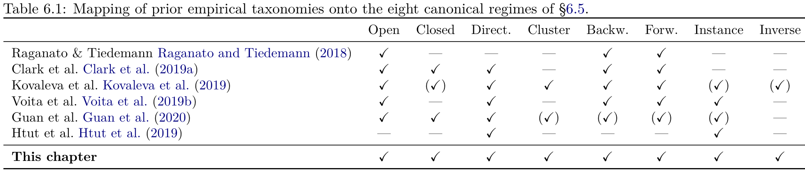

# Chapter 6: local notation, classification problems, and prior taxonomies

[Library index](../README.md) · [Source and transcription policy](../SOURCE.md) · [Previous pages: PDF 172–178](0172-0178-ch05-refinements-equivariance-and-stability.md) · [Next pages: PDF 187–193](0187-0193-ch06-taxonomy-open-and-closed-gates.md)

> Editorial note: This is the full transcription of PDF 179–186 (printed pages 143–150). Source claims, bibliographic attributions, missing references, and internal inconsistencies are retained. References to later §§6.12–6.20 are navigation in the book, not a claim that their bodies have been processed. Interpretive qualifications are in [Note 37](../notes/37-local-notation-and-relative-classification.md) and [Note 38](../notes/38-prior-taxonomies-and-eight-gating-regimes.md). Table 6.1 includes text actually encoded beyond the printed right page edge; its recovery is documented at the table. The last sentence continues on PDF 187.

## PDF 179 · Book 143

## Chapter 6 — Local Analysis: The Eight Canonical Regimes of Attention

### 6.1 Introduction

A self-attention head is a matrix that turns one matrix of token vectors into another. Strip away the language of softmax, scaled dot product, and multi-head concatenation, and what remains is a row-stochastic operator $S\in\mathcal S_n$ that tells each token, in proportions summing to one, where to look for its update. The operator can be visualised. For an input sequence of length $n$ it is an $n\times n$ image, with one row per querying token and one column per source. Trained transformers produce images that, to the eye, are not arbitrary: they exhibit recurring shapes — diagonals, vertical stripes, blocks, sparse points. In this chapter we ask what those shapes are, why they recur, and what they tell us about the geometry of the underlying bilinear form $M=W_QW_K^\top=M_s+M_a$ that produced them.

The chapter is a substantial revision of an earlier draft. Three kinds of change have been made.

**First, a precise mathematical status.** The earlier draft treated the eight recurring shapes — open gate, closed gate, directional gate, cluster head, backward and forward contextual gates, instance gate, inverse directional gate — as if they formed an exhaustive classification of attention maps. This formulation is too strong. The unrestricted set $\mathcal S_n$ of $n\times n$ row-stochastic matrices is enormous: even the deterministic boundary $\{0,1\}$-matrices alone contains all permutation matrices, of which only the cyclic shifts and the identity belong to the eight canonical families. The correct statement is that the eight shapes form a *canonical dictionary* of interpretable local regimes, and that every attention map can be classified relative to it by a Frobenius projection onto the convex hull of the dictionary plus a non-canonical residual. The earlier statement of “pattern completeness” has been retained in §6.16 as a relative result, valid within a precisely stated grammar of admissible support geometries, and has been augmented by an unrestricted result, the canonical-projection theorem of §6.17.

**Second, technical corrections.** The original draft contained three technical defects in the emergence and silence sections, which we have repaired in place. The softmax-inversion lemma confused exterior margin with intra-support flatness; the cluster condition averaged logit dominance instead of taking a uniform minimum; the closed-gate constant carried an incorrect dependence on $n$; the spectral identity for the antisymmetric activation energy

## PDF 180 · Book 144

missed a factor and the cross-terms between eigenplanes. The corrected statements are in §§6.18–6.19, and the discrepancies with the original draft are documented in §6.20, where we list explicitly the five strongest claims that need replacing and the precise replacements.

**Third, a megasection on signatures.** The new §6.17 introduces the canonical signature $\widehat\lambda(S)\in\Delta_8$ and the residual $\rho_8(S)$ that, together, place every attention map in eight-dimensional canonical coordinates. The signature is computable, Lipschitz in Frobenius norm, exact on the canonical hull, and degrades gracefully outside it. Six numerical experiments verify the construction on synthetic inputs and on synthetic BERT-style attention maps, and exhibit phenomena — the dicotomy between deterministic and distributed regimes under softmax noise, the residual-entropy correlation on Dirichlet maps, the failure of margin-only emergence — that the corrected theory now explains.

The result is not a smaller theory. It is a stronger one: the eight regimes remain central, but the chapter now knows precisely what lies outside them. We give two independent symmetry-based classification arguments *within* a controlled grammar; we give a projection-based description *outside* the grammar; and we quantify the deviation between the two.

**Reading key.** The reading key for the chapter is the movement from *visual pattern* to *operator regime*, in five stages. We begin by *seeing*: we exhibit the eight canonical shapes empirically, in attention maps drawn from a trained transformer (§6.4 reviews how the literature converged on a subset of them, and §6.5 catalogues the eight). We continue by *identifying*: §§6.6–6.13 attach to each regime a canonical row-stochastic matrix, an explicit output, a rank, a row entropy, and a placement in the symmetric/antisymmetric sector decomposition of $M$. We then *compose* (§6.14) and read the rank-entropy duality (§6.15). We prove *relatively complete* in §6.16 via two independent classification arguments. We *coordinate*, in the new §6.17: the canonical signature, the projection theorem, the stratification of $\mathcal S_n$ by face support, and the seven numerical experiments. We close by *understanding*: §§6.18–6.19 characterise, with the corrected statements, the operator-level conditions on $M$ and on the input cloud $X$ under which a specific regime emerges and the silence criterion of the antisymmetric sector.

The chapter rests on three results from preceding chapters of Part II. From Chapter ? we inherit the structural decomposition $M=M_s+M_a$ into symmetric and antisymmetric parts, together with the reciprocity-directionality identity, the cycle circulation $C(i,j,k)$, and the directional energy $\mathcal E_{\mathrm{dir}}(X;M)$. From Chapter 5 we inherit the post-softmax persistence theorems, which tell us that a directional structure present in the bilinear form survives the softmax non-linearity and reaches the score matrix as a structured pattern.

### 6.2 Local notation

We fix the notation used throughout the chapter. Let $X\in\mathbb R^{n\times d}$ be the matrix of token representations entering a single head and let

$$
M=W_QW_K^\top\in\mathbb R^{d\times d}.
\tag{6.1}
$$

Ignoring bias terms, the pre-softmax logit matrix is

$$
L=\frac{XMX^\top}{\sqrt{d_k}}\in\mathbb R^{n\times n},
\tag{6.2}
$$

## PDF 181 · Book 145

and the row-stochastic attention matrix is

$$
S=\operatorname{softmax}_{\mathrm{row}}(L),\qquad
S_{ij}=\frac{\exp(L_{ij})}{\sum_{k=1}^{n}\exp(L_{ik})}.
\tag{6.3}
$$

The set of all admissible attention matrices at sequence length $n$ is the row-stochastic polytope

$$
\mathcal S_n:=\{S\in\mathbb R_{\geq0}^{n\times n}:S\mathbf1=\mathbf1\},
\tag{6.4}
$$

where $\mathbf1\in\mathbb R^n$ is the all-ones vector.

The structural decomposition from Chapter ? is

$$
M=M_s+M_a,\qquad
M_s=\tfrac12(M+M^\top),\qquad
M_a=\tfrac12(M-M^\top),
\tag{6.5}
$$

inducing $L=L_s+L_a$ with $L_s^\top=L_s$ and $L_a^\top=-L_a$. The identity

$$
L_{ij}-L_{ji}=2(L_a)_{ij}
\tag{6.6}
$$

will be used repeatedly. Note that this is a logit-level identity: since the softmax normalises each row separately, no analogous identity holds for $S_{ij}-S_{ji}$.

**Lemma 6.1 (Row-softmax equivariance under coordinate permutations).** For every permutation matrix $\Pi\in\mathbb R^{n\times n}$ acting on $\{1,\ldots,n\}$,

$$
\operatorname{softmax}_{\mathrm{row}}(\Pi L\Pi^\top)
=\Pi\operatorname{softmax}_{\mathrm{row}}(L)\Pi^\top.
$$

*Proof.* For a row vector $u\in\mathbb R^n$ the identity $\operatorname{softmax}(u\Pi^\top)=\operatorname{softmax}(u)\Pi^\top$ holds because permutation permutes the exponentials and preserves their normalising sum. Applied row by row, with the rows themselves permuted by left multiplication by $\Pi$, this gives the matrix statement. $\square$

The lemma is the correct symmetry statement for the row-softmax. It should not be replaced by the imprecise phrase “softmax depends only on the multiset of entries”: the row-softmax preserves coordinate labels, and a permutation acting only on rows is not the same as a permutation acting only on columns.

**Other notation.** Throughout the chapter, $\Delta_k=\{\lambda\in\mathbb R_{\geq0}^k:\sum_\alpha\lambda_\alpha=1\}$ denotes the standard $k$-simplex. The Frobenius inner product on $\mathbb R^{n\times n}$ is $\langle A,B\rangle_F=\operatorname{tr}(A^\top B)$ and the Frobenius norm is $\|A\|_F=\langle A,A\rangle_F^{1/2}$. The row entropy of a row-stochastic matrix is the average Shannon entropy of its rows in nats:

$$
H_{\mathrm{row}}(S)
=\frac1n\sum_{i=1}^{n}
\left(-\sum_{j=1}^{n}S_{ij}\log S_{ij}\right).
\tag{6.7}
$$

### 6.3 Two classification problems

Before constructing the catalogue, we must distinguish two problems that the literature has occasionally conflated.

## PDF 182 · Book 146

**The unrestricted classification problem.** The unrestricted problem asks for a classification of all matrices in $\mathcal S_n$, or equivalently of all matrices of the form $\operatorname{softmax}_{\mathrm{row}}(XMX^\top/\sqrt{d_k})$ for some choice of $X$ and $M$. This problem is enormous. Every strictly positive row-stochastic matrix can be realised as the row-softmax of some logit matrix — indeed, $L_{ij}=\log S_{ij}$ produces $S$ exactly. The boundary, where some entries vanish, is reached by sending logits to $-\infty$. Up to limiting operations, the unrestricted softmax image is therefore as large as $\mathcal S_n$ itself, which is the convex hull of the $n^n$ deterministic row-stochastic matrices. No finite-list classification of $\mathcal S_n$ can exist that does not reduce, in the deterministic boundary, to a list as large as $n^n$.

**The canonical-catalogue problem.** The canonical-catalogue problem is different. It asks for a finite list of recurrent and interpretable regimes that trained heads often approximate, together with a mathematically controlled way of measuring how much of a given attention map is explained by that list. This is the problem the present chapter solves. The word *canonical* is essential. The eight regimes are not all possible attention maps; they are the distinguished local regimes used as a dictionary. Every attention map is then described by its canonical signature relative to the dictionary plus a non-canonical residual.

The distinction matters because the two problems have very different answers, and conflating them produces false statements. Two examples make the distinction concrete.

**Example 6.2 (Deterministic maps already exceed the eight regimes).** For any permutation $\pi\in\mathfrak S_n$, the matrix $S_{ij}=\mathbf1_{\{j=\pi(i)\}}$ is row-stochastic and has zero row entropy. The open gate is the special case $\pi(i)=i$. The cyclic contextual gates are the special cases $\pi(i)=i+d\pmod n$. A generic permutation is neither the identity nor a cyclic shift. Hence deterministic attention alone already contains many maps outside the eight canonical families. There are $n!$ permutations and only $n$ cyclic shifts; the ratio $n!/n=(n-1)!$ tends to infinity rapidly. We will see in §6.17.6 that, at $n=8$, the $40\,320$ permutation matrices populate a wide histogram of distances to the canonical dictionary, with only $16$ at distance zero.

**Example 6.3 (Support concentration is not uniformity).** Let a row $S_i$ have preferred support $C=\{1,2\}$ but probabilities $(0.95,0.05)$ on that support. The support resembles the two-column support of an inverse-directional or cluster regime, but the weights inside the support are not uniform. A canonical inverse-directional regime requires both that mass concentrate on $C$ and that it spread uniformly over $C$. Support membership is therefore a strictly weaker statement than canonical regime membership; the emergence theorems of §6.18 need separate hypotheses for the two facts.

These examples motivate the structure of the rest of the chapter: first define the regimes; then describe their composition and their rank-entropy duality; then prove a relative-completeness theorem inside a controlled grammar; then introduce the canonical signature and projection that handle the unrestricted problem; finally state the corrected emergence and silence theorems.

### 6.4 Prior taxonomies of attention patterns

The pattern-based reading of self-attention is older than the present chapter, but it has so far progressed in fragments. Several papers, written between 2018 and 2020, identified small subsets of the eight canonical regimes of §6.5 from empirical inspection of trained transformers. None of them established exhaustiveness, none attached a group-theoretic description, and none derived the rank-entropy duality that organises our catalogue. The purpose of this section is to make this lineage explicit: we recover, in each prior taxonomy,

## PDF 183 · Book 147

which of our eight regimes were already named, which were missed, and which formal ingredient was absent that the present chapter supplies.

#### 6.4.1 The first sightings: Raganato and Tiedemann (2018)

The earliest systematic catalogue of recurring attention patterns appears in Raganato and Tiedemann (2018), in the context of an encoder-decoder transformer trained for machine translation. By probing the encoder representations on syntactic dependency relations, the authors observed that a substantial fraction of encoder heads attend to fixed positional offsets relative to the diagonal — a token typically attends to its predecessor, its successor, or to itself. They called these *positional heads* and argued that they form the simplest, most reproducible component of the attention machinery.

Translated into our notation, the positional heads of Raganato and Tiedemann (2018) are precisely the open gate (offset $\Delta=0$, §6.6), the backward contextual gate (§6.10, $\Delta=-1$ in the original observation but generalised here to arbitrary offsets), and the forward contextual gate (§6.11). The relative-completeness of this sub-family — that any head whose row mass is concentrated on a fixed cyclic diagonal of $S$ must be one of these three — was not established and would have required the symmetry-group reading developed in §6.16. The remaining five regimes are absent from this work. The follow-up ? sharpened the empirical claim into a constructive one: positional heads can be replaced by hard-coded attention masks without loss of translation quality, providing strong indirect evidence that the contextual gates are an information-theoretic choice of the network rather than an artefact of training.

#### 6.4.2 The two foundational empirical taxonomies: Clark et al. (2019) and Kovaleva et al. (2019)

The two papers that the literature most commonly credits with the “surface-level pattern” reading of BERT’s attention appeared within months of each other. Both restrict their analyses to BERT-base and rely on manual inspection of attention maps.

Clark, Khandelwal, Levy, and Manning Clark et al. (2019a) report three coarse families of patterns. *Broad attention*, in which a head distributes its mass uniformly over the full sequence, corresponds to our closed gate (§6.7). *Attention to delimiters*, in which most tokens point to the special tokens [CLS] and [SEP], corresponds exactly to our directional gate (§6.8), with the source token coinciding with a structural marker. *Attention to fixed positional offsets* corresponds, as in Raganato and Tiedemann (2018), to the two contextual gates and the open gate. Clark et al. further observe that heads in the same layer often exhibit similar behaviours, which is the empirical analogue of the strong layer-wise structure that the symmetry-group analysis predicts: when a layer’s tokens occupy a particular subspace, the admissible regimes are constrained to the stabiliser of that subspace.

Kovaleva, Romanov, Rogers, and Rumshisky Kovaleva et al. (2019), in the EMNLP 2019 paper that gave the field its enduring vocabulary, propose five classes which they describe as exhaustive within a manual-annotation sample of $\approx400$ maps:

1. **Vertical** — a head in which every row points to a single, shared column, almost always [CLS] or [SEP]; coincides with our directional gate (§6.8).
2. **Diagonal** — a head whose mass concentrates on the main diagonal or on a fixed offset; subsumes our open gate (§6.6) and the two contextual gates (§§6.10–6.11).
3. **Vertical+Diagonal** — a mixture; in our framework, an instance of pattern composition (§6.14) rather than a new canonical regime.

## PDF 184 · Book 148

4. **Block** — a head whose attention is concentrated on [SEP]-demarcated sub-sequences; coincides with our cluster head (§6.9).
5. **Heterogeneous** — a residual class containing all maps that do not fit the previous four; explicitly described as “everything else”.

The exhaustiveness claim of Kovaleva et al. (2019) is a tautology rather than a theorem: by construction, the residual class Heterogeneous absorbs all unmatched maps and so the union covers the data. This is not a classification result in the technical sense; it is a partial taxonomy together with a catch-all. The eight regimes of §6.5 are mutually disjoint as canonical forms, and the relative-completeness theorem of §6.16 states that every shift-regular attention map decomposes as a convex combination of the eight, with the residual class re-interpreted as the non-shift-regular complement and quantified, in §6.17, by the canonical residual norm $\rho_8(S)$.

Two observations of Kovaleva et al. (2019) are particularly relevant for our treatment. First, the authors observe that the vertical and diagonal patterns together account for over half of the heads of fine-tuned BERT-base on GLUE tasks — a fact that, in the language of §6.15, places the empirical mass of trained attention on the two extremes of the rank-entropy axis (rank one with low entropy on one side, rank-preserving with zero entropy on the other). Second, they note that disabling certain heads improves performance, which is the empirical signature of the closed-gate regime (§6.7): a head that attends uniformly is operationally equivalent to a deletion of the head followed by a residual bypass.

#### 6.4.3 Specialisation and pruning: Voita et al. (2019), Michel et al. (2019)

The specialisation literature analyses attention heads through the lens of *function* rather than *form*.

Voita, Talbot, Moiseev, Sennrich, and Titov Voita et al. (2019b) introduce a pruning methodology based on stochastic gates and an $L_0$ relaxation, and identify three functional categories among the heads that survive pruning of an English-Russian Transformer: *positional heads* (corresponding to our open gate and the two contextual gates), heads that attend to *rare tokens* (a sparse, instance-like regime that we formalise as the instance gate of §6.12), and heads that encode *specific syntactic dependencies* (which, depending on the dependency, fall under directional gate, contextual gate, or instance gate). Their striking finding — that 38 of 48 encoder heads can be removed at the cost of 0.15 BLEU — is a direct empirical corollary of our cataloguing: a trained transformer concentrates the bulk of its information transport on a small number of canonical regime classes, and the rest of the heads populate the closed-gate regime, where their information contribution is negligible.

Michel, Levy, and Neubig Michel et al. (2019b) study the orthogonal question of how few heads suffice. They show that several layers of trained transformers can be reduced to a single attention head with little loss of performance, and that a randomly chosen single head per layer is often sufficient. From the perspective of the present chapter, this is consistent with the rank-entropy duality and the closed-gate regime: most heads are either redundant copies of a dominant canonical regime in their layer or near-closed gates, and a single head can carry the entire informational load if it is in a non-degenerate canonical regime.

Neither work proposes a structural classification of patterns, and neither addresses the inverse directional gate, the cluster head, or the sequence-silent regime that the geometric framework of Bonino et al. (2025) identifies and that we develop in §6.19.

## PDF 185 · Book 149

#### 6.4.4 Algorithmic clustering: Guan et al. (2020)

The work of Guan et al. Guan et al. (2020) marks the transition from manual annotation to automatic discovery. By extracting a 21-dimensional vector of distance-based features from each attention map and applying $k$-means on the 384 heads of BERT-large, they recover, without supervision, four clusters that the authors label *dense*, *vertical*, *diagonal*, and a residual *mixed* class. The first three correspond to our closed gate, directional gate, and open gate (or its contextual shifts). The clustering is corpus-wide, which is a methodological advance over single-input inspection, and the cluster centroids are stable across random initialisations, suggesting that the patterns are intrinsic properties of the trained network rather than artefacts of particular sentences.

The limitations of the clustering approach are also instructive. The number of clusters is a hyperparameter chosen by the analyst, and the recovered clusters are not equipped with formal definitions: a vertical-cluster head can be qualitatively close to a directional gate without exactly satisfying its canonical form. The cluster head and instance gate of our taxonomy do not appear as separate clusters in Guan et al. (2020); both are absorbed into the residual class. The completeness question — whether four clusters are enough — is left empirical. The relative-completeness theorem of §6.16 provides the answer the clustering literature was looking for: within the shift-regular grammar, the right number of canonical regimes is eight, and the classification is forced, not chosen.

#### 6.4.5 Visualisation tools and the rollout view

A separate strand of literature has developed visualisation tools for attention maps without proposing a taxonomy. Vig’s BERTviz ? renders bipartite token-to-token diagrams head-by-head and layer-by-layer, and has become the standard inspection instrument for practitioners; the patterns it reveals are precisely those that the catalogue of §6.5 formalises. Abnar and Zuidema’s attention rollout ? aggregates attention across layers by multiplying the score matrices, producing a global view of token influence that is conceptually orthogonal to the per-head analysis of this chapter, and that we revisit in the global-flow analysis of Chapter 8.

Htut, Phang, Bordia, and Bowman Htut et al. (2019) address a question that sits between visualisation and taxonomy: do BERT’s attention heads track specific syntactic dependencies? They find that some heads do, and that these heads correspond, on a per-dependency basis, to instance-like or directional patterns. This is the cleanest empirical confirmation that the canonical regimes of our catalogue are not merely surface descriptors but carry linguistic content, when the head is non-trivial.

#### 6.4.6 What this chapter adds

The literature surveyed above identified, between 2018 and 2020, four to five patterns by manual or algorithmic inspection. Table 6.1 maps these prior identifications onto our eight-regime taxonomy and makes visible the regimes that no prior work captured.

A check (✓) indicates that the work named or depicted the regime; a parenthesised check ((✓)) indicates that the regime was absorbed into a broader or residual class without being separately characterised; an em-dash (—) indicates absence. The last row records the present chapter’s contribution.

The contribution of the present chapter, against this backdrop, can be stated in three points.

## PDF 186 · Book 150

**Table 6.1: Mapping of prior empirical taxonomies onto the eight canonical regimes of §6.5.**

| Work | Open | Closed | Direct. | Cluster | Backw. | Forw. | Instance | Inverse |
| --- | --- | --- | --- | --- | --- | --- | --- | --- |
| Raganato & Tiedemann Raganato and Tiedemann (2018) | ✓ | — | — | — | ✓ | ✓ | — | — |
| Clark et al. Clark et al. (2019a) | ✓ | ✓ | ✓ | — | ✓ | ✓ | — | — |
| Kovaleva et al. Kovaleva et al. (2019) | ✓ | (✓) | ✓ | ✓ | ✓ | ✓ | (✓) | (✓) |
| Voita et al. Voita et al. (2019b) | ✓ | — | ✓ | — | ✓ | ✓ | ✓ | — |
| Guan et al. Guan et al. (2020) | ✓ | ✓ | ✓ | (✓) | (✓) | (✓) | (✓) | — |
| Htut et al. Htut et al. (2019) | — | — | ✓ | — | — | — | ✓ | — |
| **This chapter** | ✓ | ✓ | ✓ | ✓ | ✓ | ✓ | ✓ | ✓ |

> Editorial note on recovery: The printed PDF viewport clips the table after the “Forw.” column and the start of “Instance”. The complete “Instance” and “Inverse” columns above are present in the original PDF content stream. The image widens the viewport to render that existing content; no cell was inferred or redrawn. Bibliographic mappings remain the author's claims, not an independent review of those papers.

**(i) Relative exhaustiveness within the shift-regular class.** We give, for the first time, a classification that is provably complete within a clean structural restriction. The completeness theorem of §6.16 establishes that the eight canonical forms exhaust the orbits of shift-regular row-stochastic matrices under the natural symmetry groups; no residual class is needed inside this restriction. Two independent proofs are given, one group-theoretic and one via Pontryagin duality of the cyclic shift action. The inverse directional gate, in particular, is identified by the symmetry analysis as a canonical class even though no prior work isolated it: it is the only regime in which a single row is sparse, the row-column asymmetry of the softmax preventing its collapse into either the directional gate or the instance gate. For arbitrary, possibly non-shift-regular row-stochastic matrices, the description is augmented by the canonical signature $\widehat\lambda(S)\in\Delta_8$ and the canonical residual $\rho_8(S)$ of §6.17.

**(ii) Operator-theoretic characterisation.** Each regime is associated, via the symmetric/antisymmetric decomposition $M=M_s+M_a$ of Chapter ?, with a dominant sector and a characteristic value of the directional energy and triangular circulation. This replaces the visual nomenclature of the prior literature with quantitative observables. In particular, the sequence-silent regime identified in Bonino et al. (2025) and developed in §6.19 is invisible to inspection-based methods: it is a configuration in which $M_a\neq0$ globally but the row span of the input cloud is isotropic for the alternating form induced by $M_a$, so the head has a directional structure that is not currently activated. None of the surveyed taxonomies registered this regime.

**(iii) Rank-entropy duality and the role of the catalogue.** We organise the eight regimes along the joint axis of rank and row entropy of the output, and prove the duality of §6.15 that constrains where a regime can sit in the rank-entropy plane. The two extremal poles, the open and the closed gate, are the only regimes realising rank $n$ with entropy zero and rank one with entropy $\log n$ respectively, and the remaining six regimes interpolate through controlled combinations of these extremes. The earlier literature observed empirically that the bulk of trained heads concentrate near these two poles Kovaleva et al. (2019); Voita et al. (2019b); we explain why.

**Closing remark.** The catalogue is, in this sense, the result of a six-year empirical convergence. Every regime in our list of eight has been seen by some earlier work, with the partial exception of the inverse directional gate, which is implicit in the row-vs-column asymmetry of softmax but had not been named. What was missing — and what the formalism of this chapter supplies — is the proof that no further shift-regular pattern exists, the assignment of each regime to a sector of $M$ and to a symmetry group, the quantitative duality between rank and entropy that explains the empirical distribution of heads, and the canonical-coordinate

> Page boundary: the sentence continues with “framework…” on [PDF 187](0187-0193-ch06-taxonomy-open-and-closed-gates.md#pdf-0187).
