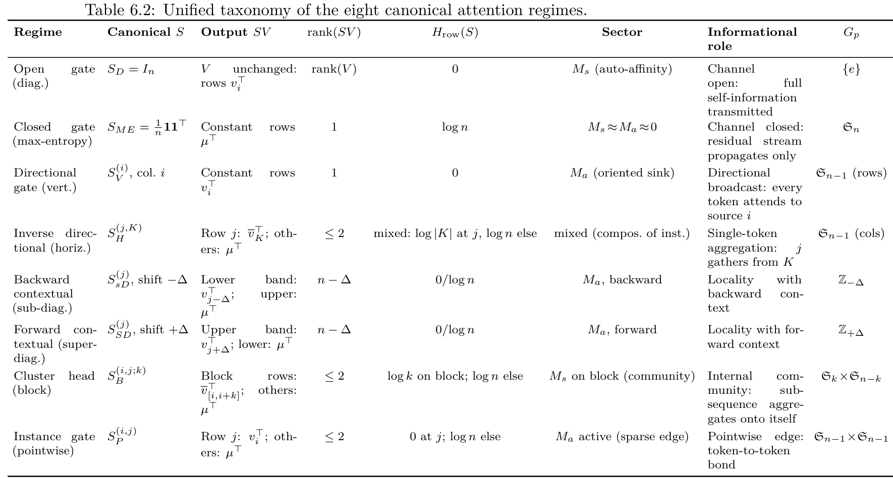
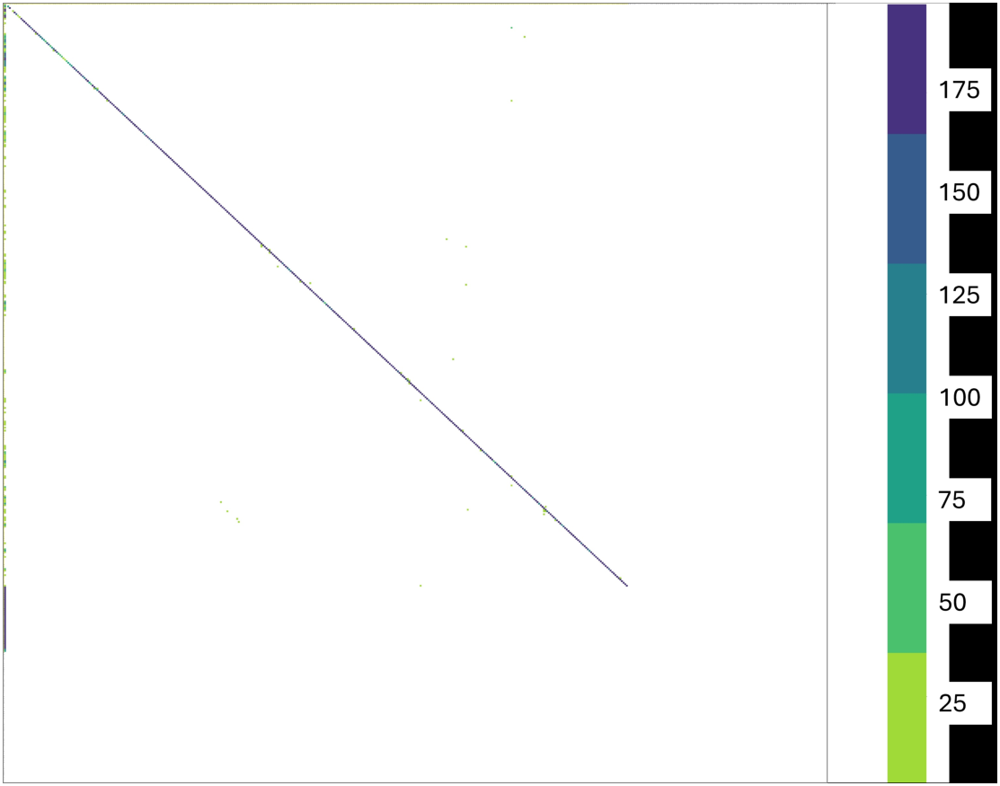
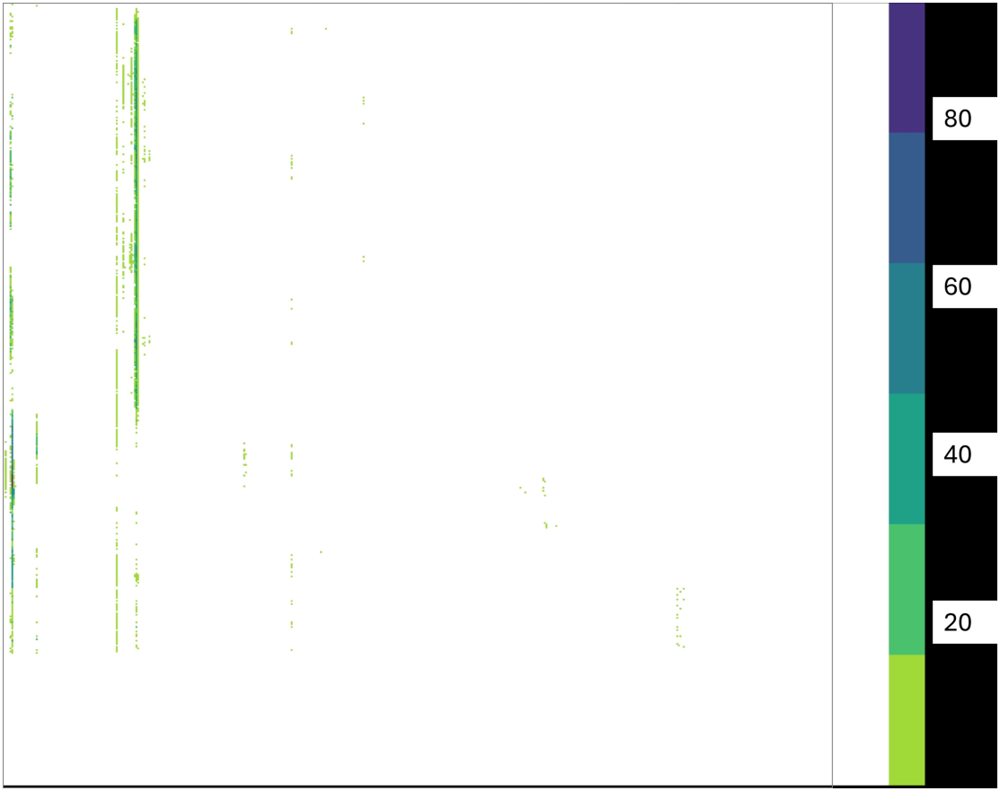

# Chapter 6: unified taxonomy, open gate, and closed gate

[Library index](../README.md) · [Source and transcription policy](../SOURCE.md) · [Previous pages: PDF 179–186](0179-0186-ch06-notation-and-prior-taxonomies.md) · [Next pages: PDF 194–200](0194-0200-ch06-directional-cluster-and-contextual-gates.md)

> Editorial note: Full transcription of PDF 187–193 (printed pages 151–157), including Table 6.2 and Figures 6.1–6.2. The table and the prose sometimes disagree; both are retained. The original source contains incorrect stabiliser statements and claims about information, sectors, and pruning that require qualifications. See [Note 38](../notes/38-prior-taxonomies-and-eight-gating-regimes.md), [Note 39](../notes/39-open-and-closed-gates.md), and [Note 40](../notes/40-directional-gates.md). The rightmost table content is recovered from the original PDF's encoded text and artwork, not inferred. Later sections named by the author remain forward references.

## PDF 187 · Book 151

framework that brings non-shift-regular maps into the same descriptive system.

### 6.5 Unified taxonomy of the eight canonical regimes

We now consolidate the local analysis of the previous sections into a single reference table. Each of the eight ideal regimes is characterised along eight operator-theoretic axes: the canonical form of the row-stochastic matrix $S$, the resulting output $SV$, its rank, its row entropy, the dominant sector of the bilinear form $M=M_s+M_a$ that produces it, the informational role played by the head, and the symmetry group $G_p$ that will appear in the relative-completeness theorem of §6.16.

- **Rank** is computed under the idealised score matrix and serves as a diagnostic of channel destruction in the sense of Theorem ??. Rank statements involving $SV$ also require generic non-degeneracy hypotheses on $V$, made explicit in each lemma below. A rank of $1$ does not automatically signal information loss: as shown in §6.8, a rank-one output may carry a strongly directional signal.
- **Row entropy** is the average Shannon entropy of the rows of $S$, in nats. The bounds $0\leq H_{\mathrm{row}}\leq\log n$ are saturated by the open and closed gates respectively.
- **Dominant sector** indicates whether the regime is generated primarily by the symmetric part $M_s$ (reciprocal affinity, no oriented flow) or by the antisymmetric part $M_a$ (oriented bias), following Proposition ?? and Theorem ??.
- **Symmetry group** $G_p$ is the stabiliser of the regime under coordinate permutations of $\{1,\ldots,n\}$, made precise in Definition 6.42 and used in the relative-completeness argument. Its size (and the dimension of its fixed subspace) controls how restrictive the regime is as an attention configuration.

**How to read Table 6.2.** The table organises the regimes along the two principal axes the chapter has developed: the rank-entropy axis (columns 4–5) and the symmetric-antisymmetric axis (column 6).

Each row gives the idealised score matrix $S$, the resulting output $SV$, its rank, its row entropy, the dominant sector of the bilinear form $M$ that generates it, the informational role played by the head, and the symmetry group $G_p$ used in the relative-completeness theorem (§6.16). Symbols: $\overline v_K$ denotes the mean of value rows indexed by $K$; $\mu$ is the uniform mean $n^{-1}\sum_i v_i$. Shifts are denoted $\sigma_\Delta$ with offset $\Delta$. The four extremal combinations are realised by canonical regimes:

- Low entropy, full rank, symmetric: open gate.
- High entropy, rank one, no sector: closed gate.
- Low entropy, rank one, antisymmetric: directional gate.
- Mixed entropy, low rank, symmetric on a sub-block: cluster head.

The remaining four regimes (instance, inverse directional, backward and forward contextual) interpolate between these extremes, parameterised by an offset $\Delta$ or by the location $(i,j)$ of the active region.

**Remark 6.4 (Rank-entropy duality).** Inspection of columns 4 and 5 reveals a partial duality. For the four regimes generated by a single dominant cell or column ($S_D$, $S_V^{(i)}$, $S_{sD}^{(j)}$, $S_{SD}^{(j)}$ on their support), low row entropy coexists with low effective rank of the output. For the

## PDF 188 · Book 152

regimes generated by uniform mass ($S_{ME}$, $S_B^{(i,j;k)}$), maximal entropy coexists with rank-1 output. This duality is made quantitative by Proposition 6.39 (§6.15).

**Remark 6.5 (Compositionality).** Empirically observed self-attention matrices are rarely instances of a single canonical regime; they are linear superpositions. Thanks to the linearity of the matrix product $S\mapsto SV$, the output decomposes accordingly:

$$
S=\sum_p\alpha_p S^{(p)}
\Longrightarrow
SV=\sum_p\alpha_p S^{(p)}V,
$$

provided the convex constraint $\sum_p\alpha_p=1$, $\alpha_p\geq0$ is preserved. This is the formal basis for the canonical-signature construction of §6.17 and motivates the relative-completeness theorem of §6.16: the eight canonical regimes generate, by convex combination, the entire admissible polytope of shift-regular row-stochastic matrices.

**Forward references.** The table is the empirical anchor for three formal results developed later in the chapter:

1. (Rank-entropy duality, §6.15) — formalises the $(\operatorname{rank},H_{\mathrm{row}})$ relationship sketched above.
2. (Relative completeness, §6.16) — proves that the eight regimes exhaust the orbits of admissible shift-regular row-stochastic matrices under the action of the symmetry groups $G_p$ listed in column 8, with two independent proofs.
3. (Canonical signatures and projection, §6.17) — extends the classification to arbitrary row-stochastic matrices via Frobenius projection onto the convex hull of the eight regime families.

### 6.6 Open gate: the identity pattern

Picture an attention head that, layer after layer, makes a single decision: do nothing. Each token, when it asks the head to redistribute its representation along the sequence, receives back exactly what it already had. No averaging, no borrowing of context, no diffusion across positions. The output of the multi-head block, in the part of the residual stream contributed by this head, is identical to its input: the head behaves as a transparent wire. We call this configuration the *open gate*, and the corresponding score matrix is the identity.

The metaphor of a gate is borrowed from the theory of feed-forward neural networks, where it usually denotes a multiplicative element that decides how much of an incoming signal is passed forward. Here we adapt it to the self-attention mechanism by reading the row-stochastic matrix $S$ as a layer of $n$ gates, one per token, each row of $S$ specifying from where the token at that position will draw its update. When the row puts all of its mass on the token’s own position, the gate carries the token’s own value through unchanged: it is open. Other configurations of the same row will give rise to gates that are closed, partially mixed, or oriented elsewhere; these form the remaining seven regimes of this chapter. The open gate is thus the identity element of the catalogue, the configuration in which the head acts trivially on the value matrix.

The open gate is rare in trained models, but its rarity is informative. A head that converges to the open gate during training is signalling that the cross-token interaction at that location of the network is, for the distribution of inputs the head sees, redundant. Pruning experiments Voita et al. (2019b); Michel et al. (2019b) have repeatedly identified such heads in BERT and translation transformers, and have shown that they can be removed at little or no cost

## PDF 189 · Book 153

**Table 6.2: Unified taxonomy of the eight canonical attention regimes.**

| Regime | Canonical $S$ | Output $SV$ | $\operatorname{rank}(SV)$ | $H_{\mathrm{row}}(S)$ | Sector | Informational role | $G_p$ |
| --- | --- | --- | --- | --- | --- | --- | --- |
| Open gate (diag.) | $S_D=I_n$ | $V$ unchanged: rows $v_i^\top$ | $\operatorname{rank}(V)$ | $0$ | $M_s$ (auto-affinity) | Channel open: full self-information transmitted | $\{e\}$ |
| Closed gate (max-entropy) | $S_{ME}=\frac1n\mathbf1\mathbf1^\top$ | Constant rows $\mu^\top$ | $1$ | $\log n$ | $M_s\approx M_a\approx0$ | Channel closed: residual stream propagates only | $\mathfrak S_n$ |
| Directional gate (vert.) | $S_V^{(i)}$, col. $i$ | Constant rows $v_i^\top$ | $1$ | $0$ | $M_a$ (oriented sink) | Directional broadcast: every token attends to source $i$ | $\mathfrak S_{n-1}$ (rows) |
| Inverse directional (horiz.) | $S_H^{(j,K)}$ | Row $j$: $\overline v_K^\top$; others: $\mu^\top$ | $\leq2$ | mixed: $\log\lvert K\rvert$ at $j$, $\log n$ else | mixed (compos. of inst.) | Single-token aggregation: $j$ gathers from $K$ | $\mathfrak S_{n-1}$ (cols) |
| Backward contextual (sub-diag.) | $S_{sD}^{(j)}$, shift $-\Delta$ | Lower band: $v_{j-\Delta}^\top$; upper: $\mu^\top$ | $n-\Delta$ | $0/\log n$ | $M_a$, backward | Locality with backward context | $\mathbb Z_{-\Delta}$ |
| Forward contextual (super-diag.) | $S_{SD}^{(j)}$, shift $+\Delta$ | Upper band: $v_{j+\Delta}^\top$; lower: $\mu^\top$ | $n-\Delta$ | $0/\log n$ | $M_a$, forward | Locality with forward context | $\mathbb Z_{+\Delta}$ |
| Cluster head (block) | $S_B^{(i,j;k)}$ | Block rows: $\overline v_{[i,i+k]}^\top$; others: $\mu^\top$ | $\leq2$ | $\log k$ on block; $\log n$ else | $M_s$ on block (community) | Internal community: sub-sequence aggregates onto itself | $\mathfrak S_k\times\mathfrak S_{n-k}$ |
| Instance gate (pointwise) | $S_P^{(i,j)}$ | Row $j$: $v_i^\top$; others: $\mu^\top$ | $\leq2$ | $0$ at $j$; $\log n$ else | $M_a$ active (sparse edge) | Pointwise edge: token-to-token bond | $\mathfrak S_{n-1}\times\mathfrak S_{n-1}$ |

> Editorial note on recovery and interpretation: The printed page clips much of “Informational role” and the whole $G_p$ column. These cells are actually encoded in the original PDF and are rendered above by widening the viewport. The table is reproduced without correcting its rank, entropy, sector, or stabiliser claims. In particular, the later source lemmas give conditional ranks and different contextual bounds; the notes distinguish these statements. The instance and inverse-directional rows are table previews only: their later defining sections have not been processed in this batch.

to downstream performance. From the perspective of the residual stream, an open-gate head is a head that delegates the information transport to the skip connection: the token bypasses the attention block and propagates unchanged to the next layer normalisation. This is the only regime, among the eight, in which the rank of the value matrix is preserved exactly; every other regime entails some degree of rank contraction.

The qualitative description above can be made precise by writing down the canonical form of $S$, computing the resulting output $SV$, and reading off its rank, its row entropy, and its placement in the symmetric/antisymmetric decomposition of $M=W_QW_K^\top$. We do this next, and we then compare the result with the empirical attention map of head 4, layer 2, of the SARS-CoV-2 classifier of Bonino et al. (2025), which exhibits an almost perfect open gate.

**Definition 6.6 (Open gate).** The open gate (or diagonal pattern) is the canonical row-stochastic matrix

$$
S_D=I_n,\qquad (S_D)_{jk}=\delta_{jk},\qquad j,k=1,\ldots,n.
\tag{6.8}
$$

The corresponding output is, by direct calculation,

$$
S_DV=V=[v_1^\top,v_2^\top,\ldots,v_n^\top]^\top.
\tag{6.9}
$$

**Lemma 6.7 (Rank preservation).** For the open gate, $\operatorname{rank}(S_DV)=\operatorname{rank}(V)$. In particular, no channel destruction in the sense of Theorem ?? occurs at this head.

*Proof.* Immediate from $S_DV=V$ and the fact that left-multiplication by an invertible matrix preserves rank. $\square$

## PDF 190 · Book 154

**Lemma 6.8 (Vanishing row entropy).** The row entropy of the open gate satisfies $H_{\mathrm{row}}(S_D)=0$.

*Proof.* Each row of $I_n$ is a unit mass on a single coordinate; the Shannon entropy of a Dirac distribution is zero. $\square$

**Sector and circulation.** The open gate places the entire diagonal mass of $S$ on the token’s own position. Since the contribution to the diagonal does not distinguish $L_{ij}$ from $L_{ji}$, an open-gate head is compatible with both a purely symmetric and a purely antisymmetric bilinear form $M$; what matters is only that the diagonal of $L=XMX^\top$ dominates uniformly over the off-diagonal, which is a condition on the spectrum of $M_s$ on the cloud of tokens. By Proposition ??, the antisymmetric sector $M_a$ contributes nothing to the diagonal of $L$, since $x_i^\top M_ax_i=0$ for every $i$; in this sense the open gate is naturally an $M_s$-dominated regime, although the condition is one-sided and degenerate antisymmetric components are not excluded. The triangular circulation $C(i,j,k)$ of Theorem ?? can therefore be either zero or nonzero on an open-gate head, depending on whether residual antisymmetric structure is present beneath the dominant diagonal.

**Remark 6.9 (The open gate is not the unique deterministic rank-preserving regime).** The open gate preserves the value rank exactly, but it is not the only attention map with this property. Every permutation matrix, and in particular every cyclic shift, also preserves rank because left multiplication by a permutation only relabels rows. The open gate is the identity representative of this rank-preserving class, not its only member. The cyclic forward and backward shifts (§§6.10–6.11) are the other rank-preserving deterministic regimes named in the catalogue; non-cyclic permutations preserve rank but are not in the catalogue (see Example 6.2).

**Remark 6.10 (Symmetry and information at the open gate).** The open gate occupies the extremal point of two of the chapter’s organising axes simultaneously. On the symmetry-breaking axis, it is the regime of minimal symmetry: its stabiliser under simultaneous row and column permutations is the trivial group $\{e\}$, since the only permutation $\Pi$ for which $\Pi I_n\Pi^\top=I_n$ is the identity permutation. On the information-channel axis, it is the regime in which the head transmits the maximum possible information from the value matrix to the output: by Lemma 6.7, no rank is destroyed, and by Lemma 6.8 no rows are averaged. The two extremalities will reverse on the next regime, the closed gate of §6.7, which has maximal symmetry and minimal information transmission.

> Editorial note: The stabiliser assertion in Remark 6.10 is false for the stated simultaneous action: $\Pi I_n\Pi^\top=I_n$ for every permutation matrix. The preceding “only regime” prose is also contradicted by the author's Remark 6.9. Both original passages are retained; [Note 39](../notes/39-open-and-closed-gates.md) gives the conditions and distinguishes value transport from a residual bypass.

### 6.7 Closed gate: the maximal-entropy pattern

Picture the opposite of an open gate. An attention head that, layer after layer, performs a single move: average. Each token, when it asks the head to redistribute its representation, receives back the same answer that every other token receives — the uniform mean of the value matrix. The head has lost the ability to discriminate between sources; its row-stochastic matrix has flattened to the maximum-entropy distribution; the output is a constant matrix. We call this configuration the *closed gate*, and it is the canonical regime of informational silence.

The metaphor of the closed gate completes the gating intuition introduced for the open gate. If the open gate is the configuration in which the head delivers its input unchanged, the closed gate is the configuration in which the head delivers a constant signal regardless of the input. Both are extremal points of the catalogue, and they sit at opposite vertices

## PDF 191 · Book 155

**Figure 6.1: The open gate, empirical instance from a trained transformer.**

*The map is from head 4, layer 2 of the BERT-base SARS-CoV-2 variant classifier of Bonino et al. (2025), evaluated on a correctly classified Omicron sequence. The diagonal structure dominates across the full $n\times n$ window, with the small interruption near the last block of tokens being a recurrent finite-size boundary effect that does not alter the qualitative classification of the head as open.*

of the rank-entropy plane: the open gate at $(\operatorname{rank}=n,H_{\mathrm{row}}=0)$, the closed gate at $(\operatorname{rank}=1,H_{\mathrm{row}}=\log n)$. The name reflects the operational content of the regime: nothing of token-specific value passes through; the information that reaches the next layer in the residual stream bypasses the head entirely, carried by the skip connection. The closed gate is, in this precise sense, an off switch.

Closed gates are surprisingly common in trained transformers. The pruning literature Voita et al. (2019b); Michel et al. (2019b); Kovaleva et al. (2019) reports that a substantial fraction of attention heads in BERT-base — between one third and one half, depending on the layer and the fine-tuning task — exhibit near-uniform attention distributions and can be removed without measurable loss in downstream performance. From the perspective developed in §6.4, this is the empirical signature of the closed-gate regime: the network has learned that, for the input distribution it sees, the head adds no usable information, and the cheapest solution is to deliver the uniform mean and let the residual stream do the work. The closed gate is therefore a regime of architectural redundancy, and its prevalence is the most direct empirical argument for sparsifying the multi-head attention block.

**Definition 6.11 (Closed gate).** The closed gate, or maximal-entropy pattern, is the canonical row-stochastic matrix

$$
S_{ME}=\frac1n\mathbf1\mathbf1^\top,\qquad
(S_{ME})_{jk}=\frac1n,\qquad j,k=1,\ldots,n.
\tag{6.10}
$$

## PDF 192 · Book 156

Letting $\mu=\frac1n\sum_{i=1}^{n}v_i$, the corresponding output is

$$
S_{ME}V=\mathbf1\mu^\top,
\tag{6.11}
$$

the constant matrix whose every row equals the uniform mean $\mu^\top$.

**Lemma 6.12 (Rank-one collapse).** For the closed gate, $\operatorname{rank}(S_{ME}V)=1$ whenever $\mu\neq0$, and $\operatorname{rank}(S_{ME}V)=0$ otherwise.

*Proof.* By (6.11) the output is the outer product $\mathbf1\mu^\top$, of rank $1$ if $\mu\neq0$ and rank $0$ otherwise. $\square$

**Lemma 6.13 (Maximal row entropy).** The row entropy of the closed gate satisfies $H_{\mathrm{row}}(S_{ME})=\log n$, the maximum value attainable on the simplex of row-stochastic distributions of length $n$.

*Proof.* Each row is the uniform distribution on $n$ atoms; its Shannon entropy is $-\sum_{k=1}^{n}\frac1n\log\frac1n=\log n$. The bound $H_{\mathrm{row}}\leq\log n$ is the standard concavity bound for entropy on a finite simplex. $\square$

**Sector and circulation.** The closed gate is the only canonical regime in which both the symmetric and the antisymmetric sectors of $M$ are operationally inactive. To see this, recall from Proposition ?? that the pre-softmax logits satisfy $L_{ij}=x_i^\top Mx_j$. The closed gate corresponds to the asymptotic regime in which the row-wise softmax flattens to uniformity, which happens when the spread of $L_{ij}$ across $j$ is small compared to unity for every $i$ — equivalently, when both $x_i^\top M_sx_j$ and $x_i^\top M_ax_j$ are dominated by their across-$j$ averages. The directional energy $\mathcal E_{\mathrm{dir}}(X;M)$ of Bonino et al. (2025) therefore vanishes in the closed-gate limit, and the triangular circulation $C(i,j,k)$ of Theorem ?? vanishes too. In contrast to the open gate, where one of the two sectors can dominate residually, the closed gate is sector-blind: the head has surrendered its contribution to the symmetry-breaking machinery of the layer.

**Remark 6.14 (Symmetry and information at the closed gate).** The closed gate is the polar opposite of the open gate on both organising axes of the chapter. On the symmetry-breaking axis, it is the regime of maximal symmetry: its stabiliser under simultaneous row and column permutations of $\{1,\ldots,n\}$ is the full symmetric group $\mathfrak S_n$, since every entry of $S_{ME}$ equals every other and any permutation leaves $S_{ME}$ invariant. The closed gate therefore breaks no symmetry whatsoever — it is the trivial element of the orbit lattice that will appear in the relative-completeness theorem of §6.16. On the information-channel axis, it is the regime that transmits no token-specific information from the value matrix to the output: by Lemma 6.12, the rank collapses to one, and by Lemma 6.13 the row entropy saturates the upper bound. The pair (open, closed) thus pins down both extremes of the rank-entropy duality of §6.15; the six remaining regimes interpolate between these two through controlled partial activations of $M_s$ and $M_a$.

> Editorial note: Constant output rows need not be independent of the input, and uniform attention does not force the antisymmetric logit energy to vanish. The row-constant-logit counterexample and the distinction between a common update and deletion of a head are in [Note 39](../notes/39-open-and-closed-gates.md).

### 6.8 Directional gate: the vertical line pattern

Imagine a head that, regardless of the position of the querying token, always returns the value at one fixed source. Token 1 asks: it receives $v_i$. Token 17 asks: it receives $v_i$. The last token in the sequence asks: it receives $v_i$. The head behaves as a broadcast antenna pointing at a single column of the value matrix; every row of the score matrix is the indicator of position $i$, and every row of the output is a copy of the $i$-th value vector. This is the

## PDF 193 · Book 157

**Figure 6.2: The closed gate, empirical analogue.** A head from the top layers of fine-tuned BERT-base, exhibiting near-uniform mass and operating as a near-closed gate Bonino et al. (2025). The qualitative rendering makes visible the high-entropy regime observed in the upper layers, where many heads converge to nearly uniform attention.

directional gate, and despite its apparent simplicity it is the most informative rank-one regime in the catalogue.

The directional gate borrows its name from the geometric content of the configuration. The output cone of the head, normally a rank-$\operatorname{rank}(V)$ cluster of token representations, has degenerated to a single line: the direction spanned by $v_i$. Yet this collapse is not, as one might expect, a destruction of information. The line carries the orientation of one specific token, and that orientation is broadcast uniformly to every position in the sequence. In the language of Voita et al. (2019b) the directional gate is a *trigger-token head*; in the language of Kovaleva et al. (2019) it is a *vertical pattern*, observed empirically to dominate when the source coincides with structural delimiters such as [CLS] or [SEP]. In both cases the empirical observation is the same: the head has selected one token, decided that its value is what the rest of the sequence needs to know, and made that decision visible by collapsing the entire row distribution onto column $i$.

In the SARS-CoV-2 classifier of Bonino et al. (2025) the directional gate is the most frequent canonical regime across the trained network; the empirical map shows “v”-coded heads in nearly every layer, with a particular concentration in the intermediate layers where token-level decisions are aggregated. The head’s information content is encoded in two scalars: the column index $i$ (which token is the source) and the magnitude of $v_i$ relative to the residual stream (how strongly the broadcast contributes). The rank-one collapse of the output is therefore not a deficit but an extremely compressed message: one direction, broadcast everywhere.

> Page boundary: the description is followed by Definition 6.15 on [PDF 194](0194-0200-ch06-directional-cluster-and-contextual-gates.md#pdf-0194).
