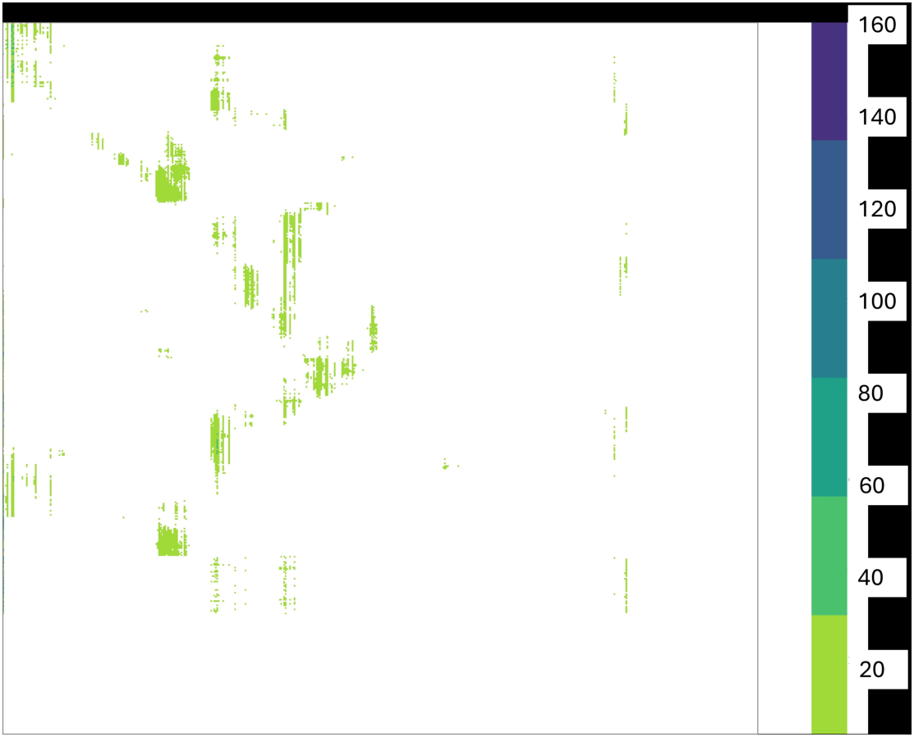
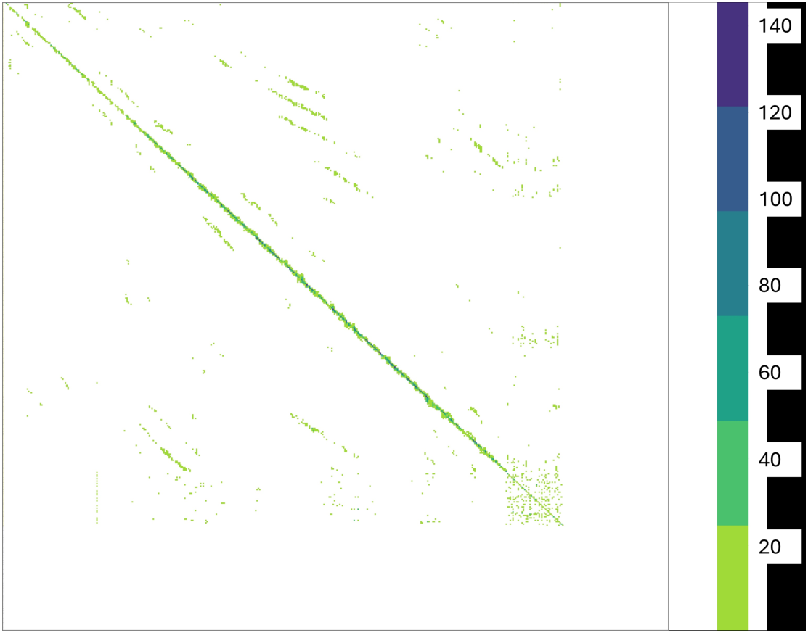

# Chapter 6: directional, cluster, backward contextual, and forward contextual gates

[Library index](../README.md) · [Source and transcription policy](../SOURCE.md) · [Previous pages: PDF 187–193](0187-0193-ch06-taxonomy-open-and-closed-gates.md)

> Editorial note: Full transcription of PDF 194–200 (printed pages 158–164), including Figures 6.3–6.5. The source's formulas, proofs, assertions about sectors and symmetry, and inconsistent indexing are retained. See [directional gates](../notes/40-directional-gates.md), [cluster gates](../notes/41-cluster-gates.md), and [contextual gates](../notes/42-backward-forward-and-contextual-gates.md) for distinct editorial analysis. Figures 6.4 and 6.5 contain the same original raster although their captions name different heads and layers. PDF 200 completes §6.11 and Remark 6.30; body text from PDF 201 onward has not been read in this batch.

## PDF 194 · Book 158

**Definition 6.15 (Directional gate).** The directional gate, or vertical line pattern with source $i\in\{1,\ldots,n\}$, is the canonical row-stochastic matrix

$$
\bigl(S_V^{(i)}\bigr)_{jk}=\delta_{ki},\qquad j,k=1,\ldots,n.
\tag{6.12}
$$

The corresponding output is, by direct calculation,

$$
S_V^{(i)}V=\mathbf1v_i^\top
=[v_i^\top,v_i^\top,\ldots,v_i^\top]^\top.
\tag{6.13}
$$

**Lemma 6.16 (Directional rank-one).** For the directional gate with source $i$, $\operatorname{rank}(S_V^{(i)}V)=1$ whenever $v_i\neq0$.

*Proof.* The output (6.13) is the outer product $\mathbf1v_i^\top$, of rank $1$ when $v_i\neq0$. $\square$

**Lemma 6.17 (Vanishing row entropy).** $H_{\mathrm{row}}(S_V^{(i)})=0$.

*Proof.* Each row of $S_V^{(i)}$ is a Dirac mass at coordinate $i$; entropy $0$. $\square$

**Sector and circulation.** The directional gate is the canonical regime of antisymmetric dominance. To realise the configuration (6.12) from the softmax of the logit matrix, one needs $L_{ji}-L_{jk}\to+\infty$ for all $j$ and all $k\neq i$, i.e. a uniform preference of the token at $x_j$ for the source $x_i$ over all alternatives. This is exactly the hypothesis of the Antisymmetric Sink Theorem (Bonino et al., 2025, Thm. 5.1), reproduced as Theorem 5.2, realised in clean form when the antisymmetric form $\langle u,v\rangle_a=u^\top M_av$ orients all tokens toward $x_i$ — a strong asymmetry condition on the geometry of $x_i$ in the eigenspace of $M_a$. Equivalently, the cycle circulation $C(i,j,k)$ of Theorem ?? is generically nonzero on a directional-gate head, and its sign reflects the orientation of the source. Among the eight canonical regimes, the directional gate is the prototypical $M_a$-dominated configuration; the open gate, by contrast, was $M_s$-dominated.

**Remark 6.18 (Symmetry and information at the directional gate).** The directional gate is the first canonical regime of informative rank collapse. Its symmetry group $G_p$ is the row-symmetric group $\mathfrak S_{n-1}$ acting on the rows other than the column-defining one — that is, any permutation of the rows of $S_V^{(i)}$ leaves the matrix unchanged, since all rows are identical. This places the directional gate strictly between the closed gate (full $\mathfrak S_n$) and the open gate (trivial group) in the lattice of stabilisers, and reflects the fact that the directional gate uses one degree of freedom (the column $i$) to break the maximal symmetry of the closed gate. On the information-channel axis, the directional gate transmits a single rank-one signal whose direction is dictated by the antisymmetric sector of $M$. In the next section we examine the cluster head, which is the analogue informative-rank-low regime but on the symmetric sector $M_s$, completing the pair of structured low-rank regimes that flank the two extremal poles of the catalogue.

### 6.9 Cluster head: the block pattern

A subset of tokens, contiguous in position, that talks only to itself. The remaining tokens, oblivious, distribute their attention uniformly over the sequence and contribute nothing of token-specific value to the output. This is the cluster head: a localised community within the attention map, identifiable as a small square block of high-density cells surrounded by a sea of background uniformity. The block has size $k$ and is anchored at position $(i,j)$; the

## PDF 195 · Book 159

**Figure 6.3: The directional gate, empirical instance from head 9, layer 4 of the SARS-CoV-2 classifier on a correctly classified Omicron sequence Bonino et al. (2025).**

*One fully saturated vertical column broadcasts the value at position $i$ to every row of the output. The rank-one structure is established in Lemma 6.16; its informational content is encoded in the column index, not in the rank.*

tokens inside form a self-interacting group whose representations are mutually averaged, while every token outside the block sees only the global mean of the values.

The cluster head implements one of the most natural primitives of sequence processing: local aggregation. Whenever a span of tokens encodes a unit of meaning that should be processed jointly — a phrase in language, a $k$-mer in genomic data, a structural motif in a biological sequence — a cluster head is the minimal attention configuration that materialises the unit and propagates its averaged content. The name *cluster* is borrowed from the graph-theoretic reading of self-attention as a weighted directed graph on tokens Kovaleva et al. (2019): a $k\times k$ block of high attention is a $k$-clique, and the head detects communities the way a clustering algorithm would. Crucially, the cluster head is structurally distinct from the directional gate: the latter broadcasts one source to everyone, the former mixes a sub-population with itself. Both produce low-rank outputs, but the rank reflects different geometric content.

Cluster heads are pervasive in the SARS-CoV-2 classifier Bonino et al. (2025): the empirical maps show “clu” or “s+clu” labels in roughly one fifth of the heads of fine-tuned BERT-base, with particularly visible blocks in the lower and middle layers. This is consistent with the broader observation that lower transformer layers encode local syntactic and morphological structure Tenney et al. (2019); Raganato and Tiedemann (2018), and that local structure is exactly what a $k\times k$ block isolates. From an information-theoretic standpoint, the cluster head is the canonical regime that breaks the global mean into a controlled local mean: the rows inside the block carry $\overline v_{[i,i+k]}$ rather than $\mu$, and the difference between these two

## PDF 196 · Book 160

quantities is precisely the contribution of the head to the residual stream.

**Definition 6.19 (Cluster head).** The cluster head, or block pattern, of size $k$ at anchor $(i,j)$ is the canonical row-stochastic matrix whose entries are

$$
\bigl(S_B^{(i,j;k)}\bigr)_{rs}=
\begin{cases}
\dfrac1k,&j\leq r\leq j+k-1,\ i\leq s\leq i+k-1,\\
\dfrac1n,&\text{otherwise on rows outside the block},\\
0,&\text{otherwise on rows inside the block}.
\end{cases}
\tag{6.14}
$$

The corresponding output is

$$
\bigl(S_B^{(i,j;k)}V\bigr)_r=
\begin{cases}
\overline v_{[i,i+k-1]}^\top,&j\leq r\leq j+k-1,\\
\mu^\top,&\text{otherwise}.
\end{cases}
\tag{6.15}
$$

**Lemma 6.20 (Cluster head rank).** The output $S_B^{(i,j;k)}V$ has rank at most $2$, and rank exactly $2$ whenever $\overline v_{[i,i+k-1]}$ and $\mu$ are linearly independent.

*Proof.* By (6.15), every row of the output is one of two fixed vectors. The output is therefore $\mathbf1_{\mathrm{block}}\overline v_{[i,i+k-1]}^\top+\mathbf1_{\mathrm{rest}}\mu^\top$, a rank-$2$ matrix whenever the two means are linearly independent and rank-$1$ when they coincide. $\square$

**Lemma 6.21 (Cluster head row entropy).** $H_{\mathrm{row}}(S_B^{(i,j;k)})$ equals $\log k$ on the block rows and $\log n$ on the off-block rows.

**Sector and circulation.** The cluster head is the prototypical symmetric-sector regime. The block is, by construction, doubly stochastic on its support: every token in the block attends to every other with equal mass $1/k$, and the role of “query” and “key” is interchangeable within the block. By Proposition ??, this requires $L_{ij}\approx L_{ji}$ on the block, i.e. vanishing antisymmetric component on the sub-cloud $\{x_i,\ldots,x_{i+k-1}\}$. The cycle circulation $C(i,j,k)$ vanishes on triples drawn from inside the block: the head has no oriented flow, only mutual affinity. Off the block, the regime degenerates to a closed gate. The cluster head is therefore a localised closed gate enriched by an $M_s$-dominated community of size $k$, and its directional energy $\mathcal E_{\mathrm{dir}}(X;M)$, when restricted to the block, is small.

**Remark 6.22 (Symmetry and information at the cluster head).** The cluster head extends the symmetry-breaking sequence from $\mathfrak S_n$ (closed gate) toward partial breaks. Its stabiliser group $G_p$ is $\mathfrak S_k\times\mathfrak S_{n-k}$: the block of size $k$ is invariant under arbitrary permutations of its rows, and the off-block region is invariant under arbitrary permutations of its rows. The cluster head therefore identifies a non-trivial partition of the token positions into two orbits, of sizes $k$ and $n-k$, and the choice $k$ ranging over $\{1,\ldots,n-1\}$ produces a family of regimes that fills the lattice between $\mathfrak S_n$ (closed) and $\mathfrak S_{n-1}$ (directional). On the information-channel axis, the cluster head transmits one non-trivial direction inside the block and one trivial direction outside, realising rank $2$ rather than the rank $1$ of the directional gate. The pair (directional, cluster) thus completes the quartet of extremal regimes: the four corners of the rank-entropy plane are now occupied by the four classes (open, closed, directional, cluster).

**Remark 6.23 (Uniformity inside the block is not implied by support concentration).** The canonical cluster prototype concentrates probability mass on the block and distributes it uniformly inside the block. Support concentration alone — e.g. $\sum_{s\in[i,i+k]}S_{rs}\approx1$ — is strictly weaker: a row may concentrate on the block with non-uniform weights, in which case $S$ is not a cluster prototype but a non-canonical deformation of it. We quantify this

## PDF 197 · Book 161

**Figure 6.4: The cluster head, empirical instance from head 1, layer 2 Bonino et al. (2025).** The map exhibits multiple cluster blocks of varying size, in line with the typical observation that cluster heads coexist with other canonical regimes (§6.14).

distinction in §6.17.6 by separating the exterior margin from the intra-support spread of the underlying logits.

### 6.10 Backward contextual gate: the sub-diagonal pattern

A token at position $j$ asks the head: “what was here, $\Delta$ steps ago?” The head answers, deterministically, by handing back $v_{j-\Delta}$. Every token in the sequence performs the same query, with the same offset, and receives the value at the same fixed lag. The score matrix forms a sub-diagonal band of width $w$ at offset $\Delta$, and the output of the head is a coherent shift of the value matrix backwards along the sequence. We call this configuration the *backward contextual gate*, and its role is to deliver retrospective context: each token sees its past.

The contextual gates — backward and forward — are the simplest non-trivial regimes of locality in the catalogue. They differ from the open gate (which delivers $v_j$ to position $j$) by a fixed shift, and they differ from the directional gate (which delivers a single fixed source to all positions) by translating the source with the query. The name *contextual* captures this dual nature: the head is local, in that the source token is close to the querying token, and it is uniform across the sequence, in that the offset is shared by all positions. The backward variant points to the past, the forward variant points to the future; together they realise the two halves of a shift-invariant attention pattern. Among the four positional configurations of Raganato and Tiedemann (2018); Kovaleva et al. (2019) this is the second one, after the open gate (offset zero); it dominates the empirical maps in heads specialised in syntactic

## PDF 198 · Book 162

and morphological dependencies, where the relevant token is consistently $\Delta$ positions away.

In trained transformers, contextual gates account for a substantial fraction of the heads identified by Voita et al. Voita et al. (2019b) as positional, and they survive aggressive pruning. The role of a backward contextual gate in the SARS-CoV-2 classifier is consistent with this picture: $k$-mer tokens drawn from a sliding window of stride 9 encode local biological structure, and a head that attends to the previous $k$-mer captures correlations between consecutive bases that are diagnostically informative. The empirical map shows “att”-coded heads distributed across all twelve layers, indicating that the network exploits this locality at every depth.

The canonical form of the pattern is given for offset $\Delta=j-1$, so that the active row $j$ in the band attends to position $1$, the row $j+1$ attends to position $2$, and so on. The first $j-1$ rows, lying above the band, are uniform; they contribute the global mean to the output and are responsible for the partial rank collapse.

**Definition 6.24 (Backward contextual gate).** The backward contextual gate with anchor row $j$ is the canonical row-stochastic matrix whose entries are

$$
\bigl(S_{sD}^{(j)}\bigr)_{rs}=
\begin{cases}
\delta_{s,r-(j-1)},&j\leq r\leq n,\\
\dfrac1n,&1\leq r\leq j-1.
\end{cases}
\tag{6.16}
$$

The corresponding output is

$$
\bigl(S_{sD}^{(j)}V\bigr)_r=
\begin{cases}
v_{r-(j-1)}^\top,&j\leq r\leq n,\\
\mu^\top,&1\leq r\leq j-1,
\end{cases}
\tag{6.17}
$$

where $\mu=\frac1n\sum_{s=1}^{n}v_s$.

**Lemma 6.25 (Backward contextual rank).** The output $S_{sD}^{(j)}V$ has rank at most $n-j+2$, and the non-trivial directions populate the band rows $j,\ldots,n$, with one additional rank-one contribution coming from the uniform region.

*Proof.* The first $j-1$ rows of the output are all equal to $\mu^\top$, contributing rank $1$ (or rank $0$ if $\mu=0$). The remaining $n-j+1$ rows are shifted copies of distinct value rows $v_1,\ldots,v_{n-j+1}$, contributing at most $n-j+1$ additional independent directions. The total rank is therefore bounded by $1+(n-j+1)=n-j+2$. $\square$

**Lemma 6.26 (Backward contextual row entropy).** $H_{\mathrm{row}}(S_{sD}^{(j)})=0$ on the band rows $r=j,\ldots,n$ and $\log n$ on the uniform rows $r=1,\ldots,j-1$.

**Sector and circulation.** The backward contextual gate is, like the directional gate, an $M_a$-dominated regime, but the orientation is encoded as a uniform translation rather than as a single source. The condition that $L_{r,r-(j-1)}$ uniformly dominates $L_{r,k}$ for $k\neq r-(j-1)$ is a shift-invariant statement about the antisymmetric form: the geometry of the token cloud must select, in the eigenbasis of $M_a$, the direction corresponding to a specific lag. Cycle circulation $C(r_1,r_2,r_3)$ on triples that align with the band orientation is generically nonzero and signed: backward-oriented triples produce one sign, forward-oriented triples produce the opposite (foreshadowing §6.11). The directional energy $\mathcal E_{\mathrm{dir}}(X;M)$ on this regime is concentrated on the shift mode of the token positions and is bounded away from zero.

**Remark 6.27 (Symmetry and information at the backward contextual gate).** The backward contextual gate introduces a new kind of symmetry into the catalogue: shift symmetry. Its

## PDF 199 · Book 163

**Figure 6.5: The backward contextual gate, empirical instance: head 10, layer 7 Bonino et al. (2025).** The map shows both a sub-diagonal (backward) and a super-diagonal (forward) band; we return to this co-occurrence in §6.11.

stabiliser $G_p$ is the cyclic group $\mathbb Z_{-\Delta}$ generated by the shift $\sigma_{-\Delta}$, restricted to the diagonal of the score matrix where the band is active. Shift symmetries are radically different from the permutation symmetries that govern the open, closed, directional, and cluster regimes: they are translational rather than positional, and they are the ingredient that the second proof of relative completeness (§6.16, via Pontryagin duality) is designed to handle. On the information-channel axis, the backward contextual gate transmits a structured rank-$(n-j+1)$ signal to the lower band rows, significantly more than the directional gate’s rank-one broadcast. The forward contextual gate of the next section is the time-reversed dual of the present regime; together they form the only canonical pair whose stabilisers belong to a continuous one-parameter family.

> Editorial note on the illustrations: Figures 6.4 and 6.5 use identical embedded raster content in the PDF (3085 × 2416 pixels), despite their different head/layer attributions. Both original labels and images are retained. This duplication does not independently establish either empirical attribution.

### 6.11 Forward contextual gate: the super-diagonal pattern

The forward contextual gate is the reflection of the backward one across the main diagonal of the score matrix. A token at position $j$ asks the head: “what comes here, $\Delta$ steps from now?” The head answers by delivering $v_{j+\Delta}$. Where the backward variant looked into the past, the forward variant looks into the future; where the backward variant produced a sub-diagonal band of high attention, the forward variant produces a super-diagonal band of equal width. The two regimes share their rank profile, their entropy profile, and their sector structure; they differ only in the sign of the shift.

The pairing of forward and backward contextual gates closes the family of shift-equivariant attention. In linguistic terms, the backward gate captures anaphoric dependencies (a token

## PDF 200 · Book 164

resolves a reference behind it), the forward gate captures cataphoric dependencies (a token resolves a reference ahead). In sequential biological data such as the SARS-CoV-2 case study, both directions are equally meaningful: a $k$-mer at position $j$ may carry information about the upstream sequence (backward) or about the downstream sequence (forward), and a head specialised in either direction will produce the corresponding band. The two regimes are operationally distinct because the softmax breaks the symmetry between rows and columns of $S$, and a row supported on column $r-(j-1)$ is not the same as a row supported on column $r+(j-1)$.

Empirically, forward and backward contextual gates often coexist in the same attention map, as visible in Figure 6.5 where both bands are simultaneously present. This is the standard observation of Bonino et al. (2025) and corresponds to a head that has split its representational capacity into two oriented channels. The co-occurrence is itself diagnostic: a head with both sub- and super-diagonal structure is contributing locally bidirectional context, which is informationally richer than either band alone. The co-occurrence will be revisited in §6.14 as a specific instance of pattern composition.

**Definition 6.28 (Forward contextual gate).** The forward contextual gate with anchor row $j$ is the canonical row-stochastic matrix whose entries are

$$
\bigl(S_{SD}^{(j)}\bigr)_{rs}=
\begin{cases}
\delta_{s,r+(j-1)},&1\leq r\leq n-j+1,\\
\dfrac1n,&n-j+2\leq r\leq n.
\end{cases}
\tag{6.18}
$$

The corresponding output is

$$
\bigl(S_{SD}^{(j)}V\bigr)_r=
\begin{cases}
v_{r+(j-1)}^\top,&1\leq r\leq n-j+1,\\
\mu^\top,&n-j+2\leq r\leq n.
\end{cases}
\tag{6.19}
$$

**Lemma 6.29 (Forward contextual rank and entropy).** $\operatorname{rank}(S_{SD}^{(j)}V)\leq n-j+2$, with row entropy $0$ on the band rows $r=1,\ldots,n-j+1$ and $\log n$ on the uniform rows $r=n-j+2,\ldots,n$.

*Proof.* Identical to the proof of Lemmas 6.25–6.26, with the roles of the band region and the uniform region exchanged. $\square$

**Sector and circulation.** The forward contextual gate is also $M_a$-dominated, with the antisymmetric form selecting the opposite sign of the lag. Cycle circulation $C(r_1,r_2,r_3)$ on forward-oriented triples carries the opposite sign from the backward case, and the sum of the directional energies of a forward and a backward gate operating at the same lag is $M_a$-balanced: the head no longer favours one direction over the other. This is the formal counterpart of the empirical observation, in Bonino et al. (2025), that contextual gates almost always come in pairs.

**Remark 6.30 (Symmetry and information at the forward contextual gate).** The forward contextual gate completes the shift-invariant pair. Its stabiliser is $\mathbb Z_{+\Delta}$, the dual of the backward stabiliser $\mathbb Z_{-\Delta}$. These two cyclic groups, together with all their products and powers, generate the abelian shift subgroup of $\mathfrak S_n$ that underlies the Fourier proof of relative completeness in §6.16. With the forward gate placed, six of the eight canonical regimes are now in position. The two remaining regimes, treated next, are the sparse instance gate and the row-localised inverse directional gate; both are pointwise rather than band-wise, and both will close the catalogue with the lowest non-trivial rank contributions of the family.

> **Editorial boundary — end of batch 004:** PDF 200 / printed page 164 ends after the complete Remark 6.30 and §6.11. Equations (6.18)–(6.19) and Lemma 6.29 with its proof are complete. The next section, §6.12, is now available on [PDF 201 / printed page 165](0201-0206-ch06-pointwise-gates-composition-and-rank.md#pdf-0201) in batch 005. No sentence or proof is split at this boundary.
