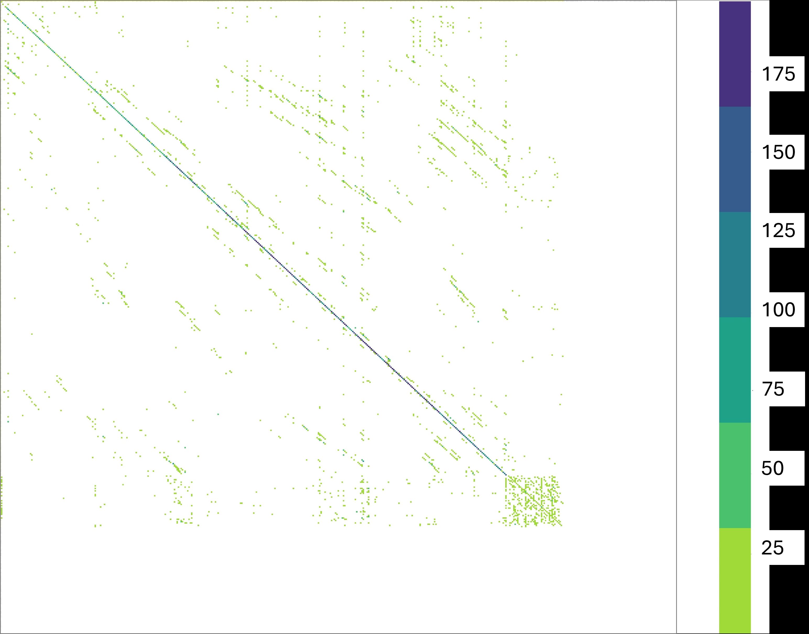

# Chapter 6: instance and inverse directional gates, composition, and rank–entropy duality

[Library index](../README.md) · [Source and transcription policy](../SOURCE.md) · [Previous pages: PDF 194–200](0194-0200-ch06-directional-cluster-and-contextual-gates.md#pdf-0200) · [Next pages: PDF 207–210](0207-0210-ch06-relative-completeness-and-fourier-grammar.md#pdf-0207)

> Editorial note: Full transcription of PDF 201–206 (printed pages 165–170), including the original Figure 6.6 and its complete caption. The source's statements, proofs, terminology, and mathematical inconsistencies are retained. Separate analysis is in [instance and inverse directional gates](../notes/43-instance-and-inverse-directional-gates.md) and [composition and rank–entropy](../notes/44-pattern-composition-and-rank-entropy.md). Remark 6.41 ends mid-sentence here; Figure 6.7 precedes its continuation on PDF 207.

## PDF 201 · Book 165

### 6.12 Instance gate: the pointwise pattern

A single saturated cell, somewhere in the score matrix. Outside that one cell, every row distributes its mass uniformly; inside that one row, the distribution is a Dirac mass at one column. We have seen this kind of sharpness before — the open gate places one Dirac per row along the diagonal, the directional gate places $n$ identical Diracs along a single column. The instance gate is more economical: just one Dirac, at position $(j,i)$. It is the most localised of the canonical regimes, and the one that carries the smallest amount of information through the score matrix while still leaving a measurable trace in the output.

The instance gate captures a single point-to-point dependency: the token at row $j$ is told that its relevant source is the token at column $i$, and no other position in the sequence is involved. This is the attention pattern that emerges when a head encodes a particular relation between two specific tokens — for example, an isolated coreference link, a specific morphological dependency, or a sparse syntactic edge of the kind described in Htut et al. Htut et al. (2019). The name *instance* reflects the singularity of the configuration: the head responds to a specific instance of a relation rather than to a structural pattern. In the empirical practice of Bonino et al. (2025), instance gates appear in attention maps as scattered isolated points, often with low intensity, and their presence requires careful threshold-based detection rather than visual inspection.

Despite their visual subtlety, instance gates are functionally important. The pruning literature Voita et al. (2019b) identifies a class of heads that attend to rare tokens — tokens whose informational role is specific and not interchangeable with other tokens — and the canonical attention pattern of such heads is precisely the instance gate. In the SARS-CoV-2 classifier, instance gates appear in heads that detect the sparse positions where specific genomic variants differentiate themselves from the reference; the empirical map shows “inst”-coded heads particularly in the upper layers, where the network has aggregated enough context to identify discriminating positions. The intensity of the instance — that is, the weight of the saturated cell relative to the noise floor — is itself diagnostic, and weak instances are often better re-classified as background fluctuations than as canonical instances.

**Definition 6.31 (Instance gate).** The instance gate at row $j$ pointing at column $i$ is the canonical row-stochastic matrix whose entries are

$$
\bigl(S_P^{(i,j)}\bigr)_{rs}=\begin{cases}
\delta_{si},&r=j,\\
\dfrac1n,&r\neq j.
\end{cases}
\tag{6.20}
$$

The corresponding output is

$$
\bigl(S_P^{(i,j)}V\bigr)_r=\begin{cases}
v_i^\top,&r=j,\\
\mu^\top,&r\neq j.
\end{cases}
\tag{6.21}
$$

**Lemma 6.32 (Instance gate rank and entropy).** $\operatorname{rank}(S_P^{(i,j)}V)\leq2$, with rank exactly $2$ whenever $v_i$ and $\mu$ are linearly independent. The row entropy is $0$ at row $j$ and $\log n$ on every other row.

*Proof.* The output is the sum of two outer products $e_jv_i^\top+(\mathbf1-e_j)\mu^\top$, of rank at most $2$. The entropy claim is immediate. $\square$

**Sector and circulation.** The instance gate carries a localised antisymmetric signature. The condition for the row $j$ of $S$ to concentrate on column $i$ is exactly the local Sink condition

## PDF 202 · Book 166

(Theorem 5.2) restricted to the single token $x_j$: $x_j^\top M_ax_i$ must dominate $x_j^\top M_ax_k$ for all $k\neq i$. The remaining $n-1$ rows of the score matrix carry no significant antisymmetric activation. Cycle circulation involving the triple $(j,i,k)$ for some third token $k$ is generically nonzero, but all triples avoiding either $j$ or $i$ produce vanishing circulation. The instance gate is therefore the minimal carrier of antisymmetric information: a single rank-one bond between two specific tokens.

**Remark 6.33 (Symmetry and information at the instance gate).** Its stabiliser group $G_p$ is $\mathfrak S_{n-1}\times\mathfrak S_{n-1}$: any permutation of the rows other than $j$, and any permutation of the columns other than $i$, leaves the matrix invariant. The $n^2$ choices of the pair $(i,j)$ generate a full orbit of $n^2$ isomorphic regimes, the largest orbit in the catalogue. On the information-channel axis, the instance gate is the smallest non-trivial information carrier: it transmits at most rank $2$ to the output, and the rank-$2$ structure is sharply localised at row $j$. The pair (instance, inverse directional) — treated next — completes the catalogue and exhausts the row-vs-column duality of the softmax normalisation.

### 6.13 Inverse directional gate: the horizontal pattern

A single token, somewhere in the sequence, breaks ranks with the rest. Its row in the score matrix is sparse: the token attends only to a small set $K$ of source positions, while all the other rows are uniform. Geometrically, the matrix exhibits a horizontal stripe at row $j$ — the dual of the vertical column we encountered in the directional gate. The token at position $j$ has selected a private cluster of sources; every other token in the sequence has surrendered to the global mean. This is the inverse directional gate, the eighth and last canonical regime, and it is the only one whose existence had not been explicitly named in the empirical literature before Bonino et al. (2025).

The name *inverse directional* is a precise statement about the softmax. The directional gate of §6.8 concentrated all rows on a single column $i$: a vertical line. The inverse pattern concentrates a single row $j$ on a small set of columns: a horizontal stripe. Were the score matrix symmetric, these two configurations would be related by a transpose, and the inverse directional gate would be a mere relabelling of the directional one. But the score matrix is not symmetric: the row-wise softmax breaks the symmetry between rows and columns by normalising rows to unit mass. As a consequence, the horizontal stripe is a genuinely distinct regime, and the catalogue must enumerate it separately. The empirical literature missed this distinction because the horizontal pattern, in trained transformers, typically consists of so few high-intensity points that it visually resembles a sparse instance gate or a composition of instances.

The inverse directional gate is the rarest of the eight canonical regimes in trained transformers, and Bonino et al. (2025) flags it as “delicate”: empirically, it appears in head configurations where a single token aggregates evidence from a small number of distant sources before delivering a verdict to the residual stream. In the SARS-CoV-2 classifier, this configuration is consistent with a head specialised in the [CLS] token: a single privileged position that gathers information from a sparse set of diagnostic positions across the sequence. The horizontal pattern of the head is the structural signature of this aggregation.

**Definition 6.34 (Inverse directional gate).** Let $K\subseteq\{1,\ldots,n\}$ be a non-empty subset of columns with $|K|<n$. The inverse directional gate, or horizontal pattern, with active row $j$

## PDF 203 · Book 167

and active set $K$ is the canonical row-stochastic matrix

$$
\bigl(S_H^{(j,K)}\bigr)_{rs}=\begin{cases}
\dfrac1{|K|}\mathbf1_{s\in K},&r=j,\\
\dfrac1n,&r\neq j.
\end{cases}
\tag{6.22}
$$

The corresponding output is

$$
\bigl(S_H^{(j,K)}V\bigr)_r=\begin{cases}
\overline v_K^\top,&r=j,\\
\mu^\top,&r\neq j,
\end{cases}
\tag{6.23}
$$

where $\overline v_K=\dfrac1{|K|}\sum_{s\in K}v_s$.

**Lemma 6.35 (Inverse directional rank and entropy).** $\operatorname{rank}(S_H^{(j,K)}V)\leq2$, with rank exactly $2$ whenever $\overline v_K$ and $\mu$ are linearly independent. Row entropy is $\log|K|$ at row $j$ and $\log n$ on every other row.

*Proof.* Identical to that of Lemma 6.32 with $\overline v_K$ in place of $v_i$. $\square$

**Sector and circulation.** The inverse directional gate is, like the cluster head, a regime in which the symmetric and antisymmetric sectors play asymmetric roles. The condition for row $j$ to be uniformly concentrated on $K$ is that $L_{js}$ is large for $s\in K$ and small for $s\notin K$, with no preferred ordering inside $K$; this requires $M_s$ to single out the cluster $\{x_s:s\in K\}$ on the slice through $x_j$, while $M_a$ remains balanced on the slice. Cycle circulation involving the active token $j$ and any two members of $K$ vanishes in the canonical limit. The inverse directional gate is, when isolated, an $M_s$-localised regime, completing the pair of $M_s$-dominated canonical regimes together with the cluster head.

**Remark 6.36 (The eighth regime: closing the catalogue).** The inverse directional gate is the eighth and last canonical regime, and the only one whose recognition required the formal classification developed in this chapter rather than visual inspection. Its stabiliser group $G_p$ is $\mathfrak S_{|K|}\times\mathfrak S_{n-|K|}$ on the columns and $\mathfrak S_{n-1}$ on the rows, reflecting the partition of columns into active and inactive and the equivalence of all non-active rows. The full catalogue, with its eight stabiliser groups, now occupies a specific lattice in the orbit structure of admissible row-stochastic matrices under the symmetric group action, a lattice that the relative-completeness theorem of §6.16 will prove to be exhaustive within the shift-regular grammar.

### 6.14 Pattern composition and linear decomposition

The eight canonical regimes of §§6.6–6.13 are idealisations. Empirical attention maps, drawn from trained transformers, almost never instantiate any single canonical form; they exhibit, instead, mixtures. A diagonal stripe with vertical lines superimposed on it. A cluster block adjacent to a sub-diagonal band. An instance gate sitting on top of a closed gate. The visual coexistence is ubiquitous, and the question that closes the catalogue must be: how does the empirical observation of mixtures fit with the rigid set of eight canonical forms?

The answer is the linear decomposition principle of this section, which states that finite convex combinations of the eight canonical regimes form a closed sub-polytope of $\mathcal S_n$ whose interior contains all shift-regular attention maps. Every such convex combination behaves additively with respect to the output operator $S\mapsto SV$, with controlled bounds on rank and entropy.

## PDF 204 · Book 168

**Figure 6.6: Composite empirical map exhibiting the inverse directional character, from Bonino et al. (2025): the simultaneous presence of an open gate (dominant diagonal), forward and backward contextual gates (secondary diagonals), instance gates (sparse points), and cluster heads (small blocks).**

*The map illustrates the typical compositional character of empirical attention maps, decomposed in §6.14 and §6.17.*

The decomposition is a direct consequence of the linearity of the output operator. Convex combinations of row-stochastic matrices are row-stochastic, and the output respects the combination linearly:

**Proposition 6.37 (Linear decomposition into canonical regimes).** Let $S\in\mathcal S_n$ be a row-stochastic matrix that admits a representation

$$
S=\sum_{\alpha=1}^{8}\lambda_\alpha S_\alpha^*,\qquad
\lambda_\alpha\geq0,\quad\sum_\alpha\lambda_\alpha=1,
\tag{6.24}
$$

where $\{S_\alpha^*\}_{\alpha=1}^8$ are canonical regime representatives. Then the output decomposes correspondingly,

$$
SV=\sum_{\alpha=1}^{8}\lambda_\alpha S_\alpha^*V,
\tag{6.25}
$$

and the rank and row entropy of $S$ are bounded by

$$
\operatorname{rank}(SV)\leq\sum_\alpha\mathbf1_{\{\lambda_\alpha>0\}}\operatorname{rank}(S_\alpha^*V),
\tag{6.26}
$$

$$
H_{\mathrm{row}}(S)\leq\sum_\alpha\lambda_\alpha H_{\mathrm{row}}(S_\alpha^*)+\log\bigl|\{\alpha:\lambda_\alpha>0\}\bigr|.
\tag{6.27}
$$

## PDF 205 · Book 169

*Proof.* The output identity (6.25) is immediate from the linearity of matrix multiplication. The rank bound is the standard subadditivity of the rank under sum of matrices; rank-zero contributions $S_\alpha^*V=0$ (when $\lambda_\alpha=0$) drop out, so only the indicator-weighted sum survives. The entropy bound is the concavity of the Shannon entropy on the probability simplex applied row-wise. $\square$

The decomposition principle says that the convex hull of the eight canonical regime families is contained in $\mathcal S_n$. The relative-completeness theorem of §6.16 will say more: every shift-regular attention map lies inside this convex hull. The construction of §6.17 extends the description to arbitrary $S\in\mathcal S_n$ via projection-plus-residual. Together, the three results — composition, relative completeness, and canonical projection — close the catalogue in three complementary senses: under combination, under enumeration of shift-regular patterns, and under unrestricted projection.

**Remark 6.38 (Composition does not generate new canonical regimes).** Proposition 6.37 closes the cataloguing question in one direction: combining canonical regimes produces no new canonical regimes, only mixtures with bounded rank and entropy. The opposite direction — that every shift-regular pattern is itself in the canonical hull, with no new shapes possible — is the content of the relative-completeness theorem in §6.16. Together, the two results say that the eight-regime hull is closed both under combination (this section) and under enumeration (the next section), making it a genuine convex hull-based descriptor of the shift-regular subset of $\mathcal S_n$.

### 6.15 The rank-entropy duality

We have organised the catalogue along two axes throughout this chapter: the rank of the output and the row entropy of the score matrix. The eight canonical regimes occupy specific corners and edges of the $(\operatorname{rank},H_{\mathrm{row}})$ plane. We now make the organisation precise. The result is a sharp duality: the two extremal rank-one regimes of the catalogue, the directional gate and the closed gate, lie at the two endpoints of the entropy interval $[0,\log n]$, and they are the only canonical regimes of rank one. All other regimes lie strictly above the line $\operatorname{rank}=1$ and strictly below the line $H_{\mathrm{row}}=\log n$.

Let $\mathcal S_n^*$ denote the set of canonical regimes of the catalogue (the eight regimes together with their parametric families: the directional gate over its column index $i$, the cluster head over its anchor and size $(i,j;k)$, and so on). Define the joint rank-entropy observable

$$
\Phi:\mathcal S_n^*\longrightarrow\{1,2,\ldots,n\}\times[0,\log n],\qquad
\Phi(S)=\bigl(\operatorname{rank}(SV),H_{\mathrm{row}}(S)\bigr).
\tag{6.28}
$$

The rank is computed under the generic non-degeneracy assumption that the relevant value-row means $\overline v_K$ involved in the canonical form are not collinear with the global mean $\mu$.

**Proposition 6.39 (Rank-entropy duality).** Under the generic non-degeneracy assumptions on $V$, the image of the canonical regimes under $\Phi$ satisfies the following.

(i) Rank-one canonical regimes are exactly two: the directional gate $S_V^{(i)}$ (every parameter $i$) and the closed gate $S_{ME}$. They satisfy

$$
\Phi(S_V^{(i)})=(1,0),\qquad\Phi(S_{ME})=(1,\log n).
\tag{6.29}
$$

(ii) Maximal-rank canonical regimes are exactly one: the open gate $S_D=I_n$, with $\Phi(S_D)=(n,0)$.

## PDF 206 · Book 170

(iii) Strict interior: every other canonical regime $S_\alpha^*$ satisfies

$$
1<\operatorname{rank}(S_\alpha^*V)<n\quad\text{and}\quad0<H_{\mathrm{row}}(S_\alpha^*)<\log n.
\tag{6.30}
$$

(iv) Monotone opposition on the rank-one fibre: the two regimes achieving rank one in (i) are the only points of $\mathcal S_n^*$ with $\operatorname{rank}=1$, and they sit at opposite endpoints of the entropy axis. Equivalently, the fibre $\Phi^{-1}(\{1\}\times[0,\log n])$ consists exactly of the two boundary points $(1,0)$ and $(1,\log n)$.

*Proof. Part (i).* A row-stochastic matrix $S$ produces $SV$ of rank one exactly when all rows of $SV$ are scalar multiples of a single vector, which by row-stochasticity forces them to be equal. The set of row-stochastic matrices with all rows equal is the set of matrices of the form $\mathbf1p^\top$ with $p$ a probability vector. Among these, the ones that are canonical regimes are exactly: the directional gate $S_V^{(i)}=\mathbf1e_i^\top$ ($p$ a Dirac at column $i$, entropy $0$), and the closed gate $S_{ME}=\mathbf1(\frac1n\mathbf1)^\top$ ($p$ uniform, entropy $\log n$). No other canonical regime has all rows equal: this rules out the cluster head, the contextual gates, the instance gate, and the inverse directional gate, which by construction have rows that disagree on the active and non-active regions.

*Part (ii).* The open gate $S_D=I_n$ has $SV=V$, of rank $\operatorname{rank}(V)=n$ generically. The row entropy is $0$. No other canonical regime realises this rank, because every other regime has at least one pair of identical rows, forcing a rank deficit of at least one.

*Part (iii).* For each remaining canonical regime, the elementary calculations of the corresponding rank and entropy lemmas in §§6.9–6.13 give the rank in $\{2,\ldots,n-1\}$ and the average entropy strictly between $0$ and $\log n$, since the canonical forms are mixtures of Dirac and uniform rows in non-trivial proportions.

*Part (iv).* Direct from (i): the only canonical regimes with rank one are the directional and closed gates, and their entropies sit at the endpoints of $[0,\log n]$. There is no canonical rank-one regime with intermediate entropy. $\square$

The result can be visualised as a partition of the $(\operatorname{rank},H_{\mathrm{row}})$ plane. Figure 6.7 places the eight canonical regime classes in this plane and exhibits the duality geometrically.

The three boundary points — directional gate $(1,0)$, closed gate $(1,\log n)$, and open gate $(n,0)$ — sit at the corners of the admissible region. The remaining five canonical regimes (cluster head, backward and forward contextual gates, instance gate, inverse directional gate) populate the interior. The two rank-one regimes lie at the opposite extremes of the entropy axis: this is the duality of Proposition 6.39(iv).

**Remark 6.40 (Spectral interpretation of the duality).** The duality has a direct spectral interpretation, which becomes manifest in the Fourier proof of relative completeness in §6.16. By Parseval’s identity, the row entropy of $S$ is in monotone correspondence with the spectral support $\Lambda(S)\subseteq\widehat{\mathbb Z}_n$ of $S$ along the cyclic shift action: regimes with full spectral support ($|\Lambda(S)|=n$) achieve maximum entropy and regimes with minimal spectral support ($|\Lambda(S)|=1$) achieve minimum entropy. The directional and closed gates are the extreme cases. The fact that both rank-one regimes correspond to $|\Lambda|=1$ is a manifestation of Pontryagin duality: spatial and spectral concentration coincide on rank-one matrices, and the entropy distinguishes whether the concentration is on the constant Fourier mode (closed gate, maximum entropy) or on a non-constant mode (directional gate, zero entropy).

**Remark 6.41 (The duality as a design constraint).** Proposition 6.39 is a structural constraint on the kind of attention regime a head can occupy. A head that aspires to be both rank-preserving (high rank) and deterministic (low $H_{\mathrm{row}}$) is forced to the open gate corner $(n,0)$

> Editorial boundary: Remark 6.41 continues after Figure 6.7 on [PDF 207](0207-0210-ch06-relative-completeness-and-fourier-grammar.md#pdf-0207). Its sentence and argument are not complete at this file boundary.
