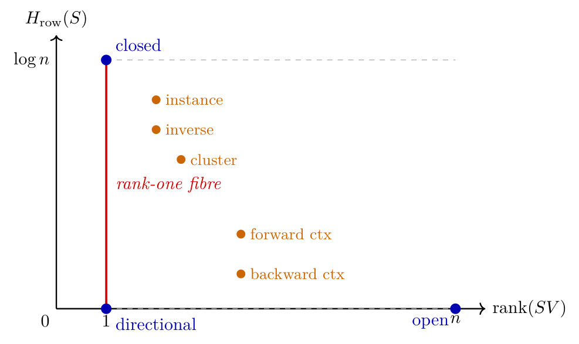

# Chapter 6: relative completeness, shift-regular grammar, and Fourier proof

[Library index](../README.md) · [Source and transcription policy](../SOURCE.md) · [Previous pages: PDF 201–206](0201-0206-ch06-pointwise-gates-composition-and-rank.md#pdf-0206) · [Next pages: PDF 211–214](0211-0214-ch06-canonical-signatures-and-projection.md#pdf-0211)

> Editorial note: Full transcription of PDF 207–210 (printed pages 171–174), including the original Figure 6.7. The opening paragraph continues Remark 6.41 from PDF 206 after the intervening figure. The source's definitions, claims, proof steps, and errors are preserved. See [composition and rank–entropy](../notes/44-pattern-composition-and-rank-entropy.md) and [relative completeness and Fourier grammar](../notes/45-relative-completeness-and-fourier-grammar.md) for separate editorial analysis. Remark 6.50 is complete here; §6.16.4 begins on PDF 211.

## PDF 207 · Book 171

**Figure 6.7: The rank-entropy plane of the eight canonical regimes.**

— there is no other canonical regime with these joint properties. A head that aspires to be both informative (rank-one, $H=0$) and anisotropic (preferring one source over others) is forced to the directional gate corner $(1,0)$. A head that uses the residual stream to bypass its contribution (rank-one, maximum entropy) is forced to the closed gate corner $(1,\log n)$. These three corners exhaust the boundary of the admissible region, and the five interior regimes are the only middle grounds. The duality therefore forecloses certain combinations and explains why the eight-regime catalogue is sufficient to describe trained heads: the regimes are not arbitrary, they are the corners and edges of a constrained region.

### 6.16 Relative completeness within the shift-regular grammar

We arrive at the result that closes the catalogue. The eight regimes of §§6.6–6.13 were identified one by one through a combination of empirical inspection and operator-theoretic characterisation. The natural question, raised already in §6.4, is whether the catalogue is exhaustive: are the eight all there is, or could a ninth canonical form have been missed?

The answer requires the qualifier *within the shift-regular grammar*. Inside this restriction — defined precisely below — no further regime exists. We give two independent proofs, motivated by complementary perspectives. The first proof, in §6.16.2, classifies regimes by their spatial symmetry group — the subgroup of cyclic shifts that commutes with the score matrix. The second proof, in §6.16.3, classifies them by their spectral support — the subgroup of Fourier modes on which the score matrix is non-vanishing. The two proofs are related by Pontryagin duality.

**The shift-regular restriction is essential.** The completeness results below all carry the qualifier *shift-regular*, which is not a notational convenience but a substantive restriction. Outside the shift-regular class — for instance, on a non-cyclic permutation matrix, on a row-stochastic matrix with non-uniform weights inside a non-trivial support, on heads with row-dependent support sizes — the eight-regime catalogue is incomplete in the strict sense: such matrices are not equal to any element of the catalogue or any of its convex combinations. The classification of arbitrary $S\in\mathcal S_n$ is the subject of the canonical-signature construction in §6.17, which augments the eight regimes with a residual norm and a projection onto the canonical hull.

## PDF 208 · Book 172

**Setup.** Let $\mathcal S_n$ denote the set of $n\times n$ row-stochastic matrices. For $S\in\mathcal S_n$ define the support profile

$$
\sigma(S)=\bigl(|\operatorname{supp}(S_1)|,\ldots,|\operatorname{supp}(S_n)|\bigr)\in\{1,\ldots,n\}^n,
\tag{6.31}
$$

where $\operatorname{supp}(S_i)=\{j:S_{ij}>0\}$. Define also the cyclic shift operator $T:\mathbb R^{n\times n}\to\mathbb R^{n\times n}$ by $(TS)_{ij}=S_{i-1,j-1}$ (indices modulo $n$). The cyclic group generated by $T$ is $\mathbb Z_n=\langle T\rangle$, of order $n$.

### 6.16.1 The shift-regular grammar

**Definition 6.42 (Shift-regular pattern).** A row-stochastic matrix $S\in\mathcal S_n$ is *shift-regular* with parameters $(d,\kappa,I)$ if the following three axioms hold.

(i) *Uniform support size on the active set:* $|\operatorname{supp}(S_i)|\equiv\kappa$ for all $i\in I$, and $|\operatorname{supp}(S_i)|=n$ for $i\notin I$, where $I\subseteq\{1,\ldots,n\}$ is the active row set.

(ii) *Linear support position:* $\operatorname{supp}(S_i)=\{i+d,i+d+1,\ldots,i+d+\kappa-1\}$ $\pmod n$ for all $i\in I$, for some fixed offset $d\in\mathbb Z_n$.

(iii) *Uniform within support:* $S_{ij}=\frac1\kappa$ for $j\in\operatorname{supp}(S_i)$ on active rows, and $S_{ij}=\frac1n$ on non-active rows.

The three axioms are precisely the conditions used implicitly to characterise the canonical regimes throughout §§6.6–6.13. A shift-regular pattern is therefore the most general row-stochastic matrix compatible with the canonical-regime axioms.

**Definition 6.43 (Symmetry group of a regime).** The symmetry group of $S\in\mathcal S_n$ is $\mathcal S(S)=\{T^k\in\mathbb Z_n:T^kS=ST^k\}$, the subgroup of cyclic shifts that commute with $S$.

### 6.16.2 Pattern completeness: the group-theoretic proof

**Theorem 6.44 (Relative completeness, group-theoretic form).** Every shift-regular pattern $S$ with parameters $(d,\kappa,I)$ corresponds to a triple $(\mathcal S(S),\kappa,\langle d\rangle)\in\operatorname{Sub}(\mathbb Z_n)\times\{1,\ldots,n\}\times\mathbb Z_n$ where $\mathcal S(S)\leq\mathbb Z_n$ is its symmetry subgroup. The eight canonical regimes of §§6.6–6.13 exhaust all non-isomorphic cases as $(d,\kappa,I)$ ranges over its admissible values. No other shift-regular pattern exists.

*Proof.* We enumerate all shift-regular patterns by their parameters in five steps.

*Step 1: support size $\kappa$.* By condition (i) of Definition 6.42, each active row has support of size $\kappa\in\{1,\ldots,n\}$. We distinguish the boundary cases $\kappa=1$ and $\kappa=n$ from the interior $1<\kappa<n$.

*Step 2: $\kappa=1$ and dependence of the support on the row index.* For $\kappa=1$, the active row $i$ has support a single column. We split by how the support depends on $i$.

- If $\operatorname{supp}(S_i)=\{i\}$ for all $i\in I$ (offset $d=0$): with $I=\{1,\ldots,n\}$ this is the open gate; with $|I|=1$ this is the instance gate.
- If $\operatorname{supp}(S_i)=\{i+c\}$ for all $i\in I$ with $c$ a constant and $c>0$: forward contextual gate with shift $d=c$. With $c<0$: backward contextual gate.
- If $\operatorname{supp}(S_i)=\{c\}$ with $c$ independent of $i$ (all active rows attend to the same column): with $I=\{1,\ldots,n\}$ this is the directional gate.

*Step 3: $\kappa=n$.* Every row has full support, and by axiom (iii) each row equals $\frac1n\mathbf1^\top$. This is the closed gate, regardless of $d$.

*Step 4: $1<\kappa<n$.* By axiom (ii) the support is contiguous of length $\kappa$. Two situations arise.

## PDF 209 · Book 173

- If $I$ is a contiguous block $[j,j+k-1]$ and the support block is fixed (does not slide with $i$): cluster head.
- If $|I|=1$ and the support is a fixed set $K$ with $|K|=\kappa$: inverse directional gate.

The case $d\neq0$ with $1<\kappa<n$ produces compositions of contextual gates and cluster heads, which are convex combinations of the canonical forms enumerated above and not new patterns.

*Step 5: subgroup correspondence.* Each canonical regime corresponds to a distinct subgroup of $\mathbb Z_n$:

- Directional gate, closed gate: $\mathcal S(S)=\mathbb Z_n$, the full cyclic group.
- Open gate: $\mathcal S(S)=\{e\}$, the trivial subgroup.
- Contextual gates with shift $d$: $\mathcal S(S)=\langle T^d\rangle\cong\mathbb Z_{n/\gcd(d,n)}$.
- Cluster head with block size $k$: $\mathcal S(S)=\langle T^k\rangle\cong\mathbb Z_{n/k}$.
- Instance gate, inverse directional gate: $\mathcal S(S)=\{e\}$, but with non-trivial active set encoding the position.

The subgroups of $\mathbb Z_n$ are exactly $\langle T^d\rangle$ for $d\mid n$. The list of canonical regimes therefore exhausts the case enumeration of Definition 6.42, and no other shift-regular pattern exists. $\square$

**Remark 6.45 (Linearity of support is the key axiom).** The requirement that the support position depend linearly on the row index (axiom (ii) of Definition 6.42) is not a mathematical convenience — it is the algebraic expression of the fact that attention heads process sequences. Positional relationships between tokens are encoded as shifts, and any pattern compatible with sequential structure must respect this linearity. Non-linear support dependencies would correspond to attention patterns that cannot be induced by any bilinear logit function $L=XMX^\top$ on a positionally-coherent input cloud, since the logit between tokens $i$ and $j$ depends on $x_i$ and $x_j$ only, not on higher-order positional interactions. Outside this axiom — that is, on attention maps with arbitrary support shapes — the catalogue is no longer complete in the strict sense, and the canonical signature of §6.17 is the appropriate descriptor.

**Corollary 6.46 (Catalogue closure within the grammar).** The eight canonical regimes form a complete and irredundant family within the shift-regular grammar: every shift-regular $S$ admits a decomposition as in Proposition 6.37, and the eight regime families are pairwise distinguishable by their symmetry groups in the subgroup lattice of $\mathbb Z_n$.

*Proof.* Existence follows from Theorem 6.44 together with the linearity of $\mathcal S_n$. Pairwise distinguishability follows from the fact that the eight canonical regimes have pairwise distinct symmetry groups (or, when groups coincide as for instance and inverse, distinct active sets). $\square$

### 6.16.3 Pattern completeness: the Fourier proof

The first proof classifies regimes via subgroups of $\mathcal S(S)\leq\mathbb Z_n$. A second, independent proof classifies them via subgroups of the dual group $\widehat{\mathbb Z}_n$. The two proofs are related by Pontryagin duality, which for finite abelian groups asserts that the lattice of subgroups of $G$ is anti-isomorphic to the lattice of subgroups of $\widehat G$. For $G=\mathbb Z_n$, since $\mathbb Z_n\cong\widehat{\mathbb Z}_n$, the two classifications are formally equivalent but operationally distinct: the spatial proof reads patterns through their invariances, the spectral proof reads them through their Fourier energy.

## PDF 210 · Book 174

**Discrete Fourier transform.** Let $\omega=e^{2\pi i/n}$ and let $F\in\mathbb C^{n\times n}$ be the DFT matrix with entries $F_{jk}=\frac1{\sqrt n}\omega^{jk}$. For any $S\in\mathcal S_n$, the spectral transform is $\widehat S=FSF^*$, where $F^*$ is the conjugate transpose. Since $F$ is unitary, the map $S\mapsto\widehat S$ is an isometry in Frobenius norm. The spectral support of $S$ is

$$
\Lambda(S)=\{k\in\{0,1,\ldots,n-1\}:\exists j\text{ such that }\widehat S_{jk}\neq0\}.
\tag{6.32}
$$

**Lemma 6.47 (Spectral support of a shift-regular pattern).** If $S$ is shift-regular with offset $d$ and uniform-support size $\kappa$, then

$$
\Lambda(S)=\{k\in\mathbb Z_n:k\equiv0\pmod{n/\gcd(\kappa,n)}\},\qquad
|\Lambda(S)|=\gcd(\kappa,n).
\tag{6.33}
$$

*Proof.* The active row $i$ of $S$ is $S_i=\frac1\kappa\sum_{m=0}^{\kappa-1}e_{i+d+m\bmod n}$. Its DFT is, for $k\neq0$,

$$
\widehat S_i(k)=\frac{\omega^{(i+d)k}}{\kappa\sqrt n}\cdot\frac{1-\omega^{\kappa k}}{1-\omega^k},
$$

and the geometric sum $\sum_{m=0}^{\kappa-1}\omega^{mk}$ vanishes exactly when $\kappa k\equiv0\pmod n$, i.e. when $k\equiv0\pmod{n/\gcd(\kappa,n)}$. The non-zero modes are those $k$ divisible by $n/\gcd(\kappa,n)$, which after standard relabelling gives the stated form. $\square$

**Lemma 6.48 (Spectral support is a subgroup).** For every shift-regular $S$, the spectral support $\Lambda(S)$ is a subgroup of $\widehat{\mathbb Z}_n\cong\mathbb Z_n$.

*Proof.* By Lemma 6.47, $\Lambda(S)=\{k:k\equiv0\pmod q\}$ where $q=n/\gcd(\kappa,n)$. This is the unique subgroup of $\mathbb Z_n$ of order $\gcd(\kappa,n)$, generated by $q$. It is closed under addition modulo $n$ and contains $0$. $\square$

**Theorem 6.49 (Relative completeness, Fourier form).** The map $S\mapsto\Lambda(S)$ defines a bijection between the set of non-isomorphic shift-regular patterns (modulo phase and active set) and the set of subgroups of $\widehat{\mathbb Z}_n$. Since $\mathbb Z_n$ has exactly $\tau(n)$ subgroups (one per divisor of $n$), the number of non-isomorphic shift-regular spectral supports is $\tau(n)$. The eight canonical regimes correspond to the admissible non-isomorphic combinations of $(\Lambda,d,I)$, where the phase $d$ and the active set $I$ further distinguish regimes sharing the same spectral support.

*Proof.* Well-definedness follows from Lemma 6.47, which shows that $\Lambda(S)$ depends only on $\gcd(\kappa,n)$. Injectivity: if $\Lambda(S)=\Lambda(S')$, then $\gcd(\kappa,n)=\gcd(\kappa',n)$, i.e. $S$ and $S'$ have the same effective block size modulo $n$; combined with shift-regularity this forces $S$ and $S'$ to coincide up to cyclic relabelling and choice of active set. Surjectivity: every subgroup of $\mathbb Z_n$ has the form $H_q=\{0,q,2q,\ldots\}$ for $q\mid n$. Setting $\kappa=q$, $d=0$, $I=\{1,\ldots,n\}$ in Definition 6.42 yields a shift-regular pattern with $\Lambda=H_q$. $\square$

**Remark 6.50 (Pontryagin duality connects the two proofs).** The first proof classifies regimes by subgroups of $\mathcal S(S)\leq\mathbb Z_n$. The second classifies them by subgroups of $\Lambda(S)\leq\widehat{\mathbb Z}_n$. Pontryagin duality states that the lattice of subgroups of $G$ and $\widehat G$ are anti-isomorphic: $H\leq G\leftrightarrow H^\perp\leq\widehat G$, with $|H|\cdot|H^\perp|=|G|$. Explicitly: open gate ($\mathcal S=\{e\}$, $\Lambda=\widehat{\mathbb Z}_n$); closed gate ($\mathcal S=\mathbb Z_n$, $\Lambda=\{0\}$); contextual with shift $d$ ($\mathcal S=\langle T^d\rangle$, $\Lambda=\langle n/\gcd(d,n)\rangle$). The uncertainty-principle identity $|\mathcal S(S)|\cdot|\Lambda(S)|=n$ holds for every canonical regime and is the algebraic statement that spatial and spectral concentration cannot be simultaneously maximised.
