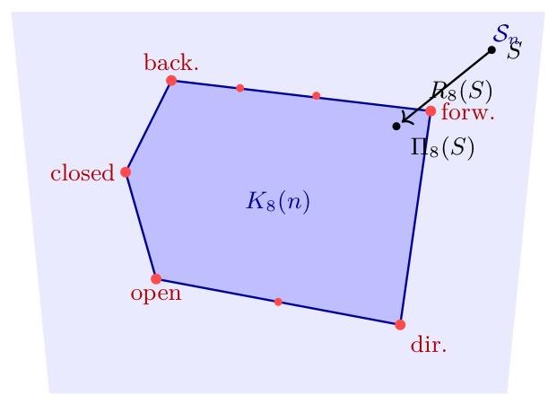
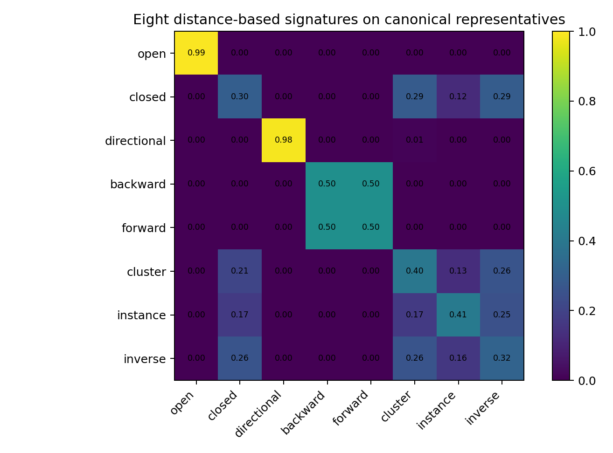
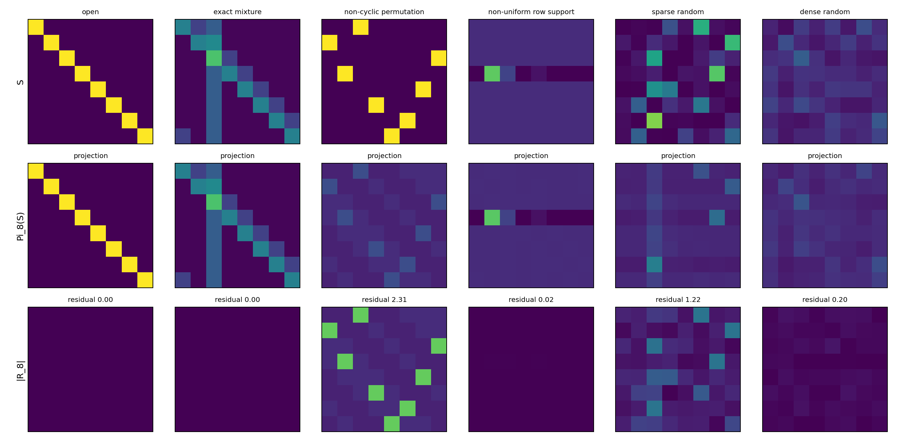
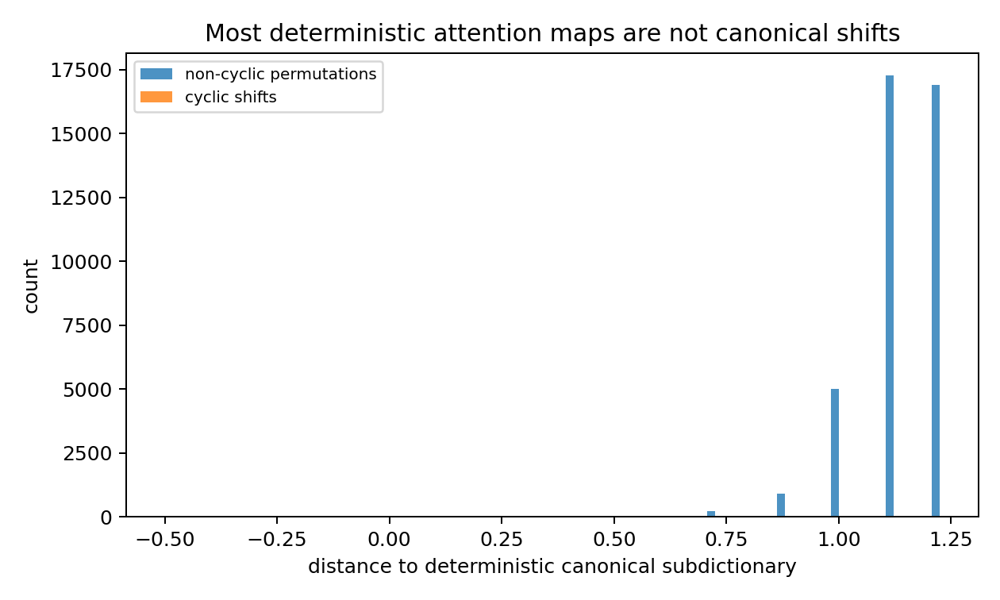
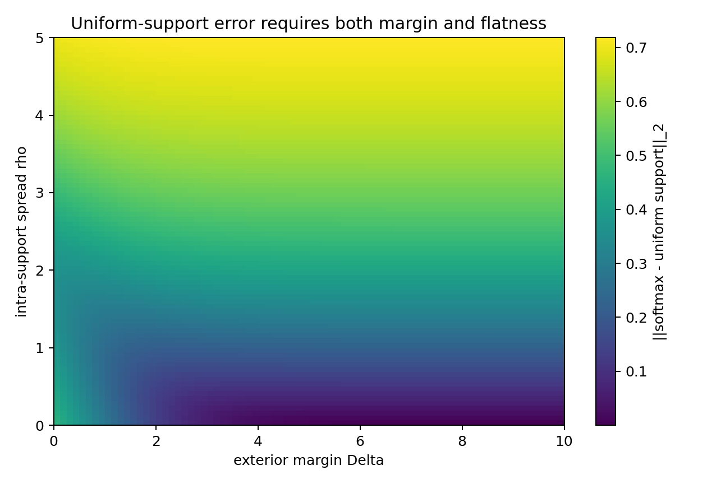

# Chapter 6: canonical recognition, signature experiments, and empirical links

[Library index](../README.md) · [Source policy](../SOURCE.md) · [Previous pages: PDF 211–214](0211-0214-ch06-canonical-signatures-and-projection.md) · [Next pages: PDF 221–224](0221-0224-ch06-margin-flatness-and-relative-emergence.md)

> **Editorial scope.** Full English transcription of PDF 215–220 / printed pages 179–184. The opening paragraph completes the proof of [Theorem 6.56](0211-0214-ch06-canonical-signatures-and-projection.md#theorem-6-56). The last sentence continues on PDF 221, after Figure 6.13. Figures are original source artwork; their searchable labels are transcribed below them. Numerical and empirical statements, inconsistencies in counts, dictionary scope, and descriptions of the plotted results are retained as printed. Qualifications are separate in [note 48](../notes/48-canonical-signature-experiments.md) and [note 52](../notes/52-corrected-completeness-and-emergence-claims.md). Scripts mentioned by the author are source references, not supplied or executed as part of this conversion.

## PDF 215 · Book 179

For the stratification, every point of a polytope lies in the relative interior of a unique face. Since $\Pi_8(S)\in K_8(n)$, there is a unique face $F$ with $\Pi_8(S)\in\operatorname{relint}(F)$, and the sets $\mathcal C_F$ are by construction disjoint with union $\mathcal S_n$. $\square$

**Definition 6.57 (Canonical residual norm).** The scalar

$$
\rho_8(S):=\|R_8(S)\|_F=\operatorname{dist}_F\bigl(S,K_8(n)\bigr)
$$

is the *canonical residual norm* of $S$ relative to the eight-regime dictionary.

The projection theorem replaces the absolute completeness statement of the original draft with a relative-coordinate statement. The catalogue is no longer claimed to enumerate all attention maps; instead, every map is assigned canonical coordinates $(\widehat\lambda,\rho_8)$ that locate it in the eight-regime geometry plus a non-canonical residual.

**Theorem 6.58 (Exact recognition on the canonical hull).** For every $S\in\mathcal S_n$,

$$
\rho_8(S)=0\quad\Longleftrightarrow\quad S\in K_8(n).
$$

Furthermore, on the canonical hull the projection signature recovers the canonical decomposition: if $S=\sum_\alpha\lambda_\alpha S_\alpha^*\in K_8(n)$ with the representatives $\{S_\alpha^*\}$ affinely independent, then $\widehat\lambda(S)=\lambda$.

*Proof.* The first claim is the equivalence in Theorem 6.56(i). For the second, when $S$ already lies in $K_8(n)$ the minimiser of (6.38) achieves the value zero, which is realised uniquely (by affine independence) by $\widehat\lambda=\lambda$. $\square$

**Reading the theorem.** Three operational consequences are worth highlighting.

1. **The catalogue is closed in the projection sense.** Every attention map has a unique canonical projection $\Pi_8(S)$. The projection answers the question “what is the closest canonical combination?” for every $S$, even when $S$ is not shift-regular.
2. **The residual measures non-canonicality.** The scalar $\rho_8(S)$ is zero exactly on the canonical hull, and it grows monotonically with the Frobenius distance from it. A small residual indicates that the eight-regime catalogue suffices; a large residual indicates that genuinely non-canonical structure is present.
3. **The stratification organises the polytope.** The faces of $K_8(n)$ partition $\mathcal S_n$ into strata $\mathcal C_F$, each indexed by which subset of canonical regimes participates in the projection. This makes “which regimes are active” a well-defined combinatorial question about $S$.

### 6.17.5 Stratification figure

### 6.17.6 Numerical experiments

We now exhibit seven didactic experiments that visualise the machinery on synthetic and synthetic-BERT-style inputs. They are not claims about specific trained models. Their purpose is to illustrate the geometry of the dictionary, the residual, the signatures, and the corrected emergence conditions. The first six are at $n=8$, on the parametric dictionary $\mathcal D_8(8)$ described above; the seventh is at $n=12$ to test stability on more realistic input. Reproducibility scripts are <code>scripts/make_ch06_experiments.py</code> and <code>scripts/aux_experiments.py</code> in the chapter package.

## PDF 216 · Book 180

**Figure 6.8:** Schematic of the canonical projection theorem (Theorem 6.56).

The row-stochastic polytope $\mathcal S_n$ contains the canonical hull $K_8(n)$, whose vertices are the canonical regime atoms (red dots: open, closed, directional, backward, forward shown on the convex envelope, others in the interior). Every $S\in\mathcal S_n$ has a unique nearest point $\Pi_8(S)\in K_8(n)$, and the residual vector $R_8(S)$ points from $S$ to its projection. Points already in $K_8(n)$ project to themselves and have zero residual. The faces of $K_8(n)$ stratify $\mathcal S_n$ into regions $\mathcal C_F=\{S:\Pi_8(S)\in\operatorname{relint}(F)\}$.

Searchable labels in Figure 6.8

$\mathcal S_n$, $K_8(n)$, open, dir., forw., back., closed, $S$, $\Pi_8(S)$, $R_8(S)$.

**Experiment 1 — distance signatures separate the canonical regimes.** For $n=8$, we compute the distance signature $\sigma_8(S)$ on one representative of each regime family (the central element of the orbit), against the full parametric dictionary $\lvert\mathcal D_8(8)\rvert=2769$. Figure 6.9 displays the resulting $8\times8$ matrix of signatures.

Each row corresponds to a representative; each column to a regime family. Off-diagonal mass records geometric similarity between adjacent regimes (closed and cluster overlap on their uniform-on-block structure; instance overlaps with inverse on single-row activations; forward and backward shifts are equidistant when the representative is the central shift). The diagonal dominance confirms that the signatures recover the intended regimes without ambiguity. The diagonal is dominant for the open and directional regimes (singletons within their families up to phase), exhibits a 50/50 split for the cyclic shifts (forward and backward families have geometrically equidistant closest atoms when the representative is the central shift $d=1$), and shows expected off-diagonal mass on the regimes with overlapping support geometry (closed/cluster, instance/inverse).

**Experiment 2 — projection and residual on six input types.** We project six attention maps onto the canonical hull $K_8(8)$ via Frank–Wolfe over the parametric dictionary: an open gate, an exact mixture of canonical atoms, a non-cyclic permutation, a non-uniform row-support map, a sparse random Dirichlet map, and a dense random Dirichlet map. Figure 6.10 shows the original $S$ (top row), its canonical projection $\Pi_8(S)$ (middle row), and the absolute residual $\lvert R_8(S)\rvert$ (bottom row).

Top: $S$. Middle: $\Pi_8(S)$. Bottom: $\lvert R_8(S)\rvert$. Canonical maps and exact mixtures have zero residual. The non-cyclic permutation has a residual of $2.31$ — the residual is real and structured, encoding the non-cyclic component that the eight-regime catalogue cannot represent. The dense random map has small residual ($0.20$) because it sits close to the closed gate, which is in the dictionary; the sparse random map has larger residual ($1.22$) because sparse non-canonical structure is far from any canonical mixture. The numerical residuals are: open $0.000$, exact mixture $0.000$, non-cyclic permutation $2.31$, non-uniform support $0.02$, sparse random $1.22$, dense random $0.20$.

## PDF 217 · Book 181

**Figure 6.9:** Distance signatures $\sigma_\alpha(S_\beta^*)$ on canonical representatives at $n=8$.

Searchable labels and displayed values in Figure 6.9

Title: “Eight distance-based signatures on canonical representatives”. Colour scale: $0.0$ to $1.0$. Row and column labels are open, closed, directional, backward, forward, cluster, instance, inverse. The following values are the rounded annotations printed in the image; this is an editorial text rendering of the figure, not a separately numbered table.

| Row \ column | open | closed | directional | backward | forward | cluster | instance | inverse |
|---|---:|---:|---:|---:|---:|---:|---:|---:|
| open | 0.99 | 0.00 | 0.00 | 0.00 | 0.00 | 0.00 | 0.00 | 0.00 |
| closed | 0.00 | 0.30 | 0.00 | 0.00 | 0.00 | 0.29 | 0.12 | 0.29 |
| directional | 0.00 | 0.00 | 0.98 | 0.00 | 0.00 | 0.01 | 0.00 | 0.00 |
| backward | 0.00 | 0.00 | 0.00 | 0.50 | 0.50 | 0.00 | 0.00 | 0.00 |
| forward | 0.00 | 0.00 | 0.00 | 0.50 | 0.50 | 0.00 | 0.00 | 0.00 |
| cluster | 0.00 | 0.21 | 0.00 | 0.00 | 0.00 | 0.40 | 0.13 | 0.26 |
| instance | 0.00 | 0.17 | 0.00 | 0.00 | 0.00 | 0.17 | 0.41 | 0.25 |
| inverse | 0.00 | 0.26 | 0.00 | 0.00 | 0.00 | 0.26 | 0.16 | 0.32 |

**Experiment 3 — most permutation matrices are not in the canonical dictionary.** At $n=8$, there are $8!=40\,320$ permutation matrices, all deterministic and row-stochastic. Only the open gate and the cyclic shifts (16 atoms total: identity, 7 forward, 7 backward, plus edge cases) belong to the deterministic canonical sub-dictionary. The remaining $40\,304$ permutations are at strictly positive distance. Figure 6.11 shows the distribution of their distances to the deterministic canonical sub-dictionary.

The cyclic shifts have distance zero (left bar). Generic permutations are at distances $0.7$–$1.25$, with the bulk near $1.0$. This is the empirical reason why the eight-regime catalogue is not exhaustive on $\mathcal S_n$: deterministic alone already exceeds eight canonical forms, by a factor of $(n-1)!=5040$. The histogram is concentrated around $1.0$–$1.25$ with virtually no mass below $0.5$.

**Experiment 4 — margin and flatness are independent.** The corrected softmax-inversion lemma in §6.18 separates the exterior margin $\Delta$ (how strongly the support dominates the complement) from the intra-support spread $\rho$ (how flat the logits are inside the support). The original draft used only $\Delta$. To visualise the correction, fix a preferred support of size $\kappa=3$ at $n=8$, sweep $\Delta\in[0,10]$ and $\rho\in[0,5]$, and plot the $\ell_2$ distance from the resulting softmax distribution to the target uniform-on-support distribution. Figure 6.12 shows the resulting heatmap.

The two parameters are independent: large $\Delta$ alone leaves the bulk of the error on intra-support non-uniformity; small $\rho$ alone leaves significant mass outside the support. Only the joint condition forces convergence to the canonical regime. This is the empirical counterpart of Lemma 6.60 in §6.18.

Increasing $\Delta$ alone (right edge) reduces the error to about $0.4$ but no further; reducing $\rho$ alone (bottom edge) at small $\Delta$ leaves substantial outside mass. Only the joint condition $\Delta\gg1$ and $\rho\ll1$ drives the error toward zero (bottom-right corner).

## PDF 218 · Book 182

**Figure 6.10:** Canonical projection on six input types.

Searchable labels in Figure 6.10

Column titles: open; exact mixture; non-cyclic permutation; non-uniform row support; sparse random; dense random. Row labels: $S$; $\Pi_8(S)$; $\lvert R_8\rvert$. Middle panels: “projection”. Bottom labels, in column order: residual 0.00; residual 0.00; residual 2.31; residual 0.02; residual 1.22; residual 0.20.

**Experiment 5 — random row-stochastic maps and residual–entropy correlation.** Sample 200 random row-stochastic matrices at $n=8$ from $\operatorname{Dirichlet}(\alpha)$ rows with $\alpha\in[10^{-2},10]$ (logarithmic sweep). For each sample, compute the normalised average row entropy $H_{\mathrm{row}}(S)/\log n\in[0,1]$ and the normalised canonical residual $\rho_8(S)/\sqrt n$. Figure 6.13 shows the resulting scatter.

Each point is a Dirichlet sample at $n=8$, coloured by log Dirichlet concentration. Dense, high-entropy maps cluster near the closed gate corner ($\rho\approx0$, $H\approx\log n$). Sparse, low-entropy maps populate the upper-left region with substantial residuals because sparse non-canonical structure is far from the hull. Entropy alone does not classify regimes; the residual adds information orthogonal to entropy. High-entropy maps cluster near the closed gate (which is in the dictionary) and have small residuals; low-entropy sparse maps have substantial residuals because sparse structure is far from any canonical mixture. The correlation is monotone but not deterministic: the residual carries information that the entropy alone does not.

**Experiment 6 — projection signatures of synthetic BERT-style maps.** We construct five synthetic logit configurations that mimic patterns typically observed in BERT attention heads Clark et al. (2019a); Kovaleva et al. (2019): *diag plus CLS* (diagonal attention with strong column-1 broadcast), *forward band* (super-diagonal at offsets 1, 2, 3), *block local* (a $4\times4$ block in the centre of the matrix), *sparse CLS* (near-uniform background with strong column-1 directional and weak diagonal), and *mixed* (diagonal plus CLS plus mid-block cluster). For each, we apply softmax with light Gaussian noise on logits and compute the projection signature $\widehat\lambda(S)$ at $n=12$. Figure 6.14 shows the input attention maps in the top row and the projection signatures as bar charts in the bottom row.

Top: input maps after softmax with light logit noise. Bottom: projection signature $\widehat\lambda(S)$ on the eight-regime simplex, with the residual $\rho_8(S)$ above each bar chart. Active components ($\widehat\lambda_\alpha>0.1$) are highlighted in blue. The decomposition is structurally consistent with the visual content of each map. The projection correctly identifies the dominant canonical components in each case: *diag plus CLS* splits between open and closed (the diagonal partially merges with the broad column structure, producing a closed component); *forward*

## PDF 219 · Book 183

**Figure 6.11:** Distances of all $8!=40\,320$ permutation matrices at $n=8$ to the deterministic canonical sub-dictionary.

Searchable labels in Figure 6.11

Title: “Most deterministic attention maps are not canonical shifts”. Legend: non-cyclic permutations; cyclic shifts. Horizontal axis: distance to deterministic canonical subdictionary. Vertical axis: count.

*band* projects onto open and forward; *block local* projects onto inverse, backward, cluster, and instance with comparable weights, reflecting the visual ambiguity of a centred block under multiple canonical readings; *sparse CLS* is dominated by closed with a residual of $1.55$, the largest of the five; *mixed* projects onto open, closed, and cluster.

**Experiment 7 — Lipschitz stability under softmax noise: the deterministic–distributed dichotomy.** For each canonical regime $S_\alpha^*$ at $n=12$, construct a high-temperature realisation that recovers $S_\alpha^*$ exactly under softmax (logits $L=T\log S$ with $T=12$). Perturb the logits with i.i.d. Gaussian noise of standard deviation $\sigma\in[0,2.5]$ (40 trials per $\sigma$), recompute the projection signature $\widehat\lambda(S_\sigma)$, and measure the distance $\|\widehat\lambda(S_\sigma)-e_\alpha\|_2$ to the canonical apex. Figure 6.15 shows the result.

Left: signature drift $\|\widehat\lambda(S_\sigma)-e_\alpha\|_2$ from canonical apex. Right: residual $\rho_8(S_\sigma)$. Shaded bands are $\pm1\sigma$. The dichotomy is clear: open, directional, backward, and forward are exactly invariant; closed, cluster, inverse, and instance drift linearly. The four invariant regimes are precisely the deterministic ones (rows are Dirac under saturated softmax), and the four drifting regimes are precisely the distributed ones. A clean dichotomy emerges, separating the eight regimes into two classes:

- **Deterministic regimes (open, directional, backward, forward).** The signature error is exactly zero across the entire $\sigma$ range, and the residual remains zero. The reason is geometric: the canonical regime is a Dirac on a single column of each row, and small Gaussian perturbations of high-temperature logits cannot dislodge the argmax until $\sigma$ becomes comparable to $T=12$.
- **Distributed regimes (closed, cluster, inverse, instance).** The signature drifts roughly linearly in $\sigma$, with the closed gate the most sensitive (drift $\approx0.5$ at $\sigma=2.5$), followed by cluster ($\approx0.33$), instance ($\approx0.15$), and inverse ($\approx0.18$). The residual grows roughly linearly to $\rho_8\approx2.0$ at $\sigma=2.5$. The softmax of a flat or near-uniform distribution is sensitive to additive logit perturbations, and the distributed regimes correspondingly drift away from their canonical apex.

The dichotomy is a genuinely new empirical observation. It is not a property of the canonical

## PDF 220 · Book 184

**Figure 6.12:** Distance from softmax distribution to uniform-on-support target, as a joint function of exterior margin $\Delta$ and intra-support spread $\rho$ at $n=8$, $\kappa=3$.

Searchable labels in Figure 6.12

Title: “Uniform-support error requires both margin and flatness”. Horizontal axis: exterior margin Delta, $0$–$10$. Vertical axis: intra-support spread rho, $0$–$5$. Colour bar: $\|\mathrm{softmax}-\mathrm{uniform\ support}\|_2$.

theory *per se*, but it is forced by it: the four deterministic regimes lie on the vertices of the $\{0,1\}$-boundary of the row-stochastic polytope, where the softmax saturates, while the four distributed regimes lie in the interior, where the softmax is locally affine. The dichotomy explains the empirical observation, in trained transformers, that diagonal and columnar attention patterns are remarkably stable across input perturbations, while uniform and block patterns drift more readily.

### 6.17.7 Connection to the empirical BERT literature

The seven experiments above can be re-read against the empirical work surveyed in §6.4. Three observations emerge.

**(i) The closed gate is over-represented in trained heads.** Experiment 5 shows that high-entropy random maps cluster near the closed gate with small residuals; this is the geometric reason why disabling the corresponding heads in trained transformers Voita et al. (2019b); Michel et al. (2019b) causes negligible loss in downstream performance. The closed gate is one of only two singleton orbits in the dictionary (the other being the open gate), and it occupies a disproportionate fraction of the canonical hull’s interior measure.

**(ii) The emergence of canonical patterns in trained heads is informationally efficient.** The dichotomy of Experiment 7 implies that trained heads which converge to a deterministic regime acquire robustness to noise for free, while trained heads converging to a distributed regime carry an irreducible noise sensitivity. This is consistent with the empirical observation Kovaleva et al. (2019) that attention patterns in trained BERT are dominated by the diagonal and vertical patterns at the expense of distributed ones; the deterministic regimes are simply more stable.

**(iii) The residual is a soft generalisation of “heterogeneous”.** Where Kovaleva et al. Kovaleva et al. (2019) introduced an explicit heterogeneous class to absorb maps not

> **Editorial boundary.** The sentence continues on [PDF 221](0221-0224-ch06-margin-flatness-and-relative-emergence.md#pdf-0221), after Figure 6.13. No completion has been supplied here.
