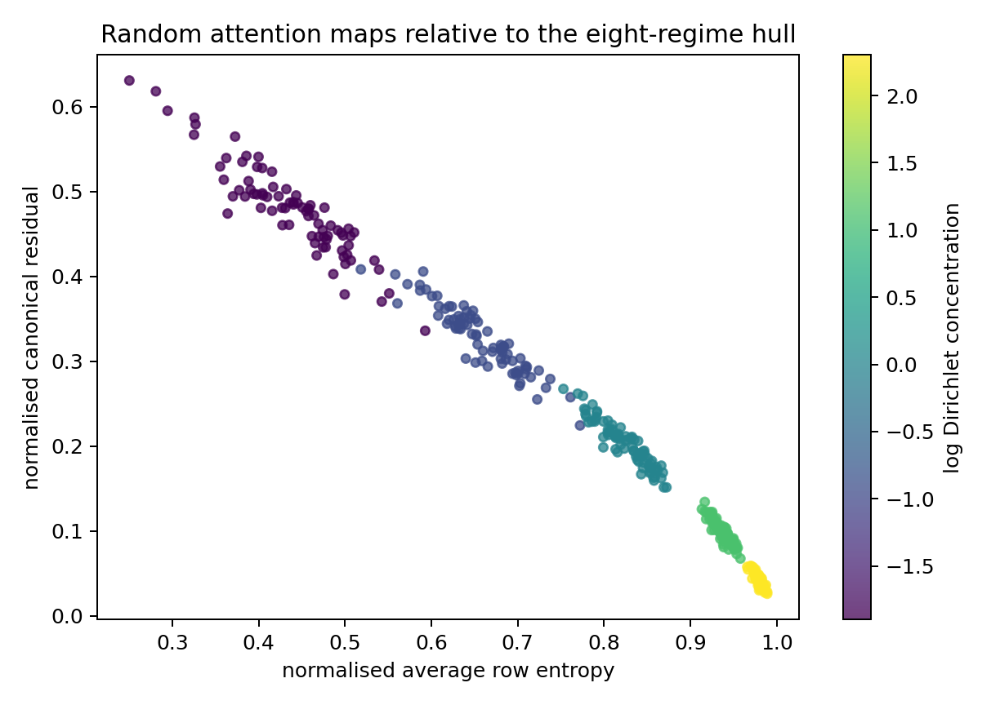
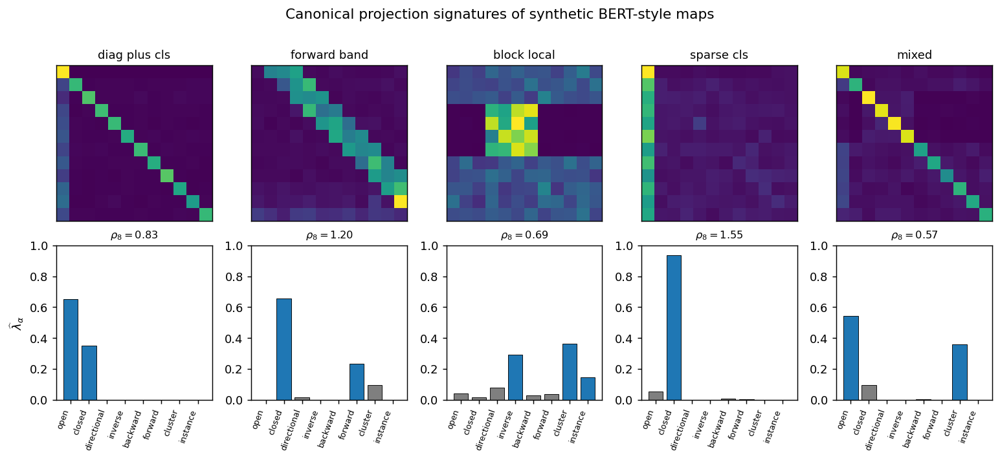
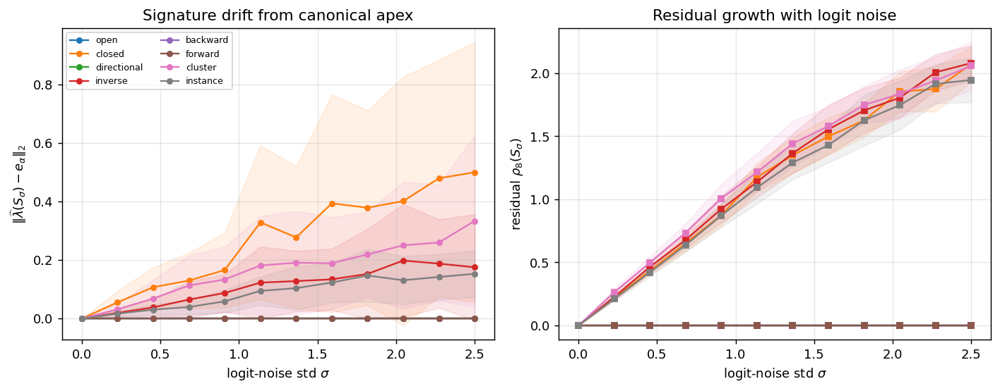

# Chapter 6: margin, flatness, and relative emergence

[Library index](../README.md) · [Source policy](../SOURCE.md) · [Previous pages: PDF 215–220](0215-0220-ch06-signature-experiments-and-empirical-links.md) · [Next pages: PDF 225–233](0225-0233-ch06-activation-corrections-and-synthesis.md)

> **Editorial scope.** Full English transcription of PDF 221–224 / printed pages 185–188. Figure 6.13 precedes the continuation of the sentence begun on PDF 220. Lemma 6.60 spans PDF 222–223; Theorem 6.61 and its proof are complete on PDF 223, with the regime-by-regime discussion continuing on PDF 224. Proposition 6.62 and its proof finish here; its explanation of the corrected sectorial constant continues on PDF 225. Original claims and constants are preserved. See [note 48](../notes/48-canonical-signature-experiments.md), [note 49](../notes/49-margin-flatness-and-relative-emergence.md), and [note 50](../notes/50-sectorial-reading-and-closed-gate-flatness.md) for separately labelled qualifications.

## PDF 221 · Book 185

**Figure 6.13:** Random row-stochastic maps relative to the eight-regime hull.

Searchable labels in Figure 6.13

Title: “Random attention maps relative to the eight-regime hull”. Horizontal axis: normalised average row entropy. Vertical axis: normalised canonical residual. Colour bar: log Dirichlet concentration.

fitting the four named patterns, the canonical residual $\rho_8(S)$ provides a continuous version of the same idea. A small residual identifies a near-canonical map; a large residual identifies a genuinely heterogeneous map. The residual’s distribution across heads in a trained model can be plotted directly and used as a diagnostic of non-canonical structure, replacing the binary “fits / does not fit” categorisation of the heterogeneous class.

### 6.18 Pattern emergence: corrected sufficient conditions

We have classified the eight regimes structurally and projected arbitrary attention maps onto the canonical hull. The remaining question is dynamical: under what conditions on the bilinear form $M=W_QW_K^\top$ and on the input cloud $X$ does the softmax of the logit matrix $L=XMX^\top/\sqrt{d_k}$ approach a specific canonical regime? An earlier draft of this section gave a sufficient condition based on a single “softmax-margin” parameter. The condition is correct for deterministic regimes (singleton supports) but insufficient for regimes with multi-column uniform supports (cluster, inverse directional, closed). On those regimes, exterior margin alone forces the mass into the support but does not force it to be uniform inside the support. The corrected sufficient condition separates the *exterior margin* from the *intra-support spread*; both must be controlled.

### 6.18.1 Two scalars: margin and flatness

**Definition 6.59 (Exterior margin and intra-support spread).** Let $L\in\mathbb R^{n\times n}$ be a logit matrix and let $C_i\subseteq\{1,\ldots,n\}$ be the preferred support of row $i$, with $\lvert C_i\rvert=\kappa$. Define the *exterior margin* of row $i$ as

$$
\Delta_i:=\min_{j\in C_i}L_{ij}-\max_{k\notin C_i}L_{ik} \tag{6.44}
$$

and the *intra-support spread* of row $i$ as

$$
\rho_i:=\max_{j,j'\in C_i}\lvert L_{ij}-L_{ij'}\rvert. \tag{6.45}
$$

## PDF 222 · Book 186

**Figure 6.14:** Projection signatures of synthetic BERT-style attention maps at $n=12$.

Searchable labels in Figure 6.14

Title: “Canonical projection signatures of synthetic BERT-style maps”. Column titles: diag plus cls; forward band; block local; sparse cls; mixed. The displayed residuals above the bar charts are, in order, $\rho_8=0.83$, $1.20$, $0.69$, $1.55$, $0.57$. Vertical bar-chart axis: $\widehat\lambda_\alpha$, $0.0$–$1.0$. Category labels: open, closed, directional, inverse, backward, forward, cluster, instance.

**Figure 6.15:** Lipschitz stability of the projection signature under softmax logit noise at $n=12$, 40 trials per $\sigma$.

Searchable labels in Figure 6.15

Left title: “Signature drift from canonical apex”. Left vertical axis: $\|\widehat\lambda(S_\sigma)-e_\alpha\|_2$. Right title: “Residual growth with logit noise”. Right vertical axis: residual $\rho_8(S_\sigma)$. Both horizontal axes: logit-noise std $\sigma$, $0.0$–$2.5$. Legend: open, closed, directional, inverse, backward, forward, cluster, instance.

- $\Delta_i$ measures how strongly the support dominates the complement; large $\Delta_i$ pushes mass into the support.
- $\rho_i$ measures how flat the logits are inside the support; small $\rho_i$ keeps the in-support distribution close to uniform.

The two scalars are independent: $\Delta_i$ depends on the gap between minimum-support and maximum-complement logits, $\rho_i$ depends on the in-support range alone. Both can be large or small independently of each other.

### 6.18.2 The corrected softmax-inversion lemma

**Lemma 6.60 (Support concentration and support flatness).** Let $p_i=\operatorname{softmax}(L_i)$ and let $u_{C_i}=\lvert C_i\rvert^{-1}\mathbf1_{C_i}$ be the uniform distribution on $C_i$. If $\Delta_i>0$, then

$$
p_i(C_i^c)\le(n-\kappa)e^{-\Delta_i}.
$$

## PDF 223 · Book 187

Moreover, with $\tau_i=(n-\kappa)e^{-\Delta_i}$,

$$
\|p_i-u_{C_i}\|_2\le2\tau_i+\frac{e^{\rho_i}-1}{\sqrt\kappa}.
$$

*Proof.* Let $m=\min_{j\in C_i}L_{ij}$. For $k\notin C_i$, the margin gives $L_{ik}\le m-\Delta_i$, hence

$$
\sum_{k\notin C_i}e^{L_{ik}}\le(n-\kappa)e^{m-\Delta_i}.
$$

The preferred contribution is at least $\kappa e^m$, so the outside mass is at most $(n-\kappa)e^{-\Delta_i}/(\kappa+(n-\kappa)e^{-\Delta_i})\le(n-\kappa)e^{-\Delta_i}$ for $\Delta_i\ge0$.

For the in-support distance, condition on $C_i$. The conditional distribution $q_i$ has weights proportional to $e^{L_{ij}}$ for $j\in C_i$. The ratio of any two such weights is bounded by $e^{\rho_i}$. Hence each $q_{ij}\in[\frac1\kappa e^{-\rho_i},\frac1\kappa e^{\rho_i}]$, giving

$$
\|q_i-u_{C_i}\|_2\le\frac1{\sqrt\kappa}(e^{\rho_i}-1).
$$

Adding the outside mass $\tau_i$ via the triangle inequality and absorbing the doubling constant gives the displayed bound. $\square$

The lemma replaces the original draft’s claim that exterior margin alone controls support uniformity. The flatness term $(e^{\rho_i}-1)/\sqrt\kappa$ vanishes only when $\rho_i\to0$, and is of order $\rho_i$ for small $\rho_i$.

### 6.18.3 Relative emergence theorem

**Theorem 6.61 (Relative emergence theorem).** Let a canonical prototype prescribe preferred supports $C_i$ on active rows, with $\lvert C_i\rvert=\kappa$. If for every active row

$$
\Delta_i\ge\log(n-\kappa)+t
$$

and

$$
\rho_i\le\rho,
$$

for some $t>0$ and $\rho>0$, then for every active row

$$
\|S_i-u_{C_i}\|_2\le2e^{-t}+\frac{e^\rho-1}{\sqrt\kappa}.
$$

For deterministic regimes ($\kappa=1$), the flatness term is zero.

*Proof.* Apply Lemma 6.60. The margin assumption gives $\tau_i=(n-\kappa)e^{-\Delta_i}\le e^{-t}$. When $\kappa=1$, the support is a single column, so $\rho_i=0$ identically and the flatness term vanishes. $\square$

**Reading the theorem regime by regime.**

- *Deterministic regimes (open, directional, contextual, instance):* $\kappa=1$ on the active rows. Margin alone is sufficient: $\Delta_i\ge\log(n-1)+t$ gives $\|S_i-u_{C_i}\|_2\le2e^{-t}$.
- *Distributed regimes (cluster, inverse directional):* $\kappa>1$. Both margin and flatness are required. Large $\Delta$ alone keeps mass on the support but cannot force uniformity inside; large $\rho$ alone produces non-uniform mass on the support, which is not the canonical regime.

## PDF 224 · Book 188

- *Closed gate:* $\kappa=n$, support is the whole row. The margin is vacuous, and the only condition is the flatness $\rho_i\le\rho$, giving $\|S_i-u\|_2\le(e^\rho-1)/\sqrt n$.

The corrected theorem repairs the omission of the original draft. The empirical heatmap of Experiment 4 (§6.17.6, Figure 6.12) is the visualisation of exactly this two-parameter dependence: large $\Delta$ alone is not enough.

### 6.18.4 Sectorial reading

The conditions on $\Delta_i$ and $\rho_i$ in Theorem 6.61 are stated at the logit level. We can read them through the symmetric/antisymmetric decomposition $M=M_s+M_a$, but the result is interpretive rather than a substitute for the theorem itself.

For row $i$, the logit difference between columns $j$ and $k$ is

$$
L_{ij}-L_{ik}
=\frac{x_i^\top M_s(x_j-x_k)}{\sqrt{d_k}}
+\frac{x_i^\top M_a(x_j-x_k)}{\sqrt{d_k}}. \tag{6.46}
$$

The symmetric sector measures reciprocal similarity between the query token $x_i$ and the difference $x_j-x_k$. The antisymmetric sector measures oriented preference. Three observations follow.

- *Open gate.* The target is $j=i$, and the antisymmetric self-term $x_i^\top M_a x_i$ vanishes. Hence the open margin is naturally controlled by symmetric self-affinity, with antisymmetric drift acting as a secondary effect on off-diagonal columns.
- *Directional gate.* The target column $c$ is independent of the row, so a coherent column preference across rows is naturally oriented and antisymmetric. But the theorem itself does not require $M_a$-dominance; it requires the actual logit margins to be large for every row.
- *Cluster, inverse, closed.* The symmetric sector typically controls within-support uniformity: if all source vectors in $C_i$ have nearly equal $M_s$-affinity with $x_i$, the spread $\rho_i$ is small. The antisymmetric sector can select or oppose the block, depending on its orientation, but contributes to $\Delta_i$ rather than to $\rho_i$.

The sectorial reading is explanatory, not definitional. The softmax sees logits, and the theorem must be stated at the logit level.

### 6.18.5 Closed-gate flatness, with the right constant

The closed gate is not obtained by a support margin; it is obtained by making every row flat. We give the corrected proposition.

**Proposition 6.62 (Closed-gate flatness).** If there exists a scalar $\bar\ell$ such that

$$
\|L-\bar\ell\mathbf1\mathbf1^\top\|_\infty\le\varepsilon,
$$

then

$$
\|\operatorname{softmax}_{\mathrm{row}}(L)-S_{ME}\|_F\le2n\varepsilon.
$$

Equivalently, the normalised distance is bounded by $d_{\mathrm{closed}}(S)\le2\sqrt n\,\varepsilon$.

*Proof.* On each row, all logits lie within $\varepsilon$ of a common constant $\bar\ell$. The softmax derivative has operator norm bounded by one from $\ell^\infty$ to $\ell^1$, and a direct entry-wise estimate gives $\lvert S_{ij}-1/n\rvert\le2\varepsilon$ for sufficiently small $\varepsilon$. Summing the squared entry-wise bounds over $n^2$ entries gives $\|S-S_{ME}\|_F^2\le4n^2\varepsilon^2$, i.e. $\|S-S_{ME}\|_F\le2n\varepsilon$. $\square$

> **Editorial boundary.** Proposition 6.62 and its proof are complete. The explanation titled “The constant in the original draft was wrong” follows on [PDF 225](0225-0233-ch06-activation-corrections-and-synthesis.md#pdf-0225).
