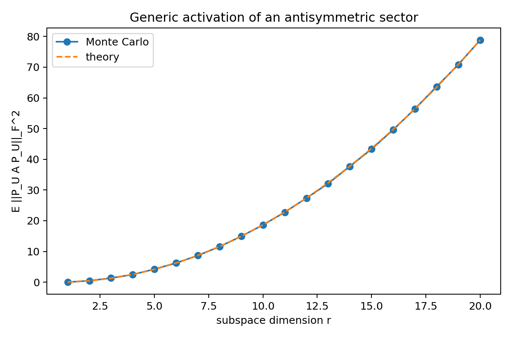

# Chapter 6: subspace activation, corrections, and synthesis

[Library index](../README.md) · [Source policy](../SOURCE.md) · [Previous pages: PDF 221–224](0221-0224-ch06-margin-flatness-and-relative-emergence.md) · [Next pages: PDF 234–238](0234-0238-ch07-signature-geography-in-bert.md)

> **Editorial scope.** Full English transcription of PDF 225–233 / printed pages 189–197, completing Chapter 6. The first paragraph explains the constant in Proposition 6.62, whose statement and proof are on PDF 224. All original claims, withdrawn claims, conjectures, formulas, counting inconsistencies, and references to “Chapter 8” are retained. The actual next chapter begins on PDF 234 as Chapter 7. Editorial qualifications are separate in [note 50](../notes/50-sectorial-reading-and-closed-gate-flatness.md), [note 51](../notes/51-subspace-activation-and-sequence-silence.md), [note 52](../notes/52-corrected-completeness-and-emergence-claims.md), and [note 53](../notes/53-local-observables-and-global-handover.md).

## PDF 225 · Book 189

**The constant in the original draft was wrong.** If the sectorial assumption is stated as

$$
\|XM_aX^\top\|_\infty\le\varepsilon_0\sqrt{d_k},
\qquad
\|XM_sX^\top-\bar\ell\sqrt{d_k}\mathbf1\mathbf1^\top\|_\infty
\le\varepsilon_0\sqrt{d_k},
$$

then after division by $\sqrt{d_k}$ the combined bound on $\|L-\bar\ell\mathbf1\mathbf1^\top\|_\infty$ is $2\varepsilon_0$, not $\varepsilon_0$. The original draft used $\varepsilon_0$ in the final closed-gate estimate; the correct constant is $4n\varepsilon_0$.

### 6.18.6 Removed claims and conjectures

The original draft of §6.18 included three “theorems” (T-I, T-II, T-III) on emergence of contextual, directional, and cluster regimes via average-margin conditions. Those statements assumed that an average margin condition on the logit matrix is sufficient to force the canonical regime, which is false in the multi-column case.

The status of the three is now downgraded as follows.

**Conjecture 6.63 (T-I — average margin and contextual emergence, downgraded from theorem).** Let the input cloud $X$ have positionally consistent embeddings, and let $M=M_s+M_a$ produce a non-zero shift-mode component along $d$ in the antisymmetric sector. Then there exists a temperature threshold $\beta^*$ such that for all $\beta\ge\beta^*$, the attention map $\operatorname{softmax}_{\mathrm{row}}(\beta L)$ converges to the contextual gate at shift $d$ in Frobenius norm. The conjecture is restricted to the deterministic limit and is implicit in the relative emergence theorem at $\kappa=1$, but a global rate or explicit threshold has not been established and is left open.

**Conjecture 6.64 (T-II — generic directional emergence, downgraded from theorem).** If $M_a$ has a single dominant non-degenerate eigenplane and the input cloud is generic with respect to that plane, then there exists $\beta^*$ such that the attention map produced by $\beta L$ for $\beta\ge\beta^*$ is close to a directional gate. As above, the deterministic limit case follows from the relative emergence theorem; a quantitative threshold is open.

The third claim, T-III, was the average-margin emergence of cluster regimes, and is now subsumed by Theorem 6.61 with the explicit caveat that average margin is not sufficient — both exterior margin and intra-support flatness must be controlled. The original T-III is therefore not retained even as a conjecture: it was false as stated, and the correct version is the relative emergence theorem itself.

### 6.19 Subspace activation and silence: corrected

A head can carry a non-zero antisymmetric form $M_a$ globally, and yet exhibit no antisymmetric logit on a particular input cloud. In this section we characterise this phenomenon precisely. The original draft described it as the input cloud lying in $\ker M_a$. That description is sufficient but *not necessary*: there are configurations in which $M_a$ acts non-trivially on individual rows of $X$ but, when sampled by the bilinear form $XM_aX^\top$, produces zero. The correct concept is isotropy, not kernel containment, and the relevant spectral identity must include cross-terms between eigenplanes that the original draft omitted. We give the corrected statements below, together with the corrected expectation formula $\mathbb E[\Gamma_U^2]=r(r-1)/(d(d-1))\|M_a\|_F^2$ for a random $r$-dimensional subspace $U\subseteq\mathbb R^d$.

### 6.19.1 Intrinsic activation energy

**Definition 6.65 (Intrinsic activation energy of a sector on a subspace).** Let $A\in\mathbb R^{d\times d}$ and let $U\subseteq\mathbb R^d$ be a subspace with orthogonal projector $P_U$. The *intrinsic activation energy* of $A$ on $U$ is

$$
\Gamma_U(A):=\|P_UAP_U\|_F. \tag{6.47}
$$

## PDF 226 · Book 190

The definition specialises to $A=M_a$ for the antisymmetric sector, $A=M_s$ for the symmetric sector, and $A=M$ for the full bilinear form. The function $\Gamma_U$ measures how strongly $A$ acts on the subspace $U$ when restricted to it; it is monotone non-decreasing in $U$ and zero whenever $U\subseteq\ker A$.

### 6.19.2 The silence criterion (corrected)

**Theorem 6.66 (Silence as isotropy).** For $M_a\in\mathbb R^{d\times d}$ antisymmetric and $U\subseteq\mathbb R^d$ a subspace,

$$
\Gamma_U(M_a)=0
\quad\Longleftrightarrow\quad
x^\top M_a y=0\quad\forall x,y\in U.
$$

Equivalently, $U$ is isotropic for the alternating bilinear form $\omega(x,y)=x^\top M_a y$.

*Proof.* The operator $P_UM_aP_U:\mathbb R^d\to\mathbb R^d$ has zero Frobenius norm if and only if it is the zero operator. Since $P_Ux=x$ for $x\in U$ and $P_Ux\in U$ for any $x\in\mathbb R^d$, the matrix elements of $P_UM_aP_U$ between vectors in $U$ are

$$
x^\top(P_UM_aP_U)y=(P_Ux)^\top M_a(P_Uy)=x^\top M_a y
\qquad\forall x,y\in U.
$$

The operator is zero on $U$ if and only if these matrix elements all vanish, which is the isotropy condition. The matrix elements between vectors in $U$ and $U^\perp$ vanish automatically because $P_U$ projects $U^\perp$ onto $0$. $\square$

**Remark 6.67 (Isotropy is strictly weaker than kernel containment).** The condition $U\subseteq\ker M_a$ implies $\Gamma_U(M_a)=0$, but the converse is false. A simple example: in $\mathbb R^4$, let $M_a$ act as a rotation on $\operatorname{span}(e_1,e_2)$ and another rotation on $\operatorname{span}(e_3,e_4)$, and let $U=\operatorname{span}(e_1,e_3)$. Then $U\nsubseteq\ker M_a$ (in fact, $\ker M_a=\{0\}$), and yet

$$
e_1^\top M_a e_1=0,\quad
e_3^\top M_a e_3=0,\quad
e_1^\top M_a e_3=0,\quad
e_3^\top M_a e_1=0
$$

because the two rotation planes are orthogonal and $U$ contains exactly one direction from each. Hence $U$ is isotropic for $M_a$ but $U\nsubseteq\ker M_a$. The original draft conflated the two and would have classified this configuration as non-silent; the corrected criterion identifies it correctly as silent.

### 6.19.3 Relation to sequence-level silence

**Proposition 6.68 (Sequence directional energy and isotropy).** Let $X\in\mathbb R^{n\times d}$ have row span $U$. Then

$$
XM_aX^\top=0
\quad\Longleftrightarrow\quad
U\text{ is isotropic for }M_a.
$$

If, in addition, the rows of $X$ form an orthonormal basis of $U$, then $\|XM_aX^\top\|_F=\Gamma_U(M_a)$. For general $X$, the two norms need not be equal.

*Proof.* The entries of $XM_aX^\top$ are $x_i^\top M_a x_j$. The matrix vanishes iff the alternating form $\omega(x_i,x_j)=x_i^\top M_a x_j$ vanishes on every pair of rows of $X$, and by bilinearity on the span $U$ of those rows.

For the norm equality, when the rows are orthonormal and span $U$, the matrix $XM_aX^\top$ is exactly the matrix of the restricted operator $P_UM_aP_U$ in the orthonormal basis $\{x_1,\ldots,x_n\}$ of $U$, and Frobenius norms are preserved by orthonormal change of basis. For non-orthonormal $X$, the Gram matrix $XX^\top\ne I$ introduces weights that change the Frobenius norm. $\square$

## PDF 227 · Book 191

### 6.19.4 Generic activation: the corrected expectation formula

The original draft contained a spectral identity for $\Gamma_U^2$ that decomposed it as a sum over eigenplanes of $M_a$. That identity omitted the cross-terms between eigenplanes and a factor of two. The corrected statement replaces the broken identity with an expectation over uniformly random subspaces.

**Theorem 6.69 (Generic activation: random-subspace expectation).** Let $M_a\in\mathbb R^{d\times d}$ be a non-zero antisymmetric matrix, and let $U$ be a Haar-uniform random subspace in the Grassmannian $\operatorname{Gr}(r,d)$. If $r\ge2$, then $\Gamma_U(M_a)>0$ almost surely, and

$$
\mathbb E\bigl[\Gamma_U(M_a)^2\bigr]
=\frac{r(r-1)}{d(d-1)}\|M_a\|_F^2. \tag{6.48}
$$

*Proof.* Identify $M_a$ with the alternating two-form $\omega(x,y)=x^\top M_a y$. The squared Frobenius norm of the restricted skew operator equals twice the squared norm of the restricted alternating form:

$$
\|P_UM_aP_U\|_F^2=2\bigl\|\omega|_{\Lambda^2U}\bigr\|^2,
$$

where the norm on $\Lambda^2U$ is the canonical extension of the inner product. The space $\Lambda^2\mathbb R^d$ has dimension $\binom d2$, while $\Lambda^2U$ has dimension $\binom r2$. By Haar invariance, the expected squared length of the projection of a fixed vector $\omega\in\Lambda^2\mathbb R^d$ onto a random subspace $\Lambda^2U$ is the dimension ratio times $\|\omega\|^2$:

$$
\mathbb E\bigl\|\omega|_{\Lambda^2U}\bigr\|^2
=\frac{\binom r2}{\binom d2}\|\omega\|^2.
$$

Combined with $\|\omega\|^2=\frac12\|M_a\|_F^2$, this gives

$$
\mathbb E\Gamma_U^2
=2\cdot\frac{\binom r2}{\binom d2}\cdot\frac12\|M_a\|_F^2
=\frac{r(r-1)}{d(d-1)}\|M_a\|_F^2.
$$

For almost-sure positivity, the condition $\Gamma_U(M_a)=0$ is algebraic in the Plücker coordinates of $U$; since $M_a\ne0$ there exists at least one two-plane on which $\omega$ is non-zero, hence the algebraic locus is a proper Zariski-closed subset of $\operatorname{Gr}(r,d)$ and has Haar measure zero. $\square$

**Boundary cases.**

- $r=1$: $\Gamma_U(M_a)=0$ identically. A one-dimensional row span is always silent for an alternating form, since $\omega(x,x)=0$.
- $r=d$: $\mathbb E\Gamma_U^2=\|M_a\|_F^2$, the full activation. The bilinear form is fully sampled.
- Intermediate $r$: the formula interpolates quadratically in $r$.

The empirical curve in the Monte Carlo plot of Figure 6.16 verifies the expectation formula (6.48) numerically. The agreement is exact within sampling error, confirming the corrected formula and ruling out the broken eigenplane identity of the original draft.

### 6.19.5 Removed: the spectral eigenplane identity

**Why the original spectral identity was wrong.** The original draft asserted, after recalling that an antisymmetric matrix $A$ has an orthonormal block-diagonal decomposition $A=\sum_kA_k$ where each $A_k=\sigma_kJ_k$ acts as a rotation in an eigenplane $E_k$, the identity

$$
\Gamma_U(A)^2\overset{?}{=}\sum_k\sigma_k^2\operatorname{Area}(P_UE_k),
$$

## PDF 228 · Book 192

**Figure 6.16:** Generic activation of an antisymmetric sector. Monte Carlo estimate of $\mathbb E[\Gamma_U(A)^2]$ for a fixed non-zero antisymmetric $A\in\mathbb R^{20\times20}$ and Haar-uniform random $U\in\operatorname{Gr}(r,20)$ for $r=1,\ldots,20$. Solid line: empirical mean; dashed line: theoretical curve $r(r-1)/(d(d-1))\|A\|_F^2$. The empirical-theoretical agreement is exact within sampling error, confirming Theorem 6.69.

Searchable labels in Figure 6.16

Title: “Generic activation of an antisymmetric sector”. Legend: Monte Carlo; theory. Horizontal axis: subspace dimension r. Vertical axis: $\mathbb E\|P_UAP_U\|_F^2$.

in which the squared norm of the restricted operator equals the sum over eigenplanes of the squared singular value times the squared area of the projected plane. The identity is wrong on two counts. First, it is missing a factor of two coming from the doubling between matrix and bilinear-form norms. Second, and more seriously, the projected eigenplanes $P_UE_k$ are not orthogonal in $\Lambda^2U$ for general $U$; the cross-terms $\langle P_UE_k,P_UE_\ell\rangle$ for $k\ne\ell$ are generically non-zero, and the squared norm of the sum is not the sum of squared norms. The error scales as $O(\|A\|_F^2)$ in pathological cases. The correct identity, when needed, is the bilinear-form expression $\|\omega|_{\Lambda^2U}\|^2$, which makes no assumption of inter-eigenplane orthogonality. The Monte Carlo identity (6.48) is the correct *averaged* statement that the original draft attempted to capture in pointwise form.

### 6.20 Minimal replacement statements for the original claims

This chapter is a substantial revision of an earlier draft, and the revisions concern five claims that were stated too strongly in the original. For the benefit of readers familiar with the earlier version, we list the replacements explicitly here. Each entry gives the original claim, the precise reason it failed, and the corrected statement. The replacements are not stylistic preferences: in each case, the original claim was provably false in some regime of parameters, while the replacement is provable in full generality.

### 6.20.1 Instead of absolute completeness

**Original claim.** “The eight canonical patterns exhaust all attention maps. Every $S\in\mathcal S_n$ equals one of the eight regimes or a convex combination of them.”

**Why it fails.** Already on the deterministic boundary of $\mathcal S_n$, the $\{0,1\}$-row-stochastic matrices form the symmetric group $\mathfrak S_n$, of which only the cyclic shifts (the open gate

## PDF 229 · Book 193

plus the $n-1$ forward shifts plus the $n-1$ backward shifts, a total of $2n-1$ matrices) belong to the canonical dictionary. The remaining $n!-2n+1$ permutations are at strictly positive Frobenius distance from every element of $K_8(n)$. At $n=8$, this is $40\,304$ non-cyclic permutations, all of them deterministic and all of them outside the canonical dictionary (Experiment 6.17.6).

**Correct replacement.** “The eight canonical regimes form a finite parametric dictionary $\mathcal D_8(n)$ of local attention maps. Every $S\in\mathcal S_n$ admits a unique decomposition $S=\Pi_8(S)+R_8(S)$ where $\Pi_8(S)\in K_8(n)=\operatorname{conv}\mathcal D_8(n)$ is the canonical projection and $R_8(S)$ is the non-canonical residual. The dictionary is exhaustive within the shift-regular grammar (Theorem 6.44); on $\mathcal S_n\setminus K_8(n)$ it is described by the residual norm $\rho_8(S)>0$ (Theorem 6.58).”

### 6.20.2 Instead of basis

**Original claim.** “The eight-pattern basis of $\mathbb R^{n\times n}$ spans all attention configurations.”

**Why it fails.** The word *basis* is reserved in linear algebra for a linearly independent spanning set. The eight canonical regimes are not linearly independent — for example, $S_{ME}=\frac1n(I_n+\sum_cS_V^{(c)}+\ldots)$ is a non-trivial linear relation. They are also not a spanning set of $\mathbb R^{n\times n}$ — they all live in the affine subspace of row-sum-one matrices. The correct algebraic structure is a parametric dictionary together with its convex hull.

**Correct replacement.** “The eight canonical regime families form a parametric dictionary $\mathcal D_8(n)$, and the eight-regime hull $K_8(n)=\operatorname{conv}\mathcal D_8(n)$ is a compact convex polytope. The hull is contained in $\mathcal S_n$ but is not equal to it.”

### 6.20.3 Instead of Fourier completeness

**Original claim.** “Every attention map has spectral support that is a subgroup of $\widehat{\mathbb Z}_n$. The eight regimes are characterised by their subgroup of spectral support.”

**Why it fails.** The first sentence is true only for shift-regular patterns (Lemma 6.48). For general row-stochastic matrices with non-uniform support weights, the Fourier transform is a generic complex matrix, not supported on any subgroup. Even for uniform-on-support distributions with a contiguous interval support of length $\kappa$, the non-zero Fourier modes are the non-zero residues modulo $n/\gcd(\kappa,n)$, which form a subgroup; but for a non-contiguous support, the spectral support is generally not a subgroup at all.

**Correct replacement.** “Within the shift-regular grammar of Definition 6.42, every attention map’s spectral support is a subgroup of $\widehat{\mathbb Z}_n$. The correspondence between regimes and subgroups is established in Theorem 6.49. Outside the shift-regular grammar, the spectral support is generic and the Fourier description is not a complete classification.”

### 6.20.4 Instead of margin-only cluster emergence

**Original claim.** “A cluster head emerges from an exterior margin condition on the logit matrix.”

## PDF 230 · Book 194

**Why it fails.** Exterior margin alone forces the mass into the support but does not force it to be uniform inside the support. A cluster head requires both the exterior margin (mass on the support) and the intra-support flatness (uniform distribution inside the support). Without the second condition, the resulting attention map has the right support but the wrong weights, and is not a cluster prototype but a non-canonical deformation of one. The heatmap of Experiment 6.17.6 (Figure 6.12) makes this empirically visible: increasing exterior margin alone leaves a non-zero error to the canonical regime.

**Correct replacement.** “A cluster head emerges from the joint condition on exterior margin and intra-support flatness: $\Delta_i\ge\log(n-\kappa)+t$ and $\rho_i\le\rho$, in which case $\|S_i-u_{C_i}\|_2\le2e^{-t}+(e^\rho-1)/\sqrt\kappa$ (Theorem 6.61).”

### 6.20.5 Instead of kernel silence

**Original claim.** “Antisymmetric silence on a sequence means the input cloud lies in $\ker M_a$.”

**Why it fails.** Kernel containment is sufficient but not necessary. A subspace $U$ can fail to be contained in $\ker M_a$ and yet have $P_UM_aP_U=0$, provided $U$ is isotropic for the alternating bilinear form $\omega(x,y)=x^\top M_a y$. The example in Remark 6.67 exhibits a two-dimensional isotropic subspace that is not contained in any non-trivial kernel. Trained transformers can produce input clouds with this property, and the original criterion would mis-classify them as activated.

**Correct replacement.** “Antisymmetric silence on a sequence with row span $U$ means $U$ is isotropic for $M_a$: $\omega(x,y)=x^\top M_a y=0$ for all $x,y\in U$ (Theorem 6.66). Kernel containment is a special case but is not necessary.”

### 6.20.6 Summary of corrections

The five corrections together produce a chapter that is more honest and more useful than the original:

1. The catalogue is no longer claimed to enumerate all attention maps, which is false; it is claimed to provide canonical coordinates for all attention maps via projection plus residual, which is true.
2. The catalogue is no longer described as a basis of a linear space, which is false; it is described as a parametric dictionary whose convex hull is a polytope, which is true.
3. The Fourier description is no longer global, which is false; it is restricted to the shift-regular grammar and proven there.
4. The cluster emergence condition no longer omits the flatness requirement, which produces false positives; it is stated jointly on margin and flatness.
5. The silence criterion no longer collapses isotropy onto kernel containment, which excludes valid silent configurations; it is stated correctly as isotropy of the row span for the alternating form.

The corrections do not weaken the eight-regime catalogue; they specify it correctly. The eight regimes remain the central object of the local theory, and the relative-completeness theorem (§6.16) establishes their exhaustiveness within a precisely defined grammar. The

## PDF 231 · Book 195

canonical-projection theorem (§6.17) extends the description to arbitrary attention maps. The corrected emergence and silence theorems (§§6.18–6.19) provide the operator-level conditions on $M$ and on $X$ under which the canonical regimes appear.

### 6.21 Synthesis and Handover

The eight canonical regimes are valuable, and their mathematical status is now precise. They are not an exhaustive classification of attention maps; they are a dictionary of interpretable local behaviours. Every attention map is decomposed into a canonical projection $\Pi_8(S)\in K_8(n)$ and a non-canonical residual $R_8(S)$, and every shift-regular attention map is in the canonical hull. This turns the finite catalogue into a rigorous coordinate system for the entire row-stochastic polytope $\mathcal S_n$.

### 6.21.1 What the chapter has established

The main results of the chapter, in the order of their development, are these:

1. *The eight canonical regimes are characterised operator-theoretically.* Each regime is defined by an explicit canonical form $S_\alpha^*$ together with its rank, row entropy, sector dominance ($M_s$ or $M_a$), and stabiliser group $G_p$. The characterisation reproduces the prior empirical taxonomies of Raganato and Tiedemann (2018); Clark et al. (2019a); Kovaleva et al. (2019); Voita et al. (2019b); Michel et al. (2019b); Guan et al. (2020), fills in the inverse directional regime that those works did not isolate, and organises the eight along the rank-entropy axis.
2. *Composition is well-defined and bounded.* Convex combinations of canonical regimes form a closed convex hull $K_8(n)\subseteq\mathcal S_n$. The output operator $S\mapsto SV$ is linear in $S$, and the rank-entropy bounds of Proposition 6.37 hold for arbitrary combinations.
3. *Relative completeness within the shift-regular grammar.* Theorems 6.44 and 6.49 prove, by two independent arguments (group-theoretic and Pontryagin-dual), that the eight regimes exhaust the shift-regular row-stochastic matrices. The two proofs are related by the uncertainty-principle identity $\lvert\mathcal S(S)\rvert\cdot\lvert\Lambda(S)\rvert=n$.
4. *Canonical projection and stratification on the entire polytope.* Theorem 6.56 provides every $S\in\mathcal S_n$ with a unique canonical projection $\Pi_8(S)$ and residual $R_8(S)$, defining the canonical-coordinate system $(\widehat\lambda(S),\rho_8(S))$. Theorem 6.58 shows that the projection is exact precisely on $K_8(n)$.
5. *Corrected emergence and silence.* The relative emergence theorem (Theorem 6.61) gives the joint margin-flatness condition for canonical regime emergence, repairing the earlier draft’s omission of the flatness term. The corrected silence theorem (Theorem 6.66) characterises antisymmetric silence as isotropy of the row span, repairing the earlier draft’s conflation of isotropy with kernel containment. The corrected generic-activation expectation (Theorem 6.69) replaces the broken spectral identity with the dimension ratio $r(r-1)/(d(d-1))\|M_a\|_F^2$, verified by Monte Carlo in Figure 6.16.
6. *Empirical validation.* Seven didactic experiments (§6.17.6) verify the canonical projection, exhibit the deterministic-distributed dichotomy under softmax noise (Experiment 7, Figure 6.15), and demonstrate the residual-entropy correlation on random Dirichlet maps (Experiment 5, Figure 6.13).

## PDF 232 · Book 196

### 6.21.2 Four observables for the global theory

The local analysis must hand off to the global analysis of Chapter 8, which studies the layer-wise distribution of attention regimes across heads and tokens. The hand-off requires that the local chapter expose its observables in a form the global chapter can aggregate. Four observables suffice. For each layer $\ell$ and head $h$, with attention matrix $S^{(\ell,h)}$ and input cloud $X^{(\ell)}$, define:

1. *The eight-regime canonical signature*

   $$
   \widehat\lambda^{(\ell,h)}=\widehat\lambda(S^{(\ell,h)})\in\Delta_8.
   $$

   This is the canonical projection coefficient on the eight regime representatives. It is the head’s location in the canonical hull.

2. *The non-canonical residual*

   $$
   \rho^{(\ell,h)}=\rho_8(S^{(\ell,h)})\ge0.
   $$

   This is the head’s distance from the canonical hull. Heads with $\rho=0$ are exact canonical mixtures; heads with large $\rho$ carry non-canonical structure that the eight regimes do not explain.

3. *The row entropy*

   $$
   H^{(\ell,h)}=H_{\mathrm{row}}(S^{(\ell,h)})\in[0,\log n].
   $$

   This is the head’s location on the entropy axis of the rank-entropy plane.

4. *The antisymmetric activation energy*

   $$
   \Gamma^{(\ell,h)}
   =\Gamma_{U^{(\ell)}}\bigl(M_a^{(\ell,h)}\bigr)
   =\bigl\|P_{U^{(\ell)}}M_a^{(\ell,h)}P_{U^{(\ell)}}\bigr\|_F,
   $$

   where $U^{(\ell)}$ is the row span of $X^{(\ell)}$. This is the head’s contribution to oriented information transport. The silence criterion of §6.19 provides the bound $\Gamma=0$ when $U^{(\ell)}$ is isotropic for $M_a^{(\ell,h)}$.

The quadruple $(\widehat\lambda^{(\ell,h)},\rho^{(\ell,h)},H^{(\ell,h)},\Gamma^{(\ell,h)})$ is the complete local description of head $(\ell,h)$ at the level of granularity that the global chapter will use. The global aggregation operates on layer-wise averages

$$
\overline\lambda^{(\ell)}=\frac1H\sum_h\widehat\lambda^{(\ell,h)},
\qquad
\overline\rho^{(\ell)}=\frac1H\sum_h\rho^{(\ell,h)},
$$

and similarly for $H$ and $\Gamma$, where $H$ is the number of heads per layer.

### 6.21.3 Questions for the global analysis

The four observables raise specific questions for the global chapter, which we list as a hand-off:

- *Depth-dependence of canonical signatures.* Does the average signature $\overline\lambda^{(\ell)}$ shift its dominant component as $\ell$ varies? Empirical work suggests, e.g. Tenney et al. (2019); Clark et al. (2019a); Bonino et al. (2025), that lower layers are dominated by contextual gates and the upper layers by closed gates, but a quantitative trajectory in $\Delta_8$ remains to be documented.
- *Concentration of non-canonical structure.* In which layers does the residual $\overline\rho^{(\ell)}$ peak? A spike indicates a layer where heads diverge from canonical regimes; a trough indicates a layer of canonical homogeneity. The concentration profile is itself a diagnostic of the network’s structural organisation.

## PDF 233 · Book 197

- *Head specialisation versus head redundancy.* The empirical observation that BERT and translation transformers contain many redundant or near-closed heads Voita et al. (2019b); Michel et al. (2019b); Guan et al. (2020) translates, in our framework, into the prediction that the closed-gate component of $\overline\lambda^{(\ell)}$ should be substantial. Pruning a head with $\widehat\lambda_{\mathrm{closed}}\approx1$ and small $\rho$ should be approximately free; pruning a head with low $\widehat\lambda_{\mathrm{closed}}$ or large $\rho$ should be costly.
- *Activation trajectories under input perturbation.* The Lipschitz dichotomy of Experiment 7 (deterministic regimes invariant, distributed regimes drifting linearly) predicts that trained heads in the deterministic regime should be more robust under input noise than heads in the distributed regime. This is a testable global-level prediction, distinct from the standard adversarial-robustness analysis, that flows directly from the local theory of §6.17.6.

### 6.21.4 Closing remark

The chapter has corrected, in place, the technical defects of an earlier draft, while preserving the descriptive content that motivated the original catalogue. The eight regimes are now equipped with canonical coordinates that handle the unrestricted case, with proofs of relative completeness inside a controlled grammar, with corrected emergence conditions that distinguish margin from flatness, and with a corrected silence theorem grounded in the algebra of alternating bilinear forms. The local chapter no longer forces every head into a rigid type. It supplies coordinates. The global chapter studies trajectories in those coordinates.

> **Editorial boundary.** Chapter 6 ends here with a complete paragraph. [PDF 234](0234-0238-ch07-signature-geography-in-bert.md#pdf-0234) starts Chapter 7. No text from later chapters has been appended to this transcription.
