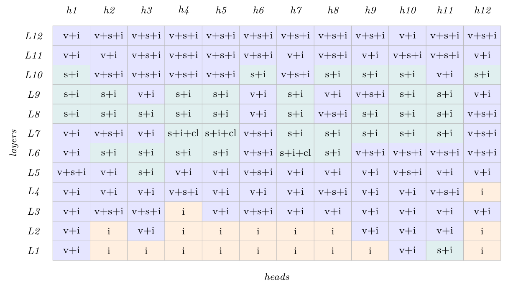
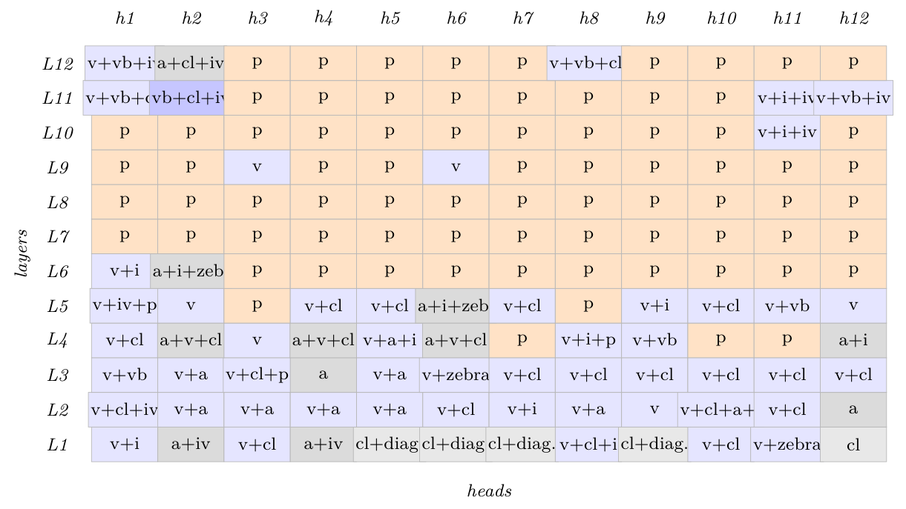

# Chapter 7: introduction and signature geography in BERT

[Library index](../README.md) · [Source and transcription policy](../SOURCE.md) · [Previous pages: PDF 225–233](0225-0233-ch06-activation-corrections-and-synthesis.md#pdf-0233)

> Editorial note: Full transcription of PDF 234–238 (printed pages 198–202), including Table 7.1 and Figures 7.1–7.2. Source wording, unresolved references (“efch:local”, “??”, “?”), references to “Chapter 10”, and the original claims about completeness and empirical robustness are retained. The original figure crops are supplemented by searchable cell labels extracted from individual text operations in the PDF; abbreviations and visibly truncated labels are not expanded. See [reading note 54](../notes/54-bert-signature-geography-and-evidence.md) for the separate assessment of evidence and internal inconsistencies.

## PDF 234 · Book 198

## Chapter 7. Global Analysis: Canonical Signatures and Attention Geography

### 7.1 Introduction

The previous chapter introduced a finite dictionary of eight canonical attention regimes. The dictionary is not an exhaustive taxonomy of all row-stochastic attention maps. Instead, it provides a reference geometry: each empirical attention map has a canonical projection onto the convex hull of the dictionary, a regime-level signature, and a residual measuring non-canonical structure. The arc of Chapter efch:local was therefore not from visual pattern to absolute classification, but from visual regularity to a canonical coordinate system. What that chapter did not do, and could not do, was look at more than one head at once. The natural object of attention was the head; the natural setting was a single forward pass through a single layer. The setting now changes. A trained Transformer is not a head: it is a grid. BERT-base, the model that has served as the running case study throughout this volume, is a grid of $L\times H=12\times12=144$ heads, organised in twelve layers stacked vertically. Each cell of the grid is a head; each row is a layer; each column is what may, provisionally, be called a channel. The question that opens this chapter is whether the grid has a structure — whether the position of a pattern in the grid carries information that the pattern itself, taken in isolation, does not.

The empirical answer is yes, and the structure is striking enough to deserve a name. It is the *geography of patterns*. Low layers, in BERT-base, are populated almost entirely by cluster heads and contextual gates — patterns that pool information across nearby positions and aggregate it into local averages. Middle layers are the domain of directional and instance gates — patterns that select, that single out, that break symmetry between positions. Upper layers are dominated by closed gates and pure self-attention — patterns that have stopped searching and are merely propagating what has been found. This stratification is not random, it is not an artefact of a single training run, and it is not specific to a single task: it appears across the four experimental conditions introduced in §7.2 (white-noise input vs. identity input, base vs. fine-tuned BERT-base), with quantitative differences between the conditions but with the same qualitative geography. A theory that explained the eight patterns one head at a time, but had nothing to say about why cluster heads cluster at the bottom of the network and closed gates cluster at the top, would be incomplete. The grid is the thing that must be explained.

## PDF 235 · Book 199

This chapter undertakes that explanation along three axes, in increasing order of ambition. The first axis, developed in §7.2 through §??, is *geographical*: the empirical layout of the patterns in the grid is described, the flow of information along the layers is measured through the cone index $\mathcal I_{\mathrm{cone}}^{(\ell)}$ and the layer-wise Shannon entropy, and the transition matrix $T_{p\to p'}$ that records which pattern at layer $\ell$ tends to be followed by which pattern at layer $\ell+1$ is estimated empirically. This is the quantitative part of what was, until now, a qualitative observation. The second axis, occupying §??–§7.20, is *dynamical*: the question is no longer where the patterns sit in the trained network, but how they got there. Three theorems are proved on the gradient flow that produces them — on the stability of the extremal patterns (open and closed gates), on the emergence of intermediate patterns from task-induced symmetry breaking, and on the canonicalisation that forces the trajectory to converge to one of the eight, not to something between them. The predictions are tested empirically by training a small Transformer from scratch and observing the patterns appear, checkpoint by checkpoint. The third axis, in §??, is the most speculative section of this entire volume. It asks a question that no chapter so far has been ready to ask: *is the layered geography of patterns in BERT a signature of backpropagation as a learning rule, rather than of the data?* The answer offered, drawing on the framework of ?, is that it is. Hebbian rules, predictive coding, target propagation — each would produce a different geography, even on identical data. The eight canonical patterns remain the patterns; their layered organisation is the way backpropagation chooses to deploy them. A reader who finishes this chapter will have seen the full picture: what the Transformer can compute (Part I and the local analysis of Chapter 10), where in the network it computes it (the geography of §§7.2–??), and why the gradient flow puts it there (the dynamics of §§??–??). The canonicality of the eight patterns, established statically in Chapter 10, will turn out to be dynamically selected as well. The same eight orbits, from two perspectives.

**Takeaway.** *A trained Transformer is a grid of $L\times H$ heads, not a head. The position of a pattern in the grid is itself information: low layers aggregate, middle layers select, upper layers propagate. Chapter 10 explained what each head can do; this chapter explains where in the network it does it, and why the gradient flow arranges it that way.*

### 7.2 Signature Geography in BERT

The grid described in §7.1 is an empirical object before it is a theoretical one. Before any explanation can be offered for the layered organisation of the patterns, the organisation itself must be measured: which pattern appears where, under which conditions, with what frequency. The present section performs that measurement on BERT-base under four controlled conditions, summarises the qualitative geography that emerges, and reads it through the propagation map of ?. The theorems that explain the geography are deferred to §§??–??; the purpose here is to fix the phenomenon to be explained.

**The four conditions.** The geography of canonical signatures is sharpest when the contribution of the input geometry is disentangled from the contribution of the trained weights. Four configurations are used throughout this section, designed to vary one factor at a time:

- *C1 — white-noise input, base model:* a Gaussian input is fed to BERT-base before any task-specific fine-tuning. This isolates the structure of attention that is intrinsic to the pre-trained backbone, on a maximally unstructured signal.
- *C2 — identity input, base model:* the input is the identity matrix (so that token $i$ has

## PDF 236 · Book 200

| Condition | Dominant pattern by layer band |
| --- | --- |
| C1 (white-noise / base) | Uniform: inst (12/12 at every layer); v rises monotonically, self from layer 6 |
| C2 (identity / base) | L1–L5: clust, att, v; L6–L10: p plateau (≥10/12); L11–L12: p + inv, vb |
| C3 (white-noise / ft) | L1–L9: v+inst+self; L10: v+inst; L11: transition; L12: stop (12/12) |
| C4 (identity / ft) | L1: aggregation (att, clust, self); L2–L5: directional + composite; L6–L8: p+vb+z plateau; L9–L11: vb dominance; L12: stop |

**Table 7.1:** Layer-wise dominant patterns under each of the four conditions C1–C4. Counts are out of 12 heads per layer; composite labels are multi-counted. The full per-layer atom distributions $\pi_p^{(\ell)}$ are given in Table ??.

a single non-zero coordinate in dimension $i$), still on the base model. This isolates the structure of attention on a maximally structured signal — the one that, by construction, carries no semantic content but maximal positional distinguishability.

- *C3 — white-noise input, fine-tuned model:* the same Gaussian input as in C1, but fed to a BERT-base instance fine-tuned on the SARS-CoV-2 case study of Chapter 3. The differences from C1 measure the signature of fine-tuning on noise.
- *C4 — identity input, fine-tuned model:* identity input on the fine-tuned model. The richest condition: both the input and the weights carry structure.

For each condition, the 144 self-attention maps ($L=12$ layers $\times H=12$ heads) are classified into the eight canonical patterns of Chapter 10, including their compositions via the algorithm $\widehat\lambda$ of §6.14. A small number of attention maps are not cleanly decomposable into the eight canonical regimes: those are flagged *peculiar* (p), *vertical-block* (vb), and *zebra* (z). Their interpretation is discussed at the end of this section.

**Caveat.** *The labels p, vb, and z are not additional canonical patterns. The Pattern Completeness Theorem (Theorems 6.14.1–6.14.2) is not contradicted by their presence: those theorems classify the patterns that arise as orbits of the operator $M_a$ on $\mathbb R^d$ under the relevant group action, and the eight orbits exhaust that classification. The labels p, vb, and z mark attention maps whose decomposition into the eight canonical regimes, in the sense of the projection algorithm $\widehat\lambda$ of §6.14, has support that does not concentrate on a single canonical pattern. They are compositions, not new pure types. The discussion of their geography in §?? treats them as such.*

**The four maps.** The full $12\times12$ classification under each condition is displayed in Figures 7.1–7.4, with each cell labelled by its dominant canonical pattern (or composition). The qualitative reading is summarised in Table 7.1 and is the central observation of this section.

The four conditions divide cleanly into two pairs along the input-structure axis. On white-noise input (C1, C3), the geography is essentially flat: the same composite label v+inst (with self entering in mid layers) populates almost every cell of the grid in the base model, and the only effect of fine-tuning is to install a band of closed gates (stop) at the top of the network. On identity input (C2, C4), the geography is layered: cluster heads and contextual gates occupy the lower layers, peculiar and composite patterns occupy a plateau in the middle layers, vertical-block patterns climb into the upper layers, and the closed gate appears as a saturated ceiling at layer 12 in the fine-tuned condition. The fine-tuning sharpens the layered

## PDF 237 · Book 201

**Figure 7.1:** **C1:** White-noise input, base BERT-base.

*Each cell is one of the 144 self-attention maps of BERT-base, classified into a canonical pattern (or composition). Atom abbreviations: v (directional, blue), s (self/open, teal), i (instance, orange), cl (cluster, grey), a (contextual, grey), iv (inverse-directional, red), st (closed, white), vb (vertical-block), z (zebra), p (peculiar). The labels vb, z, p are non-canonical compositions in the sense of §6.14.*

> Editorial transcription aid: the following grid reproduces the PDF's encoded cell labels, in the original top-to-bottom order L12–L1. It does not add classifications.

| Layer | h1 | h2 | h3 | h4 | h5 | h6 | h7 | h8 | h9 | h10 | h11 | h12 |
|---|---|---|---|---|---|---|---|---|---|---|---|---|
| L12 | v+i | v+s+i | v+s+i | v+s+i | v+s+i | v+s+i | v+s+i | v+s+i | v+s+i | v+i | v+s+i | v+s+i |
| L11 | v+i | v+i | v+s+i | v+s+i | v+s+i | v+s+i | v+i | v+s+i | v+i | v+s+i | v+s+i | v+i |
| L10 | s+i | v+s+i | v+s+i | v+s+i | v+s+i | s+i | v+s+i | s+i | s+i | s+i | v+i | s+i |
| L9 | s+i | s+i | v+i | s+i | s+i | v+i | s+i | v+i | v+s+i | s+i | s+i | v+i |
| L8 | s+i | s+i | s+i | s+i | s+i | v+i | s+i | v+s+i | s+i | s+i | s+i | v+s+i |
| L7 | v+i | v+s+i | v+i | s+i+cl | s+i+cl | v+s+i | s+i | s+i | s+i | s+i | s+i | v+s+i |
| L6 | v+i | s+i | s+i | s+i | s+i | v+s+i | s+i+cl | s+i | v+s+i | v+s+i | v+s+i | v+s+i |
| L5 | v+s+i | v+i | s+i | v+i | v+i | v+s+i | v+i | v+i | v+i | v+s+i | v+i | v+i |
| L4 | v+i | v+i | v+i | v+s+i | v+i | v+i | v+i | v+s+i | v+i | v+i | v+s+i | i |
| L3 | v+i | v+s+i | v+s+i | i | v+i | v+s+i | v+i | v+i | v+i | v+i | v+i | v+i |
| L2 | v+i | i | v+i | i | i | i | i | i | v+i | v+i | v+i | i |
| L1 | v+i | i | i | i | i | i | i | i | i | v+i | s+i | i |

geography without creating it: C2 already exhibits a clear cluster → peculiar stratification on the base model, and C4 amplifies the same structure with a richer middle band.

The asymmetry between input regimes deserves emphasis. The hypothesis that the layered geography is a property of the trained weights alone — so that any sufficiently expressive input would reveal it — is falsified by C1: the same weights, applied to a white-noise input, produce a flat geography in which essentially every head behaves as an instance gate. The hypothesis that the layered geography is a property of the input alone is equally falsified: the identity input in C2 already produces stratification before any task-specific fine-tuning. The geography emerges from the *interaction* of input structure with trained weights, and only from that interaction. Both ingredients are necessary; neither is sufficient.

**The propagation map.** Figure ?? is a compressed visual summary of the same phenomenon, on a fine-tuned BERT-base run on a single sequence of the SARS-CoV-2 case study. The visual encoding originates in the thesis of Bonino (2021) and is reproduced, with extended annotations, in the consolidated treatment of ?. The figure displays the $12\times12$ grid with three pieces of information per cell: the dominant pattern label (text), an information-richness flag (green tint for cells whose pattern is non-trivially informative, no tint otherwise), and a channel-relevance flag (red border for cells whose pattern is relevant for downstream propagation along the column). The red arrows along the top mark the channels in which the upper-layer pattern carries forward what was found below; the single arrow along the bottom marks the [cls] token, the input that actually drives the classification.

The propagation map makes visible two regimes that the per-condition maps suggest more weakly. The first regime, exemplified by channel 1 (head 1 across all layers), is the *searching channel*: the head shows no strong pattern in early layers (stop or v with grey tint), develops a clear pattern in the middle layers (typically s+clu or v+inst in green), and propagates that

## PDF 238 · Book 202

**Figure 7.2:** **C2:** Identity input, base BERT-base.

*Each cell is one of the 144 self-attention maps of BERT-base, classified into a canonical pattern (or composition). Atom abbreviations: v (directional, blue), s (self/open, teal), i (instance, orange), cl (cluster, grey), a (contextual, grey), iv (inverse-directional, red), st (closed, white), vb (vertical-block), z (zebra), p (peculiar). The labels vb, z, p are non-canonical compositions in the sense of §6.14.*

> Editorial transcription aid: the following cells retain the actual encoded labels, including abbreviations such as “diag.”, “zeb.”, and labels ending in a period. Where the printed figure overlaps or obscures a neighbouring cell, this table makes the encoded text searchable without completing it.

| Layer | h1 | h2 | h3 | h4 | h5 | h6 | h7 | h8 | h9 | h10 | h11 | h12 |
|---|---|---|---|---|---|---|---|---|---|---|---|---|
| L12 | v+vb+iv | a+cl+iv | p | p | p | p | p | v+vb+cl. | p | p | p | p |
| L11 | v+vb+cl. | vb+cl+iv | p | p | p | p | p | p | p | p | v+i+iv | v+vb+iv |
| L10 | p | p | p | p | p | p | p | p | p | p | v+i+iv | p |
| L9 | p | p | v | p | p | v | p | p | p | p | p | p |
| L8 | p | p | p | p | p | p | p | p | p | p | p | p |
| L7 | p | p | p | p | p | p | p | p | p | p | p | p |
| L6 | v+i | a+i+zeb. | p | p | p | p | p | p | p | p | p | p |
| L5 | v+iv+p | v | p | v+cl | v+cl | a+i+zeb. | v+cl | p | v+i | v+cl | v+vb | v |
| L4 | v+cl | a+v+cl | v | a+v+cl | v+a+i | a+v+cl | p | v+i+p | v+vb | p | p | a+i |
| L3 | v+vb | v+a | v+cl+p | a | v+a | v+zebra | v+cl | v+cl | v+cl | v+cl | v+cl | v+cl |
| L2 | v+cl+iv | v+a | v+a | v+a | v+a | v+cl | v+i | v+a | v | v+cl+a+i | v+cl | a |
| L1 | v+i | a+iv | v+cl | a+iv | cl+diag. | cl+diag. | cl+diag. | v+cl+i | cl+diag. | v+cl | v+zebra | cl |

pattern essentially unchanged through the upper layers. The second regime, exemplified by channel 4, is the *early-decision channel*: the head locks onto a clear pattern by layer 1 or 2 and carries it through the rest of the network with minor modulation. Both regimes occur on the same trained model, on the same input, and represent two ways the architecture can use a column of the grid: as a path that searches and finds, or as a path that recognises and propagates.

The bottom-to-top reading of any single column also clarifies the role of the upper layers. In a majority of channels, the highest layers contain almost exclusively vertical patterns (v, v+inst, occasionally stop): the information has been found, and the only task left is to broadcast it to the [cls] position via the bias-modulation mechanism formalised in §7.3. This observation recovers, from the geography alone, the empirical result of Michel et al. (2019a): pruning the upper-layer heads of BERT damages performance much less than pruning the lower-layer heads. The lower layers are where the directional search happens; the upper layers carry forward the result. A theory of the Transformer must account for both phenomena together, and that is what the rest of this chapter sets out to do.

**Takeaway.** *The geography of canonical signatures in BERT is layered when the input has structure and flat when it does not. On structured input, lower layers aggregate (cluster, contextual), middle layers compose, and upper layers either propagate the directional information found below or close the gate entirely. The phenomenon is robust across fine-tuning, and is consistent with the empirical pruning result that the upper layers carry less of the task-specific load.*

---

[Continue: PDF 239–244, information flow and the residual stream](0239-0244-ch07-information-flow-and-residual-stream.md#pdf-0239)
