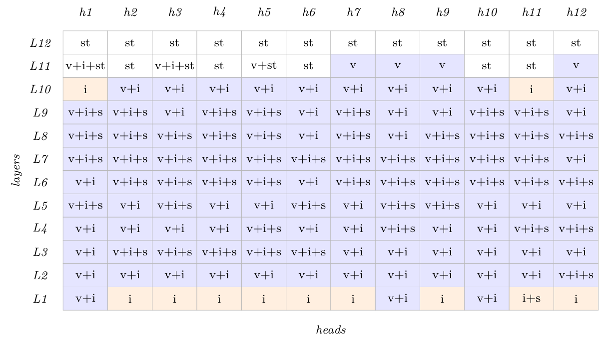
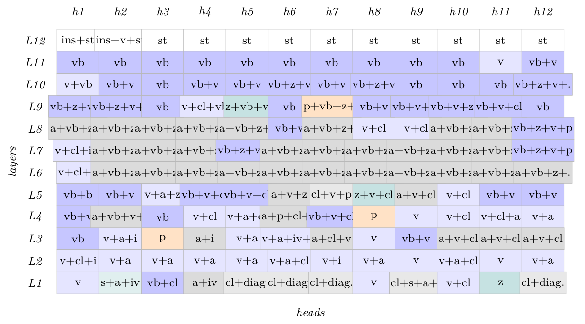
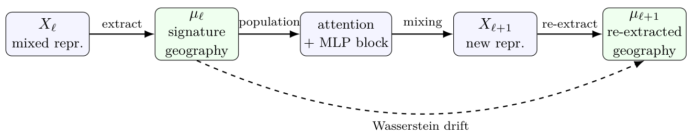
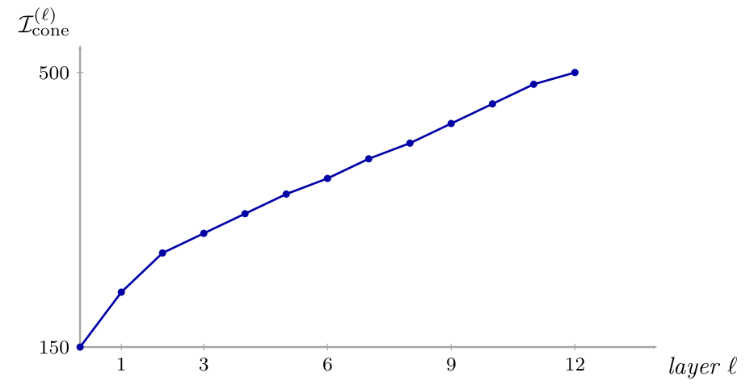
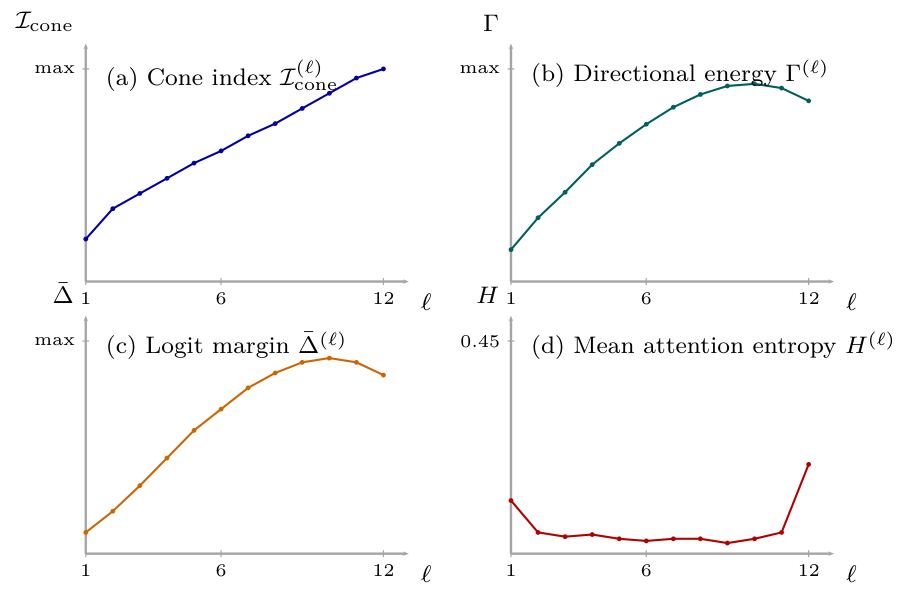
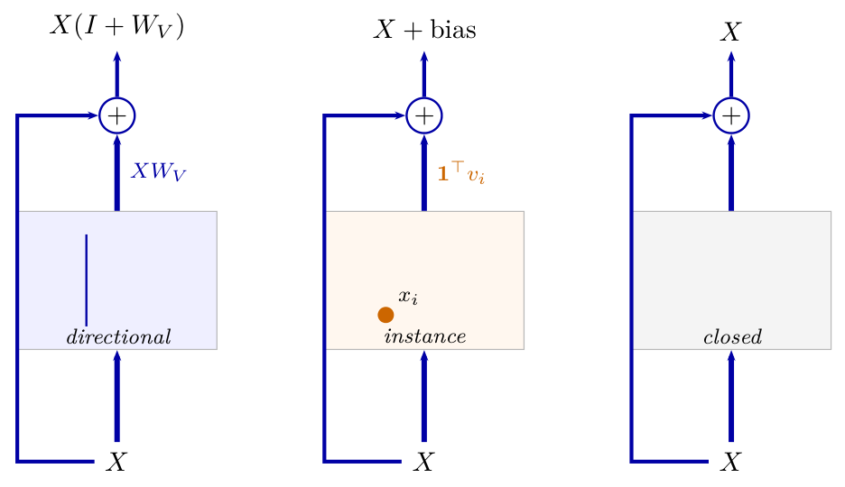

# Chapter 7: information flow, the coherence chain, and residual-stream regimes

[Library index](../README.md) · [Source and transcription policy](../SOURCE.md) · [Previous pages: PDF 234–238](0234-0238-ch07-signature-geography-in-bert.md#pdf-0238)

> Editorial note: Full transcription of PDF 239–244 (printed pages 203–208), including the source's statements, proof, sketch, preview, all six numbered equations, and Figures 7.3–7.8. Mathematical claims are reproduced as printed, including the inequalities (7.2) and (7.4), the monotonicity claims, and the residual-stream formulas with their original dimensions and gate names. The independent qualifications and counterexamples are in [note 55](../notes/55-information-flow-and-rank-along-layers.md) and [note 56](../notes/56-residual-stream-and-representation-clustering.md). A proof referred to a later chapter has not been inspected here.

## PDF 239 · Book 203

**Figure 7.3:** **C3:** White-noise input, fine-tuned BERT-base (SARS-CoV-2 task).

*Each cell is one of the 144 self-attention maps of BERT-base, classified into a canonical pattern (or composition). Atom abbreviations: v (directional, blue), s (self/open, teal), i (instance, orange), cl (cluster, grey), a (contextual, grey), iv (inverse-directional, red), st (closed, white), vb (vertical-block), z (zebra), p (peculiar). The labels vb, z, p are non-canonical compositions in the sense of §6.14.*

> Editorial transcription aid: the following searchable grid preserves the actual PDF cell labels and their original L12–L1 order.

| Layer | h1 | h2 | h3 | h4 | h5 | h6 | h7 | h8 | h9 | h10 | h11 | h12 |
|---|---|---|---|---|---|---|---|---|---|---|---|---|
| L12 | st | st | st | st | st | st | st | st | st | st | st | st |
| L11 | v+i+st | st | v+i+st | st | v+st | st | v | v | v | st | st | v |
| L10 | i | v+i | v+i | v+i | v+i | v+i | v+i | v+i | v+i | v+i | i | v+i |
| L9 | v+i+s | v+i+s | v+i | v+i+s | v+i+s | v+i | v+i+s | v+i | v+i | v+i+s | v+i+s | v+i |
| L8 | v+i+s | v+i+s | v+i+s | v+i+s | v+i+s | v+i | v+i+s | v+i | v+i+s | v+i+s | v+i+s | v+i+s |
| L7 | v+i+s | v+i+s | v+i+s | v+i+s | v+i+s | v+i+s | v+i+s | v+i+s | v+i+s | v+i+s | v+i+s | v+i |
| L6 | v+i | v+i+s | v+i+s | v+i+s | v+i+s | v+i | v+i+s | v+i+s | v+i+s | v+i+s | v+i+s | v+i+s |
| L5 | v+i+s | v+i | v+i+s | v+i | v+i | v+i+s | v+i | v+i+s | v+i+s | v+i | v+i | v+i |
| L4 | v+i | v+i | v+i | v+i | v+i+s | v+i | v+i | v+i+s | v+i | v+i | v+i+s | v+i+s |
| L3 | v+i | v+i+s | v+i+s | v+i+s | v+i+s | v+i+s | v+i | v+i | v+i | v+i | v+i | v+i |
| L2 | v+i | v+i | v+i | v+i | v+i | v+i | v+i | v+i | v+i | v+i | v+i | v+i+s |
| L1 | v+i | i | i | i | i | i | i | v+i | i | v+i | i+s | i |

### 7.3 Information Flow Along the Layers

§7.2 described where in the grid each pattern lives. The present section asks a different question: how does information move between the layers, and what makes it move? The geography is a snapshot; the flow is a process. Four observables are introduced to make that process measurable: the cone index $\mathcal I_{\mathrm{cone}}^{(\ell)}$, the directional energy $\Gamma^{(\ell)}$, the mean logit margin $\bar\Delta^{(\ell)}$, and the layer-wise Shannon entropy $H^{(\ell)}$. Each is defined at the level of an entire layer and varies monotonically with depth. The central claim of the section, made precise in Proposition 7.4, is that the four observables are linked by a chain of monotone implications that together describe a single underlying phenomenon: a layered Transformer concentrates its representation onto progressively lower-dimensional subspaces, and every observable measures one face of that concentration.

**The cone index.** The first observable is the simplest, and was introduced in this form in the thesis of Bonino (2021). Recall that, after the second layer normalisation of layer $\ell$, every row vector $x_i^{(\ell)}$ of $X^{(\ell)}$ lies on the sphere of radius $\sqrt d$ in $\mathbf1^\perp$ (Theorem 1.20, Cap. 1). The *cone index* of layer $\ell$ is the norm of the aggregate of those vectors.

**Definition 7.1 (Cone index).** The cone index at layer $\ell$ is

$$
\mathcal I_{\mathrm{cone}}^{(\ell)}
=\left\|\sum_{i=1}^{n}x_i^{(\ell)}\right\|,
\tag{7.1}
$$

with the row vectors $x_i^{(\ell)}$ taken after the second layer normalisation of layer $\ell$.

The cone index measures coherence. If the row vectors point in unrelated directions, the sum is small (it is exactly zero in expectation for centred isotropic vectors); if they cluster around

## PDF 240 · Book 204

**Figure 7.4:** **C4:** Identity input, fine-tuned BERT-base (SARS-CoV-2 task).

*Each cell is one of the 144 self-attention maps of BERT-base, classified into a canonical pattern (or composition). Atom abbreviations: v (directional, blue), s (self/open, teal), i (instance, orange), cl (cluster, grey), a (contextual, grey), iv (inverse-directional, red), st (closed, white), vb (vertical-block), z (zebra), p (peculiar). The labels vb, z, p are non-canonical compositions in the sense of §6.14.*

> Editorial transcription aid: the printed grid has overlapping long labels. These are the text strings actually encoded for each cell, not inferred completions. A terminal period remains a terminal period.

| Layer | h1 | h2 | h3 | h4 | h5 | h6 | h7 | h8 | h9 | h10 | h11 | h12 |
|---|---|---|---|---|---|---|---|---|---|---|---|---|
| L12 | ins+st | ins+v+st | st | st | st | st | st | st | st | st | st | st |
| L11 | vb | vb | vb | vb | vb | vb | vb | vb | vb | vb | v | vb+v |
| L10 | v+vb | vb+v | vb | vb+v | vb+v | vb+z+v | vb+v | vb+z+v | vb | vb | vb | vb+z+v+. |
| L9 | vb+z+v+. | vb+z+v+. | vb | v+cl+vb | z+vb+v | vb | p+vb+z+. | vb+v | vb+v+iv | vb+v+z+. | vb+v+cl. | vb |
| L8 | a+vb+z+. | a+vb+z+. | a+vb+z+. | a+vb+z+. | a+vb+z+. | vb+v | a+vb+z+. | v+cl | v+cl | a+vb+z+. | a+vb+z+. | vb+z+v+p |
| L7 | v+cl+iv. | a+vb+z+. | a+vb+z+. | a+vb+z+. | vb+z+v+p | a+vb+z+. | a+vb+z+. | a+vb+z+. | a+vb+z+. | a+vb+z+. | a+vb+z+. | vb+z+v+p |
| L6 | v+cl+p | a+vb+z+. | a+vb+z+. | a+vb+z+. | a+vb+z+. | a+vb+z+. | a+vb+z+. | a+vb+z+. | a+vb+z+. | a+vb+z+. | a+vb+z+. | a+vb+z+. |
| L5 | vb+b | vb+v | v+a+z | vb+v+cl | vb+v+cl | a+v+z | cl+v+p | z+v+cl | a+v+cl | v+cl | vb+v | vb+v |
| L4 | vb+v | a+vb+v+. | vb | v+cl | v+a+cl | a+p+cl+v | vb+v+cl | p | v | v+cl | v+cl+a | v+a |
| L3 | vb | v+a+i | p | a+i | v+a | v+a+iv+z | a+cl+v | v | vb+v | a+v+cl | a+v+cl | a+v+cl |
| L2 | v+cl+i | v+a | v+a | v+a | v+a | v+a+cl | v+i | v+a | v | v+a+cl | v | v+a |
| L1 | v | s+a+iv | vb+cl | a+iv | cl+diag. | cl+diag. | cl+diag. | v | cl+s+a+i | v+cl | z | cl+diag. |

**Figure 7.5:** Layer-wise signature re-extraction. A layer does not preserve a canonical head identity; it produces a mixed representation from which the next layer extracts a new empirical distribution of canonical signatures.

> Editorial transcription aid — figure labels: $X_\ell$, “mixed repr.”; “extract”; $\mu_\ell$, “signature geography”; “population”; “attention + MLP block”; “mixing”; $X_{\ell+1}$, “new repr.”; “re-extract”; $\mu_{\ell+1}$, “re-extracted geography”; “Wasserstein drift”.

a common direction, the sum is large. The empirical behaviour of $\mathcal I_{\mathrm{cone}}^{(\ell)}$ on BERT-base, on a correctly classified sequence of the SARS-CoV-2 case study, is monotone increasing in $\ell$ (Figure 7.6), with the steepest growth in the early and middle layers and a plateau toward the top. The reason for the monotonicity is structural, not statistical, and can be stated as a lower bound.

**Proposition 7.2 (Cone Index Lower Bound).** Let $\phi^{(\ell)}=\frac1n\sum_i\angle(x_i^{(\ell)},x_i^{(\ell-1)})$ be the mean rotation angle of the row vectors between layers $\ell-1$ and $\ell$, and let $\bar\Delta_{\mathrm{proj}}^{(\ell)}$ be the component of the mean residual increment $\frac1n\sum_i\Delta_i^{(\ell)}$ along the unit vector $\sum_i x_i^{(\ell-1)}/\|\sum_i x_i^{(\ell-1)}\|$. Then

$$
\mathcal I_{\mathrm{cone}}^{(\ell)}
\ge \mathcal I_{\mathrm{cone}}^{(\ell-1)}\cos\phi^{(\ell)}
+n\left\|\bar\Delta_{\mathrm{proj}}^{(\ell)}\right\|.
\tag{7.2}
$$

*Proof.* Decompose $\sum_i x_i^{(\ell-1)}$ along its own unit direction $\widehat u^{(\ell-1)}$, on which it has length $\mathcal I_{\mathrm{cone}}^{(\ell-1)}$. The aggregate $\sum_i x_i^{(\ell)}=\sum_i x_i^{(\ell-1)}+\sum_i\Delta_i^{(\ell)}$ projects onto $\widehat u^{(\ell-1)}$ with at least $\mathcal I_{\mathrm{cone}}^{(\ell-1)}\cos\phi^{(\ell)}$ from the first sum (by the definition of the mean rotation angle and Jensen's inequality

## PDF 241 · Book 205

**Figure 7.6:** Empirical cone index $\mathcal I_{\mathrm{cone}}^{(\ell)}=\|\sum_i x_i^{(\ell)}\|$ along the twelve layers of fine-tuned BERT-base on a correctly classified SARS-CoV-2 sequence (Omicron variant).

*Layer 0 is the input embedding after positional encoding and layer normalisation; the value at layer 0 measures the residual coherence intrinsic to the embedding. The monotone increase is the empirical signature of progressive subspace selection along the depth of the network.*

> Editorial transcription aid — labelled axes: horizontal “layer $\ell$” with ticks 1, 3, 6, 9, 12; vertical $\mathcal I_{\mathrm{cone}}^{(\ell)}$ with labels 150 and 500. Unlabelled point values have not been invented.

applied to the cosine, which is concave on $[0,\pi/2]$) and exactly $n\|\bar\Delta_{\mathrm{proj}}^{(\ell)}\|$ from the second. The norm of the aggregate is at least its projection on any unit vector. $\square$

The bound has two consequences. First, the cone index can decrease between layers only if the mean rotation $\phi^{(\ell)}$ exceeds the threshold at which $\cos\phi^{(\ell)}<1-n\|\bar\Delta_{\mathrm{proj}}^{(\ell)}\|/\mathcal I_{\mathrm{cone}}^{(\ell-1)}$, which in BERT-base never happens away from the very first layer (the rotation is small and the increments are aligned). Second, when the residual increment is positively aligned with the current aggregate direction, the second term in (7.2) strictly increases the cone, and the growth is self-reinforcing. This is the structural mechanism behind the empirical curve: a layer that selects a directional pattern produces an increment $\Delta^{(\ell)}$ aligned with the dominant token direction, which extends the cone in that direction, which makes the next layer's selection of the same direction more likely, and so on. The cone index is the global trace of the directional selection performed by the individual heads of §6.8.

**Directional energy and the logit margin.** Two further observables connect the cone index to the layer-wise attention pattern. The *directional energy* $\Gamma^{(\ell)}$ of layer $\ell$, introduced in §??, measures the Frobenius norm of $X^{(\ell)}M_a^{(\ell)}(X^{(\ell)})^\top$: it is large when the antisymmetric part of the attention matrix is doing work on the row vectors, and zero exactly when those vectors lie in the silence manifold of §6.19. The *logit margin* $\bar\Delta^{(\ell)}$ is the mean, across heads and across rows, of the gap between the largest and second-largest logit before the softmax of layer $\ell$. When $\bar\Delta^{(\ell)}$ is large, each attention row is almost a one-hot vector; when it is small, the attention row is close to uniform.

**Layer-wise entropy and the coherence chain.** The fourth observable, also introduced in this layer-averaged form in Bonino (2021), is the average per-row Shannon entropy of the attention matrices at layer $\ell$:

$$
H^{(\ell)}
=\frac1{nH}\sum_{h=1}^{H}\sum_{i=1}^{n}
\mathcal H\!\left(A_{i,:}^{(\ell,h)}\right),
\tag{7.3}
$$

## PDF 242 · Book 206

where $A^{(\ell,h)}$ is the post-softmax attention matrix of head $h$ at layer $\ell$ and $\mathcal H(\cdot)$ is the Shannon entropy of a probability vector. The entropy and the logit margin are related by an inequality, the *Entropy Decay Law*, established in Cap. 8 for the global information flow analysis.

**Theorem 7.3 (Entropy Decay Law; ?).** For any layer $\ell$ with mean logit margin $\bar\Delta^{(\ell)}$ and sequence length $n$,

$$
H^{(\ell)}
\le\log\!\left(1+(n-1)e^{-\bar\Delta^{(\ell)}}\right).
\tag{7.4}
$$

In particular, $H^{(\ell)}\to0$ exponentially as $\bar\Delta^{(\ell)}\to\infty$.

**Preview.** *The proof is given in Cap. 8 as a global flow result; it constructs the maximum-entropy distribution compatible with the margin constraint and uses Jensen's inequality for the average over heads. For the present chapter, only the inequality itself is needed.*

The four observables are now linked in a single statement, which is the central observation of §7.3.

**Proposition 7.4 (Coherence chain).** Along the layers of a trained Transformer on a sufficiently discriminative input, the four observables satisfy the chain of monotone implications

$$
\mathcal I_{\mathrm{cone}}^{(\ell)}\nearrow
\ \Longrightarrow\ \Gamma^{(\ell)}\nearrow
\ \Longrightarrow\ \bar\Delta^{(\ell)}\nearrow
\ \Longrightarrow\ H^{(\ell)}\searrow.
\tag{7.5}
$$

*Sketch.* The first arrow is Proposition 7.2 read forward: when the cone index grows, the row vectors align with a common subspace, on which the antisymmetric part $M_a^{(\ell)}$ acts with amplitude bounded below by its operator norm restricted to that subspace. The second arrow is the Directional Edge Persistence Criterion (Proposition 5.2, Cap. ??): a large $\Gamma^{(\ell)}$ produces a large gap between the maximum logit and the rest, which is exactly $\bar\Delta^{(\ell)}$. The third arrow is the Entropy Decay Law (Theorem 7.3). The implications are directional, not biconditional: the chain may fail at any link if the conditioning hypothesis fails (e.g. a silenced layer in the sense of §6.19 produces $\Gamma^{(\ell)}=0$ regardless of $\mathcal I_{\mathrm{cone}}^{(\ell)}$). $\square$

The empirical layer-wise traces of the four observables on BERT-base (Figure 7.7) confirm the chain. The cone index rises monotonically through the twelve layers, the directional energy follows it with a one- or two-layer lag, $\bar\Delta^{(\ell)}$ tracks $\Gamma^{(\ell)}$ closely, and $H^{(\ell)}$ falls from above 0.4 at layer 1 to below 0.05 in the middle layers, recovering slightly at layer 12 where the [cls] aggregation broadens the attention. The entropy plot also recovers, from a different angle, the layered geography of §7.2: the lower layers, with high $H^{(\ell)}$, are the ones in which the directional search is still happening; the middle layers, with collapsed $H^{(\ell)}$, are the ones in which the search has succeeded; the slight rebound at the top reflects the [cls] broadcasting regime.

**Three regimes of the residual stream.** The coherence chain says that information accumulates along the layers. The mechanism by which it accumulates is the residual connection: at every layer $\ell$, the representation update has the form

$$
X^{(\ell)}=X^{(\ell-1)}+\Delta^{(\ell)},
\qquad
X^{(\ell)}=X^{(0)}+\sum_{\ell'=1}^{\ell}\Delta^{(\ell')},
\tag{7.6}
$$

where the increment $\Delta^{(\ell)}$ is the multi-head attention output combined with the MLP output, both followed by layer normalisation (§??, §??). The right identity in (7.6) is the *residual stream representation*: every layer contributes a separate vector $\Delta^{(\ell)}$ to the embedding, and the embedding at any layer is the sum of all contributions up to that point. The

## PDF 243 · Book 207

**Figure 7.7:** Layer-wise traces of the four observables of the coherence chain (Proposition 7.4) on fine-tuned BERT-base, on a correctly classified SARS-CoV-2 sequence.

*Panels (a)–(c) increase with depth; panel (d) decreases. The slight rebound of $H^{(\ell)}$ at layer 12 reflects the broadening of attention onto the [cls] position for classification. Precise values are reported in the chapter appendix.*

> Editorial transcription aid — panel labels: (a) Cone index $\mathcal I_{\mathrm{cone}}^{(\ell)}$; (b) Directional energy $\Gamma^{(\ell)}$; (c) Logit margin $\bar\Delta^{(\ell)}$; (d) Mean attention entropy $H^{(\ell)}$. Each horizontal axis is $\ell$ with ticks 1, 6, 12. Panels (a)–(c) label a vertical tick “max”; panel (d) labels 0.45. The original curves and their non-monotone end segments are preserved in the image.

geography of §7.2 translates into a geography of contributions: a head whose attention map is v contributes a directional rotation, a head whose attention map is an instance gate contributes a translational shift, and a head whose attention map is the closed gate contributes nothing.

The three regimes are summarised in Figure 7.8, in the form first proposed in Bonino (2021), and characterised algebraically as follows. Write the head-$h$ attention output, before the output projection, as $A^{(h)}V^{(h)}$ with $A^{(h)}=\operatorname{softmax}(L^{(h)})$ and $V^{(h)}=XW_V^{(h)}$. Three idealised attention maps lead to three idealised contributions:

1. **Directional regime** (open gate, $A^{(h)}=I$, or near-diagonal $A^{(h)}$): the attention output is $A^{(h)}V^{(h)}=XW_V^{(h)}$, and the post-skip contribution is $X(I+W_V^{(h)})$. The head acts as a linear transformation of the row vectors. The leftmost panel of Figure 7.8 illustrates this regime.
2. **Bias regime** (instance gate, $A^{(h)}=\mathbf1e_i^\top$ for some position $i$, or cluster head with constant block weights): the attention output is $\mathbf1^\top v_i^{(h)}$, a rank-one matrix that broadcasts the $i$-th value vector to every row. The post-skip contribution is $X+\mathrm{bias}$, an additive shift. The middle panel illustrates this regime.
3. **Inert regime** (closed gate, $A^{(h)}=\frac1n\mathbf1\mathbf1^\top$): the attention output has rank one but adds essentially no directional information, so the post-skip contribution is $X$ up to a small constant shift. The rightmost panel illustrates this regime, in which the attention map is empty and the residual stream carries forward what was already there.

The three regimes are not exhaustive — contextual gates, directional gates, and the inverse directional gate produce intermediate contributions — but they are the three pure contributions the residual stream supports. The geography of §7.2 can now be read as a geography of these contributions: the lower layers, dominated by cluster and contextual patterns, contribute mostly bias and small directional shifts; the middle layers, dominated

## PDF 244 · Book 208

**Figure 7.8:** The three pure regimes of the residual stream, indexed by the attention map of the contributing head.

***Left:*** *an open or near-diagonal attention map produces the directional contribution $XW_V$, post-skip $X(I+W_V)$. **Centre:** an instance gate produces the rank-one contribution $\mathbf1^\top v_i$, post-skip $X+\mathrm{bias}$. **Right:** the closed gate contributes nothing, post-skip $X$. The geography of §7.2 maps onto a geography of these three regimes: lower layers contribute mostly the centre regime, middle layers contribute mostly the left regime, upper layers contribute mostly the right regime in the fine-tuned condition.*

> Editorial transcription aid — internal diagram labels: “directional”, “instance”, “closed”, $x_i$, three inputs $X$, three addition nodes, $XW_V$, $\mathbf1^\top v_i$, and outputs $X(I+W_V)$, $X+\mathrm{bias}$, $X$. The transposed-one expression is retained as printed.

by directional and instance gates, contribute the largest portion of the directional energy $\Gamma^{(\ell)}$; the upper layers, dominated by closed and diagonal gates in the white-noise/fine-tuned condition C3, contribute mostly the inert regime, propagating the result without modifying it. The coherence chain (7.5) measures the cumulative effect; the three regimes explain the per-layer mechanism by which the chain advances.

**Takeaway.** *Four global observables — cone index, directional energy, logit margin, layer-wise entropy — are linked by a chain of monotone implications: directional alignment grows, the antisymmetric part of attention does increasing work, the softmax sharpens, the attention entropy falls. The mechanism behind the chain is the residual stream, which decomposes the layer-wise increments into three pure regimes: directional rotations, additive biases, and inert pass-through. The geography of §7.2 maps onto a geography of these three contributions.*

**A dual view: cluster geometry of the representation.** The four observables of this section probe the operator-side of the layer-wise dynamics: how the attention mechanism transforms vectors from layer to layer, what fraction of the transformation is directional, how sharp the selection has become. A complementary view probes the *representation-side*: how the cluster structure of the embedding space evolves under the same dynamics. For a classification task with $K$ classes, this view asks at which layer the embedding cloud has separated into $K$ clusters that match the ground-truth labels.

A direct empirical instantiation on the SARS-CoV-2 case study of §7.2 is reported in Ghione (2022). Density-based clustering (DBSCAN) of the post-LayerNorm representations at five canonical extraction points, evaluated against the eight-class ground truth via the Adjusted Rand Index (ARI), gives the picture in Table 7.2.

Three observations follow. First, the ARI rises monotonically across the network, from 0.291 at the input (where the embedding layer has only just begun to separate the classes) to

---

[Continue the paragraph and Table 7.2: PDF 245–250](0245-0250-ch07-head-gauge-and-layer-geography.md#pdf-0245)
