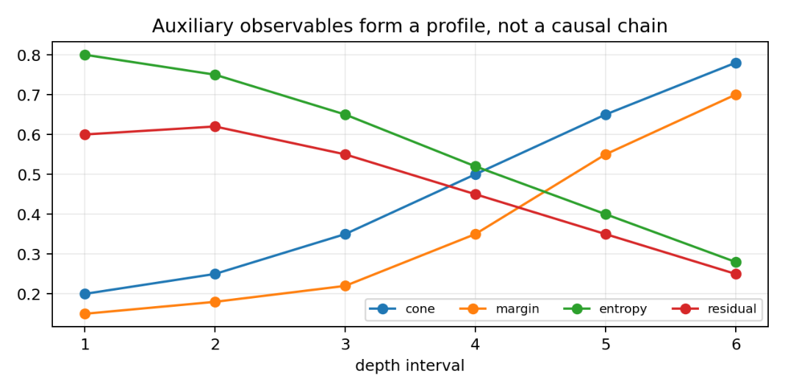
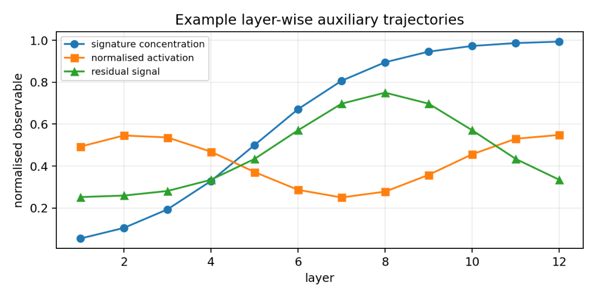

# Chapter 7: signature transport, auxiliary observables, and the closed locus

[Library index](../README.md) · [Source policy](../SOURCE.md) · [Previous: PDF 245–250](0245-0250-ch07-head-gauge-and-layer-geography.md#pdf-0250) · [Next: PDF 258–264](0258-0264-ch07-training-dynamics-and-geography-pipeline.md#pdf-0258)

> Editorial note: Complete text of PDF 251–257, including Figures 7.9–7.10, all proofs and the opening paragraph of §7.16. Original notation and the repeated words “The the the” are preserved. Row-centering notation, zero denominators, orientation signs, and the distinction between a diagnostic and an implication are discussed separately in [notes 59–62](../notes/59-signature-transport-and-coarse-transitions.md).

## PDF 251 · Book 215

### 7.8 Signature transport across layers

Let $d_{\mathrm{sig}}$ be a metric on local signatures. A simple choice is

$$
d_{\mathrm{sig}}\big((\Lambda,\rho),(\Lambda',\rho')\big)
=\|\Lambda-\Lambda'\|_1+|\rho-\rho'|.
$$

Other choices can include entropy, margin, directional activation, or a ground metric between canonical regimes.

**Definition 7.14 (Layer drift).** The signature drift between consecutive layers is

$$
D_{\ell\to\ell+1}(X)=W_1\big(\mu_\ell(X),\mu_{\ell+1}(X)\big),
$$

where $W_1$ is the Wasserstein distance induced by $d_{\mathrm{sig}}$.

Layer drift replaces the old transition matrix between hard pattern labels. A transition matrix can still be useful as a coarse visualisation after assigning each head to a dominant regime, but it is not the fundamental object. The fundamental object is the transport of signature distributions.

**Proposition 7.15 (Gauge-invariant drift).** The layer drift $D_{\ell\to\ell+1}$ is invariant under independent permutations of the heads in layer $\ell$ and layer $\ell+1$.

*Proof.* Independent head permutations leave $\mu_\ell$ and $\mu_{\ell+1}$ unchanged as empirical measures. The Wasserstein distance depends only on the two measures. $\square$

### 7.9 Coarse transition matrices as discretisations

The earlier formulation used transition matrices between pattern labels. They are retained as a discretisation. Given a signature, define its dominant canonical coordinate

$$
\alpha^\star(S)=\arg\max_\alpha\Lambda_\alpha(S),
$$

when the maximiser is unique and the residual is below a chosen threshold. A transition matrix can then be formed by counting dominant coordinates across consecutive layers. Such a matrix is not a theorem about the dynamics. It is a coarse statistic derived from the richer signature process.

The interpretation is therefore:

$$
\text{hard transition matrix}
=\text{coarse discretisation of signature transport}.
$$

This relation preserves the empirical usefulness of the old transition plots while preventing them from being mistaken for a mathematically complete dynamical law.

### 7.10 Global observables

Canonical signatures are the central state variables, but they should be read together with auxiliary observables. The earlier formulation used four such quantities: cone index, directional activation, logit margin, and row entropy. The corrected theory keeps all four, with more careful interpretation.

## PDF 252 · Book 216

#### 7.10.1 Cone index

Let $X^{(\ell)}\in\mathbb R^{n\times d}$ be the token representation at layer $\ell$. The cone vector is

$$
c^{(\ell)}=\sum_{i=1}^n x_i^{(\ell)}.
$$

A normalised cone index may be defined as

$$
I_{\mathrm{cone}}^{(\ell)}
=\frac{\|c^{(\ell)}\|}{\sum_i\|x_i^{(\ell)}\|}.
$$

It measures alignment of token vectors. It does not, by itself, imply antisymmetric activation. In fact, collapse toward a one-dimensional cone can suppress alternating forms.

**Proposition 7.16 (Cone projection bound).** Suppose

$$
c^{(\ell)}=c^{(\ell-1)}+\Delta c^{(\ell)}
$$

and $c^{(\ell-1)}\ne0$. Let

$$
u^{(\ell-1)}=\frac{c^{(\ell-1)}}{\|c^{(\ell-1)}\|}.
$$

Then

$$
\|c^{(\ell)}\|\ge\|c^{(\ell-1)}\|
+\langle\Delta c^{(\ell)},u^{(\ell-1)}\rangle.
$$

*Proof.* By Cauchy's inequality,

$$
\|c^{(\ell)}\|\ge\langle c^{(\ell)},u^{(\ell-1)}\rangle
=\|c^{(\ell-1)}\|+\langle\Delta c^{(\ell)},u^{(\ell-1)}\rangle.
$$

$\square$

This is the rigorous replacement for angle-averaged cone lower bounds. It says that cone growth is controlled by the projection of the layer increment along the previous cone direction.

#### 7.10.2 Directional activation

For a head with antisymmetric matrix $M_a$, define

$$
\Gamma(X;M)=\|XM_aX^\top\|_F.
$$

The normalised activation is

$$
\widehat\gamma(X;M)
=\frac{\|XM_aX^\top\|_F}{\|X\|_{\mathrm{op}}^2\|M_a\|_F}
$$

when $M_a\ne0$, and 0 otherwise.

**Proposition 7.17 (Normalised activation bound).** For every $X$ and $M_a\ne0$,

$$
0\le\widehat\gamma(X;M)\le1.
$$

*Proof.* The Frobenius norm satisfies

$$
\|XM_aX^\top\|_F
\le\|X\|_{\mathrm{op}}\|M_aX^\top\|_F
\le\|X\|_{\mathrm{op}}^2\|M_a\|_F.
$$

Dividing by the denominator gives the claim. $\square$

## PDF 253 · Book 217

#### 7.10.3 Margins and entropy

For a row $i$, let $j_i^\star$ be a maximising column of $L_i$, and define the row margin

$$
\Delta_i=L_{ij_i^\star}-\max_{k\ne j_i^\star}L_{ik}.
$$

Large margins imply low entropy, but the correct bound contains an extra term.

**Theorem 7.18 (Entropy bound from row margins).** Suppose $\Delta_i\ge0$ for row $i$, and set

$$
Z_i=1+(n-1)e^{-\Delta_i}.
$$

Then

$$
H(S_i)\le\log Z_i+\Delta_i\frac{(n-1)e^{-\Delta_i}}{Z_i}.
$$

Consequently, if $\Delta_i\ge\Delta_{\min}$ for every row, then

$$
H_{\mathrm{row}}(S)
\le\log Z_{\min}
+\Delta_{\min}\frac{(n-1)e^{-\Delta_{\min}}}{Z_{\min}},
$$

where $Z_{\min}=1+(n-1)e^{-\Delta_{\min}}$.

*Proof.* Among distributions whose largest logit exceeds all others by at least $\Delta_i$, the entropy is maximised when all non-winning logits are equal. The corresponding probability vector is proportional to

$$
(1,e^{-\Delta_i},\ldots,e^{-\Delta_i}).
$$

Its normaliser is $Z_i$, and direct calculation of entropy gives the displayed expression. $\square$

#### 7.10.4 Coherence profiles

The old coherence chain asserted implications among cone, activation, margin, and entropy. Those implications are not valid in general. The corrected object is a profile:

$$
\mathcal C_\ell
=\big(I_{\mathrm{cone}}^{(\ell)},\widehat\gamma^{(\ell)},
\Delta^{(\ell)},H^{(\ell)},\rho_8^{(\ell)}\big).
$$

A model may empirically show a coherence trend on a depth interval: cone index increases, directional activation increases, margins increase, entropy decreases, and residual decreases. This trend is a diagnostic, not a theorem. A rigorous theorem can be stated only under explicit monotonicity assumptions on the margins or activations.

### 7.11 Residual amplification and perturbation bounds

Layer-wise representation drift changes the activation of the antisymmetric sector. The earlier formulation contained the right idea but omitted the quadratic term. The corrected estimate is elementary and important.

**Proposition 7.19 (Residual amplification bound).** Let $X=X_0+\Delta$. Then

$$
\Gamma(X;M)\le\Gamma(X_0;M)
+2\|X_0\|_F\|\Delta\|_F\|M_a\|_{\mathrm{op}}
+\|\Delta\|_F^2\|M_a\|_{\mathrm{op}}.
$$

*Proof.* Expand

$$
XM_aX^\top
=X_0M_aX_0^\top+X_0M_a\Delta^\top
+\Delta M_aX_0^\top+\Delta M_a\Delta^\top.
$$

## PDF 254 · Book 218

**Figure 7.9:** Cone, margin, entropy, and residual form an auxiliary observable profile. The profile is diagnostic and should not be read as an unconditional causal chain.

The Frobenius triangle inequality gives the sum of the four norms. The two mixed terms are bounded by

$$
\|X_0M_a\Delta^\top\|_F
\le\|X_0\|_F\|M_a\|_{\mathrm{op}}\|\Delta\|_F,
$$

and similarly for the transpose mixed term. The quadratic term is bounded by $\|\Delta\|_F^2\|M_a\|_{\mathrm{op}}$. $\square$

The estimate explains why small residual-stream perturbations can amplify a silent or weakly active antisymmetric form. The first-order terms dominate for small $\Delta$; the quadratic term becomes important when the representation drift is large.

### 7.12 Data-dependent Jacobian control

The earlier chapter used a simple norm bound for the multi-head attention Jacobian. Such a bound cannot be uniform without additional normalisation assumptions. The attention map itself can have operator norm larger than one, and the derivative of the logits depends on $\|X\|$, $M$, and $XW_V$.

Let

$$
F_h(X)=P_h(X)XW_V^{(h)},\qquad
P_h(X)=\operatorname{softmax}_{\mathrm{row}}
\left(\frac{XM_hX^\top}{\sqrt{d_k}}\right).
$$

Then

$$
DF_h(X)[E]
=P_h(X)EW_V^{(h)}+DP_h(X)[E]XW_V^{(h)}.
$$

**Proposition 7.20 (Data-dependent MHA Jacobian bound).** There is an absolute constant $c_{\mathrm{sm}}\le1/2$, coming from the row-wise softmax Jacobian in Euclidean norm, such that

$$
\|DF_h(X)\|
\le\|P_h(X)\|_{\mathrm{op}}\|W_V^{(h)}\|_{\mathrm{op}}
+\frac{c_{\mathrm{sm}}}{\sqrt{d_k}}\|XW_V^{(h)}\|_F
\left(\|EM_hX^\top+XM_hE^\top\|_F/\|E\|_F\right)_{\mathrm{sup}}.
$$

In particular,

$$
\|DF_h(X)\|
\le\|P_h(X)\|_{\mathrm{op}}\|W_V^{(h)}\|_{\mathrm{op}}
+\frac{2c_{\mathrm{sm}}}{\sqrt{d_k}}\|XW_V^{(h)}\|_F
\|M_h\|_{\mathrm{op}}\|X\|_{\mathrm{op}}.
$$

Consequently the Jacobian of the full multi-head block is bounded by the sum of these head-wise bounds multiplied by the output-projection norm.

## PDF 255 · Book 219

*Proof.* The first term follows directly from

$$
\|P_h(X)EW_V^{(h)}\|_F
\le\|P_h(X)\|_{\mathrm{op}}\|E\|_F\|W_V^{(h)}\|_{\mathrm{op}}.
$$

For the second term, row-wise softmax has Jacobian norm at most $c_{\mathrm{sm}}$. The logit perturbation is

$$
\frac{EM_hX^\top+XM_hE^\top}{\sqrt{d_k}}.
$$

Multiplying by $XW_V^{(h)}$ gives the first displayed bound. The coarser bound follows from

$$
\|EM_hX^\top\|_F
\le\|E\|_F\|M_h\|_{\mathrm{op}}\|X\|_{\mathrm{op}}
$$

and the identical estimate for $XM_hE^\top$. $\square$

This proposition is deliberately data-dependent. It is not a defect: the geometry of attention is data-dependent, and the Jacobian should reflect that fact.

### 7.13 Activation across depth

The the the empirical analysis introduced activation sequences across layers. That idea is retained, but the normalisation is corrected. A raw directional energy

$$
\Gamma_{\ell,h}(X)
=\|X^{(\ell)}(M_{\ell,h})_a(X^{(\ell)})^\top\|_F
$$

mixes three effects: the size of the representation, the size of the antisymmetric matrix, and the alignment between the row span and the alternating form. The normalised activation removes the first two.

**Definition 7.21 (Normalised activation trajectory).** For a head $h$ in layer $\ell$, define

$$
\widehat\gamma_{\ell,h}(X)
=\frac{\|X^{(\ell)}(M_{\ell,h})_a(X^{(\ell)})^\top\|_F}
{\|X^{(\ell)}\|_{\mathrm{op}}^2\|(M_{\ell,h})_a\|_F}
$$

when $(M_{\ell,h})_a\ne0$, and 0 otherwise. The activation trajectory of the model is the empirical distribution of $\widehat\gamma_{\ell,h}$ over $h$ and $\ell$.

A cone-aligned representation is not automatically directionally activated. Alternating forms require two independent directions. Collapse toward one dominant line may decrease $\widehat\gamma$. The right sufficient condition is two-dimensional.

**Proposition 7.22 (Two-dimensional activation condition).** Let $M_a$ have a canonical eigenplane $E=\operatorname{span}(u,v)$ with singular value $\sigma>0$, so that on $E$

$$
M_au=\sigma v,\qquad M_av=-\sigma u.
$$

Let $U$ be the row span of $X$. If the orthogonal projections of two vectors $x,y\in U$ onto $E$ have oriented area $a$, then

$$
|x^\top M_ay|\ge\sigma|a|-\varepsilon_E(x,y),
$$

where $\varepsilon_E(x,y)$ is the contribution of the other eigenplanes. In particular, if $M_a$ has only this active eigenplane or if the other eigenplane contributions vanish on $x,y$, then

$$
|x^\top M_ay|=\sigma|a|.
$$

## PDF 256 · Book 220

**Figure 7.10:** Example layer-wise auxiliary trajectories. Normalised activation, residual signal, and signature concentration may mature at different depths.

*Proof.* Write $x_E=P_Ex$ and $y_E=P_Ey$. On $E$, the alternating form is

$$
\omega_E(x,y)=\sigma\det
\begin{pmatrix}
\langle x,u\rangle&\langle x,v\rangle\\
\langle y,u\rangle&\langle y,v\rangle
\end{pmatrix}.
$$

The determinant is the oriented projected area $a$. The remaining eigenplanes contribute the residual term $\varepsilon_E(x,y)$. $\square$

The proposition does not claim that cone growth causes activation. It states the actual geometric requirement: the row span must retain a two-dimensional component aligned with an antisymmetric eigenplane.

### 7.14 The all-closed locus

The closed gate corresponds to uniform attention. In logit space, a row is closed when its logits are constant. The all-closed locus is the set of score matrices with all rows constant. At finite logits this is a genuine locus. The open gate, by contrast, is a limit regime: exact Dirac attention requires infinite logit margins.

The criticality of the uniform row depends on the loss. It is not true that the all-closed locus is automatically critical for every task. The correct statement is local and row-wise.

**Proposition 7.23 (Criticality of uniform attention).** Let $S_i=\frac1n\mathbf1$ be a uniform attention row, and let $\mathcal L(S)$ be differentiable with respect to $S$. The row is critical with respect to row-logit perturbations if and only if

$$
\left[I-\frac1n\mathbf1\mathbf1^\top\right]\nabla_{S_i}\mathcal L=0.
$$

Equivalently, $\nabla_{S_i}\mathcal L$ is constant across columns.

*Proof.* At the uniform row, the softmax Jacobian is

$$
J=\frac1n I-\frac1{n^2}\mathbf1\mathbf1^\top
=\frac1n\left[I-\frac1n\mathbf1\mathbf1^\top\right].
$$

## PDF 257 · Book 221

A logit perturbation changes the loss by

$$
\langle\nabla_{S_i}\mathcal L,J\,\delta L_i\rangle.
$$

This vanishes for every logit perturbation $\delta L_i$ if and only if the projection of $\nabla_{S_i}\mathcal L$ onto $\mathbf1^\perp$ is zero. $\square$

### 7.15 Linearised softmax at the closed locus

Near the all-closed locus, softmax can be linearised. Let $L_i=c_i\mathbf1+\varepsilon z_i$ with $z_i\in\mathbf1^\perp$. Then

$$
\operatorname{softmax}(L_i)
=\frac1n\mathbf1+\frac{\varepsilon}{n}z_i+O(\varepsilon^2).
$$

Thus the first-order attention displacement is the centred logit perturbation. In matrix form, if $P=I-\frac1n\mathbf1\mathbf1^\top$ acts row-wise, then

$$
S=S_{\mathrm{closed}}+\frac1n PL+O(\|PL\|^2).
$$

This identity is the bridge from Hessian directions in parameter space to first signature directions. A perturbation of $M$ produces a logit perturbation

$$
\delta L=\frac{X\,\delta M\,X^\top}{\sqrt{d_k}}.
$$

After row-centering and softmax linearisation, this produces a first attention displacement. Projecting that displacement onto the tangent cone of the canonical hull gives the initial canonical signature direction.

**Proposition 7.24 (First signature direction).** Assume a differentiable path of logits

$$
L(t)=L_0+t\dot L_0+O(t^2)
$$

with $L_0$ in the all-closed locus. Then

$$
S(t)=S_{\mathrm{closed}}+\frac tn P_{\mathrm{row}}\dot L_0+O(t^2).
$$

Consequently the first-order canonical motion is the projection of $\frac1nP_{\mathrm{row}}\dot L_0$ onto the tangent cone of $K_8(n)$ at $S_{\mathrm{closed}}$.

*Proof.* The row-wise softmax expansion gives the first displayed formula. The canonical projection is the Euclidean projection onto $K_8(n)$. At a point of the hull, the first-order variation of the projection is the projection of the perturbation onto the tangent cone, whenever the tangent projection is unique. This gives the stated canonical motion. $\square$

### 7.16 Saddle escape and projected signatures

The earlier formulation contained a valuable dynamical idea: near a symmetric critical locus, the Hessian decomposes into invariant components, and gradient flow escapes along the most unstable component. The corrected interpretation is not that the component selects an exact pattern. It selects an initial direction in attention space, whose canonical projection has a signature.

[Continue with Theorem 7.25 on PDF 258](0258-0264-ch07-training-dynamics-and-geography-pipeline.md#pdf-0258).
