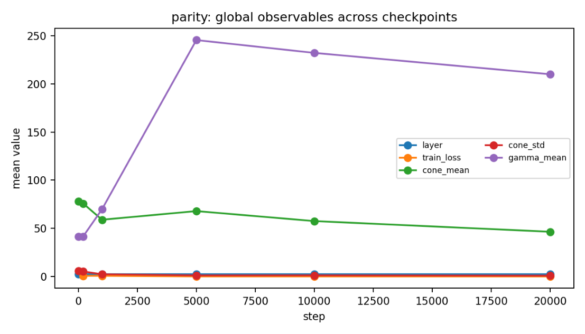
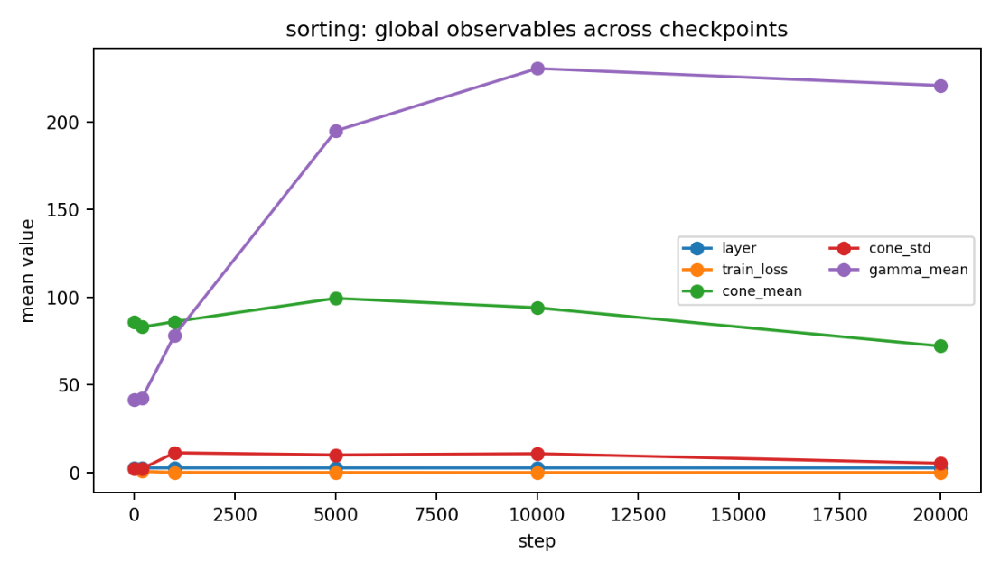
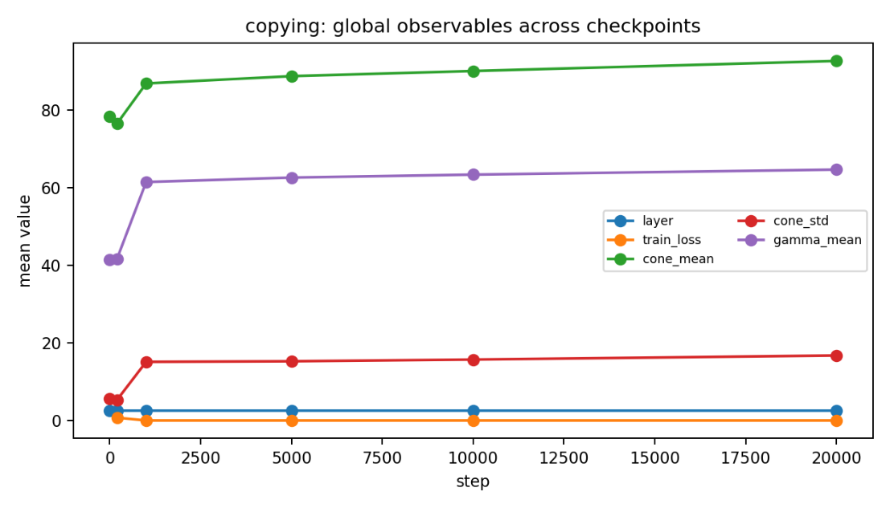
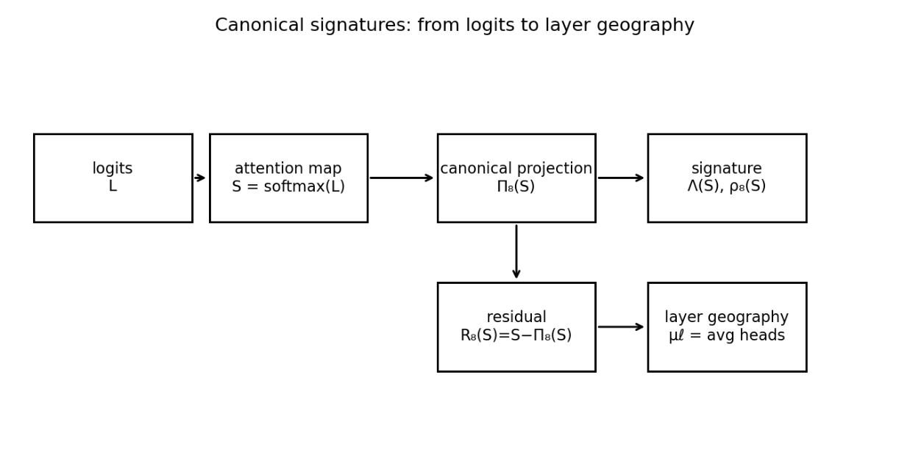

# Chapter 7: saddle escape, convergence, empirical geography, and applications

[Library index](../README.md) · [Source policy](../SOURCE.md) · [Previous: PDF 251–257](0251-0257-ch07-signature-transport-and-closed-locus.md#pdf-0257) · [Next: PDF 265–267](0265-0267-ch07-replacement-map-and-hypotheses.md#pdf-0265)

> Editorial note: Full source text, including Theorem 7.25 and its original quantifiers, Theorem 7.28's active-face claim, Figures 7.11–7.14, and all application subsections. Source claims are retained without silent repair. See [note 63](../notes/63-saddle-escape-convergence-and-stability.md) for mathematical qualifications and [note 64](../notes/64-bert-small-geography-and-causal-diagnostics.md) for the distinction between author-reported experiments, illustrative plots, and proposals. The book's statement that CSV files are included is an author statement; only the attached PDF was supplied here.

## PDF 258 · Book 222

**Theorem 7.25 (Local saddle escape).** Let $\theta_\star$ be a critical point of an analytic loss, and suppose that in local coordinates $z$ normal to the critical manifold,

$$
\mathcal L(\theta_\star+z)
=\mathcal L(\theta_\star)+\frac12\langle Hz,z\rangle+O(\|z\|^3).
$$

Assume $H$ is block diagonal,

$$
H=\bigoplus_\rho H_\rho,
$$

and that the most negative eigenvalue is attained uniquely on one block $V_{\rho_\star}$. Then every sufficiently small perturbation with nonzero projection on $V_{\rho_\star}$ exits a neighbourhood of $\theta_\star$ tangent to $V_{\rho_\star}$ under gradient flow.

*Proof.* The gradient flow in the normal coordinates is

$$
\dot z=-Hz+O(\|z\|^2).
$$

On an eigendirection with eigenvalue $\lambda<0$, the linearised flow has growth rate $-\lambda>0$. The unique most negative block has the largest growth rate. Standard invariant manifold estimates imply that for sufficiently small perturbations with nonzero component in that block, the unstable component dominates the exit direction. $\square$

**Definition 7.26 (Projected escape signature).** The projected escape signature of an unstable parameter direction $\dot\theta$ is the canonical signature of the first-order attention displacement induced by $\dot\theta$ through the linearised score and softmax maps.

Thus the correct dynamical claim is:

$$
\text{unstable Hessian block}
\longrightarrow\text{first attention displacement}
\longrightarrow\text{projected canonical signature}.
$$

There is no general theorem saying that an isotypic component equals one of the eight regimes.

### 7.17 Finite-noise selection

Finite noise changes which unstable component is first observed. The selection criterion is an exit time, not a shifted eigenvalue formula.

**Proposition 7.27 (Finite-noise exit time).** Consider the linear unstable flow

$$
\dot z_\rho=a_\rho z_\rho,\qquad a_\rho>0,
$$

on each component $V_\rho$. Starting from $z_\rho(0)=\xi_\rho$, the time to reach radius $r_\star$ is

$$
\tau_\rho=\frac1{a_\rho}\log\frac{r_\star}{\|\xi_\rho\|}.
$$

The first selected component is the one minimising $\tau_\rho$. If $\xi_\rho$ is isotropic Gaussian with variance $\sigma^2$ on $V_\rho$, then

$$
\|\xi_\rho\|^2/\sigma^2\sim\chi^2_{\dim V_\rho}.
$$

*Proof.* The solution of the linear flow is

$$
z_\rho(t)=e^{a_\rho t}\xi_\rho.
$$

The first time at which $\|z_\rho(t)\|=r_\star$ is the displayed $\tau_\rho$. For isotropic Gaussian noise, the squared norm in a $d_\rho$-dimensional component has a chi-square distribution with $d_\rho$ degrees of freedom. $\square$

## PDF 259 · Book 223

The selected component depends jointly on instability rate and initial noise amplitude. In high-dimensional components, the noise norm is typically larger; a slightly slower component can therefore exit before a faster but lower-dimensional component. The selected component then inherits a projected escape signature.

### 7.18 Łojasiewicz convergence and signatures

The earlier formulation invoked the Łojasiewicz convergence theorem for bounded analytic gradient flows. This is the correct way to discuss limits without claiming convergence to a hard canonical pattern.

**Theorem 7.28 (Convergence of canonical signatures).** Let $\theta(t)$ be a bounded gradient-flow trajectory for an analytic loss, and suppose $\theta(t)\to\theta_\infty$. Fix an input $X$ and a head $h$. If the attention map

$$
S_h(t;X)
$$

depends continuously on $\theta(t)$, then

$$
\Pi_8(S_h(t;X))\to\Pi_8(S_h^\infty(X)),
\qquad
\rho_8(S_h(t;X))\to\rho_8(S_h^\infty(X)).
$$

If the limiting projection lies in the relative interior of a face $F\preceq K_8(n)$, then the active canonical face is eventually constant.

*Proof.* Continuity of the head map gives $S_h(t;X)\to S_h^\infty(X)$. The Euclidean projection onto a closed convex set is non-expansive, hence continuous. Therefore the projections converge. The residual is a distance to $K_8(n)$, hence continuous. Finally, if $\Pi_8(S_h^\infty)\in\operatorname{relint}(F)$, then a sufficiently small neighbourhood of this point inside $K_8(n)$ remains in the star of $F$ and in particular has the same active face for points close enough when the limit is away from the boundary. $\square$

This theorem is the replacement for canonicalisation. It does not say that the limiting head is one of the eight regimes. It says that the canonical projection and residual converge. A hard-regime limit occurs only in the special case where the residual tends to zero and the projection tends to a vertex of the canonical hull.

### 7.19 Layer-coupled structural stability

Layer-wise decoupled arguments are useful, but actual networks are coupled. The appropriate theorem is structural stability under small coupling, not exact layer-wise independence.

**Theorem 7.29 (Layer-coupled structural stability).** Suppose a decoupled layer-wise gradient flow has a hyperbolic critical point $\theta_0$, and suppose the coupled flow is a $C^1$ perturbation whose vector field differs from the decoupled field by operator norm at most $\varepsilon$ in a neighbourhood of $\theta_0$. For sufficiently small $\varepsilon$, there exists a nearby hyperbolic critical point $\theta_\varepsilon$. Its stable and unstable manifolds vary continuously with $\varepsilon$. Consequently the canonical signatures of the associated attention maps vary continuously whenever their limiting projections do not lie on a face boundary.

*Proof.* The persistence of hyperbolic critical points and their invariant manifolds under $C^1$ perturbations is the standard structural stability theorem for finite-dimensional dynamical systems. The final claim follows by composing the continuous dependence of the critical point with the continuous head map and the projection-continuity statement of Theorem 7.28, away from face-boundary changes. $\square$

## PDF 260 · Book 224

This theorem replaces the old layer-wise consistency claim. It does not give an automatic small numerical bound for BERT-base. It gives a correct conditional result: if coupling is small in the relevant dynamical sense and the decoupled fixed point is hyperbolic, then the signature geometry persists.

### 7.20 Empirical validation: BERT-small from scratch

The the the empirical analysis contains a useful experiment with a small BERT-like model trained from scratch on three synthetic tasks: parity, sorting, and copying. The model has 4 layers, 4 heads, model dimension 128, and is evaluated over multiple checkpoints, tasks, and seeds. The original experiment recorded layer distributions, transition statistics, loss, cone index, directional activation, margin, and entropy.

The corrected interpretation is as follows. The recorded hard distributions are coarse observations of an underlying signature trajectory. The continuous theory would compute

$$
\Sigma_{\ell,h}(t)=\big(\Lambda_{\ell,h}(t),\rho_{\ell,h}(t)\big)
$$

for each head and checkpoint. The earlier formulation statistics approximate this by assigning a dominant atom and tracking its frequency. This is useful as long as the residual is also recorded or the assignment confidence is reported.

#### 7.20.1 Observed quantities

The experiment supplies three tables for each task:

- layer distributions across canonical atoms;
- KL transition statistics between consecutive layers;
- global observables: training loss, cone index, directional activation, margin, and entropy.

The most important empirical lesson is that the auxiliary observables can move before the coarse canonical projection has stabilised. In the earlier hard-label formulation language, the $\lambda$-projection lags behind the observables. In the present language, this means that geometry may mature before the map becomes close to a low-dimensional canonical face.

#### 7.20.2 Plots from the included CSV files

The following plots are generated from the CSV files included in the package. They are not new training runs; they are reproducible summaries of the earlier formulation experiment.

### 7.21 Task dependence of geography

Different tasks can induce different geographies. A copying task tends to reward open and contextual signatures because preserving or shifting token identity is useful. A sorting task can increase cluster and contextual structure because tokens must be organised by relational features. A parity task can drive more global aggregation and closed or directional behaviour depending on how the solution is implemented.

These are empirical tendencies, not universal laws. The signature framework is designed precisely to measure them without assuming them. A task fingerprint is the average signature distribution

$$
\overline\mu_{\mathrm{task}}
=\mathbb E_{X\sim\mathcal D_{\mathrm{task}}}
\frac1L\sum_{\ell=1}^L\mu_\ell(X).
$$

## PDF 261 · Book 225

**Figure 7.11:** Parity task: global observables across checkpoints, aggregated from the earlier formulation BERT-small experiment.

Two tasks can be compared by a distance between their fingerprints. This provides a quantitative notion of whether tasks use similar attention geography even when their labels differ.

### 7.22 Why backpropagation? A Roberts–Yaida–Hanin perspective

The Roberts–Yaida–Hanin perspective treats deep networks through the geometry of random functions, perturbative expansions, and the large-width limit. In that language, training does not merely change weights; it selects directions in a high-dimensional function space. The signature theory gives a mesoscopic observable of that selection.

At random initialisation, many heads are close to the closed or high-entropy region because logits are small and softmax rows are nearly uniform. The first meaningful movements away from that region are controlled by the linearised softmax and by the Hessian of the loss in parameter space. These movements need not land on canonical vertices. They have projected signatures. Backpropagation matters because it chooses the unstable directions whose projected signatures become the initial geography of the network.

This perspective aligns with the finite-noise exit theorem. The direction selected early in training depends on instability rates and noise amplitudes. Wider components can receive larger initial noise norms; sharper components can grow faster. The observed early signature is a competition between these effects. In later training, nonlinear dynamics, residual mixing, and layer coupling move the model through signature space.

The role of the canonical dictionary is not to replace the function space analysis. It gives a coordinate chart on the attention part of that analysis. It records how the function-space movement appears at the level of heads and layers.

## PDF 262 · Book 226

**Figure 7.12:** Sorting task: global observables across checkpoints.

### 7.23 Signature geography as mesoscopic state space

Weights are microscopic. Outputs are macroscopic. Canonical signatures are mesoscopic. They describe internal organisation at the scale at which heads and layers are still visible, but individual parameters have been compressed into interpretable geometry.

This mesoscopic level is useful for several reasons.

First, it is more stable than raw attention maps. Small logit perturbations give small residual changes, and inside a face they give stable signature coordinates.

Second, it is more informative than hard labels. It records mixtures and non-canonical residuals.

Third, it is compatible with gauge symmetries. Layer geography is an empirical distribution and does not depend on arbitrary head ordering.

Fourth, it connects to dynamics. A training trajectory becomes a path of signature distributions. A fine-tuning run becomes a displacement field in geography space. A pruning operation becomes a deletion or compression of signature mass.

These features make attention geography exploitable. It can be used for interpretability, model comparison, pruning, robustness, task fingerprinting, architecture design, causal intervention, and discovery of new regimes.

### 7.24 Exploiting attention geography

The practical value of the theory lies in the fact that it turns raw attention maps into structured observables. The canonical signature summarises how a head relates to the eight regimes; the residual shows what the dictionary misses; auxiliary observables show how concentrated, directional, or entropic the head is. The following uses are immediate.

## PDF 263 · Book 227

**Figure 7.13:** Copying task: global observables across checkpoints.

#### 7.24.1 Interpretability

A model can be summarised layer by layer:

$$
\ell\mapsto\mu_\ell.
$$

Instead of inspecting hundreds of attention maps, the layer geography shows whether early layers are open or contextual, whether middle layers are cluster-heavy, whether late layers close, and where residual non-canonical behaviour concentrates.

#### 7.24.2 Model comparison

Two models can be compared without comparing weights. Their layer signature distributions can be compared by Wasserstein distance or by moments. This allows questions such as whether fine-tuning changes only the late layers, whether larger models have lower residuals, and whether protein or language models occupy different regions of signature space.

#### 7.24.3 Training diagnostics

During training, the curve

$$
t\mapsto\overline\rho(t)
$$

measures canonicalisation in the weak, correct sense: movement toward the canonical hull. A decreasing residual indicates that the dictionary is becoming more explanatory. A rising residual indicates that the model is developing non-canonical attention.

#### 7.24.4 Pruning

Heads with high closed mass, high entropy, low directional activation, and low task sensitivity are pruning candidates. Heads with high residual and high causal effect should be preserved, because they may encode mechanisms not captured by the dictionary. Signature-aware pruning is therefore more nuanced than entropy-only pruning.

## PDF 264 · Book 228

**Figure 7.14:** The signature pipeline. Logits produce an attention map; the attention map projects onto the canonical hull; the projection gives canonical weights, while the residual measures non-canonical structure. Layer geography is the empirical distribution of head signatures.

#### 7.24.5 Distribution shift and robustness

A large deviation between the training geography and the test-input geography can indicate distribution shift. If the output confidence is high but the geography is far from the training distribution, the model may be using abnormal internal mechanisms. For adversarial examples, one can measure the geography drift

$$
\sum_\ell W_1\big(\mu_\ell(X),\mu_\ell(\widetilde X)\big).
$$

Geography-stable models should have small drift under semantically preserving perturbations.

#### 7.24.6 Causal interventions

A head can be replaced by its canonical projection:

$$
S_{\ell,h}\mapsto\Pi_8(S_{\ell,h}).
$$

If model behaviour is preserved, the canonical component explains the head. If behaviour changes, the residual is functionally important. One can also replace a head by a single canonical atom to ask which regime best preserves the computation.

#### 7.24.7 Discovery of new regimes

High residual is a discovery signal. If many heads across tasks share similar residual geometry, the dictionary is missing a regime. The programme is iterative:

$$
\mathcal D_8\longrightarrow\mathcal D_9\longrightarrow\mathcal D_{10}\longrightarrow\cdots.
$$

New regimes should be added only when residuals show stable recurrent structure and causal relevance.

[Continue with Figure 7.15 and §7.25 on PDF 265](0265-0267-ch07-replacement-map-and-hypotheses.md#pdf-0265).
