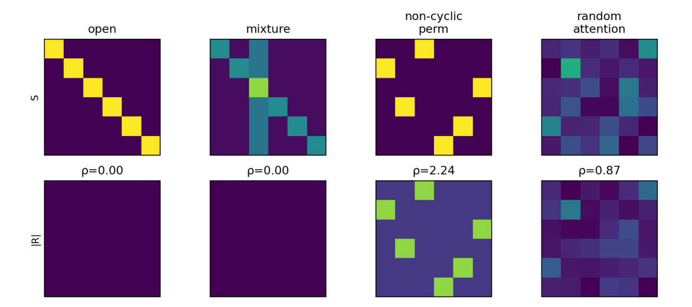

# Chapter 7: replacement map and historical hypotheses table

[Library index](../README.md) · [Source policy](../SOURCE.md) · [Previous: PDF 258–264](0258-0264-ch07-training-dynamics-and-geography-pipeline.md#pdf-0264) · [Next: PDF 268–276](0268-0276-ch07-experiments-dictionary-and-reporting.md#pdf-0268)

> Editorial note: Full text of PDF 265–267. The replacement map is an **unnumbered** source table. Table 7.3 is retained as printed, including unresolved references `??`, historical claims, and old notation that are not brought into agreement with the revised main text. On PDF 266, the caption and explanatory paragraph overlap and extend outside the ordinary page viewport; their full text below is recovered from text operations actually encoded in the supplied PDF. The [expanded viewport image](../assets/table-7-3-pdf-0266-expanded.png) exposes the existing content without inventing or correcting data. See [note 65](../notes/65-replacement-map-and-hypotheses-audit.md).

## PDF 265 · Book 229

**Figure 7.15:** Toy residual examples. Canonical atoms and exact mixtures have zero residual. Non-cyclic permutations and random attention maps are valid row-stochastic maps but need not lie near the representative canonical hull.

### 7.25 Replacement map for the old theorems

The following table records how the fragile statements of the old global theory are replaced.

| Old statement | Correct replacement |
| --- | --- |
| The eight patterns classify all heads | The eight regimes define a canonical dictionary; every head has a projection, signature, and residual. |
| Hard pattern map $\alpha_{\ell,h}\in\{1,\ldots,8\}$ | Local signature $\Sigma_{\ell,h}=(\Lambda_{\ell,h},\rho_{\ell,h})$. |
| Pattern transition matrix | Wasserstein or energy drift between empirical signature distributions. |
| Canonicalisation into one of eight patterns | Convergence or stabilisation of canonical signatures and active faces. |
| Cone index implies directional activation | Cone index is an auxiliary observable; activation requires two-dimensional alignment with an antisymmetric eigenplane. |
| Entropy decay from mean margin | Correct entropy bound from row-wise margins. |
| Residual amplification without quadratic term | Correct expansion with linear and quadratic terms in representation drift. |
| Uniform all-closed locus always critical | Uniform attention is critical only when the loss gradient is constant across columns. |
| Isotypic component equals pattern | Unstable component induces a first attention displacement with a projected signature. |
| Finite-noise shifted eigenvalue formula | Exit time determined by growth rate and initial noise norm. |
| Layer-wise consistency by product of Jacobians | Structural stability under small $C^1$ coupling and hyperbolicity. |

### 7.26 Hypotheses table

The the the empirical analysis included a table of hypotheses. The table is kept because it expresses an important editorial principle: no theorem should hide its assumptions. Some entries preserve historical terminology, but the discipline is still useful for the signature theory.

## PDF 266 · Book 230

**Table 7.3:** Hypotheses under which the formal results of Chapter 7 hold.

Each result is qualified by three classes of assumption: on the data distribution, on the architecture, and on the loss / training procedure. The “Proof” column indicates whether the proof is given in this chapter or delegated to another chapter via `\preview{}`. Empty cells in any column mean that the result is purely architectural or combinatorial and requires no assumption of that class. Conjectures and working assumptions are explicitly identified as such; their hypotheses record what would be needed to upgrade them to theorems.

> Editorial viewport note: The complete caption and explanatory paragraph above are encoded in the original PDF but overlap and extend off the normal page. [Expanded view of PDF 266](../assets/table-7-3-pdf-0266-expanded.png); this is a viewport recovery, not an additional book figure or a repaired source edition.

**§7.3 — Information flow along the layers**

| Result | Data assumptions | Architecture | Loss / dynamics | Proof |
| --- | --- | --- | --- | --- |
| Prop. 7.2 Cone index aggregate identity | Layer-$(\ell-1)$ aggregate non-zero; aggregate rotation $\Phi^{(\ell)}\in(-\pi/2,\pi/2)$ for the lower-bound corollary | Standard pre-LN Transformer with residual stream; $L\ge2$ | Trained model (weights fixed); no assumption on training procedure | in chapter |
| Thm. 7.3 Entropy decay law | Discriminative input | Pre-LN Transformer; pre-softmax score matrices well-defined | Trained model; coherence chain holds | Cap. 8 |
| Conj. 7.4 Coherence chain (conjecture) | Discriminative input; non-degenerate score matrix | Pre-LN Transformer; standard architecture | Trained model; co-monotone empirical regularity, not a biconditional | partial support |

**§7.4 — Universal analysis: channel structure breaks**

| Result | Data assumptions | Architecture | Loss / dynamics | Proof |
| --- | --- | --- | --- | --- |
| Thm. 7.5 Channel destruction | Any input (architecture-only result) | MLP block partitioned along $H$ heads; standard concatenation + output projection | No assumption (purely algebraic) | Cap. 8 |
| Prop. 7.6 Residual amplification | Any input | Pre-LN Transformer with residual stream | Trained model; bounds hold for any layer index | Cap. 11 |
| Prop. 7.7 Channel as gauge orbit | Any input | Multi-head attention with $\mathcal G_{\mathrm{channel}}=GL(d_k)\times\mathfrak S_H$ symmetry | No assumption (purely algebraic) | in chapter |

**§?? — Pattern co-occurrence and transition matrices**

| Result | Data assumptions | Architecture | Loss / dynamics | Proof |
| --- | --- | --- | --- | --- |
| Prop. ?? Diagonal-permutation invariance of the independence test | Any input | $\mathcal G_{\mathrm{channel}}$-invariant architecture; same permutation $\sigma\in\mathfrak S_H$ at every layer (diagonal sub-action) | No assumption (purely combinatorial) | in chapter |
| Prop. ?? Rank–entropy compatibility | Discriminative input; coherence chain holds at $\ell\to\ell+1$ | Standard architecture | Trained model; rank–entropy duality (Prop. ??) | in chapter |

**§?? — Activation dynamics**

| Result | Data assumptions | Architecture | Loss / dynamics | Proof |
| --- | --- | --- | --- | --- |
| Prop. ?? Jacobian bound | Any input | Multi-head attention block; key/query dimension $d_k$, output projection $W_O$, $H$ heads; pre-LN architecture | No assumption on training; bound holds at any $\theta\in\Theta$ | Cap. 11 |
| Def. ?? Activation sequence $\gamma_h^{(\ell)}$ | Token cloud $X^{(\ell)}\in\mathbb R^{n\times d_{\mathrm{model}}}$ | Single head $(\ell,h)$ with operator $M^{(h)}=W_Q^{(h)}(W_K^{(h)})^\top$ | No dynamics assumption (definition only) | in chapter |
| Thm. ?? Activation sequence bounds | Cone index $I_{\mathrm{cone}}^{(\ell)}$ monotone in $\ell$ (part iii only); Haar-distributed orthogonal frame $X^{(\ell)}=cO$ with $OO^\top=I_n$ (part ii only, probabilistic) | Pre-LN architecture with $\|X^{(\ell)}\|_F^2=nd_{\mathrm{model}}$ (part iii) | Trained model; expectation in part (ii) is over the Haar measure on $O$ | in chapter |

**§?? — Pattern emergence dynamics: local theorems and conjectures**

| Result | Data assumptions | Architecture | Loss / dynamics | Proof |
| --- | --- | --- | --- | --- |
| Prop. ?? Criticality of the all-closed locus $\mathcal M_0$ | Loss factors as $\mathcal L(\theta)=\widetilde{\mathcal L}((M^{(h)})_h,(W_V^{(h)})_h)$ | Multi-head architecture; $\mathcal G_{\mathrm{channel}}$-invariant | Loss $\mathcal L$ analytic; data-conditional gradient $g_h=\left.\mathbb E_X[\partial_{M^{(h)}}\widetilde{\mathcal L}]\right|_{M=0}=0$ $\forall h$ for full-locus criticality | in chapter |

## PDF 267 · Book 231

**Table 7.3 (continued).**

| Result | Data assumptions | Architecture | Loss / dynamics | Proof |
| --- | --- | --- | --- | --- |
| Thm. ?? Stability of $\mathcal M_0$ at smooth points | $g_h=0$ $\forall h$ | Multi-head; smooth point $\theta\in\mathcal M_0$ with $W_Q^{(h)}=0$, $W_K^{(h)}$ of full rank $d_k$ | Analytic loss; pulled-back form $Q_h$ defined on $\mathbb R^{d\times d_k}$ | in chapter |
| Lem. ?? Linearised softmax at $M=0$ | Centred token cloud: $\sum_i x_i=0$; rank-genericity for perturbation cases (ii)–(iv) | Single head; row-wise softmax; standard score matrix $L=XMX^\top/\sqrt{d_k}$ | Linearised dynamics: $\delta M$ infinitesimal at $M=0$; no assumption on training procedure | in chapter |
| Thm. ?? Spectral decomposition and saddle exit | $O(d)$-invariance of input distribution in expectation (H1); $d\ge3$ (H2) | Multi-head, $\mathcal G_{\mathrm{channel}}$-invariant; saddle hypothesis at $\theta$ via Thm. ??.(ii) | Analytic loss; gradient flow with $O(d)$-invariant Gaussian initialisation, $\sigma\to0$ | in chapter |
| Conj. ?? Pattern–isotypic correspondence and layer-wise selection (conjecture) | Empirical task structure of BERT-base / BERT-small; cluster-like geometry of $X^{(\ell)}$ | Multi-layer Transformer with residual stream | Empirical regularity tested in §7.20; not derivable from Thm. ?? alone | open |
| Prop. ?? Finite-noise exit time and standard initialisations | Same as Thm. ??; saddle non-degeneracy | Three-isotypic decomposition of $\mathbb R^{d\times d}$ well-defined | Gaussian (or He, or Xavier) initialisation with finite $\sigma$; leading-order asymptotics in $\sigma\to0$ | in chapter |
| Thm. ?? Łojasiewicz convergence to a fixed point | No data hypothesis | Bounded trajectory (coercivity, weight decay, or gauge slice) | Loss analytic and bounded below; Łojasiewicz exponent $\mu\in[0,1)$ at $\theta_\infty$ | in chapter |
| Conj. ?? Pattern stratification of $\Theta$ (conjecture) | Fixed input $X$ with full row support | Pattern map $\widehat\lambda$ is semi-algebraic on operator space | Empirical / structural; full proof requires semi-algebraic geometry of $\widehat\lambda$ | open |
| Conj. ?? Canonicalisation of the gradient-flow limit (conjecture) | Same as Thm. ??; Conj. ?? holds | Standard architecture | Lebesgue-typical initialisation; transversality of flow to stratum boundaries (Kupka–Smale-style genericity required) | open |
| Conj. ?? Layer-wise distribution as the dynamical invariant (conjecture) | Same as Conj. ?? | Multi-layer Transformer | Connection between local saddle-exit and global limit; empirical correlation tested in §7.20 | open |
| Asm. ?? Layer-wise decoupling of the multilayer dynamic (working assumption) | Same as Thm. ?? per-layer | $L$-layer Transformer with residual stream; well-trained regime $\|J^{(\ell)}\|_{\mathrm{op}}\approx1$ | Off-diagonal Hessian blocks bounded by a moderate constant (not by the worst-case Jacobian product) | assumption |

**§7.20 — Empirical validation (no formal results, only the experimental setup)**

BERT-small: $L=4$, $H=4$, $d_{\mathrm{model}}=128$, $d_k=d_v=32$, $d_{\mathrm{ff}}=256$. Training: AdamW, batch 128, lr $10^{-3}$, weight decay $10^{-4}$, 20,000 steps, 1,000 warmup, 3 seeds. Tasks: parity-of-window, sorting, copying — each with task-specific symmetry to test Conj. ?? on different $\mathcal G_{\mathrm{task}}$.

**§?? — Why backpropagation? (no formal results, structural argument only)**

Speculative section. Argues that the layered geography is a backpropagation signature by contrasting the chain-rule structure of backprop with that of Hebbian, predictive-coding, and target-propagation rules. Empirical confirmation of the predicted contrasts is left as an open question.

In later consolidation, this table should be updated so that every result is listed with its status: theorem, proposition, diagnostic, or conjecture. The present chapter already follows that rule in the main text. Coherence trends, task-dependent geography, and signature selection heuristics are not presented as unconditional theorems.

[Continue with §7.27 on PDF 268](0268-0276-ch07-experiments-dictionary-and-reporting.md#pdf-0268).
