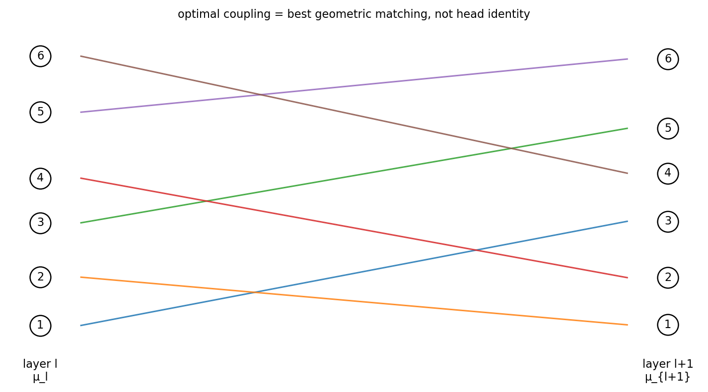
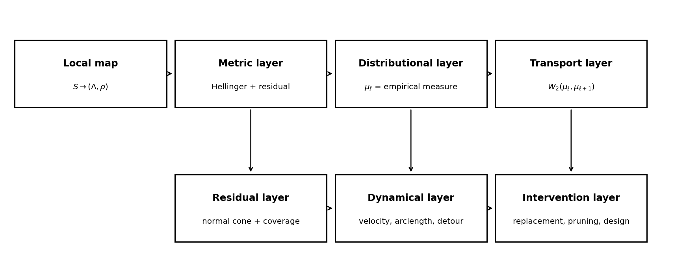
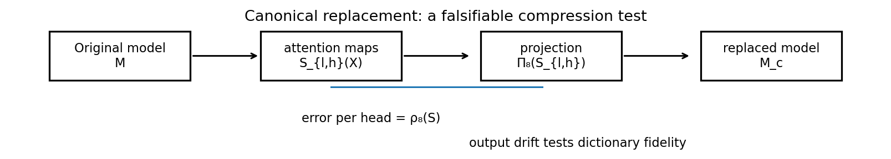

# Chapter 7: Hellinger geometry, transport, training paths, and canonical replacement

[Library index](../README.md) · [Source and transcription policy](../SOURCE.md) · [Previous pages: PDF 268–276](0268-0276-ch07-experiments-dictionary-and-reporting.md#pdf-0276)

> Editorial note: Full transcription of PDF 277–284 (printed pages 241–248), completing §7.38 and Chapter 7. Figures 7.16–7.18 are extracted directly from the provided PDF. Definitions, propositions, conjectures, proofs, and unnumbered mathematical displays are preserved. The statement that every atom is a vertex in Proposition 7.44, the product bound in Proposition 7.45, and the differentiability claim in §7.39.1 are transcribed as printed; they require qualifications given separately in [note 70](../notes/70-training-paths-and-coupling-observables.md) and [note 71](../notes/71-canonical-replacement-fidelity-and-drift.md). No claim here is a newly run Xiigen experiment.

## PDF 277 · Book 241

#### 7.38.1 Hellinger geometry on regime weights

The regime vector $\Lambda\in\Delta_8$ is a probability distribution on the eight canonical regimes. The intrinsic information geometry of the open simplex is the Fisher geometry. In coordinates, the Fisher metric weights perturbations by the inverse of the current mass. Hence small changes near a vertex are amplified: moving a tiny amount of mass into a previously absent regime is more meaningful than moving the same amount between two already large coordinates.

For empirical signatures, however, exact zeros occur frequently. The Fisher tensor is then inconvenient at the boundary. The robust closed simplex replacement is the **Hellinger distance**

$$
d_H(\Lambda,\Lambda')
=\frac1{\sqrt2}\bigl\|\sqrt\Lambda-\sqrt{\Lambda'}\bigr\|_2.
$$

It is finite on all of $\Delta_8$, agrees infinitesimally with Fisher geometry up to scale in the relative interior, and remains meaningful at the boundary.

**Definition 7.36 (Hellinger-residual signature metric).** For $\alpha>0$, define

$$
d_\Sigma^{(\alpha)}
\bigl((\Lambda,\rho),(\Lambda',\rho')\bigr)
=\left(d_H(\Lambda,\Lambda')^2
+\alpha^2|\rho-\rho'|^2\right)^{1/2}.
$$

The parameter $\alpha$ fixes the relative cost of moving in residual mass versus moving in canonical regime mass. It should be declared in empirical studies. The quadratic form is preferable for Wasserstein-2 energies because it separates regime displacement and residual displacement without introducing a cross term.

**Remark 7.37 (Fisher versus Hellinger).** The Fisher geodesic distance corresponds to the arc distance after the square-root embedding of the simplex into the positive orthant of the sphere. The Hellinger distance is the corresponding chord distance. Both induce the same local geometry in the interior; Hellinger is the safer default for the closed simplex encountered in real signatures.

#### 7.38.2 Layer geographies as Wasserstein states

For an input $X$, layer $\ell$, and $H$ heads, the layer geography is

$$
\mu_\ell(X)=\frac1H\sum_{h=1}^{H}
\delta_{\Sigma_{\ell,h}(X)}
\in\mathcal P(\Sigma_R).
$$

Equipping $\Sigma_R$ with $d_\Sigma^{(\alpha)}$ makes the sequence $\mu_1,\ldots,\mu_L$ a discrete curve in Wasserstein space.

**Definition 7.38 (Wasserstein layer velocity and energy).** The layer velocity is

$$
v_\ell(X)=W_2\bigl(\mu_\ell(X),\mu_{\ell+1}(X)\bigr),
$$

and the geography energy of the network on input $X$ is

$$
\mathcal E_{\mathrm{geo}}(X)
=\sum_{\ell=1}^{L-1}
W_2\bigl(\mu_\ell(X),\mu_{\ell+1}(X)\bigr)^2.
$$

The velocity profile identifies transition layers. A layer with large $v_\ell$ changes the internal geography sharply; a layer with small $v_\ell$ preserves the signature distribution of the previous layer. The energy measures total internal reorganisation across depth.

## PDF 278 · Book 242

**Proposition 7.39 (Discrete energy lower bound).** *For every input $X$,*

$$
\mathcal E_{\mathrm{geo}}(X)
\ge\frac1{L-1}
W_2\bigl(\mu_1(X),\mu_L(X)\bigr)^2.
$$

*Proof.* By the triangle inequality,

$$
W_2(\mu_1,\mu_L)
\le\sum_{\ell=1}^{L-1}W_2(\mu_\ell,\mu_{\ell+1}).
$$

Cauchy's inequality gives

$$
\left(\sum_{\ell=1}^{L-1}v_\ell\right)^2
\le(L-1)\sum_{\ell=1}^{L-1}v_\ell^2.
$$

Combining the two inequalities yields the result. $\square$

**Definition 7.40 (Velocity uniformity index).** If $\sum_\ell v_\ell>0$, define

$$
U_{\mathrm{geo}}(X)
=\frac{\left(\sum_{\ell=1}^{L-1}v_\ell\right)^2}
{(L-1)\sum_{\ell=1}^{L-1}v_\ell^2}.
$$

Then $0<U_{\mathrm{geo}}\le1$. Values near one indicate that geography changes evenly across layers; small values indicate that a few layers carry most of the transition.

#### 7.38.3 Optimal couplings and pseudo-identities

The optimal coupling between $\mu_\ell$ and $\mu_{\ell+1}$ gives the best geometric matching between the heads of two consecutive layers. For equal-weight empirical measures with the same number of heads, the coupling reduces to an assignment problem: find the permutation of layer $\ell+1$ heads that minimises the total signature cost.

This matching is not a canonical identity of heads. It is a geometry-dependent pseudo-identity. Its value is diagnostic: it tells us which head in the next layer is closest in signature space to a head in the previous layer, without pretending that head identity is preserved by the Transformer block.

#### 7.38.4 Transition observables

Let $\pi_\ell$ be an optimal coupling between $\mu_\ell$ and $\mu_{\ell+1}$. Three derived observables will be used later.

First, the regime translocation vector is

$$
\Phi_\Lambda^{(\ell)}
=\int(\Lambda'-\Lambda)\,
d\pi_\ell\bigl((\Lambda,\rho),(\Lambda',\rho')\bigr).
$$

It records which canonical coordinates gain or lose mass across the layer transition.

Second, the residual flow is

$$
\Phi_\rho^{(\ell)}=\int(\rho'-\rho)\,d\pi_\ell.
$$

Positive residual flow means that the next layer is less explained by the canonical dictionary; negative residual flow means that the layer moves closer to the canonical hull.

Third, the spread change compares the dispersion of $\mu_\ell$ and $\mu_{\ell+1}$ around their barycentres. Increasing spread indicates diversification of head roles; decreasing spread indicates crowding or collapse.

## PDF 279 · Book 243

**Figure 7.16:** Optimal coupling between empirical layer geographies. The matching is not a conserved head identity; it is the best geometric transport plan between two populations of signatures.

### 7.39 Training-path geometry in signature space

Layer drift compares consecutive layers at a fixed checkpoint. Training adds a second direction: the same head or layer can be followed across checkpoints. The geometry introduced above gives a way to separate straight specialisation from exploratory detours.

For a fixed input, layer, and head, let

$$
\Sigma(t_0),\Sigma(t_1),\ldots,\Sigma(t_T)
$$

be the signature observed along training checkpoints.

**Definition 7.41 (Signature arclength and geodetic deviation).** The training arclength of the head is

$$
A=\sum_{k=0}^{T-1}
d_\Sigma^{(\alpha)}\bigl(\Sigma(t_k),\Sigma(t_{k+1})\bigr).
$$

The direct displacement is

$$
D=d_\Sigma^{(\alpha)}\bigl(\Sigma(t_0),\Sigma(t_T)\bigr).
$$

The geodetic deviation is

$$
\delta_{\mathrm{geo}}=A-D\ge0.
$$

A small geodetic deviation means that the head moves almost directly to its final role. A large deviation means that the head explores signature space before stabilising. Two heads can end at nearly the same signature and still have very different histories.

**Definition 7.42 (Signature velocity in training).** For consecutive checkpoints, define

$$
\dot\Sigma(t_k)\approx
\frac{d_\Sigma^{(\alpha)}\bigl(\Sigma(t_k),\Sigma(t_{k+1})\bigr)}
{t_{k+1}-t_k}.
$$

At the layer level, replace individual signatures by $\mu_\ell(t_k)$ and use $W_2$ instead of $d_\Sigma$.

## PDF 280 · Book 244

**Figure 7.17:** The XIA stack. Local signatures become metric objects, empirical measures, transport curves, dynamical trajectories, and finally intervention targets.

> Editorial transcription of text inside the figure: **Local map** — $S\to(\Lambda,\rho)$; **Metric layer** — Hellinger + residual; **Distributional layer** — $\mu_\ell=$ empirical measure; **Transport layer** — $W_2(\mu_\ell,\mu_{\ell+1})$; **Residual layer** — normal cone + coverage; **Dynamical layer** — velocity, arclength, detour; **Intervention layer** — replacement, pruning, design.

The combination of velocity and crowding distinguishes different kinds of redundancy. A crowded head with high velocity may still be exploring; a crowded head with low velocity and low functional marginality is a strong candidate for redundant consolidation.

#### 7.39.1 Gradient-flow interpretation

The parameter dynamics is

$$
\dot\theta(t)=-\nabla_\theta\mathcal L(\theta(t)).
$$

The signature is the composite map

$$
\theta\longmapsto L(\theta)\longmapsto
S(\theta)\longmapsto\Sigma_8(S(\theta)).
$$

At points where the active face of the canonical projection is stable, this composite is differentiable and

$$
\dot\Sigma
=D\Sigma_8(S)\,D\operatorname{softmax}(L)\,DL(\theta)\,\dot\theta.
$$

At face boundaries the flow is still continuous at the level of projection and residual, but the active explanation can change. Thus training in signature space is a hybrid process: smooth motion inside faces and event-like changes at face boundaries.

This is the mathematical basis for the later training-dynamics chapter. The present chapter records the state space and the observables; the full analysis of $\dot\Sigma$, early escape, and finite-noise selection belongs to the training chapter.

### 7.40 Canonical replacement and dictionary fidelity

The residual is not only a descriptive quantity. It defines an intervention. Given a trained model, replace every attention map by its canonical projection. The resulting model tests whether the dictionary is merely geometrically descriptive or also behaviourally faithful.

**Definition 7.43 (Canonical replacement).** For every input $X$, layer $\ell$, and head $h$, define

$$
\widehat S_{\ell,h}(X)=\Pi_8(S_{\ell,h}(X)).
$$

The canonically replaced model $M_c$ is obtained from $M$ by replacing $S_{\ell,h}(X)$ with $\widehat S_{\ell,h}(X)$ in every attention head, leaving all other components unchanged.

## PDF 281 · Book 245

The replacement is deterministic, input-dependent, and local at the head level. It is not vertex pruning: the replacement is the nearest barycentric canonical mixture, not a fixed atom.

**Proposition 7.44 (Vertex pruning as a special case).** *Replacing a head by a fixed canonical atom $D_a\in\mathcal D_8(n)$ is a special case of forcing the head to a constant vertex of the canonical hull. Canonical replacement is the strictly richer operation that replaces the head by the nearest point of the entire hull $K_8(n)$.*

*Proof.* A fixed atom $D_a$ is a vertex of $K_8(n)$. Vertex pruning forces $S_{\ell,h}(X)\equiv D_a$ for all inputs. Canonical replacement uses $\Pi_8(S_{\ell,h}(X))$, which may be any point of the hull and may vary with the input. Hence vertex pruning is the constant-vertex restriction of the canonical-replacement idea. $\square$

**Proposition 7.45 (Safe output-drift bound).** *Assume that, along the interpolation between the original model and the canonically replaced model, the layerwise propagation of perturbations is bounded by constants $J_1(X),\ldots,J_L(X)$. Then there are head-output Lipschitz constants $a_{\ell,h}(X)$ such that*

$$
\|M(X)-M_c(X)\|_F
\le
\left(\prod_{r=1}^{L}J_r(X)\right)
\sum_{\ell=1}^{L}\sum_{h=1}^{H}
a_{\ell,h}(X)\rho_8\bigl(S_{\ell,h}(X)\bigr).
$$

*If, in addition, the propagated head residuals satisfy a uniform incoherence or quasi-orthogonality condition, the double sum can be replaced by the corresponding weighted $\ell^2$ norm up to the incoherence constant.*

*Proof.* For each head,

$$
S_{\ell,h}-\widehat S_{\ell,h}=R_8(S_{\ell,h}),
\qquad
\|R_8(S_{\ell,h})\|_F=\rho_8(S_{\ell,h}).
$$

The local change in the head output is bounded by a Lipschitz constant $a_{\ell,h}$ times this residual. The triangle inequality gives the safe $\ell^1$ aggregation over heads and layers. Propagation through later blocks multiplies by the product of the layer perturbation bounds. If the propagated head residuals are incoherent, the parallelogram-type or Khintchine-type estimate for sums of nearly orthogonal vectors gives the refined $\ell^2$ aggregation. $\square$

The safe bound is intentionally conservative. It is the correct theorem without hidden independence assumptions. The refined $\ell^2$ bound is often more realistic empirically, but it is conditional.

**Conjecture 7.46 (Coverage-degradation correlation).** *For a family of trained models on a fixed task, the output drift and the task-metric degradation under canonical replacement are decreasing functions, in trend, of the dictionary coverage of their attention maps. Equivalently, models whose attention geography is well covered by $K_8(n)$ should be more robust to canonical replacement.*

This conjecture is falsifiable. If high coverage does not predict low replacement drift, then coverage is not measuring the kind of dictionary adequacy relevant for computation. If the conjecture holds, canonical replacement becomes the most direct empirical validation of the signature framework.

## PDF 282 · Book 246

**Figure 7.18:** Canonical replacement. Each attention map is replaced by its canonical projection. The resulting drift tests whether the dictionary is not only descriptive but behaviourally faithful.

> Editorial transcription of text inside the figure: **Canonical replacement: a falsifiable compression test**; **Original model M**; **attention maps $S_{\ell,h}(X)$**; **projection $\Pi_8(S_{\ell,h})$**; **replaced model $M_c$**; “error per head = $\rho_8(S)$”; “output drift tests dictionary fidelity”.

#### 7.40.1 Compression and fidelity

The signature representation is a lossy compression. If only $\Pi_8(S)$ and $\rho_8(S)$ are retained, the residual direction is lost. The reconstruction error from the canonical component alone is exactly $\rho_8(S)$. A simple fidelity score is

$$
\eta(S)=1-\frac{\rho_8(S)}{\|S\|_F}.
$$

High fidelity means that the canonical projection is a good reconstruction of the head. Low fidelity means either that the head is non-canonical or that the dictionary should be expanded.

The residual-penalised fine-tuning loss

$$
\mathcal L_{\mathrm{task}}
+\beta\sum_{\ell,h}\mathbb E_X
\rho_8\bigl(S_{\ell,h}(X)\bigr)^2
$$

is therefore a natural design idea. It is not used as a theorem in this chapter; it belongs to the later design and empirical-validation chapters.

### 7.41 Open programme: mean-field geography

The layer geography $\mu_\ell^{(H)}$ depends on the number of heads. This raises a natural question: as $H\to\infty$, does the empirical signature distribution converge to a deterministic task-dependent limit?

The question is not answered in this chapter. It is recorded as a research programme because, if true, it would turn attention geography from a model-specific diagnostic into a task-canonical object.

Let

$$
\mu_\ell^{(H)}(X)
=\frac1H\sum_{h=1}^{H}\delta_{\Sigma_{\ell,h}(X)}.
$$

Assume all residuals lie in $[0,R]$, so signatures lie in the compact space $\Sigma_R=\Delta_8\times[0,R]$.

**Proposition 7.47 (Precompactness of head-width geographies).** *For fixed input $X$ and layer $\ell$, the family $\{\mu_\ell^{(H)}(X)\}_{H\ge1}\subset\mathcal P(\Sigma_R)$ is precompact in $W_2$. Hence every sequence $H_k\to\infty$ has a subsequence for which $\mu_\ell^{(H_k)}(X)$ converges in $W_2$.*

*Proof.* The space $\Sigma_R$ is compact. On a compact metric space, every family of probability measures is tight, and $\mathcal P(\Sigma_R)$ is compact for weak convergence. Since the metric is bounded on $\Sigma_R$, weak convergence and $W_2$ convergence are equivalent. $\square$

## PDF 283 · Book 247

**Conjecture 7.48 (Mean-field limit of attention geography).** *For a fixed task $\mathcal T$, architecture family, and suitable mean-field parametrisation of multi-head attention, there exists a deterministic measure-valued map*

$$
\mu_\ell^{\infty,\mathcal T}:X\mapsto\mathcal P(\Sigma_R)
$$

*such that*

$$
\mu_\ell^{(H)}(X)\to\mu_\ell^{\infty,\mathcal T}(X)
$$

*in $W_2$, uniformly over layers and over compact input families.*

If the conjecture holds, one may define a task-canonical fingerprint

$$
\bar\mu_{\mathcal T}^{\infty}
=\mathbb E_{X\sim\mathcal T}
\frac1L\sum_{\ell=1}^{L}\mu_\ell^{\infty,\mathcal T}(X),
$$

and use distances between such fingerprints as intrinsic distances between tasks at the level of internal attention geography.

A possible intrinsic complexity of a task is the dimension or effective dimension of the support of $\bar\mu_{\mathcal T}^{\infty}$ in signature space. A task whose fingerprint is concentrated on a low-dimensional region uses few canonical mechanisms; a task whose fingerprint occupies a large region of $\Sigma_R$ uses a richer internal geography.

This material is not needed for the results of the chapter. It is a forward pointer for later empirical work and possibly for a separate mean-field theory of attention geography.

### 7.42 A rejected direction: sheaves over the input space

A tempting idea is to treat the input space as a base space, attach signatures as stalks, and use sheaf cohomology to measure global obstructions to coherent attention geography. This idea is not used in this book. The failure is structural rather than technical.

First, there is no canonical topology on the input space in the sequential-token setting considered here. An embedding topology is model-dependent. A discrete topology trivialises sheaf cohomology. A semantic topology depends on arbitrary modelling choices and thresholds. Any cohomology computed from such a topology would be a property of the chosen topology, not a model-invariant property of the task.

Second, the signature map is deterministic. A trained model assigns to each input a single signature value or a single layer geography. There is no local-to-global gluing problem: the global section is already given by the model.

Third, the relevant gauge invariances are not naturally represented by a non-trivial coefficient sheaf over the input space. Head permutation invariance is already captured by empirical measures. The linear gauge of query-key factorisations is global and belongs to the parameterisation of operators, not to a sheaf over inputs.

**Remark 7.49 (What replaces sheaves here).** The legitimate question motivating the sheaf idea is how signatures vary with the input. In the present setting this is better captured by the map

$$
X\longmapsto\mu_\ell(X)
$$

into Wasserstein space. Regularity, stability, and variation over the input distribution are metric questions about this map, not cohomological questions.

## PDF 284 · Book 248

Sheaf-theoretic methods may be natural for images, graphs, or manifolds, where the input has a canonical topology or incidence structure. They are not the right tool for the token-sequence attention geography of this chapter.

### 7.43 Concluding Remarks

The definitive role of the chapter is to replace the hard-pattern version of global attention analysis by a stable mesoscopic state space. A head is represented by a signature, a layer by a distribution of signatures, and a model by a depth-indexed geography of such distributions. Training moves this geography through the gradient flow of the parameters.

This is the XIA point of view: explainable internal attention geometry. It gives a middle-level geometry in which internal computation becomes measurable without reducing the model either to individual parameters or to final outputs alone.

The subsequent non-incremental chapters should be rebuilt around the same replacements: patterns become canonical signatures; pattern transitions become Wasserstein signature transport; canonicalisation becomes projection and residual convergence; redundant heads become crowding, marginality, and replacement drift. The information-flow chapter should study re-extraction across layers, the training-dynamics chapter should study signature velocity and early escape, the emergence chapter should study projected escape signatures, and the redundancy and design chapters should use coverage, residual penalties, and controlled growth of signature geography.

With this bridge in place, the incremental Transformer can be presented as an architectural response to the same diagnosis: standard Transformers over-generate heads and produce redundant geographies, whereas an incremental architecture should grow the geography only when it increases coverage, reduces useful residual, or improves task function.

---

[Continue: PDF 285–292, Chapter 8](0285-0292-ch08-reextraction-and-residual-algebra.md#pdf-0285)

