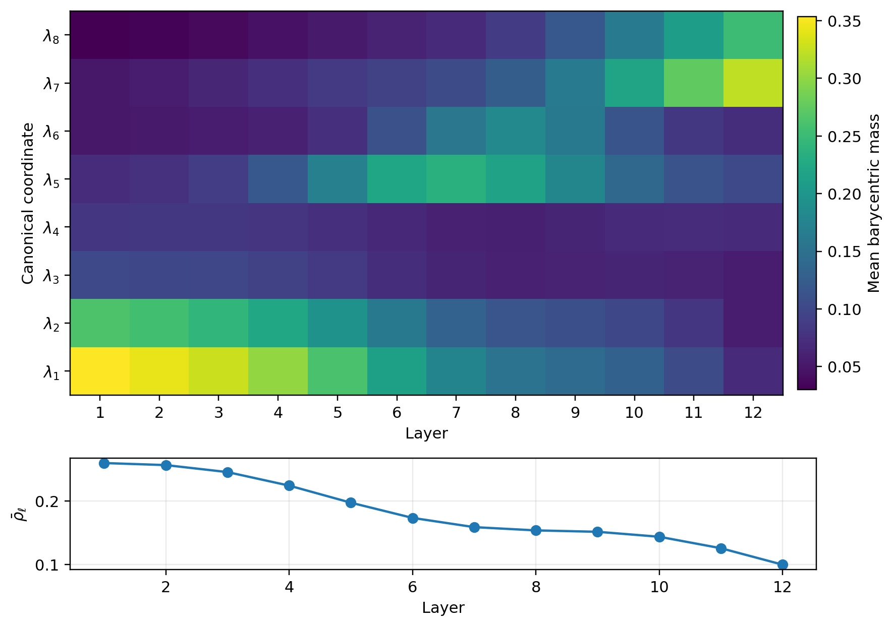
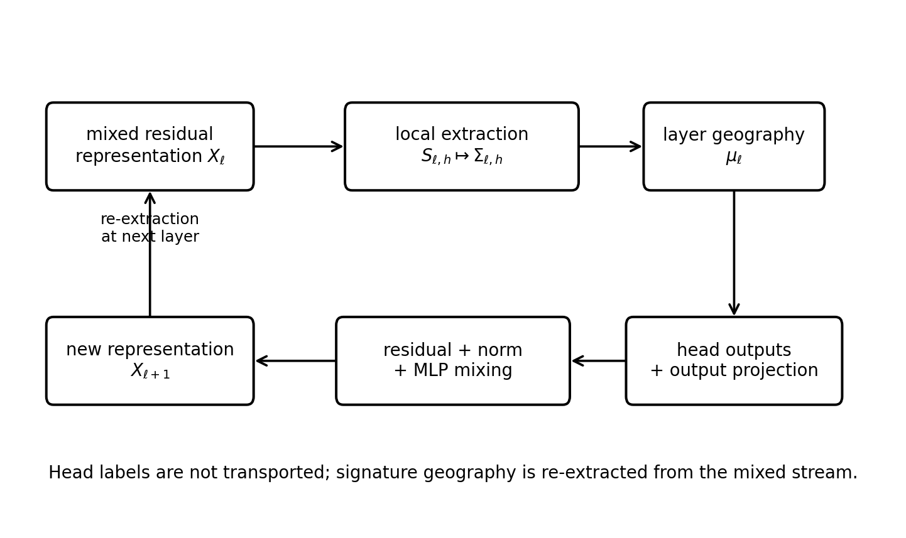
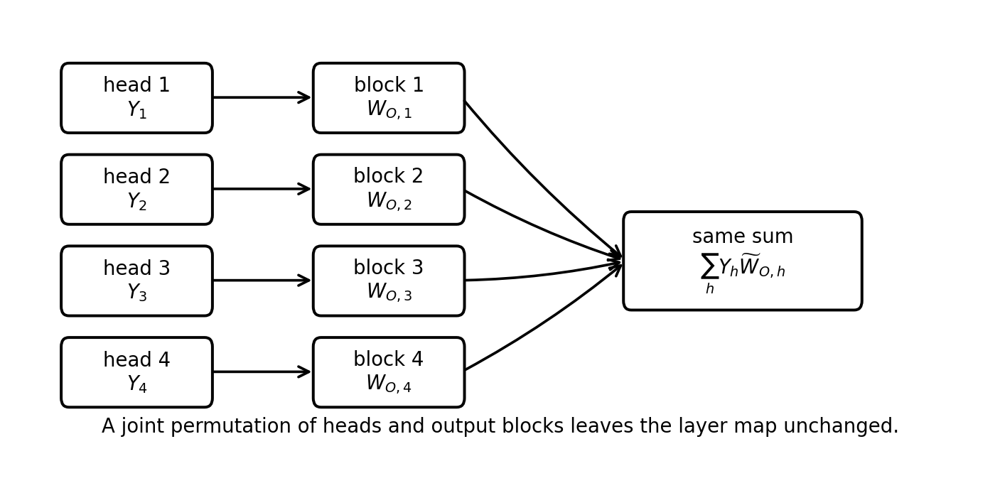
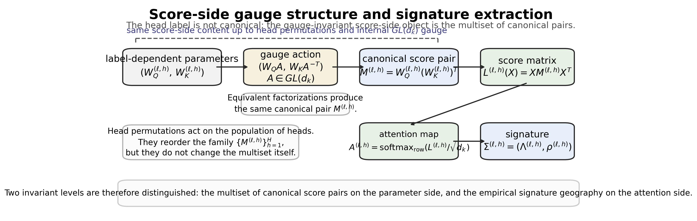

# Chapter 8: signature re-extraction, recoverability, and residual-block algebra

[Library index](../README.md) · [Source and transcription policy](../SOURCE.md) · [Previous pages: PDF 277–284](0277-0284-ch07-metric-geometry-and-canonical-replacement.md#pdf-0284) · [Next pages: PDF 293–300](0293-0300-ch08-reextraction-cost-transport-and-entropy.md#pdf-0293)

> Editorial note: Full transcription of PDF 285–292 (printed pages 249–256), with Figures 8.1–8.4, the unnumbered comparison table, all numbered statements, proofs, and unnumbered displays. The author's revision of earlier channel-destruction language is preserved. The rank cap, permutation notation, and direct-product gauge formula are reproduced as printed; editorial qualifications are in [note 73](../notes/73-reextraction-loop-and-head-recoverability.md) and [note 74](../notes/74-residual-algebra-rank-and-score-gauge.md). Figure 8.4 retains overlapping text present in the source image.

## PDF 285 · Book 249

## Chapter 8. Signature Re-Extraction and Global Information Flow

Chapter 7 introduced the global state variables attached to a trained Transformer layer: for each head $h$ at layer $\ell$, the local attention map $S_{\ell,h}(X)$ determines a canonical signature

$$
\Sigma_{\ell,h}(X)=\bigl(\Lambda_{\ell,h}(X),\rho_{\ell,h}(X)\bigr),
$$

where $\Lambda_{\ell,h}(X)$ is the barycentric coordinate vector in the canonical dictionary and $\rho_{\ell,h}(X)$ is the residual distance from the canonical hull. The empirical layer geography

$$
\mu_\ell(X)=\frac1H\sum_{h=1}^{H}\delta_{\Sigma_{\ell,h}(X)}
$$

was then used to describe the distribution of local behaviours across heads and layers.

The present chapter studies the next question: how does information move from layer to layer once the relevant observables are those geographies rather than the implementation labels of individual heads? The main claim is the following.

> Information does not flow through a Transformer as a preserved identity of the heads. Information flows as a mixed residual representation from which each layer re-extracts a new signature geography.

The statement has three consequences. First, the head index is not a canonical dynamical coordinate. The multi-head block is equivariant under a joint permutation of heads and output blocks, so the label of a head is merely a parametrisation device. Second, the natural inter-layer observable is not a head-to-head correspondence but a transport between empirical measures $\mu_\ell$ and $\mu_{\ell+1}$. Third, the layer-wise observables introduced in Chapter 7 — cone index, directional activation, logit margins, entropy, and canonical residual — must be read as a *compatibility profile* associated with re-extraction, not as a rigid causal chain.

The older Chapter 8 already contained several correct and useful components: the permutation symmetry argument, the generic recoverability of concatenated head outputs in the canonical dimensional regime, the cone–SVD connection, the margin–entropy estimate, and the intuition that every layer must reconstruct its directional structure from a mixed representation. Those elements are preserved here, but their logical role is altered. The present formulation avoids hard pattern labels, removes the claim that static and dynamic catalogues coincide in a literal sense, and replaces channel-destruction language by the more precise notion of head-gauge non-identifiability.

## PDF 286 · Book 250

A compact map of the chapter is therefore as follows.

- Section 8.1 recalls the objects inherited from Chapter 7 and formulates the layer re-extraction loop.
- Section 8.2 studies permutation symmetry and generic linear recoverability, showing that the algebraic issue is non-identifiability rather than absolute linear destruction.
- Section 8.5 introduces inter-layer transport in signature space and the associated transition observables.
- Section 8.7 and Section 8.8 analyse cone alignment, singular concentration, and entropy control.
- Section 8.10 organises those quantities into a compatibility profile and identifies transition layers.
- Section 8.14 presents small synthetic experiments and explanatory figures.
- Section 8.19 draws the line to redundancy, design, and the training-time dynamics of Chapter 11.

The chapter is deliberately kept complementary to Chapter 7. No attempt is made to reconstruct the canonical projection machinery, the dictionary expansion programme, or the mean-field discussion. Those belong to the previous chapter. The focus here is exclusively on how a trained layer takes a mixed representation as input and produces a new empirical distribution of signatures at the next depth.

### 8.1 From signature geography to information flow

#### 8.1.1 Objects inherited from the global analysis

For a fixed input $X$, each head $h$ at layer $\ell$ determines a score matrix $L_{\ell,h}(X)$, an attention matrix $A_{\ell,h}(X)=\operatorname{softmax}(L_{\ell,h}(X))$, and a local canonical signature

$$
\Sigma_{\ell,h}(X)=\bigl(\Lambda_{\ell,h}(X),\rho_{\ell,h}(X)\bigr)
\in\Delta_8\times\mathbb R_{\ge0}.
$$

The barycentric vector $\Lambda_{\ell,h}(X)$ records the canonical decomposition, while $\rho_{\ell,h}(X)$ measures the non-canonical residual. The layer geography is the empirical probability measure

$$
\mu_\ell(X)=\frac1H\sum_{h=1}^{H}\delta_{\Sigma_{\ell,h}(X)}.
$$

The default metric on signature space will be denoted by

$$
d_\Sigma\bigl((\Lambda,\rho),(\Lambda',\rho')\bigr)
=\sqrt{d_H(\Lambda,\Lambda')^2+\alpha^2|\rho-\rho'|^2},
$$

where $d_H$ is the Hellinger distance on the simplex and $\alpha>0$ is a balancing constant. The inter-layer drift is then quantified by the Wasserstein distance

$$
v_\ell(X)=W_2\bigl(\mu_\ell(X),\mu_{\ell+1}(X)\bigr).
$$

## PDF 287 · Book 251

**Figure 8.1:** Synthetic layer geography used throughout the explanatory experiments.

*The top panel shows the barycentric mass attached to the eight canonical coordinates across layers; the lower panel shows the mean residual $\bar\rho_\ell$. The geometric role of the chapter is to explain why the next layer is best viewed as re-extracting a new signature geography rather than propagating labelled heads.*

#### 8.1.2 The re-extraction loop

Let $X_\ell$ denote the residual-stream representation entering layer $\ell$. A complete layer executes the following operations:

$$
\begin{aligned}
X_\ell
&\longmapsto\{L_{\ell,h}(X_\ell),A_{\ell,h}(X_\ell),\Sigma_{\ell,h}(X_\ell)\}_{h=1}^{H}\\
&\longmapsto\{Y_{\ell,h}(X_\ell)\}_{h=1}^{H}\\
&\longmapsto Y_\ell(X_\ell)=\sum_{h=1}^{H}Y_{\ell,h}(X_\ell)\widetilde W_{O,h}\\
&\longmapsto X_{\ell+1}=\operatorname{Block}_\ell(X_\ell),
\end{aligned}
$$

where $\operatorname{Block}_\ell$ includes residual addition, normalisation, and the position-wise feed-forward map. The key point is that the next layer does not receive a canonically separated list of heads. Instead it receives $X_{\ell+1}$, a mixed representation from which a fresh family of score matrices and signatures is extracted.

## PDF 288 · Book 252

#### 8.1.3 Transition observables

Given an optimal coupling $\pi_\ell\in\Pi(\mu_\ell,\mu_{\ell+1})$, three summary observables will be useful:

$$
\begin{aligned}
\Phi_\ell^\Lambda&=\int\|\Lambda-\Lambda'\|_2\,d\pi_\ell,\\
\Phi_\ell^\rho&=\int|\rho-\rho'|\,d\pi_\ell,\\
\Delta\operatorname{Spread}_\ell&=\operatorname{Spread}(\mu_{\ell+1})-\operatorname{Spread}(\mu_\ell).
\end{aligned}
$$

The first measures barycentric relocation, the second measures residual change, and the third records concentration or diversification of the signature cloud.

**Remark 8.1.** A transport-based matching between two layers is auxiliary rather than canonical. It provides a best geometric correspondence under the chosen metric, but it does not reintroduce a privileged head identity.

### 8.2 Head-gauge symmetry and parametrisation non-identifiability

#### 8.2.1 Permutation symmetry

Consider a multi-head block with head outputs $Y_{\ell,h}(X)\in\mathbb R^{T\times d_v}$ and output blocks $\widetilde W_{O,h}\in\mathbb R^{d_v\times d_{\mathrm{model}}}$. The mixed multi-head output can be written as

$$
\operatorname{MHA}_\ell(X)=\sum_{h=1}^{H}Y_{\ell,h}(X)\widetilde W_{O,h}.
$$

If $\sigma$ is any permutation of $\{1,\ldots,H\}$ and the pair $(Y_{\ell,h},\widetilde W_{O,h})$ is replaced by $(Y_{\ell,\sigma(h)},\widetilde W_{O,\sigma(h)})$, the sum remains unchanged. The same statement extends to the complete layer block because the position-wise map acts only on the mixed tensor.

**Proposition 8.2 (Permutation symmetry of the multi-head block).** For every permutation $\sigma\in\mathfrak S_H$, the transformation

$$
(Y_{\ell,1},\ldots,Y_{\ell,H};\widetilde W_{O,1},\ldots,\widetilde W_{O,H})
\mapsto
(Y_{\ell,\sigma(1)},\ldots,Y_{\ell,\sigma(H)};
\widetilde W_{O,\sigma(1)},\ldots,\widetilde W_{O,\sigma(H)})
$$

leaves the input-output map of the layer unchanged.

*Proof.* The proof is immediate from the commutativity of the finite sum defining $\operatorname{MHA}_\ell(X)$. $\square$

The proposition shows that the head index is a gauge variable. It can be used for bookkeeping and visualisation, but it cannot be treated as a stable functional coordinate of the network.

#### 8.2.2 Generic linear recoverability

The loss of head identity should not be described as linear destruction of information. In the canonical dimensional regime $Hd_v=d_{\mathrm{model}}$, let

$$
\mathcal Y_\ell(X)=
\bigl[Y_{\ell,1}(X)\mid\cdots\mid Y_{\ell,H}(X)\bigr]\in\mathbb R^{T\times Hd_v}
$$

be the concatenated head output and let $W_O\in\mathbb R^{Hd_v\times d_{\mathrm{model}}}$ be the block output matrix. Then $\operatorname{MHA}_\ell(X)=\mathcal Y_\ell(X)W_O$.

## PDF 289 · Book 253

**Proposition 8.3 (Generic recoverability in the canonical regime).** If $Hd_v=d_{\mathrm{model}}$ and $W_O$ is invertible, then the concatenated head output $\mathcal Y_\ell(X)$ is uniquely recoverable from $\operatorname{MHA}_\ell(X)$. More generally, recoverability holds on a Zariski-open dense subset of output matrices.

*Proof.* If $W_O$ is invertible, then $\mathcal Y_\ell(X)=\operatorname{MHA}_\ell(X)W_O^{-1}$. The generic statement follows because invertible matrices form a dense Zariski-open set inside $\mathbb R^{Hd_v\times Hd_v}$. $\square$

Thus no universal theorem of linear information loss can be extracted from the algebra of the output projection alone. The correct conclusion is more subtle: even if the concatenated head output is linearly recoverable, the architecture does not preserve a canonical labelling of heads across layers, because the next block only receives the mixed representation. The non-identifiability is therefore structural, not merely algebraic.

#### 8.2.3 Consequences for layer-wise analysis

A layer-to-layer map of the form $h\mapsto h'$ has no invariant meaning. In contrast, the empirical measure $\mu_\ell$ is invariant under head permutations. This makes $\mu_\ell$ the natural object for inter-layer flow analysis. The geometry of the chapter must therefore be understood at the level of populations of signatures rather than labelled trajectories of individual heads.

### 8.3 Algebraic form of the residual block

The re-extraction picture rests on a simple algebraic fact: a Transformer block passes forward a mixed residual representation, not a canonical list of previous head channels. This section records the block notation in a form that can be cited later.

Let $X\in\mathbb R^{n\times d_{\mathrm{model}}}$ be the layer input. For head $h$, write

$$
Q^{(h)}=XW_Q^{(h)},\qquad
K^{(h)}=XW_K^{(h)},\qquad
V^{(h)}=XW_V^{(h)},
$$

$$
L^{(h)}=Q^{(h)}(K^{(h)})^\top,\qquad
S^{(h)}=\operatorname{softmax}_{\mathrm{row}}\!\left(\frac{L^{(h)}}{\sqrt{d_k}}\right),
\qquad Y^{(h)}=S^{(h)}V^{(h)}.
$$

The multi-head output is

$$
Y=\operatorname{MHA}(X)=\operatorname{Concat}_{h=1}^{H}(Y^{(h)})W_O.
$$

Equivalently, if $W_O$ is written in row blocks $\widetilde W_{O,h}$, then

$$
Y=\sum_{h=1}^{H}Y^{(h)}\widetilde W_{O,h}.
$$

The residual block has the schematic form

$$
X^+=\mathcal B(X)=
\mathcal N_2\!\left(\mathcal N_1(X+Y)
+\operatorname{MLP}\bigl(\mathcal N_1(X+Y)\bigr)\right),
$$

where $\mathcal N_1,\mathcal N_2$ denote the normalisation convention used by the architecture. The exact pre-LN or post-LN placement is not material for the gauge argument. In both cases the next layer receives $X^+$ and not the ordered tuple $(Y^{(1)},\ldots,Y^{(H)})$.

## PDF 290 · Book 254

**Figure 8.2:** The signature re-extraction loop. A mixed residual representation is passed to the next block. Local attention maps and their signatures are extracted again from that representation. Thus the layer geography is regenerated at each depth.

#### 8.3.1 Dimension count and non-identifiability

In the usual BERT-like regime $Hd_v=d_{\mathrm{model}}$, the output projection may be invertible. However, invertibility of $W_O$ is a statement about recoverability of the concatenated matrix in a fixed parametrisation. It does not produce a canonical head labelling. If a permutation matrix $P_\sigma$ acts on the concatenated head axis and $W_O$ is replaced by $P_\sigma W_O$, the input-output function is unchanged. Thus a recovered concatenated representation depends on the chosen gauge.

The point is conceptual but important. Linear recoverability answers the question: can one reconstruct a concatenated coordinate vector from the mixed output if the parametrisation is fixed? Head-gauge non-identifiability answers a different question: is there an invariant meaning to the coordinate called “head $h$” after the block has been composed with the following layers? The answer is negative.

#### 8.3.2 Invariant and non-invariant quantities

The following distinction will be used repeatedly.

| Gauge-dependent quantity | Gauge-invariant quantity |
|---|---|
| The label “head $h$” | The empirical measure $\mu_\ell$ |
| A fixed head-to-head path across layers | The transport distance $W_2(\mu_\ell,\mu_{\ell+1})$ |
| A hard transition matrix after arbitrary labelling | A coupling between empirical signature distributions |
| A single-head narrative without ablation | Population-level signature statistics and causal tests |

This table is the algebraic reason for the chapter’s global viewpoint. Information flow can be described in terms of signature distributions without assigning a privileged identity to heads

## PDF 291 · Book 255

**Figure 8.3:** Head-gauge symmetry. A joint permutation of head outputs and output-projection blocks leaves the sum unchanged. The empirical signature distribution is invariant under this relabelling, while the individual head labels are not.

across depth.

#### 8.3.3 Rank cap of the position-wise map

The position-wise MLP also imposes a simple rank cap on the mixed representation. If the hidden width of the feed-forward map is $d_{\mathrm{ff}}$, then for every input matrix,

$$
\operatorname{rank}\bigl(\operatorname{MLP}(Z)\bigr)\le
\min(n,d_{\mathrm{ff}},d_{\mathrm{model}}).
$$

In the standard BERT-like regime $d_{\mathrm{ff}}\ge d_{\mathrm{model}}$, this reduces to

$$
\operatorname{rank}\bigl(\operatorname{MLP}(Z)\bigr)\le\min(n,d_{\mathrm{model}}).
$$

The sharper form is useful because it separates the usual wide-MLP case from hypothetical thin-feed-forward architectures.

**Remark 8.4 (Genericity versus trained checkpoints).** Statements about generic invertibility of $W_O$ are algebraic statements: full rank holds outside a proper algebraic subset of the parameter space. For an actual trained checkpoint, the relevant verification is empirical and consists in inspecting the singular values of each output projection. Thus genericity explains why invertibility is structurally expected, but a trained model should be checked directly when the claim is used quantitatively.

#### 8.3.4 Canonical QK pairs

Permutation symmetry concerns the labels of heads after the heads have been named. There is also an internal gauge on the score side of each head. For a head with query and key matrices

$$
W_Q^{(\ell,h)}\in\mathbb R^{d_{\mathrm{model}}\times d_k},
\qquad W_K^{(\ell,h)}\in\mathbb R^{d_{\mathrm{model}}\times d_k},
$$

the score matrix depends on the pair only through

$$
M^{(\ell,h)}=W_Q^{(\ell,h)}(W_K^{(\ell,h)})^\top.
$$

## PDF 292 · Book 256

**Figure 8.4:** Score-side gauge structure. Different query–key factorisations can determine the same canonical pair $M=W_QW_K^\top$. The labelled head index is gauge-dependent, while the multiset of canonical pairs and the induced signature geography are the objects used by the chapter.

Indeed,

$$
L^{(\ell,h)}(X)=XW_Q^{(\ell,h)}(W_K^{(\ell,h)})^\top X^\top
=XM^{(\ell,h)}X^\top.
$$

Thus the canonical score-side object is not the labelled pair $(W_Q^{(\ell,h)},W_K^{(\ell,h)})$, but the matrix $M^{(\ell,h)}$.

Let $A\in GL(d_k)$. The transformation

$$
W_Q^{(\ell,h)}\mapsto W_Q^{(\ell,h)}A,\qquad
W_K^{(\ell,h)}\mapsto W_K^{(\ell,h)}A^{-\top}
$$

leaves $M^{(\ell,h)}$ unchanged. Together with head permutations, this gives the score-side gauge group

$$
\mathcal G_{\mathrm{head}}=\mathfrak S_H\times GL(d_k)^H.
$$

**Proposition 8.5 (Canonical score-side head identity).** For a fixed layer $\ell$, the multiset

$$
\mathcal M_\ell=\{M^{(\ell,h)}:h=1,\ldots,H\}
$$

is invariant under the score-side gauge action $\mathfrak S_H\times GL(d_k)^H$. Moreover, the score matrices $\{L^{(\ell,h)}(X)\}_{h=1}^{H}$ depend on the labelled query–key parameters only through this multiset and the input representation $X$.

*Proof.* The invariance under $GL(d_k)$ follows from

$$
W_QA(W_KA^{-\top})^\top
=W_QAA^{-1}W_K^\top=W_QW_K^\top.
$$

The invariance under $\mathfrak S_H$ follows because a permutation only reorders the elements of the multiset. Finally, the displayed identity $L^{(\ell,h)}(X)=XM^{(\ell,h)}X^\top$ shows that the score matrices are determined by the corresponding canonical pairs. $\square$

This proposition supplies the missing bridge between parameter geometry and signature geometry. The head label is non-canonical, but the population of canonical QK-pairs is a well-defined score-side object. The layer geography $\mu_\ell$ is obtained only after those canonical pairs act on the current representation and pass through softmax and canonical projection.

---

[Continue with §8.4 on PDF 293](0293-0300-ch08-reextraction-cost-transport-and-entropy.md#pdf-0293).
