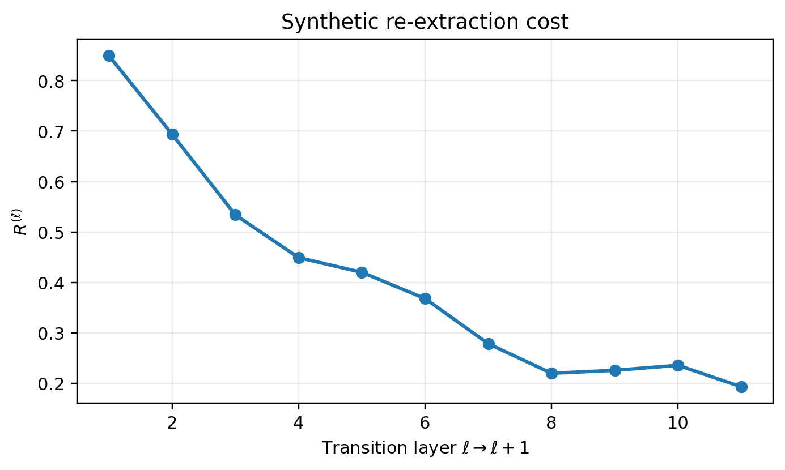
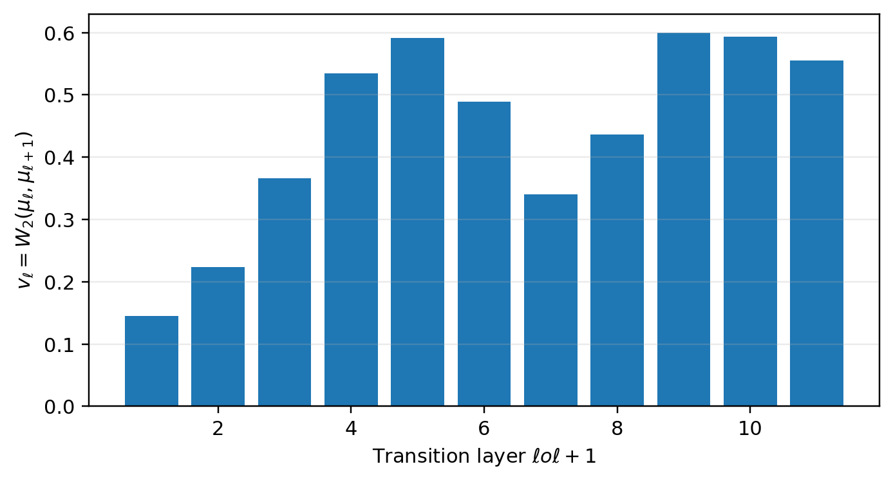
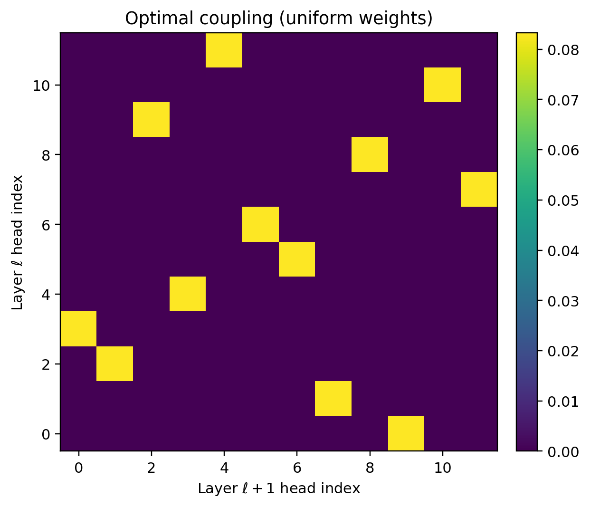
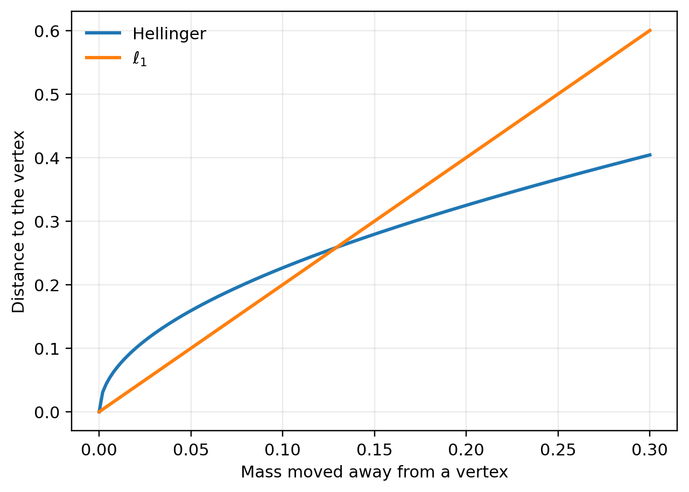
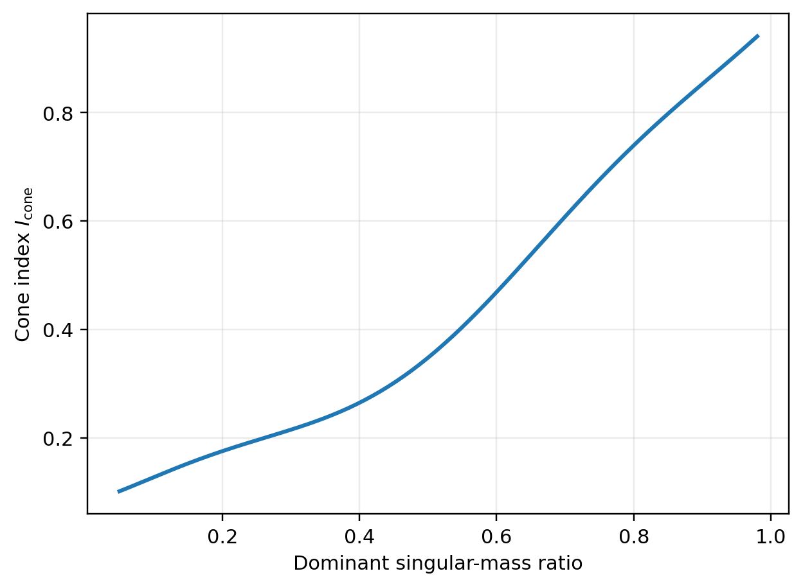
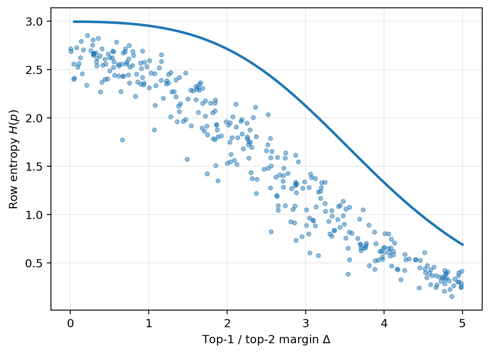

# Chapter 8: re-extraction cost, transport diagnostics, and conditional entropy control

[Library index](../README.md) · [Source and transcription policy](../SOURCE.md) · [Previous pages: PDF 285–292](0285-0292-ch08-reextraction-and-residual-algebra.md#pdf-0292)

> Editorial note: Full transcription of PDF 293–300 (printed pages 257–264), including Figures 8.5–8.10, the unnumbered diagnostic table, objects 8.6–8.16, proofs, and unnumbered formulas. All source claims are retained, including the qualitative cone–SVD proposition and the average-margin sentence. Their limitations are addressed separately in [notes 75–78](../notes/75-reextraction-cost-and-operator-populations.md). The batch ends after the completed §8.10.1 paragraph; no body text after PDF 300 is included.

## PDF 293 · Book 257

### 8.4 The cost of re-extraction

The re-extraction loop can be quantified before passing to signatures. The previous section identified the score-side population

$$
\mathcal M_\ell=\{M^{(\ell,h)}\}_{h=1}^{H}.
$$

If two consecutive layers have very similar populations of canonical QK-pairs, then the next layer partly reuses the score geometry of the previous layer. If the two populations are nearly unrelated, then the next layer performs strong re-extraction.

**Definition 8.6 (Re-extraction cost).** For consecutive layers, define

$$
R^{(\ell)}=
\min_{\sigma\in\mathfrak S_H}
\frac{\displaystyle\sum_{h=1}^{H}
\left\|M^{(\ell+1,\sigma(h))}-M^{(\ell,h)}\right\|_F^2}
{\displaystyle\sum_{h=1}^{H}
\left(\left\|M^{(\ell+1,\sigma(h))}\right\|_F^2+
\left\|M^{(\ell,h)}\right\|_F^2\right)}
$$

whenever the denominator is non-zero, and set $R^{(\ell)}=0$ otherwise.

The minimisation over $\sigma$ removes the arbitrary head labels. The quantity is a score-side analogue of the Wasserstein drift between signature geographies.

**Proposition 8.7 (Basic properties of the re-extraction cost).** The quantity $R^{(\ell)}$ satisfies:

(i) $0\le R^{(\ell)}\le2$. If the numerator is replaced by $\frac12\sum_h\|M^{(\ell+1,\sigma(h))}-M^{(\ell,h)}\|_F^2$, the range becomes $[0,1]$.

(ii) $R^{(\ell)}$ is invariant under independent relabellings of the heads at layer $\ell$ and layer $\ell+1$.

(iii) $R^{(\ell)}=0$ if and only if the two multisets of canonical pairs coincide.

*Proof.* For every pair of matrices $A,B$,

$$
\|A-B\|_F^2\le2\|A\|_F^2+2\|B\|_F^2.
$$

Summing over the matched heads gives the stated range. Relabelling either layer merely composes the minimising permutation with another permutation and therefore leaves the minimum unchanged. Finally, the numerator vanishes exactly when a permutation matches each element of one multiset with an identical element of the other. $\square$

**Conjecture 8.8 (Re-extraction profile in trained encoders).** In trained encoder-style Transformers, $R^{(\ell)}$ is expected to be large in early layers, to decrease in the middle layers as the representation geometry stabilises, and to flatten in the upper layers where the entropy proxy and cone alignment have already saturated.

This conjecture is deliberately empirical. It can be tested by computing canonical QK-pairs at consecutive layers, solving the finite assignment problem in Definition 8.6, and comparing the resulting profile with the signature drift $W_2(\mu_\ell,\mu_{\ell+1})$.

### 8.5 Transport between layer geographies

#### 8.5.1 The Wasserstein viewpoint

Let $\mu_\ell$ and $\mu_{\ell+1}$ be the empirical signature distributions at two consecutive layers. The inter-layer drift is measured by

$$
v_\ell=W_2(\mu_\ell,\mu_{\ell+1};d_\Sigma).
$$

## PDF 294 · Book 258

**Figure 8.5:** Synthetic re-extraction cost profile. The cost is high when consecutive layers use unrelated canonical QK-pair populations, and it decreases when the score-side geometry stabilises. This diagnostic is distinct from, but complementary to, Wasserstein drift in signature space.

This quantity is gauge-invariant, because it depends only on the empirical measures. It captures how much the next layer modifies the signature cloud extracted from the representation.

**Definition 8.9 (Transition layer).** A layer transition $\ell\to\ell+1$ will be called a *transition layer* when $v_\ell$ is significantly larger than the typical inter-layer drift of the model under the same evaluation protocol.

Transition layers are the places where the signature geography is reorganised most strongly. Layers with small $v_\ell$ act mainly as conservative transmitters of an already established geometry.

#### 8.5.2 Optimal coupling as non-canonical matching

If both empirical measures assign mass $1/H$ to each head, every optimal plan can be represented by a doubly stochastic matrix; an optimal assignment is a sparse extremal choice. It is therefore convenient to visualise an optimal coupling as a best geometric pairing of heads between consecutive layers.

**Remark 8.10.** The coupling is useful precisely because it does not pretend to be canonical. It summarises how the population of signatures can be transported at minimum cost. A different metric or a different tie-breaking rule may change the matching while preserving the invariant quantity $W_2(\mu_\ell,\mu_{\ell+1})$.

#### 8.5.3 Metric sensitivity near canonical vertices

The choice of metric matters. The Hellinger distance is defined on the closed simplex and is more sensitive near the vertices than a plain $\ell_1$ distance. Since specialised heads tend to concentrate near the extreme canonical coordinates, that behaviour is desirable.

For the purposes of this chapter, the metric issue is not merely technical. If the task is to understand how a layer re-extracts specialised structure from a mixed representation,

## PDF 295 · Book 259

**Figure 8.6:** Synthetic velocity profile $v_\ell=W_2(\mu_\ell,\mu_{\ell+1})$. Large peaks indicate transition layers in which the signature geography changes rapidly. Small values indicate near-conservative transport.

the boundary behaviour of the metric should faithfully distinguish strongly concentrated signatures from diffuse ones.

### 8.6 Transport diagnostics for global information flow

The Wasserstein velocity $v_\ell$ is a useful scalar, but a complete diagnostic protocol should separate three questions:

1. How far does the layer geography move?
2. In which canonical coordinates does it move?
3. Does the move concentrate, diversify, canonicalise, or residualise the head population?

#### 8.6.1 Barycentric drift

Given an optimal coupling $\pi_\ell$, the signed barycentric drift can be defined by

$$
D_\ell^\Lambda=
\int(\Lambda'-\Lambda)\,d\pi_\ell\bigl((\Lambda,\rho),(\Lambda',\rho')\bigr).
$$

Its $a$-th coordinate records the average signed gain of the $a$-th canonical coordinate from layer $\ell$ to layer $\ell+1$. Positive values indicate that the next layer extracts more mass in that coordinate; negative values indicate loss.

The scalar $\Phi_\ell^\Lambda$ used earlier is the unsigned version. Both quantities are useful. The signed vector tells which canonical components change; the unsigned scalar tells how much total barycentric relocation occurs.

#### 8.6.2 Residual drift

The residual drift can be measured in signed and unsigned form:

$$
D_\ell^\rho=\int(\rho'-\rho)\,d\pi_\ell,\qquad
\Phi_\ell^\rho=\int|\rho'-\rho|\,d\pi_\ell.
$$

## PDF 296 · Book 260

**Figure 8.7:** Synthetic optimal coupling between two consecutive layer geographies. The plot yields a best geometric matching under the chosen signature metric. No canonical identity statement follows from the heat map; the coupling is a diagnostic surrogate rather than a structural head correspondence.

A negative signed drift indicates canonicalisation relative to the dictionary. A positive signed drift indicates movement toward non-canonical structure. This does not automatically signal failure: residual increase may occur in transition layers or in tasks where the dictionary is intentionally incomplete.

#### 8.6.3 Spread and crowding

Let $m_\ell=\int z\,d\mu_\ell(z)$ be the mean signature and define

$$
\operatorname{Spread}(\mu_\ell)=\int d_\Sigma(z,m_\ell)^2\,d\mu_\ell(z).
$$

A decrease of spread indicates crowding or consolidation. An increase indicates diversification. This quantity becomes important later for redundancy, because a layer may preserve the same mean signature while becoming more or less internally redundant.

#### 8.6.4 Diagnostic table

The following interpretive table summarises the protocol.

| Observable | Large positive / large value | Interpretation |
|---|---|---|
| $v_\ell$ | Large transport distance | Strong transition layer |
| $D_\ell^\Lambda$ | Signed gain in coordinate $a$ | Re-extraction of a canonical component |
| $D_\ell^\rho<0$ | Residual decreases | More canonical extraction |
| $D_\ell^\rho>0$ | Residual increases | Non-canonical or transition behaviour |
| $\Delta\operatorname{Spread}_\ell<0$ | Spread decreases | Crowd formation or consolidation |
| $\Delta\operatorname{Spread}_\ell>0$ | Spread increases | Diversification of head roles |

## PDF 297 · Book 261

**Figure 8.8:** Distance from a canonical vertex as a small amount of mass is moved away from the vertex. Hellinger and $\ell_1$ encode different local geometries. Near the boundary, the square-root geometry produces a sharper metric sensitivity to specialised heads.

This protocol is a direct replacement for hard pattern-transition language. It is more informative because it distinguishes direction, magnitude, residual change, and population spread.

### 8.7 Cone geometry, singular alignment, and entropy control

#### 8.7.1 Cone index as an alignment observable

Chapter 7 introduced the cone index $I_{\mathrm{cone}}$ as a summary of how strongly the token cloud aligns with a dominant direction. The quantity remains useful here, but its logical role must be formulated carefully. The cone index does not by itself force a particular signature. Instead it constrains which kinds of signatures are easy to re-extract at the next layer.

**Proposition 8.11 (Qualitative cone–SVD correspondence).** If the centred token representation at layer $\ell$ has a singular spectrum dominated by one leading direction and the token means align with that direction, then the cone index is large. Conversely, isotropic singular spectra prevent large cone concentration.

*Proof sketch.* Large concentration on a leading singular direction implies that most token vectors form small angles with the dominant axis. The empirical cone index, being an angular concentration statistic, must therefore increase with the dominant singular-mass ratio. $\square$

The proposition is deliberately stated qualitatively. The useful message is not that cone index determines the signature regime, but that it measures the geometric predisposition of the layer input.

#### 8.7.2 Directional activation is not one-dimensional

The older chapter treated the cone observable, directional activation, logit margins, and entropy as if they formed a strict causal chain. That interpretation is too rigid. In particular,

## PDF 298 · Book 262

**Figure 8.9:** Synthetic relation between the cone index and the dominant singular-mass ratio. The figure is illustrative rather than empirical. Its purpose is to make explicit the interpretation of $I_{\mathrm{cone}}$ as a coarse observable of singular alignment.

strong antisymmetric activation requires a genuinely two-dimensional component aligned with an antisymmetric eigenspace; a nearly one-dimensional cloud may have a high cone index and yet fail to activate strong directional scores. Cone alignment is therefore one component of a larger diagnostic profile rather than a sufficient mechanism.

### 8.8 Margin–entropy control

#### 8.8.1 The row-wise bound

Let $p\in\Delta_n$ be a row of a softmax matrix and let $\Delta$ be the difference between its largest and second-largest logits. The standard extremal argument yields the following statement.

**Theorem 8.12 (Margin–entropy bound).** For every row probability vector $p=\operatorname{softmax}(z)$ with top-1/top-2 margin $\Delta\ge0$,

$$
H(p)\le
\log\!\left(1+(n-1)e^{-\Delta}\right)
+\frac{\Delta(n-1)e^{-\Delta}}{1+(n-1)e^{-\Delta}}.
$$

The right-hand side is monotone decreasing in $\Delta$.

*Proof.* Among all logit vectors with fixed margin $\Delta$, entropy is maximised when one coordinate attains the top logit and the remaining $n-1$ coordinates are equal. The corresponding softmax distribution has masses

$$
p_1=\frac{e^\Delta}{e^\Delta+n-1},\qquad
p_2=\cdots=p_n=\frac1{e^\Delta+n-1}.
$$

Direct substitution yields the claimed upper bound. $\square$

**Remark 8.13 (Endpoint values).** At $\Delta=0$, the bound gives $H(p)\le\log n$, corresponding to the uniform row. As $\Delta\to\infty$, the bound tends to $0$, corresponding to a deterministic row.

## PDF 299 · Book 263

**Figure 8.10:** Synthetic entropy–margin scatter. The solid curve is the theoretical upper bound from Theorem 8.12. The plot illustrates the chapter’s main point: margin growth sharpens attention concentration, but the exact entropy trajectory still depends on the detailed row distribution.

These two limits should be read separately: the first is the zero-margin endpoint, while the second is the large-margin concentration limit.

#### 8.8.2 Consequences for inter-layer flow

If the average row margins grow between two layers, the entropy of the next attention distribution is forced downward through the bound. However, the theorem does not assert a universal monotone entropy law without additional hypotheses. What it provides is a controlled upper envelope linking concentration and margin growth.

This distinction matters. The chapter does not claim that entropy alone explains the observed layer geography. Instead, entropy is one component of a multi-observable profile that constrains how sharply a layer may focus once the underlying representation has become alignable.

### 8.9 Conditional entropy proxy decay

The margin–entropy theorem gives a row-wise upper envelope. To compare layers, an entropy proxy is useful. For a head $h$ at layer $\ell$, let $\Delta_i^{(\ell,h)}$ be the row margin at row $i$, and define

$$
\widetilde H^{(\ell,h)}
=\frac1n\sum_{i=1}^{n}B_n\!\left(\Delta_i^{(\ell,h)}\right),
$$

where

$$
B_n(\Delta)=\log\!\left(1+(n-1)e^{-\Delta}\right)
+\frac{\Delta(n-1)e^{-\Delta}}{1+(n-1)e^{-\Delta}}.
$$

By Theorem 8.12, the true mean row entropy is bounded above by this proxy.

## PDF 300 · Book 264

**Proposition 8.14 (Conditional decay of the entropy proxy).** Assume that for a fixed head $h$ and all rows $i$,

$$
\Delta_i^{(\ell+1,h)}\ge\Delta_i^{(\ell,h)}+m_i^{(\ell)}
$$

with $m_i^{(\ell)}\ge0$. Then

$$
\widetilde H^{(\ell+1,h)}\le\widetilde H^{(\ell,h)}.
$$

If, in addition, $m_i^{(\ell)}\ge m_0>0$ and all margins remain in a compact interval $[0,M]$, then there exists $\kappa_{n,M,m_0}>0$ such that

$$
\widetilde H^{(\ell,h)}-\widetilde H^{(\ell+1,h)}\ge\kappa_{n,M,m_0}.
$$

*Proof.* The function $B_n$ is monotone decreasing in $\Delta$. The first statement follows immediately by applying the monotonicity row by row and averaging. On the compact interval $[0,M+m_0]$, the decrease $B_n(\Delta)-B_n(\Delta+m_0)$ has a positive minimum because $B_n$ is strictly decreasing. This gives the constant $\kappa_{n,M,m_0}$. $\square$

**Remark 8.15.** The proposition is conditional. It does not prove that trained Transformers must increase their margins. It states that whenever margin growth is empirically observed or independently established, entropy concentration follows through a controlled envelope.

#### 8.9.1 Relation to re-extraction

Entropy proxy decay is a useful signal of sharpening. In the re-extraction loop, sharpening indicates that the next layer has produced a more selective attention distribution from the mixed representation it received. The entropy proxy should therefore be analysed together with the residual drift $D_\ell^\rho$. A layer may sharpen attention while increasing residual if the sharpening points toward a non-canonical family of maps. Conversely, entropy may remain high while the canonical residual decreases if the layer extracts a more uniform canonical component.

### 8.10 Compatibility profiles and transition layers

#### 8.10.1 From chain language to profile language

The empirical regularities of trained BERT can be summarised by the tendency of several observables to move in coordinated directions with depth: cone alignment tends to increase, directional activation tends to become more pronounced, row margins tend to grow, entropy tends to decrease, and the canonical residual often decreases before stabilising. The older formulation described this coordination as a strict chain. The revised formulation is intentionally weaker and more accurate.

**Definition 8.16 (Compatibility profile).** For a layer $\ell$, the tuple

$$
\mathcal C_\ell=
\bigl(I_{\mathrm{cone},\ell},\Gamma_\ell,\bar\Delta_\ell,H_\ell,\bar\rho_\ell\bigr)
$$

will be called the *compatibility profile* of the layer. A family of layers is said to exhibit compatible re-extraction if those quantities evolve in a coordinated way consistent with the qualitative relations established in this chapter.

The advantage of this language is immediate. A compatibility profile makes room for exceptions, regime switches, and task-dependent behaviour. No claim is made that architecture alone forces a universal deterministic chain.

---

**End of batch 006:** PDF 300 / printed page 264. Definition 8.16 and the final paragraph of §8.10.1 are complete. Last words: “alone forces a universal deterministic chain.” The next batch begins at PDF 301 / printed page 265. Its body text is not transcribed or used here. See [continuation instructions](../USAGE.md) and [progress manifest](../progress.json).

> Continuation added in batch 007: the historical boundary above is followed by [§8.10.2 on PDF 301](0301-0305-ch08-compatibility-bounds-and-signature-transport.md#pdf-0301). Chapter 8 is now transcribed through its ending on PDF 311. Current coverage is recorded in [progress.json](../progress.json).
