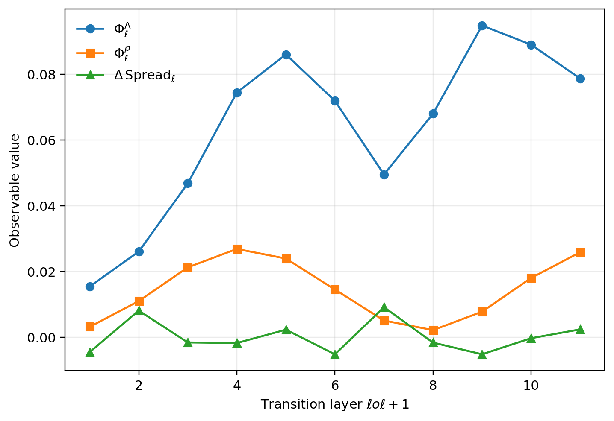
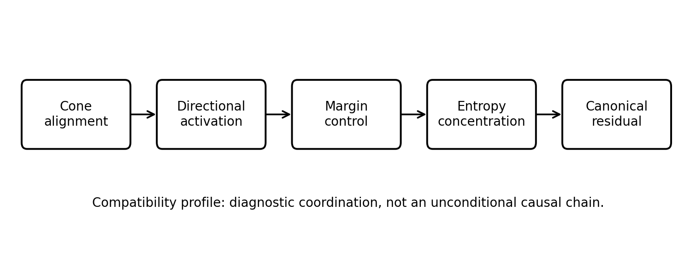

# Chapter 8: conditional compatibility and transport of signatures

[Library index](../README.md) · [Source and transcription policy](../SOURCE.md) · [Previous pages: PDF 293–300](0293-0300-ch08-reextraction-cost-transport-and-entropy.md#pdf-0300)

> Editorial note: Full transcription of PDF 301–305 (printed pages 265–269), including Figures 8.11–8.12, objects 8.17–8.22, proofs, and unnumbered formulas. The source's conditional estimates and qualitative claims are preserved as written; their scope is examined separately in [notes 79–81](../notes/79-transition-observables-and-compatibility-links.md). Proposition 8.22 spans PDF 304–305.

## PDF 301 · Book 265

**Figure 8.11:** Synthetic transition observables. $\Phi_\ell^\Lambda$ measures mean barycentric transport, $\Phi_\ell^\rho$ measures mean residual change, and $\Delta\operatorname{Spread}_\ell$ measures concentration or diversification of the signature cloud. Large values identify transitions in which the next layer materially changes the extracted geometry.

### 8.10.2 Transition observables in practice

The transport observables from Section 8.5 provide a practical way to detect where compatibility changes. In the synthetic example of Figure 8.6, the largest transport peak occurs in the middle layers. The corresponding transition observables are shown in Figure 8.11.

The figure makes a point that is central for later chapters. Different transitions may have different geometric signatures: one transition may primarily move canonical mass, another may primarily reduce residuals, and another may mainly compress or diversify the cloud. Inter-layer information flow is therefore multi-channel at the level of observables, even though the architecture itself transmits a single mixed residual stream.

### 8.10.3 Residual re-extraction

Let $\bar\rho_\ell=\frac1H\sum_h\rho_{\ell,h}$ be the mean canonical residual. If $\bar\rho_{\ell+1}<\bar\rho_\ell$, the next layer has extracted a more canonical geometry from the mixed representation. If the reverse inequality occurs, the next layer has moved away from the current dictionary and may be signalling the need for a richer local catalogue, a task-dependent perturbation, or a temporary transition regime. This perspective makes the residual coordinate directly relevant for flow analysis rather than a mere auxiliary quality measure.

### 8.11 Compatibility bounds behind the profile

A compatibility profile is not a theorem by itself. It is a diagnostic container. The individual links that justify the container are conditional estimates. Three representative estimates are recorded here.

## PDF 302 · Book 266

**Figure 8.12:** Compatibility profile. Cone alignment, directional activation, margins, entropy, and residual coordinate each measure a different aspect of re-extraction. The arrows indicate diagnostic compatibility, not an unconditional causal chain.

#### 8.11.1 Cone-to-energy compatibility

Let $M_a$ be the antisymmetric part of a score matrix and let $U_\ell$ be the row span of $X_\ell$. Directional activation depends on the restriction of $M_a$ to $U_\ell$:

$$
\Gamma_\ell(M_a)=\|X_\ell M_aX_\ell^\top\|_F.
$$

If the row span has a two-dimensional component aligned with an antisymmetric eigenplane of $M_a$, then $\Gamma_\ell(M_a)$ is bounded from below by the product of the corresponding singular value and the projected area of that component. If the row span collapses to one dimension, this lower bound vanishes. Thus cone concentration alone is insufficient; cone concentration must be accompanied by two-dimensional angular diversity.

**Remark 8.17 (Parity of antisymmetric rank).** For a real antisymmetric matrix, the rank is always even. Hence the active directions of $M_a$ are naturally organised into two-dimensional planes. This is the linear-algebraic reason why a one-dimensional token cloud cannot activate a genuinely antisymmetric directional component.

#### 8.11.2 Energy-to-margin compatibility

Directional energy contributes to logit separation only if it is aligned with the winning row-column contrasts. A general lower bound must therefore include a non-degeneracy coefficient. One may write schematically

$$
\bar\Delta_\ell\ge c_\ell\Gamma_\ell-b_\ell,
$$

where $c_\ell$ measures alignment between the active antisymmetric form and the row-wise top-1/top-2 contrasts, and $b_\ell$ accounts for symmetric or residual contributions that may oppose the separation. The inequality is useful as a diagnostic: large $\Gamma_\ell$ with small margins indicates poor alignment, not failure of the formalism.

#### 8.11.3 Margin-to-entropy compatibility

The last link is rigorous and unconditional at the row level: Theorem 8.12 transforms row margins into an entropy envelope. Therefore the profile has one hard mathematical endpoint and two data-dependent geometric links.

## PDF 303 · Book 267

#### 8.11.4 What the bounds do not say

The profile does not assert that every layer must increase cone index, directional activation, or margins. It also does not assert that lower entropy is always better. High entropy can be functional in global aggregation layers; low entropy can be non-canonical if the concentrated map lies outside the dictionary. The correct statement is that the profile organises the possible relations among observables once the geometric non-degeneracy conditions of the trained representation are checked.

### 8.12 A conditional compatibility theorem

The compatibility profile can be gathered into a single conditional theorem. Its purpose is not to turn empirical trends into architectural laws, but to make the required hypotheses explicit.

**Theorem 8.18 (Conditional compatibility of re-extraction observables).** Fix a transition $\ell\to\ell+1$ and a head $h$. Assume the following conditions.

(C1) The row span of $X_{\ell+1}$ has a two-dimensional projection of area at least $a_0>0$ onto an antisymmetric eigenplane of $(M_{\ell+1,h})_a$ with singular value at least $\sigma_0>0$.

(C2) The directional energy generated on that plane is aligned with the active row-wise top-1/top-2 logit contrasts with coefficient at least $c_0>0$.

(C3) Opposing symmetric and residual contributions to the relevant margins are bounded above by $b_0$.

(C4) The resulting row margin increments are non-negative and bounded below on an active set of rows by $m_0>0$.

Then the transition satisfies the following implications on the active set:

$$
\Gamma_{\ell+1,h}\ge\sigma_0a_0,
\qquad
\bar\Delta_{\ell+1,h}\ge c_0\Gamma_{\ell+1,h}-b_0,
$$

and the entropy proxy decreases by at least the margin-dependent amount supplied by Proposition 8.14.

*Proof.* The first inequality is the two-dimensional activation estimate for an antisymmetric form restricted to the row span. The second is precisely the alignment condition between directional energy and row-wise contrast margins, with the bounded opposing contribution subtracted. The final statement follows from Proposition 8.14 applied to the rows whose margin increments are bounded below by $m_0$. $\square$

**Remark 8.19 (Status of the theorem).** The theorem deliberately places the hard work inside explicit hypotheses. In trained networks these hypotheses must be measured; they are not guaranteed by the Transformer architecture alone. The theorem should therefore be read as a conditional compatibility result, not as a universal monotonicity law.

#### 8.12.1 Why the theorem is useful

The value of Theorem 8.18 is diagnostic. If cone alignment increases but directional activation does not, the failure is localised in condition (C1). If directional activation increases but margins do not, the failure is localised in condition (C2) or (C3). If margins increase but entropy does not fall, the failure must be examined at the row distribution level or in the distinction between actual entropy and the proxy. Thus the theorem provides a debugging map for the re-extraction mechanism.

## PDF 304 · Book 268

#### 8.12.2 Relation to residual drift

The theorem contains no direct conclusion about $\rho_8$. This is intentional. Canonical residual is a dictionary-dependent quantity, while entropy and margins are raw attention quantities. A layer can satisfy the compatibility theorem and still increase residual if the sharpened attention map lies outside the canonical hull. Conversely, residual can decrease without a large margin change when a diffuse map moves closer to a closed or cluster-like canonical component. This separation is essential for avoiding a false identification between concentration and canonicality.

### 8.13 Projecting the compatibility profile onto signature space

The cone–activation–margin–entropy profile is expressed in terms of representation geometry and score concentration. The signature framework of Chapter 7 expresses the same layer in terms of barycentric coordinates and residuals. This section records conditional bridges between the two languages. The results are translation principles, not unconditional emergence theorems.

**Proposition 8.20 (Margin growth and directional signature mass).** Assume that, over a layer interval, the hypotheses of the compatibility profile hold and that the rows whose margins grow are aligned with a stable directional source set. If the canonical dictionary contains the corresponding directional atoms and if the canonical residual remains bounded by $\varepsilon$, then the directional barycentric mass satisfies a lower bound of the form

$$
\Lambda_{\mathrm{dir}}^{(\ell+1,h)}
\ge\Lambda_{\mathrm{dir}}^{(\ell,h)}
+c\bigl(\bar\Delta^{(\ell+1,h)}-\bar\Delta^{(\ell,h)}\bigr)-C\varepsilon
$$

for constants $c,C$ depending on the chosen dictionary and metric.

*Proof sketch.* Margin growth concentrates the relevant softmax rows near their winning columns. Under the stable-source hypothesis, the concentrated support is directional. Projection onto the canonical hull therefore moves mass toward the directional face, up to the error represented by the residual. The constants encode the local conditioning of the canonical projection near that face. $\square$

**Proposition 8.21 (Cone alignment and layer residual).** Suppose the layer representation has high cone alignment and a stable low-dimensional singular structure compatible with one of the canonical faces of the signature hull. If the average residual $\bar\rho_\ell$ is small, then the cone index is bounded below by a function of the leading singular-mass ratio, up to an error controlled by $\bar\rho_\ell$.

*Proof sketch.* The cone index is controlled by concentration of the token cloud along leading singular directions. If the canonical residual is small, the observed attention maps are close to a canonical face generated by atoms compatible with that singular geometry. The residual error perturbs the alignment estimate by a Lipschitz term. $\square$

**Proposition 8.22 (Residual update and Wasserstein drift).** Let $\pi_\ell$ be any matching of the heads between two consecutive layers. Then

$$
W_2(\mu_\ell,\mu_{\ell+1})^2
\le\frac1H\sum_{h=1}^{H}
d_\Sigma\bigl(\Sigma_{\ell,h},\Sigma_{\ell+1,\pi_\ell(h)}\bigr)^2.
$$

## PDF 305 · Book 269

In particular, if the barycentric updates and residual updates are bounded by

$$
\|\Lambda_{\ell+1,\pi_\ell(h)}-\Lambda_{\ell,h}\|\le a_h,
\qquad
|\rho_{\ell+1,\pi_\ell(h)}-\rho_{\ell,h}|\le b_h,
$$

then

$$
W_2(\mu_\ell,\mu_{\ell+1})^2
\le\frac1H\sum_{h=1}^{H}(a_h^2+\alpha^2b_h^2)
$$

for the quadratic Hellinger–residual metric, up to the equivalence constant between the chosen barycentric norm and $d_H$ on the relevant compact subset.

*Proof.* The first inequality follows directly from the definition of $W_2$, since every matching determines an admissible coupling between the two empirical measures. The second inequality follows by inserting the coordinate-wise bounds into the metric. $\square$

These propositions explain how the profile variables of this chapter project onto the layer geographies of Chapter 7. Margin growth, cone alignment, entropy concentration, residual drift, and Wasserstein transport are not separate stories. They are different coordinate systems for the same re-extraction mechanism.

### 8.14 Small explanatory experiments

The purpose of the following experiments is not to substitute for the large-scale BERT analysis, but to make the chapter’s geometric claims concrete with compact, reproducible examples. All experiments are synthetic and are included as scripts and data files in the package.

#### 8.14.1 Experiment A: re-extraction versus labelled propagation

A synthetic family of layer geographies is constructed so that early layers are dominated by contextual coordinates, middle layers display rapid barycentric relocation, and upper layers move toward value-like and instance-like concentration. The resulting geographies are shown in Figure 8.1. The velocity profile in Figure 8.6 shows a sharp middle-layer transition. The phenomenon is much easier to express as motion of empirical measures than as motion of labelled heads.

#### 8.14.2 Experiment B: the entropy envelope

Random logit rows with controlled top-1/top-2 margin are sampled and the true entropy is compared to the analytical upper bound of Theorem 8.12. Figure 8.10 confirms the expected envelope. The experiment is deliberately elementary, but it clarifies the scope of the theorem: the bound is strong enough to control an entropy envelope and weak enough to leave room for distinct distributions with the same margin.

#### 8.14.3 Experiment C: non-canonical head matching

Two synthetic empirical signature distributions are generated and an optimal transport plan is computed under the Hellinger–residual metric. The resulting coupling in Figure 8.7 gives a best geometric matching between the two layers. The example shows why a coupling should be treated as a diagnostic surrogate. Once the coupling matrix has been computed, the inter-layer drift is summarised cleanly without requiring the fiction of a canonical head identity.

[Continue: PDF 306–311](0306-0311-ch08-experiments-protocol-and-synthesis.md#pdf-0306) · [Russian notes 79–81](../notes/79-transition-observables-and-compatibility-links.md)
