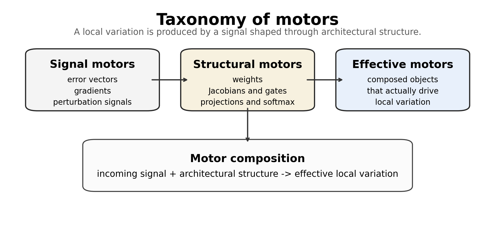

# Chapter 9: motor taxonomy, composition, and surrounding literature

[Library index](../README.md) · [Source and transcription policy](../SOURCE.md) · [Previous pages: PDF 306–311](0306-0311-ch08-experiments-protocol-and-synthesis.md#pdf-0311)

> Editorial note: Full transcription of PDF 312–317 (printed pages 276–281), including Figure 9.1, Definitions 9.1–9.2, Remark 9.3, Proposition 9.4 and its proof, all ten rows of Table 9.1, and the opening formulas of §9.3. Unresolved citation markers `?` and duplicated author strings remain as printed. The guiding-principle quotation, Remark 9.3, and two paragraphs cross physical-page boundaries. The MLM analysis continues on PDF 318.

## PDF 312 · Book 276

## Chapter 9 · Motor Formalism for Signature Dynamics

Chapter 8 described the depth-wise behaviour of a Transformer as repeated re-extraction of signature geography. A layer receives a mixed residual representation, extracts score matrices, produces attention maps, and thereby generates a new empirical distribution of signatures. The present chapter studies the differential anatomy behind this mechanism, with the computational graph of a BERT block as its central object.

The chapter is therefore not merely a catalogue of gradients. It is an anatomical reading of the masked-position computation: the task head injects a primary motor, the feed-forward block gates it, LayerNorm filters it, the attention block splits it into Q/K/V routes, and the residual stream carries the leading channel through depth.

The central object is a *motor*: a signal, operator, or composite quantity that governs the variation of another quantity in the computational graph. The term is intentionally broader than gradient. In backward analysis, a gradient is often the incoming signal motor; however, the effective local motor is usually a composition of that signal with weights, Jacobians, gates, projections, and residual paths. In forward perturbation analysis, the analogous role is played by differentials and Jacobian factors.

The purpose of the motor language is not to replace standard backpropagation. Rather, it reorganises the formulas into a structural grammar. The masked-language-model head injects the primary signal motor; the feed-forward block gates and recombines motors through its activation mask; the self-attention block distributes motors through value, coefficient, score, query, and key paths; and the output projection recombines headwise contributions. The resulting grammar gives a local explanation of why the re-extraction process of Chapter 8 is both structured and redundant.

The chapter has four roles in the monograph.

1. It provides a differential counterpart to the static signature geometry of Chapter 7.
2. It explains the internal motor anatomy behind the layer-wise re-extraction loop of Chapter 8.
3. It prepares the self-attention motor decomposition of the next chapter.
4. It prepares the training-time gradient-flow analysis of Chapter 11.

The guiding principle is:

> The re-extraction of signature geography is driven by motors: signal motors

## PDF 313 · Book 277

**Figure 9.1:** Taxonomy of motors. A signal motor carries variation, a structural motor shapes variation, and an effective motor is the composed object that actually acts on the variable of interest.

> injected by the task, structural motors imposed by the architecture, and effective motors produced by their composition.

The chapter is local in a precise sense. It studies one block, one masked position, or one layer at a time. Global layer geographies, Wasserstein transport, and dictionary coverage are not reconstructed here; they are assumed from Chapters 7 and 8. The new contribution is to identify the objects that actually push hidden states, scores, attention maps, value paths, and signatures under perturbation or backward propagation.

### 9.1 Definition and taxonomy of motors

**Definition 9.1 (Motor).** Let $x$ be a variable in a computational graph. A *motor* of $x$ is any quantity or operator that effectively governs the variation of $x$, either under forward perturbation analysis or under backward propagation of a loss signal.

The definition is deliberately inclusive. A motor may be a vector, tensor, matrix, Jacobian factor, mask, projection, or composite expression. Three classes will be used throughout the chapter.

**Definition 9.2 (Signal, structural, and effective motors).** A *signal motor* is a variation signal, such as $\partial L/\partial x$ or a forward perturbation $dx$. A *structural motor* is an operator that shapes the transmitted variation, such as a weight matrix, Jacobian, ReLU mask, softmax Jacobian, or projection. An *effective motor* is the composed object that acts on the variable after the signal motor has passed through the relevant structural motors.

For example, in the expression

$$
\frac{\partial L}{\partial y_m}=g_mW_2^\top D_mW_1^\top,
$$

the incoming vector $g_m$ is the signal motor, while $W_2^\top$, $D_m$, and $W_1^\top$ are structural motors. The product is the effective motor acting on $y_m$.

**Remark 9.3.** The term motor is not meant to obscure the chain rule. It is a bookkeeping device for preserving the distinction between a signal and the architectural operators that

## PDF 314 · Book 278

reshape it. This distinction becomes important in Transformers because residual streams, headwise splits, attention normalisation, and feed-forward gates interact in non-trivial ways.

**Proposition 9.4 (Motor composition).** Let $x\mapsto h(x)\mapsto y(h)$ be a composed differentiable block. If $M_y$ is an incoming row-vector motor acting on $y$, then the effective motor acting on $x$ is

$$
M_x=M_yJ_{y\leftarrow h}J_{h\leftarrow x},
$$

where $J_{y\leftarrow h}$ and $J_{h\leftarrow x}$ are the Jacobian factors of the two maps.

*Proof.* This is the chain rule written in motor form. The incoming variation signal $M_y$ is pulled back through the structural motors of the intermediate maps. $\square$

The proposition extends recursively to any finite computational graph. In a Transformer, the relevant compositions include affine maps, softmax normalisation, value mixing, output projection, residual addition, layer normalisation, and feed-forward gates.

### 9.2 Related work: the surrounding landscape

The motor formalism is deliberately positioned inside a large landscape. It is not proposed as a replacement for backpropagation, attribution, probing, circuit analysis, or training dynamics. Its role is narrower and more structural: it provides a vocabulary for the local differential objects that transmit, gate, rotate, split, and recombine variation inside a Transformer block. The following review is therefore organised by mathematical function rather than by chronology.

#### 9.2.1 Transformer architecture and residual-stream viewpoints

The architectural background is the Transformer of Vaswani et al. ? and the BERT encoder of Devlin et al. Devlin et al. (2019b). These architectures organise computation through residual streams, multi-head attention, feed-forward blocks, normalisation layers, and task heads. Standard architectural descriptions specify the forward map. The present chapter instead asks which local objects drive variation through that map.

Residual-stream analyses and transformer-circuit work make the shared residual space central. Elhage et al. Elhage et al. (2021b) formulate attention heads and MLPs as components that read from and write to the residual stream. The motor formalism is compatible with that view, but shifts the emphasis. Instead of cataloguing a complete algorithm implemented by a circuit, it describes the signal motors and structural motors by which a local perturbation or loss signal moves through the graph.

#### 9.2.2 BERTology, probing, and attention-head analysis

A large literature studies what BERT represents and how its heads behave. Clark et al. ? showed that BERT heads can specialise to delimiter tokens, positional offsets, broad attention, syntax, and coreference. Rogers et al. ? survey the broader BERTology literature, including probing, layerwise linguistic structure, attention patterns, and representational specialisation. Related work by Tenney et al. ? and Hewitt and Manning ? studies what linguistic structure can be recovered from contextual representations.

The signature programme of Chapters 7 and 8 belongs to this family but changes the unit of description. Instead of assigning a hard pattern label to a head, an attention map is projected onto a canonical dictionary and represented by a signature plus residual. The

## PDF 315 · Book 279

motor formalism adds a further layer: it asks how variations reach the maps whose signatures are being measured.

#### 9.2.3 Mechanistic interpretability and circuits

Mechanistic interpretability seeks internal mechanisms rather than final attribution scores. The transformer-circuits programme studies how residual-stream components compose, how attention heads interact, and how specific mechanisms such as induction heads arise Elhage et al. (2021b); ?. Induction-head work is especially relevant because it links headwise mechanisms, training dynamics, and circuit-level behaviour.

The present formalism is lower-level than a circuit catalogue. A circuit may be seen as a stable composition of effective motors. Conversely, a motor decomposition describes the local differential anatomy available to any such circuit: the incoming signal, the output projection split, the softmax tangent map, the value path, the query path, the key path, and the feed-forward gate.

#### 9.2.4 Attention as explanation and causal intervention

A separate literature asks whether attention weights are explanations. Jain and Wallace ? argue that attention is not automatically explanatory, while Wiegreffe and Pinter ? clarify conditions under which attention-based explanations can be meaningful. Serrano and Smith ? and related intervention studies show that attention weights must be tested functionally rather than read naively.

The motor formalism adopts the same caution. An attention distribution is not an explanation by itself. It is a structural motor inside a pathway. Its explanatory value depends on whether changes in the associated motor, map, or signature predict or cause functional changes. This is why later chapters combine signature crowding with motor marginality, ablation, replacement, and pruning tests.

#### 9.2.5 Gradient-based attribution, Jacobians, and influence

The mathematical substrate of the chapter is ordinary differentiation. Classical backpropagation ? supplies the chain-rule mechanism; automatic differentiation supplies the computational implementation. Attribution methods such as saliency maps ?, integrated gradients ?, DeepLIFT ?, SmoothGrad ?, and Grad-CAM ? use gradients or modified gradients to assign importance to inputs or internal components. Influence-function approaches ? study the effect of training examples through differential approximations.

The motor formalism differs from attribution in its target. It does not directly produce an importance score. It records the local anatomy of variation: which signal is incoming, which Jacobian or gate reshapes it, which path splits it, and which effective object actually acts. A motor norm may become an attribution feature, but the motor itself is a structural differential object.

#### 9.2.6 Softmax geometry and information geometry

Attention probabilities live in simplices, and the softmax Jacobian is a covariance-type operator

$$
J_{\mathrm{softmax}}(s)=\operatorname{diag}(a)-aa^\top.
$$

It annihilates the all-ones direction and transmits only tangent-space perturbations. This local tangent geometry is the differential counterpart of the Hellinger/Fisher metric layer

## PDF 316 · Book 280

used in the signature geometry of Chapter 7. The metric layer asks how two signatures should be compared. The motor layer asks how a perturbation enters the simplex before a signature is formed.

#### 9.2.7 Feed-forward layers, memories, and neurons

Feed-forward layers in Transformers have been interpreted as key-value memories by Geva et al. ?. That viewpoint is complementary to the motor reading of the MLP block. A memory interpretation describes what the MLP stores or retrieves; a motor interpretation describes how an incoming signal is expanded, gated, and recombined through the ReLU mask and the two linear maps. Later work on knowledge neurons and model editing, such as Dai et al. ? and Meng et al. ?, is also adjacent: it studies localised internal structures that mediate factual behaviour. The motor language offers a differential grammar for such localised effects.

#### 9.2.8 Low-rank structure, pruning, and parameter-efficient adaptation

The single-token gradients derived in this chapter often have outer-product form. Thus they are rank-one before aggregation. This local observation is related, but not identical, to low-rank adaptation and compression. LoRA ? exploits low-rank parameter updates for efficient adaptation; intrinsic-dimension work ? argues that fine-tuning may occur in a surprisingly low-dimensional subspace. Head-pruning studies such as Michel et al. Michel et al. (2019a) and Voita et al. Voita et al. (2019a) show that many attention heads are functionally redundant. Attention-redundancy analyses such as Bian et al. ? quantify similarities among attention matrices.

The motor contribution is to separate geometric redundancy from differential marginality. Two heads may have similar signatures but different motor energies; conversely, a head may have an unusual signature and still be dynamically irrelevant for a given task. Later redundancy criteria therefore need both signature crowding and motor marginality.

#### 9.2.9 Training dynamics, gradient flow, and mean-field limits

Training-time approaches study how parameters or functions evolve under optimisation. Relevant frameworks include exact learning dynamics in simplified networks ?, neural tangent kernels ?, mean-field and optimal-transport formulations of overparameterised learning ?, and broader gradient-flow analyses. These theories operate at a global level. The motor formalism supplies mesoscopic coordinates for them. A parameter velocity first induces a motor on canonical score pairs, then on score matrices, then on attention maps, and finally on signatures.

This is the bridge to Chapter 11. The present chapter analyses the local differential machinery. The later training chapter studies how that machinery itself evolves with time.

#### 9.2.10 Position of the chapter

The resulting position can be stated precisely. The chapter is not a survey of interpretability, not an attribution method, not a circuit-discovery algorithm, and not a new optimiser. It is a differential grammar for Transformer blocks. Its reusable objects are task-head motors, gated MLP motors, simplex-constrained softmax motors, Q/K/V motors, headwise motors, low-rank local motors, and signature motors. These objects are intended to interface with the signature geography of Chapter 7, the re-extraction picture of Chapter 8, and the training-time dynamics of Chapter 11.

## PDF 317 · Book 281

**Table 9.1:** Neighbouring literatures and the role played by the motor formalism.

| Literature | Main object | Role of the motor formalism |
|---|---|---|
| Backpropagation and autodiff | Chain-rule computation | Separates incoming signal, structural operator, and effective local action. |
| Transformer circuits | Residual-stream algorithms | Supplies local differential primitives inside circuit components. |
| BERTology and probing | Representations and attention heads | Explains how variation reaches maps, signatures, and hidden states. |
| Attention explanation | Attention weights and interventions | Treats attention as a structural motor, not as an explanation by itself. |
| Attribution and influence | Importance and sensitivity scores | Provides candidate dynamical observables that must be tested causally. |
| Information geometry | Simplex metrics and tangent spaces | Provides the local softmax-tangent counterpart of signature metrics. |
| FFN memory views | Key-value memory structure | Describes how memory-like modules transmit and gate variation. |
| Low-rank adaptation | Low-dimensional updates | Explains recurring local outer-product motifs. |
| Pruning and redundancy | Component importance | Adds motor marginality to signature crowding. |
| Training dynamics | Parameter/function trajectories | Provides mesoscopic coordinates for signature velocity. |

#### 9.2.11 Literature map

Table 9.1 summarises the role of the motor formalism relative to neighbouring literatures. The table is intentionally schematic: each line indicates a mathematical interface rather than a claim of replacement.

### 9.3 The masked-language-model head as primary signal motor

Consider a masked position $m$. Let $A_m\in\mathbb R^{1\times d}$ be the final hidden representation at that position, let

$$
\nu_m=A_mW_D+b_D
$$

be the vector of logits over the vocabulary, let

$$
z_m=\operatorname{softmax}(\nu_m)
$$

be the predicted distribution, and let $t_m$ be the one-hot target. The cross-entropy loss is

$$
L_m=-\sum_c t_{mc}\log z_{mc}.
$$

[Continue: PDF 318–324](0318-0324-ch09-mlm-graph-feedforward-and-softmax.md#pdf-0318) · [Russian note: motor taxonomy](../notes/84-motor-taxonomy-and-chain-rule.md) · [Russian note: literature map](../notes/85-motor-literature-map-and-mlm-entry.md)
