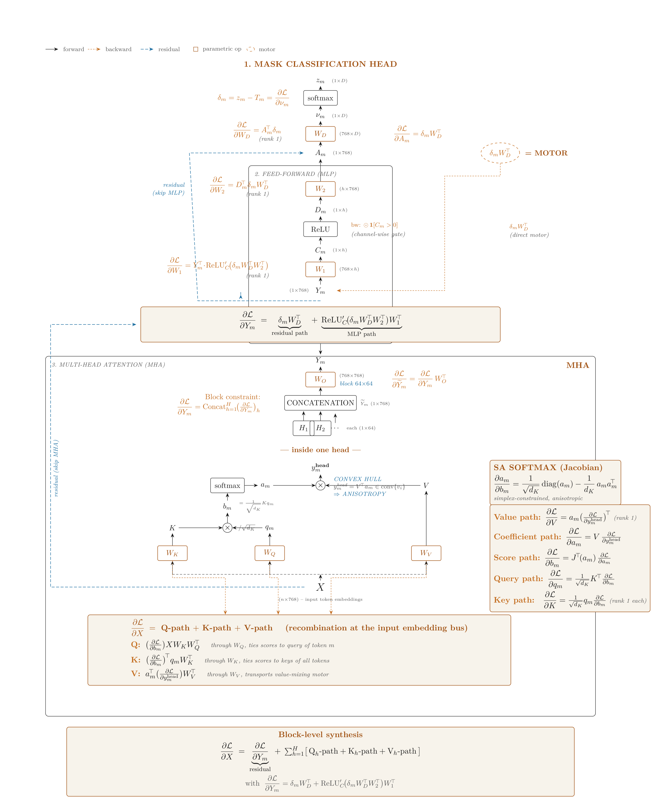
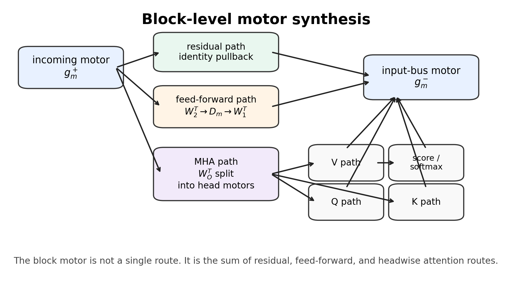
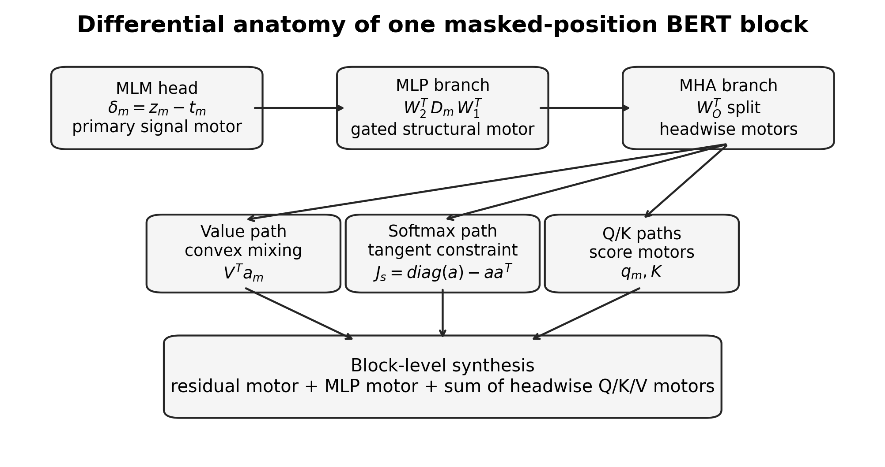
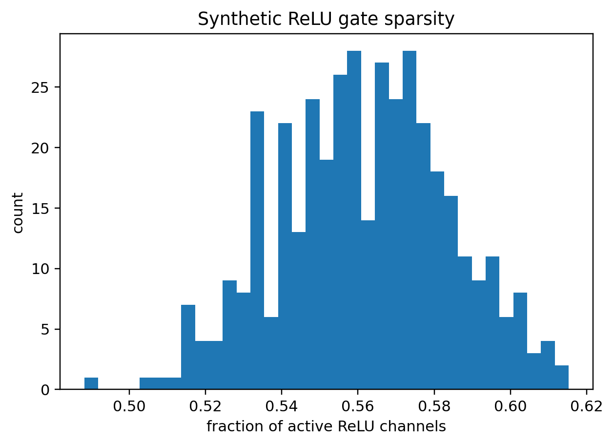
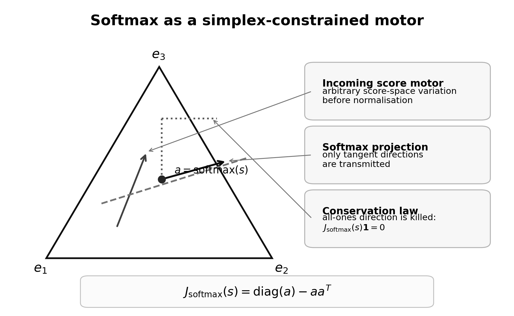

# Chapter 9: MLM motor, computational graph, feed-forward gates, LayerNorm, and softmax

[Library index](../README.md) · [Source and transcription policy](../SOURCE.md) · [Previous pages: PDF 312–317](0312-0317-ch09-motor-taxonomy-and-related-work.md#pdf-0317) · [Next pages: PDF 325–329](0325-0329-ch09-headwise-recursion-and-score-motors.md#pdf-0325)

> Editorial note: Full transcription of PDF 318–324 (printed pages 282–288), including Theorem 9.5, Propositions 9.6–9.9, all proofs and formulas, and Figures 9.2–9.6. Figure 9.2 is a direct high-resolution crop of the original vector graph; its labels and equations are additionally transcribed below for search. Original inconsistencies in that graph, the LayerNorm conventions, and the use of “projection” for the softmax Jacobian are preserved and qualified in [note 86](../notes/86-mlm-primary-motor-and-computational-graph.md), [note 87](../notes/87-feedforward-gates-and-layernorm-motors.md), and [note 88](../notes/88-convex-values-and-softmax-tangent-motor.md). The source uses $D_m$ for different objects in the graph and the subsequent prose; the notation is not silently unified.

## PDF 318 · Book 282

**Theorem 9.5 (Primary motor of the MLM head).** For the softmax-cross-entropy masked-language-model head,

$$
\delta_m:=\frac{\partial L_m}{\partial\nu_m}=z_m-t_m
$$

is the primary signal motor. The motor acting on the hidden representation is

$$
\frac{\partial L_m}{\partial A_m}=\delta_mW_D^\top,
$$

and the local decoder-gradient contribution is

$$
\frac{\partial L_m}{\partial W_D}=A_m^\top\delta_m.
$$

In particular, the single-token contribution to $\partial L_m/\partial W_D$ has rank at most one.

*Proof.* The derivative of softmax followed by cross-entropy gives $\partial L_m/\partial\nu_m=z_m-t_m$. Pulling this signal back through the affine map $\nu_m=A_mW_D+b_D$ yields the hidden-state motor $\delta_mW_D^\top$. Differentiating the affine map with respect to $W_D$ gives the outer product $A_m^\top\delta_m$. $\square$

The theorem identifies the task-level entry point of the backward dynamics. The loss does not enter the encoder as an unstructured object; it enters through a compact error vector and the transpose of the decoder map. Every lower motor in the encoder is downstream of this primary signal.

### 9.4 The computational graph of one BERT encoder block

The motor formalism becomes concrete only after the computational graph is placed in front of the reader. For a masked position $m$, the relevant graph has three main regions: the masked-language-model head, the feed-forward branch, and the multi-head-attention branch. The first injects the primary signal motor; the second gates and reshapes that motor; the third splits it into headwise value, coefficient, score, query, and key paths.

## PDF 319 · Book 283

**Figure 9.2:** Computational graph of one BERT encoder block at masked position $m$.

*Forward edges are solid black; backward motor edges are dashed orange; residual connections are dashed blue. The graph displays the masked-language-model head, the feed-forward branch, the multi-head-attention branch, and the final block-level synthesis of residual, MLP, and Q/K/V motor paths.*

#### Searchable transcription of Figure 9.2

> Editorial transcription of the original figure labels, preserving its displayed formulas and dimensions, including their inconsistencies. The image above is the visual source. This subsection is not an additional section of the book.

**Legend:** forward; backward; residual; parametric op; motor.

**1. MASK CLASSIFICATION HEAD**

The forward chain runs through $A_m$ $(1\times768)$, $W_D$ $(768\times D)$, $\nu_m$ $(1\times D)$, softmax, and $z_m$ $(1\times D)$. The backward labels read

$$
\delta_m=z_m-T_m=\frac{\partial\mathcal L}{\partial\nu_m},
\qquad
\frac{\partial\mathcal L}{\partial W_D}=A_m^\top\delta_m
\quad\text{(rank 1)},
$$

$$
\frac{\partial\mathcal L}{\partial A_m}=\delta_mW_D^\top,
\qquad
\delta_mW_D^\top=\text{MOTOR}.
$$

**2. FEED-FORWARD (MLP)**

The forward chain is $Y_m$ $(1\times768)$, $W_1$ $(768\times h)$, $C_m$ $(1\times h)$, ReLU, $D_m$ $(1\times h)$, $W_2$ $(h\times768)$, and $A_m$. The ReLU backward label is “bw: $\odot\mathbf1[C_m>0]$ (channel-wise gate)”. Parameter-gradient labels are

$$
\frac{\partial\mathcal L}{\partial W_2}
=D_m^\top\delta_mW_D^\top
\quad\text{(rank 1)},
$$

$$
\frac{\partial\mathcal L}{\partial W_1}
=Y_m^\top\cdot\operatorname{ReLU}'_C
\bigl(\delta_mW_D^\top W_2^\top\bigr)
\quad\text{(rank 1)}.
$$

The skip connection is labelled “residual (skip MLP)”, and the direct backward motor is labelled $\delta_mW_D^\top$ “(direct motor)”. The synthesis box reads

$$
\frac{\partial\mathcal L}{\partial Y_m}
=
\underbrace{\delta_mW_D^\top}_{\text{residual path}}
+
\underbrace{
\operatorname{ReLU}'_C\bigl(\delta_mW_D^\top W_2^\top\bigr)W_1^\top
}_{\text{MLP path}}.
$$

**3. MULTI-HEAD ATTENTION (MHA)**

The output map $W_O$ is labelled $(768\times768)$ and “block $64\times64$”. The concatenated row is $\widetilde Y_m$ $(1\times768)$, assembled from $H_1,H_2,\ldots$, “each $(1\times64)$”. The graph gives

$$
\frac{\partial\mathcal L}{\partial\widetilde Y_m}
=\frac{\partial\mathcal L}{\partial Y_m}W_O^\top.
$$

The displayed “Block constraint” is

$$
\frac{\partial\mathcal L}{\partial Y_m}
=\operatorname{Concat}_{h=1}^{H}
\left(\frac{\partial\mathcal L}{\partial Y_m}\right)_h.
$$

**— inside one head —**

The input bus is $X$ $(n\times768)$ — input token embeddings. The three projections are $W_K,W_Q,W_V$, producing $K,q_m,V$. The score and value labels read

$$
b_m=\frac1{\sqrt{d_K}}Kq_m,
\qquad
y_m^{\mathrm{head}}=V^\top a_m\in\operatorname{conv}\{v_i\}.
$$

The latter is labelled “CONVEX HULL” and “$\Rightarrow$ ANISOTROPY”. A softmax map sends $b_m$ to $a_m$.

**SA SOFTMAX (Jacobian)**

$$
\frac{\partial a_m}{\partial b_m}
=\frac1{\sqrt{d_K}}\operatorname{diag}(a_m)
-\frac1{d_K}a_ma_m^\top.
$$

The box is labelled “simplex-constrained, anisotropic”. Its path formulas are

$$
\begin{aligned}
\text{Value path:}\quad
\frac{\partial\mathcal L}{\partial V}
&=a_m\left(\frac{\partial\mathcal L}{\partial y_m^{\mathrm{head}}}\right)^\top
\quad\text{(rank 1)},\\
\text{Coefficient path:}\quad
\frac{\partial\mathcal L}{\partial a_m}
&=V\frac{\partial\mathcal L}{\partial y_m^{\mathrm{head}}},\\
\text{Score path:}\quad
\frac{\partial\mathcal L}{\partial b_m}
&=J^\top(a_m)\frac{\partial\mathcal L}{\partial a_m},\\
\text{Query path:}\quad
\frac{\partial\mathcal L}{\partial q_m}
&=\frac1{\sqrt{d_K}}K^\top\frac{\partial\mathcal L}{\partial b_m},\\
\text{Key path:}\quad
\frac{\partial\mathcal L}{\partial K}
&=\frac1{\sqrt{d_K}}q_m\frac{\partial\mathcal L}{\partial b_m}
\quad\text{(rank 1 each)}.
\end{aligned}
$$

**Recombination at the input embedding bus**

$$
\frac{\partial\mathcal L}{\partial X}
=\text{Q-path}+\text{K-path}+\text{V-path}.
$$

The three rows of the box read

$$
\begin{aligned}
\text{Q:}\quad&
\left(\frac{\partial\mathcal L}{\partial b_m}\right)XW_KW_Q^\top
&&\text{through }W_Q,\text{ ties scores to query of token }m,\\
\text{K:}\quad&
\left(\frac{\partial\mathcal L}{\partial b_m}\right)^\top q_mW_K^\top
&&\text{through }W_K,\text{ ties scores to keys of all tokens},\\
\text{V:}\quad&
a_m^\top\left(\frac{\partial\mathcal L}{\partial y_m^{\mathrm{head}}}\right)W_V^\top
&&\text{through }W_V,\text{ transports value-mixing motor}.
\end{aligned}
$$

The attention skip connection is labelled “residual (skip MHA)”.

**Block-level synthesis**

$$
\frac{\partial\mathcal L}{\partial X}
=
\underbrace{\frac{\partial\mathcal L}{\partial Y_m}}_{\text{residual}}
+\sum_{h=1}^{H}
\bigl[\text{Q}_h\text{-path}+\text{K}_h\text{-path}+\text{V}_h\text{-path}\bigr],
$$

with

$$
\frac{\partial\mathcal L}{\partial Y_m}
=\delta_mW_D^\top+
\operatorname{ReLU}'_C\bigl(\delta_mW_D^\top W_2^\top\bigr)W_1^\top.
$$

## PDF 320 · Book 284

Figure 9.2 is intentionally dense. It is not meant to replace the formulas below; it is the anatomical map of the chapter. The white arrows describe the forward computation, the orange dashed arrows describe backward motors, and the cyan arrows describe residual channels. The most important reading of the figure is the following.

1. The primary task motor is injected at the classification head as the prediction error $\delta_m=z_m-T_m$.
2. The MLP branch transforms this motor through a transposed linear map, an activation gate, and a second transposed linear map.
3. The MHA branch first splits the motor through $W_O^\top$, then decomposes it headwise.
4. Inside each head, the value path, coefficient path, score path, query path, and key path carry structurally different motors.
5. The input bus recombines residual, MLP, and attention contributions.

The rest of the chapter is a mathematical unpacking of this graph. The graph should therefore be read as the differential anatomy of BERT at a single masked position.

### 9.5 Differential anatomy of a BERT block

For a masked position $m$, the encoder block may be read as a local differential machine. A signal injected by the masked-language-model head is pulled back through the classifier, the feed-forward branch, the multi-head attention branch, and the residual stream. Each stage contributes a structural motor: a decoder matrix, a feed-forward gate, the output projection, a softmax Jacobian, or one of the query–key–value projections.

The useful abstraction is not a single gradient vector, but a graph of motors. At the level of one block the following schematic decomposition is obtained:

$$
\text{task motor}\longrightarrow
\text{MLP motor}+\text{MHA motor}+\text{residual motor}.
$$

The attention contribution further decomposes into value, coefficient, score, query, and key paths.

This figure is intentionally less detailed than a full computational graph. Its role is to expose the algebraic organisation that will be formalised in the next sections. The same decomposition also explains why a motor formalism is better suited than a single-gradient vocabulary: the effective variation at the input of a block is assembled from several structurally different routes.

### 9.6 The feed-forward block as a gated motor transformer

Let the feed-forward block at a token position be

$$
\operatorname{FFN}(y_m)=\phi(y_mW_1+b_1)W_2+b_2,
$$

where $\phi$ is an elementwise activation. For the ReLU case, define

$$
c_m=y_mW_1+b_1,\qquad
D_m=\operatorname{diag}(\mathbf1_{c_m>0}).
$$

If $g_m=\partial L/\partial\operatorname{FFN}(y_m)$ is the incoming signal motor, then

$$
\frac{\partial L}{\partial y_m}=g_mW_2^\top D_mW_1^\top.
$$

## PDF 321 · Book 285

**Figure 9.3:** Differential anatomy of one encoder block at a masked position. The task motor is pulled back through the feed-forward and multi-head-attention branches, while the residual stream carries a direct motor. The MHA contribution is split into value, coefficient, score, query, and key paths.

**Proposition 9.6 (Gated motor propagation).** In a ReLU feed-forward block, the backward motor is filtered by the diagonal activation mask $D_m$. Only active channels participate in the local propagation of variation.

*Proof.* The derivative of ReLU is the diagonal selector $D_m$. Applying the chain rule to $y_m\mapsto c_m\mapsto\phi(c_m)\mapsto\operatorname{FFN}(y_m)$ gives the stated formula. $\square$

Parameter gradients inherit outer-product structure. For a single token,

$$
\frac{\partial L}{\partial W_2}=r_m^\top g_m,\qquad r_m=\phi(c_m),
$$

and

$$
\frac{\partial L}{\partial W_1}
=y_m^\top\bigl((g_mW_2^\top)\odot\mathbf1_{c_m>0}\bigr).
$$

Both are rank-one contributions before summing over tokens or batch elements.

### 9.7 LayerNorm as a structural motor

Layer normalisation should not be treated as a minor implementation detail. In backward propagation it is a structural motor: it projects, rescales, and removes specific directions from the incoming covector.

For a row vector $x\in\mathbb R^{d_{\mathrm{model}}}$, write

$$
\mu(x)=\frac1d\sum_i x_i,\qquad
\sigma(x)^2=\frac1d\sum_i(x_i-\mu(x))^2,\qquad
\widehat x=\frac{x-\mu(x)\mathbf1}{\sigma(x)}.
$$

## PDF 322 · Book 286

**Figure 9.4:** Simplified differential anatomy of one masked-position BERT block. The primary signal motor enters through the MLM head, is gated by the MLP, and is split into headwise Q/K/V motors inside self-attention.

Ignoring the affine bias and keeping the scale vector $\gamma$, the LayerNorm Jacobian has the form

$$
J_{\mathrm{LN}}(x)=
\frac1{\sigma(x)}
\left(
\operatorname{diag}(\gamma)
-\frac1d\mathbf1\gamma^\top
-\frac1d\widehat x(\gamma\odot\widehat x)^\top
\right),
$$

up to the convention of row or column vectors.

**Proposition 9.7 (LayerNorm as backward norm filter).** Assume $\gamma\approx\mathbf1$ and $\sigma(x)\approx1$. Let

$$
g_\perp=g-\frac1d(\mathbf1^\top g)\mathbf1
$$

be the zero-mean component of an incoming covector. Then

$$
\|J_{\mathrm{LN}}(x)^\top g\|_2^2
=\|g_\perp\|_2^2-\frac1d(\widehat x^\top g)^2
+O\bigl(|1-\sigma|+\|\mathbf1-\gamma\|\bigr),
$$

and therefore $\|J_{\mathrm{LN}}(x)^\top g\|_2\le\|g\|_2$ up to the stated scale perturbations.

*Proof.* For $\gamma=\mathbf1$ and $\sigma=1$, the transpose Jacobian acts as

$$
J_{\mathrm{LN}}(x)^\top g
=g_\perp-\frac1d(\widehat x^\top g)\widehat x.
$$

Since $\widehat x^\top\mathbf1=0$, the zero-mean projection and the $\widehat x$-projection are orthogonal in the displayed decomposition. Taking squared norms gives the formula. Perturbing $\gamma$ and $\sigma$ gives the stated first-order correction. $\square$

Thus LayerNorm is a centering and norm-filtering structural motor. Its role is analogous to the softmax Jacobian’s tangent-space constraint: both remove a distinguished one-dimensional direction before the next motor is propagated.

## PDF 323 · Book 287

**Figure 9.5:** Synthetic ReLU gate sparsity. The gate is a structural motor: it determines which hidden channels transmit the incoming signal.

### 9.8 Self-attention: convex value path and simplex motor

For one head and one query position $m$, let

$$
q_m=y_mW_Q,\qquad K=YW_K,\qquad V=YW_V.
$$

The score vector and attention weights are

$$
s_m=\frac{q_mK^\top}{\sqrt{d_k}},\qquad a_m=\operatorname{softmax}(s_m),
$$

and the head output is

$$
o_m=a_mV=\sum_{j=1}^{n}a_{mj}v_j.
$$

**Proposition 9.8 (Convexity of the value path).** Before output projection, the attention output lies in the convex hull of the value vectors:

$$
o_m\in\operatorname{conv}\{v_1,\ldots,v_n\}.
$$

*Proof.* The softmax weights satisfy $a_{mj}\ge0$ and $\sum_j a_{mj}=1$. Thus $o_m$ is a convex combination of the rows of $V$. $\square$

This convexity is not the same as the canonical hull of Chapter 7. The value hull constrains vectors in representation space, while the canonical hull constrains attention maps. The two hulls nevertheless express a common principle: internal Transformer computation is repeatedly constrained by simplex and convex geometry before linear projections remix the result.

#### 9.8.1 Softmax as structural motor

For $a=\operatorname{softmax}(s)$, the softmax Jacobian is

$$
J_{\mathrm{softmax}}(s)=\operatorname{diag}(a)-aa^\top.
$$

## PDF 324 · Book 288

**Figure 9.6:** Softmax as a simplex-constrained structural motor. The Jacobian projects variations into the tangent space of the probability simplex and annihilates the all-ones direction.

It satisfies

$$
J_{\mathrm{softmax}}(s)\mathbf1=0.
$$

Thus the softmax structural motor maps incoming variations into the tangent space of the probability simplex.

**Proposition 9.9 (Softmax tangent constraint).** Every score-space motor propagated through the softmax Jacobian has zero component in the all-ones direction.

*Proof.* The rows and columns of $\operatorname{diag}(a)-aa^\top$ sum to zero. Hence multiplication by this Jacobian annihilates the all-ones direction. $\square$

The tangent constraint is the differential form of row-normalisation. It will later connect to signature dynamics through the chain

$$
\delta L\longmapsto\delta S\longmapsto\delta\Sigma.
$$

### 9.9 Backpropagation through value, score, query, and key paths

Let $g_m=\partial L/\partial o_m$ be the incoming motor at the output of one attention head. The value path gives

$$
\frac{\partial L}{\partial V}=a_m^\top g_m,
$$

so row $j$ of $V$ receives the contribution $a_{mj}g_m$.

The coefficient path is

$$
\frac{\partial L}{\partial a_m}=g_mV^\top.
$$

Passing through the softmax Jacobian gives the score-space motor

$$
\eta_m=\frac{\partial L}{\partial s_m}
=\frac{\partial L}{\partial a_m}J_{\mathrm{softmax}}(s_m).
$$

Because $s_m=q_mK^\top/\sqrt{d_k}$, the query and key paths are

$$
\frac{\partial L}{\partial q_m}
=\frac1{\sqrt{d_k}}\eta_mK,\qquad
\frac{\partial L}{\partial K}
=\frac1{\sqrt{d_k}}\eta_m^\top q_m.
$$

