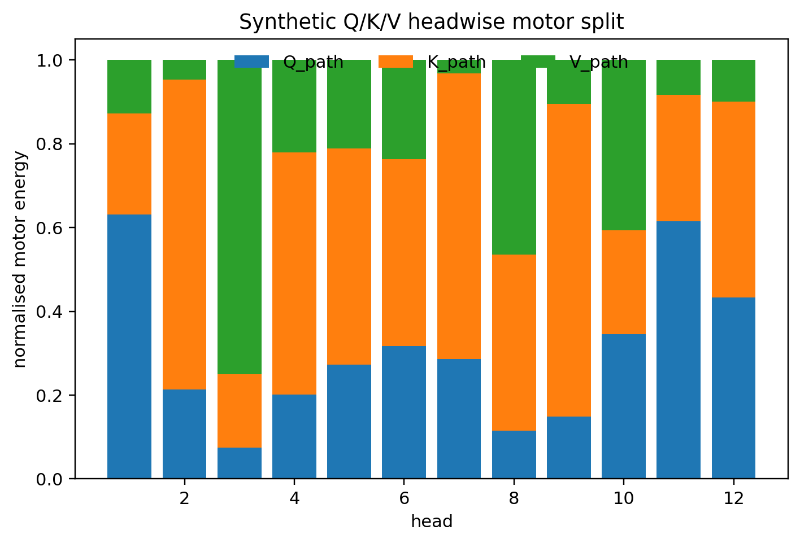

# Chapter 9: headwise synthesis, depth recursion, and canonical score motors

[Library index](../README.md) · [Source and transcription policy](../SOURCE.md) · [Previous pages: PDF 318–324](0318-0324-ch09-mlm-graph-feedforward-and-softmax.md#pdf-0324) · [Next pages: PDF 330–334](0330-0334-ch09-sa-maps-and-low-rank-motors.md#pdf-0330)

> Editorial note: Full transcription of PDF 325–329 (printed pages 289–293), including Figure 9.7, objects 9.10–9.17, all prose, proofs, and displays. The schematic block decomposition, row-vector product ordering, fixed-token notation, and differentiability assumptions are preserved as printed. Their exact scope is discussed in [note 89](../notes/89-qkv-paths-and-headwise-pullback.md), [note 90](../notes/90-block-synthesis-depth-recursion-and-residual-bounds.md), and [note 91](../notes/91-signature-differential-chain-and-sa-motors.md). Proposition 9.16 begins on PDF 328 and its proof is on PDF 329.

## PDF 325 · Book 289

These formulas separate three kinds of motors.

1. The value motor transports the incoming signal through the value vectors selected by $a_m$.
2. The coefficient motor measures how the output would change under probability-weight perturbations.
3. The score motor pushes that variation through the simplex tangent constraint and then into query and key space.

Pulling these motors through the linear projections gives parameter-gradient contributions for $W_Q$, $W_K$, and $W_V$. For a fixed local token contribution, these gradients are outer products or sums of few outer products.

**Remark 9.10.** The Q/K/V motor decomposition is local to a fixed parametrisation and fixed layer. It does not contradict the head-gauge non-identifiability of Chapter 8. Within a layer, the parametrisation supplies computational coordinates; across layers, those coordinates are not canonical dynamical identities.

### 9.10 Headwise motor decomposition

Let the multi-head output be

$$
\operatorname{MHA}(X)=\operatorname{Concat}(o^{(1)},\ldots,o^{(H)})W_O.
$$

An incoming motor at the block output is first pulled back by $W_O^\top$ and then split into head segments. Each segment is propagated through the corresponding value, score, query, and key paths.

**Theorem 9.11 (Headwise motor decomposition).** In a fixed layer and fixed parametrisation, the backward motor at the output of multi-head attention decomposes into headwise motors after pullback by $W_O^\top$. Each headwise motor then propagates independently through that head’s Q/K/V computational path, before the resulting motors are recombined at the shared input representation.

*Proof.* The forward map is affine in the concatenated head output. Its pullback is multiplication by $W_O^\top$. The resulting vector is partitioned according to the head dimensions. Each partition enters the corresponding head’s local computation, whose Q/K/V paths share the same input representation but have distinct parameter matrices. $\square$

The theorem gives a precise interpretation to headwise analysis. A head is a local differential channel inside a fixed block, but its index does not define a canonical identity across depth. This distinction reconciles the motor decomposition with the signature-geography viewpoint.

### 9.11 Block-level motor synthesis

The local formulas can be assembled into a single block-level statement. Let $g_m^+$ denote the incoming motor at the output of an encoder block, restricted to the masked position. The pullback through the block produces a motor at the input representation $X$. It contains a direct residual term, a feed-forward term, and the sum of the headwise attention terms.

For a single head, write the headwise contribution as

$$
\mathcal Q_h(g_m^+)+\mathcal K_h(g_m^+)+\mathcal V_h(g_m^+),
$$

## PDF 326 · Book 290

**Figure 9.7:** Synthetic headwise Q/K/V motor-energy split. The figure illustrates that different heads may carry different proportions of query, key, and value motor energy.

where the three terms denote the motors propagated through the query, key, and value paths after the output-projection split and the softmax tangent constraint.

**Theorem 9.12 (Block-level motor synthesis).** For one encoder block and one masked token $m$, the pullback of an incoming motor $g_m^+$ has the schematic decomposition

$$
g_m^-=g_m^++\mathcal M_{\mathrm{FFN}}(g_m^+)
+\sum_{h=1}^{H}
\bigl[\mathcal Q_h(g_m^+)+\mathcal K_h(g_m^+)+\mathcal V_h(g_m^+)\bigr],
$$

where $g_m^+$ is the residual motor, $\mathcal M_{\mathrm{FFN}}$ is the feed-forward gated motor, and the summation collects the headwise attention motors.

*Proof.* The residual branch contributes the identity pullback $g_m^+$. The feed-forward branch gives the gated pullback described in Proposition 9.6. The multi-head branch is first pulled back by the output projection $W_O^\top$, then split into head segments by Theorem 9.11. Each segment propagates through the value, coefficient, score, query, and key formulas of Section 9.9. Summing the contributions at the shared input representation gives the displayed decomposition. $\square$

The theorem does not assert that the three attention terms are orthogonal or independent. They share the same input representation and may interact through aggregation across heads and tokens. Its purpose is structural: it identifies the routes through which a local variation can reach the input bus of the block.

### 9.12 Motor recursion across stacked blocks

The previous theorem gives a one-block decomposition. Stacking blocks turns it into a recursion. Let

$$
g_m^{(\ell)}=\frac{\partial L_m}{\partial X_m^{(\ell)}}
$$

## PDF 327 · Book 291

be the motor at the residual stream entering layer $\ell$. If $\mathcal B_\ell$ denotes the forward encoder block and $J_\ell$ its local Jacobian at the current input, then

$$
g_m^{(\ell)}=g_m^{(\ell+1)}J_\ell.
$$

Iterating gives

$$
g_m^{(\ell)}
=g_m^{(L+1)}J_LJ_{L-1}\cdotsJ_\ell.
$$

**Theorem 9.13 (Motor recursion across depth).** For a stack of $L$ differentiable encoder blocks, the motor at layer $\ell$ is obtained by pulling back the final motor through the sequence of structural motors:

$$
g_m^{(\ell)}=g_m^{(L+1)}\prod_{r=\ell}^{L}J_r,
$$

with the product ordered from the last applied pullback to the first.

*Proof.* The statement follows by repeated application of the chain rule. The one-step identity is $g_m^{(r)}=g_m^{(r+1)}J_r$. Iterating from $r=L$ down to $r=\ell$ gives the formula. $\square$

This recursion is the backward analogue of the depth-wise re-extraction picture of Chapter 8. Chapter 8 follows the empirical signature geography $\mu_\ell$ forward in depth. The present section follows the motor $g_m^{(\ell)}$ backward in depth. The two views meet when the motor is pushed through the score and softmax maps and then projected onto signature space.

### 9.13 Residual-path approximation

Transformer blocks are residual maps. Locally, the Jacobian of a block can often be written schematically as

$$
J_\ell=I+E_\ell,
$$

where $E_\ell$ collects the non-residual contribution of attention, feed-forward, and normalisation effects. This decomposition does not make the non-residual term negligible in general, but it gives a useful perturbative regime.

**Proposition 9.14 (Residual-path bound).** Assume that $\|E_\ell\|\le\varepsilon_\ell$ for $\ell=1,\ldots,L$. Then the motor recursion satisfies

$$
\|g_m^{(\ell)}\|
\le\|g_m^{(L+1)}\|\prod_{r=\ell}^{L}(1+\varepsilon_r).
$$

If $\sum_{r=\ell}^{L}\varepsilon_r$ is small, then the residual path dominates the first-order propagation and the accumulated non-residual amplification is controlled by

$$
\prod_{r=\ell}^{L}(1+\varepsilon_r)
\le\exp\left(\sum_{r=\ell}^{L}\varepsilon_r\right).
$$

*Proof.* The first inequality follows from submultiplicativity:

$$
\left\|g_m^{(L+1)}\prod_{r=\ell}^{L}(I+E_r)\right\|
\le
\|g_m^{(L+1)}\|\prod_{r=\ell}^{L}\|I+E_r\|
\le
\|g_m^{(L+1)}\|\prod_{r=\ell}^{L}(1+\varepsilon_r).
$$

The exponential bound follows from $1+x\le e^x$. $\square$

## PDF 328 · Book 292

**Conjecture 9.15 (Layer-wise residual perturbation profile).** In trained encoder-style Transformers, the effective perturbation size $\varepsilon_\ell$ is expected to be non-uniform across depth: early layers may exhibit larger reformatting effects, middle layers may exhibit stronger task-sensitive perturbations, and upper layers may stabilise around smaller residual corrections. The conjecture is falsifiable by estimating local block Jacobian norms or finite-difference motor amplification across layers.

The phrase “residual-path approximation” is therefore used in a restricted sense. It means that a controlled part of the backward motor follows the identity component of the residual stream, while the non-residual motors contribute bounded deviations. It is not a claim that attention or feed-forward branches are functionally negligible.

### 9.14 Canonical QK-pair motors and signature variation

Chapter 8 introduced the canonical score-side pair

$$
M^{(\ell,h)}=W_Q^{(\ell,h)}\bigl(W_K^{(\ell,h)}\bigr)^\top.
$$

The corresponding score matrix is

$$
L^{(\ell,h)}(X)=XM^{(\ell,h)}X^\top.
$$

The motor formalism gives the differential chain from parameter perturbations to signature perturbations.

The first variation of the canonical QK pair is

$$
dM=dW_QW_K^\top+W_QdW_K^\top.
$$

Therefore

$$
dL=dXMX^\top+XdMX^\top+XMdX^\top.
$$

If the input representation is held fixed, the score motor induced by the QK-pair motor is simply

$$
dL=XdMX^\top.
$$

This score variation is then passed through the row-softmax Jacobian:

$$
dS=D\operatorname{softmax}_L[dL].
$$

Finally, wherever the canonical projection is differentiable on the active face of the canonical hull,

$$
d\Sigma=D\Sigma(S)[dS].
$$

Thus the local motor chain is

$$
d(W_Q,W_K)\longmapsto dM\longmapsto dL\longmapsto dS\longmapsto d\Sigma.
$$

**Proposition 9.16 (Motor chain to signature space).** On any stratum where the canonical projection map is differentiable, the variation of a head signature induced by a QK-parameter perturbation is the composition

$$
d\Sigma
=D\Sigma(S)\,D\operatorname{softmax}_L
\bigl[X(dW_QW_K^\top+W_QdW_K^\top)X^\top\bigr],
$$

when the input representation is fixed.

## PDF 329 · Book 293

*Proof.* The formula is the chain rule applied to $(W_Q,W_K)\mapsto M\mapsto L\mapsto S\mapsto\Sigma$. $\square$

This proposition is the local differential bridge between the motor formalism and the signature framework. The geographies of Chapters 7 and 8 move because their local signatures have motors.

### 9.15 Symmetric–antisymmetric score motors

The motor chain to signature space must retain the symmetric–antisymmetric decomposition introduced earlier in the monograph. For a head $h$, write

$$
M^{(\ell,h)}=W_Q^{(\ell,h)}\bigl(W_K^{(\ell,h)}\bigr)^\top,\qquad
M^{(\ell,h)}=M_s^{(\ell,h)}+M_a^{(\ell,h)},
$$

where

$$
M_s^{(\ell,h)}
=\frac12\left(M^{(\ell,h)}+\bigl(M^{(\ell,h)}\bigr)^\top\right),
\qquad
M_a^{(\ell,h)}
=\frac12\left(M^{(\ell,h)}-\bigl(M^{(\ell,h)}\bigr)^\top\right).
$$

The corresponding score matrix splits as

$$
L^{(\ell,h)}(X)=XM_s^{(\ell,h)}X^\top+XM_a^{(\ell,h)}X^\top.
$$

The first term is reciprocal; the second term is directional. This is not merely a forward decomposition. The backward score motor also splits into orthogonal symmetric and antisymmetric components.

Let $g_m^L\in\mathbb R^{n\times n}$ be the lifted score-matrix motor associated with the masked position $m$: it has the row motor at row $m$ and zero entries elsewhere. The chain rule gives

$$
G_M^{(\ell,h)}
:=\frac{\partial L_m}{\partial M^{(\ell,h)}}
=X^\top g_m^L X.
$$

Define the projections

$$
P_s(A)=\frac12(A+A^\top),\qquad
P_a(A)=\frac12(A-A^\top).
$$

**Proposition 9.17 (Symmetric–antisymmetric splitting of the score motor).** The score-side motor $G_M^{(\ell,h)}$ decomposes orthogonally as

$$
G_M^{(\ell,h)}=G_s^{(\ell,h)}+G_a^{(\ell,h)},\qquad
G_s^{(\ell,h)}=P_s\bigl(G_M^{(\ell,h)}\bigr),\qquad
G_a^{(\ell,h)}=P_a\bigl(G_M^{(\ell,h)}\bigr).
$$

The component $G_s^{(\ell,h)}$ is the motor acting on $M_s^{(\ell,h)}$, while $G_a^{(\ell,h)}$ is the motor acting on $M_a^{(\ell,h)}$. Moreover,

$$
\left\langle G_s^{(\ell,h)},G_a^{(\ell,h)}\right\rangle_F=0.
$$

*Proof.* The identity $G_M=X^\top g_m^LX$ is the chain rule applied to $L=XMX^\top$. The projections $P_s$ and $P_a$ are orthogonal projections for the Frobenius inner product. Therefore the two projected motors are respectively symmetric and antisymmetric, sum to $G_M$, and are orthogonal. $\square$

Two energies follow naturally:

$$
\Gamma_s^{(\ell,h)}(X)=\|XM_s^{(\ell,h)}X^\top\|_F^2,\qquad
\Gamma_a^{(\ell,h)}(X)=\|XM_a^{(\ell,h)}X^\top\|_F^2.
$$

The antisymmetric energy is the directional energy used by the cone–energy–margin–entropy compatibility profile of Chapter 8. The symmetric energy is not absent from the model; it is a parallel motor channel. It controls reciprocal alignment and therefore contributes to the global S–A maps even when it is invisible to purely directional diagnostics.

