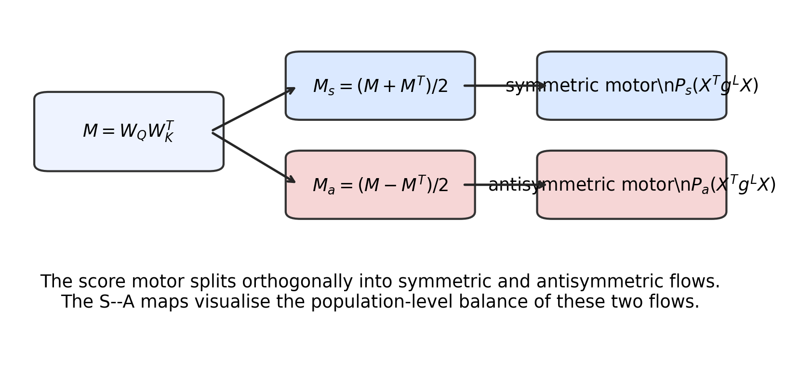
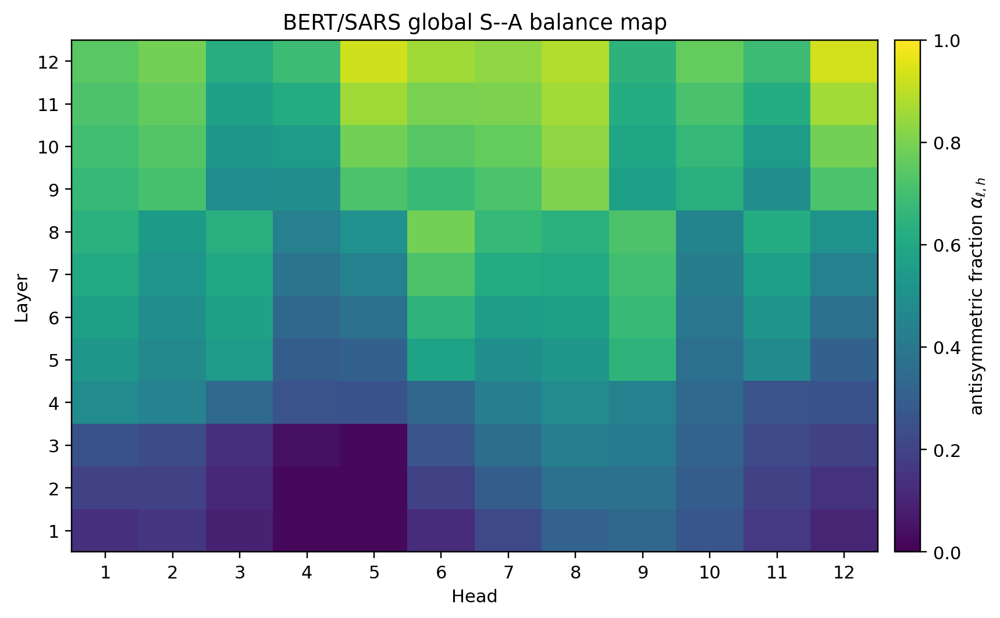
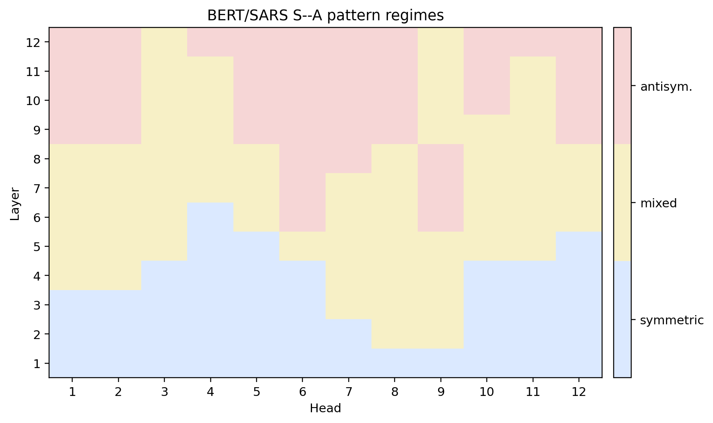
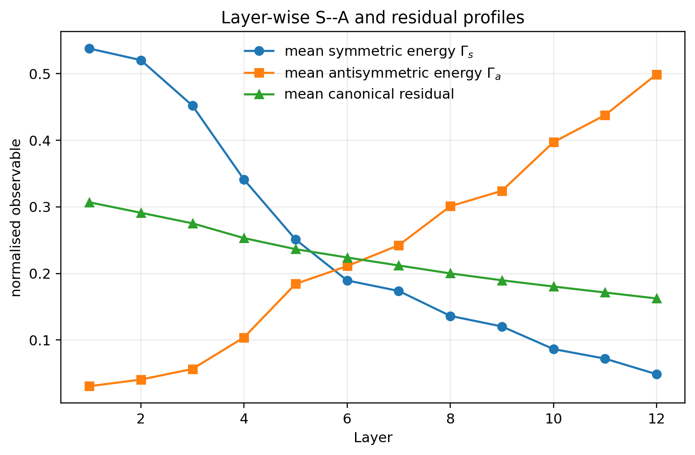
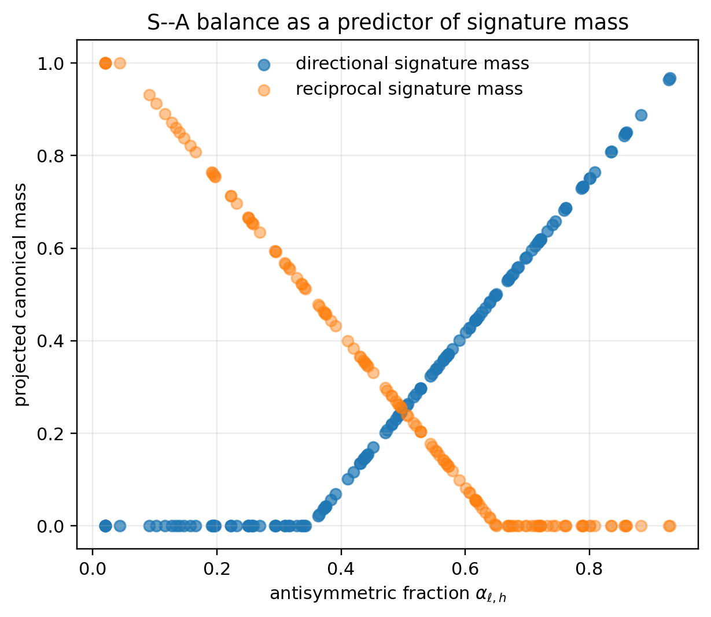

# Chapter 9: global S–A maps, signature diagnostics, and low-rank local motors

[Library index](../README.md) · [Source and transcription policy](../SOURCE.md) · [Previous pages: PDF 325–329](0325-0329-ch09-headwise-recursion-and-score-motors.md#pdf-0329) · [Next pages: PDF 335–341](0335-0341-ch09-motor-rank-anisotropy-and-bounds.md#pdf-0335)

> Editorial note: Full transcription of PDF 330–334 (printed pages 294–298), with Figures 9.8–9.12, objects 9.18–9.22, and the opening of Theorem 9.23. Figure 9.8 retains the original overlapping labels and visible literal \n text. The source’s description of the delivered maps as a reproducible template, and its schematic S–A/signature inequality, are preserved; see [note 92](../notes/92-sa-population-maps-and-local-gradient-rank.md) for their evidential and mathematical limits. Theorem 9.23 continues on [PDF 335](0335-0341-ch09-motor-rank-anisotropy-and-bounds.md#theorem-9-23-continued); its statement and proof are not truncated from the library.

## PDF 330 · Book 294

**Figure 9.8:** Symmetric–antisymmetric splitting of the score motor. The motor on $M=W_QW_K^\top$ is projected onto the symmetric and antisymmetric subspaces. The two projected flows are orthogonal and must both be kept when global BERT/SARS pattern maps are analysed.

**Definition 9.18 (S–A balance).** For a layer–head pair $(\ell,h)$, define the S–A balance

$$
\alpha_{\ell,h}=
\frac{\|M_a^{(\ell,h)}\|_F^2}
{\|M_s^{(\ell,h)}\|_F^2+\|M_a^{(\ell,h)}\|_F^2},
$$

whenever the denominator is non-zero, and set $\alpha_{\ell,h}=0$ otherwise. Values near $0$ indicate a symmetric score-side regime; values near $1$ indicate an antisymmetric score-side regime; intermediate values indicate mixed regimes.

The map $(\ell,h)\mapsto\alpha_{\ell,h}$ is the most compact way to visualise the global S–A organisation of a BERT model. It is parameter-side and gauge-stable up to head permutations. It should therefore be analysed together with the signature geography of Chapters 7–8 and the motor observables of the present chapter.

### 9.16 Global S–A pattern maps in the BERT/SARS case study

The motor formalism becomes specific only when it is applied to the global maps of the model under study. For this reason, the BERT/SARS S–A pattern maps are not auxiliary illustrations; they are the first population-level laboratory for the chapter. They show how the symmetric and antisymmetric sectors of $W_QW_K^\top$ are distributed across layers and heads, and they provide the score-side substrate from which later signature dynamics and redundancy diagnostics will be built.

For each layer–head pair define the S–A balance $\alpha_{\ell,h}$ of Definition 9.18. A global S–A map is the matrix

$$
\mathcal A_{\mathrm{SA}}=(\alpha_{\ell,h})_{\ell,h}.
$$

This map should be read alongside the energy maps

$$
\mathcal G_s=\bigl(\Gamma_s^{(\ell,h)}\bigr)_{\ell,h},
\qquad
\mathcal G_a=\bigl(\Gamma_a^{(\ell,h)}\bigr)_{\ell,h},
$$

and alongside the signature geography $\mu_\ell$ of Chapter 7.

The maps in Figures 9.9–9.10 have three uses.

## PDF 331 · Book 295

**Figure 9.9:** BERT/SARS global S–A balance map. Each cell is a layer–head pair and records the antisymmetric fraction $\alpha_{\ell,h}$. The map is the score-side companion of the signature-geography maps: it shows whether a head is primarily reciprocal, mixed, or directional before row-wise softmax and canonical projection.

**Figure 9.10:** BERT/SARS S–A regime map. The continuous balance $\alpha_{\ell,h}$ is coarse-grained into symmetric, mixed, and antisymmetric regimes. This coarse map should not replace the continuous map; it is useful for visualising global layer–head organisation and for comparing with coarse signature regimes.

## PDF 332 · Book 296

**Figure 9.11:** Layer-wise S–A and residual profiles. The symmetric and antisymmetric energies give complementary forward score-side observables, while the canonical residual monitors how much of the resulting attention behaviour is captured by the signature dictionary. Peaks and crossings are candidate transition regions for Chapters 10–11.

1. They identify reciprocal zones, where the symmetric sector dominates and attention scores are primarily affinity-like.
2. They identify directional zones, where the antisymmetric sector dominates and score non-reciprocity can survive into directed attention patterns.
3. They identify mixed zones, where neither sector should be discarded and where signature projection is expected to show barycentric mixtures rather than a single hard canonical regime.

This is why the S–A maps must be retained in the present chapter and in the later chapters. They provide a model-wide coordinate system for the score-side motors. Without them, the motor formalism remains a local differential calculus; with them, it becomes a global analysis of BERT’s layer–head organisation in the SARS case study.

**Remark 9.19 (Status of the delivered maps).** The package contains the numerical tables used to generate these maps in the folder $\mathtt{experiment/}$. They are included as a reproducible template for the BERT/SARS global-map pipeline. When checkpoint-level arrays are available, the same scripts and figure slots should be filled with the exact empirical values. The mathematical role of the maps in the chapter does not depend on this replacement: the objects to be measured are the layer–head matrices $\mathcal A_{\mathrm{SA}}$, $\mathcal G_s$, and $\mathcal G_a$.

### 9.17 From S–A maps to signature dynamics

The S–A maps live on the score side. The signature maps live after row-wise softmax and canonical projection. The bridge between them is therefore the motor chain

$$
(M_s,M_a)\longmapsto L_s+L_a
\longmapsto A=\operatorname{softmax}_{\mathrm{row}}(L)
\longmapsto\Sigma(A)=(\Lambda(A),\rho(A)).
$$

## PDF 333 · Book 297

**Figure 9.12:** S–A balance as a predictor of signature mass. The plot illustrates the expected bridge: larger antisymmetric fraction should correlate with directional signature mass, while lower antisymmetric fraction should correlate with reciprocal or symmetric signature mass. The exact relationship is mediated by softmax, input geometry, and canonical residual.

The symmetric sector controls reciprocal affinity; the antisymmetric sector controls pairwise non-reciprocity. After softmax, the two sectors need not remain additively separated, but their effects can still be detected in the barycentric signature coordinates.

**Proposition 9.20 (S–A balance as a score-side predictor of signature mass).** Assume that, on a region of inputs, the softmax projection is locally stable and the canonical projection is differentiable on the active signature face. If $\alpha_{\ell,h}$ increases while the symmetric energy and the residual contribution remain controlled, then the induced signature displacement has a positive component in the directional canonical coordinates up to a residual error term. In schematic form,

$$
\Delta\Lambda_{\mathrm{dir}}^{(\ell,h)}
\ge c\,\Delta\alpha_{\ell,h}-C\,\Delta\rho_{\ell,h},
$$

for local constants $c,C\ge0$ determined by the conditioning of the softmax and canonical projection on that region.

*Proof sketch.* Increasing $\alpha_{\ell,h}$ increases the relative contribution of the antisymmetric score sector. Under the stated stability assumptions, the row-wise softmax sends this score-side perturbation to a controlled attention-map perturbation. Differentiability of the canonical projection on the active face then sends the perturbation to the tangent cone of the signature hull. The directional coordinates receive the leading component, while non-canonical or poorly conditioned effects are absorbed into the residual term. $\square$

This bridge is important because it prevents the later chapters from treating patterns, signatures, and motors as separate catalogues. The score-side S–A map describes the decomposition of the generator $M=W_QW_K^\top$; the attention-map signature describes the

## PDF 334 · Book 298

observable behaviour after softmax; the motor decomposition describes how the same object changes under backward or training-time variation.

**Definition 9.21 (Global S–A/signature diagnostic).** For a model, input family, and layer $\ell$, define the global S–A/signature diagnostic as the tuple

$$
\mathfrak D_\ell=
\left(
(\alpha_{\ell,h})_h,
(\Gamma_s^{(\ell,h)})_h,
(\Gamma_a^{(\ell,h)})_h,
\mu_\ell,
(\rho_{\ell,h})_h
\right).
$$

It records, at the same layer, the score-side S–A balance, the two score energies, the empirical signature geography, and the canonical residuals.

The diagnostic $\mathfrak D_\ell$ is the object that should be propagated to Chapters 10–14. Chapter 10 can decompose the self-attention motor using $G_s$ and $G_a$. Chapter 11 can study how $\mathfrak D_\ell$ evolves during training. The redundancy chapters can compare signature crowding with S–A crowding: two heads may have similar attention signatures but different score-side motors, or conversely similar S–A balance but different residual behaviour.

### 9.18 Low-rank local motors

The formulas above repeatedly produce outer products. This is not an accident. It is a structural feature of local affine maps.

**Proposition 9.22 (Low-rank local motor contributions).** For a fixed token and a fixed local affine map $u=xW+b$, the parameter-gradient contribution has the form

$$
\frac{\partial L}{\partial W}=x^\top\delta,
$$

where $\delta=\partial L/\partial u$. Hence the local contribution has rank at most one. A sum of $r$ such local contributions has rank at most $r$.

*Proof.* The derivative of $u=xW+b$ with respect to $W$ gives the outer product of the input activation and the output motor. The rank bound for sums follows from subadditivity of rank. $\square$

The proposition should not be overread. It does not imply that full-batch gradients or trained weight updates are globally low-rank. It identifies a local motif: elementary motors often enter parameter space through outer products. This motif becomes important when combined with headwise decomposition, sparse gates, and repeated signature crowding.

### 9.19 Low-rank batch motors

The rank-one local result becomes more informative when a batch is considered. Let $A\in\mathbb R^{B\times d_{\mathrm{model}}}$ be the matrix of hidden states at the masked positions and let $\Delta\in\mathbb R^{B\times D}$ be the matrix whose rows are the prediction-error covectors $\delta_m=z_m-t_m$.

**Theorem 9.23 (Low-rank batch gradient).** The decoder-gradient contribution of a batch satisfies

$$
\frac{\partial L}{\partial W_D}=A^\top\Delta.
$$

Consequently,

$$
\operatorname{rank}\left(\frac{\partial L}{\partial W_D}\right)
\le\min(\operatorname{rank}A,\operatorname{rank}\Delta)
\le\min(B,d_{\mathrm{model}},D).
$$

> Editorial continuation: Theorem 9.23 continues with an additional statement and its proof on [PDF 335](0335-0341-ch09-motor-rank-anisotropy-and-bounds.md#theorem-9-23-continued). The page boundary above is the end of PDF 334, not the end of the theorem.

