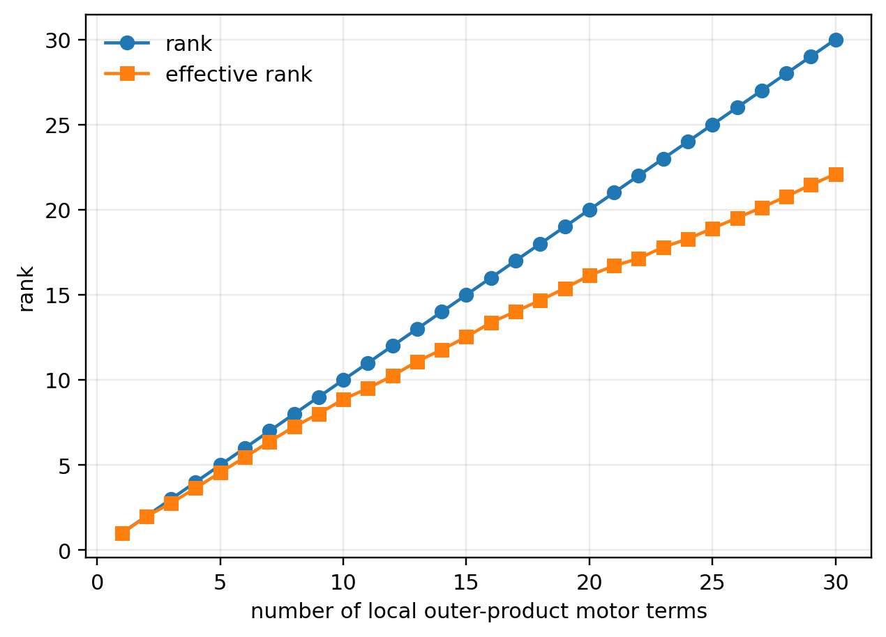
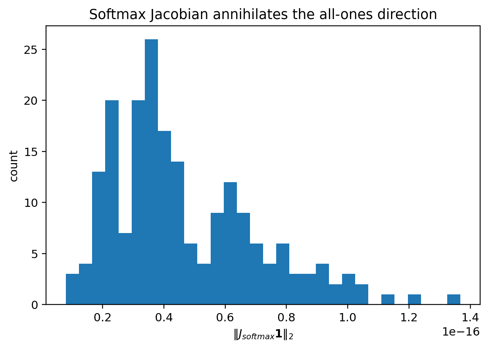
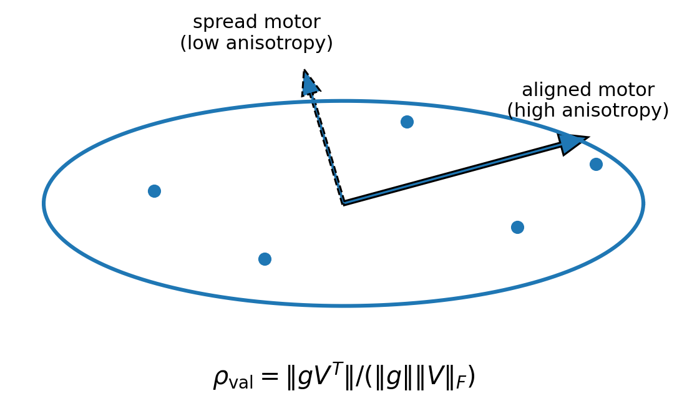

# Chapter 9: motor rank, anisotropy, conditional bounds, and limitations

[Library index](../README.md) · [Source policy](../SOURCE.md) · [Previous: PDF 330–334](0330-0334-ch09-sa-maps-and-low-rank-motors.md#pdf-0334) · [Next: Chapter 10, PDF 342–346](0342-0346-ch10-canonical-pair-and-score-splitting.md#pdf-0342)

> Editorial note: Full transcription of PDF 335–341 (printed pages 299–305). This file begins with the continuation and proof of Theorem 9.23 from PDF 334 and completes Chapter 9. Figures 9.13–9.15 and Table 9.2 are retained. The source's effective-rank qualification, repeated anisotropy definitions, row/column conventions, and conditional “forward” bounds are preserved; separate Russian notes 93–96 discuss their limits.

## PDF 335 · Book 299

**Figure 9.13:** Synthetic accumulation of local outer-product motor terms. The exact rank grows at most linearly with the number of terms, while the effective rank may remain lower when terms are correlated.

*Theorem 9.23, continued from [PDF 334](0330-0334-ch09-sa-maps-and-low-rank-motors.md#theorem-9-23).*

If the error matrix $\Delta$ is effectively concentrated on $r$ singular directions, then the gradient is effectively rank $r$ in the same spectral sense.

*Proof.* The per-token decoder gradient is $A_m^\top\delta_m$. Summing over the batch gives $A^\top\Delta$. The rank bound follows from $\operatorname{rank}(MN)\le\min(\operatorname{rank}M,\operatorname{rank}N)$. The effective-rank statement is spectral: multiplication by $A^\top$ cannot create more significant singular directions than are present in $\Delta$, except through conditioning effects. $\square$

**Remark 9.24 (Relation to low-rank adaptation).** The theorem is not a theorem about LoRA or about any particular fine-tuning method. It supplies a local algebraic reason why low-rank update structures are natural: many gradient contributions enter parameter space as products of an activation matrix and an error matrix. Low-rank adaptation methods exploit a compatible fact at the level of trainable update parametrisation.

### 9.20 Motor observables and small experiments

The motor formalism becomes useful only if it produces observables. The following quantities will be used in later chapters.

- **Motor norm:** the magnitude of a signal or effective motor.
- **Motor rank and effective rank:** the rank structure of local or aggregated parameter-gradient contributions.
- **Headwise motor energy:** the distribution of Q/K/V motor energy across heads.
- **Softmax tangent energy:** score variation surviving row-normalisation.
- **Gate sparsity:** the fraction of active feed-forward channels.
- **Signature motor norm:** the size of $d\Sigma$ induced by a parameter or representation perturbation.
- **Alignment with signature velocity:** the cosine between a motor-induced $d\Sigma$ and the observed training-time or depth-wise signature displacement.

## PDF 336 · Book 300

**Table 9.2:** Synthetic diagnostics included with the chapter. Values are illustrative and are used only to make the definitions concrete.

| Diagnostic | Synthetic value |
|---|---:|
| Mean $\lVert J_{\mathrm{softmax}}\mathbf1\rVert_2$ | $2.8\cdot10^{-17}$ |
| Final exact rank after 30 outer-product terms | 30 |
| Final effective rank after 30 outer-product terms | 19.2 |
| Mean active ReLU fraction | 0.56 |
| Number of synthetic heads in Q/K/V split | 12 |

**Figure 9.14:** Synthetic verification that the softmax Jacobian annihilates the all-ones direction. Numerical values concentrate near machine precision.

The package contains small synthetic experiments that illustrate these observables. These experiments are not empirical claims about BERT. They are didactic tests of the formulas: softmax motors lie in the tangent space, local affine motors are outer products, ReLU gates sparsify transmission, and heads may split motor energy differently among Q, K, and V paths.

### 9.21 Anisotropy invariant of the value-path motor

The value path is constrained by convexity, but its backward motor can still be highly anisotropic. Let $g_m^{\mathrm{head}}$ be the incoming motor at the output of a head, and let $V\in\mathbb R^{n\times d_v}$ be the value matrix. The coefficient motor is

$$
\frac{\partial\mathcal L}{\partial a_m}=g_m^{\mathrm{head}}V^\top.
$$

It measures how strongly each value vector is seen by the incoming head motor.

**Definition 9.25 (Value-path anisotropy invariant).** For a fixed layer, head, and masked position, define

$$
\rho_{\mathrm{val}}=
\frac{\lVert g_m^{\mathrm{head}}V^\top\rVert_2}
{\lVert g_m^{\mathrm{head}}\rVert_2\,\lVert V\rVert_F},
$$

whenever the denominator is non-zero, and set $\rho_{\mathrm{val}}=0$ otherwise.

## PDF 337 · Book 301

**Proposition 9.26 (Basic properties of the anisotropy invariant).** The quantity $\rho_{\mathrm{val}}$ satisfies $0\le\rho_{\mathrm{val}}\le1$. It is large when the incoming head motor aligns with a small number of dominant value directions, and small when the motor is spread almost isotropically over the value cloud.

*Proof.* The upper bound follows from

$$
\lVert g_m^{\mathrm{head}}V^\top\rVert_2
\le \lVert g_m^{\mathrm{head}}\rVert_2\lVert V^\top\rVert_2
\le \lVert g_m^{\mathrm{head}}\rVert_2\lVert V\rVert_F.
$$

The lower bound is immediate. The interpretation follows from equality and near-equality cases in the operator-norm estimate. $\square$

**Conjecture 9.27 (Layer-stratified value anisotropy).** In trained BERT-like encoders, value-path anisotropy is expected to be layer-stratified: lower layers should display broader value spreading, middle layers should show increased head differentiation, and upper layers should contain a mixture of highly anisotropic task-sensitive heads and low-energy redundant heads.

This invariant complements the signature observables of Chapters 7 and 8. Signature geometry describes what attention maps look like; $\rho_{\mathrm{val}}$ records how strongly the backward motor uses the value directions selected by those maps.

### 9.22 Motor anisotropy invariants

Two anisotropy observables will be useful. The first measures how strongly the value path aligns with the incoming head motor. The second measures how much of the coefficient motor survives the simplex-tangent constraint of softmax. The notation avoids $\rho$, which is reserved elsewhere for canonical residual coordinates.

#### 9.22.1 Value-path anisotropy

Let $g_m^{\mathrm{head}}$ be the incoming motor at the output of a head, and let $V\in\mathbb R^{n\times d_v}$ be the value matrix. Define

$$
\alpha_{\mathrm{val}}=
\frac{\lVert g_m^{\mathrm{head}}V^\top\rVert_2}
{\lVert g_m^{\mathrm{head}}\rVert_2\,\lVert V\rVert_F},
$$

with value 0 if the denominator vanishes.

**Proposition 9.28 (Value-path anisotropy).** The invariant $\alpha_{\mathrm{val}}$ satisfies $0\le\alpha_{\mathrm{val}}\le1$. It is large when the incoming motor aligns with a small number of dominant value directions, and small when the motor is spread almost isotropically over the value cloud.

*Proof.* The estimate follows from $\lVert gV^\top\rVert_2\le\lVert g\rVert_2\lVert V^\top\rVert_2\le\lVert g\rVert_2\lVert V\rVert_F$. $\square$

#### 9.22.2 Softmax-tangent anisotropy

Let

$$
J_{\mathrm{SA}}(a)=\frac1{\sqrt{d_k}}\bigl(\operatorname{diag}(a)-aa^\top\bigr)
$$

be the score-side softmax Jacobian, including the usual attention scaling. For the coefficient motor $u=g_m^{\mathrm{head}}V^\top$, define

$$
\chi_{\mathrm{sa}}=\frac{\lVert J_{\mathrm{SA}}(a)^\top u\rVert_2}{\lVert u\rVert_2},
$$

with value 0 when $u=0$.

## PDF 338 · Book 302

**Figure 9.15:** Value-path anisotropy. A head motor aligned with a dominant direction of the value cloud produces high anisotropy; a motor spread across many value directions produces lower anisotropy.

**Proposition 9.29 (Softmax-tangent anisotropy).** The invariant $\chi_{\mathrm{sa}}$ vanishes when $u$ is proportional to the all-ones vector. It is large when the coefficient motor has a strong component in the simplex tangent directions selected by $a$. Moreover,

$$
0\le\chi_{\mathrm{sa}}
\le\frac1{\sqrt{d_k}}\lVert\operatorname{diag}(a)-aa^\top\rVert_{\mathrm{op}}.
$$

*Proof.* The kernel statement follows from $(\operatorname{diag}(a)-aa^\top)\mathbf1=0$. The upper bound is the operator-norm inequality applied to $J_{\mathrm{SA}}(a)^\top u$. $\square$

**Conjecture 9.30 (Layer-stratified motor anisotropy).** In trained BERT-like encoders, the layer-wise means of $\alpha_{\mathrm{val}}$ and $\chi_{\mathrm{sa}}$ are expected to be stratified across depth: lower layers should show broad, weakly anisotropic value spreading; middle layers should show stronger head differentiation; upper layers should contain a mixture of highly anisotropic task-sensitive heads and low-energy redundant heads.

### 9.23 Cone- and anisotropy-stratified motor bounds

The residual-path approximation becomes more informative when the non-residual correction is controlled by forward observables. The following result is formulated conditionally. Its role is to state exactly what must be measured in order to turn the approximation into an empirical statement.

Let $J_\ell=I+E_\ell$ be the local residual decomposition of the block Jacobian. Suppose that the non-residual term splits as

$$
E_\ell=E_\ell^{\mathrm{MLP}}+E_\ell^{\mathrm{MHA}}.
$$

Let $I_{\mathrm{cone}}^{(\ell)}$ be the cone index of the input representation at layer $\ell$, and let $\bar\chi_{\mathrm{sa}}^{(\ell+1)}$ be the layer-wise mean softmax-tangent anisotropy of the next attention extraction.

**Theorem 9.31 (Cone- and anisotropy-stratified bound).** Assume that constants $\kappa_\ell^{\mathrm{MLP}},\kappa_\ell^{\mathrm{MHA}}\ge0$ satisfy

$$
\lVert E_\ell^{\mathrm{MLP}}\rVert
\le \kappa_\ell^{\mathrm{MLP}}\sqrt{1-I_{\mathrm{cone}}^{(\ell)}}
$$

## PDF 339 · Book 303

and

$$
\lVert E_\ell^{\mathrm{MHA}}\rVert
\le \kappa_\ell^{\mathrm{MHA}}\bar\chi_{\mathrm{sa}}^{(\ell+1)}.
$$

Then

$$
\lVert E_\ell\rVert
\le \kappa_\ell^{\mathrm{MLP}}\sqrt{1-I_{\mathrm{cone}}^{(\ell)}}
+\kappa_\ell^{\mathrm{MHA}}\bar\chi_{\mathrm{sa}}^{(\ell+1)}.
$$

Consequently, the residual-path bound of Proposition 9.14 can be written entirely in terms of these forward observables and the constants $\kappa_\ell^{\mathrm{MLP}},\kappa_\ell^{\mathrm{MHA}}$.

*Proof.* The displayed bound follows from the triangle inequality $\lVert E_\ell\rVert\le\lVert E_\ell^{\mathrm{MLP}}\rVert+\lVert E_\ell^{\mathrm{MHA}}\rVert$ and the two hypotheses. Substitution into Proposition 9.14 gives the claimed residual-path estimate. $\square$

**Corollary 9.32 (Forward-controlled residual-path estimate).** Under the hypotheses of Theorem 9.31,

$$
\lVert g_m^{(\ell)}\rVert
\le \lVert g_m^{(L+1)}\rVert
\exp\!\left(
\sum_{r=\ell}^{L}
\left[
\kappa_r^{\mathrm{MLP}}\sqrt{1-I_{\mathrm{cone}}^{(r)}}
+\kappa_r^{\mathrm{MHA}}\bar\chi_{\mathrm{sa}}^{(r+1)}
\right]\right).
$$

This is the bridge result of the chapter. The forward observables that organise attention geography also control, under explicit hypotheses, the deviation of the backward motor from the pure residual path.

### 9.24 Interface with the next chapters

The motor formalism prepares three subsequent developments.

First, **Chapter 10 can refine the self-attention motor.** The present chapter decomposes attention into value, coefficient, score, query, and key paths. The next chapter can isolate the self-attention motor itself, separate symmetric and antisymmetric score components, and study how those components affect canonical signatures.

Second, **Chapter 11 can turn motors into training-time dynamics.** If training follows

$$
\dot\theta(t)=-\nabla_\theta\mathcal L(\theta(t)),
$$

then the signature dynamics can be read locally through

$$
\dot\Sigma=D\Sigma(S)\,D\operatorname{softmax}_L\,DL_\theta[\dot\theta].
$$

The term $DL_\theta[\dot\theta]$ is a score-side motor, and the remaining factors are structural motors.

Third, **the redundancy chapters can use motor observables.** A head may be geometrically redundant in signature space but still carry a large motor norm. Conversely, a head may have a visually distinctive attention map but negligible functional motor contribution. Thus redundancy must combine signature crowding with motor marginality.

The resulting principle is:

> A signature describes where a head is in attention geometry; a motor describes how that head can move or how it transmits variation.

## PDF 340 · Book 304

### 9.25 Scope and limitations

Several limitations should be made explicit.

First, a motor is a local differential object, not automatically a semantic explanation. A motor identifies how variation can move through the graph. It does not, by itself, prove that the corresponding component is causally necessary for a task. Causal replacement, ablation, patching, or counterfactual testing remains necessary.

Second, the formulas in this chapter are written for clean local components. Real implementations include layer normalisation variants, dropout during training, batching, token masking details, and architectural modifications. These do not invalidate the formalism, but they insert additional structural motors into the composition.

Third, the single-token outer-product structure should not be confused with a global low-rank theorem for full training updates. Aggregation over positions, batches, tasks, and time can increase rank substantially. The local low-rank result is a motif, not a universal compression guarantee.

Fourth, the headwise decomposition is parametrisation-dependent. It is meaningful inside a fixed layer and fixed implementation. Across depth, the canonical object is still the signature geography rather than a labelled head trajectory.

Fifth, the motor-to-signature derivative is only smooth within a fixed stratum of the canonical projection. At face crossings, signature dynamics should be treated as piecewise smooth or hybrid. This is precisely why the stratification and transport machinery of Chapter 7 remains necessary.

These limitations do not weaken the role of the chapter. They delimit it. The chapter supplies a grammar for local differential mechanisms; later chapters must decide which mechanisms are stable, causal, compressible, or useful for design.

### 9.26 Concluding Remarks

The chapter has introduced a differential anatomy of BERT through the motor formalism. The main points are the following.

1. The computational graph of the masked-position encoder block is the anatomical object from which the chapter starts.
2. The primary task motor for masked language modelling is the error vector $\delta_m=z_m-t_m$.
3. The feed-forward block is a gated motor transformer: its ReLU mask decides which channels transmit variation.
4. LayerNorm acts as a centering and norm-filtering structural motor.
5. The self-attention value path is convex before output projection.
6. The softmax Jacobian is a simplex-tangent structural motor.
7. Q/K/V paths decompose the attention motor into value, coefficient, score, query, and key contributions.
8. In a fixed layer and parametrisation, the MHA motor decomposes headwise after pullback by $W_O^\top$.
9. The block-level motor is the sum of residual, feed-forward, and headwise Q/K/V routes.

## PDF 341 · Book 305

10. Across depth, motors satisfy a recursive pullback through the Jacobians of stacked blocks.
11. Canonical QK-pair motors produce score motors, attention-map motors, and ultimately signature motors. Their symmetric and antisymmetric projections give global S–A maps that must be analysed together with signature geographies.
12. The value-path anisotropy invariant records how strongly a head motor aligns with dominant value directions.
13. Local parameter-gradient motors are often outer products and therefore low-rank before aggregation; the batch version is controlled by the rank of the error matrix.
14. Motor anisotropy invariants and cone alignment give conditional forward controls on the backward residual-path approximation.

The chapter therefore provides the local differential mechanism behind the re-extraction loop of Chapter 8. A layer re-extracts a signature geography because its computational graph transforms variation through a structured cascade of motors. This prepares the more detailed decomposition of the self-attention motor and the training-time theory of signature dynamics.

[Continue with Chapter 10 on PDF 342](0342-0346-ch10-canonical-pair-and-score-splitting.md#pdf-0342).
