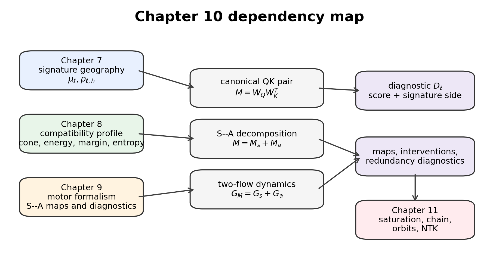
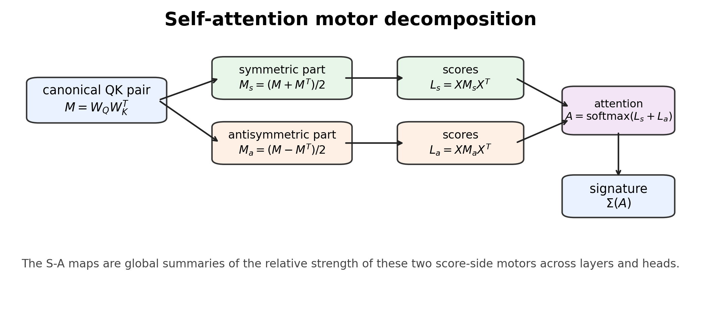
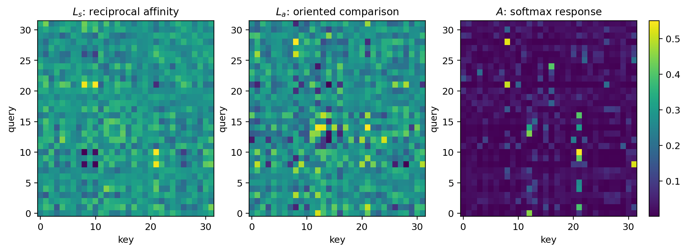

# Chapter 10: canonical QK pair and symmetric–antisymmetric score geometry

[Library index](../README.md) · [Source policy](../SOURCE.md) · [Previous: Chapter 9, PDF 335–341](0335-0341-ch09-motor-rank-anisotropy-and-bounds.md#pdf-0341) · [Next: PDF 347–350](0347-0350-ch10-softmax-adjoint-and-two-flow.md#pdf-0347)

> Editorial note: Full transcription of PDF 342–346 (printed pages 306–310), from the introduction to Chapter 10 through the opening of §10.6. Objects 10.1–10.5 and Figures 10.1–10.3 are preserved. The local score convention omits the usual scale factor; the source's interpretation of score-side balance and its later redefinition are discussed separately in Russian notes 97–99.

## PDF 342 · Book 306

## Chapter 10 — Self-Attention Motor Decomposition

Chapter 9 introduced the differential anatomy of BERT and showed that the global S–A maps observed in the SARS experiments are not peripheral diagnostics. They are the first visible layer-head projection of a deeper score-side decomposition. The present chapter develops that decomposition.

The central object is the canonical query-key pair of a head,

$$
M^{(\ell,h)}=W_Q^{(\ell,h)}(W_K^{(\ell,h)})^\top.
$$

The matrices $W_Q$ and $W_K$ are not separately canonical, because an internal $\mathrm{GL}(d_k)$ gauge can change their factorisation without changing the score bilinear form. The product $M$ is the first score-side object on which the self-attention motor can be analysed intrinsically. Its orthogonal splitting

$$
M=M_s+M_a,\qquad
M_s=\frac{M+M^\top}{2},\qquad
M_a=\frac{M-M^\top}{2},
$$

separates reciprocal affinity geometry from oriented comparison geometry.

This chapter has three purposes.

1. It gives the mathematical foundation of the S–A maps introduced in Chapter 9.
2. It shows how symmetric and antisymmetric score motors propagate through scores, softmax, attention maps, and signatures.
3. It prepares the gradient-flow and orbit analysis of the next chapter by writing the adjoint motor on $M$ and its projections onto the symmetric and antisymmetric subspaces.

The main thesis is the following.

> The global S–A maps are not merely empirical heatmaps. They are layer-head projections of the canonical symmetric–antisymmetric decomposition of the self-attention motor.

The chapter deliberately stops before claiming that the observed S–A geography is dynamically inevitable. The algebraic decomposition is inevitable: every real square matrix splits uniquely into symmetric and antisymmetric parts. The dynamical selection of a particular S–A geography under gradient descent is a training-time question. That question belongs to Chapter 11, where S–A orbits will be studied.

## PDF 343 · Book 307

**Figure 10.1:** Dependency map for Chapter 10.

*The chapter receives signature geography, compatibility observables, and motor diagnostics from Chapters 7–9. It develops the canonical S–A decomposition, the forward/backward score split, the two-flow first-order dynamics, and the diagnostic $\mathcal D_\ell$. Full saturation, training-time chain, NTK, phase diagram, and orbit theory are passed to Chapter 11.*

### 10.1 Inputs and outputs of the chapter

The chapter uses three inputs from the preceding development. Chapter 7 provides the signature geography $\mu_\ell$ and the residual coordinates $\rho_{\ell,h}$. Chapter 8 provides the compatibility profile and the forward observables that organise re-extraction across depth. Chapter 9 provides the motor formalism and the empirical S–A maps obtained from BERT/SARS runs.

The output of the present chapter is narrower than a full theory of training. It proves that the S–A maps are grounded in a canonical decomposition of the self-attention score motor and then adds the first-order two-flow dynamics of that decomposition. The saturation theorem, the training-time chain, NTK reformulation, and phase diagram are intentionally deferred to Chapter 11.

### 10.2 The gauge-canonical QK pair

For one layer and one head, let

$$
Q=XW_Q,\qquad K=XW_K,
$$

where $X\in\mathbb R^{n\times d}$ is the token representation matrix. The unnormalised score matrix is

$$
L=QK^\top=XW_QW_K^\top X^\top.
$$

Thus the score geometry depends on $W_Q$ and $W_K$ only through

$$
M=W_QW_K^\top.
$$

If $A\in\mathrm{GL}(d_k)$, then

$$
W_Q\mapsto W_QA,\qquad W_K\mapsto W_KA^{-\top}
$$

## PDF 344 · Book 308

leaves $M$ invariant. Hence the pair $(W_Q,W_K)$ is gauge-dependent, while $M$ is the gauge-canonical score-side object.

**Definition 10.1 (Canonical QK pair).** The matrix

$$
M^{(\ell,h)}=W_Q^{(\ell,h)}(W_K^{(\ell,h)})^\top
$$

will be called the canonical QK pair of head $h$ at layer $\ell$.

**Proposition 10.2 (Gauge invariance of the QK pair).** The canonical QK pair is invariant under the internal transformation $W_Q\mapsto W_QA$, $W_K\mapsto W_KA^{-\top}$ for every $A\in\mathrm{GL}(d_k)$. The score matrix $L=XMX^\top$ is therefore determined by $X$ and $M$, not by the particular factorisation of $M$ into query and key matrices.

*Proof.* The transformed product is

$$
(W_QA)(W_KA^{-\top})^\top=W_QAA^{-1}W_K^\top=W_QW_K^\top.
$$

Substitution into $L=XMX^\top$ gives the second statement. $\square$

The analysis of this chapter is therefore conducted on $M$, not on the non-canonical pair $(W_Q,W_K)$.

### 10.3 Symmetric–antisymmetric decomposition

Let $\mathcal S_d$ be the vector space of real symmetric $d\times d$ matrices and let $\mathcal A_d$ be the vector space of real antisymmetric $d\times d$ matrices. Every real square matrix admits the decomposition

$$
M=M_s+M_a,\qquad
M_s=\frac{M+M^\top}{2},\qquad
M_a=\frac{M-M^\top}{2}.
$$

**Theorem 10.3 (Orthogonal S–A decomposition).** For every real square matrix $M$, the decomposition $M=M_s+M_a$ is unique. Moreover,

$$
\langle M_s,M_a\rangle_F=0,\qquad
\lVert M\rVert_F^2=\lVert M_s\rVert_F^2+\lVert M_a\rVert_F^2.
$$

*Proof.* The formulas define a symmetric matrix $M_s$ and an antisymmetric matrix $M_a$ whose sum is $M$. If $M=S+A$ with $S^\top=S$ and $A^\top=-A$, then $M^\top=S-A$, so $S=(M+M^\top)/2$ and $A=(M-M^\top)/2$. Orthogonality follows from

$$
\langle S,A\rangle_F=\operatorname{tr}(S^\top A)
=\operatorname{tr}(SA)=\operatorname{tr}((SA)^\top)
=\operatorname{tr}(A^\top S^\top)
=\operatorname{tr}(-AS)=-\operatorname{tr}(SA).
$$

Hence $\operatorname{tr}(SA)=0$. $\square$

The decomposition is not a modelling choice. It is forced by linear algebra. What remains empirical is the distribution of the two components across layers and heads, and the way training changes their relative magnitudes.

### 10.4 Forward score geometry

The forward score matrix is

$$
L=XMX^\top=XM_sX^\top+XM_aX^\top.
$$

Define

$$
L_s=XM_sX^\top,\qquad L_a=XM_aX^\top.
$$

## PDF 345 · Book 309

**Figure 10.2:** The canonical QK pair decomposes into symmetric and antisymmetric motors. These components generate score components, pass through row-softmax, and ultimately induce variations of attention signatures.

**Proposition 10.4 (S–A score splitting).** The score components satisfy

$$
L_s^\top=L_s,\qquad L_a^\top=-L_a,\qquad
\langle L_s,L_a\rangle_F=0.
$$

Consequently,

$$
\lVert L\rVert_F^2=\lVert L_s\rVert_F^2+\lVert L_a\rVert_F^2.
$$

*Proof.* Since $M_s$ is symmetric,

$$
L_s^\top=(XM_sX^\top)^\top=XM_s^\top X^\top=XM_sX^\top=L_s.
$$

Similarly, since $M_a^\top=-M_a$, one has $L_a^\top=-L_a$. Orthogonality follows from the same trace argument as in Theorem 10.3 applied in score space. $\square$

This gives the first quantitative observables:

$$
\Gamma_s=\lVert XM_sX^\top\rVert_F,\qquad
\Gamma_a=\lVert XM_aX^\top\rVert_F.
$$

The S–A balance of a head is defined as

$$
\alpha_{\mathrm{SA}}=\frac{\Gamma_a}{\Gamma_s+\Gamma_a+\varepsilon},
$$

where $\varepsilon>0$ is a small numerical stabiliser. Values near 0 indicate symmetric-score dominance; values near 1 indicate antisymmetric-score dominance; intermediate values indicate mixed regimes.

### 10.5 Interpretation of symmetric and antisymmetric motors

The symmetric score motor and the antisymmetric score motor have different geometric meanings.

## PDF 346 · Book 310

**Figure 10.3:** Synthetic example of symmetric and antisymmetric score components. The symmetric component encodes reciprocal affinity, while the antisymmetric component encodes oriented comparison. The row-softmax response combines both.

#### 10.5.1 Symmetric motor: reciprocal affinity

A symmetric score component satisfies $L_{ij}=L_{ji}$. It therefore measures reciprocal affinity: if token $i$ gives a high symmetric score to token $j$, token $j$ gives the same symmetric score to token $i$. This component is naturally compatible with similarity, clustering, cone alignment, and reciprocal token grouping.

The symmetric component should not be reduced to a single interpretation. A high symmetric energy can arise from lexical similarity, syntactic grouping, semantic proximity, or any mechanism in which the score geometry is approximately reciprocal. Its common mathematical feature is invariance under exchange of the two token positions.

#### 10.5.2 Antisymmetric motor: oriented comparison

An antisymmetric score component satisfies $L_{ij}=-L_{ji}$ and $L_{ii}=0$. It is not a similarity motor. It is an oriented comparison motor. If $L_{ij}$ is positive, then $L_{ji}$ is negative with the same magnitude. Thus the component encodes source-target asymmetry, order, direction, or preference.

**Proposition 10.5 (Even rank of antisymmetric motors).** Every real antisymmetric matrix has even rank. Its non-zero action is organised into two-dimensional invariant planes.

*Proof.* A real antisymmetric matrix has purely imaginary eigenvalues occurring in conjugate pairs. Equivalently, it can be brought by an orthogonal transformation to block diagonal form with $2\times2$ skew blocks and possibly zeros. Each non-zero block contributes rank two. $\square$

This explains why antisymmetric activation is not fundamentally one-dimensional. A token cloud collapsed to a line cannot fully activate an oriented comparison plane. This observation is consistent with the compatibility-profile analysis of Chapter 8 and the motor-anisotropy discussion of Chapter 9.

### 10.6 Softmax response and tangent decomposition

The S–A decomposition is linear at the score level. Attention maps are obtained after row-softmax:

$$
A=\operatorname{softmax}_{\mathrm{row}}(L_s+L_a).
$$

[Continue §10.6 on PDF 347](0347-0350-ch10-softmax-adjoint-and-two-flow.md#pdf-0347).
