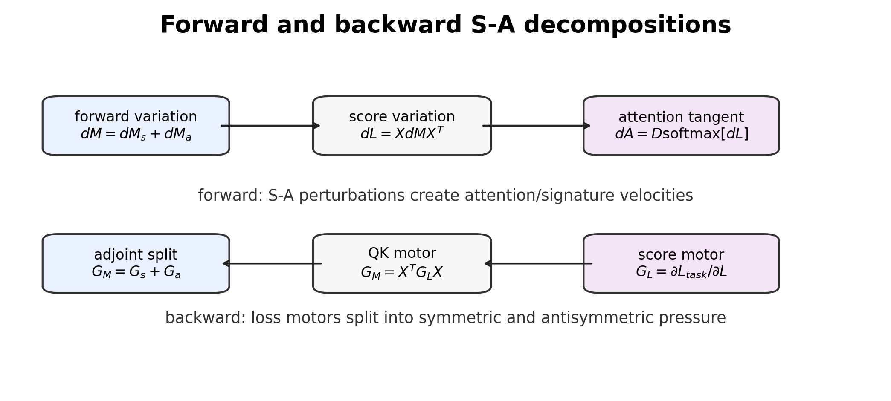
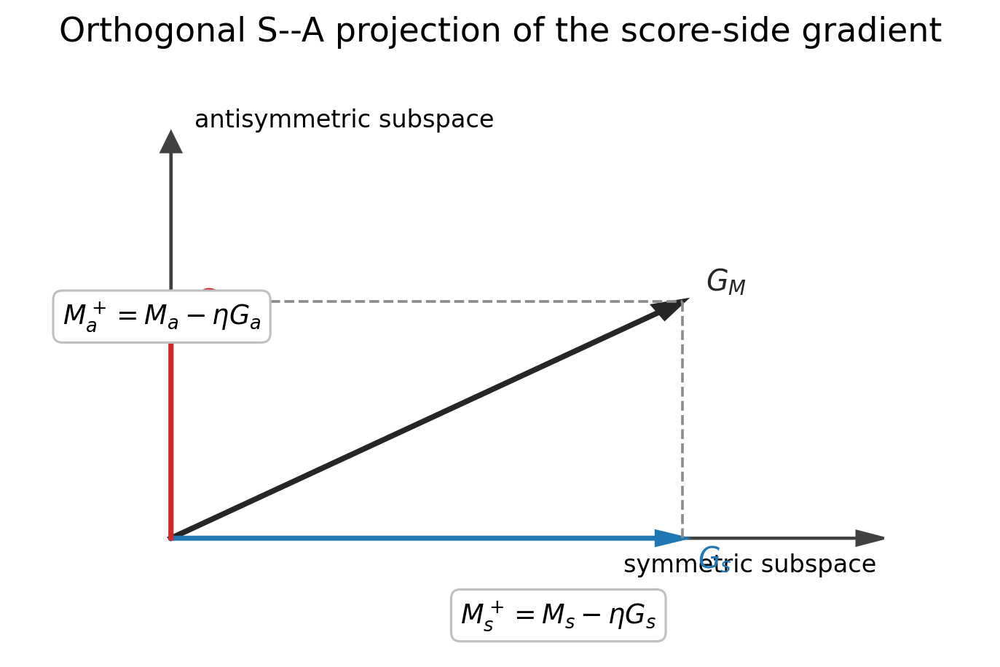

# Chapter 10: softmax tangent response, adjoint motor, and first-order two-flow dynamics

[Library index](../README.md) · [Source policy](../SOURCE.md) · [Previous: PDF 342–346](0342-0346-ch10-canonical-pair-and-score-splitting.md#pdf-0346)

> Editorial note: Full transcription of PDF 347–350 (printed pages 311–314). Objects 10.6–10.10, their proofs, Figures 10.4–10.5, and the opening paragraph of §10.9.1 are retained. The source changes the meaning of $\alpha_{\mathrm{SA}}$ and describes canonical-pair flow alongside factorised training; these issues are treated separately in Russian notes 97–99. The following corollary is announced but lies beyond this batch.

## PDF 347 · Book 311

*Continuation of [§10.6](0342-0346-ch10-canonical-pair-and-score-splitting.md#section-10-6).*

The softmax map is nonlinear, so the equality $\operatorname{softmax}(L_s+L_a)=\operatorname{softmax}(L_s)+\operatorname{softmax}(L_a)$ is false. The correct statement is first-order.

At a fixed score matrix $L$, the row-wise differential is

$$
dA=D\operatorname{softmax}_L[dL].
$$

For a score perturbation $dL=dL_s+dL_a$, define

$$
dA_s=D\operatorname{softmax}_L[dL_s],\qquad
dA_a=D\operatorname{softmax}_L[dL_a].
$$

Then

$$
dA=dA_s+dA_a.
$$

**Theorem 10.6 (First-order S–A attention response).** At any fixed score matrix $L$, the first-order variation of the attention map induced by a score perturbation decomposes linearly into symmetric-driven and antisymmetric-driven tangent motors:

$$
D\operatorname{softmax}_L[dL_s+dL_a]
=D\operatorname{softmax}_L[dL_s]+D\operatorname{softmax}_L[dL_a].
$$

Each row of these variations lies in the tangent space of the probability simplex.

*Proof.* The derivative of softmax at $L$ is a linear map. Hence it distributes over sums. The tangent-space statement follows from the fact that the softmax Jacobian annihilates the all-ones direction row by row. $\square$

This theorem is the formal reason why the S–A decomposition can be pushed into signature dynamics at first order. It should not be interpreted as a global additive decomposition of attention probabilities.

### 10.7 Backward score motor and adjoint S–A split

Let $G_L=\partial\mathcal L_{\mathrm{task}}/\partial L$ be the backward motor at the score matrix. For a parameter-side perturbation $dM$ with $X$ fixed,

$$
dL=XdMX^\top.
$$

The adjoint relation is

$$
\langle G_L,XdMX^\top\rangle_F
=\langle X^\top G_LX,dM\rangle_F.
$$

Hence the motor acting on the canonical QK pair is

$$
G_M=X^\top G_LX.
$$

It decomposes as

$$
G_s=\frac{G_M+G_M^\top}{2},\qquad
G_a=\frac{G_M-G_M^\top}{2}.
$$

**Theorem 10.7 (Adjoint S–A motor decomposition).** The backward motor on the canonical QK pair decomposes orthogonally into a symmetric pressure $G_s$ and an antisymmetric pressure $G_a$. For every decomposition $dM=dM_s+dM_a$,

$$
\langle G_M,dM\rangle_F
=\langle G_s,dM_s\rangle_F+\langle G_a,dM_a\rangle_F.
$$

*Proof.* The identity $G_M=X^\top G_LX$ follows from cyclicity of the trace. The projections onto symmetric and antisymmetric subspaces are orthogonal. Cross terms vanish because symmetric and antisymmetric matrices are Frobenius-orthogonal. $\square$

## PDF 348 · Book 312

**Figure 10.4:** Forward and backward S–A decompositions. Forward perturbations create attention and signature velocities. Backward motors split into symmetric and antisymmetric pressure on the canonical QK pair.

This theorem is the bridge to gradient flow. If training follows gradient descent, then the sign and persistence of $G_a$ determine whether the antisymmetric energy grows, shrinks, or oscillates. That analysis is deferred to Chapter 11.

### 10.8 S–A signature velocity

#### Score-side coordinates are not signatures

It is useful to separate three layers of description. The quantity $\alpha_{\mathrm{SA}}$ is a score-side coordinate: it is computed from the canonical pair $M=W_QW_K^\top$ before the input representation, row-softmax, or canonical signature projection have acted. The attention map $A=\operatorname{softmax}(XMX^\top)$ is an attention-side object: it already includes representation-side amplification by $X$ and row-wise normalisation. The signature $\Sigma(A)$ is a signature-side object: it records the location of the resulting attention map in the canonical geography developed in Chapter 7.

Thus $\alpha_{\mathrm{SA}}$ should not be read as a signature coordinate. It is a motor coordinate that predicts how a head is allowed to move score mass. The signature map records the visible geometric outcome of that motion after softmax. The bridge between the two is necessarily differential: a perturbation of $M_s$ or $M_a$ produces a tangent displacement of $A$, and only then a tangent displacement of $\Sigma(A)$ on the active canonical stratum.

Let $\Sigma(A)$ denote the canonical signature of an attention map, as defined in Chapter 7. On any stratum where the projection onto the canonical hull is differentiable, a first-order attention perturbation produces a signature perturbation

$$
d\Sigma=D\Sigma_A[dA].
$$

Combining this with the first-order S–A response gives

$$
d\Sigma_s=D\Sigma_A\!\left[D\operatorname{softmax}_L[dL_s]\right],
\qquad
d\Sigma_a=D\Sigma_A\!\left[D\operatorname{softmax}_L[dL_a]\right].
$$

Therefore

$$
d\Sigma=d\Sigma_s+d\Sigma_a.
$$

## PDF 349 · Book 313

**Proposition 10.8 (S–A decomposition of signature velocity).** On a differentiability stratum of the canonical signature map, the first-order signature velocity induced by a score perturbation decomposes into symmetric-driven and antisymmetric-driven components.

*Proof.* The result follows by composing the linear first-order softmax response of Theorem 10.6 with the linear derivative of the signature map on the active stratum. $\square$

This proposition is the formal bridge from the S–A score geometry to the signature geography of Chapters 7 and 8. It also explains why the global S–A maps should be compared against layer-head signature coordinates, residuals, entropy, and margin profiles.

The empirical traces used later in this chapter validate the score-side and attention-side portions of this bridge: $\alpha_{\mathrm{SA}}$, $\Gamma_s$, $\Gamma_a$, entropy, attention asymmetry, and local S/A interventions. They do not yet constitute a full empirical measurement of the signature-side drift $\partial_t\mu_\ell$ or of the residual coordinates $\rho_{\ell,h}$. Those quantities require the complete canonical projection pipeline of Chapter 7 and are therefore treated as part of the training-time orbit analysis of Chapter 11. The present chapter fixes the differential mechanism that makes such a later measurement meaningful.

### 10.9 Two-flow dynamics of the S–A decomposition

The previous sections establish the static decomposition of the score-side motor. A first training-time statement can already be made without entering the full orbit theory of Chapter 11. The symmetric and antisymmetric components of the canonical pair evolve, to first order in the learning rate, through the orthogonal projections of the gradient.

For the duration of this section the layer and head indices are suppressed. Write

$$
M=M_s+M_a,\qquad M_s=P_s(M),\qquad M_a=P_a(M),
$$

where

$$
P_s(G)=\frac{G+G^\top}{2},\qquad P_a(G)=\frac{G-G^\top}{2}.
$$

Let $\mathcal L$ denote the task loss and let $G_M=\partial\mathcal L/\partial M$ be the score-side gradient on the canonical pair.

**Theorem 10.9 (Two-flow decomposition of the gradient on $M$).** The gradient on the canonical pair decomposes orthogonally as

$$
G_M=G_s+G_a,\qquad G_s=P_s(G_M),\qquad G_a=P_a(G_M),
$$

with $\langle G_s,G_a\rangle_F=0$. Under a gradient-descent step on $M$,

$$
M^+=M-\eta G_M+O(\eta^2),
$$

the symmetric and antisymmetric components satisfy

$$
M_s^+-M_s=-\eta G_s+O(\eta^2),\qquad
M_a^+-M_a=-\eta G_a+O(\eta^2).
$$

Thus the update decomposes into two $L^2$-orthogonal first-order flows on the symmetric and antisymmetric subspaces.

## PDF 350 · Book 314

**Figure 10.5:** Two-flow decomposition. The gradient $G_M$ on the canonical pair decomposes into a symmetric component $G_s$ and an antisymmetric component $G_a$. The corresponding first-order SGD update moves $M_s$ and $M_a$ in orthogonal matrix subspaces. The diagram is drawn in two dimensions only to represent the orthogonal splitting.

*Proof.* The projections $P_s$ and $P_a$ are linear, orthogonal projections for the Frobenius inner product. Applying $P_s$ and $P_a$ to the gradient-descent update gives the two displayed updates. Orthogonality follows from

$$
\langle S,A\rangle_F=\operatorname{tr}(S^\top A)
=\operatorname{tr}(SA)=\operatorname{tr}((SA)^\top)
=\operatorname{tr}(A^\top S^\top)
=-\operatorname{tr}(AS)=-\operatorname{tr}(SA),
$$

for every symmetric $S$ and antisymmetric $A$, hence the trace is zero. $\square$

**Remark 10.10 (Scope of the orthogonality statement).** The two-flow decomposition is a first-order statement in the matrix space of the canonical pair $M$. It does not assert global independence of the two processes in the full Transformer. In the real model, $M_s$ and $M_a$ share the same $W_Q$, $W_K$ factorisation, softmax, residual stream, loss, and subsequent layers. Orthogonality means that, once the gradient has been expressed as a motor on the canonical pair, its symmetric and antisymmetric projections do not mix at first order in that matrix space.

#### 10.9.1 Evolution of the S–A balance

Define the parameter-side balance

$$
\alpha_{\mathrm{SA}}=
\frac{\lVert M_a\rVert_F^2}{\lVert M_s\rVert_F^2+\lVert M_a\rVert_F^2}
$$

whenever the denominator is non-zero. The following corollary is stated at the level of the effective canonical-pair flow: after the loss gradient has been expressed as a Frobenius motor on the matrix $M$, its symmetric and antisymmetric projections determine the first-order evolution of $\alpha_{\mathrm{SA}}$. For the actual factorisation $M=W_QW_K^\top$, this is the induced $M$-flow, not an assertion that $M$ is an independent architectural parameter.

> Editorial boundary: Batch 007 ends here, after the completed introductory paragraph of §10.9.1 on PDF 350 / printed page 314. Theorem 10.9 and Remark 10.10 are complete, but §10.9.1 continues. Its announced corollary and all body text on PDF 351 onward are outside this batch. Resume on PDF 351 / printed page 315, continuing §10.9.1.

> Continuation added in batch 008: the historical boundary above is followed by [Corollary 10.11 on PDF 351](0351-0354-ch10-two-flow-balance-and-signature-diagnostic.md#pdf-0351). Chapter 10 is now transcribed through PDF 364. Current coverage is recorded in [progress.json](../progress.json).
