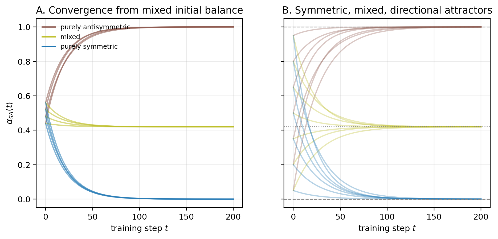

# Chapter 10: two-flow balance and the joint S–A/signature diagnostic

[Library index](../README.md) · [Source policy](../SOURCE.md) · [Previous](0347-0350-ch10-softmax-adjoint-and-two-flow.md#pdf-0350)

> Editorial note: Full transcription of PDF 351–354 (printed pages 315–318), including the complete Corollary 10.11 proof, objects 10.12–10.18, Figure 10.6 and the opening of §10.11. The final sentence continues on PDF 355 after its figures. Source conventions and claims are retained; Russian notes 100–102 distinguish the parameter balance from the empirical score balance.

## PDF 351 · Book 315

*Continuation of [§10.9.1](0347-0350-ch10-softmax-adjoint-and-two-flow.md#section-10-9-1).*

**Corollary 10.11 (First-order evolution of $\alpha_{\mathrm{SA}}$).** Under the notation of Theorem 10.9, let

$$
E=\lVert M_s\rVert_F^2+\lVert M_a\rVert_F^2.
$$

Then, under a first-order descent step on the canonical pair,

$$
\partial_t\alpha_{\mathrm{SA}}
=\frac{2(1-\alpha_{\mathrm{SA}})}{E}\langle M_a,G_a\rangle_F\cdot(-\eta)
-\frac{2\alpha_{\mathrm{SA}}}{E}\langle M_s,G_s\rangle_F\cdot(-\eta)+O(\eta^2).
$$

Equivalently,

$$
\partial_t\alpha_{\mathrm{SA}}
=-\frac{2\eta}{E}\Bigl((1-\alpha_{\mathrm{SA}})\langle M_a,G_a\rangle_F
-\alpha_{\mathrm{SA}}\langle M_s,G_s\rangle_F\Bigr)+O(\eta^2).
$$

Persistent alignment of the descent direction with the antisymmetric component increases the antisymmetric balance; persistent alignment of the descent direction with the symmetric component decreases it.

*Proof.* Set

$$
A=\lVert M_a\rVert_F^2,\qquad S=\lVert M_s\rVert_F^2,\qquad
E=A+S,\qquad\alpha_{\mathrm{SA}}=A/E.
$$

The differential of $A$ with respect to the full matrix $M$ is

$$
\frac{\partial A}{\partial M}=2M_a.
$$

Indeed,

$$
A=\frac14\lVert M-M^\top\rVert_F^2
=\frac12\lVert M\rVert_F^2-\frac12\langle M,M^\top\rangle_F,
$$

and differentiation gives $\partial A/\partial M=M-M^\top=2M_a$. Similarly,

$$
\frac{\partial S}{\partial M}=2M_s,\qquad\frac{\partial E}{\partial M}=2M.
$$

Applying the quotient rule to $\alpha_{\mathrm{SA}}=A/E$ gives

$$
\frac{\partial\alpha_{\mathrm{SA}}}{\partial M}
=\frac1E\frac{\partial A}{\partial M}-\frac{A}{E^2}\frac{\partial E}{\partial M}
=\frac{2M_a}{E}-\frac{2\alpha_{\mathrm{SA}}M}{E}.
$$

Since $M=M_s+M_a$, this becomes

$$
\frac{\partial\alpha_{\mathrm{SA}}}{\partial M}
=\frac{2(1-\alpha_{\mathrm{SA}})M_a-2\alpha_{\mathrm{SA}}M_s}{E}.
$$

Taking the Frobenius inner product with the effective loss motor $G_M=G_s+G_a$ yields

$$
\begin{aligned}
\left\langle\frac{\partial\alpha_{\mathrm{SA}}}{\partial M},G_M\right\rangle_F
&=\frac{2(1-\alpha_{\mathrm{SA}})}{E}\langle M_a,G_s\rangle_F
+\frac{2(1-\alpha_{\mathrm{SA}})}{E}\langle M_a,G_a\rangle_F\\
&\quad-\frac{2\alpha_{\mathrm{SA}}}{E}\langle M_s,G_s\rangle_F
-\frac{2\alpha_{\mathrm{SA}}}{E}\langle M_s,G_a\rangle_F.
\end{aligned}
$$

The two cross terms vanish because symmetric and antisymmetric matrices are Frobenius-orthogonal:

$$
\langle M_a,G_s\rangle_F=0,\qquad\langle M_s,G_a\rangle_F=0.
$$

Therefore

$$
\left\langle\frac{\partial\alpha_{\mathrm{SA}}}{\partial M},G_M\right\rangle_F
=\frac{2(1-\alpha_{\mathrm{SA}})}{E}\langle M_a,G_a\rangle_F
-\frac{2\alpha_{\mathrm{SA}}}{E}\langle M_s,G_s\rangle_F.
$$

Finally, the first-order descent increment on the effective $M$-flow is

$$
\partial_t\alpha_{\mathrm{SA}}
=-\eta\left\langle\frac{\partial\alpha_{\mathrm{SA}}}{\partial M},G_M\right\rangle_F+O(\eta^2),
$$

which gives the displayed formula. $\square$

## PDF 352 · Book 316

**Remark 10.12 (Canonical-pair flow versus the $W_Q,W_K$ parametrisation).** The proof uses the Frobenius gradient on the canonical pair $M$. In the Transformer, $M=W_QW_K^\top$, so the parameter update is carried by $W_Q$ and $W_K$. The corollary should therefore be read as a statement about the induced first-order motor on the canonical pair. If the actual parameter-space update is first pushed forward to $\partial_tM$, then its symmetric and antisymmetric projections obey the same quotient-rule calculation above.

**Remark 10.13 ($\alpha_{\mathrm{SA}}$ as a saturation coordinate).** The corollary makes $\alpha_{\mathrm{SA}}$ a dynamical coordinate, not only a static heatmap value. A head can move toward a reciprocal regime, a directional regime, or a mixed regime depending on the persistent sign and magnitude of the symmetric and antisymmetric inner products. The full study of these orbits is deferred to Chapter 11.

## PDF 353 · Book 317

**Figure 10.6:** Toy S–A balance dynamics. Gradient flow on a quadratic loss $\frac12\lVert M-M_\star\rVert_F^2$ drives $\alpha_{\mathrm{SA}}$ toward the balance of the target matrix. Purely symmetric, mixed, and purely antisymmetric targets produce three distinct saturation regimes. The figure is illustrative: the BERT masked-language-modelling loss is not this quadratic toy loss.

### 10.10 The S–A/signature diagnostic

The two-flow decomposition acts on score-side objects, whereas the earlier chapters also track signature-side objects. A useful diagnostic must keep both sides together.

**Definition 10.14 (S–A/signature diagnostic).** For a layer $\ell$, define

$$
D_\ell=\bigl((\alpha_{\ell,h})_h,(\Gamma_s^{(\ell,h)})_h,
(\Gamma_a^{(\ell,h)})_h,\mu_\ell,(\rho_{\ell,h})_h\bigr).
$$

Here $\alpha_{\ell,h}$ is the S–A balance of head $h$, $\Gamma_s$ and $\Gamma_a$ are the symmetric and antisymmetric score energies, $\mu_\ell$ is the empirical signature geography of Chapter 7, and $\rho_{\ell,h}$ is the canonical residual of the head.

The diagnostic separates the two channels that will be coupled in training:

$$
\text{score side: }(\alpha,\Gamma_s,\Gamma_a),\qquad
\text{signature side: }(\mu_\ell,\rho_{\ell,h}).
$$

The score side evolves through the two-flow decomposition of Theorem 10.9; the signature side evolves through the map

$$
M\longmapsto L=XMX^\top\longmapsto A=\operatorname{softmax}(L)\longmapsto\Sigma(A).
$$

**Proposition 10.15 (First-order propagation of $D_\ell$).** On a differentiability stratum of the softmax and signature projection, the first-order change of $D_\ell$ under a gradient-descent step is obtained componentwise by applying the chain rule to the score-side two-flow variables and to the signature map. In particular,

$$
\partial_tD_\ell=\bigl((\partial_t\alpha_{\ell,h})_h,
(\partial_t\Gamma_s^{(\ell,h)})_h,(\partial_t\Gamma_a^{(\ell,h)})_h,
\partial_t\mu_\ell,(\partial_t\rho_{\ell,h})_h\bigr),
$$

where $\partial_t\alpha_{\ell,h}$ is given by Corollary 10.11, and $\partial_t\mu_\ell$ is controlled by the induced signature velocities of Proposition 10.8.

## PDF 354 · Book 318

*Proof.* The score-side components are differentiable functions of $M_s$ and $M_a$ away from the zero-energy denominator. Their increments follow from Theorem 10.9 and the quotient rule. The signature-side components are differentiable on the active canonical stratum by hypothesis and therefore follow from the chain $M\mapsto L\mapsto A\mapsto\Sigma(A)$. $\square$

**Remark 10.16 (What the compatibility chain misses).** The compatibility chain of Chapter 8 controls the directional or antisymmetric channel through quantities such as cone alignment, directional energy, margin, and entropy. It does not by itself control the symmetric channel $\Gamma_s$. The diagnostic $D_\ell$ is therefore the natural object for later chapters: it records the directional half that the compatibility chain sees, the symmetric half that it does not see, and the signature geography on which both channels leave visible traces.

**Remark 10.17 (Three projections of the same head).** The diagnostic $D_\ell$ deliberately mixes quantities of different nature. The triple $(\alpha,\Gamma_s,\Gamma_a)$ is a score-side projection of a head. Entropy, margin, and attention asymmetry are attention-side projections. The pair $(\mu_\ell,\rho_{\ell,h})$ is signature-side. None of these projections alone is complete. A head can be score-side antisymmetric but have weak signature drift if the active input representation suppresses the relevant skew plane; conversely, a modest score-side antisymmetric component can produce a visible signature displacement when the softmax tangent and the representation geometry amplify it. The purpose of $D_\ell$ is to keep these distinctions visible rather than collapse them into a single scalar.

**Remark 10.18 (Use of the SARS v8 trace).** The SARS v8 trace inserted below should be read with this taxonomy in mind. It gives a reproducible score-side and attention-side trace of $D_\ell$, together with local S/A interventions. It does not claim to exhaust the signature-side part of $D_\ell$. In particular, the empirical evolution of $\mu_\ell$ and $\rho_{\ell,h}$ is deferred to the next chapter, where S–A orbits are studied jointly with the canonical signature geography.

### 10.11 BERT/SARS S–A maps revisited

Chapter 9 introduced global S–A maps for BERT in the SARS setting. The present chapter provides their mathematical interpretation and now fixes the empirical display convention used in the rest of the monograph. For every layer and head, compute

$$
\Gamma_s^{(\ell,h)}=\lVert X^{(\ell)}M_s^{(\ell,h)}(X^{(\ell)})^\top\rVert_F,
\qquad
\Gamma_a^{(\ell,h)}=\lVert X^{(\ell)}M_a^{(\ell,h)}(X^{(\ell)})^\top\rVert_F,
$$

and

$$
\alpha_{\mathrm{SA}}^{(\ell,h)}
=\frac{\Gamma_a^{(\ell,h)}}{\Gamma_s^{(\ell,h)}+\Gamma_a^{(\ell,h)}+\varepsilon}.
$$

The layer-head heatmap of $\alpha_{\mathrm{SA}}$ is the S–A balance map. It is a score-side diagnostic, not a task-performance claim.

The final map should be read together with the two energy maps in Figure 10.8.

The mean symmetric score energy grows from 0.442 to 6.277, while the mean antisymmetric score energy grows from 0.360 to 1.325. The symmetric flow therefore dominates the aggregate energy budget, even though selected heads retain large antisymmetric balance. This is one empirical reason why the compatibility chain, which is primarily directional, cannot by itself describe the full training dynamics. The run begins near a moderately mixed configuration, with mean $\alpha_{\mathrm{SA}}\simeq0.453$ and standard deviation 0.047. At the final checkpoint, the mean has fallen to 0.245 while the standard deviation has grown to 0.176. Thus training does not move every head along the same scalar trajectory. It produces a differentiated geography:

[Continue: PDF 355](0355-0360-ch10-sars-trace-and-sa-interventions.md#pdf-0355)
