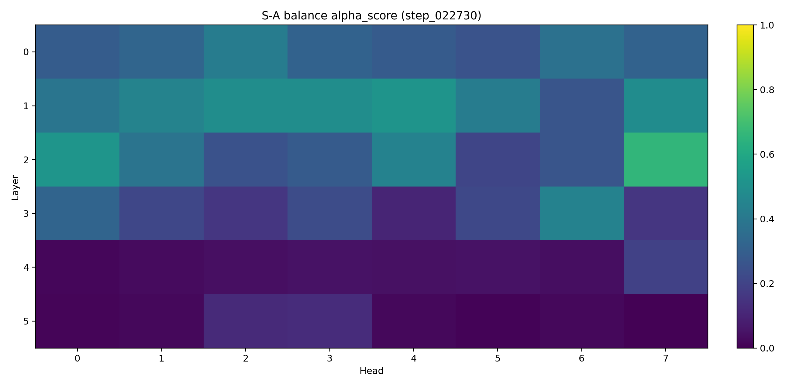
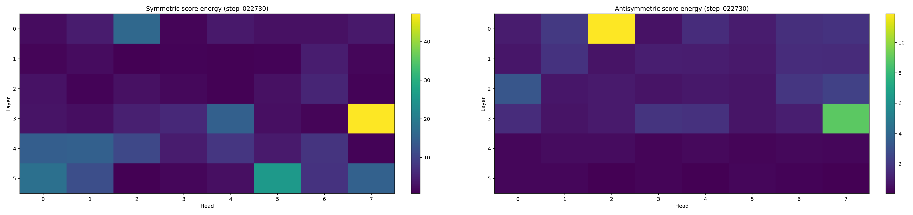
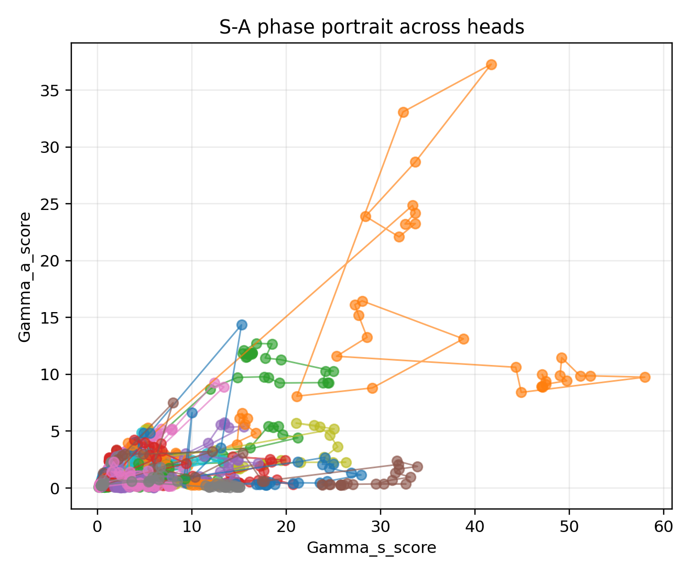
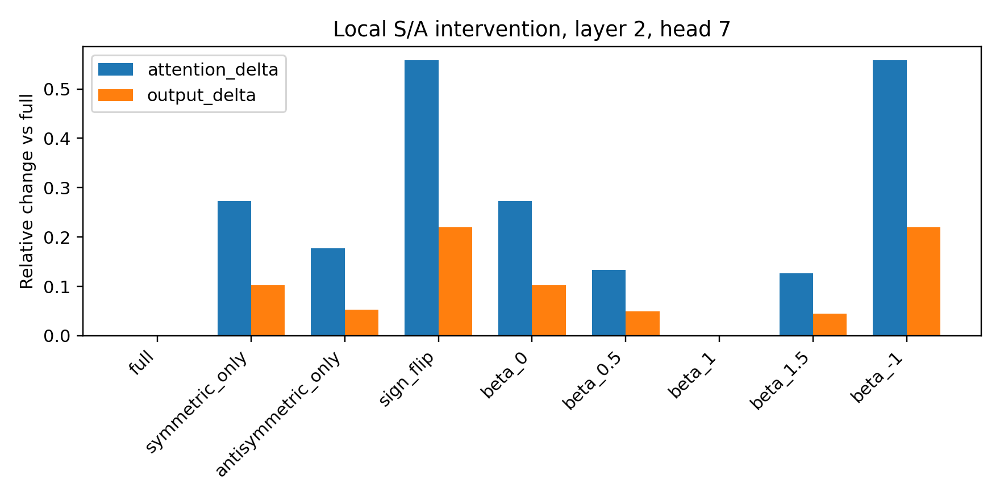

# Chapter 10: SARS v8 trace, S–A interventions, and enriched crowding

[Library index](../README.md) · [Source policy](../SOURCE.md) · [Previous](0351-0354-ch10-two-flow-balance-and-signature-diagnostic.md#pdf-0354)

> Editorial note: Full transcription of PDF 355–360 (printed pages 319–324). Figures 10.7–10.10, all 22 data rows of Tables 10.1–10.3, Definition 10.19, Proposition 10.20 with its proof, and all intervening prose are retained. Figure 10.8 is a direct crop of the two original panels. SARS v8 values are author-reported; editorial interpretation and limits are in notes 102–105. Section 10.15 continues in the next file.

## PDF 355 · Book 319

**Figure 10.7:** Empirical S–A balance map at the final checkpoint of the SARS v8 proof-of-mechanism run.

*The model is a compact 6-layer, 8-head DNA encoder trained for 10 epochs. The map shows a polarized layer-head geography: the mean $\alpha_{\mathrm{SA}}$ decreases during training, while a small set of heads remains mixed or antisymmetric-dominant. The strongest final head is layer 2, head 7, with $\alpha_{\mathrm{SA}}\simeq0.659$.*

**Figure 10.8:** Final symmetric and antisymmetric score-energy maps in the SARS v8 run.

*Continuation of the sentence at [PDF 354](0351-0354-ch10-two-flow-balance-and-signature-diagnostic.md#pdf-0354):*

many upper-layer heads move toward a symmetric-dominant regime, while a smaller number of middle heads retain or increase directional balance.

A coarse regime map can be obtained by thresholding $\alpha_{\mathrm{SA}}$:

$$
\begin{aligned}
\alpha_{\mathrm{SA}}<\tau_s&\quad\Rightarrow\quad\text{symmetric-dominant},\\
\tau_s\le\alpha_{\mathrm{SA}}\le\tau_a&\quad\Rightarrow\quad\text{mixed},\\
\alpha_{\mathrm{SA}}>\tau_a&\quad\Rightarrow\quad\text{antisymmetric-dominant}.
\end{aligned}
$$

The thresholds are presentation choices, not new invariants. The invariant quantities are the projected energies and the induced balance.

A more detailed numerical reading of the run is given in Section 10.12. The interpretation must remain cautious. A high $\alpha_{\mathrm{SA}}$ does not by itself prove causal necessity. It identifies heads whose score geometry is dominated by oriented comparison energy. Causal necessity requires interventions, ablation, or replacement tests. This is the purpose of Section 10.13.

## PDF 356 · Book 320

| step | $\bar\alpha$ | $\operatorname{sd}(\alpha)$ | $\min\alpha$ | $\max\alpha$ | $\bar\Gamma_s$ | $\bar\Gamma_a$ | $\bar H$ | asym. |
|---:|---:|---:|---:|---:|---:|---:|---:|---:|
| 0 | 0.453 | 0.047 | 0.329 | 0.567 | 0.442 | 0.360 | 3.118 | 0.108 |
| 5000 | 0.464 | 0.056 | 0.297 | 0.583 | 0.457 | 0.398 | 3.118 | 0.121 |
| 10000 | 0.295 | 0.144 | 0.010 | 0.670 | 6.246 | 1.473 | 3.075 | 0.310 |
| 15000 | 0.253 | 0.177 | 0.006 | 0.681 | 6.262 | 1.363 | 3.076 | 0.295 |
| 20000 | 0.249 | 0.177 | 0.006 | 0.667 | 6.274 | 1.341 | 3.077 | 0.289 |
| 22730 | 0.245 | 0.176 | 0.005 | 0.659 | 6.277 | 1.325 | 3.076 | 0.287 |

**Table 10.1:** Aggregate S–A evolution in the SARS v8 proof-of-mechanism run. The mean balance moves toward the symmetric side, but the range and standard deviation increase, revealing headwise specialization. The columns report layer-head averages of $\alpha_{\mathrm{SA}}$, symmetric and antisymmetric score energies, attention entropy, and attention asymmetry.

### 10.12 Detailed reading of the SARS v8 trace

The compact empirical run is useful because it separates three notions that are often conflated: task performance, score-side geometry, and local causal effect. The classifier itself is not the object of the present chapter. The object is the layer-head-resolved trace of the matrices $M_s^{(\ell,h)}$ and $M_a^{(\ell,h)}$, together with the attention maps they induce. In this sense the run is a proof-of-mechanism: it verifies that the algebraic quantities defined above can be measured during training and that their interventions can be non-trivial.

**Status of the signature-side coordinates.** The measurements in this section are intentionally restricted to the part of $D_\ell$ that is already available in the present experiment: score-side energies, S–A balances, attention entropy, attention asymmetry, and local S/A intervention effects. They are not presented as a full empirical reconstruction of the signature geography $\mu_\ell$ or of the residual coordinates $\rho_{\ell,h}$. Consequently, the experiment supports the score-to-attention part of the bridge

$$
M_s,M_a\longrightarrow L_s,L_a\longrightarrow A,
$$

and illustrates why a signature-side measurement should be informative, but it does not replace the later orbit analysis

$$
A(t)\longrightarrow\Sigma(A(t))\longrightarrow(\mu_\ell(t),\rho_{\ell,h}(t)).
$$

This distinction is essential: the chapter is closed with a proof-of-mechanism run, not with a completed empirical theory of signature drift.

The first aggregate fact is a polarization effect. At initialization the S–A balance is nearly homogeneous across heads: the mean is approximately 0.453, the standard deviation is 0.047, and the range is $[0.329,0.567]$. At the final checkpoint the mean has decreased to approximately 0.245, but the standard deviation has increased to 0.176 and the range has widened to $[0.005,0.659]$. Thus the training trace is not described by a single scalar drift of the whole network. Some heads move toward a symmetric-dominant regime, while a smaller number of heads either remain mixed or increase their antisymmetric component.

The second fact is that the energy budget is not balanced. The mean symmetric score energy grows from approximately 0.442 to 6.277, whereas the mean antisymmetric score energy grows from approximately 0.360 to 1.325. Both channels are active, but the symmetric channel dominates the aggregate scale. This observation is conceptually important: an analysis based only on the directional energy $\Gamma_a$ would miss the much larger growth of $\Gamma_s$.

## PDF 357 · Book 321

**Figure 10.9:** Phase portrait of the SARS v8 trace in the $(\Gamma_s,\Gamma_a)$ plane.

*Each point is a layer-head measurement at one checkpoint. The portrait shows that both energies increase during training, but not along a single one-dimensional ray: several heads move strongly into the symmetric-energy direction, while selected heads retain a comparatively large antisymmetric component. This is the empirical image of the two-flow decomposition.*

Conversely, an analysis based only on symmetric affinity would miss the selected heads whose antisymmetric component remains large and causally effective.

The third fact is a separation between score-side balance and attention-side asymmetry. The mean $\alpha_{\mathrm{SA}}$ decreases, but the mean attention asymmetry increases from approximately 0.108 to 0.287. This is not a contradiction. The map

$$
M_s+M_a\longmapsto X(M_s+M_a)X^\top\longmapsto\operatorname{softmax}(\cdot)
$$

contains representation-side amplification and row-normalisation. A moderate or even decreasing score-side antisymmetric fraction can therefore coexist with increased attention-side asymmetry when the hidden states and the softmax tangent amplify the oriented part of selected score directions. This is one reason why the chapter distinguishes score-side energies, attention-side statistics, and signature-side coordinates.

Figure 10.9 makes the same point in phase-space form. The two-flow decomposition does not say that the two channels are dynamically independent in the full Transformer: the channels share the loss, the residual stream, the softmax, and the $W_Q,W_K$ parametrisation. It says something more local and more robust: once the induced score-side motor has been expressed on the canonical pair $M$, its symmetric and antisymmetric projections live in orthogonal subspaces. The empirical phase portrait is the observable trace of those two projected channels.

Table 10.2 records the heads used for interpretation. Layer 2, head 7 is the cleanest directional

## PDF 358 · Book 322

| layer | head | final $\alpha$ | $\Delta\alpha$ | $\Gamma_s$ | $\Gamma_a$ | reading |
|---:|---:|---:|---:|---:|---:|---|
| 2 | 7 | 0.659 | +0.283 | 1.224 | 2.366 | strongest directional candidate |
| 2 | 0 | 0.523 | +0.073 | 2.924 | 3.208 | mixed-directional |
| 1 | 4 | 0.518 | +0.056 | 0.948 | 1.017 | mixed-directional |
| 1 | 2 | 0.492 | +0.033 | 0.724 | 0.700 | mixed |
| 1 | 3 | 0.491 | +0.014 | 1.111 | 1.071 | mixed |
| 1 | 7 | 0.488 | -0.014 | 1.586 | 1.511 | mixed with high energy |
| 4 | 4 | 0.044 | -0.484 | 8.060 | 0.367 | symmetric collapse |
| 5 | 0 | 0.015 | -0.464 | 17.871 | 0.281 | symmetric collapse |
| 5 | 5 | 0.010 | -0.457 | 25.769 | 0.255 | symmetric collapse |
| 4 | 6 | 0.039 | -0.441 | 7.677 | 0.310 | symmetric collapse |

**Table 10.2:** Representative heads in the SARS v8 trace. The same run contains both middle-layer heads with large final antisymmetric balance and upper-layer heads whose balance collapses toward the symmetric channel. This is the layer-head geography that Chapter 11 will reinterpret as a family of S–A orbits.

candidate because both its final balance and its balance increase are large. By contrast, several upper-layer heads have final $\alpha_{\mathrm{SA}}$ close to zero and very large $\Gamma_s$. These heads are not inactive. They are active in the symmetric channel. The correct conclusion is therefore not that late layers are weak, but that in this run their dominant score geometry is reciprocal rather than oriented.

Finally, the entropy and margin columns should not be over-read. The mean entropy decreases only mildly, and the classification trace does not support a claim of successful SARS prediction. The chapter uses the run to validate the measurement and intervention pipeline, not to claim biological performance. Strong performance claims require a separate experimental chapter with stronger baselines, multiple seeds, and task-level validation.

### 10.13 S–A interventions

The decomposition suggests a family of causal interventions on each head:

$$
\begin{gathered}
M_{\mathrm{full}}=M_s+M_a,\qquad M_S=M_s,\qquad M_A=M_a,\\
M_{\mathrm{flip}}=M_s-M_a,\qquad M_\beta=M_s+\beta M_a.
\end{gathered}
$$

These interventions test whether the S–A map is merely descriptive or functionally meaningful. A large value of $\alpha_{\mathrm{SA}}$ is a geometric statement. A large intervention drift is a causal statement. The two are related, but they are not equivalent.

**Definition 10.19 (S–A intervention profile).** For a head, the S–A intervention profile is the vector of changes in selected observables under $M_S$, $M_A$, $M_{\mathrm{flip}}$, and $M_\beta$, relative to the full score motor. Typical observables include attention drift, signature drift, entropy change, hidden-state drift, loss change, and task-metric change.

The strongest directional candidate in the SARS v8 run is layer 2, head 7. Its final balance is $\alpha_{\mathrm{SA}}\simeq0.659$ and its increase from initialization is approximately $+0.283$. The local intervention profile is shown in Figure 10.10. The sign-flip intervention $M_s-M_a$ changes the attention map by approximately 0.558 and the output by approximately 0.219, substantially more than either the symmetric-only or antisymmetric-only replacement alone. Thus, for this head, the antisymmetric component is not just visible in the score decomposition; its sign is functionally relevant.

## PDF 359 · Book 323

**Figure 10.10:** Empirical S/A intervention profile for layer 2, head 7 in the SARS v8 run. The full head is compared with symmetric-only, antisymmetric-only, sign-flip, and scaled-antisymmetric replacements. The sign flip $M_s-M_a$ produces the largest attention drift, supporting the interpretation of this head as a non-trivial directional motor.

| Intervention | $\beta$ | attention drift | output drift | attention asym. |
|---|---:|---:|---:|---:|
| full $M_s+M_a$ | 1.0 | 0.000 | 0.000 | 0.320 |
| $M_s$ only | 0.0 | 0.272 | 0.103 | 0.091 |
| $M_a$ only | – | 0.177 | 0.052 | 0.391 |
| $M_s-M_a$ | -1.0 | 0.558 | 0.219 | 0.468 |
| $M_s+0.5M_a$ | 0.5 | 0.133 | 0.049 | 0.140 |
| $M_s+1.5M_a$ | 1.5 | 0.127 | 0.045 | 0.481 |

**Table 10.3:** Local intervention values for layer 2, head 7. The $\beta$ path shows an approximately V-shaped response around the full model value $\beta=1$: reducing or overscaling the antisymmetric component changes the attention map, while sign reversal gives the largest drift.

The $\beta$ path is especially informative. The full model sits at $\beta=1$. Moving to $\beta=0.5$ changes the attention map by approximately 0.133; moving to $\beta=1.5$ changes it by approximately 0.127; moving to $\beta=-1$ changes it by approximately 0.558. This pattern indicates that the head is not merely sensitive to the norm of $M_a$. It is sensitive to the orientation encoded by the sign of the antisymmetric component. In the language of Section 10.5, the head implements an oriented comparison rather than only a reciprocal affinity.

**Proposition 10.20 (Operational antisymmetric dependence).** Fix a head and a batch. Suppose that the sign-flip drift

$$
\lVert A(M_s-M_a)-A(M_s+M_a)\rVert
$$

for a chosen attention-side norm is larger than both removal drifts: the drift obtained by removing $M_a$ and the drift obtained by removing $M_s$. If the margin is non-negligible, then, on that batch and for that norm, the head is operationally dependent on the orientation of its antisymmetric component.

*Proof.* The statement is a definition-level operational criterion. The three interventions compare the full map against three alternatives: removal of $M_a$, removal of $M_s$, and reversal of the oriented part. If reversal produces the largest drift, the attention map is sensitive to the sign of $M_a$, not merely to the presence of a low-rank or high-norm perturbation. This

## PDF 360 · Book 324

establishes operational dependence on the oriented component for the specified batch and norm. $\square$

For layer 2, head 7, Proposition 10.20 applies with the attention drift reported in Table 10.3. The conclusion is deliberately local. It does not say that the head is globally necessary for the SARS classifier, nor that all heads with high $\alpha_{\mathrm{SA}}$ are causally important. It says that in the measured batch, under the measured norm, the orientation of $M_a$ has a large local effect on the induced attention map and output.

This local nature is essential. There are three possible failure modes for a high-$\alpha_{\mathrm{SA}}$ head.

1. The head may have high balance but small absolute score energy, so interventions are weak.
2. The head may affect attention but not downstream hidden states, because the value/output path suppresses it.
3. The head may affect hidden states but not the task metric, because the classifier or subsequent layers compensate.

The v8 head avoids the first two failure modes at the local level: both attention drift and output drift are visible. Avoiding the third requires task-level ablations and belongs to the experimental validation chapter.

A head should therefore be called antisymmetric-driven only if removing, scaling, or changing the sign of $M_a$ produces a substantial effect on the relevant observables. This is the causal counterpart of a large $\alpha_{\mathrm{SA}}$ value. Conversely, a high $\alpha_{\mathrm{SA}}$ with negligible intervention drift should be treated as geometrically directional but functionally weak.

### 10.14 S–A redundancy and crowding

The S–A decomposition refines the redundancy theory developed from signature geography. Two heads may have similar signatures but different S–A motors, or similar S–A motors but different causal effects. A robust redundancy diagnostic should therefore combine several coordinates:

$$
\text{signature crowding}+\text{S–A motor crowding}+\text{functional marginality}.
$$

S–A motor crowding can be measured through layer-head distances involving

$$
\alpha_{\mathrm{SA}},\qquad\Gamma_s,\qquad\Gamma_a,\qquad
\lVert G_s\rVert_F,\qquad\lVert G_a\rVert_F,\qquad
\lVert d\Sigma_s\rVert,\qquad\lVert d\Sigma_a\rVert.
$$

Heads clustered in this enriched space are not merely visually similar. They have similar score-side decomposition, similar gradient pressure, and similar signature velocity. This richer notion will be used in the later redundancy chapters.

### 10.15 Empirical status of the SARS v8 proof-of-mechanism run

The experiment used in this chapter is not presented as a SARS classification result. Its role is narrower and mathematically cleaner: it shows that the S–A decomposition, the S–A balance maps, the S–A orbits, and the local S/A interventions are all computable in a layer-head-resolved training trace, and that at least one head exhibits a large causal response to the antisymmetric sign flip.

[Continue: PDF 361](0361-0364-ch10-empirical-status-and-synthesis.md#pdf-0361)
