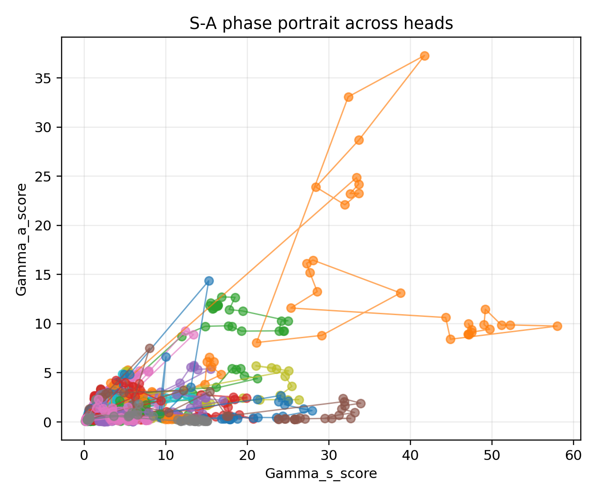
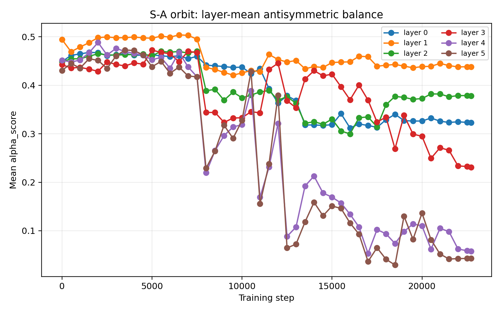
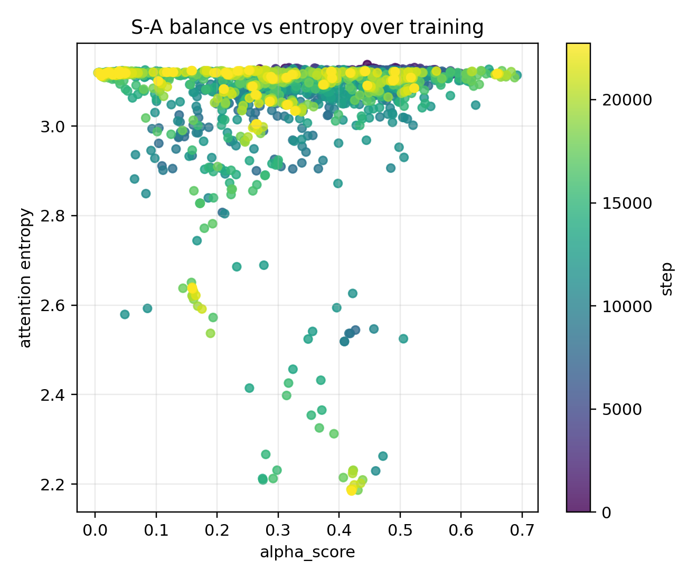

# Chapter 10: empirical status, synthesis, and concluding remarks

[Library index](../README.md) · [Source policy](../SOURCE.md) · [Previous](0355-0360-ch10-sars-trace-and-sa-interventions.md#pdf-0360)

> Editorial note: Full transcription of PDF 361–364 (printed pages 325–328), completing Chapter 10. All author-reported experiment limitations, Figures 10.11–10.13, the twelve-point synthesis and four concluding remarks are retained. Figures 10.9 and 10.11 are the same embedded image in the source PDF, with different captions; both source appearances are preserved. The claimed external run archive has not been supplied or independently replicated in this conversion.

## PDF 361 · Book 325

*Continuation of [§10.15](0355-0360-ch10-sars-trace-and-sa-interventions.md#section-10-15).*

**Figure 10.11:** Empirical score-energy phase portrait for the SARS v8 run. The trajectories show that heads can share a broad aggregate drift while separating in the $(\Gamma_s,\Gamma_a)$ plane. This is the score-side precursor of the orbit-crowding diagnostics used later for redundancy analysis.

The run uses a compact BERT-like DNA encoder with 6 layers, 8 heads, hidden dimension 256, sequence length 512, and 10 training epochs. For each checkpoint, layer, and head, the notebook exports:

- $\Gamma_s^{(\ell,h)}$ and $\Gamma_a^{(\ell,h)}$;
- $\alpha_{\mathrm{SA}}^{(\ell,h)}$;
- attention entropy, margin, and attention-asymmetry summaries;
- intervention deltas for S-only, A-only, sign-flip, and scaled-A replacements;
- training-time trajectories for Chapter 11.

The static maps and the intervention profile belong primarily to the present chapter. The checkpoint trajectories, layerwise orbit structure, comparison with the stable v9 failure mode, and the question of training-induced emergence belong to Chapter 11. In particular, no claim is made here that the compact classifier solves the SARS task. The classification trace is deliberately treated as background: the mathematical object of interest is the measured S–A geometry and its local causal response.

The following conclusions are licensed by the v8 run.

1. The quantities $\Gamma_s$, $\Gamma_a$, and $\alpha_{\mathrm{SA}}$ are measurable for every layer and head along a full training trajectory.
2. The score-side balance can polarize across heads: the mean can decrease while the variance and range increase.
3. The aggregate symmetric energy can dominate the energy budget even when selected

## PDF 362 · Book 326

**Figure 10.12:** Layer-mean S–A balance trajectories in the SARS v8 run. The aggregate trend is toward lower $\alpha_{\mathrm{SA}}$, but the final heatmap shows that this mean trend hides substantial headwise differentiation. Chapter 11 studies these curves as S–A orbits.

heads remain directionally significant.

4. At least one head, layer 2/head 7, exhibits a large local causal response to antisymmetric sign reversal.

The following conclusions are not licensed by this run.

1. It does not establish competitive SARS classification performance.
2. It does not prove that the antisymmetric component is globally necessary for the classifier.
3. It does not prove that all high-$\alpha_{\mathrm{SA}}$ heads are important.
4. It does not prove inevitability of S–A maps under gradient flow. That requires the saturation and orbit theory of Chapter 11 and broader experimental validation.

The files required to reproduce the empirical panels in this chapter are archived in this package. The most important are the full trajectory table, the layer–2/head–7 intervention table, the final headwise table with deltas, the stepwise aggregate summary, and the complete v8 run archive under `sources/`.

### 10.16 Synthesis

The chapter has established the mathematical basis of the S–A maps and fixed the empirical convention used in the rest of the monograph.

1. The canonical QK pair $M=W_QW_K^\top$ is the gauge-invariant score-side object of a head.
2. Every $M$ decomposes uniquely and orthogonally as $M_s+M_a$.
3. The forward scores split as $L_s=XM_sX^\top$ and $L_a=XM_aX^\top$.
4. Symmetric motors encode reciprocal affinity; antisymmetric motors encode oriented comparison.

## PDF 363 · Book 327

**Figure 10.13:** S–A balance versus attention entropy in the SARS v8 trace.

*The cloud should not be interpreted as a universal law; it is a diagnostic projection. It shows that the same training trace contains heads with similar entropy but different S–A balances, and heads with similar S–A balance but different entropy. This supports the separation between score-side geometry and attention-side sharpness.*

5. Softmax does not preserve the decomposition globally, but its derivative does at first order.
6. The backward motor $G_M=X^\top G_LX$ decomposes into symmetric and antisymmetric pressures.
7. On differentiability strata, the induced signature velocity splits into symmetric-driven and antisymmetric-driven components.
8. The two-flow decomposition gives the first-order dynamic shadow of the algebraic splitting: the effective score-side motor separates into Frobenius-orthogonal symmetric and antisymmetric channels.
9. The S–A balance $\alpha_{\mathrm{SA}}$ is a genuine dynamic coordinate on the canonical-pair flow. Its quotient-rule evolution depends only on the two projected inner products $\langle M_s,G_s\rangle_F$ and $\langle M_a,G_a\rangle_F$.
10. S–A maps, S–A interventions, and S–A orbit diagnostics are therefore natural tools for analysing self-attention.
11. In the SARS v8 proof-of-mechanism run, S–A maps and local S/A interventions are empirically measurable. The run is not used as a SARS classification claim, but it supplies a concrete headwise trace in which layer 2, head 7 displays a large antisymmetric sign-flip effect.
12. The empirical v8 trace closes the score-side and attention-side part of the chapter. The

## PDF 364 · Book 328

complete signature-side orbit $(\mu_\ell(t),\rho_{\ell,h}(t))$ is deliberately deferred to the training-time analysis of the next chapter.

The most important empirical lesson is not that the compact SARS classifier is strong. It is not. The lesson is that the S–A decomposition is experimentally actionable. A single run supplies all of the following objects in a reproducible form:

$$
\bigl(\Gamma_s^{(\ell,h)}(t),\Gamma_a^{(\ell,h)}(t),
\alpha_{\mathrm{SA}}^{(\ell,h)}(t),H^{(\ell,h)}(t),
\operatorname{asym}^{(\ell,h)}(t)\bigr)_{\ell,h,t},
$$

together with intervention profiles for selected heads. This is enough for the present chapter because the chapter is about the decomposition and its local causal meaning, not about final task accuracy.

The distinction between score-side, attention-side, and signature-side quantities is therefore not cosmetic; it is the organising principle that allows the following chapter to ask a sharper dynamical question. The next chapter studies the training-time question deliberately left open here: how gradient flow moves the quantities $M_s$, $M_a$, $\Gamma_s$, $\Gamma_a$, $\alpha_{\mathrm{SA}}$, and the corresponding signatures. The algebraic decomposition is inevitable. The dynamical emergence of particular S–A geographies is the subject of the orbit analysis that follows.

### 10.17 Concluding Remarks

The present chapter proves the canonical decomposition, the first-order S–A response, and the two-flow split on the canonical pair. Several stronger claims are intentionally left to Chapter 11.

1. **Saturation.** The statement that the compatibility regime is forward-invariant under gradient descent requires explicit gradient-correlation hypotheses between the loss and the observables of the compatibility profile.
2. **Training-time chain.** The correct dynamic analogue of the compatibility chain is not obtained by differentiating its inequalities. It requires slack tightening and inequality propagation.
3. **S–A orbits.** The quantities $t\mapsto\Gamma_s(t)$, $t\mapsto\Gamma_a(t)$, $t\mapsto\alpha_{\ell,h}(t)$, and $t\mapsto\Sigma_{\ell,h}(t)$ define training-time orbits. Their phase portraits belong to the next chapter.
4. **NTK and phase diagram.** Kernel-target alignment, saturation/edge/escape regimes, and edge-of-stability interpretations are global training-time questions rather than local decompositions of self-attention.

This separation keeps the present chapter focused. The algebraic splitting $M=M_s+M_a$ is inevitable. The two-flow decomposition is its first-order dynamic shadow. The emergence, stability, and possible inevitability of particular S–A maps under training require the orbit theory of Chapter 11.

[Continue: PDF 365](0365-0367-ch11-signature-orbits-and-training-traces.md#pdf-0365)
