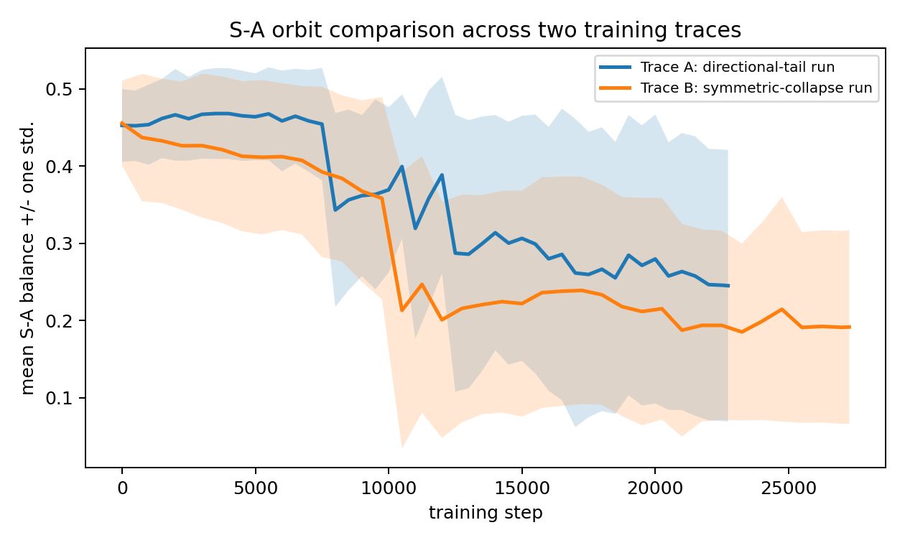
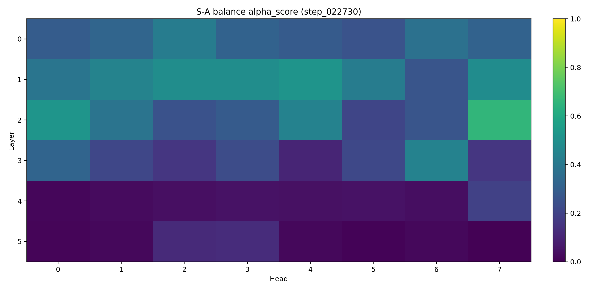
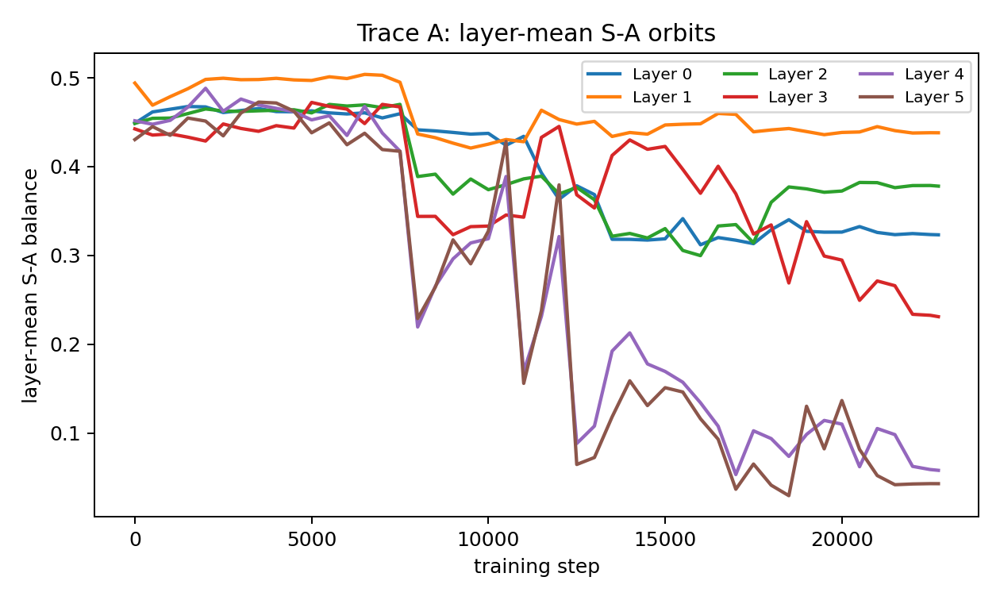
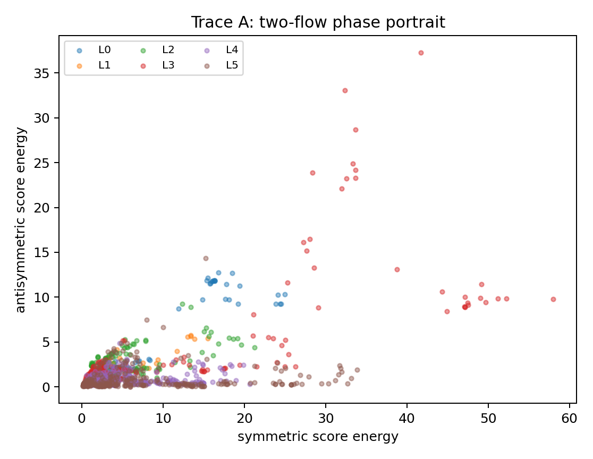
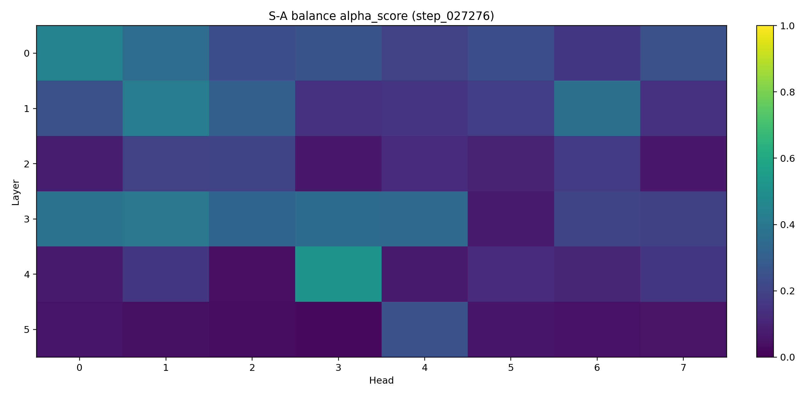
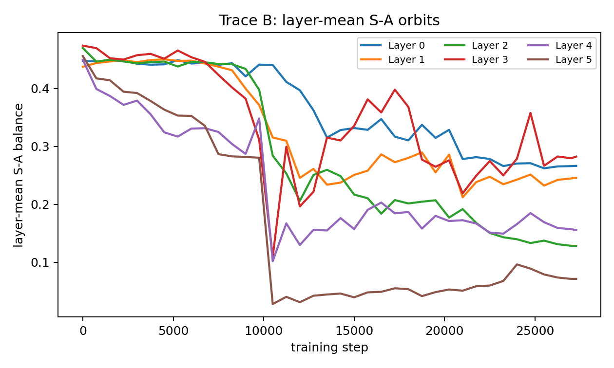
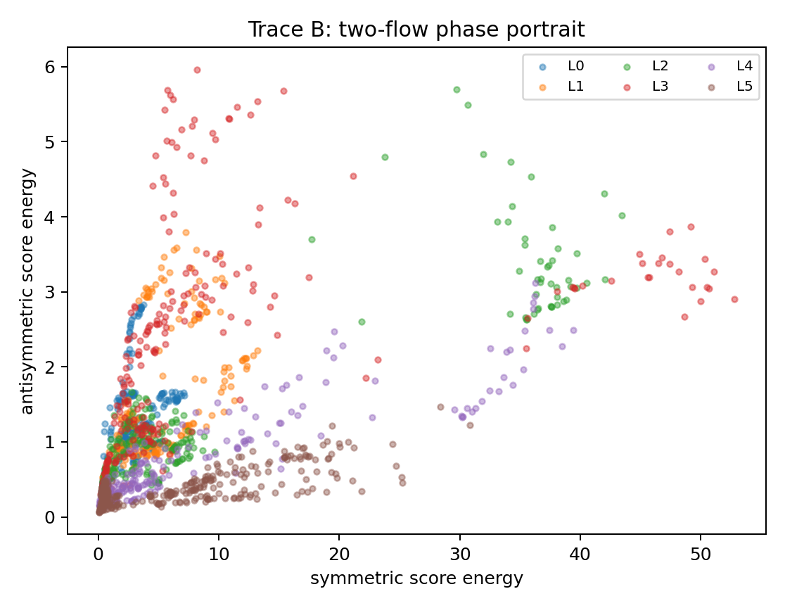
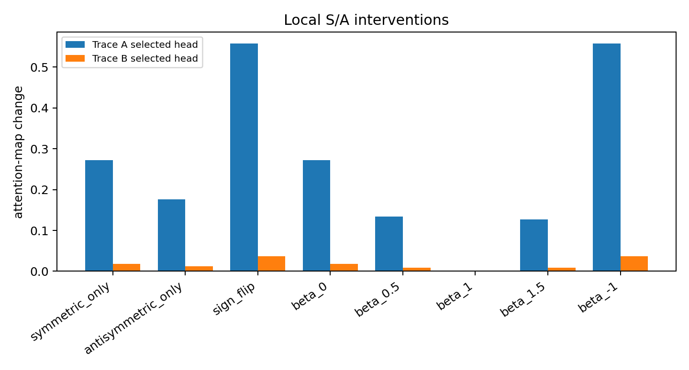

# Chapter 11: empirical orbit atlas of two SARS training traces

[Library index](../README.md) · [Source policy](../SOURCE.md) · [Previous: PDF 365–367](0365-0367-ch11-signature-orbits-and-training-traces.md#pdf-0367) · [Next: PDF 373–378](0373-0378-ch11-layer-observables-and-symplectic-attractors.md#pdf-0373)

> Editorial note: Full transcription of PDF 368–372 (printed pages 332–336), continuing §11.3. Table 11.1, the unnumbered class-count table, and Figures 11.1–11.8 are retained. Numerical results and their interpretations are the author's reports, not newly reproduced experiments. The final sentence continues on PDF 373. Russian note 108 separates the measured observables from wider causal or classification claims.

## PDF 368 · Book 332

*Continuation of [§11.3](0365-0367-ch11-signature-orbits-and-training-traces.md#section-11-3).*

This second trace is useful precisely because it shows that stable optimisation can still fail to produce a useful directional geography.

| trace | step | $\bar\alpha$ | $\operatorname{sd}(\alpha)$ | $\min\alpha$ | $\max\alpha$ | $\bar\Gamma_s$ | $\bar\Gamma_a$ | asym. |
|---|---:|---:|---:|---:|---:|---:|---:|---:|
| directional-tail | 0 | 0.453 | 0.047 | 0.329 | 0.567 | 0.442 | 0.360 | 0.108 |
| directional-tail | 22730 | 0.245 | 0.176 | 0.005 | 0.659 | 6.277 | 1.325 | 0.287 |
| symmetric-collapse | 0 | 0.456 | 0.055 | 0.319 | 0.558 | 0.445 | 0.365 | 0.106 |
| symmetric-collapse | 27276 | 0.192 | 0.125 | 0.025 | 0.510 | 7.390 | 1.191 | 0.207 |

**Table 11.1:** Aggregate orbit statistics for the two SARS traces. Both traces move toward a lower mean S–A balance, but the directional-tail trace preserves a larger antisymmetric tail and later exhibits a much stronger local intervention effect.

**Figure 11.1:** Mean S–A balance across the two SARS traces. The shaded band gives one standard deviation across heads and layers. The figure shows that the orbit geometry is not determined by final task accuracy alone.

### 11.3.1 Directional-tail trace

The final heatmap of the directional-tail trace is shown in Figure 11.2. The most important head is layer 2, head 7. Its S–A balance increases approximately from 0.376 to 0.659, with final energies $\Gamma_s\simeq1.224$ and $\Gamma_a\simeq2.366$. Its sign-flip intervention is large:

$$
\Delta A\simeq0.558,\qquad \Delta X_{\mathrm{out}}\simeq0.219.
$$

This is the cleanest empirical reason for retaining antisymmetric motors as causal objects rather than treating them as diagnostic decoration.

## PDF 369 · Book 333

**Figure 11.2:** Final S–A heatmap of the directional-tail trace. Most heads become symmetric-dominant, but a small tail of heads retains high antisymmetric balance.

**Figure 11.3:** Layer-mean S–A orbits for the directional-tail trace. Layers do not follow a single scalar drift; they occupy different regions of the S–A orbit space.

## PDF 370 · Book 334

**Figure 11.4:** Two-flow phase portrait for the directional-tail trace. Both $\Gamma_s$ and $\Gamma_a$ grow, but selected heads retain comparatively large antisymmetric energy.

### 11.3.2 Symmetric-collapse trace

The symmetric-collapse trace has slightly lower loss but collapses almost entirely onto one class. Its final prediction distribution is:

| class | 0 | 1 | 2 | 3 | 4 | 5 | 6 | 7 |
|---|---:|---:|---:|---:|---:|---:|---:|---:|
| true | 8 | 46 | 162 | 416 | 577 | 720 | 488 | 583 |
| predicted | 0 | 0 | 0 | 0 | 5 | 2937 | 0 | 58. |

The orbit signature of this failure is a stronger global drift toward the symmetric channel:

$$
\bar\alpha_{SA}:0.456\to0.192,\qquad
\bar\Gamma_s:0.445\to7.390,\qquad
\bar\Gamma_a:0.365\to1.191.
$$

Thus a numerically smoother run can still destroy the directional tail.

## PDF 371 · Book 335

**Figure 11.5:** Final S–A heatmap of the symmetric-collapse trace. The antisymmetric tail is weaker than in the directional-tail trace, and the global movement is dominated by the symmetric channel.

**Figure 11.6:** Layer-mean S–A orbits for the symmetric-collapse trace. The run is smoother, but it does not produce a strong directional geometry.

## PDF 372 · Book 336

**Figure 11.7:** Two-flow phase portrait for the symmetric-collapse trace. The large symmetric expansion is the orbit-level signature of classifier collapse.

### 11.3.3 Causal intervention contrast

The contrast between the two traces is clearest under local S/A intervention. In the directional-tail trace, the selected head has a large response to antisymmetric sign flip. In the symmetric-collapse trace, the selected head has only a weak response. Figure 11.8 compares the intervention profiles.

**Figure 11.8:** Local S/A intervention comparison. The directional-tail trace contains a head whose attention map is strongly altered by flipping the antisymmetric component. The symmetric-collapse trace does not.

The empirical conclusion is not that either compact SARS classifier is satisfactory. It is

[Continue this sentence on PDF 373](0373-0378-ch11-layer-observables-and-symplectic-attractors.md#pdf-0373).

