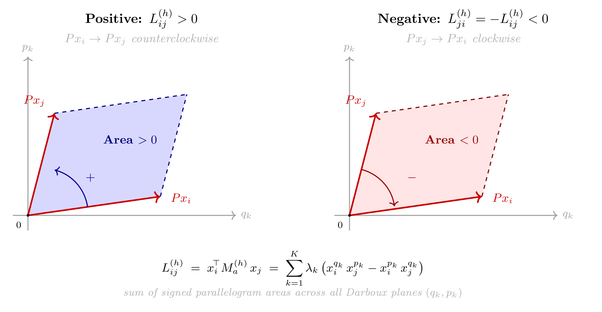
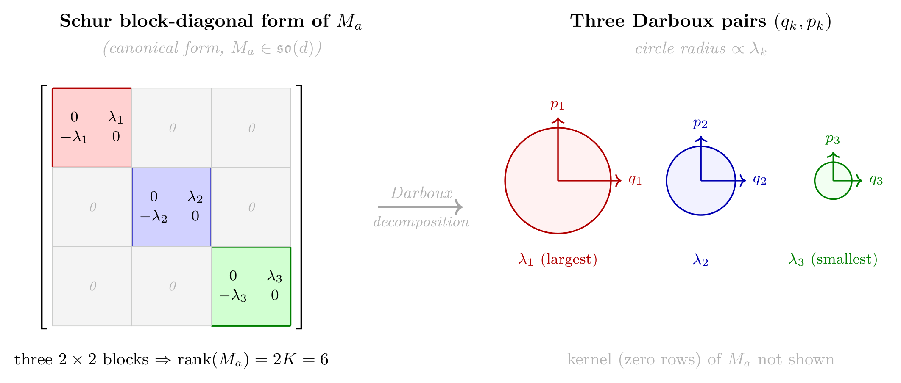

# Chapter 11: layer observables, skew-gradient flow, and symplectic attractor classes

[Library index](../README.md) · [Source policy](../SOURCE.md) · [Previous: PDF 368–372](0368-0372-ch11-empirical-orbit-atlas.md#pdf-0372) · [Next: PDF 379–384](0379-0384-ch11-gap-opening-and-symmetry-breaking.md#pdf-0379)

> Editorial note: Full transcription of PDF 373–378 (printed pages 337–342). The unresolved “??” references, changes of notation, source spelling “irriducible,” and the stated classification are preserved. Equations (11.1)–(11.8), objects 11.2–11.15, and Figures 11.9–11.10 are included. Searchable figure-label transcriptions are explicitly marked as editorial aids. Mathematical qualifications are separate in Russian notes 109–111.

## PDF 373 · Book 337

*Continuation of the sentence on [PDF 372](0368-0372-ch11-empirical-orbit-atlas.md#pdf-0372).*

that the orbit geometry separates two regimes that final accuracy alone would merge: a run with a causal directional tail and a run with symmetric collapse. This is exactly the role of signature orbits in the theory.

### 11.4 The Layer-Wise View: Setup and Observables

The analysis of Chapters ?? and ?? was head-centric: it fixed a layer $l$ and a head $h$ and traced the trajectory of $M_a^{(h,l)}$ in $\mathfrak{so}(d)$. To study dynamics across layers, a different frame is needed: instead of fixing one object (one head) and tracing its motion, the analysis fixes the observer (the sequence of layers) and asks what each layer sees.

Three observables organise the layer-wise analysis.

#### 11.4.1 The directional energy profile $\Gamma^{(l)}$

Recall from Chapter ?? (Theorem C, Directional Energy Theorem) that the quantity

$$
\Gamma(X;M_a)=\lVert XM_aX^\top\rVert_F
$$

measures the total directional energy generated by the antisymmetric sector of the score matrix, acting on the input sequence.

**Definition 11.2 (Layer-wise directional energy).** Let $X^{(l)}\in\mathbb R^{n\times d}$ be the hidden-state matrix at layer $l$, and let $M_a^{(h,l)}=(M^{(h,l)}-M^{(h,l)\top})/2$ be the antisymmetric component of the score matrix of head $h$ at layer $l$. The **layer-wise directional energy** at layer $l$ is

$$
\Gamma^{(l)}:=
\frac1{H_l}\sum_{h=1}^{H_l}
\left\lVert X^{(l)}M_a^{(h,l)}X^{(l)\top}\right\rVert_F,
\tag{11.1}
$$

where $H_l$ is the number of active heads at layer $l$.

**Remark 11.3 (Role of $X^{(l)}$ in $\Gamma^{(l)}$).** The dependence of $\Gamma^{(l)}$ on $X^{(l)}$, and not merely on $M_a^{(h,l)}$, is essential. A score matrix with large $\lVert M_a\rVert_F$ generates no directional energy if the input sequence is isotropic (all token representations collapsed to a single direction). Conversely, a sequence with high representational diversity amplifies even a modest antisymmetric component. The interplay between representational diversity and directional energy is precisely what the Residual Amplification Proposition (Section 11.7) makes precise.

#### 11.4.2 The head activation sequence $\gamma_h^{(l)}$

The asymmetry index $\alpha_h^{(l)}=\lVert M_a^{(h,l)}\rVert_F/\lVert M^{(h,l)}\rVert_F$, introduced in Chapter ??, measures the fraction of the score matrix attributable to the directional (antisymmetric) component at any fixed moment. To track how this fraction evolves during training, it is more informative to normalise by the initial value.

**Definition 11.4 (Head activation sequence).** The **activation sequence** of head $h$ at layer $l$ is

$$
\gamma_h^{(l)}(t):=
\frac{\alpha_h^{(l)}(t)}{\alpha_h^{(l)}(0)}
=
\frac{\lVert M_a^{(h,l)}(t)\rVert_F/\lVert M^{(h,l)}(t)\rVert_F}
{\lVert M_a^{(h,l)}(0)\rVert_F/\lVert M^{(h,l)}(0)\rVert_F},
\tag{11.2}
$$

where $t$ denotes training step. A head $h$ at layer $l$ is said to be **directionally active** at time $t$ if $\gamma_h^{(l)}(t)>1$, i.e., if the antisymmetric sector has grown relative to its initialisation.

## PDF 374 · Book 338

**Remark 11.5 (Relation to the cone index).** The directional activity $\gamma_h^{(l)}(t)>1$ is the head-level counterpart of the cone index growth $I_{\mathrm{cone}}^{(l)}\nearrow$ that appears in the coherence chain of Chapter ??. The coherence chain operates at layer level; the activation sequence $\gamma_h^{(l)}$ provides the head-level resolution of the same phenomenon. The connection is made precise in Proposition 11.40 below.

#### 11.4.3 The effective rank of $W_O^{(l)}$

The diagnostic $r_{\mathrm{eff}}(W_O^{(l)})$, introduced in Chapter ?? (Remark ??), measures the effective number of independent output directions available after the output projection at layer $l$. Its layer-wise behaviour — specifically, the empirical observation that $r_{\mathrm{eff}}(W_O^{(l)})$ decreases with depth in trained BERT models (Experiment 6, Chapter ??) — is one of the central facts that this chapter explains. The explanation is the content of Section 11.8.

### 11.5 The Trajectory of $M_a^{(h,l)}$ in $\mathfrak{so}(d)$

**Remark 11.6 (Boundary with Chapter ??).** The motor formalism of Chapters ?? and ?? provides the algebraic language for what follows: the antisymmetric part of the gradient $\partial\mathcal L/\partial M^{(h,l)}$ acts as an element of $\mathfrak{so}(d)$, constraining the trajectory of $M_a^{(h,l)}$ to lie in that Lie algebra throughout training. This chapter uses the geometric consequence of that fact (the trajectory is a curve in $\mathfrak{so}(d)$, not an arbitrary path through matrix space) without invoking the motor notation $G_s,G_a$ or the geodesic flow formulas. The full algebraic development is in Chapter ??.

**Proposition 11.7 (Antisymmetric gradient constraint).** For any differentiable loss $\mathcal L$ and any head $(h,l)$, the gradient of $\mathcal L$ with respect to $M^{(h,l)}$ decomposes as

$$
\frac{\partial\mathcal L}{\partial M^{(h,l)}}=G_s^{(h,l)}+G_a^{(h,l)},
$$

where $G_s^{(h,l)}$ is symmetric and $G_a^{(h,l)}$ is antisymmetric. Under gradient flow, $M_a^{(h,l)}$ evolves according to

$$
\dot M_a^{(h,l)}=-\eta\,G_a^{(h,l)},
\tag{11.3}
$$

and therefore $M_a^{(h,l)}(t)\in\mathfrak{so}(d)$ for all $t\ge0$, provided $M_a^{(h,l)}(0)\in\mathfrak{so}(d)$.

*Proof.* The decomposition of the gradient follows from the fact that any square matrix decomposes uniquely into symmetric and antisymmetric parts, applied to $\partial\mathcal L/\partial M^{(h,l)}$. Under gradient flow, only the antisymmetric part of the gradient acts on $M_a^{(h,l)}$: the symmetric part $G_s^{(h,l)}$ drives $M_s^{(h,l)}$, and the two sectors are decoupled because $\mathfrak{so}(d)$ is invariant under the projection $A\mapsto(A-A^\top)/2$. The invariance of $M_a^{(h,l)}(t)\in\mathfrak{so}(d)$ then follows because the flow (11.3) is a flow on $\mathfrak{so}(d)$. The full derivation, including the computation of $G_a^{(h,l)}$ in terms of the score-space motor, is in Chapter ??, Antisymmetric Motor Theorem. $\square$

**Remark 11.8 (What “trajectory in $\mathfrak{so}(d)$” means geometrically).** The space $\mathfrak{so}(d)$ is the set of $d\times d$ antisymmetric real matrices. It is a vector space of dimension $d(d-1)/2$. Saying that $M_a^{(h,l)}$ traces a curve in $\mathfrak{so}(d)$ means that training cannot take a directional head and turn it into a purely symmetric one by gradient steps on $M_a$ alone: the antisymmetric sector is invariant under its own gradient flow. In practice, the antisymmetric component can only be modified by the antisymmetric part of the gradient; the symmetric part of the gradient

## PDF 375 · Book 339

acts on $M_s$ separately. This decoupling is the structural reason why directional heads and reciprocal heads do not mix during training: they occupy different invariant submanifolds of parameter space.

#### 11.5.1 The canonical structure of $M_a^{(h,l)}$: symplectic eigenplanes

Before the fixed points of the flow are characterised, the algebraic structure of the object that flows deserves close attention: the antisymmetric matrix $M_a^{(h,l)}\in\mathfrak{so}(d)$. This structure is classical — it is the real normal form of antisymmetric matrices — but its consequences for the theory of attention heads have not previously been made explicit. The key message is simple and concrete: every antisymmetric matrix decomposes into a sum of independent rotation generators, one per two-dimensional “eigenplane”. A head that has converged to class (iii) is, in effect, implementing a single such rotation in the token embedding space.

**Proposition 11.9 (Canonical Symplectic Decomposition).** Let $M_a\in\mathfrak{so}(d)$ be any real antisymmetric matrix. There exists an orthonormal basis $\{q_1,p_1,\ldots,q_K,p_K,e_1,\ldots,e_{d-2K}\}$ of $\mathbb R^d$ such that

$$
M_a=\sum_{k=1}^{K}\lambda_k(q_kp_k^\top-p_kq_k^\top),
\qquad
\lambda_1\ge\lambda_2\ge\cdots\ge\lambda_K>0,
\tag{11.4}
$$

where $K=\operatorname{rank}(M_a)/2\le\lfloor d/2\rfloor$. The pairs $(q_k,p_k)$ are orthonormal and mutually orthogonal across different $k$; the vectors $e_j$ span the kernel of $M_a$. The decomposition is unique up to rotation within each eigenplane $\operatorname{span}(q_k,p_k)$ and up to sign of $\lambda_k$.

*Proof.* By the real Schur decomposition of $M_a$, there exists an orthogonal $P\in O(d)$ such that $P^\top M_aP$ is block-diagonal with $2\times2$ blocks $\left[\begin{smallmatrix}0&\lambda_k\\-\lambda_k&0\end{smallmatrix}\right]$ and zero blocks, ordered by $\lambda_k\searrow$. Setting $q_k$ and $p_k$ as the columns of $P$ corresponding to the $k$-th block gives (11.4). Uniqueness up to eigenplane rotation follows from the spectral theorem for antisymmetric operators on $\mathbb R^d$. $\square$

**Remark 11.10 (The symplectic form).** Each term $\lambda_k(q_kp_k^\top-p_kq_k^\top)$ is the generator of a rotation in the plane $\operatorname{span}(q_k,p_k)$ with angular frequency $\lambda_k$. The associated bilinear form $\omega_k(u,v)=\lambda_k(u^\top q_k)(v^\top p_k)-\lambda_k(u^\top p_k)(v^\top q_k)$ is a symplectic 2-form on $\operatorname{span}(q_k,p_k)$: it is antisymmetric, non-degenerate, and closed. The full antisymmetric form $\omega(u,v)=u^\top M_av=\sum_k\omega_k(u,v)$ is the sum of $K$ symplectic 2-forms, one per eigenplane — the Darboux normal form of $\omega$. The pairs $(q_k,p_k)$ are Darboux coordinates: $\omega_k(q_k,p_k)=\lambda_k$ and $\omega_k$ vanishes on all other pairs.

**Remark 11.11 (Geometric interpretation of the score matrix).** Under the canonical decomposition, the antisymmetric contribution to the score between tokens $i$ and $j$ takes the form

$$
\left(X^{(l)}M_a^{(h,l)}X^{(l)\top}\right)_{ij}
=
\sum_{k=1}^{K}\lambda_k
\det\begin{pmatrix}
x_i^{(l)}\cdot q_k & x_i^{(l)}\cdot p_k\\
x_j^{(l)}\cdot q_k & x_j^{(l)}\cdot p_k
\end{pmatrix},
\tag{11.5}
$$

where each summand is the signed area of the parallelogram spanned by the projections of tokens $i$ and $j$ onto the $k$-th eigenplane. This is positive when token $i$ precedes $j$ in the oriented plane $(q_k,p_k)$, negative when $j$ precedes $i$, and zero when they are collinear in that plane. A single eigenplane $(K=1)$ is the minimal, irriducible attention head: it detects one oriented relational structure between token pairs.

The canonical decomposition has an immediate consequence for the rank structure of the directional operator.

## PDF 376 · Book 340

**Corollary 11.12 (Rank parity — from symplectic structure).** For any $X^{(l)}\in\mathbb R^{n\times d}$ and any $M_a^{(l)}\in\mathfrak{so}(d)$, the directional operator $\mathcal D^{(l)}=X^{(l)}M_a^{(l)}X^{(l)\top}\in\mathfrak{so}(n)$ has rank

$$
\operatorname{rank}(\mathcal D^{(l)})\in\{0,2,4,\ldots\},
\qquad
\operatorname{rank}(\mathcal D^{(l)})
\le 2\left\lfloor\frac{\min(n,d)}2\right\rfloor.
\tag{11.6}
$$

The rank is even because $\mathcal D^{(l)}$ is itself an antisymmetric matrix (it belongs to $\mathfrak{so}(n)$), and every antisymmetric real matrix has even rank by Proposition 11.9 applied to $\mathcal D^{(l)}$ in place of $M_a$.

*Proof.* $\mathcal D^{(l)}\in\mathfrak{so}(n)$ because $(XM_aX^\top)^\top=-XM_aX^\top$ by antisymmetry of $M_a$. Applying Proposition 11.9 to $\mathcal D^{(l)}$ gives a decomposition with $K'=\operatorname{rank}(\mathcal D^{(l)})/2$ eigenplanes, so the rank is $2K'$. The upper bound follows from $\operatorname{rank}(\mathcal D^{(l)})\le\operatorname{rank}(X^{(l)})\le\min(n,d)$. $\square$

**Figure 11.9: Antisymmetric score as signed area** (Rem. 11.11). The score $L_{ij}^{(h)}$ is the signed area of the parallelogram formed by the projections of tokens $i$ and $j$ onto the Darboux plane $(q_k,p_k)$. Positive: $i$ precedes $j$; negative: $j$ precedes $i$; zero: collinear.

> Editorial aid — searchable labels from the original Figure 11.9: left panel, “Positive: $L_{ij}^{(h)}>0$”, “$Px_i\to Px_j$ counterclockwise”, “Area $>0$”, “$+$”; right panel, “Negative: $L_{ji}^{(h)}=-L_{ij}^{(h)}<0$”, “$Px_j\to Px_i$ clockwise”, “Area $<0$”, “$-$”. Both panels label the axes $q_k,p_k$, origin $0$, and projected tokens $Px_i,Px_j$. The equation printed beneath the panels is:
>
> $$
> L_{ij}^{(h)}=x_i^\top M_a^{(h)}x_j
> =\sum_{k=1}^{K}\lambda_k
> \left(x_i^{q_k}x_j^{p_k}-x_i^{p_k}x_j^{q_k}\right).
> $$
>
> Its subtitle is “sum of signed parallelogram areas across all Darboux planes $(q_k,p_k)$”.

**Remark 11.13 (Relation to the earlier Rank Parity Proposition).** Corollary 11.12 supersedes Proposition 11.50 in Section 11.9: the rank parity is not a separate algebraic fact to be established independently, but an immediate consequence of the canonical structure of antisymmetric matrices. Both statements are equivalent; the canonical decomposition makes the origin of the parity transparent. In what follows, Corollary 11.12 as the primary statement and retain Proposition 11.50 as a self-contained reference for readers who encounter it without the canonical decomposition context.

## PDF 377 · Book 341

**Figure 11.10: Canonical Symplectic Decomposition** (Prop. 11.9). *Left:* Schur block-diagonal form of $M_a\in\mathfrak{so}(d)$ — each coloured $2\times2$ block encodes one rotation plane with frequency $\lambda_k$. *Right:* the three Darboux pairs $(q_k,p_k)$; circle radius $\propto\lambda_k$. $\operatorname{Rank}(M_a)=2K$ always even; the kernel (zero rows) is not shown.

> Editorial aid — searchable labels from the original Figure 11.10: “Schur block-diagonal form of $M_a$”, “(canonical form, $M_a\in\mathfrak{so}(d)$)”; three diagonal blocks $\left[\begin{smallmatrix}0&\lambda_k\\-\lambda_k&0\end{smallmatrix}\right]$ for $k=1,2,3$, with zero blocks off the diagonal; “three $2\times2$ blocks $\Rightarrow\operatorname{rank}(M_a)=2K=6$”; arrow “Darboux decomposition”; “Three Darboux pairs $(q_k,p_k)$”, “circle radius $\propto\lambda_k$”; axes $q_1,p_1$, $q_2,p_2$, $q_3,p_3$; “$\lambda_1$ (largest)”, “$\lambda_2$”, “$\lambda_3$ (smallest)”; “kernel (zero rows) of $M_a$ not shown”.

#### 11.5.2 Fixed points and attractor geometry

The canonical decomposition provides the right language for describing the fixed points of the flow (11.3): a fixed point is a configuration of eigenplanes $(q_k,p_k,\lambda_k)$ at which the gradient no longer pushes $M_a$ to change. The classification that follows is now more transparent than it would have been without the decomposition: each class corresponds to a different relationship between the eigenplanes of $M_a^{(h,l)}$ and the eigenplanes of the directional operator $\mathcal D^{(h,l)}$.

The flow (11.3) terminates when $G_a^{(h,l)}=0$, i.e., when the antisymmetric part of the gradient vanishes. The fixed-point classification that Chapters ?? and ?? will use as a direct input. The derivation in terms of the motor score decomposition belongs to Chapter ??; what follows gives the geometric content in a form that is self-contained within this chapter.

**Proposition 11.14 (Fixed-Point Classification).** Let $M_a^{(h,l)}\in\mathfrak{so}(d)$ be a fixed point of the flow (11.3) at layer $l$, with canonical decomposition $M_a^{(h,l)}=\sum_{k=1}^{K}\lambda_k(q_kp_k^\top-p_kq_k^\top)$. Define the directional operator

$$
\mathcal D^{(h,l)}:=X^{(l)}M_a^{(h,l)}X^{(l)\top}\in\mathfrak{so}(n),
\tag{11.7}
$$

with its own canonical decomposition $\mathcal D^{(h,l)}=\sum_{k=1}^{K'}\mu_k(u_kv_k^\top-v_ku_k^\top)$, $\mu_1\ge\mu_2\ge\cdots\ge\mu_{K'}>0$. The fixed point falls into exactly one of four classes, determined by the alignment between the eigenplanes of $M_a^{(h,l)}$ and those of $\mathcal D^{(h,l)}$:

(i) **Sequence-silent.** $K=0$: $M_a^{(h,l)}=0$, hence $\mathcal D^{(h,l)}=0$. The directional energy vanishes (silence criterion, Chapter ??, Theorem C) and $\gamma_h^{(l)}\to0$. This class coincides with the silence manifold $\mathcal M_{\mathrm{silence}}$ (Chapter ??).

(ii) **Reciprocal attractor.** $K=1$ with $\operatorname{span}(q_1,p_1)$ aligned with the dominant eigenplane of $\mathcal D^{(h,l)}$, and the spectral gap $\mu_1-\mu_2=0$: the directional operator concentrates equal energy on two planes. The activation sequence $\gamma_h^{(l)}$ stabilises at a finite value $\gamma^*>0$.

## PDF 378 · Book 342

In the language of the canonical decomposition, the head implements one symplectic 2-form at moderate amplitude.

(iii) **Directional attractor.** $K=1$ with $\operatorname{span}(q_1,p_1)$ aligned with the dominant eigenplane of $\mathcal D^{(h,l)}$, and the spectral gap $\mu_1-\mu_2>0$: the directional operator concentrates strictly more energy in the dominant plane than in any other. The alignment condition is

$$
\operatorname{span}(q_1,p_1)=\operatorname{span}(u_1,v_1),
\qquad \lambda_1=\mu>0,
\tag{11.8}
$$

and $\gamma_h^{(l)}\to\gamma^{**}>1$. This is the minimal irriducible head: one eigenplane, one symplectic 2-form.

(iv) **Composite attractor.** $K\ge2$: the head implements multiple symplectic 2-forms simultaneously. The eigenplanes of $M_a^{(h,l)}$ span a $2K$-dimensional subspace and the directional energy is distributed across $K$ eigenplanes of $\mathcal D^{(h,l)}$. The activation sequence stabilises at a finite value, but the head's contribution to $\Gamma^{(l)}$ is spread across multiple planes.

The proof of this classification is a sketch. *The full derivation from the vanishing condition $G_a^{(h,l)}=0$ is in Chapter ?? (motor formalism).* The identification of class (i) with the silence manifold is made precise in Chapter ??.

*Proof sketch.* At a fixed point $\dot M_a^{(h,l)}=0$, the condition $G_a^{(h,l)}=0$ requires that the antisymmetric part of the gradient vanishes. By the Antisymmetric Motor Theorem (Chapter ??), $G_a^{(h,l)}$ is proportional to $X^{(l)\top}\mathcal D^{(h,l)}X^{(l)}$ projected onto $\mathfrak{so}(d)$. The four classes correspond to the four qualitatively distinct ways this projection can vanish: (i) $\mathcal D^{(h,l)}=0$ identically; (ii) $\mathcal D^{(h,l)}\ne0$ but the projection vanishes due to equal singular values (degenerate spectrum); (iii) the projection vanishes because $M_a^{(h,l)}$ is already aligned with the dominant eigenplane of $\mathcal D^{(h,l)}$ (self-consistent condition); (iv) alignment across multiple planes simultaneously. The spectral gap $\mu_1-\mu_2$ discriminates between classes (ii) and (iii)/(iv). $\square$

**Remark 11.15 (Why class (iii) drives amplification).** Among the four classes, only class (iii) — the directional attractor, a single symplectic eigenplane at convergence — satisfies $\gamma_h^{(l)}>1$. It is the minimal irriducible head: one Darboux pair $(q_1,p_1)$, one amplitude $\lambda_1$, one oriented relational structure. Class (i) contributes zero energy; class (ii) contributes bounded, isotropic energy (the two directions of the plane contribute equally); class (iv) contributes energy distributed across $K\ge2$ planes simultaneously — richer than class (ii) but less concentrated than class (iii). The Residual Amplification Proposition below (Proposition 11.33) applies to heads in class (iii): only a head that has committed to a single eigenplane generates the alignment coefficient $\kappa>0$ that drives linear growth of $\Gamma^{(l)}$. The Pattern-Emergence Theorem (Chapter ??) will show that the transition from class (ii) to class (iii) — the gap-opening transition of Section 11.5.3 — is the dynamical mechanism behind the emergence of each of the eight attention patterns.

[Continue with Figure 11.11 and §11.5.3 on PDF 379](0379-0384-ch11-gap-opening-and-symmetry-breaking.md#pdf-0379).

