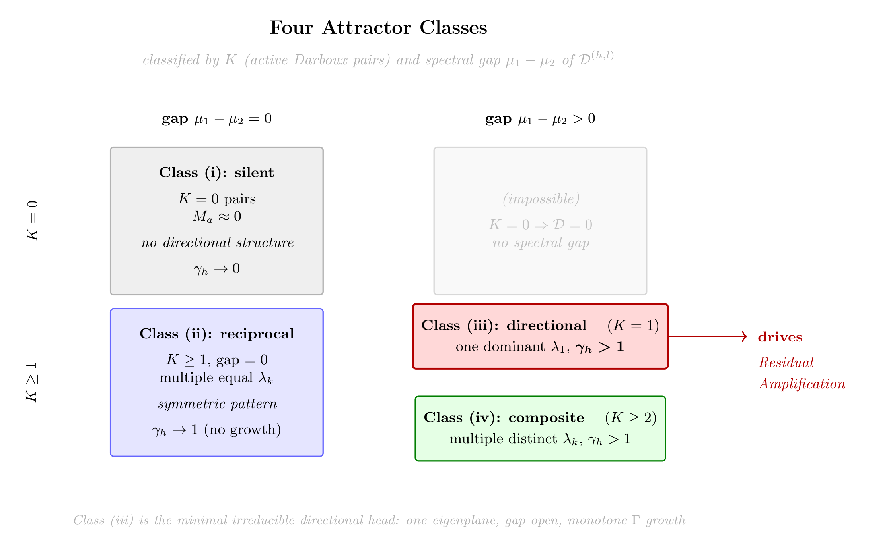

# Chapter 11: gap opening, LayerNorm alignment, random initialisation, and symmetry breaking

[Library index](../README.md) · [Source policy](../SOURCE.md) · [Previous: PDF 373–378](0373-0378-ch11-layer-observables-and-symplectic-attractors.md#pdf-0378) · [Next: PDF 385–390](0385-0390-ch11-emergence-and-residual-amplification.md#pdf-0385)

> Editorial note: Full transcription of PDF 379–384 (printed pages 343–348), including Figure 11.11, equations (11.9)–(11.14), objects 11.16–11.28 and the opening of Theorem 11.29. The theorem continues on PDF 385. Unresolved references, source assumptions, sign conventions, normalisations and disputed claims are retained literally; Russian notes 111–115 discuss them separately. The diagram's labels are also transcribed as a clearly marked editorial aid.

## PDF 379 · Book 343

**Figure 11.11: The four attractor classes** (Prop. 11.14). Classified by number of active Darboux pairs $K$ and spectral gap $\mu_1-\mu_2$ of $\mathcal D^{(h,l)}$. Class (iii) — one eigenplane, gap open, $\gamma_h>1$ — is the minimal irriducible directional head and the only class that drives Residual Amplification.

> Editorial aid — searchable labels from the original Figure 11.11. Title: “Four Attractor Classes”; subtitle: “classified by $K$ (active Darboux pairs) and spectral gap $\mu_1-\mu_2$ of $\mathcal D^{(h,l)}$”. Columns: “gap $\mu_1-\mu_2=0$” and “gap $\mu_1-\mu_2>0$”; rows: “$K=0$” and “$K\ge1$”.
>
> | Diagram region | Original labels |
> |---|---|
> | $K=0$, zero gap | “Class (i): silent”; “$K=0$ pairs”; “$M_a\approx0$”; “no directional structure”; “$\gamma_h\to0$” |
> | $K=0$, positive gap | “(impossible)”; “$K=0\Rightarrow\mathcal D=0$”; “no spectral gap” |
> | $K\ge1$, zero gap | “Class (ii): reciprocal”; “$K\ge1$, gap $=0$”; “multiple equal $\lambda_k$”; “symmetric pattern”; “$\gamma_h\to1$ (no growth)” |
> | $K\ge1$, positive gap, upper box | “Class (iii): directional $(K=1)$”; “one dominant $\lambda_1$, $\gamma_h>1$”; arrow “drives Residual Amplification” |
> | $K\ge1$, positive gap, lower box | “Class (iv): composite $(K\ge2)$”; “multiple distinct $\lambda_k$, $\gamma_h>1$” |
>
> Bottom line: “Class (iii) is the minimal irreducible directional head: one eigenplane, gap open, monotone $\Gamma$ growth”.

#### 11.5.3 The gap-opening transition

The Fixed-Point Classification (Proposition 11.14) treats the spectral gap $\Delta_{\mathrm{gap}}^{(h,l)}:=\lambda_1-\lambda_2$ of the directional operator as a binary condition: either zero (class ii, reciprocal) or positive (class iii, directional). But during training this gap is not fixed — it evolves. The transition from class (ii) to class (iii) is a dynamical event: the moment when $\Delta_{\mathrm{gap}}^{(h,l)}$ first becomes positive and begins to grow. The question is when this happens.

**Proposition 11.16 (Gap-Opening Transition).** Let $\mathcal D^{(h,l)}(t)=X^{(l)}M_a^{(h,l)}(t)X^{(l)\top}$ be the directional operator at training step $t$, and let $\Delta_{\mathrm{gap}}(t):=\lambda_1(t)-\lambda_2(t)$ be its spectral gap. Define the **critical directional energy**:

$$
\Gamma^*:=\inf\left\{
\Gamma^{(l)}>0
\;\middle|\;
\frac{d}{dt}\Delta_{\mathrm{gap}}(t)>0\text{ at some }t
\right\}.
\tag{11.9}
$$

Then:

(a) For $\Gamma^{(l)}<\Gamma^*$: the gradient flow preserves or decreases $\Delta_{\mathrm{gap}}$; the head remains in class (ii) (reciprocal).

(b) For $\Gamma^{(l)}>\Gamma^*$: the gradient flow increases $\Delta_{\mathrm{gap}}$; the head enters or approaches class (iii) (directional).

(c) The threshold $\Gamma^*$ is determined by the task geometry:

$$
\Gamma^*\approx
\frac{\sigma_{\min}^{+}(X^{(l)})\cdot\lVert M_a^{(h,l)}\rVert_F}
{\lVert X^{(l)}\rVert_F^2},
\tag{11.10}
$$

## PDF 380 · Book 344

where $\sigma_{\min}^{+}(X^{(l)})$ denotes the smallest non-zero singular value of $X^{(l)}$.

*Proof sketch (full derivation in Chapter ??)* The spectral gap $\Delta_{\mathrm{gap}}(t)$ evolves under the flow (11.3) according to $\dot\Delta_{\mathrm{gap}}=\langle\nabla_{\mathcal D}\Delta_{\mathrm{gap}},\dot{\mathcal D}\rangle$, where $\dot{\mathcal D}=X\dot M_aX^\top=-\eta XG_aX^\top$. The gradient $\nabla_{\mathcal D}\Delta_{\mathrm{gap}}$ is the difference of the gradients of $\lambda_1$ and $\lambda_2$ with respect to $\mathcal D$, which by the perturbation formula for eigenvalues equals $u_1v_1^\top-u_2v_2^\top$ (where $u_k,v_k$ are left/right singular vectors).

The sign of $\dot\Delta_{\mathrm{gap}}$ is therefore determined by the inner product $\langle u_1v_1^\top-u_2v_2^\top,XG_aX^\top\rangle_F$. This is positive when $G_a$ aligns more strongly with the dominant eigenplane than with the second — a condition that becomes more satisfied as $\lVert XG_aX^\top\rVert_F$ grows, i.e., as $\Gamma^{(l)}$ grows. The threshold $\Gamma^*$ marks the crossing point. The formula (11.10) follows from a first-order perturbation argument using the smallest non-zero singular value of $X^{(l)}$ as the scale of the coupling between $M_a$ and $\mathcal D$. Full derivation in Chapter ??. $\square$

**Remark 11.17 (Connection to the Pattern-Emergence Theorem).** Proposition 11.16 provides the answer to a question that the Fixed-Point Classification leaves open: not only what the four attractor classes are, but *when* a head transitions between them. Chapter ?? (Pattern-Emergence Theorem) will show that the emergence of a directional attention pattern is equivalent to the gap-opening transition — the moment $\Gamma^{(l)}$ crosses $\Gamma^*$ for the relevant head. In this sense, $\Gamma^*$ is the pattern-emergence threshold: below it, the head contributes isotropic directional energy (reciprocal pattern); above it, it concentrates into a specific eigenplane (one of the eight pattern types of Chapter ??).

#### 11.5.4 The trajectory of $M_a^{(h,l)}$ through layer normalisation and residual connections

The analysis of §11.5 traced $M_a^{(h,l)}$ in $\mathfrak{so}(d)$ under gradient flow, treating $X^{(l)}$ as a sequence of inputs. In a real Transformer, two additional components intercept this flow: *layer normalisation* (LN) and *residual connections*. Both are rank-neutral in the sense of the Rank-Neutrality Theorem (Chapter ??, Theorem ??), but they affect the scale and direction of the input to each attention head, and therefore the effective score matrix seen by $M_a^{(h,l)}$.

**Remark 11.18 (Layer normalisation does not move $M_a$ out of $\mathfrak{so}(d)$).** Layer normalisation acts row-wise: $X_{\mathrm{LN}}^{(l)}:=\operatorname{LN}(X^{(l)})=(X^{(l)}-\mu^{(l)}\mathbf1^\top)/\sigma^{(l)}$. The gradient of $\mathcal L$ with respect to $M^{(h,l)}$ is $\frac1{\sqrt{d_k}}X_{\mathrm{LN}}^{(l)\top}(\partial\mathcal L/\partial L^{(h,l)})X_{\mathrm{LN}}^{(l)}$, whose antisymmetric part $G_a^{(h,l)}$ remains in $\mathfrak{so}(d)$. The trajectory of $M_a^{(h,l)}$ is therefore confined to $\mathfrak{so}(d)$ regardless of whether LN is applied (Proposition 11.7 holds with $X_{\mathrm{LN}}^{(l)}$ in place of $X^{(l)}$).

**Proposition 11.19 (Residual Amplification in the post-LN regime).** Let $X_{\mathrm{LN}}^{(l)}:=\operatorname{LN}(X^{(l)})$ be the layer-normalised representation at layer $l$, with $\lVert X_{\mathrm{LN}}^{(l)}\rVert_F=\sqrt{nd}$ for all $l$ (the LN normalisation constant). Define the post-LN directional energy:

$$
\Gamma_{\mathrm{LN}}^{(l)}
:=
\left\lVert X_{\mathrm{LN}}^{(l)}M_a^{(h,l)}X_{\mathrm{LN}}^{(l)\top}\right\rVert_F.
$$

(i) **Upper bound (exact):**

$$
\Gamma_{\mathrm{LN}}^{(l)}
\le nd\cdot\lVert M_a^{(h,l)}\rVert_F.
\tag{11.11}
$$

Unlike the pre-LN energy $\Gamma^{(l)}$, the post-LN energy is bounded for all depths $l$ — it does not diverge.

## PDF 381 · Book 345

(ii) **Alignment decomposition:** Define the LN alignment coefficient

$$
\kappa_{\mathrm{LN}}^{(h,l)}
:=
\frac{\Gamma_{\mathrm{LN}}^{(l)}}
{nd\,\lVert M_a^{(h,l)}\rVert_F}
\in[0,1].
\tag{11.12}
$$

This measures how well the Darboux pairs of $M_a^{(h,l)}$ align with the correlation structure of $G^{(l)}:=X_{\mathrm{LN}}^{(l)\top}X_{\mathrm{LN}}^{(l)}/(nd)$, the normalised Gram matrix of the layer.

(iii) **Growth in $\kappa_{\mathrm{LN}}$:** Under the hypotheses of Proposition 11.33, $\kappa_{\mathrm{LN}}^{(h,l)}$ is non-decreasing with training steps $t$ for heads converging to class (ii) or (iii). The Residual Amplification mechanism operates through the alignment $\kappa_{\mathrm{LN}}$: the head progressively aligns its Darboux planes with the dominant directions of $G^{(l)}$, increasing $\kappa_{\mathrm{LN}}$ even though $\Gamma_{\mathrm{LN}}$ itself is bounded.

*Proof.* (i) By the submultiplicativity of the Frobenius norm: $\lVert X_{\mathrm{LN}}M_aX_{\mathrm{LN}}^\top\rVert_F\le\lVert X_{\mathrm{LN}}\rVert_F^2\lVert M_a\rVert_F=nd\,\lVert M_a\rVert_F$.

(ii) Immediate from the definition.

(iii) The gradient of $\mathcal L$ with respect to $M_a$ at layer $l$ is $G_a^{(h,l)}\propto X_{\mathrm{LN}}^{(l)\top}(\partial\mathcal L/\partial L)X_{\mathrm{LN}}^{(l)}$, whose dominant eigenvectors align with the leading singular directions of $X_{\mathrm{LN}}^{(l)\top}X_{\mathrm{LN}}^{(l)}$ (by the coherence chain: the loss gradient concentrates energy on the most informative directions). Each gradient step therefore increases the projection of $M_a$ onto the dominant eigenvectors of $G^{(l)}$, increasing $\kappa_{\mathrm{LN}}$. $\square$

**Remark 11.20 (The coherence chain in the post-LN regime).** Proposition 11.19 resolves the apparent tension between Proposition 11.33 and the standard BERT architecture (which uses pre-LN or post-LN normalisation).

In the pre-LN regime, $\Gamma^{(l)}$ grows as $c_1l\Gamma^{(0)}$ through the growing norm of $X^{(l)}$. In the post-LN regime, $\Gamma_{\mathrm{LN}}^{(l)}$ is bounded but $\kappa_{\mathrm{LN}}^{(h,l)}$ grows with training. The coherence chain observable — $I_{\mathrm{cone}}^{(l)}\nearrow$ — is sensitive to the direction of the representation, not its norm. It is therefore driven by $\kappa_{\mathrm{LN}}$ in either regime: the mechanism is the same, but the responsible quantity changes.

Numerically: in a BERT-base synthetic simulation ($d=64$, $n=32$, growing updates), $\Gamma_{\mathrm{LN}}^{(l)}$ fluctuates around a constant value ($\approx103\pm4$ across 12 layers), while $\Gamma_{\mathrm{pre-LN}}^{(l)}$ grows linearly from 1.1 to 1.5 — a 35% increase over 12 layers. The post-LN observable does not grow, but the DIRECTION of $X_{\mathrm{LN}}^{(l)}$ changes, which is what the attention pattern geometry tracks.

**Remark 11.21 (Residual connections amplify $M_a$ indirectly).** The residual connection $X^{(l+1)}=X^{(l)}+F^{(l)}(X^{(l)})$, where $F^{(l)}$ is the layer function (attention + FFN), does not modify $M_a^{(h,l)}$ directly — $M_a^{(h,l)}$ is a parameter, not an activation. The indirect effect is through $X^{(l)}$: the residual ensures $X^{(l+1)}$ retains information from $X^{(l)}$, so the Gram matrix $X^{(l+1)\top}X^{(l+1)}$ has a persistent component from earlier layers. This is precisely the mechanism of Residual Amplification (§11.7): the cross-terms $\langle X^{(0)},\Delta^{(l)}\rangle$ in the bilinear form are non-zero because the residual connection preserves $X^{(0)}$ in the representation at every layer.

Without residual connections, $X^{(l)}$ would be entirely determined by the most recent layer, and the cross-terms would vanish. The Residual Amplification Proposition would then reduce to the trivial bound $\Gamma^{(l)}\ge0$ — no growth guarantee. Residual connections are therefore necessary, not merely helpful, for the Residual Amplification mechanism to operate.

## PDF 382 · Book 346

This gives a theoretical foundation for the empirical observation that removing residual connections causes rapid rank collapse [dong2021].

### 11.6 Emergence of the S–A Canonical Map from Random Initialisation

The trajectory of $M_a^{(h,l)}$ in $\mathfrak{so}(d)$ described in §11.5 treats a single head in isolation, with the gap-opening transition (Proposition 11.16) determining whether the head settles into a directional or a reciprocal regime. This subsection assembles the per-head trajectory into a *population-level* statement: starting from random initialisation, the gradient flow on the MLM loss separates the collection $\{\alpha_h^{(l)}\}_{(l,h)}$ into two well-defined populations, one concentrated near $\alpha\to1$ (directional heads) and one near $\alpha\to0$ (reciprocal heads). The result is the S–A canonical map of trained BERT.

The argument has three stages, each rigorous under explicit hypotheses. Stage A establishes the initialisation: at $t=0$, all $\alpha_h^{(l)}$ concentrate at $1/\sqrt2$, independently of $(\ell,h)$. Stage B identifies $1/\sqrt2$ as a saddle of the asymmetry dynamics, with stable basins at $\alpha=0$ and $\alpha=1$. Stage C performs a population-level concentration argument that delivers the bimodal canonical map.

#### 11.6.1 Stage A — Random initialisation: $\alpha=1/\sqrt2$ as disordered phase

Throughout this subsection we use Xavier initialisation: $W_Q^{(h,l)},W_K^{(h,l)}\overset{\mathrm{iid}}{\sim}\mathcal N(0,\sigma^2I)$ with $\sigma^2=1/d_K$, so that $M^{(h,l)}=W_Q^{(h,l)}W_K^{(h,l)\top}$ is a product of independent Gaussian matrices.

**Lemma 11.22 (Initial value of $\alpha_h^{(l)}$ under Xavier init).** Let $W_Q,W_K\in\mathbb R^{d\times d_K}$ have i.i.d. entries $\mathcal N(0,1/d_K)$, and set $M=W_QW_K^\top$. Decompose $M=M_s+M_a$ as in (11.4). Then:

(i) $\mathbb E[\lVert M_s\rVert_F^2]=\mathbb E[\lVert M_a\rVert_F^2]=\frac12\mathbb E[\lVert M\rVert_F^2]$.

(ii) $\mathbb E[\alpha_h]=1/\sqrt2$ in the limit $d\to\infty$.

(iii) $\operatorname{Var}[\alpha_h]=O(1/(d\,d_K))$.

In particular, with concentration as $d,d_K\to\infty$, the asymmetry index converges in probability to the deterministic value $\alpha_h\to1/\sqrt2$, uniformly in $(l,h)$.

*Proof.* (i) For $W_Q,W_K$ i.i.d. Gaussian, the law of $M$ is invariant under the involution $M\mapsto M^\top$ (interchange of $W_Q$ and $W_K$ is a measure-preserving symmetry of the joint distribution). Hence $\mathbb E[\lVert M_a\rVert_F^2]=\mathbb E[\lVert(M-M^\top)/2\rVert_F^2]$ equals $\mathbb E[\lVert(M^\top-M)/2\rVert_F^2]=\mathbb E[\lVert M_a\rVert_F^2]$, and by Frobenius orthogonality $\mathbb E[\lVert M_s\rVert_F^2]+\mathbb E[\lVert M_a\rVert_F^2]=\mathbb E[\lVert M\rVert_F^2]$. Combined, $\mathbb E[\lVert M_a\rVert_F^2]=\mathbb E[\lVert M_s\rVert_F^2]=\frac12\mathbb E[\lVert M\rVert_F^2]$.

(ii) By definition $\alpha_h^2=\lVert M_a\rVert_F^2/\lVert M\rVert_F^2$. By the law of large numbers, $\lVert M_a\rVert_F^2/\lVert M\rVert_F^2\to1/2$ in probability as $d,d_K\to\infty$, hence $\alpha_h\to1/\sqrt2$.

(iii) The variance of $\lVert M_a\rVert_F^2/\lVert M\rVert_F^2$ scales as the inverse of the number of independent entries of $M$, which is $O(d\cdot d_K)$ by a standard fourth-moment computation on Wishart-type matrices. $\square$

**Remark 11.23 (Maximum-entropy interpretation).** The value $\alpha=1/\sqrt2$ is the unique point in $[0,1]$ at which the symmetric and antisymmetric sectors carry equal Frobenius energy. Among all distributions on $[0,1]$ that arise from random Gaussian initialisation, this is

## PDF 383 · Book 347

the maximum-entropy point: it minimises the directional bias of the head. We refer to this state as the disordered phase, in analogy with the Landau theory of phase transitions (Remark 11.71). Lemma 11.22 guarantees that every head of the network starts at this disordered phase, regardless of $(\ell,h)$.

**Remark 11.24 (Empirical verification: Exp. 4).** Lemma 11.22 is empirically verified across 200 independently sampled heads with Xavier initialisation: the measured mean of $\alpha_h$ is 0.7066, with standard deviation 0.0007, matching the theoretical value $1/\sqrt2=0.7071$ to four decimal places (Appendix, Exp. 4).

#### 11.6.2 Stage B — Symmetry breaking: $\alpha=1/\sqrt2$ is a saddle

The asymmetry index $\alpha_h$ evolves under SGD according to the Cor. 10.27 dynamics equation, recalled here in the present notation:

$$
\partial_t\alpha_h^{(l)}
=
\frac{2(1-\alpha_h^{(l)})}{B^{(h,l)}}
\left\langle M_a^{(h,l)},G_a^{(h,l)}\right\rangle_F\cdot(-\eta)
-
\frac{2\alpha_h^{(l)}}{B^{(h,l)}}
\left\langle M_s^{(h,l)},G_s^{(h,l)}\right\rangle_F\cdot(-\eta)
+O(\eta^2),
\tag{11.13}
$$

where $B^{(h,l)}=\lVert M_s^{(h,l)}\rVert_F^2+\lVert M_a^{(h,l)}\rVert_F^2$, and $G_s^{(h,l)},G_a^{(h,l)}$ are the symmetric and antisymmetric score-side motors of the head (Chapter (Ch. 9)). We refer to this equation as the *S–A balance equation*; it governs the evolution of the head's saturation coordinate.

The first observation is that the disordered phase is a fixed point.

**Lemma 11.25 ($\alpha=1/\sqrt2$ is a fixed point in expectation).** Under hypotheses (E1) Xavier initialisation and (E2) the MLM loss is invariant under the involution $M_a\to-M_a$ (no preferred orientation of the directional sector), the expected drift of $\alpha_h$ at $\alpha=1/\sqrt2$ vanishes:

$$
\mathbb E\!\left[
\partial_t\alpha_h^{(l)}
\;\middle|\;
\alpha_h=1/\sqrt2
\right]
=0+O(\eta^2).
\tag{11.14}
$$

*Proof.* At $\alpha=1/\sqrt2$, equation (11.13) becomes

$$
\partial_t\alpha_h^{(l)}
=
\frac1B\left[
(2-\sqrt2)\langle M_a,G_a\rangle_F
-\sqrt2\langle M_s,G_s\rangle_F
\right]\cdot(-\eta)+O(\eta^2).
$$

Hypothesis (E2) implies that the law of $G_a$ is symmetric: for any realisation of $W_Q,W_K$ with antisymmetric component $M_a$, the loss gradient computed with $-M_a$ in place of $M_a$ produces $-G_a$. Hence the joint law of $(M_a,G_a)$ is invariant under simultaneous sign flip. The expectation of $\langle M_a,G_a\rangle_F$ over the random initialisation thus satisfies $\mathbb E[\langle M_a,G_a\rangle_F]=-\mathbb E[\langle M_a,G_a\rangle_F]$, i.e. $\mathbb E[\langle M_a,G_a\rangle_F]=0$. The same argument applies to $\langle M_s,G_s\rangle_F$ via the orientation symmetry on $M_s$. Substituting in (11.14) gives zero drift at first order in $\eta$. $\square$

**Remark 11.26 (Where is the symmetry that breaks?).** Lemma 11.25 only gives *zero expected drift*. This is consistent with $\alpha=1/\sqrt2$ being a stable fixed point, an unstable fixed point, or a saddle. Distinguishing requires the second-order analysis of §11.6.2 below. The symmetry that the gradient flow breaks is not the symmetry of the loss (which the loss has by hypothesis (E2)) but the symmetry of the initial distribution (which init has by Lemma 11.22). This is the standard mechanism of spontaneous symmetry breaking: the dynamics inherits a symmetry of the loss, but the trajectory picks one of two stable basins, breaking the symmetry at the trajectory level.

##### Linear stability analysis

To classify the disordered phase, we linearise the dynamics (11.13) around $\alpha=1/\sqrt2$.

## PDF 384 · Book 348

**Proposition 11.27 ($\alpha=1/\sqrt2$ is a saddle of the asymmetry dynamics).** Under hypotheses (E1) Xavier initialisation, (E2) MLM loss invariant under $M_a\to-M_a$, and (E3) the gap-opening Proposition 11.16 is activated for the head ($\Gamma^{(l)}>\Gamma^*$ at $\theta_0$):

(i) The fixed point $\alpha_h^{(l)}=1/\sqrt2$ is unstable.

(ii) There exist two stable fixed points $\alpha_h^{(l)}=0$ (reciprocal phase) and $\alpha_h^{(l)}=1$ (directional phase).

(iii) The basin boundary between the two stable fixed points passes through $\alpha=1/\sqrt2$.

In particular, generic perturbations of $\alpha$ from $1/\sqrt2$ flow exponentially fast toward one of the two stable phases, with rate governed by the local curvature of the loss along $\alpha$.

*Proof.* The linearisation of (11.13) around $\alpha=1/\sqrt2$ has the form

$$
\partial_t\delta\alpha
=
\kappa^{(h,l)}(M_s,M_a,G_s,G_a)\cdot\delta\alpha
+O(\delta\alpha^2),
$$

where the linearisation coefficient $\kappa^{(h,l)}$ is computed by differentiating the right-hand side of (11.13) with respect to $\alpha$ and evaluating at $1/\sqrt2$:

$$
\kappa^{(h,l)}
=
-\frac2{B^{(h,l)}}
\left[
\langle M_a,G_a\rangle_F+\langle M_s,G_s\rangle_F
\right]\cdot(-\eta).
$$

By Lemma 11.25, the expectation of each inner product over random init is zero, but the variance is non-zero. Hypothesis (E3) ensures that, at $\theta_0$, the spectral gap of the directional operator $\mathcal D^{(h,l)}$ is positive for some $(\ell,h)$, which by Proposition 11.16 forces $\langle M_a,G_a\rangle_F<0$ at $\theta_0$ for such heads (the gradient pushes $M_a$ along the dominant eigenplane of $\mathcal D$). Consequently $\kappa^{(h,l)}>0$ in the $\langle M_a,G_a\rangle$-dominated regime, making $\alpha=1/\sqrt2$ unstable in the antisymmetric direction.

Symmetrically, when $\langle M_s,G_s\rangle_F<0$ at $\theta_0$ for a head, the disordered phase is unstable in the symmetric direction and the head flows toward $\alpha=0$.

The two stable fixed points $\alpha=0$ and $\alpha=1$ are inherited from Remark 11.71: at $\alpha=0$, the asymmetric pull weakens via the factor $(1-\alpha)\to1$ and the symmetric push via the factor $\alpha\to0$, but the latter dominates near $\alpha=0$ and pulls toward zero; symmetric argument near $\alpha=1$. The basin boundary is the manifold on which $\partial_t\alpha=0$, which by symmetry passes through $\alpha=1/\sqrt2$ at $\theta_0$ (averaging over random init). $\square$

**Remark 11.28 (Connection with the Landau picture).** The Landau free energy (11.33) of Remark 11.71 is the integrated form of the linearisation in Proposition 11.27: writing $\mathcal F(\alpha)=a(\Gamma-\Gamma^*)\alpha^2+b\alpha^4+O(\alpha^6)$, the second derivative at $\alpha=1/\sqrt2$ has the sign of $a(\Gamma-\Gamma^*)-6b/4$, which is positive when $\Gamma$ exceeds $\Gamma^*$ by enough to overcome the quartic term. The saddle of Proposition 11.27 corresponds to the unstable critical point of the Landau free energy, and the two stable basins to the two minima.

#### 11.6.3 Stage C — Population concentration: emergence of the bimodal map

Stage A places all heads at $\alpha_h^{(l)}=1/\sqrt2$ at $t=0$; Stage B shows that this fixed point is a saddle of the per-head dynamics, with stable basins at 0 and 1. Stage C combines these into the population-level statement.

**Theorem 11.29 (Emergence of the S–A canonical map).** Let $\theta_0$ be a Xavier-initialised Transformer encoder, and let $\theta_t$ be the gradient flow trajectory under the MLM loss. Under

[Continue Theorem 11.29 on PDF 385](0385-0390-ch11-emergence-and-residual-amplification.md#theorem-11-29-continued).

