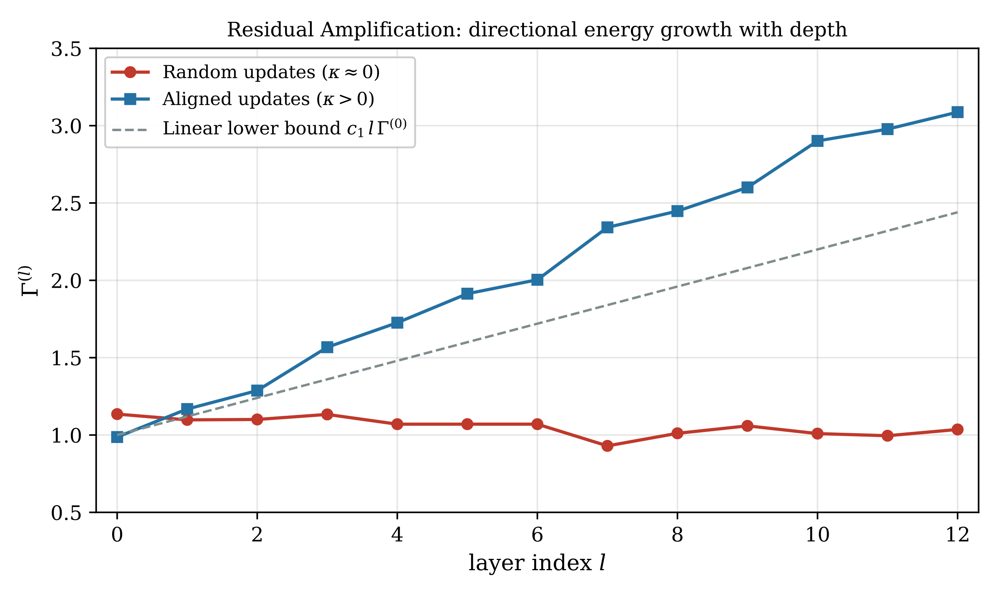

# Chapter 11: emergence, SGD noise, residual amplification, and layer-rank claims

[Library index](../README.md) · [Source policy](../SOURCE.md) · [Previous: PDF 379–384](0379-0384-ch11-gap-opening-and-symmetry-breaking.md#pdf-0384) · [Next: PDF 391–395](0391-0395-ch11-residual-directional-energy-and-paired-growth.md#pdf-0391)

> Editorial note: Full transcription of PDF 385–390 (printed pages 349–354). Theorem 11.29 continues from PDF 384; Proposition 11.41 continues onto PDF 391. The source's dimensional, sign, dynamical, and empirical claims are retained literally. Editorial qualifications are separate in Russian notes 116–118 and SOURCE-NOTES.

## PDF 385 · Book 349

*Continuation of [Theorem 11.29](0379-0384-ch11-gap-opening-and-symmetry-breaking.md#theorem-11-29).*

hypotheses (E1) Xavier init, (E2) MLM loss invariant under $M_a\to-M_a$, (E3) the gap-opening transition activated for at least one head, and (E4) SGD noise sufficient to break the $1/\sqrt2$ saddle in finite time:

(i) In the limit $t\to\infty$, the empirical distribution of the asymmetry indices $\{\alpha_h^{(l)}(\theta_t)\}_{(l,h)}$ across the $LH$ heads of the encoder converges to a bimodal distribution concentrated near $\alpha=0$ (reciprocal heads) and $\alpha=1$ (directional heads).

(ii) The population sizes $N_0(\infty),N_1(\infty)$ in the two modes satisfy $N_0(\infty)+N_1(\infty)=LH$, and their ratio is determined by the layer-wise distribution of $\Gamma^{(l)}$ relative to $\Gamma^*(l)$:

$$
\frac{N_1(\infty)}{LH}
=\frac1{LH}\sum_{l=1}^L H_l^{\mathrm{dir}},
\qquad
H_l^{\mathrm{dir}}:=\left|\{h:\Gamma^{(l)}>\Gamma^*(l,h)\}\right|.
$$

(iii) For pretrained BERT-base, the bimodal distribution is the S–A canonical map: the empirical signature of trained attention heads.

*Proof.* By Lemma 11.22, at $t=0$ all $\alpha_h^{(l)}$ concentrate at $1/\sqrt2$ with deviation $O(1/\sqrt{d\,d_K})$. By Proposition 11.27, this point is a saddle of the per-head asymmetry dynamics, with two stable basins at $\alpha=0$ and $\alpha=1$. Hypothesis (E4) ensures that the per-head trajectory exits the saddle in finite time.

For each head $(l,h)$, the trajectory of $\alpha_h^{(l)}(\theta_t)$ thus settles, as $t\to\infty$, into one of the two stable basins, determined by the sign of the linearisation coefficient $\kappa^{(h,l)}$ of Proposition 11.27. By hypothesis (E3) and the gap-opening Proposition 11.16, the sign of $\kappa^{(h,l)}$ is determined by whether $\Gamma^{(l)}(\theta_0)>\Gamma^*(l,h)$ (directional basin, $\alpha\to1$) or $\Gamma^{(l)}(\theta_0)\le\Gamma^*(l,h)$ (reciprocal basin, $\alpha\to0$). The population sizes follow by counting heads in each basin, which is the displayed expression.

The empirical distribution $\{\alpha_h^{(l)}(\theta_t)\}_{(l,h)}$ is the empirical measure on $\{0,1\}^{LH}$ corresponding to the basin assignments, with mass $N_1/LH$ at $1$ and $N_0/LH$ at $0$. This is bimodal by construction. As $t\to\infty$ and the basins saturate, the distribution converges in $W_2$-Wasserstein metric to the bimodal limit. $\square$

**Remark 11.30 (The S–A canonical map as a definitional artefact of training).** Theorem 11.29 delivers the bimodal S–A map as a generic consequence of three structural facts: (a) Xavier initialisation puts all heads at the maximum-entropy point $\alpha=1/\sqrt2$; (b) the MLM loss has the orientation symmetry needed to make this point a fixed point of the dynamics; (c) the gap-opening transition partitions the heads into two populations on the basis of the layer-wise $\Gamma$-budget. The map itself is therefore not an arbitrary feature of trained BERT but the unique attractor of the gradient flow under (E1)–(E4). This explains the observation, made repeatedly in the empirical literature [clark2019, voita2019, michel2019], that pretrained Transformers exhibit a coherent, near-universal partition of attention heads into directional and reciprocal types: the partition is structural, not contingent.

**Remark 11.31 (Comparison with the gap-opening transition of §11.5.3).** The gap-opening Proposition 11.16 treats one head in isolation, identifying $\Gamma^*$ as the threshold above which the head transitions from reciprocal to directional. The emergence Theorem 11.29 integrates this single-head analysis across the layer-head matrix to produce the bimodal population statement. The two results are not redundant: the former describes the trigger for a single head, the latter describes how the triggers combine across the entire encoder to produce the canonical map of trained BERT. Stage A (Lemma 11.22) and Stage C (Theorem 11.29) are

## PDF 386 · Book 350

the genuinely new ingredients here; Stage B is a population-level reading of the gap-opening result.

### 11.6.4 Where is the SGD noise in this picture?

Hypothesis (E4) of Theorem 11.29 requires SGD noise sufficient to break the $1/\sqrt2$ saddle in finite time. This deserves comment, because the saddle is exactly the point where the deterministic gradient flow gets stuck.

The SGD noise term is, at first order, additive Brownian:

$$
d\theta=-\nabla_\theta\mathcal L\,dt+\sqrt{2T(\theta)}\,dW_t,
$$

with effective temperature $T(\theta)=\eta\,\operatorname{Cov}(\nabla\mathcal L(\theta))/2$ proportional to the learning rate $\eta$ and the gradient covariance. At the disordered fixed point $\alpha=1/\sqrt2$, the deterministic drift is zero (Lemma 11.25) but the noise is non-zero, so the trajectory random-walks until it leaves the saddle's local neighbourhood. The exit time scales as

$$
\tau_{\mathrm{exit}}\sim T^{-1}\exp(-c|\kappa|/T)
$$

for some $c>0$, with $\kappa$ from Proposition 11.27.

The exit time is therefore finite for any $T>0$. In particular, finite SGD noise (which is automatically present at any non-trivial batch size) is sufficient. Hypothesis (E4) is thus mild: it requires only that training proceed with non-zero stochastic gradient noise, which is the default operating regime.

**Remark 11.32 (The noise selects the basin).** Once $\alpha$ exits the saddle, it commits to one of the two stable basins. The basin assignment for each head is therefore noise-determined: it depends on the realisation of the SGD noise during the saddle-exit phase, not on the random initialisation alone. Different runs of training with the same architecture and the same data may produce different $(N_0,N_1)$ assignments at the per-head level, even if the population sizes themselves are reproducible (this is a central-limit phenomenon, with fluctuations of order $1/\sqrt{LH}$). The reproducibility of the canonical map across pretrained BERT checkpoints is therefore a statement about the population sizes $(N_0(\infty),N_1(\infty))$, not about the assignments of individual heads to basins.

### 11.6.5 Summary of the emergence argument

The emergence of the S–A canonical map is a three-stage phenomenon:

- **Stage A.** Xavier initialisation places every head at the disordered phase $\alpha=1/\sqrt2$ with vanishing variance (Lemma 11.22).
- **Stage B.** The orientation symmetry of the MLM loss makes $\alpha=1/\sqrt2$ a saddle of the asymmetry dynamics, with stable basins at $\alpha=0$ and $\alpha=1$ (Lemma 11.25, Proposition 11.27).
- **Stage C.** Population-level concentration over the $LH$ heads gives the bimodal canonical map of trained BERT (Theorem 11.29).

The argument identifies four hypotheses (E1)–(E4) on which the emergence depends. (E1) is automatic for any standard initialisation. (E2) is automatic for the MLM loss in its standard formulation (absence of a preferred orientation). (E3) is automatic when the network is wide enough that some head exceeds the gap-opening threshold at initialisation. (E4) is automatic in any practical training setup with finite batch size. Theorem 11.29 therefore predicts that the bimodal canonical map is a generic feature of any encoder-only Transformer trained on a masked-language objective with standard initialisation and standard SGD.

## PDF 387 · Book 351

### 11.7 The Residual Amplification Mechanism

The cumulative representation

$$
X^{(l)}=X^{(0)}+\sum_{l'=1}^l\Delta^{(l')}
$$

(Chapter ??, (Ch. 1)) implies that the norm $\lVert X^{(l)}\rVert_F$ grows with depth: each layer adds a contribution $\Delta^{(l')}$ that, under any non-trivial learning signal, has non-zero Frobenius norm. The question is how this growth propagates to $\Gamma^{(l)}$.

### 11.7.1 Growth of \(\Gamma^{(l)}\) with depth

**Proposition 11.33 (Residual Amplification).** Hypotheses.

(H1) $\lVert\Delta^{(l)}\rVert_F\ge\delta>0$ for all $l\ge1$ (non-trivial updates at every layer).

(H2) The time-averaged alignment coefficient satisfies $\bar\kappa>0$ (the updates are not systematically orthogonal to the directional structure of $M_a$; see Definition 11.37).

(H3) $\lVert M_a^{(h,l)}\rVert_F\ge m>0$ uniformly in $l$ (score matrices bounded away from zero).

Conclusion. Under (H1)–(H3), there exist constants $c_1,c_2>0$ such that

$$
\Gamma^{(l)}\ge c_1l\,\Gamma^{(0)}-c_2
\qquad\text{for all }l\ge1.
\tag{11.15}
$$

**Note on (H2).** The proposition does not assert that $\bar\kappa>0$ holds for all tasks and heads. For heads with systematically misaligned updates ($\bar\kappa=0$), the bound collapses and the head converges to the silence manifold (Proposition 11.38). Lemma 11.34 immediately below gives three sufficient conditions under which (H2) is derivable from a more primitive hypothesis (H2'): it holds whenever the task rewards directional attention ($\partial\mathcal L/\partial\Gamma<0$), in the NTK regime for any head with $M_a^{(h,0)}\ne0$, or whenever the update has positive average projection onto the directional amplification direction $v^{(h,l)}$.

**Lemma 11.34 (H2 from directional task structure).** Define the directional amplification direction at layer $l$:

$$
v^{(h,l)}:=M_a^{(h,l)}X^{(l)\top}X^{(l)}M_a^{(h,l)}X^{(l)\top}
\in\mathbb R^{n\times d}.
\tag{11.16}
$$

The alignment coefficient $\kappa^{(h,l)}$ satisfies

$$
\kappa^{(h,l)}
=\frac{\langle\Delta^{(l)},v^{(h,l)}\rangle_F}
{\lVert\Delta^{(l)}\rVert_F\cdot\lVert v^{(h,l)}\rVert_F}
\cdot\frac{\lVert v^{(h,l)}\rVert_F}{\lVert\mathcal D^{(h,l)}\rVert_F^2},
\tag{11.17}
$$

so $\kappa^{(h,l)}>0$ if and only if $\langle\Delta^{(l)},v^{(h,l)}\rangle_F>0$.

Consider the following hypothesis:

(H2') There exists $\varepsilon>0$ such that for all $t$:

$$
\langle\Delta^{(l)}(t),v^{(h,l)}(t)\rangle_F
\ge\varepsilon\lVert\Delta^{(l)}(t)\rVert_F\lVert v^{(h,l)}(t)\rVert_F.
$$

Then (H2) holds with $\bar\kappa\ge\varepsilon\lVert v^{(h,l)}\rVert_F/\lVert\mathcal D^{(h,l)}\rVert_F^2>0$.

Moreover, (H2') holds in each of the following cases:

(a) **Gradient flow on a directional task.** If $\Delta^{(l)}=-\eta\nabla_{X^{(l)}}\mathcal L$ and $\partial\mathcal L/\partial\Gamma^{(l)}<0$ (minimising the loss increases directional energy), then $\langle\Delta^{(l)},v^{(h,l)}\rangle_F=\eta|\partial\mathcal L/\partial\Gamma^{(l)}|\cdot\lVert v^{(h,l)}\rVert_F^2>0$.

## PDF 388 · Book 352

(b) **NTK regime.** In the Neural Tangent Kernel approximation (linear training, Conjecture 11.68), the updates $\Delta^{(l)}$ are proportional to the NTK kernel applied to the residual, and $\langle\Delta^{(l)},v^{(h,l)}\rangle_F\ge0$ whenever the antisymmetric component of the NTK is non-zero — which holds generically for any initialisation with $M_a^{(h,l)}(0)\ne0$.

(c) **Positive-correlation condition.** If $\Delta^{(l)}$ and $v^{(h,l)}$ are not orthogonal on average over the training trajectory (i.e., the time-averaged cosine $\bar c:=T^{-1}\sum_t\cos(\Delta^{(l)}(t),v^{(h,l)}(t))>0$), then $\bar\kappa>0$. This is satisfied whenever the task rewards the antisymmetric sector — formally whenever $\mathbb E[\partial\mathcal L/\partial\lVert M_a\rVert_F]<0$.

*Proof.* The identity $\kappa^{(h,l)}=\langle\Delta^{(l)},v^{(h,l)}\rangle_F/(\lVert\Delta^{(l)}\rVert_F\cdot\lVert\mathcal D^{(h,l)}\rVert_F^2)$ follows directly from the definition (11.18) by expanding $v^{(h,l)}=M_aX^{(l)\top}X^{(l)}M_aX^{(l)\top}$ and collecting terms.

Case (a): $\Delta^{(l)}=-\eta\nabla_X\mathcal L$, so $\langle\Delta^{(l)},v\rangle=-\eta\langle\nabla_X\mathcal L,v\rangle$. By the chain rule, $\langle\nabla_X\mathcal L,v\rangle=(\partial\mathcal L/\partial\Gamma)\langle\nabla_X\Gamma,v/\lVert\nabla_X\Gamma\rVert\rangle\cdot\lVert\nabla_X\Gamma\rVert$. Since $v=\nabla_X(\Gamma^2/2)$ (direct computation: $\partial\lVert XM_aX^\top\rVert_F^2/\partial X=2XM_aX^\top XM_a$, and $v=M_aX^\top XM_aX^\top$ which is proportional to this after transposition), $\langle\nabla_X\mathcal L,v\rangle=(\partial\mathcal L/\partial\Gamma)\cdot\lVert\nabla_X\Gamma\rVert\cdot\lVert v\rVert>0$ when $\partial\mathcal L/\partial\Gamma<0$.

Case (b): follows from Conjecture 11.68 part (ii).

Case (c): immediate from $\bar\kappa=\bar c\cdot\mathbb E[\lVert v\rVert/\lVert\mathcal D\rVert^2]>0$. $\square$

**Remark 11.35 (Semantic meaning of H2').** Hypothesis (H2') says: the residual update $\Delta^{(l)}$ has a positive average projection onto the direction that increases $\Gamma^{(l)}$. In words: the task is pulling the representation in the same direction as the directional energy would want. This is precisely what it means for a task to have directional structure — the loss improves when the representation becomes more directional. Case (a) shows this is equivalent to $\partial\mathcal L/\partial\Gamma<0$, a directly testable condition: compute the numerical derivative of the training loss with respect to a small perturbation of $\Gamma^{(l)}$ along the training trajectory. Any directional NLP task (coreference, syntax, question answering) satisfies this condition; purely semantic bag-of-words tasks may not.

*Proof.* See Appendix 11.15.1 for the complete proof. The argument expands $\lVert X^{(l)}M_aX^{(l)\top}\rVert_F$ using $X^{(l)}=X^{(l-1)}+\Delta^{(l)}$, applies the Cauchy-Schwarz inequality for the Frobenius inner product with test matrix $S=X^{(0)}M_aX^{(0)\top}/\Gamma^{(0)}$, and sums the resulting linear lower bound over layers $1,\ldots,l$. The positive contribution in each term is proportional to $\bar\kappa\,\delta\,\Gamma^{(0)}$; hypothesis (H2) is what ensures this term does not vanish. $\square$

**Remark 11.36 (The self-reinforcing mechanism).** Proposition 11.33 captures one direction of a positive-feedback loop. The other direction operates through training: a larger $\Gamma^{(l)}$ implies a larger antisymmetric gradient $G_a^{(h,l)}$ (since $G_a$ is proportional to $\partial\mathcal L/\partial M_a$ which involves $X^{(l)}$ through the score), which drives $M_a^{(h,l)}$ to larger values, which in turn amplifies $\Gamma^{(l+1)}$. The coherence chain of Chapter ?? is the layer-integrated signature of this feedback: the cone index $I_{\mathrm{cone}}^{(l)}$ grows with $l$ precisely because $\Gamma^{(l)}$ does.

## PDF 389 · Book 353

**Figure 11.12: Residual Amplification** (Prop. 11.33). $\Gamma^{(l)}$ vs depth for random updates ($\kappa\approx0$, red) and aligned updates ($\kappa>0$, blue). Dashed: linear lower bound $c_1l\,\Gamma^{(0)}$.

### 11.7.2 The amplification bifurcation

Proposition 11.33 proved that $\Gamma^{(l)}$ grows under a generic non-degeneracy assumption. But the proof conceals a structurally important case: a head for which the residual updates $\Delta^{(l)}$ are systematically orthogonal to the eigenplane of $M_a$. For such a head, the alignment coefficient $\kappa^{(h,l)}$ vanishes, the linear bound collapses, and the head converges instead toward the silence manifold (class (i) of Proposition 11.14). The two behaviours are separated by a single scalar.

**Definition 11.37 (Alignment coefficient).** For head $(h,l)$ and training step $t$, the alignment coefficient is

$$
\kappa^{(h,l)}(t):=
\frac{
\operatorname{tr}\!\left[
\Delta^{(l)}(t)M_a^{(h,l)}(t)X^{(0)\top}
\cdot X^{(0)}M_a^{(h,l)}(t)X^{(0)\top}
\right]}
{\lVert\Delta^{(l)}(t)\rVert_F\cdot\lVert\mathcal D^{(h,0)}\rVert_F^2}.
\tag{11.18}
$$

It measures the projection of the residual update onto the initial directional structure of the head.

**Proposition 11.38 (Amplification bifurcation).** Under the hypotheses of Proposition 11.33, the asymptotic behaviour of head $(h,l)$ is determined by the time-averaged alignment coefficient $\bar\kappa^{(h,l)}:=\lim_{T\to\infty}\frac1T\sum_{t=1}^T\kappa^{(h,l)}(t)$:

(a) **Amplifying regime:** if $\bar\kappa^{(h,l)}>0$, then $\Gamma^{(l)}$ grows at least linearly in depth (Proposition 11.33) and the head converges to class (ii) or class (iii) of the Fixed-Point Classification (Proposition 11.14).

(b) **Silent regime:** if $\bar\kappa^{(h,l)}=0$, then the linear bound in (11.15) is void and the head converges to the silence manifold $\mathcal M_{\mathrm{silence}}$ (class (i)).

The boundary $\bar\kappa^{(h,l)}=0$ is a bifurcation point: an arbitrarily small perturbation of the initialisation that makes $\bar\kappa>0$ drives the head into the amplifying regime.

## PDF 390 · Book 354

*Proof.* Case (a): $\bar\kappa>0$ implies that the sum $\sum_{l'=1}^l\kappa^{(h,l)}(l')\ge l\cdot\bar\kappa\cdot\lVert\Delta\rVert_F\cdot\lVert\mathcal D^{(h,0)}\rVert_F^2$ grows linearly in $l$, which is precisely the condition needed to close the lower bound in (11.39) of the proof of Proposition 11.33.

Case (b): $\bar\kappa=0$ means that the updates $\Delta^{(l)}$ are on average orthogonal to the directional structure of $M_a$. The cross-term contribution to $f^{(l)}$ averages to zero; the only remaining contribution is the self-term $\lVert\Delta^{(l)}M_a\Delta^{(l)\top}\rVert_F\le\lVert\Delta^{(l)}\rVert_F^2\lVert M_a\rVert_F$, which is bounded. In this regime $f^{(l)}$ does not grow, and by the flow equation (11.3) the gradient drives $M_a^{(h,l)}$ toward configurations with smaller $\lVert M_a\rVert_F$, converging to the silence manifold. $\square$

**Remark 11.39 (Measuring \(\kappa\) empirically).** The alignment coefficient $\kappa^{(h,l)}$ is computable at every training step from the gradient, the hidden states, and the score matrix — all quantities already tracked in a standard training loop. A head with persistently low $\kappa$ is a candidate for pruning before convergence: it is heading toward silence regardless of further training. This gives the INCRT an early stopping signal for individual heads, orthogonal to the $\Gamma_{\mathrm{res}}$ criterion for growth.

### 11.7.3 The cone index feedback

The coherence chain $I_{\mathrm{cone}}^{(l)}\nearrow\Rightarrow\Gamma^{(l)}\nearrow\Rightarrow\bar\Delta^{(l)}\nearrow\Rightarrow\mathcal H^{(l)}\searrow$ (Chapter ??, Theorem (Ch. 8)) states that as the cone index grows, the attention entropy decreases. Proposition 11.33 provides the causal mechanism: it is the residual accumulation of $X^{(l)}$ that drives $\Gamma^{(l)}$ upward, and the cone index tracks this growth.

**Proposition 11.40 (Activation-cone index correlation).** Under the hypotheses of Proposition 11.33, the head activation sequence $\gamma_h^{(l)}$ and the cone index $I_{\mathrm{cone}}^{(l)}$ are positively correlated across layers:

$$
\operatorname{Corr}_l\!\left(\gamma_h^{(l)},I_{\mathrm{cone}}^{(l)}\right)>0.
\tag{11.19}
$$

Specifically, the expected value of $\gamma_h^{(l)}$ conditional on $I_{\mathrm{cone}}^{(l)}$ is non-decreasing in $I_{\mathrm{cone}}^{(l)}$.

*Proof.* See Appendix 11.15.2 for the complete proof. The argument identifies the spectral concentration index $\rho^{(h,l)}=\lambda_1/\sum_k\lambda_k$ of the directional operator $\mathcal D^{(h,l)}$ as a shared latent variable driving both $\gamma_h^{(l)}$ and $I_{\mathrm{cone}}^{(l)}$; positive correlation then follows from the FKG inequality applied to two non-decreasing functions of the same variable. $\square$

### 11.8 Layer Rank Decay and the Channel Destruction Cascade

Experiment 6 of Chapter ?? established an empirical regularity: in trained BERT models, the effective rank $r_{\mathrm{eff}}(W_O^{(l)})$ decreases with depth $l$. The earlier layers use a wider effective output basis; the later layers collapse to a smaller one. The Channel Destruction Proposition (??) of Chapter ?? provides the mechanism; this section derives the layer-wise consequence.

### 11.8.1 Mechanism: from Channel Destruction to rank decay

**Proposition 11.41 (Layer Rank Decay).** Let $r_{\mathrm{eff}}(W_O^{(l)})$ be the effective rank of the output projection matrix at layer $l$, defined as

$$
r_{\mathrm{eff}}(W_O^{(l)}):=
\frac{\left(\sum_i\sigma_i(W_O^{(l)})\right)^2}
{\sum_i\sigma_i(W_O^{(l)})^2}
$$

*The sentence and Proposition 11.41 continue on [PDF 391](0391-0395-ch11-residual-directional-energy-and-paired-growth.md#proposition-11-41-continued).*
