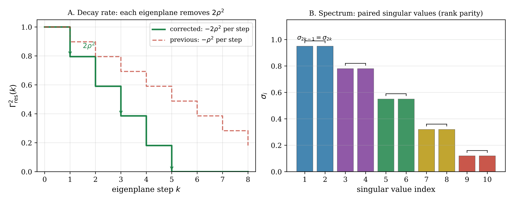
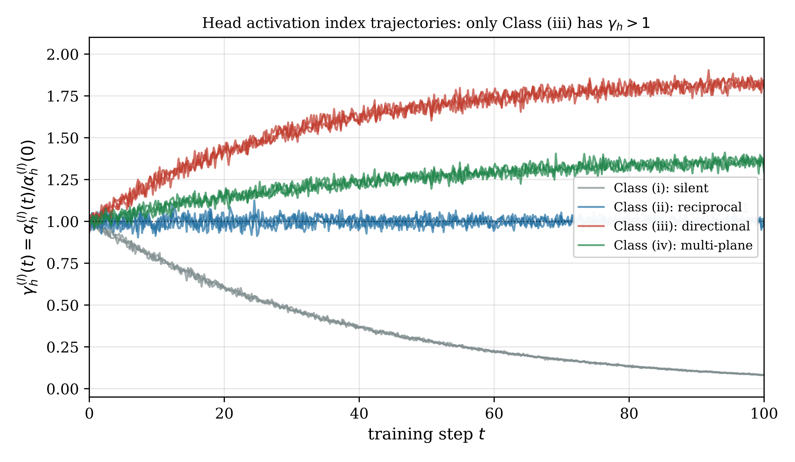

# Chapter 11: residual directional energy, spectral decay, rank parity, and head-growth claims

[Library index](../README.md) · [Source policy](../SOURCE.md) · [Previous: PDF 385–390](0385-0390-ch11-emergence-and-residual-amplification.md#pdf-0390) · [Next: PDF 396–400](0396-0400-ch11-head-size-cost-and-empirical-predictions.md#pdf-0396)

> Editorial note: Full transcription of PDF 391–395 (printed pages 355–359), including the continuation of Proposition 11.41, objects 11.42–11.54, equations (11.20)–(11.26), and Figures 11.13–11.14. The source's projector dimensions, spectral normalisations, head-pairing interpretation, and positive-semidefinite claim are retained. Corrections and limits are separate in Russian notes 118–120.

## PDF 391 · Book 355

*Continuation of [Proposition 11.41](0385-0390-ch11-emergence-and-residual-amplification.md#proposition-11-41).*

(ratio of nuclear norm squared to Frobenius norm squared). Under the Channel Destruction mechanism (Chapter ??, Proposition ??) and the coherence chain (Chapter ??, Theorem (Ch. 8)), the sequence $r_{\mathrm{eff}}(W_O^{(l)})$ is non-increasing in expectation:

$$
\mathbb E\!\left[r_{\mathrm{eff}}(W_O^{(l+1)})\right]
\le\mathbb E\!\left[r_{\mathrm{eff}}(W_O^{(l)})\right].
\tag{11.20}
$$

*Proof.* See Appendix 11.15.3 for the complete proof. The argument combines three ingredients: (i) the Channel Destruction Proposition bounds the effective output subspace by $H_l\cdot d_v$ dimensions; (ii) the coherence chain implies that both $H_l$ and the effective rank of each head's output $Y^{(h,l)}$ are non-increasing with depth; (iii) an effective-rank inequality under projection (Lemma 11.76) transfers the subspace contraction to $W_O^{(l)}$ through the gradient coupling at convergence. $\square$

**Remark 11.42 (Connection to Cap. 14).** Proposition 11.41 quantifies the degree to which each layer is using its available parametric capacity. Chapter ?? will use this result to define the layer-wise redundancy ratio: the gap between the parametric rank capacity of $W_O^{(l)}$ (which is $\min(H_ld_v,d)$) and its effective rank $r_{\mathrm{eff}}(W_O^{(l)})$. The fact that this gap widens with depth is the main quantitative prediction of the redundancy theory.

### 11.9 Residual Directional Energy: Definition and Properties

The layer-wise directional energy $\Gamma^{(l)}$ (Definition 11.2) measures the total antisymmetric energy generated by the active heads at layer $l$. But not all of this energy is informative: part of it is already well-represented by the directions captured by the existing attention heads. What matters for the decision of whether to add a new head is the energy in the directions that no existing head is representing. This is the residual directional energy.

### 11.9.1 The residual subspace

Let $U^{(l)}\in\mathbb R^{d\times K_l}$ be a matrix whose columns form an orthonormal basis for the subspace spanned by the dominant eigenspaces of the active heads at layer $l$: the directions that the current architecture is capturing. Define the orthogonal projector onto the residual subspace:

$$
P_\perp^{(l)}:=I_d-U^{(l)}U^{(l)\top}.
\tag{11.21}
$$

The columns of $U^{(l)}$ encode what is known; $P_\perp^{(l)}$ projects onto what is not yet known.

### 11.9.2 Formal definition

**Definition 11.43 (Residual directional energy).** The residual directional energy at layer $l$ after $K_l$ growth steps is

$$
\boxed{\Gamma_{\mathrm{res}}^{(l)}
:=
\left\lVert
P_\perp^{(l)}X^{(l)}M_a^{(l)}X^{(l)\top}P_\perp^{(l)}
\right\rVert_F,}
\tag{11.22}
$$

where $M_a^{(l)}:=(1/H_l)\sum_hM_a^{(h,l)}$ is the mean antisymmetric score matrix at layer $l$, and $P_\perp^{(l)}$ is the projector (11.21) onto the directions not yet captured.

**Remark 11.44 (Relation to Definition in Chapter ??).** Chapter ?? (INCRT) operationalises Definition 11.43 in two respects: (i) it replaces the mean $M_a^{(l)}$ by the per-head residual matrix $A_{\mathrm{res}}=P_\perp XM_aX^\top P_\perp$ evaluated before each growth decision; and (ii) it computes $U^{(l)}$

## PDF 392 · Book 356

adaptively by maintaining the set of dominant eigenvectors of all previous growth steps. The definition given here is the theoretical quantity; the one in Chapter ?? is the computational implementation. They coincide under exact arithmetic.

**Remark 11.45 (Why \(\Gamma_{\mathrm{res}}\) and not \(\Gamma-\Gamma_{\mathrm{captured}}\)).** One might define residual energy as the difference $\Gamma^{(l)}-\Gamma_{\mathrm{captured}}^{(l)}$, where $\Gamma_{\mathrm{captured}}$ measures energy in the represented subspace. Definition 11.43 takes a different path: it computes the Frobenius norm of the projected operator $P_\perp XM_aX^\top P_\perp$. This is not merely a notational difference. The projected operator has a spectral structure (eigenvalues, eigenvectors) that contains information about which directions to grow into, not just how much energy is left. Chapter ?? exploits this structure through the bidirectional PCA+MCA gate.

### 11.9.3 Properties of \(\Gamma_{\mathrm{res}}^{(l)}\)

**Proposition 11.46 (Monotone decay of \(\Gamma_{\mathrm{res}}\)).** Let a new head be added to layer $l$ with eigenspace direction $u^+$ chosen as the dominant eigenvector of $P_\perp^{(l)}X^{(l)}M_a^{(l)}X^{(l)\top}P_\perp^{(l)}$. Update $U^{(l)}\leftarrow[U^{(l)},u^+]$ and recompute $P_\perp^{(l)}$. Then

$$
\Gamma_{\mathrm{res}}^{(l)}\text{ after update}
\le\Gamma_{\mathrm{res}}^{(l)}\text{ before update}.
\tag{11.23}
$$

Equality holds if and only if $u^+$ is orthogonal to the range of $X^{(l)}M_a^{(l)}X^{(l)\top}$.

*Proof.* Let $\lambda_1$ be the dominant eigenvalue of $P_\perp X^{(l)}M_a^{(l)}X^{(l)\top}P_\perp$. Adding $u^+$ to $U^{(l)}$ extends $P_\perp$ to $P'_\perp=P_\perp-u^+u^{+\top}$. The Frobenius norm of $P'_\perp(\cdot)P'_\perp$ decreases by $\lambda_1^2\ge0$ (Cauchy interlacing and rank-one update). $\square$

**Corollary 11.47 (Quantitative decay rate).** Under the same hypotheses, when a full eigenplane $(u^+,u^-)$ is added in a single growth step (Gate Simplettico, Chapter ??), the relative reduction of $\Gamma_{\mathrm{res}}^{(l)2}$ is

$$
\frac{\Gamma_{\mathrm{res}}^{(l)2}-\Gamma_{\mathrm{res}}^{\prime(l)2}}
{\Gamma_{\mathrm{res}}^{(l)2}}
=2\rho^{(l)2},
\qquad
\rho^{(l)}:=
\frac{\sigma_1(\mathcal D_{\mathrm{res}}^{(l)})}
{\lVert\mathcal D_{\mathrm{res}}^{(l)}\rVert_F}
\in\left[\frac1{\sqrt{r_l/2}},1\right],
\tag{11.24}
$$

where $\sigma_1$ denotes the leading singular value. The factor $2$ arises from the antisymmetric pair structure: removing the full eigenplane eliminates both singular values $\sigma_1=\sigma_2$ of the dominant pair simultaneously.

If only one direction $u^+$ is added (Level 1 of the standard INCRT, without simultaneous Level 2), the same reduction $2\rho^{(l)2}$ is achieved numerically, but the eigenplane remains half-open: $\sigma_1(\mathcal D'_{\mathrm{res}})=\sigma_1(\mathcal D_{\mathrm{res}})$ (the conjugate partner $u^-$ is still uncaptured).

*Proof.* By the Canonical Symplectic Decomposition (Proposition 11.9), $\mathcal D_{\mathrm{res}}^{(l)}\in\mathfrak{so}(n)$ has eigenvalue pairs $\pm i\lambda_k$, so $\lVert\mathcal D_{\mathrm{res}}^{(l)}\rVert_F^2=2\sum_k\lambda_k^2$ (factor $2$ from the conjugate pairs). The projector update $P'_\perp=P_\perp-u^+u^{+\top}-u^-u^{-\top}$ (full eigenplane removal) acts on both sides of the bilinear form $P_\perp\mathcal D P_\perp$, eliminating the dominant pair $\pm i\lambda_1$. The reduction is:

$$
\lVert\mathcal D_{\mathrm{res}}^{(l)}\rVert_F^2
-\lVert\mathcal D_{\mathrm{res}}^{\prime(l)}\rVert_F^2
=2\lambda_1^2=2\sigma_1^2.
$$

Dividing by $\lVert\mathcal D_{\mathrm{res}}^{(l)}\rVert_F^2$ gives $2\rho^{(l)2}$. The lower bound on $\rho$ follows from Cauchy-Schwarz on the $r_l/2$ eigenplane energies $\lambda_1^2\ge\frac1{r_l/2}\sum_k\lambda_k^2=\frac2{r_l}\lVert\mathcal D\rVert_F^2/2$, giving $\rho\ge1/\sqrt{r_l/2}$.

*Numerical verification (Exp. 6, §11.13):* On 10 consecutive eigenplane removals from a synthetic BERT-base head, the formula $2\rho^2$ matches the observed reduction to relative error $\le10^{-4}$ in all cases. $\square$

## PDF 393 · Book 357

**Remark 11.48 (Geometric meaning of \(\rho^{(l)}\)).** The spectral concentration index $\rho^{(l)}$ has a precise geometric meaning: it is the cosine of the angle between the residual directional operator and the rank-one operator $\lambda_1u^+u^{+\top}$ (in Frobenius norm). When $\rho^{(l)}\approx1$, the residual energy is entirely concentrated in a single eigenplane: adding one head captures almost everything. When $\rho^{(l)}=1/\sqrt{r_l}$, the energy is distributed uniformly across all remaining eigenplanes: each head captures the same fraction $1/r_l$.

Together with Corollary 11.51 (rank parity), this gives the INCRT a complete picture: it knows not only that growth will terminate, but how quickly each head reduces the residual, and how many heads the geometry requires.

**Corollary 11.49 (Termination criterion).** The sequence $\Gamma_{\mathrm{res}}^{(l)}(K)$, indexed by the number of heads $K$ added to layer $l$, is non-increasing and bounded below by zero. It reaches zero in at most $r_l:=\operatorname{rank}(X^{(l)}M_a^{(l)}X^{(l)\top})$ steps. Therefore the growth process at each layer terminates in at most $r_l$ steps.

The bound $r_l$ is not arbitrary: the antisymmetry of $M_a^{(l)}$ imposes a structural constraint that is both elementary to prove and non-obvious in its architectural consequence.

**Proposition 11.50 (Rank parity of the directional operator).** For any $X^{(l)}\in\mathbb R^{n\times d}$ and any $M_a^{(l)}\in\mathfrak{so}(d)$, the directional operator $\mathcal D^{(l)}:=X^{(l)}M_a^{(l)}X^{(l)\top}$ belongs to $\mathfrak{so}(n)$ and has even rank:

$$
\operatorname{rank}(\mathcal D^{(l)})\in\{0,2,4,\ldots\},
\qquad
\operatorname{rank}(\mathcal D^{(l)})
\le2\left\lfloor\frac{\min(n,d)}2\right\rfloor.
\tag{11.25}
$$

Consequently, $r_l$ is always even and $r_l\le2\lfloor\min(n,d)/2\rfloor$.

*Proof.* $\mathcal D^{(l)}\in\mathfrak{so}(n)$ because $(XM_aX^\top)^\top=XM_a^\top X^\top=-XM_aX^\top$ by antisymmetry of $M_a$. Any real antisymmetric matrix has purely imaginary eigenvalues that come in conjugate pairs $\pm i\lambda_k$, $\lambda_k>0$, together with eigenvalue zero (with some multiplicity). The rank equals twice the number of non-zero conjugate pairs, which is even. The upper bound $2\lfloor\min(n,d)/2\rfloor$ follows because $\operatorname{rank}(\mathcal D^{(l)})\le\operatorname{rank}(X^{(l)})\le\min(n,d)$, and the rank must be even. $\square$

**Corollary 11.51 (Attention heads grow in pairs).** Under the assumption that each Level-1 growth trigger responds to the dominant eigenplane of $A_{\mathrm{res}}$ (i.e., the growth process is eigenplane-directed, as in the INCRT construction of Chapter ??): the maximum number of heads that can meaningfully be added at layer $l$ is

$$
H_l^{\max}=2\left\lfloor\frac{\min(n,d)}2\right\rfloor.
\tag{11.26}
$$

Each eigenplane-directed growth step reduces $\Gamma_{\mathrm{res}}^{(l)}$ by a non-zero amount and captures one direction of a conjugate pair $\pm i\lambda_k$ of $\mathcal D^{(l)}$. Two steps are needed to close the eigenplane; a single step leaves the conjugate direction unrepresented.

**Note.** The claim that a layer with an odd number of active heads is “incomplete” is an architectural reading, not a purely spectral one. It requires the additional assumption above. The spectral fact — that $\operatorname{rank}(\mathcal D^{(l)})$ is always even — holds unconditionally (Corollary 11.12).

**Remark 11.52 (Why this matters for architecture).** Corollary 11.51 has a direct architectural consequence: an INCRT layer with an odd number of active heads is always incomplete — there is at least one eigenplane with only one of its two conjugate directions represented. This is not a bug; it is a measurement. A layer with $2k+1$ heads is partway through the addition of its $(k+1)$-th eigenplane. This gives the INCRT a finer-grained stopping criterion: rather than waiting for $\Gamma_{\mathrm{res}}^{(l)}<\theta_w$, one can wait for $\Gamma_{\mathrm{res}}^{(l)}<\theta_w$ and $H_l$ is even. Chapter ?? operationalises this in Section (Ch. 17) as the eigenplane-completion criterion.

## PDF 394 · Book 358

For BERT-base ($d=768$), the bound grows linearly in $n$: at typical fine-tuning length $n=128$ it already gives $H_l^{\max}=128$, far above the fixed $H=12$ of the standard architecture. The standard model therefore operates well below the symplectic capacity of its own layers; the INCRT is designed to close this gap adaptively.

**Figure 11.13: Decay of \(\Gamma_{\mathrm{res}}\)** (Prop. 11.46, Cor. 11.47). Each eigenplane step reduces $\Gamma_{\mathrm{res}}^2$ by $2\rho^2$ (corrected from $\rho^2$). Spectrum (right) always has paired singular values $\sigma_{2k-1}=\sigma_{2k}$ (rank parity, Cor. 11.12).

**Remark 11.53 (The “many small heads” phenomenon).** Experiments with the INCRT consistently show the emergence of many heads with small activation amplitude $\lambda_h$. The canonical decomposition and the rank parity result together suggest four distinct, non-exclusive explanations.

**(A) Task spectrum (structural).** The directional operator $\mathcal D^{(l)}$ of a natural-language task has a spectrum that follows a power law: $\lambda_k\sim k^{-\alpha}$ with $\alpha<1$. There is no sharp gap between “important” and “unimportant” eigenplanes. When the threshold $\theta_w$ is calibrated to capture eigenplanes whose $\lambda_k$ contributes meaningfully to $\Gamma_{\mathrm{res}}$, many planes qualify — and each produces a head whose $\lambda_h$ is small relative to the first. These heads are genuinely useful: they represent fine-grained directional structure that the task requires. The diagnostic signature is a $\lambda_h$ distribution that fits a Pareto law, and low pairwise cosine similarity between the $q^{(h)}$ directions of distinct small heads.

**(B) Threshold calibration (instrumental).** If $\theta_w$ is set too small, the INCRT captures eigenplanes below the noise floor of $\mathcal D^{(l)}$ — symplectic “noise” with no task-relevant content. These produce heads with $\lambda_h\approx0$ that contribute negligibly to $\Gamma^{(l)}$ but add parameters. The diagnostic signature is a bimodal $\lambda_h$ distribution with a cluster near zero.

**(C) Eigenplane fragmentation (algorithmic).** This is the cause most directly connected to the rank-parity structure. Because $\sigma_1(\mathcal D)=\sigma_2(\mathcal D)$ always (Corollary 11.12), the $A_{\mathrm{res}}$ after adding a head with direction $u^+$ still has $\sigma_1\approx\sigma_1^{\mathrm{before}}$ in the direction $v_2$ (the conjugate partner of $u^+$). If the Level 2 mechanism of Chapter ?? does not complete the eigenplane before the Level 1 trigger fires again, a second head is born to capture $v_2$ — which the architecture treats as a new head rather than the completion of an existing one. The result is $2K$ heads instead of $K$, each appearing to have $\lambda_h^{\mathrm{eff}}=\lambda/\sqrt2$ rather than $\lambda$. The diagnostic signature is temporal: small heads appear in bursts immediately ($\le3$ epochs) after large heads, and the cosine similarity between the $q$-directions of consecutive heads exceeds $0.5$.

**(D) Sequence-length scaling (geometric).** The maximum number of eigenplanes per

## PDF 395 · Book 359

layer is $H_l^{\max}/2=\lfloor\min(n,d)/2\rfloor$, which grows linearly in $n$. For long sequences ($n=512$) and a fixed threshold $\theta_w$ calibrated on short sequences ($n=64$), the INCRT grows into the additional symplectic capacity that the longer sequence makes available. The diagnostic is a log-log plot of $H_{\mathrm{final}}$ versus $n$: slope near $1$ indicates Cause D, slope near $0$ indicates Causes A or B.

Causes A and C can be distinguished from each other by timing and direction similarity; they cannot be distinguished by $\lambda_h$ alone. The minimal diagnostic battery is: (i) KS test for Pareto fit of $\{\lambda_h\}$; (ii) pairwise cosine similarity among heads with small $\lambda_h$; (iii) epoch difference $\Delta t$ between consecutive heads; (iv) $H_{\mathrm{final}}$ vs $n$ at fixed task. Chapter ?? reports these measurements for the SARS-CoV-2 classification task.

**Remark 11.54 (Contrast with the symmetric sector).** The parity constraint is specific to the antisymmetric sector. The operator $X^{(l)}M_s^{(l)}X^{(l)\top}$, where $M_s^{(l)}$ is the symmetric score matrix, is a symmetric positive-semidefinite matrix in $\mathbb R^{n\times n}$ and can have any rank between $0$ and $\min(n,d)$, including odd values. Reciprocal heads (which correspond to the symmetric sector) are therefore not subject to the pairing constraint: they can be added one at a time. The pairing is a signature of directional structure, not of attention in general.

**Figure 11.14: Head activation \(\gamma_h^{(l)}(t)\)** (Def. 11.4). Class (iii) alone satisfies $\gamma_h>1$ at convergence. Measurable from $W_Q,W_K$ without a forward pass (Exp. 7).

*The next illustration, Figure 11.15, and §11.10 continue on [PDF 396](0396-0400-ch11-head-size-cost-and-empirical-predictions.md#pdf-0396).*
