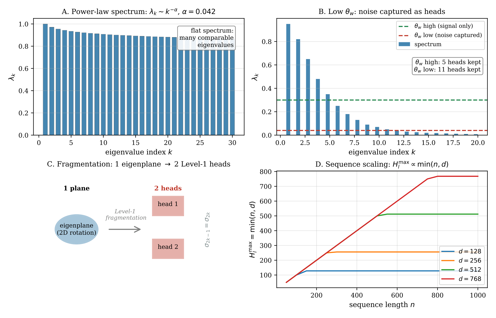

# Chapter 11: head-size costs, marginal value, minimum key dimension, and empirical predictions

[Library index](../README.md) · [Source policy](../SOURCE.md) · [Previous: PDF 391–395](0391-0395-ch11-residual-directional-energy-and-paired-growth.md#pdf-0395)

> Editorial note: Full transcription of PDF 396–400 (printed pages 360–364), including Figure 11.15, objects 11.55–11.64, equations (11.27)–(11.31), and both unnumbered numerical tables. Costs, rank bounds, inconsistent minimum-dimension statements, and empirical claims are retained as printed. Russian notes 120–123 distinguish the source from corrections. The batch ends after the complete displayed statement of Conjecture 11.64; §11.11 continues beyond the processed range.

## PDF 396 · Book 360

**Figure 11.15: “Many small heads” — four causes** (Rem. 11.53). (A) Power-law spectrum ($\alpha=0.042$ at init, Exp. 9). (B) Low $\theta_w$: noise captured. (C) Fragmentation: Level-1 fires twice per eigenplane. (D) Sequence scaling: $H_l^{\max}\propto\min(n,d)$.

### 11.10 Many Small Heads vs One Large Head: a Computational Analysis

The emergence of many small heads in the INCRT — and more generally in trained Transformer models — raises a natural question: is this a bug, a feature, or an inevitability? The analysis of the preceding section identified four structural causes. This section addresses the question from a different angle: given a fixed computational budget, which configuration is theoretically preferable?

### 11.10.1 FLOPs equivalence

The first observation is perhaps the most surprising.

**Proposition 11.55 (FLOPs equivalence of head configurations).** Fix the total key dimension $D=\sum_{h=1}^H d_k^{(h)}$ and a sequence of length $n$ over a model of dimension $d$. The total FLOPs for the forward pass of the attention mechanism — comprising QKV projections, score computation, softmax, and output projection — depend only on $D,n,$ and $d$, not on how $D$ is partitioned across heads:

$$
\operatorname{FLOPs}(H\text{ heads},\,d_k=D/H)
=\operatorname{FLOPs}(1\text{ head},\,d_k=D)
=4nDd+2n^2D.
\tag{11.27}
$$

*Proof.* The QKV and output projection cost for each head is $4nd_kd$ (three projections of size $n\times d\to n\times d_k$, plus the output projection $n\times d_k\to n\times d$). The score computation costs $2n^2d_k$ per head. Summing over $H$ heads each with $d_k=D/H$:

$$
H\cdot(4n(D/H)d+2n^2(D/H))=4nDd+2n^2D,
$$

## PDF 397 · Book 361

which is independent of $H$. $\square$

The implication is immediate: the standard argument that many small heads are “cheaper” than one large head is incorrect when the total query dimension is held fixed. The computational cost is the same.

### 11.10.2 What actually differs: capacity and granularity

If the cost is the same, the question becomes: what is the structural difference between the two configurations?

**Eigenplane capacity.** By the Canonical Symplectic Decomposition (Proposition 11.9), a single head with $d_k=D$ has antisymmetric score matrix $M_a\in\mathfrak{so}(d)$ with $\operatorname{rank}(M_a)\le D$ and at most $K_{\max}=D/2$ active eigenplanes. For $H$ heads each with $d_k=D/H$, the total across heads is also $H\cdot(D/H)/2=D/2$ eigenplanes. The maximum eigenplane capacity is identical.

**Granularity of decomposition.** The structural difference is not capacity but independence: the $H$ small heads implement $H$ independent antisymmetric operators $\{M_a^{(h)}\}_{h=1}^H$, each orientated freely by training. The single large head implements one operator $M_a$ of rank $\le D$. After the output projection $W_O$ (Channel Destruction Theorem, Chapter ??), the individual head contributions are irreversibly mixed; only their sum $\sum_hY^{(h)}W_O^{(h)}$ survives. The effective antisymmetric operator acting on the residual stream is therefore

$$
M_a^{\mathrm{eff}}
=\sum_{h=1}^H W_V^{(h)}M_a^{(h)}W_K^{(h)\top},
\tag{11.28}
$$

a sum of $H$ matrices each of rank $\le D/H$. When the eigenplanes of different heads are mutually orthogonal, $\operatorname{rank}(M_a^{\mathrm{eff}})$ reaches its maximum of $D$ — the same as the single large head. When they are aligned (eigenplane fragmentation, Cause C), the sum collapses to $\operatorname{rank}\le D/H$, a $H$-fold capacity loss.

### 11.10.3 The marginal value of a head and the optimality criterion

The correct question is not “many vs one” in the aggregate, but what is the value of the next head added at the current state of the architecture?

**Definition 11.56 (Marginal directional value).** At a point in the INCRT growth process where the residual directional energy is $\Gamma_{\mathrm{res}}$ with spectral concentration $\rho=\sigma_1(\mathcal D_{\mathrm{res}})/\lVert\mathcal D_{\mathrm{res}}\rVert_F$, the marginal directional value of adding one eigenplane head with key dimension $d_k$ is

$$
V(d_k):=
\frac{\Delta(\Gamma_{\mathrm{res}}^2)}{\operatorname{FLOPs}(d_k)}
=\frac{2\rho^2\Gamma_{\mathrm{res}}^2}{d_k(4nd+2n^2)}.
\tag{11.29}
$$

The formula follows directly from the Quantitative Decay Rate (Corollary 11.47) and the FLOPs formula (11.27). Since $d_k$ appears only in the denominator of $V(d_k)$, and since $\rho$ does not depend on $d_k$ but only on the geometry of the residual operator, the marginal value is inversely proportional to $d_k$:

**Corollary 11.57 (Optimality of small heads under flat task spectra).** For a fixed computational budget $B=\operatorname{FLOPs}(d_k)$ per head, the marginal directional value $V(d_k)$ is maximised by the smallest feasible $d_k$. Equivalently, for fixed total budget $B_{\mathrm{total}}$, many small heads

## PDF 398 · Book 362

are always preferable to one large head, unless $d_k$ is already at its minimum feasible value (determined by the rank of $\mathcal D_{\mathrm{res}}$, which is at most $2\lfloor\min(n,d)/2\rfloor$).

The exception is when the task has a strongly peaked residual spectrum ($\rho\approx1$, one dominant eigenplane): then a single head with large $d_k$ concentrates its capacity on the right direction and dominates. For flat spectra ($\rho\approx1/\sqrt K$, $K$ eigenplanes equally weighted), many small heads distributed over independent eigenplanes capture strictly more energy per FLOP.

*Proof.* $V(d_k)\propto\rho^2/d_k$. Since $\rho^2$ and the budget factor $(4nd+2n^2)$ are both independent of how $d_k$ is chosen (they depend on the residual $\mathcal D_{\mathrm{res}}$ and the model dimensions, not on the new head's $d_k$), $V$ is maximised by minimising $d_k$. $\square$

**Remark 11.58 (Connection to Cause A of the “many small heads” phenomenon).** Corollary 11.57 provides the theoretical explanation for Cause A (Remark 11.53). At initialisation, the task spectrum is flat ($\alpha\approx0.042$, Exp. 9), meaning many eigenplanes contribute roughly equally to $\Gamma_{\mathrm{res}}$. The INCRT growth criterion, by repeatedly choosing the dominant eigenplane and adding the smallest useful head, is behaving optimally according to the marginal value criterion: each small head captures one eigenplane's worth of directional energy at minimum FLOPs cost. The many small heads are not a failure mode; they are the rational response to a flat task spectrum.

The counterargument holds for tasks with very concentrated spectra (e.g., simple positional dependencies): there, a single large head with $d_k\approx D$ would dominate. The INCRT handles this automatically — the spectral concentration $\rho$ of $\mathcal D_{\mathrm{res}}$ is high, the growth criterion fires only once or twice, and the architecture converges to a small number of large heads.

**Remark 11.59 (The minimum useful \(d_k\)).** The argument above might seem to push $d_k\to1$, which is not meaningful. The minimum useful $d_k$ is constrained by the rank of $\mathcal D_{\mathrm{res}}$: a head with $d_k=1$ has $M_a=W_QW_K^\top-W_KW_Q^\top$ of rank at most $2$, capturing at most one Darboux pair. For $\mathcal D_{\mathrm{res}}$ of rank $2r$, the minimum $d_k$ that can capture the dominant eigenplane is $d_k=2$ (one Darboux pair exactly). In practice, $d_k=4$ or $8$ is used to allow for numerical stability and gradient flow through the small bottleneck. The INCRT threshold $\theta_w$ implicitly selects the minimum $d_k$ at which $V(d_k)>\theta_V$ for some value threshold $\theta_V$.

**Proposition 11.60 (Optimal minimum key dimension).** Let $\mathcal D_{\mathrm{res}}\in\mathfrak{so}(n)$ have dominant eigenplane $(q_1,p_1)$ with singular value $\sigma_1$.

**(i) Algebraic minimum.** A head with $d_k=1$ already has $\operatorname{rank}(M_a)=2$: the antisymmetric matrix $M_a=(w_Qw_K^\top-w_Kw_Q^\top)/2$, with $w_Q,w_K\in\mathbb R^d$, generates exactly one Darboux pair in $\operatorname{span}(w_Q,w_K)$. When $w_Q\propto q_1$ and $w_K\propto p_1$, the head captures $\mathcal D_{\mathrm{res}}$ perfectly: $\Gamma_{\mathrm{captured}}=\sigma_1$. The algebraic minimum is therefore $d_k^{\min}=1$.

**(ii) Alignment probability.** For $w_Q,w_K\sim\mathcal N(0,I_d/d)$ (standard initialisation), the expected squared overlap between $\operatorname{span}(w_Q,w_K)$ and the target plane $\operatorname{span}(q_1,p_1)$ is:

$$
\mathbb E[\operatorname{overlap}^2(d_k)]\approx\frac{2d_k}{d},
\tag{11.30}
$$

where $\operatorname{overlap}^2=\lVert\Pi_{(q_1,p_1)}\Pi_{(W_Q,W_K)}\rVert_F^2$ is the squared projection of the target plane onto the head's column space. This follows from the standard random subspace overlap formula: a uniformly random $2d_k$-dimensional subspace of $\mathbb R^d$ intersects a fixed $2$-dimensional subspace with expected squared overlap $2d_k/d$.

**(iii) Practical minimum.** The initial alignment $\operatorname{overlap}^2(d_k)\approx2d_k/d$ determines the initial gradient signal for training. For the gradient to align the head with the target eigenplane,

## PDF 399 · Book 363

one needs $\operatorname{overlap}^2>0$ — which holds for any $d_k\ge1$ with probability $1$. However, for reliable convergence in the presence of gradient noise, a useful rule of thumb is $d_k\ge d_{\min}^{\mathrm{prac}}$ where:

$$
d_{\min}^{\mathrm{prac}}\approx\frac d2\cdot
\frac{\sigma_{\mathrm{init}}^2}{\sigma_1^2/n},
\tag{11.31}
$$

with $\sigma_{\mathrm{init}}$ the initialisation scale of $W_Q,W_K$ and $\sigma_1^2/n$ the per-dimension signal-to-noise ratio of the task. For BERT-base ($d=768,d_k=64$, Xavier init), $\mathbb E[\operatorname{overlap}^2]=2\cdot64/768=1/6$: the standard choice provides comfortable alignment probability without over-parameterising the head.

**Remark 11.61 (Interpretation: why \(d_k=2\) is the true minimum).** The practical formula (11.31) vanishes as $\sigma_{\mathrm{init}}\to0$ — in the limit of arbitrarily small initialisation (near-linear training regime), $d_k=2$ is always sufficient. The two free parameters $w_Q,w_K\in\mathbb R^d$ provide one Darboux pair; gradient descent, even from a random initial direction, will amplify the component aligned with the dominant eigenplane of $\mathcal D_{\mathrm{res}}$ and suppress the orthogonal component, exactly as in the Residual Amplification mechanism (Proposition 11.33).

The reason BERT uses $d_k=64$ rather than $d_k=2$ is not algebraic necessity but training robustness: larger $d_k$ increases the initial alignment probability $\propto2d_k/d$, reducing the number of gradient steps needed before the head has a useful signal. For the INCRT, this suggests an adaptive strategy: start with small $d_k$ (say $4$ or $8$) and grow $d_k$ if the head has not aligned within a fixed number of steps — a second level of adaptivity within the head itself.

### 11.10.4 Numerical illustration

For BERT-base synthetic ($d=256,n=64$, total budget $D=64$):

| Config | $d_k$ | FLOPs/head | $\Gamma$ per head | $\Delta\Gamma^2/\mathrm{FLOP}$ ($\times10^{-6}$) | $\rho$ |
|---|---:|---:|---:|---:|---:|
| 1 large | 64 | 4,718,592 | 5.96 | 1.26 | 0.276 |
| 4 small | 16 | 1,179,648 | 3.55 | 3.01 | 0.346 |
| 8 tiny | 8 | 589,824 | 2.41 | 4.08 | 0.365 |

Total FLOPs are identical across all three configurations (4,718,592). The marginal efficiency $\Delta\Gamma^2/\mathrm{FLOP}$ increases monotonically as $d_k$ decreases — consistent with Corollary 11.57. The spectral concentration $\rho$ is slightly higher for small heads because the smaller $d_k$ forces a tighter projection onto fewer directions, sharpening the dominant singular value relative to the Frobenius norm.

### 11.10.5 Worked example: two task regimes

The abstract criterion $V(d_k)\propto\rho^2/d_k$ becomes concrete when two extreme task regimes are compared. Consider a model with $d=64,n=32$, and a total key-dimension budget $D=16$.

**Task A — syntactic dependency (peaked spectrum).** A head that marks subject–verb agreement, or that tracks long-range wh-movement, needs to orient a single pair of token positions in one dominant direction. The residual directional operator $\mathcal D_{\mathrm{res}}$ has most of its energy in one eigenplane: $\sigma_1=\sigma_2\gg\sigma_3=\sigma_4$. In the example, $\rho=0.69$ and the spectral decay exponent $\alpha\approx1.3$ (steeply decaying — Cause A is weak).

**Task B — semantic role labelling (flat spectrum).** A head that tracks “who does what to whom” across a sentence must distinguish many different relational structures

## PDF 400 · Book 364

simultaneously. The residual operator has several eigenplanes of comparable energy: $\sigma_1\approx\sigma_3\approx\sigma_5$. In the example, $\rho=0.43$ and $\alpha\approx0.3$ (nearly flat — Cause A is strong).

**Simulation results** (three configurations, same FLOPs = 163,840):

| Configuration | FLOPs | $\Gamma$ captured (cumulative): Task A ($\rho=0.69$) | $\Gamma$ captured (cumulative): Task B ($\rho=0.43$) |
|---|---:|---:|---:|
| 1 head, $d_k=16$ | 163,840 | 0.50 | 0.98 |
| 2 heads, $d_k=8$ | 163,840 | 1.02 | 1.50 |
| 4 heads, $d_k=4$ | 163,840 | 1.74 | 2.15 |

Every configuration costs the same. The cumulative $\Gamma$ captured measures how much total directional energy the full set of heads extracts from the residual stream, with each successive head operating on the residual left by the previous ones.

**Reading the table.** In Task A, the gain from splitting into more heads is real but modest: the dominant eigenplane already holds most of the energy, and successive heads find increasingly thin residuals. In Task B, each successive head finds a rich residual of comparable energy to the first; four small heads collectively capture $2.2\times$ what one large head captures, at identical cost.

This is the precise sense in which many small heads are the rational architecture for a semantically rich, flat-spectrum task. One large head is rational for a peaked, syntactically local task. The INCRT detects which regime is active at each layer through the spectral concentration $\rho$ of $\mathcal D_{\mathrm{res}}$: a high $\rho$ after the first head signals Task A (stop early); a $\rho$ that remains high through several growth steps signals Task B (keep adding small heads).

**Remark 11.62 (Regime detection is automatic).** The marginal value criterion $V(d_k)=2\rho^2\Gamma_{\mathrm{res}}^2/\mathrm{FLOPs}$ does not require the practitioner to know the task regime in advance. After each growth step, the updated $\Gamma_{\mathrm{res}}$ and $\rho$ are recomputed from the residual $\mathcal D_{\mathrm{res}}$. If $V$ drops below the threshold $\theta_V$, the INCRT stops; otherwise it adds another small head. The architecture discovers whether it is in a peaked or flat regime from the data, and stops growing when the marginal gain no longer justifies the cost.

### 11.11 Empirical Predictions

The propositions of the preceding sections generate several quantitative predictions about trained Transformer models that can be verified in the experimental regime. These are stated as formal conjectures; Chapter ?? reports the results.

**Conjecture 11.63 (Activation-depth correlation).** In a trained BERT model, the mean activation $\bar\gamma^{(l)}:=(1/H_l)\sum_h\gamma_h^{(l)}$ is a strictly increasing function of depth $l$:

$$
\bar\gamma^{(1)}<\bar\gamma^{(2)}<\cdots<\bar\gamma^{(L)}.
$$

**Conjecture 11.64 (Activation-cone index correlation).** For all layers $l$ and all heads $h$, the Pearson correlation between $\gamma_h^{(l)}$ and $I_{\mathrm{cone}}^{(l)}$, measured across the training run and across heads within each layer, satisfies

$$
\operatorname{Corr}\!\left(\gamma_h^{(l)},I_{\mathrm{cone}}^{(l)}\right)>0.5.
$$

## Editorial boundary of batch 008

PDF 400 / printed page 364 ends after the complete displayed statement of Conjecture 11.64. Section 11.11, “Empirical Predictions”, continues. No main-text content after PDF 400 was processed in this batch. The next range is PDF 401–450 / printed pages 365–414, starting with the continuation of §11.11.

## Continuation in batch 009

[Continue with PDF 401: Conjecture 11.65 and the remainder of §11.11](0401-0407-ch11-predictions-coherence-and-experiments.md#pdf-0401). Chapter 11 is now complete through PDF 414. The preceding batch-boundary record remains historical.
