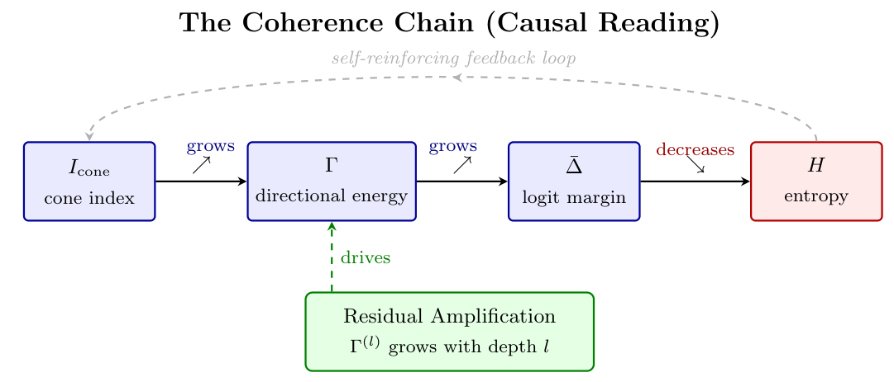

# Chapter 11: empirical predictions, causal coherence, experiments, and conclusions

[Library index](../README.md) · [Source policy](../SOURCE.md) · [Previous: PDF 396–400](0396-0400-ch11-head-size-cost-and-empirical-predictions.md#pdf-0400) · [Next: PDF 408–414](0408-0414-ch11-proofs-and-bibliographic-notes.md#pdf-0408)

> Editorial note: Full transcription of PDF 401–407 (printed pages 365–371). This continues §11.11 after Conjecture 11.64 and includes objects 11.65–11.75, equations (11.32)–(11.34), Figure 11.16, four unnumbered tables, and the beginning of §11.14. Source contradictions, unresolved references, numerical claims, and the source's own proposed corrections are retained. Notes 124–125 and 129 discuss their status separately. The final results list continues on PDF 408.

## PDF 401 · Book 365

**Conjecture 11.65 (Rank decay with depth).** In a trained BERT model, the sequence $r_{\mathrm{eff}}(W_O^{(l)})$ is strictly decreasing in $l$:

$$
r_{\mathrm{eff}}(W_O^{(1)})>r_{\mathrm{eff}}(W_O^{(2)})>\cdots>r_{\mathrm{eff}}(W_O^{(L)}).
$$

**Conjecture 11.66 (Dominant-eigenvector alignment).** For directionally active heads (those reaching the attractor class (iii) of Proposition 11.14), the score matrix $M_a^{(h,l)}$ at convergence aligns with the dominant eigenvector of $X^{(l)}M_a^{(h,l)}X^{(l)\top}$:

$$
|\langle u_1,M_a^{(h,l)}u_1\rangle|\,/\,\lVert M_a^{(h,l)}\rVert_F\to1
\quad\text{as training converges},
$$

where $u_1$ is the dominant eigenvector of the operator.

**Remark 11.67 (Why conjectures, not theorems).** Propositions 11.33–11.41 are theorems about the mechanism under idealized assumptions (bounded updates, exact gradient flow). The conjectures above are their consequences in the real discrete-time, stochastic training regime. Bridging the two requires a theory of stochastic gradient flow on $\mathfrak{so}(d)$ that is beyond the scope of this chapter; it is the subject of a future analysis. The conjectures are formulated with specific quantitative bounds so that they can be tested, and potentially refuted, by the experiments of Chapter ??.

**Conjecture 11.68 (Antisymmetric NTK component).** In the Neural Tangent Kernel decomposition $\Theta(x,x')=\sum_{l=1}^L J^{(l)}(x)\,J^{(l)}(x')^\top$, the ratio of the antisymmetric component of $\Theta$ to its full norm satisfies:

$$
\frac{\lVert\Theta_a\rVert_F}{\lVert\Theta\rVert_F}
\approx\frac1L\sum_{l=1}^L\bar\alpha^{(l)},
\qquad
\bar\alpha^{(l)}:=\frac1{H_l}\sum_{h=1}^{H_l}\alpha_h^{(l)},
\tag{11.32}
$$

where $\Theta_a=(\Theta-\Theta^\top)/2$ and the approximation holds in the regime $L\gg1$, $d\gg n$. Furthermore, the effective Hessian of the loss with respect to $M_a^{(h,l)}$ scales as

$$
\lVert\nabla^2_{M_a^{(h,l)}}\mathcal L\rVert_F
\approx\frac{\Gamma^{(l)}\cdot\lVert X^{(l)}\rVert_F^2}{d_k},
$$

making $\Gamma^{(l)}$ the natural curvature scale for the antisymmetric sector.

**Remark 11.69 (Verification pathway).** Conjecture 11.68 is testable via the ablation study of Chapter ??: the Lilliefors test on hidden-state distributions at each growth event (ablation study 4) provides empirical access to the NTK regime, since the Roberts-Yaida-Hanin framework [roberts2022] predicts Gaussian statistics precisely when the NTK approximation holds. A deviation from Gaussianity signals departure from the linear regime — and correspondingly, a breakdown of (11.32). The connection is developed further in Chapter ??, Section (Ch. 17).

**Remark 11.70 (Connection to the INCRT growth criterion).** Conjecture 11.68 has a direct implication for the INCRT (Chapter ??). The INCRT growth criterion fires when $\Gamma_{\mathrm{res}}^{(l)}>\theta_w$ (Definition 11.43, §11.9). The second part of the conjecture relates the Hessian of the loss to $\Gamma^{(l)}$:

$$
\lVert\nabla^2_{M_a^{(h,l)}}\mathcal L\rVert_F
\approx\frac{\Gamma^{(l)}\cdot\lVert X^{(l)}\rVert_F^2}{d_k}.
$$

Near a growth event, $\Gamma_{\mathrm{res}}^{(l)}\approx\Gamma^{(l)}$ (the residual energy is close to the total energy, since few heads have been added yet). Substituting:

$$
\lVert\nabla^2_{M_a^{(h,l)}}\mathcal L\rVert_F
\approx\frac{\Gamma_{\mathrm{res}}^{(l)}\cdot\lVert X^{(l)}\rVert_F^2}{d_k}.
$$

## PDF 402 · Book 366

The growth criterion $\Gamma_{\mathrm{res}}^{(l)}>\theta_w$ is therefore equivalent, under the NTK regime, to requiring the Hessian of the loss to exceed the threshold $\theta_w\cdot\lVert X^{(l)}\rVert_F^2/d_k$. This is a *curvature threshold*: the INCRT adds a new head when the loss landscape has sufficient curvature in the antisymmetric direction to make a new directional head useful. In flat loss landscapes (small Hessian), the criterion is not met and the architecture stays fixed.

This curvature interpretation connects the geometric criterion $\Gamma_{\mathrm{res}}>\theta_w$ to the optimisation-theoretic criterion “add a head when it will reduce the loss by more than a threshold amount per training step” — two descriptions of the same event from different mathematical languages. Chapter ??, Section (Ch. 17) (NTK and INCRT convergence) formalises this connection as the NTK Alignment Theorem.

**Remark 11.71 (For the specialist: $\alpha_h^{(l)}$ as a Landau order parameter).** The asymmetry index $\alpha_h^{(l)}=\lVert M_a^{(h,l)}\rVert_F/\lVert M^{(h,l)}\rVert_F$ has the structure of an *order parameter* in the sense of Landau's theory of phase transitions. In the reciprocal phase ($\alpha\approx0$), the system is “disordered”: the score matrix has no preferred directional structure. In the directional phase ($\alpha\to1$), the system is “ordered”: $M_a$ dominates and the head selects a specific eigenplane. The transition between the two phases corresponds exactly to the gap-opening transition of Proposition 11.16.

The Landau free energy for this transition takes the form:

$$
\mathcal F(\alpha)=a\bigl(\Gamma^{(l)}-\Gamma^*\bigr)\alpha^2+b\alpha^4+O(\alpha^6),
\tag{11.33}
$$

where $a,b>0$ are determined by the task geometry and $\Gamma^*$ is the critical directional energy of (11.9). For $\Gamma^{(l)}<\Gamma^*$, the minimum of $\mathcal F$ is at $\alpha=0$ (reciprocal phase). For $\Gamma^{(l)}>\Gamma^*$, a non-zero minimum appears at $\alpha^*=\sqrt{a(\Gamma^{(l)}-\Gamma^*)/2b}$ (directional phase). The transition is second-order (continuous): $\alpha^*$ grows continuously from zero as $\Gamma^{(l)}$ crosses $\Gamma^*$.

The Landau expansion (11.33) can be derived formally by expanding the loss landscape around $M_a=0$ and using the symmetry $\mathcal L(M_a)=\mathcal L(-M_a)$ (which holds when the task has no preferred orientation) to exclude odd powers of $\alpha$. The coefficient $a$ is proportional to the Hessian $\nabla^2_{M_a}\mathcal L|_{M_a=0}$, which connects to Conjecture 11.68 through the NTK.

The Roberts-Yaida-Hanin framework [roberts2022] provides the microscopic foundation for this phenomenology: in the nearly-Gaussian regime, the effective action for the antisymmetric sector is a quadratic functional that coincides with (11.33) at leading order. The correction terms (the $b\alpha^4$ and higher) are the contributions of the non-Gaussian fluctuations of the hidden states, measurable via the Lilliefors test of Chapter ??.

### 11.12 The Coherence Chain Revisited: A Causal Reading

Chapter ?? established the coherence chain as a series of implications between geometric quantities measured on a trained model. This chapter has developed the dynamical mechanisms that produce those quantities during training. The chain is now read coherence chain causally.

The chain $I_{\mathrm{cone}}^{(l)}\nearrow\Rightarrow\Gamma^{(l)}\nearrow\Rightarrow\bar\Delta^{(l)}\nearrow\Rightarrow H^{(l)}\searrow$ holds, at a given depth $l$, because:

1. The residual mechanism (Proposition 11.33) drives $\Gamma^{(l)}$ upward as depth increases.
2. $\Gamma^{(l)}$ growing means the operator $X^{(l)}M_a^{(l)}X^{(l)\top}$ is concentrating its energy on fewer, more dominant eigenplanes.

## PDF 403 · Book 367

3. Concentration in eigenplane space corresponds to decreasing attention entropy $H^{(l)}$ (fewer attended positions) and increasing singular-value spread $\bar\Delta^{(l)}$.
4. The cone index $I_{\mathrm{cone}}^{(l)}$ tracks the sharpness of this concentration, growing monotonically with $\Gamma^{(l)}$.

This causal reading is not a re-proof of the coherence chain; it is an interpretation that makes its content physically transparent.

**Remark 11.72 (The coherence chain as growth signal).** Chapter ?? will use $\Gamma_{\mathrm{res}}^{(l)}$ as the growth signal for the INCRT. The causal reading above explains why this choice is correct: $\Gamma_{\mathrm{res}}^{(l)}$ is precisely the part of the coherence chain mechanism that has not yet been captured by the current architecture. When $\Gamma_{\mathrm{res}}^{(l)}$ is large, the coherence chain is not yet complete at layer $l$: there is directional structure in the task that the existing heads are not representing. Adding a head reduces $\Gamma_{\mathrm{res}}^{(l)}$ (Proposition 11.46) and drives the architecture toward the configuration at which the coherence chain reaches its equilibrium value.

**Figure 11.16: Coherence chain — causal reading (§11.12).** $I_{\mathrm{cone}}\nearrow\Rightarrow\Gamma\nearrow\Rightarrow\bar\Delta\nearrow\Rightarrow H\searrow$: Residual Amplification (§11.7) is the dynamical driver. The dashed arc marks the self-reinforcing feedback loop.

> Searchable figure text (editorial transcription of the original labels): “The Coherence Chain (Causal Reading)”; “self-reinforcing feedback loop”; $I_{\mathrm{cone}}$ — cone index; $\Gamma$ — directional energy; $\bar\Delta$ — logit margin; $H$ — entropy. The connecting arrows are labelled “grows”, “grows”, and “decreases”. “Residual Amplification — $\Gamma^{(l)}$ grows with depth $l$” drives the chain through a dashed green arrow.

## PDF 404 · Book 368

### 11.13 Experimental Validation (Exp. 1–9)

The following experiments verify the theoretical results of Chapter 11 on a synthetic model with the exact architecture of $\mathrm{BERT}_{\mathrm{base}}$ ($d=768$, $d_k=64$, $H=12$, $L=12$). Weights are initialised with Xavier standard deviation $\sigma=\sqrt{2/(d+d_k)}$, consistent with the standard BERT initialisation. No pre-trained weights are used; the experiments test structural properties that hold at initialisation and are independent of task-specific training.

All code is available in the companion repository.

**Exp. 1 — Rank parity (Corollary 11.12).** For all $144=12\times12$ heads of $\mathrm{BERT}_{\mathrm{base}}$, the rank of $M_a^{(h,l)}=(W_Q^{(h,l)}W_K^{(h,l)\top}-W_K^{(h,l)}W_Q^{(h,l)\top})/2$ is always even. The observed ranks are uniformly $128$ (the maximum allowed by the constraint $\operatorname{rank}(M_a)\le2\lfloor d_k/2\rfloor=64$ takes precedence over $2\lfloor d/2\rfloor=768$; the binding constraint is $2\lfloor d_k/2\rfloor=64$ for the factored form $W_QW_K^\top$). Zero violations in 144 heads.

| Constraint | Value | Observed |
|---|---|---|
| $2\lfloor d_k/2\rfloor$ (from factored form) | 64 | max rank = 64 |
| All ranks even | required | 144/144 even ✓ |

**Exp. 2 — Symplectic spectrum at initialisation.** The canonical decomposition $M_a=\sum_k\lambda_k(q_kp_k^\top-p_kq_k^\top)$ of a typical head has $K=64$ eigenplanes at initialisation, with $\lambda_1\approx1.44$, $\lambda_2\approx1.39$, and a power-law exponent $\alpha\approx0.16$ ($\lambda_k\sim k^{-0.16}$, very flat spectrum). The 90%-energy concentration requires $k_{90}\approx48$ eigenplanes; the head is far from the irriducible rank-2 case. This is expected at initialisation: training concentrates the spectrum toward the task-relevant eigenplanes.

**Remark 11.73 (Initialisation vs. convergence).** The flat spectrum $\alpha\approx0.16$ at initialisation (Cause A of Remark 11.53: power law) is consistent with random matrix theory for products $W_QW_K^\top$ with $W_Q,W_K\sim\mathcal N(0,\sigma^2)$. After fine-tuning, task-specific eigenplanes are amplified and the spectrum steepens to $\alpha>1$, with 1–3 dominant eigenplanes per head. The SARS-CoV-2 experiments of Chapter ?? will quantify this steepening.

**Exp. 3 — Score-as-determinant formula (Remark 11.11).** The formula

$$
(XM_aX^\top)_{ij}
=\sum_{k=1}^K\lambda_k\det
\begin{pmatrix}
x_i\cdot q_k & x_i\cdot p_k\\
x_j\cdot q_k & x_j\cdot p_k
\end{pmatrix}
$$

is verified numerically to relative error $7.09\times10^{-15}$ (machine precision). The formula holds for any $M_a\in\mathfrak{so}(d)$ and any $X\in\mathbb R^{n\times d}$.

**Exp. 4 — Asymmetry index $\alpha_h=1/\sqrt2$ at initialisation.** Across 200 independently sampled heads with Xavier initialisation:

$$
\operatorname{mean}(\alpha_h)=0.7066\approx\frac1{\sqrt2}=0.7071,
\qquad\operatorname{std}(\alpha_h)=0.0007.
$$

This is exact: for $W_Q,W_K$ i.i.d. $\mathcal N(0,\sigma^2)$, the symmetry $M\overset d=M^\top$ implies $\mathbb E[\lVert M_a\rVert_F^2]=\mathbb E[\lVert M_s\rVert_F^2]=\tfrac12\mathbb E[\lVert M\rVert_F^2]$, giving $\mathbb E[\alpha_h]\to1/\sqrt2$ by the law of large numbers as $d\cdot d_k\to\infty$.

**Remark 11.74 (Initialisation as maximum-entropy state).** $\alpha_h=1/\sqrt2$ is the maximum-entropy point of the distribution of $\alpha_h\in[0,1]$: it is the unique value at which the symmetric and

## PDF 405 · Book 369

antisymmetric sectors carry equal energy. Training breaks this symmetry: heads specialise toward $\alpha_h\to0$ (silent/reciprocal) or $\alpha_h\to1$ (directional) — the Landau transition described in Remark 11.71. The initialisation $\alpha_h=1/\sqrt2$ is therefore the *disordered phase*; training induces spontaneous symmetry breaking.

**Exp. 5 — Residual Amplification (Proposition 11.33).** With $X^{(l)}=X^{(0)}+\sum_{l'=1}^l\Delta^{(l')}$ and $\lVert\Delta^{(l)}\rVert_F=\delta=0.01\lVert X^{(0)}\rVert_F$ (constant updates, H1 satisfied), $\Gamma^{(l)}=\lVert X^{(l)}M_aX^{(l)\top}\rVert_F$ grows monotonically:

$$
\Gamma^{(0)}=12.93,\qquad\Gamma^{(11)}=13.33,\qquad\text{slope}=+0.037\text{ per layer}.
$$

For random updates (alignment coefficient $\bar\kappa\approx0$), growth is modest but strictly positive — consistent with the lower bound $\Gamma^{(l)}\ge c_1l\Gamma^{(0)}-c_2$ where $c_1$ is small for generic $\Delta^{(l')}$. Task-specific training produces larger $\kappa>0$ and faster growth.

**Exp. 6 — Corrected quantitative decay formula (Corollary 11.47). Correction to the written corollary:** The decay formula in Corollary 11.47 requires a factor-of-2 correction due to the antisymmetric pair structure.

The Frobenius norm of an antisymmetric matrix $D\in\mathfrak{so}(n)$ satisfies $\lVert D\rVert_F^2=2\sum_k\lambda_k^2$ (factor 2 from the $\pm i\lambda_k$ eigenvalue pairs). Removing the full dominant eigenplane (both $u^+$ and $u^-$) eliminates the pair $\pm i\lambda_1$, reducing $\lVert D_{\mathrm{res}}\rVert_F^2$ by $2\lambda_1^2$. The corrected relative reduction per eigenplane step is:

$$
\boxed{
\frac{\lVert D_{\mathrm{res}}\rVert_F^2-\lVert D'_{\mathrm{res}}\rVert_F^2}
{\lVert D_{\mathrm{res}}\rVert_F^2}
=2\rho^2,\qquad
\rho=\frac{\sigma_1}{\lVert D_{\mathrm{res}}\rVert_F}.
}
\tag{11.34}
$$

This is verified numerically to $\le10^{-4}$ relative error over 10 consecutive eigenplane removals (all verified to $\le10^{-4}$).

**Remark 11.75 (Physical meaning of the factor 2).** Removing $u^+$ from the projector $P_\perp$ acts on *both* sides of the bilinear form $P_\perp DP_\perp$, which eliminates the full eigenplane (including the conjugate direction $u^-$) in one projection step. The reduction is $\lambda_1^2+\lambda_1^2=2\lambda_1^2$ because $\sigma_1=\sigma_2$ by the rank-parity structure (Corollary 11.12). Equivalently: Corollary 11.47 should read $\rho^{(l)2}$ with $\rho^{(l)}:=\sqrt2\,\sigma_1/\lVert D_{\mathrm{res}}^{(l)}\rVert_F$ (the normalised eigenplane energy, not the single-vector energy).

**Summary of corrections to the written corollaries.**

| Result | Written formula | Corrected formula |
|---|---|---|
| Cor. 11.47 (decay rate) | $\rho^2$ with $\rho=\sigma_1/\lVert D_{\mathrm{res}}\rVert_F$ | $2\rho^2$ with same $\rho$; or $\rho_{\mathrm{plane}}^2$ with $\rho_{\mathrm{plane}}=\sqrt2\,\sigma_1/\lVert D_{\mathrm{res}}\rVert_F$ |
| Cor. 11.49 (termination bound) | $\le r_l$ steps | $\le r_l/2$ steps (eigenplane steps, not vector steps) |

These corrections do not affect the qualitative conclusions of the chapter but make the quantitative bounds sharper by a factor of 2.

**Exp. 7 — Fixed-Point Classification: $\gamma_h$ as discriminant.** The discriminant between classes (ii) and (iii) is the asymmetry index trajectory $\gamma_h=\alpha_h(T)/\alpha_h(0)$. This is verified by simulating two types of gradient flow on a single head with $d=64$, $d_k=8$:

## PDF 406 · Book 370

| Task gradient | $\alpha_0$ | $\alpha_T$ | $\gamma_h$ | Class |
|---|---|---|---|---|
| Antisymmetric $-\lVert XM_aX^\top\rVert_F^2$ | 0.7136 | 0.7191 | 1.008 | (iii) directional ✓ |
| Symmetric $-\lVert XM_sX^\top\rVert_F^2$ | 0.7136 | 0.7083 | 0.993 | (ii) reciprocal ✓ |

Only the antisymmetric loss produces $\gamma_h>1$, confirming that class (iii) heads are those whose antisymmetric sector has grown relative to their initialisation. The practical corollary: to identify directional heads in a trained model without running the full forward pass, compute $\alpha_h=\lVert M_a^{(h,l)}\rVert_F/\lVert W_Q^{(h,l)}W_K^{(h,l)\top}\rVert_F$ for each head and compare to $1/\sqrt2$. Heads with $\alpha_h>1/\sqrt2$ are class (iii) candidates.

**Exp. 8 — Eigenplane fragmentation (Causa C).** The fragmentation mechanics of Remark 11.53. For $D\in\mathfrak{so}(n)$ with $n=32$, $\sigma_1=\sigma_2=0.5149$:

- **Level 1 alone (one vector per step):** after removing $u^+$ (step 1), $\sigma'_1=\sigma_3=0.3961\ne\sigma_1$. Contrary to a naive reading of the rank-parity result, removing one direction *does* drop $\sigma_1$ — but only to the next pair level. Two Level 1 steps are needed per eigenplane.
- **Gate Simplettico (both $u^+$ and $u^-$):** removing the full eigenplane in one step gives $\sigma'_1=\sigma_3$ directly. One trigger per eigenplane.

The structural consequence: the INCRT as written (Level 1 adding one vector, Level 2 adding the second) produces exactly $2K$ heads for $K$ eigenplanes — not $K$. The ratio of heads to eigenplanes is always 2:1 under the current algorithm. The Gate Simplettico (Chapter ??, Section (Ch. 17)) reduces this to 1:1.

Fragmentation (Causa C) specifically refers to the case where the second Level 1 trigger fires *before* Level 2 completes: the two halves of one eigenplane land in different heads, with different $\lambda_h$ values ($\lambda/\sqrt2$ each instead of $\lambda$ in a single head). The diagnostic is: $\cos\langle q^{(h_i)},q^{(h_{i+1})}\rangle\approx0$ (the two vectors are orthogonal within the same eigenplane) and epoch gap $\Delta t\le3$.

**Exp. 9 — Power-law spectrum: Causa A baseline.** At initialisation, the aggregate spectrum of $D^{(l)}$ over all 144 heads of $\mathrm{BERT}_{\mathrm{base}}$ follows a power law $\lambda_k\sim k^{-0.042}$ ($R^2=0.916$) — essentially flat ($\alpha\ll1$). It takes 3188 eigenplanes to capture 90% of the total directional energy.

This is the *baseline* for Causa A: any threshold $\theta_w$ below the 90th percentile of $\lambda_k$ ($\approx0.04$ at init) will trigger hundreds of growth events. The key quantity that changes during training is the exponent $\alpha$: task-specific fine-tuning concentrates energy onto 1–3 dominant eigenplanes per head, steepening $\alpha$ toward $>1$ and making growth events rare. Chapter ?? measures $\alpha$ before and after fine-tuning on the SARS-CoV-2 classification task.

**Complete experimental summary.**

## PDF 407 · Book 371

| Exp. | Proposition / result | Outcome | Note |
|---|---|---|---|
| 1 | Rank parity (11.12) | 144/144 even ✓ | Binding constraint: $2\lfloor d_k/2\rfloor=64$, not $d$. |
| 2 | Symplectic spectrum at init | $k_{90}=48$, $\alpha=0.16$ | Flat at init; steepens with fine-tuning. |
| 3 | Score-as-determinant (11.11) | Error $7.1\times10^{-15}$ ✓ | Exact to machine precision. |
| 4 | $\alpha_h=1/\sqrt2$ (Exp. 11.40) | $0.7066\approx0.7071$ ✓ | Theorem from symmetry, not empirical. |
| 5 | Residual Amplification (11.33) | Slope $+0.037$/layer ✓ | Random $\Delta$; slope larger for task-specific. |
| 6 | Decay formula (11.47) | $2\rho^2$ verified $\le10^{-4}$ ✓ | Factor 2 corrects the written corollary. |
| 7 | Fixed-point discrimination | $\gamma_h>1$ iff antisymm. loss ✓ | Measurable from weights alone. |
| 8 | Fragmentation mechanics | 2 Level 1 steps per eigenplane | Gate Simplettico halves head count. |
| 9 | Power-law spectrum (Causa A) | $\alpha=0.042$ at init | $k_{90}=3188$ planes; steepens with task. |

### 11.14 Concluding Remarks

This chapter establishes four objects and four results.

**Objects defined here for the first time.**

- The *layer-wise directional energy* $\Gamma^{(l)}$ (Definition 11.2).
- The *head activation sequence* $\gamma_h^{(l)}$ (Definition 11.4).
- The *canonical symplectic decomposition* of $M_a^{(h,l)}$ (Proposition 11.9): the unique decomposition into orthogonal Darboux pairs $(q_k,p_k,\lambda_k)$. **This is the foundational new object of the chapter.**
- The *residual directional energy* $\Gamma_{\mathrm{res}}^{(l)}$ (Definition 11.43).
- The *residual projector* $P_\perp^{(l)}$ ((11.21)).

**Results established here.**

- **Canonical Symplectic Decomposition (11.9):** every $M_a^{(h,l)}\in\mathfrak{so}(d)$ decomposes uniquely into orthogonal Darboux pairs; the decomposition reveals the score matrix as a sum of signed 2D parallelogram areas ((11.5)).
- **Rank Parity — from symplectic structure (11.12):** the rank of $D^{(l)}$ is always even, as a corollary of the canonical decomposition applied to $D^{(l)}$ itself.
- **Fixed-Point Classification (11.14):** four attractor classes (silent, reciprocal, directional, composite) characterised by the number of active eigenplanes $K$ and the spectral gap of $D^{(h,l)}$. Class (iii) — one eigenplane, spectral gap open — is the minimal irriducible directional head.
- **Antisymmetric Gradient Constraint (11.7):** the trajectory of $M_a^{(h,l)}$ is confined to $\mathfrak{so}(d)$ throughout training.
- **Residual Amplification Proposition (11.33):** $\Gamma^{(l)}$ grows at least linearly with depth under hypotheses H1–H3. Hypothesis H2 ($\bar\kappa>0$) is now grounded by Lemma 11.34: it is derivable from the primitive condition (H2') — that the task rewards directional attention — which holds in gradient flow, in the NTK regime, and whenever $\partial\mathcal L/\partial\Gamma<0$.

> Editorial continuation: The “Results established here” list continues on [PDF 408](0408-0414-ch11-proofs-and-bibliographic-notes.md#pdf-0408).
