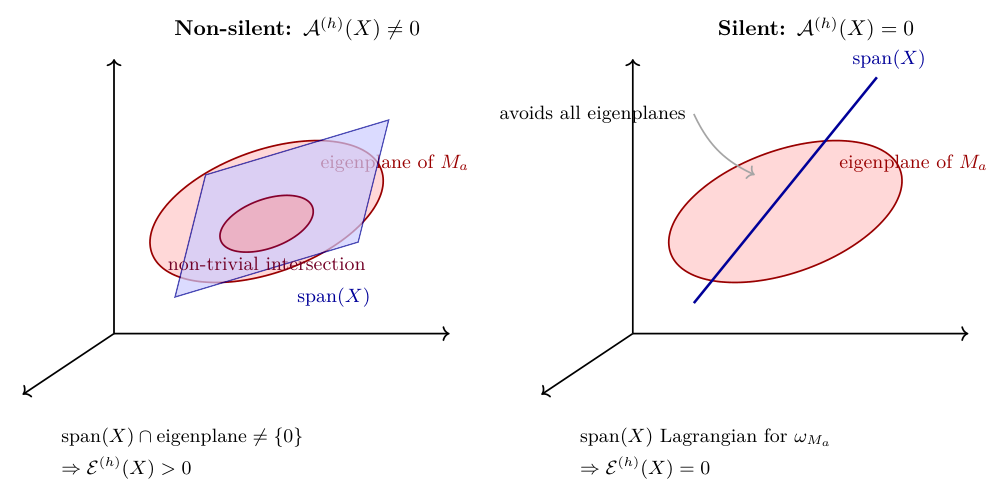

# Chapter 12: silence, isotropic subspaces, and the saddle-exit hypothesis

[Library index](../README.md) · [Source policy](../SOURCE.md) · [Previous: PDF 425–428](0425-0428-ch12-activation-operator-and-random-initialisation.md#pdf-0428)

> Editorial note: Full transcription of PDF 429–433 (printed pages 393–397), including Figure 12.1, objects 12.13–12.16, equations (12.31)–(12.32), and Hypothesis E4. The incorrect $r>2K$ emptiness criterion, the figure's intersection claim, missing factor in the energy, pruning inference, and saddle-exit assertions are retained. Notes 136–138 distinguish them from the exact isotropy criterion. PDF 433 ends after the opening paragraph of §12.5; §12.5.1 begins on PDF 434.

## PDF 429 · Book 393

*content — that random heads are non-silent, and the activation energy scales with the rank ratio $r(r-1)/(d(d-1))$ — is robust across initialisations.*

### 12.3.4 Activation across depth

Definition 12.8 is layer-by-layer: it produces, for each $(\ell,h)$, an activation operator $\mathcal A^{(\ell,h)}(X)=\pi_{U^{(\ell)}(X)}M_a^{(\ell,h)}\pi_{U^{(\ell)}(X)}$ where $U^{(\ell)}(X)$ is the row span of the input cloud at layer $\ell$. The profile

$$
\ell\longmapsto\mathcal E^{(\ell,h)}(X)
$$

across depth is the *layer-wise activation trajectory* of head $h$. Its empirical content was anticipated by the normalised activation $\widehat\gamma_{\ell,h}(X)$ of §7.7.13; the operator-level lift is the trajectory of activation operators, and it contains strictly more information.

**Remark 12.13 (Activation never grows by averaging).** The row span $U^{(\ell)}(X)$ at layer $\ell$ is the row span of the cloud after $\ell-1$ residual blocks. Each block can in principle either expand or contract the row span. In practice, for trained transformers, the empirical observation is that $\dim U^{(\ell)}$ evolves slowly with $\ell$ but the geometry of $U^{(\ell)}$ inside $\mathbb R^d$ can rotate dramatically. The activation operator $\mathcal A^{(\ell,h)}(X)$ is sensitive to this rotation through the projector $\pi_{U^{(\ell)}}$, even when $\dim U^{(\ell)}$ is constant. This is the operator-level mechanism behind the layer-rank decay $\Gamma_{\mathrm{res}}^{(\ell)}$ of Chapter 11: the row span rotates into a configuration that is increasingly isotropic for $M_a^{(\ell,h)}$, without any change in the dimension of the cloud.

**Preview.** *The next section formalises the boundary case $\mathcal E^{(h)}(X)=0$: the silence criterion. The criterion is a Grassmannian condition (the row span must be isotropic for the alternating form induced by $M_a$), and it specifies a measure-zero locus inside the Grassmannian. Generic clouds avoid the locus, and the random-subspace expectation of Theorem 6.69 quantifies how generic genericity is. The interesting case is when training has driven the cloud onto the silence locus, which is the silent-but-not-trivial configuration that Chapter 7 first identified.*

### 12.4 The silence criterion

The activation operator vanishes when its restricted alternating form $\omega_U^{(h)}(x,y)=x^\top M_a^{(h)}y$ is identically zero on $U\times U$. This is the *silence criterion*. It was identified at the level of single layers in Chapter 6 (Theorem 6.66) as the correct replacement for the kernel-containment criterion. The characterisation retained below is the characterisation here, lift it to the depth-indexed observable $\ell\mapsto\mathcal E^{(\ell,h)}(X)$, and specify the silence locus as a Schubert-type subvariety of the Grassmannian. The two technical results of the section are: (i) the silence criterion proper, in the sharp form already proven in Chapter 6, restated here in the activation-operator language; and (ii) the genericity of activation, deduced from the random-subspace expectation of Chapter 6.

### 12.4.1 Silence as isotropy

**Theorem 12.14 (Silence criterion).** Let $M_a^{(h)}\in\mathbb R^{d\times d}$ be antisymmetric and let $U=U(X)\subseteq\mathbb R^d$ be the row span of the cloud $X\in\mathbb R^{n\times d}$. Then $\mathcal A^{(h)}(X)=0$ if and only if $U$ is *isotropic* for the alternating bilinear form $\omega^{(h)}(x,y):=x^\top M_a^{(h)}y$, i.e. $x^\top M_a^{(h)}y=0$ for all $x,y\in U$.

*Proof.* The activation operator $\mathcal A^{(h)}(X)=\pi_UM_a^{(h)}\pi_U$ has zero Frobenius norm if and only if it is the zero operator. For $x,y\in\mathbb R^d$ arbitrary, $x^\top\mathcal A^{(h)}(X)y=(\pi_Ux)^\top M_a^{(h)}(\pi_Uy)$. This

## PDF 430 · Book 394

vanishes for all $x,y\in\mathbb R^d$ if and only if it vanishes for all $x,y\in U$ (since $\pi_U$ is the identity on $U$ and zero on $U^\perp$). Hence $\mathcal A^{(h)}(X)=0$ iff $\omega^{(h)}(x,y)=0$ for all $x,y\in U$, which is exactly the isotropy condition. $\square$

The theorem inherits its proof from Cap. 6. The lift to the chapter’s depth-indexed observables is conceptual rather than technical: at every layer $\ell$, the silence criterion separates the algebraic-geometric content of $U^{(\ell)}(X)$ from the matrix content of $M_a^{(\ell,h)}$. The cloud is silent for the head if and only if its row span lives inside an isotropic subspace of the alternating form induced by the head; this is a closed condition in the Grassmannian $\operatorname{Gr}(r,d)$ made precise below.

### 12.4.2 Generic non-silence

**Corollary 12.15 (Generic non-silence).** Let $M_a^{(h)}\ne0$ and let $U\sim\operatorname{Haar}(\operatorname{Gr}(r,d))$ be a uniformly random subspace with $r\ge2$. Then $\mathcal A^{(h)}(X)=0$ with probability zero.

In particular, for an i.i.d. cloud $X\in\mathbb R^{n\times d}$ with $n\ge2$ rows in general position, $\mathcal A^{(h)}(X)=0$ has Lebesgue measure zero in the space of input clouds.

*Proof.* By Theorem 6.69 (the corrected generic-activation expectation, Cap. 6), the expected squared activation energy is $\mathbb E[\mathcal E^{(h)}(X)]=\frac{r(r-1)}{d(d-1)}\lVert M_a^{(h)}\rVert_F^2>0$. A non-negative random variable with positive expectation is positive with positive probability. Moreover, the silence locus $\mathcal S(M_a^{(h)}):=\{U\in\operatorname{Gr}(r,d):U\text{ is isotropic for }M_a^{(h)}\}$ is the zero set of the Plücker-coordinate function $U\mapsto\lVert\pi_{\Lambda^2U}(\omega_a)\rVert^2$, which is a real-algebraic function on $\operatorname{Gr}(r,d)$. Since $\omega_a\ne0$ (as $M_a^{(h)}\ne0$), the function is not identically zero, hence its zero set is a proper real-algebraic subvariety, of strictly lower dimension than the Grassmannian itself. Such subvarieties have Haar measure zero.

For the cloud-level statement, the row span of an i.i.d. Gaussian cloud distributes as Haar on $\operatorname{Gr}(r,d)$, so the silence event has Haar measure zero. For more general distributions absolutely continuous with respect to Lebesgue measure, the event is again null because it is the preimage of a measure-zero set on $\operatorname{Gr}(r,d)$ under a continuous map. $\square$

The corollary makes precise the slogan “generic clouds are not silent”. Whether a particular trained transformer occupies a generic configuration is an empirical question; the corollary asserts only that random initialisation is non-silent, and that any silence at training time must be the result of training.

### 12.4.3 The silence manifold

**Proposition 12.16 (Silence manifold as Grassmannian variety).** Let $M_a\in\mathbb R^{d\times d}$ be antisymmetric, of rank $2K$ (so $K$ symplectic eigenplanes). Let $\omega_a\in\Lambda^2\mathbb R^d$ be the bivector dual to $M_a$. The silence locus

$$
\mathcal S(M_a):=
\{U\in\operatorname{Gr}(r,d):\omega_a|_{\Lambda^2U}\equiv0\}
\tag{12.31}
$$

is a closed real-algebraic subvariety of $\operatorname{Gr}(r,d)$. When $r\le K$ (equivalently, $r$ does not exceed the number of symplectic pairs), the silence locus is non-empty and contains in particular all subspaces of the form

$$
U=\operatorname{span}(e_{i_1},\ldots,e_{i_r})
\quad\text{or}\quad
U=\operatorname{span}(f_{i_1},\ldots,f_{i_r})
\tag{12.32}
$$

## PDF 431 · Book 395

> Searchable diagram labels (transcribed from the original): “Non-silent: $\mathcal A^{(h)}(X)\ne0$”; “Silent: $\mathcal A^{(h)}(X)=0$”; “eigenplane of $M_a$”; “span$(X)$”; “non-trivial intersection”; “avoids all eigenplanes”; “$\operatorname{span}(X)\cap\text{eigenplane}\ne\{0\}\Rightarrow\mathcal E^{(h)}(X)>0$”; “$\operatorname{span}(X)$ Lagrangian for $\omega_{M_a}\Rightarrow\mathcal E^{(h)}(X)=0$”.

**Figure 12.1: Geometric content of the silence criterion.**

Left: when $\operatorname{span}(X)$ intersects an eigenplane of $M_a$ in a non-trivial subspace, the activation energy $\mathcal E^{(h)}(X)$ is strictly positive and proportional to the squared area of the projected intersection. Right: when $\operatorname{span}(X)$ is Lagrangian for the symplectic form $\omega_{M_a}$, every projection onto an eigenplane is one-dimensional and the symplectic area vanishes, so $\mathcal E^{(h)}(X)=0$. Silence is a tangency condition between the cloud span and the eigenplane structure of $M_a$, not an alignment condition.

for any $r$-tuple $\{i_1,\ldots,i_r\}\subseteq\{1,\ldots,K\}$, where $(e_k,f_k)$ are the canonical basis pairs of (12.26). When $r>2K$ (equivalently, $\dim U$ exceeds twice the number of symplectic pairs), the silence locus is empty.

The maximal dimension of an isotropic subspace is $d-K$ (a Lagrangian-type subspace, attained by the kernel of $M_a$ enlarged with one vector from each symplectic pair).

*Proof.* The silence condition $\omega_a|_{\Lambda^2U}\equiv0$ is the vanishing of the bilinear form $(x,y)\mapsto\omega_a(x,y)$ on $U\times U$. In coordinates, this is a finite system of polynomial equations in the Plücker coordinates of $U$; explicitly, if $U$ is described by an $r\times d$ matrix $A$ with linearly independent rows, the condition is $AM_aA^\top=0$. The space of $r\times d$ matrices is a smooth manifold, and the condition is a system of $\binom r2$ polynomial equations (corresponding to the upper-triangular entries of an antisymmetric $r\times r$ matrix). Hence $\mathcal S(M_a)$ is a closed real-algebraic subvariety.

For the explicit standard isotropic subspaces, observe that on $\operatorname{span}(e_{i_1},\ldots,e_{i_r})$ the bilinear form $\omega_a$ acts as $\omega_a(e_{i_k},e_{i_\ell})=\sigma_{i_k}(e_{i_k}\cdot e_{i_\ell}\text{ component})-\sigma_{i_\ell}(\ldots)$, which using the canonical form (12.26) gives $e_{i_k}^\top M_ae_{i_\ell}=\sigma_{i_k}(e_{i_k}f_{i_k}^\top-f_{i_k}e_{i_k}^\top)e_{i_\ell}\cdot(e_{i_\ell})\big|_{\mathrm{component}}$. Since the $e_k$’s are orthonormal and lie in different symplectic eigenplanes, $\omega_a(e_{i_k},e_{i_\ell})=0$ for all $k,\ell$. The same calculation holds for $\operatorname{span}(f_{i_1},\ldots,f_{i_r})$.

The empty case $r>2K$ follows from the standard fact about alternating forms: the maximal dimension of a totally isotropic subspace for an alternating form of rank $2K$ on $\mathbb R^d$ equals $d-K$. When $r$ exceeds this bound (and in particular when $r>2K$ on a non-degenerate $M_a$ acting on $\mathbb R^{2K}$), no isotropic subspace of dimension $r$ exists.

The maximal dimension $d-K$ is achieved as follows. Choose, in each symplectic pair $E_k=\operatorname{span}(e_k,f_k)$, the line spanned by $e_k$ (or any other line in $E_k$). The direct sum of these $K$ lines, together with the kernel of $M_a$ (of dimension $d-2K$), is an isotropic subspace of dimension $K+(d-2K)=d-K$. A standard exercise in symplectic linear algebra shows

## PDF 432 · Book 396

that this is the maximum possible dimension. $\square$

**Reading the silence manifold.** The silence locus $\mathcal S(M_a)$ is the geometric meeting place of the cloud’s row span and the head’s antisymmetric sector: the cloud is silent for the head if and only if its row span lies on $\mathcal S(M_a)$. The proposition shows that this is a strict subvariety of the Grassmannian when $r\ge2$ (otherwise it would have positive Haar measure, contradicting Corollary 12.15). Three regimes are visible:

- $r=1$: $\mathcal S(M_a)=\operatorname{Gr}(1,d)$ is the full projective space, since one-dimensional subspaces are trivially isotropic. The silence criterion is vacuous in this case, and a head whose cloud is rank-one is silent regardless of its antisymmetric sector.
- $2\le r\le d-K$: $\mathcal S(M_a)$ is a proper subvariety of the Grassmannian, of strictly lower dimension. Generic clouds avoid it, but training can drive a cloud onto it.
- $r>d-K$: $\mathcal S(M_a)=\varnothing$. The cloud is necessarily non-silent for the head.

**Caveat.** *The Grassmannian description is geometric, not algorithmic. Computing the distance from a cloud’s row span to the silence locus is, in general, a real-algebraic optimisation problem of dimension $\binom r2$ in the Plücker coordinates. The activation energy $\mathcal E^{(h)}(X)=\lVert\pi_{\Lambda^2U}(\omega_a)\rVert^2$ provides a smooth surrogate: it is zero on $\mathcal S(M_a)$ and positive elsewhere, and its gradient with respect to $U$ (along the Grassmannian tangent space) is computable in closed form. For diagnostic purposes the activation energy is the practical observable; the silence locus is the conceptual object behind it.*

### 12.4.4 Layer-wise silence and training-induced silence

The corollary 12.15 says random initialisation is non-silent. Training, however, can move $U^{(\ell)}(X)$ around in the Grassmannian. Two qualitative outcomes are possible:

- *Activation-preserving training.* The cloud’s row span remains non-silent at every layer, and the activation energy $\mathcal E^{(\ell,h)}(X)$ stays bounded away from zero throughout depth. The head’s directional structure is used.
- *Silence-inducing training.* The cloud’s row span migrates toward the silence locus $\mathcal S(M_a^{(\ell,h)})$ at some layer $\ell$. The head’s directional structure exists but is unused. Pruning the head leaves the trained network’s behavithe unchanged.

The empirical literature on attention pruning (Voita et al. (2019b); Michel et al. (2019b)) has documented exactly the second outcome: a substantial fraction of heads in trained transformers can be removed without measurable performance loss. The activation operator provides the operator-level explanation: the removable heads are those whose cloud lies on or near $\mathcal S(M_a^{(\ell,h)})$, i.e. whose activation energy is small. The closed-gate component of the canonical signature $\widehat\lambda_{\mathrm{closed}}^{(\ell,h)}$ (Chapter 7) correlates with low activation energy for an obvious reason: the closed gate is the regime in which the antisymmetric sector contributes nothing to the attention map, which is exactly the silence configuration.

**Connection to layer rank decay.** The layer-rank decay $\Gamma_{\mathrm{res}}^{(\ell)}$ of Chapter 11 is the layer-aggregated version of the activation profile. Specifically, $\Gamma_{\mathrm{res}}^{(\ell)}=\frac1H\sum_h\mathcal E^{(\ell,h)}(X)^{1/2}$, up to a normalisation that depends on the conventions of Chapter 11. A decreasing $\Gamma_{\mathrm{res}}^{(\ell)}$ in depth indicates that, on average across heads, the cloud is approaching the silence locus of the heads’ antisymmetric sectors. Whether this is a benign reorganisation (the cloud is finding

## PDF 433 · Book 397

the right subspace for the task and the unused heads will be pruned) or a destructive one (the cloud is collapsing to a sub-cloud that destroys directional information) is decided by the combined trajectory in signature space, not by activation alone.

### 12.4.5 Saddle-exit appendix: noise hypothesis E4

The dynamical question raised by §12.4.4 — can training move the cloud’s row span across $\mathcal S(M_a)$ in finite time? — is a saddle-exit problem in the loss landscape. The correct framework is Freidlin–Wentzell large-deviation theory for stochastic gradient flows in the small-noise limit; the standing hypothesis is that SGD noise is non-degenerate transverse to the silence locus. The hypothesis is listed the hypothesis in the form used by Chapters 11, 13, and 17.

**Hypothesis E4 (SGD noise non-degeneracy).** Let $\xi(t)$ be the SGD noise process at training time $t$, decomposed in the basis adapted to the activation operator $\mathcal A^{(\ell,h)}(X(t))$. Then the components of $\xi(t)$ transverse to the silence locus $\mathcal S(M_a^{(\ell,h)}(t))$ have variance bounded below by a constant $\eta_0>0$ uniformly in $t$ on the trajectory $X(t)$.

**Consequence.** Under hypothesis E4, the silence locus is not an attractor of the SGD flow: the cloud cannot remain on $\mathcal S(M_a)$ unless the silence locus is itself a critical sub-manifold of the loss. When the silence locus is critical (e.g. when the head’s antisymmetric contribution to the loss is dominated by the residual stream, as in the closed-gate regime), training will indeed drive the cloud onto $\mathcal S(M_a)$, and the head becomes silent. When the silence locus is not critical, hypothesis E4 ensures the cloud escapes it in time of order $\exp(\Theta(1/\eta_0))$.

**Status.** A complete proof of saddle-exit at the silence locus, under hypothesis E4 and the additional regularity assumptions on the loss surface, is the Freidlin–Wentzell argument in the appendix to Chapter 11 (item A2 of the checklist). It is a technical adaptation of ? and ? to the scalar saddle case. The argument is not reproduced here; it is recorded as a dependency of the silence-induced training trajectory analysis. For the rest of this chapter, hypothesis E4 is taken as given.

**Preview.** *The next section recovers the operator content of subspaces and eigenplanes in the language of the canonical task directions of Chapter 7 and the S–A coordinate of Chapter 10. It is the link between the local activation operator developed here and the residual-stream task vocabulary that Chapter 13 will need.*

### 12.5 Subspace activation and eigenplanes

The activation operator and the silence criterion describe the alternating form induced by $M_a^{(h)}$ on the cloud’s row span. They do not, by themselves, say which directions inside the row span are doing the work. This section identifies those directions. The relevant objects are the symplectic eigenplanes of $M_a^{(h)}$, the projections of these planes onto the row span, and the residual-stream coordinates that a downstream layer can read from the head’s output. The material is essentially recovered from Chapters 6 (§6.19) and 7 (§7.7.13), with the operator-level upgrade made in §12.3 of this chapter.
